## Введение

Здесь представлена распознанная и отредактированная книга Германа Костена Weideplätze der Mongolen im Reiche der Chalcha (Пастбища монголов в Халхе). Разбивка на страницы сохранена, добавлены интерактивные содержание и список фотографий. Язык --- немецкий.

Библиографическая ссылка:

> Consten, Hermann. Weideplätze der Mongolen im Reiche der Chalcha. Bd. 1. Berlin: Dietrich Reimer (Ernst Vohsen), 1919.

Иcточник: [отсканированная версия книги](https://digital.staatsbibliothek-berlin.de/werkansicht?PPN=PPN1015296289&PHYSID=PHYS_0004&view=overview-toc&DMDID=DMDLOG_0001) в Берлинской государственной библиотеке.

Скачать исходный PDF ([большой](https://drive.google.com/file/d/16f8QRar-dfzD0FWC31Pqs5YFbs-ky6vJ/view?usp=sharing), [поменьше](https://drive.google.com/file/d/1AXHYM1zQBzYRK0w7UYqZ2GXTDjjMxfx-/view?usp=sharing)). Карту в хорошем разрешении см. в большом PDF или отдельно в этой заметке.

Ошибки в исходном тексте:

* Kapitel 16 - пропущен.
* Неправильная ссылка на страницу в индексе изображений для 44 и 45 изображения.

## Текст книги

<a id="I">**-- I --**</a>

HERMANN CONSTEN

WEIDEPLÄTZE DER MONGOLEN

BAND I

<a id="II">**-- II --**</a>

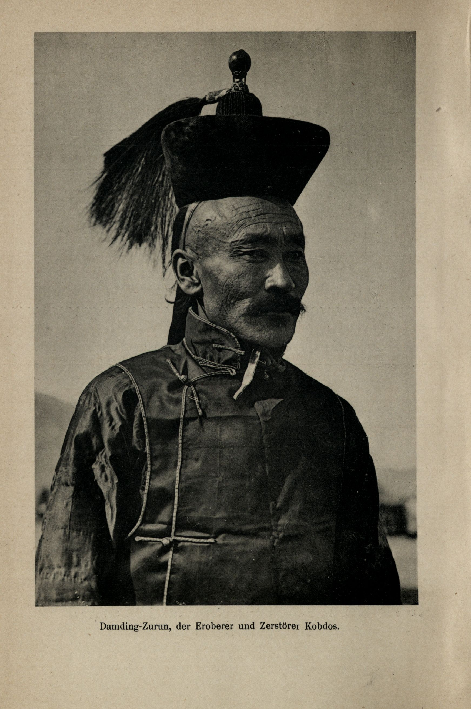

Damding-Zurun, der Eroberer und Zerstörer kobdos.

<a id="III">**-- III --**</a>

WEIDEPLÄTZE DER MONGOLEN  
IM REICHE DER CHALCHA

VON

HERMANN CONSTEN

IN 2 BÄNDEN

BAND I

MIT 63 TAFELN UND 1 KARTE

DIETRICH REIMER (ERNST VOHSEN) A.-G.  
IN BERLIN 1919

<a id="IV">**-- IV --**</a>

DRUCK VON J. J. AUGUSTIN IN GLÜCKSTADT UND HAMBURG

<a id="V">**-- V --**</a>

VORWORT.

Wie eine wilde Sturmflut brausten die Mongolenheere vom Orchon durch Asien bis zu Deutschlands Grenzen, alles vernichtend, zerstörend, wenig aufbauend. Zurückflutend kristallisierte sich ihre gewaltige Macht in Asien, eines der mächtigsten Reiche für kurze Zeit zusammenfügend, bis sie selber, dem chinesischen Einfluß unterliegend, von Chinesen und Mandschu wieder über die große Mauer hinaus in ihre angestammten Steppensitze zurückgetrieben wurden. Dann verschwinden sie zeitweilig aus der Geschichte, um zermürbt und zermalmt durch innere politische und religiöse Kämpfe schließlich die Unterjochten der einst von ihnen unterworfenen Chinesen zu werden. Erst im Jahre 1911/12 gelang es den vollständig heruntergekommenen mongolischen Völkern unter Führung der Chalcha, dem Stammlande Dschingischans, mit Hilfe der Russen das chinesische Joch abzuschütteln, um als freier Staat unter den Schutz Rußlands zu gelangen.

Jahrelange Erfahrung und Aufenthalt unter den Chalcha-Mongolen hatten mich in eine Stellung geschoben, die ich, ohne an maßgebender Stelle in Deutschland irgendwelches Verständnis zu finden, zu Nutz und Frommen der deutschen Wissenschaft und des deutschen Handels auszunutzen suchte. Als ich anfangs 1914 nach achtjähriger Abwesenheit aus Asien zurückkehrte --- denn die Kriegsgefahr zog sich durch die Probemobilisationen der Russen, bei denen die Leute nicht mehr entlassen wurden, plastisch zusammen --- schrieb ich den ersten Band dieses Werkes, bis zum 29. Juli 1914. Der Krieg nahm mir, wie so vielen anderen, die Feder aus der Hand. Es erforderte nachher ein Jahr schwerer Arbeit, um das in verschiedenen Ländern aufbewahrte Material wieder zusammenzubringen und den zweiten Band zu gestalten. Wenn auch seit dem von mir Erlebten Welterschütterndes geschah, so glaube ich doch an die Zukunft meines Vaterlandes und an die Gesundung des deutschen Volkes, dem ich, in Erinnerung an das stets gezeigte Interesse für die Erforschung, Sitten und Gebräuche ferner Länder und Völker, von denen uns törichter Haß und blinde

<a id="VI">**-- VI --**</a>

Furcht wie Parias ausschließen will, dieses Werk vertrauensvoll übergebe.

Ich habe mich in der Schreibweise mongolischer Namen für Mensch, Tier, Gebirge, Seen und Flüsse usw. stets an das von mir selbst Gehörte und Verstandene gehalten, da die Mongolen recht häufig durch ihre Stammesverschiedenheit, nicht zu reden von den eingesprengten mongolisierten Türkvölkern, dasselbe Wort je nachdem hart oder weich aussprechen, o für u sagen und umgekehrt. Dazu kommt noch, je nach dem Bildungsgrad des Mongolen, der Einfluß des Tibetanischen, Chinesischen und, besonders durch die russischen Händler, des Russischen. Zum näheren Verständnis will ich die in meinem Werk am häufigsten vor kommenden geographischen Bezeichnungen hier übersetzen, da es nicht gut anging die Übersetzung im Text bis ins Unendliche zu wiederholen. So bedeutet *Nor* und *Nur* See, *Gol* und *Kol* Fluß, *Ussu* Wasser, *Daba* ebenso wie das russische *Perewal* Gebirgspaß, *Chairachan* Gebirge und Gebirgsrücken. Urtone sind die seit frühester Zeit in Chinä und später, als China dem wilden Ansturm der Mongolen unterlag, in der Mongolei eingeführten Poststationen, auf denen immer eine bestimmte Anzahl Pferde und Kamele vorhanden sein müssen, um den Verkehr von den Hauptpunkten bis fern in und durch die Gobi von 40 Werst zu 40 Werst nach beiden Seiten hin aufrecht zu erhalten. Ich habe in meinem Werk den den deutschen Lesern aus anderen Reisebeschreibungen bekannten Ausdruck "Jurte" statt Ger für die Filzwohnungen der Mongolen gebraucht, obwohl der erste Ausdruck den Mongolen vollständig unbekannt ist; ebenso den Ausdruck "Yack" statt Sarlyk für den Grunzochsen.

Die Temperatur wurde immer morgens und abends abgelesen. Die Höhen sind stets mit zwei verschiedenen Höhenmessern auf jeder Station sowie Lagerplatz, sowohl bei dem Hin- und Rückmarsch festgestellt worden. Sie bilden eine rote Linie von Kosch-Agatsch bis Urga, also quer durch das Reich der Chalcha. Die auf einzelnen Plätzen entstandene Differenz kommt daher, daß die Mongolen je nach den Witterungsverhältnissen und Weidemöglichkeiten die Urtone höher oder tiefer ins Gebirge, oft auf 5 und 6 Werst Entfernung, legen, dabei aber den Namen des Urtons beibehalten.

Die beigegebene Routenkarte ist von mir während meines Aufenthaltes im Reiche der Chalcha aufgenommen; als Grundlage diente mir die russische 40 Werstkarte.

Über die von mir auf der Reise benutzte, meist russische Literatur, kann ich leider keine nähere Auskunft mehr geben, da mir die genauen Titel der von mir mitgenommenen Bücher entfallen, die Bücher selbst

<a id="VII">**-- VII --**</a>

aber, wie so vieles andere, in Rußland zurückgeblieben und für mich zur Zeit unerreichbar sind.

Dank sage ich vor allen Dingen Herrn Kurt Mitzlaff, Berlin, der mir durch sein großes Entgegenkommen überhaupt die schnelle Herausgabe meines Werkes ermöglicht hat, Fräulein Estelle du Bois-Reymond, meiner unermüdlichen Korrekturleserin, danke ich für manchen Wink und Rat, ebenso wie Herrn Photograph Hugo Schmiedeknecht in Blankenburg, Thüringen, der aus einem Haufen von Kartenmaterial verständnisvoll, unermüdlich und geduldig immer wieder das von mir Gebrauchte heraussuchte und vergrößerte. Die Bilder des Dsal-Chen-Sen-Gegen, der auch Dsal-Chan-Dsa-Chutuchtu (ich brauche stets die erstere, volkstümlichere Aussprache) genannt wird, sowie des Delobin-Gegen auf dem Umschlag sind nach von mir gemalten Ölbildern angefertigt. Sie machen keinen Anspruch auf Kunstwert und sollen dem Leser nur eine schwache Vorstellung von der mongolischen Farben- und Kleiderpracht geben. Die andere Zeichnung auf dem Buchdeckel stellt einen der geheimnisvollen Schützer des Glaubens dar, an denen der Tantra-Kultus so reich ist. Die Gestalt steht auf einen mit menschlichem Eingeweide und Blut gefüllten Lotos, aus dem Flammen züngeln, die sich zur Gewandung gestalten. In der rechten Hand trägt sie die qabala (eine menschliche Schädeldecke) gefüllt mit Menschenhirn und Blut, das herauskocht; ebenso schlagen Flammen aus dem eigenen Schädel der Schreckensgestalt, die in der linken Hand ein bei der Opferung gebrauchtes kurzes rundes Handbeil schwingt. Der Buchrücken ist mit einem Zauberdolch, Purbu genannt, verziert, mit dem die Geister festgenagelt werden. Andere bunte Bilder in das Werk aufzunehmen mußten der Verlag und ich uns versagen, da sonst die Herstellungskosten ins Ungeheure angewachsen wären.

Wie jetzt die Lage im Reiche der Chalcha ist, darüber kann ich dem Leser leider keine Auskunft geben. Denn es ist mir während des Krieges über mein Arbeitsgebiet sehr wenig bekannt geworden. Nur eins scheint sicher, daß die Expedition Pappenheim, bei der sich der bekannte Asienkenner Pferdekämper befand, auf ihrem Zug durch die Mongolei überfallen und vernichtet wurde. Die abgeschnittenen Köpfe der ermordeten deutschen Teilnehmer wurden jedenfalls von Russen photographiert und die Photographien an die russische Gesandtschaft in Peking gesandt. Deutsche Offiziere, denen es gelang, auf ihrer Flucht aus Sibirien Chalcha-Territorium zu erreichen, wurden, da sie den Gegensatz zwischen Mongolen und Chinesen nicht kannten und sich als Freunde der Chinesen ausgaben, entweder niedergemacht oder durch den Verrat

<a id="VIII">**-- VIII --**</a>

einzelner, unter dem Schutz der Russen zurückgebliebener Chinesen an den russischen Konsul in Uljasutai und den russischen Ministerresidenten in Urga, beide mit echt deutschen Namen, verraten und trotz des Sträubens verschiedener mongolischer Fürsten und Beamten nach Sibirien zurücktransportiert.

Der russische Telegraph ist von Kosch-Agatsch nach Kobdo und von Werchnoje Udinsk über Urga nach Kalgan gelegt worden, d. h. eigentlich nur von Werchnoje nach Urga, da in Urga der Anschluß an die chinesische Telegraphenleitung nach Kalgan erreicht wurde.

Im Herbst 1919.

HERMANN CONSTEN.

<a id="IX">**-- IX --**</a>

|    |                                                   |              |
| -: | ------------------------------------------------- | -----------: |
|    | Vorwort.                                          |      [V](#V) |
|    | Einleitung                                        |      [1](#1) |
|  1 | Auf der sibirischen Bahn                          |      [4](#4) |
|  2 | Auf dem Ob                                        |    [17](#17) |
|  3 | Von Biisk nach Kosch-Agatsch                      |    [27](#27) |
|  4 | In der Mongolei (Im Reiche der Chalcha)           |    [58](#58) |
|  5 | Der russische Handel in der Mongolei              |    [63](#63) |
|  6 | Von Kosch-Agatsch nach Uljasutai                  |    [73](#73) |
|  7 | In Uljasutai                                      |  [103](#103) |
|  8 | Die russischen Konsulate in Asien                 |  [112](#112) |
|  9 | Chinesisches Geschäftsgebaren und Handelspolitik  |  [118](#118) |
| 10 | Der chinesische und russische Handel in Uljasutai |  [126](#126) |
| 11 | Die Mongolen als Besieger der Chinesen            |  [147](#147) |
| 12 | Die Stellung der mongolischen Frauen und Männer   |  [166](#166) |
| 13 | Erdbeben, Alarmnachrichten und Fürstenbesuch      |  [184](#184) |
| 14 | Die Chinesen verlassen Uljasutai                  |  [195](#195) |
| 15 | Nach Urga                                         |  [212](#212) |

VERZEICHNIS DER TAFELN

Titelbild. Damding-Zurun, der Eroberer und Zerstörer Kobdos.

|  Taf. |                                                                                               |              |
| ----: | --------------------------------------------------------------------------------------------- | -----------: |
|  1.   | Schikataman. Am Pristan in Kamen                                                           |    [40](#40) |
|  2.   | Der Ausblick vom Schikataman auf den Altai                                                    |    [40](#40) |
|  3.   | Ausblick vom Schikataman mit dem Flusse Ulgemen und dem Reiseweg durch den Tschuiskitrakt     |    [40](#40) |
|  4.   | Übergang über den Fluß Katun                                                                  |    [40](#40) |
|  5.   | Aigulak (Das Bärenöhrchen). Der erste Ausblick auf die Tschuiski-Alpen dicht hinter Zibith |    [48](#48) |
|  6.   | Der Weg nach Jedro Im Tschuiskitrakt                                                       |    [48](#48) |
|  7.   | Der Fluß Tschuja                                                                              |    [48](#48) |

<a id="X">**-- X --**</a>

| Taf. |                                                                                                |              |
|------|------------------------------------------------------------------------------------------------|-------------:|
| 8.   | Im Tschuiskitrakt zwischen Jedro und Aigulak bei einem sogenannten Poom                        |    [48](#48) |
| 9.   | Auf dem Archina. Station Kurai mit den Tschuiski-Alpen                                      |    [56](#56) |
| 10.  | Kuachtanar                                                                                     |    [56](#56) |
| 11.  | Kuachtanar, Postgebäude. Die Kurai-Alpen                                                    |    [56](#56) |
| 12.  | Mit der Troika durch die Tschuja-Steppe. Tilingithen der Tschuja-Steppe                     |    [56](#56) |
| 13.  | Chinesische Flüchtlinge in Kosch-Agatsch. Im Tarschantu-Gebirge zum Zagan-Nor               |    [72](#72) |
| 14.  | Der Zagan-Nor, vom Plateau aus gesehen                                                         |    [72](#72) |
| 15.  | Der Tarantas, am Damnur durch mongolische Reiter gezogen                                       |    [80](#80) |
| 16.  | Am Atschik-Nor.                                                                                |    [80](#80) |
| 17.  | Der auseinandergenommene Tarantas. Mongolenlager, Pferde- und Schafherden am Kobdofluß.     |    [80](#80) |
| 18.  | Tragen des Tarantas durch Mongolen über besonders schwierige Stellen. Der auseinandergenommene Tarantas. |    [80](#80) |
| 19.  | Unser Lager am Chirbita. Zusammentreffen mit Podpolkownik Bensenger am Flüßchen Chirbita    |    [88](#88) |
| 20.  | Ming-Bao                                                                                       |    [88](#88) |
| 21.  | Die mit Photomaterial beladenen Lastpferde in den Ausläufern des Chara-Argalantu. Mongolen am Kungui, Kamel- und Pferdemist als Brennmaterial sammelnd. Im Lager am Ust-Nor |    [88](#88) |
| 22.  | Die russische Kolonie von Uljasutai beim Empfang Konsul Walters. Der Hof der Festung Uljasutai |    [96](#96) |
| 23.  | Am Nordtor von Uljasutai                                                                       |  [104](#104) |
| 24.  | Uljasutai vom Obo aus gesehen                                                                  |  [104](#104) |
| 25.  | Auf dem Hofe des russischen Kaufmanns Bodonoff. Feierlicher Empfang dicht vor Uljasutai durch russische Händler, mongolische Verwaltungsbeamten, mongolisches Militär und die chinesische Kaufmannschaft |  [104](#104) |
| 26.  | Der Dsänsyn von Uljasutai verläßt unter dem Schutze der Russen die ihm anvertraute Stadt und Festung Uljasutai |  [104](#104) |
| 27.  | Festungstor von Uljasutai mit chinesischer Besatzung. Die heilige Grotte, dem Flußgott des Bogdin-Tol-Koi geweiht |  [104](#104) |

<a id="XI">**-- XI --**</a>

| Taf. |                                                                                                 |              |
|------|-------------------------------------------------------------------------------------------------|-------------:|
| 28.  | Lininfa auf seinem Hofe, im Hintergrund unser gemeinsames Schlafhaus.                           |              |
| 28.  | Der chinesische Kaufmann Scho-Su-Schi vom Tonki-nor                                             |  [112](#112) |
| 29.  | Chinesischer Kaufmannsladen und Hof                                                             |  [112](#112) |
| 30.  | Der chinesische Großkaufmann Lininfa                                                            |  [144](#144) |
| 31.  | Ming-Bao verhindert in Uljasutai die Plünderung des Handelshauses des Ältesten der chinesischen Kaufmannschäft |  [144](#144) |
| 32.  | Mongolisches Mädchen                                                                            |  [152](#152) |
| 33.  | Mingbao reinigt die Straßen von Uljasutai von Marodeuren und Plünderern                         |  [152](#152) |
| 34.  | Die dritte Sotnije der Sabaikalkasaken zieht in Uljasutai ein. Verbrüderungsfest der Mongolen und Russen in Uljasutai. Kasakenparade |  [152](#152) |
| 35.  | Dsal-Chen-Sen-Gegen                                                                             |  [152](#152) |
| 36.  | Soroktul, Zartul oder Zesen-Bese. Der erste mongolische Generalgouverneur von Kobdo und Uljasutai |  [160](#160) |
| 37.  | Mongolischer Lama (Maler). Mongolische Lamas im Sommer vor der Jurte in der Nähe ihres Klosters |  [160](#160) |
| 38.  | Mongolisches Mädchen im Festschmuck                                                             |  [160](#160) |
| 39.  | Mongolische Frauen                                                                              |  [160](#160) |
| 40.  | Mongolische Frau im Haarschmuck mit Krone ohne Zobelhut                                         |  [168](#168) |
| 41.  | Fine ältere Matrone, Scha-Bu-Gun-Ze                                                             |  [168](#168) |
| 42.  | Mongolin von rückwärts gesehen                                                                  |  [168](#168) |
| 43.  | Mongolische Hetäre, 30 Jahre alt, mit Zobelhut und Silberschmuck                                |  [168](#168) |
| 44.  | Delobin-Gegen                                                                                   |  [176](#178) |
| 45.  | Damding-Zurun und seine Batres                                                                  |  [176](#178) |
| 46.  | Dsal-Chen-Sen-Gegen und Delobin-Gegen in der Jurte des Dsal-Chen-Sen-Gegen                      |  [184](#184) |
| 47.  | Damding-Zurun vor seiner Jurte. Im Hintergrund die mit Menschenblut beschriebenen Fahnen        |  [184](#184) |
| 48.  | Damding-Zurun mit seinen beiden Adjutanten                                                      |  [184](#184) |
| 49.  | Yacks mit beladenen Holzkarren. Yacks durchschwimmen mit den leeren Holzkarren dicht bei der Brücke von Uljasutai den Bogdin-kol |  [184](#184) |
| 50.  | Fürst Uchtomski. Konsul Walter. Japanischer Besuch im russischen Konsulat in Uljasutai       |  [192](#192) |

<a id="XII">**-- XII --**</a>

| Taf. |                                                                                                 |              |
|------|-------------------------------------------------------------------------------------------------|-------------:|
| 51.  | Zezen-Beese (Zartul-Beese) mit seiner Umgebung und Dienerschaft                                 |  [192](#192) |
| 52.  | Aufbruch von Uljasutai. Das Beladen der Kamele                                                  |  [216](#216) |
| 53.  | Ein beladener Yack, den Weg suchend                                                             |  [216](#216) |
| 54.  | Bei --- 40 Grad R. mit dem Rest der sterbenden Karawane durch die verschneiten Gebirge am Bajantu-kol. Der Verfasser in Eis und Schnee am Bajantu-kol |  [216](#216) |
| 55.  | Die Steppe zwischen Churchutu, Ar-Dschirgalantu und Ubur-Dschirgalantu                          |  [232](#232) |
| 56.  | Der Verfasser mit einem erlegten weiblichen Wildschaf am Sontschi-Buluk                         |  [256](#256) |
| 57.  | Gesamtansicht der Klosterruine Lama-Gegen bei Schar-gol-Schuk                                   |  [280](#280) |
| 58.  | Der innere Klosterhof Der Klosterhof. Linker Teil mit den ehemaligen Wohnungen der Lamas und der eingestürzten Gebetshalle |  [288](#288) |
| 59.  | Das zweite Gebäude der Klosterruine von außen gesehen                                           |  [288](#288) |
| 60.  | Urton Charet (Charat)                                                                           |  [288](#288) |
| 61.  | Das Innere des zweiten Gebäudes der Klosterruine. Im Goldgräberlager am Baidarik             |  [296](#296) |
| 62.  | Am Tola-Fluß                                                                                    |  [296](#296) |

KARTE der Reiseroute von Biisk über Uljasutai und Urga und zurück nach Uljasutai---Kobdo, zum großen Altai und den russischmongolischen Grenzgebirgen ......... Am Schluß des ersten Bandes.

<a id="1">**-- 1 --**</a>

EINLEITUNG.

Es war Ende Juli 1912. Das europäische Unwetter hatte sich scheinbar verzogen, drohte aber knurrend sich im fernen Osten zusammenzuballen. Seit etwa drei Monaten erhielt ich in kurzen Zwischenräumen die liebenswürdigsten Briefe und Telegramme des russischen Konsuls Walter, der mich bat, wieder mit ihm zusammen in die Mongolei zu reisen; doch diesmal wolle er seine Frau und seinen 6 Monate alten Sohn mitnehmen.

Im vorigen Jahre hatte ich schon Konsul Walter nach Uljasutai begleitet und einige Erlebnisse aus dieser Zeit rechne ich zu den interessantesten meines Lebens. Obwohl der Konsul bei dieser Reise und während meines Aufenthaltes in Uljasutai mir gegenüber eine mehr als zweideutige Rolle gespielt hatte --- doch darauf werde ich im Laufe meiner Tagebuchblätter noch zurückkommen --- entschloß ich mich doch, ihn und seine Frau, allerdings ohne Kind durch die im hellen Aufruhr befindliche Mongolei nach Uljasutai zu bringen, und Uljasutai als Ausgangspunkt einer großen Expedition in die äußere Mongolei zu wählen.

*(Moskau im Sommer)* Wir trafen uns, er von Odessa kommend, in Moskau. Moskau, das Herz Rußlands, gleicht Ende Juli einem Bratofen. Jeder, dem es nur irgendwie seine Mittel erlauben, entflieht dieser tropischen Hitze, die den Asphalt der Bürgersteige erweicht. Man geht auf diesem Asphalt wie auf einem dicken Gummiteppich, die Abdrücke der Absätze und diese selbst manchmal darauf zurücklassend. Alles Leben ist um 6 Uhr in der Stadt erstorben.

Von 5 Uhr an hasten tausende Fuhrleute mit den mit Paketen beladenen Ehemännern nach den fünf verschiedenen Bahnhöfen Moskaus. Die elektrischen Bahnen sind zum Platzen voll, auf den abgehenden Zügen stehen die armen Ehemänner qualvoll gedrängt sogar auf den Plattformen. Hier blüht der Weizen der berühmten russischen Taschendiebe. Die vollen Züge bringen ihre Passagiere nach den manchmal sechzig Kilometer von Moskau gelegenen Datschenorten.

<a id="2">**-- 2 --**</a>

*(Datschenleben in der Umgebung Moskaus)* Diese Datschenorte bestehen aus einer Gruppe hübscher russischer Blockhäuser, gedeckt mit grünem Blech, mehr oder minder versteckt gelegen, in den herrlichen Tannen- und Birkenwäldern, die Moskau umgeben. Dieses Datschenleben hat für den Moskowiter sowohl, wie für den in Moskau lebenden Fremden seinen Reiz, doch nur für den, der seinen Urlaub dort ruhig verbringen kann, ohne jeden Morgen und Abend zur Bahn hasten' zu müssen. Das gesellschaftliche Leben in den größeren Datschenorten ist ebenso interessant wie pikant. Kino, Rollschuhbahn, Liebhabertheater sorgen dafür, daß die Moskauer Jugend sich nicht langweilt und Gott Amor lacht sich ins Fäustchen. Es wird mit der ganzen naiven Offenheit der heutigen Moskauer Jugend geflirtet und geliebt, die unseren mit Töchtern reichlich gesegneten Müttern entweder ein wonniges Grausen, oder einen Ohnmachtsanfall eintragen würde. Mancher mit einem Dutzend Paketen heimkehrende schwitzende Ehemann trifft beim gemütlich surrenden Samowar auf der Veranda seines Blockhauses seinen Freund Iwan Iwanowitsch, der die liebe Gattin über die tägliche Trennung von ihrem Männchen hinwegtröstet, weil er gerade Urlaub hat und der Urlaub des Gatten unglücklicherweise an's Ende der Datschenzeit fällt. Frau Fama erzählt so viel! Wenn auch nur der hundertste Teil davon wahr wäre, so hätte Boccaccio hier noch etwas lernen können. --- Die einzigen, die außer den erwachsenen weiblichen Familienmitgliedern einen wirklichen Genuß vom Datschenleben haben, sind die Schuljugend, Gymnasiasten, Gymnasiastinnen, Studenten und Kursistinnen. Denn alle höheren Lehranstalten sind im Sommer für beinahe drei Monate geschlossen.

Am bevorzugtesten sind die an einem Fluß gelegenen Datschenorte. Hier entwickelt sich gegen Nachmittag bis die Sonne rotglühend hinter den Wäldern verschwindet, ein für uns Deutsche eigentümliches Bild. In größeren und kleineren Truppen sieht man Mädchen, junge und ältere Frauen, angetan mit dünnen Morgenröckchen, die ebensoviel verraten, als sie verdecken, zu Fuß und zu Rad, die Badetücher häufig als Schutz gegen die Sonne um den Kopf gebunden, dem kühlenden Naß zueilen. Dazwischen Rußlands schlanke, elastische Jugend und Männer, gebräunt von der warmen Julisonne, bekleidet mit der ebenso praktischen, wie kleidsamen russischen Bluse. Die Badeplätze der beiden Geschlechter sind kaum einen Steinwurf weit voneinander getrennt; Männlein und Weiblein kleiden sich am Ufer aus. Aus der Gruppe der Frauen und Mädchen ertönt hier und da ein lustiges Aufkreischen, wenn irgend ein männlicher Datschenbewohner sich gerade im interessantesten Moment zu seinem gewohnten Badeplatz begeben will. Einen Augenblick lang bemerkt der ruhig Vorübergehende marmorweiße Arme und Beine

<a id="3">**-- 3 --**</a>

blitzschnell fällt die letzte Hülle und lustig aufkreischend stürzt sich die mehr oder minder Schöne ins Wasser. Andere hocken, dem Vorübergehenden ihre Rückenpartie zukehrend, ---Venus Kallipygos könnte hier blaß vor Neid werden, ---nur mit einem dünnen, durchsichtigen Hemdchen bekleidet, sich ins Gras nieder. Wieder andere tauchen bis zum Halse im Wasser unter und warten so das Verschwinden des Störenfrieds ab. Auf dem Flusse ertönt Gesang; von Harmonika und Balalaika begleitet, schallen die wunderbaren russischen Volkslieder über die Wasser. Die Boote sind gefüllt mit jungen Mädchen und jungen Burschen. Gerät eines der Boote zu nahe in eine Gruppe der ohne alle Bekleidung Badenden, so gibts wohl hier und da ein lustiges Kreischen und Necken, aber ernstlich böse wird niemand. Die an den Ufern sich Auskleidenden beeilen sich, ehe das Boot sie erreicht, ins Wasser zu kommen, oder warten mit dem letzten Entkleiden, bis das Boot mit seinen Insassen einige Meter weit vorüber ist.

Alles atmet eine freie anständige Auffassung im Verkehr der Geschlechter untereinander, wie sie mir nur noch aus Finnland, Schweden und Norwegen bekannt ist.

Kraskowa, in herrlichen Tannen- und Kieferwaldungen an einem kleinen Fluß gelegen, war mir in letzter Zeit ein lieber, trauter Aufenthalt gewesen, wo ich mich von den Anstrengungen meiner letzten mongolischen Expedition zu erholen hoffte. Auch für mich schlug nun die Trennungsstunde. Langsam stiegen wir die große Freitreppe, die vom Garten in den Park hinausführte, hinab, die schönste Rose des Gartens wurde mir noch schnell gepflückt, ein langer Blick, ein inniger Händedruck, der mehr sagte als alle Worte, dann pfiff ich meinen beiden gelben Doggen, und bald lagen die Datschen weit hinter mir, ich eilte nach diesem Abschied zur Bahn, um zeitig in Moskau zu sein, denn morgen soll mich der russische Expreß dem fernen Sibirien zutragen. ---

<a id="4">**-- 4 --**</a>

## KAPITEL 1. AUF DER SIBIRISCHEN BAHN.

*(Mit dem russischen Expreß durch Sibirien bis Novo-Nikolajewsk.)* Langsam, kaum merklich, mit dem dritten Glockenschlag setzt sich der Zug in Bewegung. Wir haben zu Dritt ein ganzes Coupee für uns, ich quartiere mich mit unseren sechsundzwanzig Stück Handgepäck, darunter Jagdflinten, Mauserbüchsen, Pistolen, Patronenkisten in die obere Etage ein. Zwar protestierte der wachhabende Beamte, aber drei Rubel beschwichtigten die Regungen seines Herzens. Ehe das Handgepäck glücklich verstaut und einigermaßen Ordnung geschaffen ist, liegt der Kursker Bahnhof und Moskau mit seiner herrlichen Erlöserkirche weit hinter uns. Ruhig und gleichmäßig rollen wir dem fernen Endziel entgegen. Die russischen Wagen mit ihrer breiteren Spurweite laufen viel ruhiger und gleichmäßiger, sie sind auch in jeder Beziehung bequemer, wenn auch lange nicht so sauber wie unsere deutschen Wagen. Einstweilen hält die russische Regierung daran fest, daß die Eisenbahnen dazu da sind, die Reisenden --- auch die Passagiere dritter Klasse --- möglichst bequem und billig zu befördern. Der Reisende ist Gott sei Dank hier in Rußland nicht für die Eisenbahnen da, sondern die Eisenbahnen für die Reisenden. Kann man doch für etwazweihundert Mark bequem von Moskau nach Wladiwostok reisen. Hier und da sausen wir an den im kühlen Walde liegenden Datschenorten vorbei. Die kleinen Holzbahnhöfe sind mit Frauen mit hellschimmernden Kleidern, die ihre Männer erwarten, gefüllt. Dann wird es ruhiger und wir fahren durch dunkle Tannen- und helle Birkenwälder in den schönen klaren Abend hinaus.

Wir sind in unserem Wagen wie zu Hause. Der Schaffner hat uns auf irgend eine Weise kochendes Wasser besorgt. Wir trinken Tee, essen etwas frischen Kaviar ---denn nach dem Abschiedsessen im Metropol-Hotel haben wir noch keinen so richtigen Hunger ---und wir denken ans Schlafengehen. Leise klirren die Gläser mit ihren silbernen Teelöffeln auf dem kleinen Tischchen. Während sich Frau Konsul Walter entkleidet, stehe ich draußen im Gange und mustere die Passagiere. Die meisten sind damit beschäftigt, ihr Abendbrot zu verzehren, und bald

<a id="5">**-- 5 --**</a>

ist der ganze Fußboden bedeckt mit Papier, Abfall von Wurst, Käse usw. Jede Stunde werden die Wagen durch den Gehilfen des Schaffners trocken ausgekehrt. Man kann nicht behaupten, daß der aufgewirbelte Staub appetitlich und hygienisch wirkt. Aber die Fußböden der Wagen sind äußerlich sauber. Beinahe jeder dieser Reisenden hat sein kleines Proviantkörbchen bei sich. Geht der Inhalt zur Neige, so wird derselbe, allerdings meistens erst in Sibirien, schnell wieder ergänzt.

Andere legen auf die von kräftigen Winkeleisen gehaltenen, quer zur Fahrrichtung aufgeschlagenen Bänke ihre Bettwäsche und Kopfkissen, ganz als ob sie zu Hause wären. Dieser ewig gleichmäßig rollende, nur hier und da für einige Minuten ruhigstehende Wagen ist für viele die nächsten fünf Tage Schlaf-, Eß-, Spiel- und Empfangszimmer, wo die neuen Reisebekanntschaften zu einem Glas Tee und einer Partie Karten eingeladen werden. ---

Mir waren alle diese Vorbereitungen in den einzelnen Abteilungen nichts Neues. Ich musterte die Mitfahrenden nur, um vielleicht einen alten Reisebekannten aus den Jahren 1910 und 1911 zu sehen. Im Jahre 1910 fuhr ich mit dem international- sibirischen Expreß. Unser Wagen erster und zweiter Klasse war gefüllt mit Amerikanern und Engländern, die nach Wladiwostok, Japan oder China wollten. Man konnte glauben, sich in Deutschland oder sonstwo inmitten einer Cookkarawane zu befinden. Ich hörte nichts als "Yes" ---"No", und dabei roch der ganze Wagen bald nach englischem Navy Cut, so daß ein mitreisender Russe und ich mit unseren vorzüglichen russischen Zigaretten nicht durchdringen konnten.

Im Jahre 1911 fuhr ich der Abwechslung halber einmal dritter Klasse durch Sibirien. Die Fahrt in der dritten Klasse kann ich jedem Ausländer, der der russischen Sprache mächtig ist und die echten Russen auf Reisen näher kennen lernen will, nur dringend anraten. Ich z le eine solche Fahrt mit zu dem interessantesten Teil der Reise. Bis Tula hatte ich damals beinahe einen ganzen Wagen allein, dann wurde er aber mit Sibiriaken, Kindern und Handgepäck vollgepfropft. Kein hastendes, nervöses, rücksichtsloses Drängen, jeder hilft bereitwilligst dem ihm völlig Unbekannten beim Unterbringen des massenhaften Handgepäcks. Innerhalb zehn Minuten ist das Eis gebrochen, und die Leute sitzen in den einzelnen Abteilen so gemütlich russisch zusammen, als wären sie schon jahrelang miteinander bekannt. Jeder Reisende der dritten Klasse hat seine Platzkarte, denn in jedem Abteil befinden sich nur vier Plätze, und somit hat jeder eine ganze Bank als Schlafplatz für sich, worauf er sich bequem ausstrecken kann. Diese Bänke werden mit dünnen, rotweiß gestreiften Matrazen belegt, darüber sau-

<a id="6">**-- 6 --**</a>

beres Linnen, Kopfkissen und --- die Reisenden dritter Güte fahren ebenso gut, billiger, und --- gemütlicher als die der ersten und zweiten Klasse.

Welch prachtvolle Volksstudien kann man in so einem Wagen machen! Es sind Charakterköpfe, diese Sibiriaken. Vielen sieht man die Mischung mit mongolisch-kirgisischem Blute an. Hier und da bemerkte ich einen Altgläubigen mit rundabgeschnittenem Haupthaar und langem Bart. Dazwischen russische Beamte niedrigen Ranges mit ihren Familien. Sie haben ihren Urlaub in der Heimat in Klein- oder Großrußland verbracht und kehren jetzt in ihre alten oder neuen Standquartiere zurück. Doch, ich traute meinen Ohren kaum, da stand ja auch ein echt rheinischer Bauer und sorgte sich um seine zwei kleinen Mädels im unverfälschten Platt. Ich ging auf ihn zu und begrüßte meinen engeren Landsmann. Bald waren wir im vollen Erzählen, die russische Umgebung, die Mitreisenden vergessend; die kleinen Mädels schauten den fremden Mann mit ihren unschuldigen Kinderaugen erstaunt an, konnten sie es doch kaum begreifen, daß der Fremde mit ihnen ihre Muttersprache sprach, genau so, als wäre es seine eigene, und daß er direkt aus jener Gegend kam, von der Großvater und Großmütterchen wie von einem fernen Märchenlande erzählt haben. Die Familie meines Landsmannes Wings lebt schon in der vierten Generation in Sibirien. Er gehört der Herrenhuter Gemeinde an, ist Mühlenbesitzer am Irtisch und hat es zu einem bescheidenen Wohlstand gebracht. Er gibt mir wertvolle Aufschlüsse über das Leben der deutschen Kolonisten, die fest an ihrem Deutschtum hängen, aber trotzdem zu den treuesten Untertanen des Zaren gehören. Hingen die nach Nordamerika eingewanderten Deutschen nur entfernt so an ihrem Deutschtum wie diese Kolonisten, so wäre der neue Kontinent nicht angelsächsisch. Die Bodenpreise am Irtisch sind in letzter Zeit durch die Einwanderung gewaltig gestiegen, ein Dessatin, der früher 12---15 Rubel kostete, ist heute kaum für das Zehnfache zu haben. ---

Es wird Zeit zum Schlafengehen; hier und da befestigen junge Frauen an dem Rande der oberen schon heruntergeklappten Bank mit Reisnägeln oder Nadeln ein Laken, das von oben herunterfallend ihren Schlafplatz auf geschickte und einfache Weise verdeckt. Dann verschwinden sie dahinter mit den Kindern, schnell wird noch für alle Fälle aus einer alten Hutschachtel ein diskretes Geschirr herausgesucht, und nach einiger Zeit ertönt ringsherum ein durch das ruhige gleichmäßige Rollen des Zuges halb verdecktes Schnarchen. Nur früh morgens ist die Luft im Wagen, --- notabene ebenso in der zweiten Klasse --- bedrückend, es riecht mit einem Wort nach Menschen und Fischen. Wer eine etwas

<a id="7">**-- 7 --**</a>

empfindliche Nase hat, hält sich besser, bis gelüftet wird, auf der Plattform auf, um die frische Brise, die von der Wolga herüberweht, zu genießen. ---

*(Über die Wolga.)* Am anderen Abend kamen wir nach Sisran an die Wolga. Von der untergehenden Sonne herrlich beleuchtet, glänzen die Wogen und Wellen von Mütterchen Wolga goldig, blutigrot. Die steil abfallenden außergewöhnlich hohen Ufer sind hier und da in einen violettgrauen Nebel gehüllt. Langsam gleitet unser Zug über die wunderbare, mit einem mächtigen Doppeladler geschmückte Wolgabrücke. In diesem Moment begreift man viele der sehnsuchtsvollen russischen Wolgalieder. Mir klingen und singen die Lieder von Stenka Rasin in den Ohren. Was wissen diese Lieder nicht alles zu melden! Dort unten ballen sich die Nebel zu Gestalten zusammen. Wüstes Kampfgeschrei tönt zu den steilen Ufern empor, krachend schmettert die Streitaxt auf gepanzerte Menschenschädel, Menschen stürzen in den Fluß, tauchen auf und werden von dem sterbenden Gegner mit in die Tiefe gezogen. Blutigrot ist der Fluß vom vielen Menschenblut. Rasch huschen mit in Bisen gekleideten Männern voll beladene Boote zu den Ufern. Immer wilder, immer wütender wird der Angriff; allen voran kämpft Stenka Rasin, aber Mütterchen Wolga schenkt den Sieg den tapferen Feinden, dessen wildes Frohlocken bis auf die mitten im Strom verankerten Barken herüberschallt. Stenka rast. Am anderen Morgen bei Sonnenaufgang, steuert Stenka mit bleichem, übernächtigem Gesicht, umgeben von bezechten johlenden Freunden und Kriegsgefährten mitten in den Strom hinaus, wo er am tiefsten ist. Plötzlich greift er seine zu seinen Füßen gefesselt liegende mit dem kostbarstem Geschmeide geschmückte Geliebte, eine arme persische Prinzessin, die Stenka einst raubte. Hoch hebt er sie empor, ein Aufschlagen und Aufspritzen der Wellen, ein matter Schrei und Mütterchen Wolga hatte ihr Opfer. Bin Ruck, --- der Zug hält auf der anderen Seite der Wolga. Sechs eine halbe Minute brauchten wir, um langsam über die Brücke zu gleiten. Dort unten ziehen mächtige Flöße, Transport- und Passagierdampfer die Wolga hinab, deren Wellen von dem darauf schwimmenden Naphta beschmutzt sind. Noch ein Blick auf die schon im Dämmerlicht unter uns liegende Wolga, noch ein Aufglänzen ihrer goldigen Wogen, verschwunden und unseren Blicken entzogen ist dies herrliche Bild, wir rollen weiter dem Ural entgegen.

(*Russische Aus- und Rückwanderer in Samara.*) Bei Samara treffen wir die ersten Aus- und Rückwanderer. --- Täglich befördert die Sibirische Bahn zwei Züge voll nach und einen Zug von Sibirien mit diesen Ärmsten der Armen. Wer weiß, wie der russi-

<a id="8">**-- 8 --**</a>

sche Bauer an seiner Scholle, an seinem Dorfe hängt, wird leicht verstehen, daß nur die äußerste Not ihn zwingt, nach Sibirien zu wandern. Ich besuchte die Rückwanderer an ihren Waggons. Sie stammen aus Bessarabien und wurden in der Orenburger Gegend in Tschirchaiski-Oblast angesiedelt. Dort haben sie, wie sie behaupten, bei mühseliger Arbeit auf unfruchtbarem sumpfigem Boden alles verloren. Hier trifft nach meiner Meinung die Ansiedlungskommission die Schuld, nicht jeder ist eben --- trotz aller großartigen Hilfe, die die Regierung den Ansiedlern leistet ---, zum Roden und Urbarmachen von Sumpf und Steppe geeignet, und so kehren sie denn, die schwere Arbeit der ersten drei Jahre scheuend, die sich nachher so glänzend bezahlt macht, von allem entblößt in ihre Heimat zurück, der Heimatsgemeinde und Semstwo eine schwerdrückende Last.

Wieder ein Tag im Wagen. Die Reisegesellschaft hält wie eine große Familie zusammen, hier und da werden Karten gespielt, "Chemin de fer" ("Eisenbalm") nennt's der Franzose. Geschichten werden erzählt, einer liest aus einem von der Regierung verbotenem Buch vor, Anekdoten schwirren durch den Wagen, Jäger- und Abenteuerlatein wird verabreicht. Besonders ein etwas ältlicher Montenegriner zeichnet sich durch seine Erzählungen aus den Türkenkämpfen aus. Der Wagen riecht förmlich nach Pulver und Blut. Von Samara an, mit seiner berühmten Bierbrauerei, bis in den Ural hinein sind überall große Kurorte im Entstehen. Hier bei den Tartaren suchen tausende bleichsüchtige Mädchen und lungenkranke Frauen Heilung von ihren Leiden. Die gegorene und ungegorene Pferdemilch, "Kumis" und "Kefir" genannt, soll wunderbare Wirkung haben.

Als ich 1911 dieselbe Strecke fuhr, waren die Wiesen und Felder mit ihren Hafer, Weizen, Gerste und Gras weit bis hinter Omsk schwarz gedörrt von dem glühenden Sonnenbrand. Nichts grünes war zu sehen. Überall im Gouvernement Samara drohte die Hungersnot. Ein Pferd kostete in Tschelabinsk fünf Rubel, eine Kuh zehn Rubel. Sofort fanden sich gewissenlose Händler, die gepreßtes Futter in großen Mengen längs der Bahn aufstapelten und dafür ganz enorme Preise von den Bauern verlangten. In ihrer Not griffen die Bauern zu einem einfachen Mittel, sie drohten die ganzen Stapel in Brand zu stecken, wenn sie ihnen nicht zu normalen Preisen verkauft würden. Das half! ---

Wir begegneten wieder auf einer Station einem kleinen Heerlager von Aus- und Rückwanderern. Letztere kommen aus Blagowatschensk im Amurgebiet. Immer dasselbe Lied! Auf einem Nebengeleise halten die Züge mit blonden, blauäugigen Menschen. Ringsherum duftet es

<a id="9">**-- 9 --**</a>

nach Juchten und russischem Bauer. Ein bunt belebtes Bild. Hier drängen sich Mädchen und Frauen in bunten kurzen Röcken, unter denen kräftige Juchtenstiefel oder Bastschuhe zum Vorschein kommen, in hellen Kopftüchern, mit sonnenverbranntem Gesicht zu der Stelle, wo kochendes Teewasser unentgeltlich am Balmhofsgebäude verabreicht wird. Viele tragen ihren silbernen Trauring nach alter russischer Sitte am Zeigefinger. Die Männer, in ihren grellroten oder bunten Blusen, das strähnige Haar in die dunkelbraune Stirn gekämmt, hocken Sonnenblumenkerne kauend, spuckend auf den Trittbrettern der Wagen oder bei ihren aufgestapelten Habseligkeiten. Kinder und Frauen, letztere die Beine breit auseinander, den Schoß mit Samenkernen gefüllt, beteiligen sich eifrig an diesem National-Sport-Essen des russischen Bauern. Wer zum ersten Mal in einer russischen Provinzstadt einer Zirkusvorstellung beigewohnt hat, wird wohl erstaunt den Kopf gehoben haben. Ein Rauschen, wie von feinem Regen, der sachte auf das Zeltdach niederrieselt, so fließt es durch den ganzen Zirkus, denn alles, Männer, Frauen, Kinder kaut die schwarzen Samenkeme und spuckt die Schalen, die wie zwei kleine Miniaturflugschrauben niederschwirren, geschickt aus. ---

Es ist hier vielleicht der Platz, um kurz über den geräuschlosen, stillen, aber zähen Kampf, der sich um den Besitz Sibiriens abspielt, einige Worte zu sagen.

*(Der Kampf um die Kolonisation Sibiriens.)* Li Hung Schan --- dieser gerissenste aller chinesischen Diplomaten --- hat darüber folgenden klassischen Ausspruch zu dem ihm in den Chinawirren nach der Ermordung Kettelers attachierten russischen Legationsrat Korostowetz getan: „Ihr wollt Handels- und Eisenbahnkonzessionen, Ihr wollt unser Volk mit dem Eurigen in immer kürzerer Entfernung und immer inniger zusammenzwingen. Das könnt Ihr haben!

Jede neue Eisenbahn, jede neue Handelsstraße, die Ihr baut, wird das Vordringen unseres Volkes erleichtern. Glaubt Ihr, daß die geweckten vierhundertachtzig Millionen einmal im friedlichen oder kriegerischen Vordringen aufgehalten werden können? In fünfundzwanzig Jahren, in fünfzig Jahren wird Irkutsk chinesisch sein. Sie lächeln ungläubig! Nun gut, dann in fünfundsiebzig Jahren, aber chinesisch wird Irkutsk und nur durch Eure Hilfe."

Nimmt man diese Worte als von einem Vertreter der großen mongolischen Rasse gesprochen an, so hat Li Hung Schan vollständig bis ins Kleinste Recht. Der Mongole beginnt, sich seiner Macht durch die Masse, durch seine Genügsamkeit und sein Geschick Europas Kultur abzuklatschen, bewußt zu werden, und sich zum Widerstand gegen die Arier

<a id="10">**-- 10 --**</a>

zu rüsten. Mutig, kein Opfer scheuend, ist die japanische Wildkatze dem weißen Bären an die Kehle gesprungen. Die Uneinigkeit der Arier verhalf den Gelben zum Siege. Korostowetz --- der später den Verhandlungen in Portsmouth beiwohnte, dann Kaiserlich Russischer Gesandter in Peking war --- mußte leider seinen Posten Familien Verhältnisse halber verlassen. Rußland verlor hierdurch einen seiner geschicktesten mit der chinesischen Diplomatie genau vertrauten Diplomaten. --- Ich glaube, daß wenn Exzellenz Korostowetz mit seiner Erfahrung und dem Ansehen, das er bei seinen chinesischen Freunden genoß, in Peking geblieben wäre, die ganze Chalcha- und Mongolenfrage eine andere Wendung genommen hätte .---

Soweit unsere historischen Kenntnisse zurückreichen, standen Europas und Asiens Völker sich im Kampf gegenüber. Es war ein ewiges Vorwärts- und Rückwärtsbranden über den Ural. Welle auf Welle --- anscheinend aus dem Loop-Nor kommend --- flutete über den Ural, alles vernichtend --- schlimmer als eine durch ein Seebeben hervorgerufene Sturmflut wirkend, und öde Verwüstung zurücklassend. Der Gegenstoß der Arier warf sie wieder über den Ural zurück. Lange Zeit waren die Arier die Vordringenden, seit den letzten fünfzehn Jahren machte sich eine neue mongolische Woge bemerkbar. Einmal entlud sie sich mit elementarer Gewalt und zwang den Vorposten der Arier in die Kniee.

Rußland macht mit ganz enormen Mitteln gegen die drohende Gefahr Front, aber alle Mittel scheinen zu versagen. Die von den Russen gebaute "chinesische Ost-Bahn", die "Amurbahn", die dadurch entstandenen Ansiedlungen und Industrien, geben vor allem den Chinesen oder Gelben Verdienst und einen Anhalt. Dagegen helfen auch keine noch so scharfen Verordnungen und Ausweisungsbefehle der Gouverneure, überall bleibt von den jährlichen hunderttausend chinesischen Saisonarbeitern, die bei den Wegebauten, Eisenbahnen, Städtegründungen der Russen beschäftigt werden, ein gewisser Prozentsatz zurück, und die ausgegebenen Millionen fließen in die Taschen der sparsamen Gelben. Die russische Kulturarbeit in den menschenleeren Gegenden des fernen Ostens wäre ohne die genügsamen, fleißigen, chinesischen Arbeiter überhaupt nicht möglich, aber einmal eingedrungen, sind sie nicht mehr abzuschütteln. Östlich des Baikals ist das Vordringen der mongolischen Rasse am stärksten bemerkbar. In Irkutsk sieht man sie schon überall; in dem Straßenhandel, Elektrizitätswerken, Ziegeleien usw. Viele Kenner der Verhältnisse geben das Gebiet östlich des Baikals heute schon verloren, denn die durch die russische, sibirische Kolonisation in Bewegung gebrachten Elemente sind nicht gerade die

<a id="11">**-- 11 --**</a>

besten. Ob sie mit ihrer Schwerfälligkeit den sich allen Verhältnissen glatt anschmiegenden Gelben erfolgreich widerstehen können, ist noch sehr die Frage. Die russische Regierung glaubt noch daran und opfert Millionen und Millionen um einen arischen Damm gegen die kommende gelbe Sturmflut aufzurichten; aber Li Hung Schans Worte haben sich heute schon bewahrheitet. Übrigens glauben genaue Kenner des westlichen Sibiriens nur dann an einen Aufschwung der reichen sibirischen Grubenindustrie, wenn auch hier der fleißige gelbe Kuli eingeführt werden kann.

*(Durch den Ural)* Gegen Abend fahren wir auf eine totgefahrene Kuh, die mitten auf dem Geleise liegt, da die Streckenwärter im Ural es anscheinend nicht für nötig halten, dergleichen "Kleinigkeiten" von dem Geleise zu entfernen. Die Folge war das Zerreißen der vorderen und das Beschädigen der hinteren Kuppelung an unserem Wagen. Nachdem der Schaden ausgebessert, ging es weiter in die Ausläufer des Urals hinein. Plötzlich ein Ruck, die hinter uns rollenden Wagen bleiben langsam laufend zurück, die beschädigte Kuppelung war ebenfalls gerissen. Mit einer halbstündigen Verspätung setzen wir unsere Fahrt fort, und das hat alles die Nachlässigkeit eines Streckenaufsehers und eine tote Kuh getan. Übrigens scheinen die Züge in der Nähe des Urals häufig Rencontres mit Kühen zu haben. Als ich 1913 auf dem Heimwege aus der Mongolei war, mußte unser Zug auch auf der Strecke halten. Mitten auf dem Bahndamm spazierten einige Kühe mit ihren Kälbern, kein Pfeifen, kein noch so zischender Dampf, der der Lokomotive mit voller Kraft entströmte, brachte sie von dem Geleise herunter. Kam der Zug in ihre Nähe, so trabten sie einfach gemütlich vor der Lokomotive her. Schließlich mußten das Zugpersonal und einige Passagiere die Tiere vom hohen Damm herunterjagen. ---

Mit Fußgänger-Langsamkeit steigt der Zug bei Ufa in die schwarzen Berge des Urals. Ufa selbst liegt auf seinem, etwa 200 m hohen Ufer am Zusammenfluß der Beleija und Ufa. Die Holzhäuser der Stadt liegen regel- und wahllos an den Uferhängen so zerstreut, als hätte ein Riese, der einen Sack kleiner Holzhäuser auf den Rücken trug, sie beim Überschreiten der Beleija und Ufa aus einem Loch des Sackes verloren.

Wir gleiten an einem kleinen, weißen pyramidenartigen Stein, geschmückt mit dem russischen Doppeladler, vorbei. Das war Europas und Asiens von dunkelgrünen Tannen umgebene Grenzmarke. Scharf äugt der doppelköpfige schwarze Adler nach Europa und dem fernen Osten, ein einfaches, aber sprechendes Bild von Rußlands Macht und Politik. Wir durchfahren die berühmte dreifache Kurve, wo wir den Anfang

<a id="12">**-- 12 --**</a>

und das Ende des Zuges bei jeder Biegung bequem beobachten können. Links auf den bewaldeten Höhen stehen drei schlanke Türme, Signaltürme. Einer davon dient dazu, Europa und Asien auf drahtlosem Wege zu verbinden. Durch scharfe, steile, mit Dynamit auseinandergesprengte Wände preßt sich der Schienenstrang nach Sibirien hinein. Der Montenegriner lügt immer noch, ich habe geglaubt, das sei nur ein Vorzug der Jäger, aber dieser Müller versteht es noch besser.

*(Tscheljabinsk.)* Morgens sind wir in Tscheljabinsk. Konsul Walter hatte telegra phish für uns neue Platzkarten bestellt. Ich überwache das Ausladen unseres Handgepäcks. Konsul Walter läuft zum Schalter, um möglichst schnell die Platzkarten zu bekommen. Es ist ein Hasten und Rennen in die Passagiere gefahren, überall herrscht Arbeitsteilung, wie bei uns. Einer überwacht das Handgepäck, das zu hohen Haufen längs der Linie aufgestapelt ist, die anderen besorgen in langen Reihen einer hinter dem anderen aufgestellt, geduldig wartend, die Platzkarten. Wer Platzkarten erhalten und sein Handgepäck verstaut hat ---ein Rubel für den Schaffner des neuen Zuges wirkt Wunder ---setzt sich in den geräumigen Wartesaal erster und zweiter Klasse, mit seinem mächtigen russischen Buffet. Das Buffet ist mit all den Herrlichkeiten beladen, die der Russe "Sakuski" nennt, Schnaps und Fische in jeder Art der Aufbereitung bilden die Hauptbestandteile. Das mächtige Bahnhofsgebäude sieht in seinem weißen Kalkbewurf schon durch die harten sibirischen Winter stark mitgenommen aus.

Tscheljabinsk ist heute durch die Auswanderung ein wichtiger Punkt an der großen "Sibirischen" geworden. So passierten vom 8.---14. Februar 1914 Ansiedler 2215, Rückwanderer 546, Kundschafter 1261, Rückwanderer 507. Seit Januar bis 14. Februar Ansiedler 9495, Rückwanderer 3645, Kundschafter 5402, Rückwanderer 3330. Die Stadt selbst, die ziemlich weit vom Bahnhof entfernt liegt, ist mit ihren breiten ungepflasterten Straßen das Bild einer typischen russischen Provinzstadt. Holzhäuser, mit einem aus Bohlen hergestellten Bürgersteig, damit man nicht bei Regenwetter im Schmutz versinkt, hier und da der protzenhafte Steinbau einer Moskauer Firma, einige große im russischen Stil ausgeführte Kirchen mit zwiebelförmigen blau, grün und goldenen Kuppeln, geschmückt mit vergoldeten Kettenkreuzen, einige Tingeltangel mit französischen und deutschen Chansonetten sechster Güte, das ist Tscheljabinsk!

*(Handel mit Uralerzeugnissen auf den Stationen.)* Seit Ufa gibt es auf jeder Station neben einem Laden, wo man Früchte, Wurstrot kaufen kann, auch einen solchen mit Erzeugnissen des Urals: Zigarettenspitzen aus Mammut-Knochen und Achat, mächtige Perlschnüre aus Amethysten, Topase, Achate, (zum größten Teil in

<a id="13">**-- 13 --**</a>

Deutschland geschliffen). Halb-Edelsteine und Edelsteine des Urals aus gefärbtem Glas oder nach Professor Miethe hergestellt, kleine hübsche Grotten, die aus Abfällen aller im Ural vorkommenden Arten des Gesteins zusammengesetzt sind, irisierende Schlackensplitter werden den Durchreisenden für schweres Geld --- auch wenn man noch so ausgezeichnet zu feilschen versteht --- aufgehängt. Ich glaube, die Edelstein- und Achatschleifereien in Oberstein und an der Ahr überhaupt, zählen den Ural zu ihren besten Kunden, aber die kleinen Buden sind von Käufern und Neugierigen dicht umdrängt. Kleine Japaner in europäischer Kleidung, made in Berlin, Friedrichsstraße, lang aufgeschossene Engländer und Amerikaner, Schanghai-Englisch zugestutzte Deutsche, alle wollen für billiges Geld einige Kostbarkeiten des Urals erwerben. Ich mache in einem halbdutzend Sprachen den Dolmetscher, denn die Leute sind wie große Kinder und wollen betrogen sein. Übrigens ging es mir persönlich auf meiner ersten Reise durch Sibirien nicht besser. Das wirklich Gute wird meistens nur von russischen Offizieren erworben, um ihre Wohnungen am Amur, in der Mongolei, oder sonst wo im fernen Asien damit zu schmücken. Es sind dies die wunderbaren aus Gußeisen gegossenen Figuren der Kaiserlichen Manufaktur des Urals. Berühmt sind: Der Abschied des Kosaken, eine von Wölfen verfolgte Troika und klein-russische Genreszenen. Leider sind die Sachen sehr zerbrechlich. Wer sich aber für die Halbedelsteine des Ural interessiert, der kaufe sie ruhig in Moskau in einem guten Geschäft. Er bekommt sie dort zu denselben Preisen und --- echt. Dort findet er auch das Kostbarste, was der Ural birgt: den wunderbaren, seine Farbe beim künstlichen Licht vom Dunkelgrünen ins Rubinrote wechselnden Alexandrit.

*(Sibirien.)* Anderthalb Stunden später setzte sich beim dritten Schlag der großen Glocke --- die drei Glockenschläge haben hier gerade etwas besonders Feierliches --- unser Zug in Bewegung. Ruhig, kaum merklich, gleiten wir an dem weißen Bahnhofsgebäude, dem großen prächtigen Gendarm in grüner Bluse mit silbernen Fangschnüren, Mauserpistole und großem Säbel, dem Laden für Wurst, Brot und uralischem Tand vorbei. Die Schaffner in hellgelben langen Leinenkitteln, --- einer trägt sogar chinesische Rohseide --- in hohen Stiefeln und Pumphosen, springen auf den schon fahrenden Zug. Am letzten Wagen streckt einer von ihnen krampfhaft eine kleine grüne Fahne heraus. Weiter und weiter, durch Tündern und Steppen trägt uns unser Dampfroß immer tiefer in das herrliche Sibirien, ein zukünftiges Kanada, hinein. Wir sind beinahe wieder dieselbe Reisegesellschaft. Nebenan lügt der Montenegriner

<a id="14">**-- 14 --**</a>

immer noch, wo der nur den Stoff dazu herkriegt! ---Wir fahren durch die Gorkaja "die bittere Steppe", deren Wasser beinahe ungenießbar ist. Heute ist sie mit hohem Riedgras bedeckt. Nur hier und da blitzt wie eine silberne patinierte Scheibe ein Tümpel, eine Pfütze aus dem Sumpf und Moor hervor. Ich liebe diese Sumpf- und Moorlandschaften. Wehe dem des Weges Unkundigen, der um Becassinnen zu schießen, da hineingerät. Mit eisernen Klammern hält ihn der elastische Sumpf und Moorboden fest, bis sein letzter Schrei von gurgelndem, schwarzen, salzigen Wasser erstickt wird.

*(Kurgan.)* Wir halten einige Zeit längsseits von Kurgan. Der Bahnhof ist belebt von jungen Burschen und Mädchen, die den reisenden Damen die letzten Moden abzugucken versuchen. Viel bekommen sie allerdings nicht zu sehen, denn unsere weiblichen Mitreisenden machen es sich so bequem wie möglich. Hier in Kurgan, sowie an allen Bahnhöfen der großen Sibirischen haben die Bauernweiber eine Art Markt für die Durchreisenden errichtet. Fische, gekochte Eier, Butter, gebratene Gänse, Enten, Hühner, je nach der Jahreszeit wilde Gänse und Enten, Wurst, gekochtes Gekröse, geräucherte Fische, frischer Wabenhonig, lockeres Weiß- und prachtvolles Schwarzbrot kann man hier für billiges Geld einhandeln.

Kurgan ist heute ein wichtiger Handelspunkt, früher berüchtigt als Verteilungsort politischer und gemeiner Verbrecher, die zur Zwangsansiedlung oder Zwangsarbeit verurteilt werden.

*(Omsk.)* Am nächsten Morgen hält der Zug in Omsk. Es ist noch früh, und ohne einige hastende Passagiere, den Gendarmerieoberst, den obligatorischen Gendarmen, wäre der Bahnhof wie ausgestorben. Vor einem Jahr hatte Omsk den Versuch einer sibirischen Ausstellung gemacht, die im allgemeinen einen hochinteressanten Überblick über Handel, Industrie und Wissenschaft Sibiriens gab. Leider war der Besuch durch die damals drohende Hungersnot nicht so zahlreich als man erwartet hatte. ---Die Stadt selbst liegt an dem Irtisch. Durch Eisenbahn und Fluß-Schifffahrt ---in letzter Zeit sind ganz moderne Raddampfer eingeführt worden, ---reicht der Radius der Sibirischen Handelsempore bis zu dem Bergbau- Gebiet von Semipalatinsk und Pawlodar. Der Haupthandelsartikel in Omsk sind Butter und Maschinen. Deutsche, Engländer und Dänen sind hier scharfe Konkurrenten. Die meisten Butter- und Eierfirmen, auch im übrigen Sibirien, so Barnaul und Biisk sind deutsch oder dänisch. Amerikaner und Engländer machen uns den Markt mit industriellen Maschinen streitig. "Es ist wunderbar, wie viele Dänen in Sibirien ansässig sind," bemerkte ich einem dänischen Freund gegenüber einst in Biisk. "So ist es", meinte der mit Frau und Kind nach

<a id="15">**-- 15 --**</a>

Biisk verschlagene ewig lustige Seemann, "Dänen und Spatzen treffen Sie hier in allen Gassen."

Auf der Station Tartarskaja verläßt der alte pockennarbige Montenegriner den Zug.

(*Novo-Nikolajewsk.*) Wieder haben wir eine Nacht im Wagen zugebracht, morgens gegen 4 Uhr Ortszeit rollt unser Zug mit zwei Stunden Verspätung über die siebenbogige Eisenbrücke des Ob. Die Brückenköpfe werden von Soldaten mit auf gepflanztem Bajonett bewacht. Unser erster Blick gilt dem Hafen und dem Melnikowschen Pristan. Tief unter uns noch mit ungelöschten Signallaternen liegt im leichten Nebel Schiff an Schiff. Mitten dazwischen, mein alter Bekannter, der Walschewnik (Zauberer), mit dem ich schon einmal von Biisk bis Novo-Nikolajewsk die Reise gemacht habe.

Auf dem Walschewnik herrscht geschäftiges Treiben, wie riesengroße Ameisen krabbeln dort tief unten die Menschen auf dem Schiffe herum. Wir haben scheinbar Glück, wenn alles gut geht, schwimmen wir gegen Mittag den Ob hinauf. Hoch oben auf den vom abfließenden Schneewasser und durch den wilden Eisgang des Obs zerrissenen Ufern liegen weit ausgedehnt die braunen Blockhäuser, die hohen schlanken Mühlen mit ihren massiven hohen Schornsteinen der Stadt Novo-Nikolajewsk. Vor dem großen stattlichen Balmhofsgebäude hält unser Zug. Handgepäck und Bagage werden nach langem Feilschen auf zwei kleine Lastwagen verladen. Konsul Walter und Frau fahren zum Hafen, während ich gemütlich meine Pfeife rauchend, den herrlichen Morgen genießend, zu Fuß das Gepäck zum Hafen eskortiere. Wie hat sich dies "Novo" verändert, seit ich es zum ersten Male sah! Erst eine kleine Station "Ob" genannt, in der Nachbarschaft ein kleines Fischerdorf. Nach einigen Jahren waren die Bauern und Fischer nach der Stanzi Ob übergesiedelt, die sich schnell zu einer Stadt auswuchs, und nun Novo- Nikolajewsk genannt wurde. Durch seine vorzügliche Lage an der Eisenbahn und dem Ob wurde es bald ein neues Handelszentrum Sibiriens und macht der alten Kapitale Tomsk schwere Konkurrenz. Die heutige Riesen- Ausdehnung der Stadt ist so recht russischer Art. Herrliche Zeiten brachen für Novo während des russisch-japanischen Krieges an, das Geld hatte anscheinend keinen Wert mehr. Im Bahnhof-Restaurant wo sich die Honoratioren, meistens Beamte, Offiziere und Groß-Kaufleute trafen, wurde gejeut nach allen Regeln der Kunst. Teegläser voll mit Gold wurden ungezählt auf eine Karte gesetzt. Der Aufschwung der neuen Stadt kannte scheinbar keine Grenze, innerhalb zehn Jahren hatte sie vierzigtausend und schließlich fünfundsechzigtausend Einwohner. Aus allen Teilen Sibiriens und Rußlands strömten die Menschen herbei.

<a id="16">**-- 16 --**</a>

Rings in den hellen Birkenwäldern wuchsen regellos die Blockhäuser mit ihren von hohen Holzzäunen umgebenen großen Höfen empor. Erst allmählich wurde nach einem einheitlichen Plan gebaut. Die Kriminalität als Nachwehen der Revolution und dem Zusammenfluß der verschiedensten Elemente nahm erschreckend zu, durchschnittlich täglich ein Raubmord, bis endlich ein neuer Polizeimeister mit eiserner Faust auf Grund des verstärkten Schutzes Ordnung schaffte. Darm brannten etwa 700 dieser Häuser und Gehöfte nieder und wurden wieder in kurzer Zeit nach einem einheitlichen Plan aufgebaut. Die Höfe sind sauberer, die Häuser solider, die Straßen aber in demselben scheußlichen Zustand geblieben, wie seit der Gründung. Der neue Prachtbau des Post- und Telegraphenamtes fällt mir sofort auf. Die großen Handelsreihen sind immer noch nicht fertig, in der Dampfmühle von Turkin dicht am Pristan arbeiten die Mühlen mit voller Kraft. Überall herrscht scheinbar dasselbe geschäftliche Treiben wie sonst, doch als ich später die Stadt besuchte, war ich bitter enttäuscht. Novo hat einen fürchterlichen Rückschlag erlitten. Die Stadt gleicht geschäftlich einem Friedhof. Unsummen haben die ausländischen, besonders deutsche Lieferanten verloren. Große mächtige Geschäftslokale, aus rotem Backstein aufgeführt, stehen leer. Der Rückschlag war ebenso echt amerikanisch wie das Emporblühen. Aber wenn Novo das Vorhandene auf solider Basis ausbaut, so wird es, trotz aller Anstrengung der Kaufmannschaft von Tomsk, die Handelsmetropole Sibiriens bleiben. Überall am Hafen lagern auch heute Berge von Waren, in den Erdwällen längs der Bahn sind die Kühlräume für die Buttersendungen, Holzteile für Butterfässer, Maschinenteile, landwirtschaftliche Maschinen, Säcke mit Mehl haushoch aufgetürmt und warten darauf, in den schier unergründlichen Bauch der im Hafen ankernden Schiffe verladen zu werden.

*(Das zweite Geleise der großen Sibirischen Bahn.)* Noch ein Wort über das viel besprochene zweite Geleise der großen sibirischen Bahn. Es war auf der ganzen Strecke auch weit bis hinter Irkutsk um den Baikalsee herum, wie ich mich bei einer anderen Gelegen heit überzeugen konnte, fertig, aber die Fertigstellung ist gut maskiert.

Offiziell sollte die Bahn erst 1915 fertig sein. Die Leistungsfähigkeit der Bahn wird dadurch ins Ungeheure gesteigert, beförderte sie doch schon damals durchschnittlich drei eine halbe Million Menschen pro Jahr. Bei einem nochmaligen Vorfluten der Gelben werden sie mit einem ganz anderen Gegner zu rechnen haben, als in dem Unglücksjahr 1905; auch gegen Westen wird das zweite Geleise im friedlichen Wettbewerb wie auch bei kriegerischen Verwicklungen eine bedeutende Rolle spielen.

<a id="17">**-- 17 --**</a>

## KAPITEL 2. AUF DEM OB.

*(Nach Barnaul und Biisk.)* Langsam wendet der Walschewnik seinen Bug gegen den Strom, scharf bis ins kleinste spannt sich die Brücke über den Ob. Die

Räder spritzen siberne Funken. Es ist heiß! In der Kajüte ist es plus 24 GradReaumur. Die Reisegesellschaft ist auch hier beinahe dieselbe wie im Zuge. Die meisten Reisenden fahren nach Barnaul. Die Verpflegung ist vorzüglich. --- Sachte gleitet der Dampfer gegen Abend stromaufwärts.

Draußen auf dem Strom wetterleuchtet es, dann prasselt ein feiner Regen aufs Deck nieder. Langsam schwimmen die Lichter an den Ufern vorbei. Welch ein Unterschied! Vor zwei Jahren fuhr ich denselben Weg über den zugefrorenen Ob, mit drei Troikas, hoch beladen. Über den Fluß pfiff ein eisiger Wind, es war bitter kalt. Hier und da umfuhren wir haushohe Schneewehen. Er hat etwas Furchtbares an sich dieser sibirische Winter! Diese Kälte, die die Erde klingen und die Bäume bersten läßt! Bei Barnaul überraschte uns damals ein Wjuga, ein echt sibirischer Schneesturm, zum Glück waren wir nicht weit von einem Blockhause entfernt. In unsere Dachas gehüllt flogen wir mit unseren Schlitten dahin. Hier fanden Menschen und Pferde Unterschlupf vor der rasenden Gewalt des Sturmes. Diese Dachas sind die gewöhnlichen aus Dseren-Antilopenfellen hergestellten langen Pelze der sibirisch-mongolischen Fuhrleute, so breit, daß man sich im Notfalle doppelt hineinwickeln kann, mit 1^1^/~4~ Meter langen und einen halben Meter breiten Ärmeln. Das schöne hell- und braungelbe aber brüchige Haarkleid wird nach außen getragen. Wehe dem Wanderer, der in der weiten Steppe von einem Wjuga überrascht wird! Eisige Kälte, die das Blut in den Knochen gefrieren läßt, durchdringt trotz des Dachas den Körper; gespensterhaft, hundert vielzackige Schneearme weit ausreckend, tobt der Sturm durch die Steppe, alles Lebende mit seiner eisigen Kälte umklammernd, Tod und Vernichtung zurücklassend, darüber ein blitzendes silberglänzendes Schneekleid.

<a id="18">**-- 18 --**</a>

*(Am Pristan (Ladeplatz) von Kamen.)* Gegen Nachmittag liegt unser Walschewnik neben dem Pristan von Der Wasserstand ist niedrig und es ist noch sehr die Frage, ob wir morgen Barnaul erreichen. Unser Kapitän getraut sich nicht die Nacht durchzufahren, er fürchtet die vielen Untiefen und Sandbänke. Gerade gegenüber der Anlegestelle der Schiffe prangt an einem Ladeschuppen ein Reklameschild hellblau mit weißen Buchstaben darauf "Möblierte Zimmer, Berlin".

Das soll wohl die reisenden Deutschen oder Juden anlocken.

Am Pristan sehe ich eine Menge Steinkohlen aufgestapelt. Da es die erste Steinkohle ist, die ich hier zu Gesicht bekomme, interessiere ich mich dafür. Es ist Steinkohle von Sujenka aus der Nähe von Tomsk, sie kostet der Firma Melnikow inklusive Transport 20 bis 25 Kopeken pro Pud. Melnikow hat damit den ersten Versuch gemacht, seine Wälder fressenden Schiffe durch Steinkohlen zu heizen. Angeblich enthält die Steinkohle von Sujenka 40% Abfall, daran ist aber wohl milder schlechte Abbau schuld. Melnikow verkauft das Pud Steinkohle zu 24 Kopeken pro Pud. Die Schiffahrtsgesellschaften des Ob setzen große Hoffnungen auf die auf dem Kabinettslande gemutete Kohle im Dorfe Bersk, 40 Werst von Novo-Nikolajewsk. Angeblich soll laut Analyse 80---90% guter Kohle vorkommen. Die Kohlenfrage spielt auch in dem übrigen Sibirien und Rußland eine große Rolle. Rußland und Sibirien sind wohl nach China an guter Kohle die reichsten Länder der Erde. Aber ruhig werden Wälder und Urwälder ausgerottet und dem nimmersatten Moloch Maschine und Ofen in den feurigen Schlund gestopft. Wo Kohle unbedingt nötig ist ---wie für die Flotte ---wird sie aus England und Deutschland eingeführt. So hat auch in diesem Jahr die russische Regierung gewaltige Mengen Kohlen für die Flotte und die strategischen Bahnen in England kaufen müssen.

*(Der Urangkaibezirk.)* Die Flußschiffahrt talabwärts ist äußerst lebhaft, wir schleichen stromaufwärts. Einigemale sitzen wir fest, die Räder wühlen gelbbraunes sandiges Wasser auf, aber immer wieder kommen wir los. Einmal gegen Abend glitten wir über eine Untiefe hin, das Schiff erzitterte in seinen Fugen. Die Gläser klirrten, erschrocken sprang alles auf, denn einige Tage hier mitten im Strom zu leben, ist wirklich keine allzu verlockende Aussicht. Aber nein! Der gute alte Walschewnik hat mit dem gewaltigen Anprall auch die kleine Sandbank, die so tückisch gerade in dem Niveau seiner Linie lag, überrannt. Aber der Kapitän hat genug des grausamen Spiels, denn dichte Nebel liegen auf dem Strome. Ununterbrochen in kurzen Stößen gellt die Sirene über das Wasser, anfangs uns in unserer gemütlichen Unterhaltung durch ihr wildes Pfeifen störend, allmählich wird das schrille Surren der weißen Dampf aus-

<a id="19">**-- 19 --**</a>

stoßenden Sirene ruhiger, wir hören sie kaum noch, oder haben uns so schnell daran gewöhnt, daß wir ihrer nicht mehr achten. Unsere Unterhaltung dreht sich wie gewöhnlich um den Uranghai-Bezirk, der zu dem äußeren Verwaltungsbezirk des Konsuls in der Mongolei gehört. Bekanntlich ist der Uranghai-Bezirk reich an Zobeln und anderem edlen Pelzwerk. Gold soll auch in guten Mengen vorkommen. Der Uranghai- Bezirk verdient übrigens auch das größte Interesse der russischen Konsule und chinesischen Diplomaten. Auf dem Vertrag von Ili fußend, wenn ich nicht irre, wurde die genaue Grenze zwischen Rußland und China in diesem Bezirk festgelegt. Bei dem heutigen Interesse, das plötzlich die Mongolei in ganz Rußland durch die chinesische Besiedlungsfrage erweckt, stellt sich folgende Tatsache heraus: Rußland hat die im Vertrag festgelegte Grenze genau respektiert, weil es dort die ganze Zeit über keinerlei Interesse hatte. China hat seine Wachtposten und Stationen, "Karaul" genannt, genau um fünfhundert Werst in der ganzen Ausdehnung der Grenze zurück in das Innere des Landes gelegt. Rußlands Diplomaten und Konsuln beanspruchen jetzt diese fünfhundert Werst, gerade den reichsten Teil von Uranghai, als die durch den Vertrag festgelegte Grenze. Denn, folgern die russischen Diplomaten: China hat ganz genau gewußt, daß wir uns irrten, sonst hätte es die Grenze in derselben Linie uns gegenüber gesetzt und nicht einen Zwischenraum von fünfhundert Werst zwischen unserer und seiner Grenzstation gelassen. --- Auf allen alten chinesischen Karten sind die Karauls genau so wie Rußland es heute angibt, eingetragen. China wendet dagegen ein, daß es nur eine Art Sicherheitszone habe schaffen wollen, die ihm rechtlich gehöre, um keine neuen Komplikationen durch Streitigkeiten der Grenzwachen entstehen zu lassen.

Wer das Benehmen des an der deutschen Grenze stehenden russischen Militärs kennt, wie es auf harmlose Spaziergänger, die nur einen Schritt versehentlich über die Grenze tun, feuert, wird verstehen, daß Chinas Entgegnungen etwas für sich haben. Wie dem auch sei, China hat schon heute nicht nur den Uranghai-Bezirk, sondern faktisch die ganze äußere Mongolei verloren.

*(Eine Nacht auf dem Ob.)* Ich lehne mich an die Reeling. Der Nebel ist einem schweren Regen gewichen. Unser Schiff liegt ruhig. Im Ob spiegeln sich die Glühlichter der Kabinen und Gänge und die roten und grünen Reflexe der Signallaternen. Die rote Warnungslampe auf Backbord erscheint im Wasser zwischen den goldig glänzenden, schillernden Schlangen wie eine feurige rote Rubinschlange. Ihr sattes, blutiges Rot überstrahlt ihre glänzenden Schwestern um ein Bedeutendes. Leise branden und brausen die Wogen am Bug unseres Schiffes. Am Ufer brennt ein großes Holzfeuer.

<a id="20">**-- 20 --**</a>

Die Nacht war angenehm kühl. Ich schlief in meiner Kabine auf der mit schwarzem Wachstuch überzogenen Kabinenbank ---Wäsche und dergleichen gibt es auf dem Schiffe nicht und führt jeder Reisende deshalb bei sich. Gegen Morgen weckt mich die Maschine, wir fuhren weiter den ganzen Tag den Ob aufwärts. Der Ob ist hier zweimal so breit wie der Rhein, sein Wasser ist tiefgelb von den mächtigen Sand- und Lehmblöcken, die er von den Ufern losreißt. Die Ufer sind gleichmäßig öde und flach, in dem breiten Überschwemmungsgebiet mit Weiden und einzelnen Sträuchern bewachsen. Der ganze Fluß erinnert mich in der Einförmigkeit seiner Ufer an die Flüsse in Birma.

*(Barnaul.)* Gegen sieben Uhr abends sind wir in Barnaul. Der größte Teil der Passagiere verläßt hier das Schiff. Zu meinem größten Erstaunen werde ich vom Pristan aus von einem Herrn angerufen. Es ist der Wirt Markarow aus Biisk, der mir mittelt, daß für mich von Hauptmann Rausch, der mich längere Zeit in seinem Hotel erwartete, Briefe und Telegramme in Biisk lägen. Das ist eine Überraschung! Dann fahren Konsul Walter und ich zu dem Wagenbauer Schamburow, der eine spezielle Art Wagen für die Mongolei baut, Tarantas genannt. Konsul Walter ist kein Reiter und will mit seiner Frau den ganzen Weg fahren. Ich werde die ganze Strecke reiten. Da kein Wagen fertig ist --- nur das untere Gestell mit starken Federn ist vorhanden ---bestellen wir sofort einen solchen, Er verspricht, ihn uns mit dem nächsten Schiff nach Biisk nachzusenden. So ein Tarantas mit Lederverdeck kostet etwa 140 bis 200 Rubel, je nach Ausführung. In der Nähe des Hauses dieses Wagenbauers bemerkte man schon in der Straße die starken Sandverwehungen der den Norden und Süden der Stadt umlagernden Sanddünen.

Barnaul ist eine reiche Handelsstadt mit vielen prachtvollen Steinbauten und einer großen gut gepflegten Hauptstraße. Der Haupthandel ist äuch hier Butter, Eier, landwirtschaftliche Maschinen und Geräte für die Landwirtschaft und Leder. Berühmt sind die schwarzgefärbten Barnaulka, lange Schafpelze, die ein ganzes Jahr beim Tragen abfärben, dann aber auch unverwüstlich sind. Auch hier sind dieselben Firmen vertreten wie in Omsk, Tomsk und Novo. Das Gespräch in Barnaul dreht sich um Butter und Maschinen, Maschinen und Butter. *(Neue Bahnbauten.)* Am meisten interessiert allerdings zur Zeit die neu projektierte Bahn. Diese Bahn soll im Anschluß an die große Sibirische von Novo nach Bersk, Tschuschenka, zehn bis fünfzehn Werst an Anisimowka mit seinen dreitausend Einwohnern vorbei nach Schepokowa führen. Von Schepokowa etwa zweihundert Saschin entfernt, wird die neue Station

<a id="21">**-- 21 --**</a>

Altaiskoje liegen. Hier zweigt der Hauptarm nach Barnaul, der Nebenarm nach Petrowka ab. Petrowka wird Knotenpunkt für die Anschlußbahn nach Kussnezk. Von Petrowka bleiben neunzig Werst bis Biisk, das in sechsstündiger Fahrt zu erreichen wäre. Beinahe ebensoschnell kommt man mit Pferden dorthin, allerdings nicht so billig. Biisk, günstig am Ob und den Ausläufern des Altai gelegen, ist hierbei stark zu Gunsten von Barnaul benachteiligt worden. Welche Machenschaften hier mitgespielt haben, will ichnicht näher erörtern. Vielen großen Städten an der großen Sibirischen ist es ebenso ergangen. Zahlten sie den die Strecke absteckenden Ingenieuren nicht die verlangte Summe, die genau im Verhältnis zum Interesse der Stadt zum Bahnbau stand, so wurde die Bahn einfach glatt vorbeigeführt. So erging es auch Tomsk. Auf das Versprechen des damaligen Cäsarewitsch Nikolai Alexandrowitsch pochend, die Bahn werde in gerader Linie nach Tomsk geführt, verweigerte es jegliche Zahlung an die Ingenieure. --- --- Heute ist Tomsk durch eine Zweigbahn von Taiga aus, einer Station, die wie Novo mitten in dem Urwald hervorgezaubert wurde, mit der Hauptbahn verbunden, zum größten Schaden der Stadt. ---

Durch die oben erwähnten Bahnverbindungen wird einerseits die zu bauende Linie Barnaul, längs des Flusses Barnaul, Semipalatinsk und anderseits mit Petrowka als Knotenpunkt die Strecke nach Kusnezk an die große Sibirische angeschlossen. Die strategische, sowie handelspolitische Bedeutung dieser Bahn ist augenfällig. Die Bahn Novo- Barnaul---Biisk sollte schon 1916 eröffnet werden.

Der Fluß ist hier in Barnaul in zahlreiche Arme geteilt, eingefaßt an beiden Seiten durch Höhenzüge, deren steile Böschung zum Ufer abfällt. Bin Blick über Fluß und Stadt ist während der Überschwemmungszeit, wo die niedrigen am Ufer und auf den Inseln liegenden Blockhäuser manchmal bis zum Dach unter Wasser stehen, großartig. Die einzelnen Arme des Flusses durchfließen dann als gewaltiger See die mehrere Kilometer breite Stromebene. In Barnaulleben viele Russen sächsischer Abstammung, sogar unter den in die Mongolei eindringenden Goldsuchern fand ich einige dieser Nachkommen der durch den Fürsten Dimitrow gegen Ende des achtzehnten Jahrhunderts hierher berufenen deutschen Bergleute. Damals blühte hier eine weit und breit bekannte Hüttenindustrie. Die Grubenbezirke Smeigorosk und Ridderski lieferten Blei und Silbererze, die per Achse etwa hundert Kilometer weit nach Barnaul gebracht wurden. Vor fünfzehn Jahren wurde der Betrieb als unrentabel eingestellt. Barnaul wird aber durch seine prachtvolle Lage mitten im Bergbezirk des Altais, sobald die Ausbeute der reichen Mineralschätze des Altais mit modernen Maschinen und den nötigen Arbeits-

<a id="22">**-- 22 --**</a>

kräften beginnt, und als Knotenpunkt der aus jenen Gebieten kommenden Eisenbahnen, seine alte Bedeutung bald überholen. Arbeitskräfte für den Minendistrikt werden die zwischen Barnaul und Ust-Kamenogorsk in der Steppe angesiedelten Familien der Landsucher liefern. Hier sind etwa zwanzigtausend Familien angesiedelt worden, darunter viele deutsche Kolonisten, doch durch die Mißernten sind viele von ihnen verarmt. Die Regenmenge ist hier äußerst hoch und dadurch der ganze Distrikt nicht zum Getreidebau, wohl aber zur Viehzucht geeignet. *(Biisk.)* Spät abends legt unser Schiff am Pristan in Biisk an. Wir bleiben an Bord, um am anderen Morgen ins Hotel überzusiedeln. Biisk hat seine große Sensation. Der russische Aviatiker Wassilew führte einige gelungene Flüge über die Stadt aus.

Biisk ist mit seinem Dutzend jährlich sechs Monate in der äußeren Mongolei lebenden Großkaufleuten genau noch dasselbe schmutzige Nest, wie ich es von meinen früheren Reisen her kenne. Man sieht hier verhältnismäßig viele weißgestrichene Backsteinbauten, mitten zwischen elenden Holzbaracken. Ein Prachtbau ist das Haus Firsow am Marktplatz, in dem sich auch das Ladenlokal des ungekrönten Königs von Sibirien, Fterow, befindet. Die Zentrale der Firma ist in Moskau. Die Hauptstraßen der Stadt Biisk sind in der Trockenzeit ganz gut passierbar, dann läuft sogar ein Brasier-Wagen des Kaufmanns Bodonow. mächtige Staubwolken aufwirbelnd, durch die Stadt. Zur Zeit liegt der Wagen zusammengebrochen irgendwo in der Mongolei. Aber im Frühjahr und Herbst gleichen die Straßen einem großen Schlammbad. Eines Tages fragte eine große englische Butterfirma bei einem meiner dänischen Freunde an, warum gerade die aus Biisk stammenden Butterfässer außen dermaßen beschmutzt und verschlammt wären, daß die englischen Arbeiter sich weigerten, sie abzuladen. Ohne weitere Kommentare schickte mein lustiger Däne der Firma eine in Biisk allbekannte aber verbotene Photographie zu. Die Firma richtete in bezug auf schmutzige Fässer seither keinerlei Fragen mehr an ihre Lieferanten. Die heitere Episode, die zu dieser photographischen Aufnahme Anlaß gab, spielte sich folgendermaßen ab. Ein russischer Muschik fährt auf sein gutes Glück vertrauend in die wie glattes Berliner Asphalt glänzende Hauptstraße von Biisk hinein. Am Hauptverkehrspunkt versinkt sein armes Rößleinvbis zum Bauch und seine Telga bis über die Achsen in den Schlamm. Nach kurzem Besinnen zieht der Biedere vor versammeltem Volk seine Stiefel und seine Unaussprechlichen aus und steigt, nur mit dem kurzen russischen Hemd bekleidet, todesmutig unter dem Gelächter der Zuschauer in den Morast. Trotz der Aufforderung des Polizeibeamten, ihm zur Wache zu folgen, versucht der Biedere ruhig erst sein Pferd

<a id="23">**-- 23 --**</a>

und seinen Wagen aus dem Schmutz los zu bekommen; denn einstweilen ist er ja vor der Polizei sicher, wenn der Gorodowoi selbst seine Hosen und Stiefel nicht riskieren will. Nach langer Arbeit gelingt es ihm auch, sein Pferd und Wägelchen aus dem tiefsten Morast herauszuziehen. Auf einem benachbarten Hof wäscht das Bäuerlein ruhig seine unteren Extremitäten von dem anhaftenden Straßenschlamm ab, zieht seine trockene Hose an und folgt dann willig dem Gorodowoi zur Wache. Der Muschik setzt dem Polizeigewaltigen von Biisk seine Lage so überzeugend auseinander, --- er wohnt etwa 40 Werst von Biisk und würde sich in den von Schlamm überzogenen Hosen auf der Heimfahrt vielleicht den Tod geholt haben, --- daß dieser ihn mit einem drei Rubel-Schein beschenkt und mit der Mahnung, künftig vorsichtiger in den Straßen von Biisk zu sein, entläßt.

*(Der Handel von Biisk mit der Mongolei.)* Biisk liegt an den Bia etwa zehn Werst vom Zusammenfluß der Flüsse Katun und Bia, beide den Ob bildend, in dem dicht bevölkerten Kreis der Nordabhänge des Altais. Von hier aus führt der bekannte Tschuiskitrakt nach Kosch-Agatsch, Kobdo oder Uljasutai. Der mongolische Handel der Tschuitzen, wie man die in Biisk und Umgebung ansässige, in der Mongolei handeltreibenden Kaufleute und Bauern nennt, hat nicht nur seinen Sitz in Biisk, sondern auch in den umliegenden Dörfern des Altais. Jährlich ziehen eine Menge Bauern für sechs Monate in die Mongolei, um dort Tauschhandel zu treiben. In Biisk haben etwa ein Dutzend Kaufleute und Kleinhändler ihren Sitz, die Gesamtzahl der Händler in der Mongolei beträgt etwa sechzig, die durch ihre Karawanen einen regen Handelsverkehr mit der Mongolei unterhalten. Uljasutai und Kobdo sind die Hauptzentren des Biisker Handels.

Ein Hauptausfuhrartikel von Biisk ist das von mehreren größeren Lederfabriken fabrizierte russische Juchten. Die gewöhnlich schwarzen, schweinsrüsselartigen, nach oben gebogenen Stiefel der Mongolen werden meist aus diesem Leder hergestellt. Die feineren Stiefel mit den reliefgepreßten bunten Ornamenten kommen aus Kalgan. Die Rohhäute stammen aus dem Altai und Kobdo. Der Einkaufspreis in Biisk für solche ganze Juchtenstücke schwankt zwischen 6---9 Rubel. Jährlich werden etwa drei bis fünftausend Stück umgesetzt. Alle übrigen russisch-mongolischen Handelsartikel werden in Moskau und Warschau eingekauft. Die Handelsbeziehungen zwischen Biisk und der Mongolei stammen aus den vierziger Jahren, wo es einigen verwegenen Abenteuern gelang, im Tschuiskitrakt bis zum heutigen Minskipoom vorzudringen. Hier gebot aber die Natur dem Vordringen ein Halt. Der Fluß preßte sich dicht an die Felsen heran, steil hob sich das Gebirge direkt aus dem

<a id="24">**-- 24 --**</a>

Fluß in die Höhe. Kein noch so schmaler Saumpfad bot Platz für die Hufe der Pferde, nur durch ein ganz sclimales Loch, das unter den Felsen durchführte, zwängte sich der russische Händler, um an der anderen Seite seine Waren an die Telengiten loszuschlagen. Die Telengiten vermittelten also lange Zeit den Handel zwischen Biisk und den Mongolen. Später wurde die Straße an dieser Stelle mit Dynamit erweitert, doch das Schlupfloch für die Tschuitzen hat man bis zum heutigen Tage erhalten. Der Tschiuskitrakt läuft über das Dorf Altaiskoje, Ongodai, über den Paß Schikataman, in der Richtung des Katun und seines Nebenflusses Tschuja, ---daher der Name Tschuiskitrakt ---nach Kosh-Agatsch. Seine Länge beträgt 525 Werst.

Der Handel der Tschuitzen betrug im Jahre 1880 300000---400000 Rubel, in den letzten Jahren dagegen zwei Millionen. Fine eigentümliche Erscheinung unter den Tschuitzen ist es, daß sie, wenn es eben geht, in Biisk, oder ihren Heimatdörfern überwintern. Nur ganz wenige bleiben auch den Winter über in der Mongolei.

Die russischen Händler sind tief in das Innere der Mongolei, in der Nähe der mongolischen Lager oder Klöster lebend, vorgedrungen, So nach Olandaba, Zagantonke, Gutschen. Aber das eigentliche Handelsgebiet für die Tschuitzen bleibt Kobdo und Uljasutai und deren nähere Umgebung. Hier haben sie auch stellenweise feste Häuser und Jurten errichtet und treiben Viehzucht. Der Transport der Waren hin und zurück geschieht auf Tarantaikas, zweirädrigen, russischen Karren, meistens nur bis Kosch-Agatsch, von wo die Waren auf Kamelen weiterbefördert werden. Im Winter findet äußerst selten ein Warenaustausch statt, doch dann geschieht der Transport bis Ongodai auf Schlitten, durch den Trakt auf Tarantaikas und von der Grenze nach Kosch-Agatsch auf Kamelen und Pferden. Meistens bleibt die Ware auf den Stapelplätzen in Kosch-Agatsch bis zum Frühjahr liegen, damit die ausgehungerten Transporttiere Futter am Wege finden können.

*(Jaemschiki)* Eine Menge Einwohner der im Trakt liegenden Dörfer, wie zum Beispiel Tscherga, leben von dem Transport dieser Waren. Diese Jaemschiki sind ein ganz gefährliches Völkchen; haben sie es doch durchgesetzt, daß keine Kiste Wodka in die Mongolei transportiert werden kann, es sei denn unter den Augen des Besitzers selbst. Doch ist das nicht etwa eine Art Abstinenz-Bewegung unter dem Einfluß des blauen Kreuzes, sondern die Herren Jaemschiki saufen jede Kiste einfach leer. Sind mehrere Kisten vorhanden, so wird solange gerastet, bis alles gereinigt ist, später lassen sie sich kaltblütig das Ausgesoffene vom Lohn abziehen. Sie gehen eben auf den Wodka wie die Fliegen auf den Honig.

<a id="25">**-- 25 --**</a>

Ihre Nahrung besteht aus Suchari (getrocknete Schwarz- und Weißbrotstücke) und Fleisch. Die Waren sind von Biisk bis Kobdo 4---5 oder bis Uljasutai 6 Wochen bis zwei Monate unterwegs, je nach dem Wodka vorrat der Karawane und dem eisernen Bestand in den Dörfern am Wege.

Noch kurz ein Wort über die Gesinnung der Biisker uns Deutschen gegenüber.

Der Biisker tritt zum größten Teil als Zwischenhändler zwischen Deutschen und Mongolen auf. Man sollte nun annelimen, daß durch den Handelsverkehr wir Deutsche in Biisk besonders angesehen und beliebt wären. Das Gegenteil ist aber faktisch der Fall. Wir Deutsche sind den Biiskern in tiefster Seele verhaßt. Worte wie: die Deutschen fressen den Russen das Brot fort oder ähnliche Liebenswürdigkeiten mehr sind nichts Seltenes. Als ich bei Gelegenheit einmal die Frage aufwarf, warum die Biisker ihre Kinder die deutsche Sprache erlernen ließen, antwortete man mir: um die Deutschen eines Tages besser unterkriegen und den deutschen Handel ausschalten zu können. Dieser Deutschenhaß führte auch zur Ermordung des einzigen deutschen Staatsangehörigen, des deutschen Butterhändlers Johannsen in der Firma Carl Jörgensen im Klub zu Biisk. Er wurde im Kreise seiner dänischen Bekannten von rückwärts niedergeknallt. Bis heute hat der Mörder, der Sohn eines Millionärs, seine Strafe noch nicht verbüßt und läuft frei in Biisk herum. Die Mutter des Herrn Johannsen, deren einziger Sohn und Stütze er war, lebt heute in äußerster Not in ihrer Heimat Schleswig-Holstein. Dänische Freunde des Ermordeten mußten, da die Post die Telegramme, die dem deutschen Konsulat in Moskau und Tomsk seinen Tod meldeten, nicht absenden wollte, diese etwa fünfzig Werst von Biisk zu Pferd nach einer anderen Telegraphenstation bringen, damit sie von dort aus befördert wurden.

Bei einer Verhandlung, um das deutsche Kapital für den Biisker- und Altaihandel mit Butter und Käse zu interessieren, lenkte ich das Gespräch auf die große Anthipathie der Biisker uns Deutschen gegenüber. Von einem der Gebildetsten dieses Kreises bekam ich auch folgende Erklärung: "Überall an der Spitze der Verwaltung bis in die höchsten Kreise hinein sitzen in den einträglichsten Stellungen die Deutschen. (Hiermit sind die Deutsch-Russen gemeint). Wir werden faktisch nur von den Deutschen regiert, da wir aber alle hier in Sibirien mit der Regierung unzufrieden sind, so trifft unsere Antipathie auch die Reichsdeutschen." Übrigens ist auch in den anderen Städten die Separationsbewegung Sibiriens noch lange nicht erloschen.

*(Hotel Makarow.)* In Biisk, wo wir im Hotel Makarow abstiegen, erwarteten uns viele

<a id="26">**-- 26 --**</a>

Neuigkeiten. Für mich lagen dort Briefe und Telegramme meines Freundes Hauptmann Rausch, der mich im Trakt auf dem Rückmarsch von der mongolischen Grenze erwartete.

*(Konsul Walter und die Biisker.)* Nach unserer Ankunft entspann sich ein stiller aber um so heftigerer Kampf zwischen den in Uljasutai und Kobdo handelnden Tschuitzen. Jeder wollte den Konsul bei sich sehen und bewirten. Es ist, sobald ein russischer Konsul in Biisk eintrifft, immer dieselbe Geschichte. Hierbei spielen Sympathien, Antipathien oder gar Patriotismus absolut keine Rolle. Jeder will den Konsul bei sich zu Hause gesehen haben, um den Konkurrenten, den der Konsul zufällig nicht aufsucht oder aufsuchen kann, im Stillen etwas zu ärgern, und um sich beim Konsul "lieb Kind" zu machen. Man kann ja nicht wissen, wozu es gut ist. In diesem Falle trug Frau Bodonow beim Rennen den Sieg davon. Abends war dort Gesellschaft. Ich traf dort meine alten Bekannten Kisselew aus Ongudai und eine Landsmännin aus Schwaben, ein Fräulein Brab, die als Erzieherin hierher verschlagen worden war. Drei Tage blieben wir in Biisk, bis der Tarantas endlich eintraf. Die Einkäufe an Konserven und Proviant waren besorgt, die letzten Ausrüstungsgegenstände, wie Emailleeimer und Schalen, waren eingekauft worden. Der Tarantas war von den Tschuitzen als ganz ausgezeichnet befunden worden, und so verließen wir endlich Biisk mit zwölf Pferden und zwei Polizeibeamten.

Biisk liegt 187 m über dem Meere. Oberhalb der Stadt zieht sich ein langer schmaler Streifen des Grenzgebirges, gekrönt von einer russischen Kirche, hin. Der Auf- und Abstieg ist nicht ungefährlich. Zwischen dieser Grenzscheide und den Ufern des Bia breitet sich Biisk aus.

<a id="27">**-- 27 --**</a>

## KAPITEL 3. DER TSCHUISKITRAKT.

*(Von Biisk durch den Tschuiskitrakt nach Kosch-Agatsch.)* Morgens hatte ich das Verladen unseres Gepäcks überwacht. Auf dem hinteren Teil des Tarantas waren, so weit es ging, solche Koffer aufgeladen worden, die unterwegs nicht mehr aufgemacht zu werden brauchten. Im Innern des Wagens wurde alles, was zum täglichen Bedarf gehörte, verstaut. Auf zwei Telegen, von je drei Pferden gezogen, wurden die übrigen Ausrüstungsgegenstände, w^r^ie Zelte, usw. aufgeladen. Ein kleiner Korbwagen mit zwei Pferden war für unseren Uradnik, der uns auf Befehl des Gouverneurs von Tomsk, Exellenz Gran bis Kosch- Agatsch begleiten sollte, bestimmt. Ich selber zog es vor, während der ganzen Dauer der Reise zu reiten. Ich hatte noch gerade genug von meiner letzten Fahrt durch den Tschuiskitrakt! *(Über den Ob.)* Auf der Fähre war für uns durch die Polizei Platz gemacht worden. Kurz nach unserem Eintreffen setzte sich die von einem Motorboot geschleppte Fähre in Bewegung. Lange winkten uns unsere Bekannten, Dänen und Russen, nach. Am anderen Ufer, dessen steilen Weg wir von der Fähre nach oben im Galopp nahmen, sandten wir noch einen Blick auf Biisk zurück. Wir biegen in ein kleines Kiefernwäldchen ein, der Weg ist staubig, aber nicht schlecht, und im schlanken Trab geht es unter dem Klingeln der an jedem Wagen über dem Mittelpferd am Kummet des Dreigespanns angebrachten dreitönig abgestimmten Glocken, durch welliges Hügelland, der zweiten Fähre, der Katun zu.

*(Über die Katun.)* Da wir gegen Nachmittag aufgebrochen sind, kommen wir zur Katunfähre, beim herrlichsten Wetter, erst um halb sieben Uhr abends. Hier entsteht eine große Hundebeißerei. Sechs gegen einen, das ist etwas viel, und auf Bitten der Frau Konsul komme ich vom Pferde herab mit meiner langen Hetzpeitsche dem armen Schelm zu Hilfe und rette ihm so sein Fell. Als wir schon auf der Fähre waren, --- die von drei Pferden an einem Göpelwerk auf der Fähre selbst getrieben wird, ---sehen wir den armen Hund bis zum Halse, nicht weit vom Ufer, im Wasser sitzen, belagert und beknurrt von seinen Rivalen.

<a id="28">**-- 28 --**</a>

In Katunski (200 m Seellöhe), siebzehn Werst von Biisk an der Katun gelegen, wechseln wir zum ersten Mal die Pferde. Das Gepäck wird unter Aufsicht des Uradniks umgeladen, und 7.10 Uhr fahren wir unter dem Geschrei der Jaemschiki, dem Klingeln unserer Glocken zum Tor des Semstwo-Gebäudes hinaus. Die noch fernen Berge des Altais zeichnen sich wie ein scharfer feiner blauer Streifen, manchmal vom Purpurrot der sinkenden Sonne umflossen, am fernen Horizont ab. *(Smolensk.)* Bei Anbruch der Dunkelheit um 8.10 Uhr sind wir in Smolensk. Wir haben also nur eine Stunde für die zwölf Werst gebraucht. Smolensk hat 210 m Seehöhe. ---

Da es unser erster Reisetag und Frau Konsul ermüdet ist, beschließen wir, heute hier zu übernachten und von morgen an mit frischen Kräften die eigentliche Reiseordnung einzuhalten. Wir schlafen alle auf den auf dem Fußboden ausgebreiteten für die Expedition mitgenommenen Matratzen.

Erst morgens gegen halb zehn Uhr werden wir flott. Um halb sechs hatte ich schon die Bagage verladen und in Ordnung bringen lassen. Aber die Damen! Auch Frau Konsul gehört anscheinend zu denen, die nie zur Zeit fertig werden können, aber das wird sich schon auf dem Wege alles einrenken. Kurz vor Staroi-Bjelokuricha fahren wir in flottem Galopp in eine Schweineherde hinein. Eines der armen Biester wird vom Tarantas überfahren, das Vorderrad geht ihm über den Hals und das Hinterrad über den Kiefer. Mein Pferd setzt mit einem eleganten Sprung über einen zornig brummenden Eber weg. Als ich zurückblicke, sehe ich das arme Schwein sich im Kreise herumdrehen --- anscheinend hatte es auch einen Fuß gebrochen --- mitleidig begrunzt von seinen Genossen.

*(Staroi-Bjelokuricha.)* Immer schärfer heben sich die Berge des Altais am Horizont ab. Staroi-Bjelokuricha liegt 215 m hoch, hier werden die Pferde und die Jaemschiki gegen 12 Uhr mittags gewechselt. Wir tranken etwas Tee und um 1 Uhr ging es weiter. Die Gegend wird immer hügeliger. Wir nähern uns der Fußzone des Altais. Als ich die Karawane an mir vorbeifahren lasse, bemerke ich das verzweifelte Gesicht unseres zuletzt fahrenden Uradniks. Auf meine Anfrage teilt er mir mit, daß er sein ganzes Reisegepäck --- eine schwarze Handtasche ---vor etwa einer Viertelstunde verloren habe, sich aber, um Konsul Walter nicht zu erzürnen, nicht getraut habe zurückzufahren. Im flotten Galopp reite ich zurück, nach einer Viertelstunde sehe ich mitten auf der Landstraße etwas Unförmliches, Schwarzes liegen, das mir etwa wie ein alter Baumstumpf vorkommt. Je näher ich herankomme, desto kleiner wird der Gegenstand und schließlich entpuppt er sich als die verlorene Tasche. So sehr täuscht sich hier schon auf eine

<a id="29">**-- 29 --**</a>

kleine Entfernung das Auge. Ich habe dies Vergrößern der Gegenstände, jedenfalls durch die klare Luft hervorgerufen, später häufig in der Mongolei beobachtet. Mein Gaul scheut vor der Tasche und will sie nicht sich aufladen lassen, aber schließlich bin ich doch so weit.

*(Abseits vom Wege.)* Nun beschließe ich, den Weg abzukürzen. Nachdem ich einen kleinen Hügel hinauf geritten bin, gerate ich in eine richtige Mausefalle. Überall ringsherum sind Hafer- und Weizenfelder. Ich kann mich nicht entschließen, quer durch die fruchttragenden Felder zu reiten, und gerate hierbei in einen Sumpf, mein Brauner sinkt bis zum Bauche ein. Zwei Weiber und ein Bursche schauen ruhig, ohne mich auch nur durch einen Zuruf zu warnen, zu. Endlich bin ich noch nach einer Auseinandersetzung mit einem Bauern, über dessen schon stellenweise gemähtes Feld ich reiten mußte, wieder auf dem richtigen Wege und hole unsere Karawane, die schon auf mich wartete, ein. Das Gelände abseits vom Wege ist stark hügelig, die Täler sind von hohen Felshängen und dichten Wäldern eingefaßt. Statt abzukürzen, hatte ich Zeit verloren. Ich nahm mir fest vor, nicht mehr vom Wege abzuweichen und in sumpfigem Gelände vorsichtig zu sein, aber der Weg zur Hölle ist mit guten Vorsätzen gepflastert! Eigentlich habe ich in der Nachbarschaft des Weges so viel gut bebaute Ländereien nicht vermutet. Der Grund und Boden ist Kabinetsland, und gehört den Bauern nur in Erbpacht. Diese sind meistens wohlhabend.

*(Altaiskoje.)* Um halb fünf Uhr sind wir in dem am Rande des Altais gelegenen Dorfe Altaiskoje (260 m Seehöhe). In der Dorfstraße stehen große Wasserpfützen vom gestrigen Regen. Alles läuft, als wir mit unseren Troikas zur Semstwo-Station fahren, auf die Straße. Die Ankunft des Konsuls ist hier eben ein großes Ereignis. Als wir weiter wollen, fängt es stark an zu regnen. Ein guter Grund für uns alle, daß wir nach kurzer Beratung beschließen, hier zu bleiben. Wir sind todmüde. Morgen wollen wir um vier aufstehen und um sechs aufbrechen, um so das Versäumte einzuholen. Aber das kenne ich schon! Das sind wieder so gute Vorsätze. Die Nichte des Dorfältesten --- sie hat in Biisk das Nähen gelernt --- kommt um uns zu bedienen. Sie unterhält hier, wie sie mir sagt, ein "Damenatelier". Ihr Kleid ist angeblich nach der neuesten französischen Mode gemacht, und legt sich eng über die untere Rückenpartie. Bei jeder Bewegung zeichnet sich scharf und prall jede Muskelfalte ab.

Die muß den Altaiskojer Burschen mit ihrem französischen Schick vorkommen, wie ein Vollblut unter Arbeitspferden. ---Todmüde, trotzdem wir heute nur fünfzig Werst gemacht haben, schmeiße ich mich auf meinen Schlafsack, meine Reisegefährten schlafen schon. Nachts gegen halb drei wurde ich durch einen Heidenlärm geweckt. Der Gehilfe des

<a id="30">**-- 30 --**</a>

Semstwo-Natschalnik (Bauernfriedensrichter) wollte zu uns hinein. Unser Uradnik ließ ihn aber garificht nach oben. Sie zankten sich tüchtig. Aber schließlich blieb unser Uradnik Sieger. Der Gehilfe des Semstwo-Natschalnik zog mit der Versicherung ab, sich über uns beschweren zu wollen, da dem Konsul keine besonderen Vorrechte zukommen.

Da Konsuls morgens um halb acht Uhr noch schliefen, ritt ich mit dem Gepäck voraus. Langsam kommen wir auf dem aufgeweichten Boden vorwärts. Einer der Jaemschiki ist noch halb besoffen. Unterwegs begegnen wir auch einem in derselben Richtung ziehenden Bäuerlein, es schwenkt seelenvergnügt eine volle Schnapsflasche, und torkelt in seinem Wägelchen hin und her wie ein grunzendes Schweinchen. Ruhig trottet der arme Gaul, den er durch Flüche und Schimpfen anzutreiben sucht, seines Weges. Ein Glück, daß das Pferd den Weg genau kennt. Kaum ist das trunkene Bäuerlein meiner Jaemschiki ansichtig geworden so brüllt es, allerlei fragliche russische Liebenswürdigkeiten einflechtend, eine kameradschaftliche Finladung herüber. Auf einmal können unsere Pferde nicht mehr vorwärts, obgleich wir eben erst im schlanken Trab das Bäuerlein überholt hatten. Immer langsamer fahren die Halunken, um den besoffenen Bauer, der wie ein Wahnsinniger an den Zügeln seines Pferdes zerrt, näher heranzukommen zu lassen. Einige Augenblicke später bin ich bei unserem ersten Jaemschik. Meine Aufforderung, schneller zu fahren, beantwortet er, nachdem er einen raschen Blick rückwärts auf den langsam näherkommenden Bauer geworfen hat, mit allerlei Ausreden. Meine lange Nagaika brachte seine Troika plötzlich so in Schwung, daß der Jaemschik bei dem flotten Galopp, in dem seine Pferde davongingen, beinahe von seiner Telega heruntergepurzelt wäre. Die zweite und dritte Telega schloß sich im Galopp an, nur der zuletzt fahrende Jaemschik, dem das brüllende, mit der Flasche winkende Bäuerlein bedenklich näher gekommen war, wollte nicht vorwärts, bat und bettelte "nur einen Schluck". Da ich aber ganz genau wußte, daß, wenn die Kerle einmal angefangen, Schnaps zu lecken, auch nichts mehr mit ihnen zu wollen ist, mußte er vorwärts. Ich bedachte ihn mit einigen russischen Kraftausdrücken, die ihrer Abstammung nach tatarisch sind, und drohte, ihn durch den nachkommenden Uradnik einige Tage einsperren zu lassen. Das half! Wie ein Hund, den man von der Suppe weggejagt hat, drehte er sich alle Augenblicke, seinen roten Schnauzbart mit der Zunge ableckend, nach dem vergebens mit der gefüllten Flasche winkenden Bauer um. Ich war froh, als wir den besoffenen Halunken aus dem Gesicht verloren.

<a id="31">**-- 31 --**</a>

*(Wechnoje-Kirkila. Bei Herrn Bey.)* Um elf Uhr bin ich in Werchnoje-Kirkila bei Herrn Bey. Ich schicke das Gepäck voraus und steige unbemerkt vom Pferde, öffne das Gatter und komme bis zum Flur, wo ich Bey im Gespräch mit einigen Bauern in seiner Stube bemerke. "Halloh, halloh, Mr. Bey, how do you do?" rufe ich lachend in den niedrigen Gang seines Blockhauses hinein. --- "Schockschwerebrett, das ist doch kein Russe" --- schallt es auf gut Deutsch mit dänischem Akzent aus dem Innern zurück, "das ist ja --- ja wahrhaftig unser alter Freund, der deutsche Argalijäger. Frau, jetzt aber schnell, Kaffee, Brot und Schinken nebst dem dazugehörigen Wodka auf den Tisch. Kommen sie denn von der Mongolei, oder gehen Sie erst wieder dorthin; Mensch wir haben im letzten Jahr eine Ewigkeit auf Sie gewartet!"

Lachend, so gut wie es geht, beantworte ich seine, mit unverwüstlichem Humor vorgebrachten Fragen, die Bauern, die von ihm Vorschuß auf Butter, die sie erst im nächsten Jahre liefern werden, haben wollen, verscheuche ich mit der Meldung, daß der Konsul sofort hinter mir eintreffen wird. So sind wir wenigstens eine halbe Stunde bis zum Eintreffen des Konsuls unter uns. Das prachtvolle Schwarzbrot, die wunderbare frische Altaibutter, der Bärenschinken, alles schmeckt herrlich und doppelt gut, weiß ich doch nur zu gut, daß dies der letzte Platz ist, wo ich bis weit hinein in die Mongolei, so herzlich und gut bewirtet werde. Beim ersten Gläschen des unvermeidlichen Wodkas habe ich Gewissensbisse. Ich denke an meine Jaemschiki, aber beim dritten habe ich keinerlei Bedenken mehr. Das Klingeln der Glocken einer Troika, die plötzlich vor dem Hause hält, meldet uns die Ankunft des Konsuls und seiner Frau. Bald sitzen wir alle gemütlich um den großen Tisch. Bey erzählt uns von seiner Tochter, die in Dänemark die Schule besucht. Auch berichtet er uns über all die Schwierigkeiten, die ihm hier von der russischen Konkurrenz gemacht werden. So hatte man ihm eines Nachts die Separatoren zerstört und einige Stücke gestohlen und ihn dadurch eine Woche lang an jeder Verarbeitung der Butter gehindert. Auch stahl man ihm in einer anderen Nacht zwei Pferde. Alles nur, um ihn möglichst schnell aus der Gegend wegzuekeln. Die liebenswürdige Konkurenz hatte sogar einem berüchtigten Halunken fünfundsiebzig Rubel geboten, wenn er Bey erschießen würde. Man sieht, das Leben der Ausländer im Altai wird nicht sehr hoch eingeschätzt. Auch erzählt Herr Bey, er habe von der Polizei keinerlei Hilfe. Eines der gestohlenen Pferde habe er schließlich durch die Drohung, sich an seinen Konsul in Tomsk zu wenden, zurückerhalten; das beste Pferd, dessen Versteck er seit einigen Tagen kenne, werde er wohl in dieser Nacht zurückbekommen. Ein bekannter Pferdedieb habe ihm gegen 25 Rubel Belohnung

<a id="32">**-- 32 --**</a>

versprochen, das Pferd heute Nacht dort, wo es untergebracht sei, wegzutreiben und ihm zurückzubringen. Tatsächlich erhielt Bey auf diesem einfachen Wege, ohne Hilfe der Polizei, wie ich später erfuhr, sein Pferd zurück.

*(Im Altai.)* Nach herzlichem Abschied fahren wir weiter nach Komar (528 m Seehöhe), und von dort über eine Paßschwelle von 920 m nach dem großen Dorf Tscherga. Wir sind hier schon in den niedrigen Vorbergen des Altais. Hier im Semstwo-Quartier hängen an den Wänden die Photo graphen von hohen Beamten, die Brust voller Orden, Studenten in Uniform und Damen in eleganter Toilette. *(Baritsch, der Jaemschik.)* Es sind die nächsten Verwandten des Jaemschiks, der uns weiter befördern soll. ---Aber er sitzt zur Zeit im Untersuchungsgefängnis in Biisk, angeklagt des Mordversuchs und der Bildung einer Räuberbande. Seine Geliebte, die seinen jüngsten Sohn auf dem Arm trägt, erkennt mich sofort. Bin ich doch schon zum sechsten Mal hier. Baritsch selbst sitzt, wie sie mir erzählt, noch immer in Untersuchungshaft, trotzdem seine Verwandten eine große Kaution geboten haben. Das Leben dieses Baritsch, wie er allgemein im Trakt genannt wird, ist so interessant und wirft so grelle Streiflichter auf das russisch-sibirische Leben, daß ich es hier kurz skizzieren will. Baritsch ist der Sohn des Geheimen Hofrats M. aus Tomsk, der in der Nähe von Tscherga ein großes Waldgut besitzt, wo die Familie sich im Sommer zur Erholung aufhielt. Der siebzehnjährige Sohn, der soeben die Universität bezogen hatte, verliebte sich in ein Bauernmädchen und heiratete sie schließlich gegen den Willen seiner Eltern, die sich ganz von ihm zurückzogen. Baritsch schlug sich so gut es ging als Jaemschik im Trakt durch, wurde dann beim Ausbruch des russisch-japanischen Krieges eingezogen, zeichnete sich bei den ersten Zusammenstößen mit den Japanern aus, wurde Offizier und kehrte nach dem Kriege zu seiner Frau und seinen Kindern zurück. Kurz darauf verließ er seine Frau aus mir unbekannten Gründen und zog mit seiner jetzigen Geliebten zusammen. Seine Eltern hatten ihm seiner Zeit eine große Summe geboten, wenn er seine erste Frau verlasse, --- vergebens. Jetzt unterstützten sie ihn mit einer kleinen Summe und er schien als Jaemschik im Trakt Glück zu haben. Aber bald schwirrten die tollsten Gerüchte --- jedenfalls von der Sippe seiner Frau verbreitet --- durch den Trakt. War irgend ein Mord, ein Überfall geschehen, so flüsterte man sich den Namen "Baritsch" ins Ohr. Brach irgendwo Feuer aus, so hieß es: das war Baritsch mit seiner Bande. Fiel eine Kuh oder wurde ein Pferd krank, so war wieder Baritsch daran schuld. Alle diese Gerüchte fielen bei den Bauern des Traktes auf fruchtbaren Boden. Trotz der langen Zeit, die Baritsch unter ihnen gelebt hatte, konnten sie es nicht vergessen, daß er früher ein "Barin",

<a id="33">**-- 33 --**</a>

ein Herr, gewesen und ihnen an Intelligenz weit überlegen ist. Schließlich schritt die Polizei zur Verhaftung des Baritsch. Aber die Räubereien und Brandstiftungen hörten nicht auf, obwohl Baritsch im Gefängnis zu Biisk saß. Jetzt erzählten sich die Bauern, er lenke und dirigiere seine Bande auch noch vom Gefängnis aus. Viele, die dem jungen Mann gegenüber ein schlechtes Gewissen hatten, zitterten im geheimen. In drei Monaten sollte die Verhandlung stattfinden, wo er jedenfalls, wie die junge Frau behauptete, glänzend freigesprochen werden würde. So traf es denn auch wirklich ein.

*(Dorf Tscherga.)* Das Dorf Tscherga liegt 445 m hoch und ist eine kleine Stadt mit etwa 20 000 Einwohnern. Groß und breit angelegt, liegen die einzelnen Viertel des Dorfes auf den Hängen des Altais.

Die Holzhäuser sind solid gebaut und zeugen von der Wohlhabenheit der Einwohner.

Auf dem Wege zwischen Tscherga und Miuta treffen wir. abends mit dem Biisker Kaufmann Assanow zusammen, der aus der Nähe von Kobdo kommt und uns das Neueste von den Kämpfen in der Mongolei erzählt. Ich war ein Stück vor unserer Karawane hergeritten, als ich mich plötzlich der Troika des Assanow gegenüber befand. Er erkannte mich sofort, war ich doch unter ganz gefährlichen Umständen ein Jahr vorher sein Gast in Kobdo gewesen. Er hätte es heute sehr eilig, nach Biisk zu kommen, um Gelder zu einer großen Spekulation frei zu bekommen. Seine Nachrichten über Kobdo stimmten nicht ganz mit den uns bekannten Telegrammen des Russischen Konsuls Kusminski, der in der Nähe von Kobdo lagerte, überein.

*(Miuta.)* Abends kamen wir nach Miuta (600 m Seehöhe). Ich erkundigte mich hier nach dem mir aus dem Jahre 1909 bekannten Händler Kaigorodow, der hier ein kleines Häuschen besitzt. Bei Kaigorodow verbrachte ich auf einer Jagdexpedition auf Argali am Fuße des Bain- und Kürün-Chairchachan damals einige angenehme Tage. Er war in seinem Standlager am Bain-Chairchachan, um dort die Entwicklung der Wirren in der Mongolei abzuwarten.

*(Schebolino und die Hirschzucht.)* Gegen ein Uhr nachts kamen wir nach Schebolino (870 m Seehöhe), nachdem wir durch das langgestreckte Dörfchen Sarassa und an dem Flüßchen Ssema in SSO-Richtung weitergefahren waren. Sarassa hat eine Ausdehnung von 2 1/2 km. Schebolino ist ein großes mächtiges Dorf, an dem kleinen Flüßchen gelegen, rings umgeben von waldbedeckten Hügelkuppen, in denen die Maralhirsche gehegt werden. Auf Kuppen, Hügeln und Felsen sieht man sie in Trupps von zwanzig und dreißig ruhig äsen. Hinter den einzelnen Bauernhäusern sind einige in kleinen Gehegen untergebracht, wie man sonst im Trakt das Rindvieh ein-

<a id="34">**-- 34 --**</a>

pfercht. Diese Maralhirsche bilden für Schebolino und einige andere Dörfer im Trakt eine eigenartige Erwerbsquelle. Die jungen Hirsche werden von den Russen in der Mongolei und im Quellgebiet der Katun von den nomadisierenden Jägern gekauft. Bald sind sie so zahm, daß sie den in ihre Winterquartiere zurückkehrenden Karawanen ohne jede Schwierigkeit durch den Trakt nach Schebolino folgen Sobald nun die Hirsche das frische Geweih ansetzen, werden ihnen die noch weichen Kolben abgesägt. Diese noch mit Blut gefüllten Kolben werden nach Kosch Agatsch, Kobdo und Uljasutai geschickt, wo das Pfund von den Chinesen mit 9---12 Rubel bezahlt wird. Die Chinesen bereiten daraus ein angeblich sicher wirkendes Mittel gegen Impotenz. Eine Chinesin kann ihrem Eheherrn keine größere Freude bereiten, als ihm ein paar dieser kostbaren Hirschgeweihe zu schenken. In Kanton werden die Gehörne verarbeitet und kommen als Tropfen in kleinen kostbaren Fläschchen in den Handel. Der Wert dieses Heilmittels wächst mit der Entfernung vom Einkaufsort ins Tausendfache. So wird für ein Fläschchen mit seinem kostbaren Inhalt in den chinesischen Provinzen mehr bezahlt als in Uljasutai oder Kobdo für ein ganzes Gehörn. Allerdings hat in letzter Zeit, so im Jahre 1911 der Ausbruch der Unruhen in China stark auf den Handel mit Maral-Gehörnen gedrückt. So lagen in demselben Jahre etwa 32 000 Paar unverarbeiteter, unverkaufter Maralgehörne in Kanton. Selbstverständlich ist dies für die chinesischen Aufkäufer ein großer Verlust, da die Gehörne, je länger sie liegen, durch Austrocknen an der Luft bedeutend an Wert verlieren. Gewissenlose russische Händler ---ich weiß dies aus eigener Erfahrung --- begießen kurz vor dem Abschluß des Verkaufs die Gehörne im geheimen mit Wasser, die Kolben saugen die Feuchtigkeit auf und wiegen natürlich dadurch bedeutend mehr.

In Schebolino blieben wir über Nacht. --- --- Wir hatten schönes warmes Wetter.

Seit morgens um sechs Uhr warteten die Dorfältesten auf uns, um uns weiter zu transportieren. Ich bin längst reisefertig und habe ein ganz vorzügliches Pferd unterm Sattel. Aber erst um halb elf sind Konsuls so weit, daß wir aufbrechen können. In der Zwischenzeit unterhalte ich mich mit dem Ältesten von Schebolino und den anderen Bauern, darunter auch der dicke Popow, die mir alle von meinen früheren Reisen her bekannt sind. Allgemein sind die Klagen. Einstweilen hat sich der Handel durch die Unruhen in der Mongolei stark verschlechtert. Also gerade das Gegenteil von dem, was man erwartet hatte, war eingetreten. Als wir endlich aus Schebolino loskommen, begleiten uns einige Bauern zu Pferde auf dem ersten Teil des Weges. Sie haben am Tarantas Stricke

<a id="35">**-- 35 --**</a>

befestigt, diese um den Sattel und das rechte Bein geschlungen, und halten nun so auf dem oberen Rand des Weges reitend, den schwerfälligen Tarantas, der hier sehr leicht den Abhang hinunterpurzeln könnte, im Gleichgewicht. ---Noch eine schlechte gefährliche Stelle, und der Weg wird verhältnismäßig besser, die Reiter wünschen uns gute Reise, innerlich über das magere Trinkgeld des Konsuls brummend, und der dicke Popow --- er wiegt seine 300 deutsche Pfund --- lenkt von mm an allein die Troika des Konsuls bis zur nächsten Station. Popow ist einer der größten Maralheerdenbesitzer von Schebolino. Wir fahren und reiten immer in SSO-Richtung durch die wunderbaren herrlichen Partien des Altais. Verhältnismäßig schnell, um 12.20 Uhr, sind wir in Topuschaja, das nur 20 Werst von Schebolino entfernt liegt. --- *(Über den Siminperewal. (Siminpass))* In Tapuschaja (Seehöhe 1125 m), trinken wir den unvermeidlichen Tee, und um 1.15 Uhr fahren wir im flotten Galopp mit frischen Pferden und neuen Jaemschiki durch die Dorfstraße, in der sich hier und da in den großen Pfützen wohlgenährte Schweine wälzen, dem herrlichen Siminperewal (1680 m Seehöhe) entgegen. Hoch auf fliegt der Schmutz, als wir durch die Pfützen mit Glockengeläute hindurchjagen, dann geht's über eine kleine Bohlenbrücke, unter der ein starker Gebirgsbach hinwegbraust, und wir steigen langsam zum Siminperewal aufwärts. Der Weg ist für einen Wagen kaum passierbar. Die armen Pferde haben schwere Arbeit. Unser Gepäck ist auf kleinere leichte Wagen verladen, jeder mit drei Pferden bespannt. Ich komme mit meinem Gaul allmählich voraus, bald ferner und ferner verklingt das Läuten der Glocken an den Troikas, das Rufen und Fluchen der Jaemschiki, die die Pferde anfeuern, dringt immer undeutlicher zu mir herauf. Dann wird es ganz still um mich her, kaum hörbar schreitet mein Grauschimmel über das Moos am Wegesrand. Scharf luge ich, das Gewehr schußfertig vor mir auf dem Sattel, nach jeder Waldblöße hin, aber nirgends zeigt sich ein Rehbock, dessen Fleisch uns einige Abwechslung in die ewige Bieresserei bringen würde. Das Gehörn des Altaibocks ist außergewöhnlich stark und wunderbar geperlt. --- Nichts ist zu spüren ? Herüber zu mir klingt der Ruf des Schwarzweißspechts, ein Rotschwänzchen fliegt am Weg auf, dort links fliegt ein Specht, einen großen Käfer im Schnabel, zum nächsten Ast, dem Herrn scheint sein Mittagessen gut zu gefallen. Bin Kuckuck streicht mit raschen Flügelschlägen schnell über den Weg. Der dichte Waldbestand ist stellenweise durch Brände von größerem Umfang verwüstet. Hier und dort steht so ein schwarz gebrannter Baumriese zwischen niedrigem Gestrüpp, die blätterlosen Äste wie mächtige Arme gen Himmel streckend, dem Habicht und Adler ein beliebter Platz zum Aufbäumen.

<a id="36">**-- 36 --**</a>

Im Frühjahr tönt der ganze Perewal von dem Glockenton des Auerhahns wieder, balzend und kämpfend geht der Taube --- wie ihn die Russen nennen, zur Freite. ---

An einer Wegkrümmung taucht ein Kalmück auf, erschrocken prallt er zurück, als er sich plötzlich einem fremden Reiter gegenüber sieht. An seinem Sattel hängen ein halb Dutzend Fohlenhäute, die er in Schebolino, wie er mir sagt, verkaufen will. Später treffe ich nochmals mit einem Kalmücken zusammen. Er ist zivilisiert, trägt halbrussische Kleidung und ist Christ. Er will nach seinem Heu sehen. Tief unten im Tal sah ich das Zelt der Arbeiter im Sonnenschein stehen. Wieder bin ich allein. Unter mächtigen Baumriesen, deren Äste dicht über dem Nebenweg, den ich eingeschlagen habe, liegen, klettert mein guter Grauer munter den Berg aufwärts. Eine hübsche junge Kalmückin mit ihrem sechsjährigen Jungen hält erschrocken ihre Pferde an, als ich aus dem Nebenwege plötzlich auf den Hauptweg einbiege. Auch sie wollen zur Heuernte. Allmählich wird der Wald lichter, und um zwei Uhr 25 Minuten bin ich auf dem Gipfel. Der Seminperewal führt über den Gebirgszug Senjucha, der parallel in WO-Richtung streichend, mit dem Tenga hier die Wasserscheide bildet. Das Flüßchen Tenga mündet in den Urusul. Von der anderen Seite des Perewals tönt das Rufen und Quietschen einer Lastwagenkarawane zu mir herüber. Dort wo eine kleine Brücke aus dem Walde herausführt, lege ich mich unter einer hohen alten mächtigen Kiefer hin, um das herrliche Panorama dieser einzigartigen Gebirgswelt des Altais, das sich nach S und SO vor mir ausbreitet, zu betrachten. Meinen Grauschimmel lasse ich ruhig grasen, nachdem ich ihm die Vorderfüße zusammengekoppelt habe. Quietschend und polternd kommt die Lastkarawane vorbei. Die Pferde ziehen, eins hinter dem anderen, den hochbeladenen zweirädrigen Karren über den schlechten Weg, geschickt jedes Hindernis meidend, so daß verhältnismäßig wenig Fuhrleute bei der Karawane sind. Sie bringen Schafwolle und Felle nach Biisk. Auch sie wissen nichts bestimmtes aus Kobdo. Als sie aus Kosch-Agatsch aufbrachen, waren alle Kaufleute aus Kobdo in Kosch- Agatsch versammelt, um das Ergebnis der Kämpfe abzuwarten. Eine Karre nach der anderen verschwindet über die Brücke in den Wald, dann wird es ruhig. Immer ferner schallt das Rufen der Jaemschiki, das Poltern der Karren. Hier unter den Bäumen haben vor einiger Zeit Engländer oder Amerikaner gelagert. Die Leute haben sich wie die . Barbaren an den Bäumen der nächsten Umgebung vergangen. Aus der alten Kiefer, ein Wahrzeichen des Seminperewal haben sie große Stücke herausgehauen, in den nächsten Bäumen haben sie einen halben Meter groß die Anfangsbuchstaben ihres Namens eingeschlagen. --- Zwischen

<a id="37">**-- 37 --**</a>

den knorrigen Wurzeln der Kiefer liegend, bin ich immer wieder ent zückt von dem herrlichen Fernblick über den Altai. Ein Habicht bäumt sich auf der nächsten Telegraphenstange auf. Unbeweglich, wie aus Holz geschnitzt sitzt er dort oben, als lausche er den Nachrichten, die von Kosch-Agatsch nach Petersburg fliegen. Dort unten in der Mongolei kämpft ein Volk um seine Freiheit, und Petersburg interessiert sich für die Entwicklung des Kampfes mehr, als den Mongolen lieb sein kann. --- Leise klingen die Glöckchen der sich langsam nähernden Karawane zu mir herauf. Immer deutlicher wird das Klingen und Rufen der Jaemschiki, und um 3.15 Uhr biegt der erste Wagen aus dem Walde. Dann der zweite, dritte, vierte und fünfte, zuletzt der Tarantas des Konsuls. Alles ist gut gegangen, nur der Wagen mit dem Proviant ist zweimal umgeflogen, aber da kann nicht viel zerbrechen. Der Habicht ist beim Näherkommen der Karawane von Telegraphenstange zu Telegraphenstange geflogen, gleich als könnte er sich nicht von den Kobdo-Nach- richten losreißen.

*(Werpischanskoe. Zusammentreffen mit Expedition Professor Suchkin.)* Dann geht es zu Tal, an alle Wagen werden die Bremseisen angelegt, knirschend schleifen die Hinterräder über die Steine. Unten im Tal in Werpischanskoe (1340 m Seehöhe) treffen wir mit einem Teil der Ex pedition des Professors Suchkin aus Charkow zusammen, der eine große Expedition in den Altai unternahm. Es sind dies die Herren Privat dozenten Dr. phil. Nat. Wladimir Redikowzew und Wasili Pereversieß, beides Zoologen. Die Herren sind auf dem Rückmarsch. Die Ausbeute an Vögeln allein beträgt 1000 Stück, darunter sehr seltene Exemplare; aber kein Steinhuhn, obwohl dies nach der Versicherung der beiden Herren, wenn auch äußerst selten, im Altai Vorkommen soll. Professor Suchkin besucht noch, wie mir die Herren erzählten, den Belucha, um ihn von der Südseite zu besteigen. ---Ob ihm dies schwierige Stück gelungen ist, ist mir z. Zt. unbekannt, es wird wohl bei einigen größeren Gletschervermessungen geblieben sein. Nach kurzem Abschied geht es abermals, nachdem wir die Pferde gewechselt haben, bergan.

*(Über den Tengaperewal (Tengapass) nach Tenga und Ongodai.)* Wir steigen jetzt über den Tenga (1424 m Seehöhe), der Perewal führt dann nach dem südlichen Teil hinunter in eine baumlose breite Mulde, in der der kleine See Tenga (1120 m Seehöhe) eingebettet liegt. Der Weg geht tief eingeschnitten zwischen den Wegrändern zu Tal. Die Hinterräder der Wagen schleifen und springen über graugelbe Felsen und Steine, der Tarantas schwankt wie eine Arche Noa und droht jeden Augenblick umzufallen. Konsuls gehen zu Fuß. Der Abstieg ist kurz, aber desto steiler. Wir sind alle froh, als ich glücklich alle Wagen mit Hilfe der Jaemschiki herunterbugsiert habe. Dann bin ich, mein Pferd am Zügel führend, der Frau Konsul beim steilen Abstieg behilflich.

<a id="38">**-- 38 --**</a>

Jeder Baum und Strauch kommt mir wie ein alter Bekannter vor. Wieviel schneller war ich im März 1910 dort unten in der Mulde angelangt, als ich längs der bewaldeten, von dichten Kiefern bestandenen Hänge dahingleitend auf meinen Telemaks im hohen Schnee zu Tal fuhr. Hier und da an windgeschützten Stellen stehen die aus Baumrinden gefertigten spitzen Kibitken der Kalmücken. Langsam quellen dichte Rauchwolken aus der oberen Öffnung der Kibitken. Aus der Ferne schallt der Ruf eines kalmückischen Hirten zu uns herüber, der die Herden näher zur Niederlassung herantreibt. Im Vorbeireiten rufe ich einige russische Jaemschiki an, die auf dem Wege nach Smolenskoi sind, aber auch sie wissen nichts Neues aus der Mongolei.

*(Tenga.)* Kurz vor dem Dunkeln treffen wir in Tenga (997 m Seehöhe) ein, wo mich der Posthalter und sein Sohn als alten Bekannten herzlich begrüßen. Immer noch steht still und einsam mitten im Tal die kleine griechisch-katholische Kirche, in der nur einmal im Jahre Gottesdienst abgehalten wird. Nicht weit davon ist ein mächtiges, griechisches Kreuz aufgerichtet. An der Stelle des Kreuzes hat früher die erste Kapelle gestanden, das Kreuz wurde errichtet um die Heiligkeit des Ortes und das Eigentumsrecht der Kirche an dem Boden zu dokumentieren.

Der Weg von Tenginskoje, auch Ust-Tenga genannt, führt durch das langgestreckte Tal des Urusul, zwischen mächtigen kahlen Geröllabhängen von teilweise bewaldeten Gebirgszügen begleitet nach Ongodai.

Es ist stockdunkel, als wir aufbrechen, aber wir wollen heute noch bis Ongodai, wohin wir noch 37 Werst haben. Ich trabe der Karawane voraus, hell und klar funkeln die Sterne am Firmament, die Gebirgszüge heben sich scharf als schwarze Masse vom dunkeln Himmel ab, hier und da blitzt ein Stern besonders hell über dem Rand der Gebirgsmauer auf. Es wird dunkler, die Sterne verschwinden, ein feiner Regen setzt ein. Nachdem ich mir den Regenmantel übergezogen, besichtige ich alle Gepäckwagen, ob auch überall die wasserdichten Segeltuchdecken über die Gepäckstücke gelegt sind. Dann geht es unter Pfeifen und Rufen der Jaemschiki weiter. Das Auge gewöhnt sich schnell an die Dunkelheit, so daß man auf kurze Entfernung sogar die einzelnen Gegenstände erkennen kann. Die Zeit vergeht bei so einem Nachtritt doppelt langsam, besonders wenn man todmüde ist und schon beinahe 100 Werst, nur durch den Pferdewechsel unterbrochen, im Sattel zurückgelegt hat. Ich rauche meine Pfeife und singe mir leise, um nicht im Sattel einzuschlafen, ein altes Studentenlied. Das ewige Gebimmel an dem Kummet der Troikas und dem Schellenkranz, den das linke Handpferd um den Hals trägt, wirkten einschläfernd. *(Tuichta.)* Wir fahren durch

<a id="39">**-- 39 --**</a>

das langgestreckte Dorf Tuichta, das etwa 15 Werst von Ongodai ent fernt liegt. Die Fenster sind hell erleuchtet und mit geblümtem Kattunstoff bis zur halben Höhe verdeckt. Hier und da versucht irgend ein bärtiger Kopf durch die Fenster auf die Straße zu spähen. Endlich hören wir das Rauschen und Brausen des Urusuls, dann geht es über die große Bohlenbrücke, und im Galopp fahren wir vor dem Semstwoquartier vor.

Ich bin froh, aus dem Sattel zu kommen, denn 110 Werst Traben ist für den Anfang eigentlich ein bischen viel. Der Jaemschik und der Dorfälteste erwarten uns hier. Das Haus selber ist mir wohlbekannt. Hier übernachtete ich vor drei Jahren, als noch Tretjakow, der beste aber versoffenste Jaemschik des ganzen Traktes, hier hauste. Heute ist er strafversetzt am Kor-Ketschu. Der morgige Tag ist ein Rasttag, da Frau Konsul die ewige Schüttelei im Wagen nicht mehr aushalten kann. Ich krieche deshalb mit doppeltem Vergnügen in meinen Schlafsack.

*(Ongodai.)* Am anderen Morgen nehme ich ein russisches Dampfbad. So ein russisches Dampfbad hat eine wunderbare Wirkung. Der russische Bauer, so schmutzig er sonst in seiner Kleidung ist, nimmt, wenn er es irgend möglich machen kann, wenigstens wöchentlich einmal ein Dampfund Schwitzbad. In jedem kleineren Dorf ist wenigstens eine Badestube, die irgend einem reichen oder unternehmungslustigen Muschik gehört. Wenn er das Bad heizt, so wird dies im Dorf bekannt gemacht, und gegen Abgabe von 1 oder 2 Kopeken kommen die Badelustigen, nachdem der Besitzer die Badestube zuerst benutzt hat, zum Baden. Fehlt es aber an einer Badestube, so kriechen die Bauern nicht selten in den großen holländischen Kachelofen, der in keinem Bauernhaus fehlt, nachdem er sich auf eine angemessene Temperatur abgekühlt hat. Wenn so ein Männlein oder Weiblein in Adamstoilette als Bleichgesicht in den Ofen hineinkriecht, so kommt es schwarz wie ein Zentralafrikaner wieder heraus. Mit lauwarmem Wasser wird dann der Ruß abgespült, und der Bauer oder die Bäuerin vertilgen nach solch einem Bad eine Unmenge heißen Tee, der den Schwitzprozeß noch eine Weile fördert. Öfters hört man davon, daß durch Zufall von spielenden Kindern die Ofenklappe zugemacht wurde und daß der oder die Badende dann im Ofen erstickten.

*(Badestube in Ongodai.)* So eine Bauernbadestube wie hier in Ongodai ist ein kleines würfel- artiges Blockhaus mit einem Fenster, wegen der Feuersgefahr etwas entfernt vom Hauptgebäude gelegen. Die Tür ist niedrig, so daß man sich den Kopf tüchtig anstößt, wenn man nicht achtgibt. An zwei Seiten der Wände stehen niedrige Bänke. Doch sehe man sich vor, da auch einmal ein Nagel aus einer solchen Bank zum Vorschein kommt. Der Besitzer kennt den Nagel ganz genau, ihn geniert er nicht, die anderen können aufpassen. Gegenüber vom Fenster, dicht beim Ofen ist eine Art Estrade,

<a id="40">**-- 40 --**</a>

dann eine Bank, und in der Ecke gegenüber dem Ofen befindet sich eine metergroße gußeiserne Schüssel mit kaltem Wasser, daneben eine kleinere mit lauwarmen Wasser. Der Ofen ist gewöhnlich gemauert, und auf ihm liegen 1/2 m hoch kopfgroße aus irgend einem Bach herbeigeschaffte Steine. Sie sind durch das Wasser glatt geschliffen. Am Morgen oder am Abend vor dem Baden wird der Ofen geheizt, die Steine werden allmählich glühend heiß. Hat so das Feuer 10 Stunden unter den Steinen gebrannt, so ist das Bad fertig. Häufig befindet sich noch auf dem Ofen, rings in den Steinen eingebettet, ein großer eiserner Kessel mit kochendem Wasser. Der Badende entkleidet sich in der Badestube, kommt aber in möglichst leichter Toilette, auch wenn er eine Viertelstunde zu gehen hat, dorthin und gießt je nach Bedarf Wasser auf die glühenden Steine. Zischend und prasselnd verdampft das Wasser: der Raum füllt sich mit Wasserdampf und erreicht auf der Estrade manchmal eine Temperatur von 50 Grad Reaumur. Man streckt sich auf dieser Estrade lang auf die Holzbretter aus, da gerade hier sich der Wasserdampf am stärksten ansammelt. Später spült sich der Badende mit lauwarmem oder kaltem Wasser ab. Man sieht, die Prozedur ist höchst einfach, aber im Endeffekt um nichts von den herrlich eingerichteten Bädern in Moskau oder Petersburg verschieden.

Ongodai (zehn Götter) ist wunderbar gelegen, rings von allen Seiten von hohen bewaldeten Bergen eingeschlossen. Daß das Dorf seinen Namen der Verehrung der zehn verschiedenen Quellen verdankt, die angeblich im Quellgebiet des Ongodaiflüßchens liegen, halte ich für nicht wahrscheinlich, vielmehr glaube ich, daß die umliegenden zehn hohen Berge der Umgebung und das Flüßchen Ongodai den Göttern der Kalmücken geweiht waren. Ongudai ist der Sitz der Kreisverwaltung, der Poststation für den ganzen hiesigen Altaibezirk. Der Bezirksarzt hat auch hier seinen Sitz, das Krankenhaus ist geräumig und sauber. Der Arzt hat zwei Feldschere und eine Feldscherin zur Verfügung. Der Bezirksarzt, sowie der Feldscher unternehmen tagelange Reisen in ihrem Bezirk um die erkrankten Kalmücken zu besuchen. ---

Der Pristaw von Ongodai ist beinahe ständig unterwegs, um die Polizeigeschäfte zu erledigen. Auch sein Bezirk ist übereinstimmend mit dem des Doktors doppelt so groß wie die Rheinprovinz. --- Der vorige Pristaw nahm es allerdings nicht sehr genau mit seinen Pflichten. Ich hatte die Ehre, den würdigen Herrn im Jahre 1910 kennen zu lernen, als er ohne Grund meine Pässe revidieren kam und mir Unannehmlichkeiten zu bereiten suchte, damit ich eine schwere Kiste für ihn mit meinen Pferden nach Kosch-Agatsch nehmen sollte. Er trieb verbotenen Schnapshandel, und im Streit darüber erschoß er in der Trunkenheit ein junges

PHOTOS

Tafel 1.

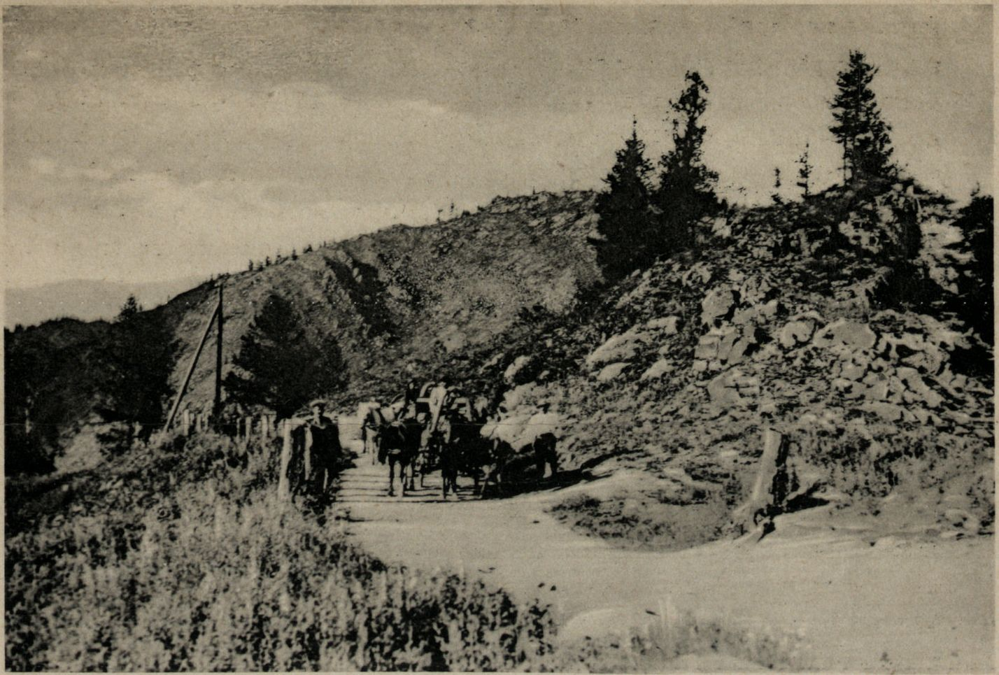

Schikataman.

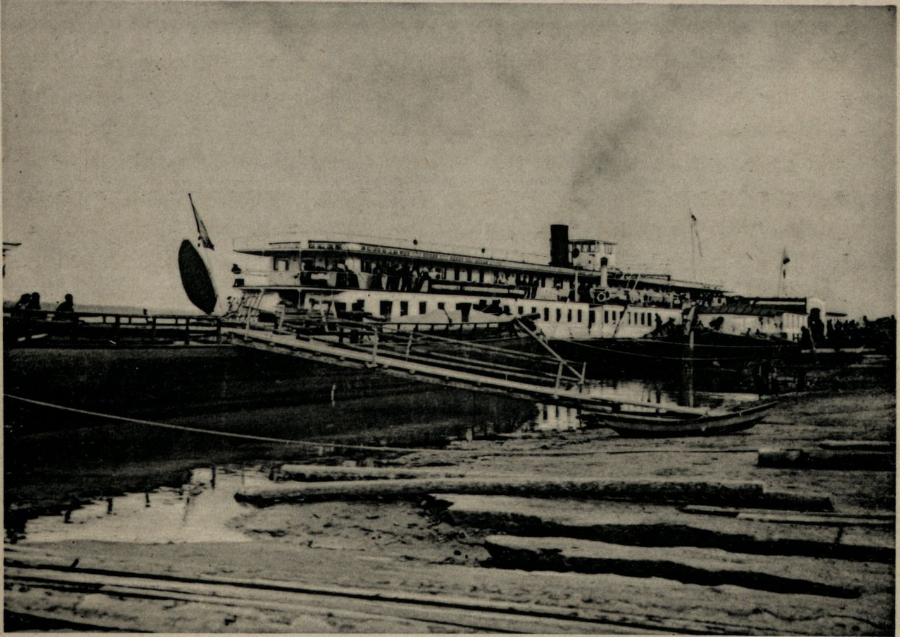

Am Pristan (Ladeplatz) in Kamen.

Tafel 2.

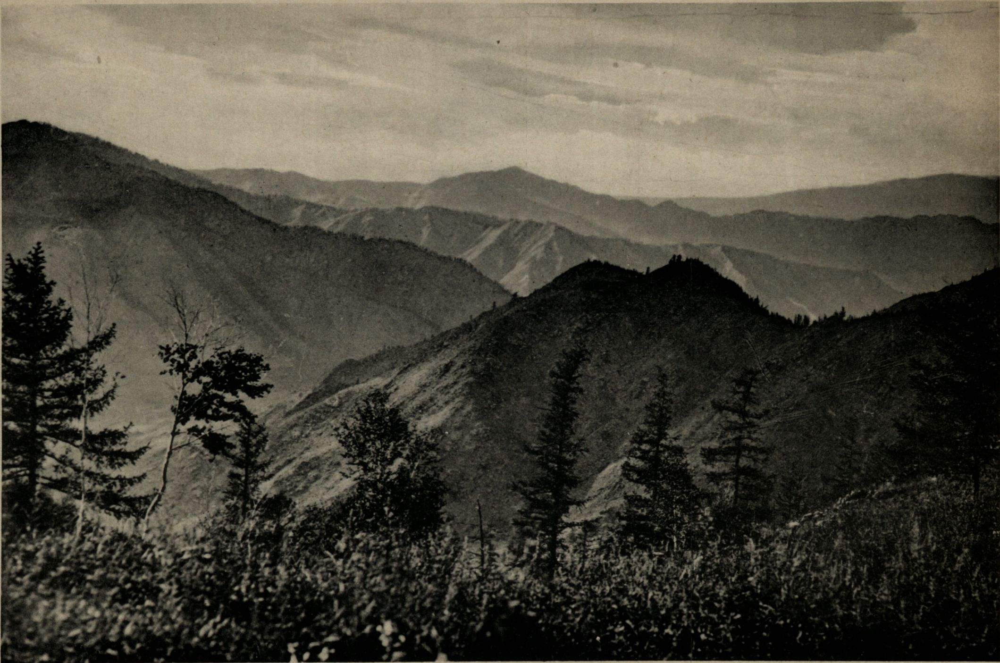

Der Ausblick von Schikataman auf den Altai.

Tafel 3.

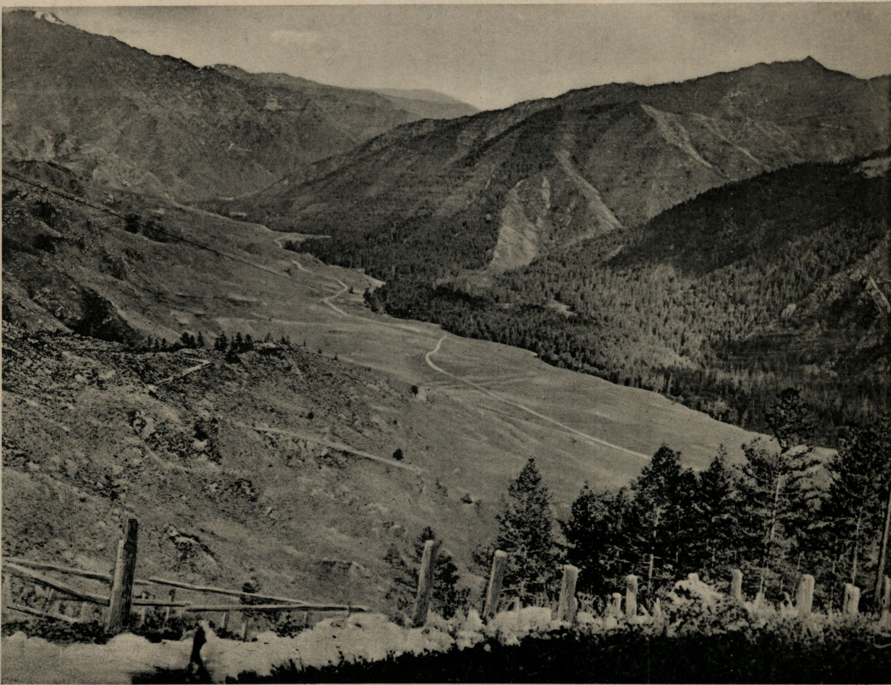

Ausblick vom Schikataman mit dem Flusse Ulgemen und dem Reiseweg durch den Tschuiskitrakt.

Tafel 4.

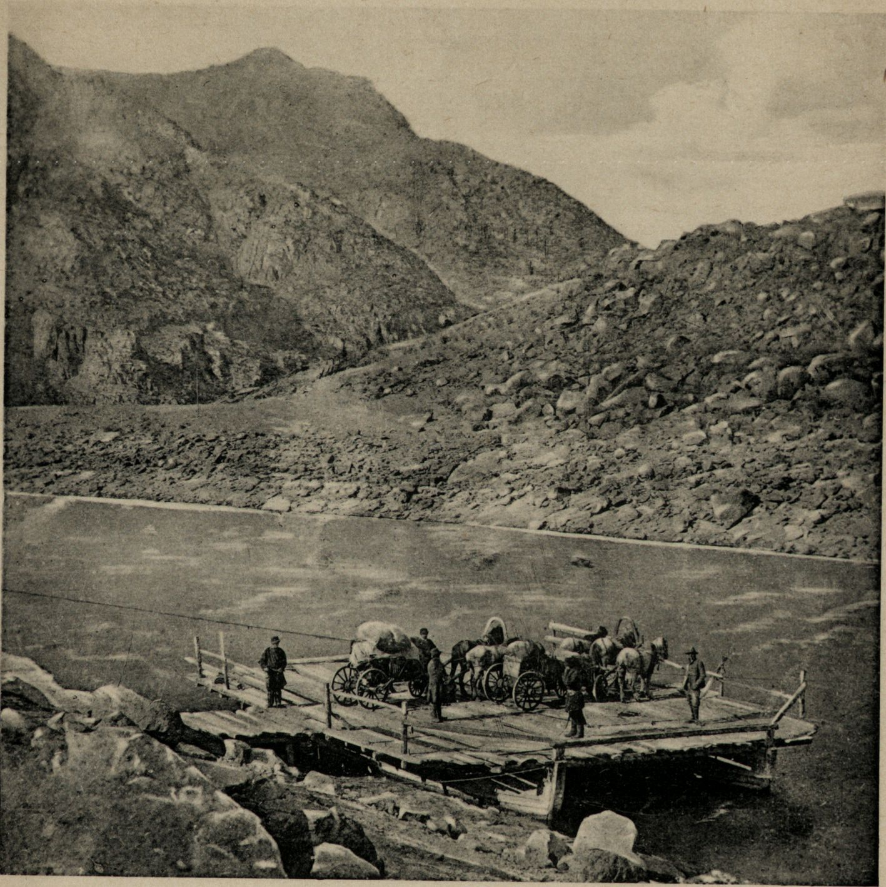

Übergang über den Fluss Katun.

<a id="41">**-- 41 --**</a>

Mädchen. Er erhielt dafür mehrere Jahre Arrestantenkompagnie. Früher war Ongodai die Grenz- und Zollstation. Heute hat Rußland seine Grenz- Zoll- und Telegraphenstation 267 Werst der Mongolei nähergeschoben. Ongodai liegt 860 m hoch, auf dem rechten Ufer des Urusul, dort, wo das Flüßchen Ongodai in diesen mündet. Ongodai selbst würde seiner Lage nach ein prachtvoller Luftkurort sein. Allerdings gibt es etwa 150 Werst von Ongodai in der Nähe des Teletzkojesees wunderbare Luftkurorte, die es ihrer Lage und ihrem Klima nach getrost mit Davos aufnehmen können, z. B. Tschernoje-Manuje und im Imonskibezirk das nur von Barnaul zu erreichende Kitralu. Tatsächlich scheuen einige Moskauer Familien nicht den weiten Weg, um diese sogenannten Luftkurorte aufzusuchen, wo das Leben äußerst billig ist. Für ein russisches im geräumigen sibierischen Stil gebautes Blockhaus zahlen sie für die ganze Saison 25 Rubel, für eine aus Holzstämmen gezimmerte achteckige Altaijische Kibithke nur 10 Rubel. Lebensmittel sind wie überall in dieser Gegend Sibiriens für ein paar Kopeken zu haben. Wanzen und Flöhe sind wenig vorhanden, da der strenge Winter in den ungeheizten nicht benutzten Räumen eine gründliche Säuberungsarbeit verrichtet.

*(Umpacken.)* Es regnet in Ongodai. Während die anderen noch schlafen, öffne ich die Kiste der Telega, die auf dem Seminperewal zweimal umgeflogen ist. Es sieht bunt genug darin aus. Durch die ewige Schüttelei ist alles durcheinandergeworfen worden, so daß ich alles umpacken muß. Die Körbchen, Kistchen und Konservendosen umwickle ich jetzt fest mit gepreßtem Heu, denn war der Weg bisher holprig, so wird er, sobald wir den Schikataman überschreiten, steinig. Meine starken, afrikanischen Lastenkisten aus Zinkblech gingen das letzte Mal durch die Stöße in Stücke. --- So geht denn der Vormittag mit Umpacken herum, dann besuche ich Kisselew, der zwei Tage früher hier eingetroffen ist als wir. Kisselew unterhielt hier eine Filiale der Firma Bodonow, verläßt aber Ongodai, um sich in Biisk vor dem Kriegsgericht wegen Aufruhr und Gefangenenbefreiung zu verantworten. Er schloß sich, wohl unter dem Einfluß seiner Frau stehend, der revolutionären Bewegung im Jahre 1905 tätig an. So bildete er aus alten gedienten Leuten eine bewaffnete Abteilung zum Selbstschutz gegen Pogrome des Schwarzen Hunderts. Diese Pogrome waren angeblich von einem Gendarmeriehauptmann organisiert worden. Durch das Eingreifen Kisselews wurden tatsächlich die Plünderungen verhindert. Kisselew war selbst in jener Zeit Lehrer in Biisk und ist überhaupt ein hochintelligenter Kopf, der allerdings stark zum Marxismus neigt. Wegen seiner Tätigkeit im Jahre 1905 soll er sich jetzt, wie gesagt, nach sieben Jahren --- so lange währt schon der Prozeß ---

<a id="42">**-- 42 --**</a>

verantworten. Ein Teil der Belastungszeugen ist gestorben, verzogen usw. Dieser Umstand kann für ihn und seine Genossen äußerst wertvoll werden. Trotzdem sieht er dem Ausgang mit Besorgnis entgegen und bestellt seine Haus- und Familienangelegenheiten auf mehrere Jahre voraus. ---

Nachmittags spiele ich den Koch. Es gibt Ochsenschwanzsuppe, Hammelkeule, in der Asche gebratene Kartoffeln und Pudding. ---

Abends spät sitzen Konsuls und ich noch lange bei Kisselew. Am andern Morgen sind wir erst um 11 1/2 Uhr fertig. Auf dem Schikataman, nach dem ich besorgt ausschaue, ist über Nacht leichter Schnee gefallen.

*(Über den Schikataman in den Tschuiski-trakt.)* Derselbe kalmückische Jaemschik, der Konsul Walter und mich im vorigen Jahr an einer ganz gefährlichen Stelle kurz hinter Ongodai umschmiß, fährt auch heute den Konsul und seine Frau. Er verspricht dem Konsul hoch und heilig, ihn diesmal wirklich nicht umzuschmeißen. In seinem roten russischen Hemd, den hohen Stiefeln, seiner schwarzen weiten Plüschhose, die nach Jaemschikenart hinten einen viertel Meter sackartig aus den Juchtenstiefeln hängt, ähnlich wie die alten holländischen Schiffsbauern sie trugen, macht er mit seinem dunklen Kalmückengesicht den Eindruck eines tüchtigen Jaemschiks. Aber der Schein trügt. Wir fahren in einem breiten Hochtal. Der Weg führt, nur getrennt durch auf 1 1/2 m Entfernung eingerammte Blöcke von im Höhe, längs dem hohen sehr steilen Ufer des tief unten tobenden Urusul ostwärts. *(Ein Wagen-unfall.)* Ander höchsten abschüssigen Stelle, nachdem wir an dem Platz, wo unser Jaemschik im vorigen Jahr so elegant umgeschmissen hatte, glücklich vorübergekommen waren, konnte das mittlere Pferd der Troika den schweren Tarantas fast nicht mehr zurückhalten. Das linke Pferd geriet beim vergeblichen Versuch des J aemschik, den Wagen vom Abgrund möglichst fern zu halten, auf eine in den Weg vorspringende Felsplatte, fand hier keinen Halt mehr, der Tarantas kam schräg zum Wege zu stehen. Ich ergriff rasch vom Sattel aus, am oberen Rand des Weges reitend, das starke Eisen des Lederverdecks, um den schon kippenden Wagen im Gleichgewicht zu halten und brüllte dem schnell auf dem abschüssigen Wege sich nähernden Gepäckwagen zu zu stoppen, damit er nicht in uns hineinführe. Langsam neigte sich der Wagen dem Abgrund zu. Die Ungeschicklichkeit des Konsuls, der in seiner Angst aus dem Wagen springen wollte und auf dem Trittbrett sitzen blieb, statt seinerseits mit dem Rücken den Wagen zu stützen, brachte die Karre vollständig aus dem Gleichgewicht. Mein Pferd stürzte in die Kniee, das Spanneisen des Verdecks riß im Gelenk in meiner Hand entzwei, und ich mußte, um nicht vom Sattel aus über den Tarantas hinweg in den Abgrund geschleudert zu werden,

<a id="43">**-- 43 --**</a>

loslassen. Der Tarantas kippte um. Der Konsul fiel gegen einen der Pfosten. Seine Frau flog, ihrem Manne einen tüchtigen Stoß in die Rippen versetzend, gegen ihn, wodurch allerdings ihr Fall bedeutend abgeschwächt wurde. Das alles hatte sich vielleicht in einer halben Minute abgespielt. Aus dem Sattel springend, überzeugte ich mich durch einen Blick, daß für Konsul Walter und Frau die Sache verhältnismäßig gut abgelaufen war. Frau Konsul blutete aus einer kleinen Kopfwunde, benahm sich aber sehr ruhig und mutig. Konsul Walter der von dem stürzenden Wagen auch noch einen kräftigen Stoß in die linke Seite erhalten hatte, war außer sich. Er verprügelte den Jaemschik höchst eigenhändig. Ich suchte inzwischen mit dem uns begleitenden Uradnik, der sich in der ganzen Angelegenheit wie ein Schaf benommen hatte, die herausgeflogenen Gegenstände am Abhange zusammen. Dann richteten wir mit vereinten Kräften den etwas verbogenen Tarantas auf. Die Fahrt ging, nachdem wir den Jaemschik gewechselt, der übrigens sofort auf telegraphische Anordnung des Konsuls aus dem Dienst entlassen wurde, mit doppelter Vorsicht weiter. Endlich wird der Weg besser. Wir kommen durch das kleine Dorf Chabarowka, dessen Bewohner zum größten Teil Altgläubige sind. Chabarowka hat eine Seehöhe von 824 m. *(Über* *den* *Schikataman.)* Im flotten Trab nähern wir uns durch die Ebene dem Schikataman, dessen Gipfel in dichte Schneewolken gehüllt ist. Am Fuße des Schikataman lassen wir die Pferde einen Augenblick verschnaufen.

Konsuls steigen aus ihren Tarantas, um den Berg zu Fuß hinaufzuwandern. Frau Konsul fällt das Gehen nach dem Sturze schwer. Die armen Pferde ziehen zu Dritt keuchend den schweren Wagen nach oben. Die Serpentinen sind verhältnismäßig in ausgezeichnetem Zustande. Man merkt sofort, daß der Gouverneur von Tomsk, Exellenz Gran, den Weg vor nicht zu langer Zeit persönlich in Augenschein genommen hat. Auf jeder einigermaßen ebenen Stelle blieben die armen Pferde mit schlagenden Flanken stehen. Steine werden unter die Hinterräder geschoben, um ihnen die Rast zu erleichtern. Düster und eng führen die Serpentinen in langen Biegungen den Paß hinan. Der Weg ist nur gerade so breit, daß die sich entgegenkommenden Tarantaikas knapp ausweichen können. Die rot, blau und gelb schimmernden Felswände sind von dunkelorange grünen Flechten und einem hellgrün schimmernden Moos überzogen. Eine von den grünlichen fettpflanzenartigen Flechten soll nur auf den Felsenplatten des Schikataman vorkommen. Violett blühende Sträucher geben den im saftigen Grün an den Abhängen liegenden Matten einen eigenartigen Reiz. Durch schattigen Wald, unter mächtigen Baumriesen, hier und dort einen Ausblick auf die hinter uns liegende Gebirgswelt des Altais, so kommen wir langsam nach oben. Von hier (1345 m

<a id="44">**-- 44 --**</a>

Seehöhe) haben wir einen herrlichen Rundblick über den ganzen Altai. Die Pflanzenwelt und die verkrüppelten Kiffern geben der Spitze des Schikataman einen alpinen Charakter. Nach rückwärts liegt tief unter uns die Ebene mit dem Dörfchen Chabarowsk. Rot und blaugrüne bizarr gebildete Felsen, die wie spitze Nadeln zu uns steil hinaufragen, schließen scheinbar die von dem glänzenden Silberband eines Baches durchflossene grüne Ebene vom Schikataman ab. Dahinter liegt, in dunkelblaue bis in schwarzblau übergehende Töne getaucht, der Altai, ein Bergmassiv hinter dem anderen in scharf geschnittenen Linien sich voneinander abhebend. So breitet sich der Altai in seiner ganzen Herrlichkeit vor unseren Augen aus. Hier und dort glänzt und grüßt ein Gletscher zu uns herüber. Dichte schwere Schneewolken lagen über den vorderen Gebirgszügen, den Horizont mit seinem grellen Sonnenschein freilassend, darunter in lichtem Blau verschwinden die letzten Linien des Altais in weiter Ferne. Vor uns tief unten windet sich wie ein feiner heller Streifen unser Weg durch die Ebene dahin, aus der einzelne Hügel, hier und da mit Kiefern bestanden, sich erheben. Auch über sie führen in vielen Windungen scharf gezeichnet helle Linien, es sind die Saumpfade der Kalmücken, die hier seit Jahrhunderten von einem Weideplatz zum anderen ziehen. Der Schikataman führt über das Ulgemen-Gebirge, dessen Ausläufer unten im Tale sichtbar sind. Zur Rechten, dicht am Fuße des Gebirges, schlängelt sich unten, aus den dunklen Kiefern aufblitzend, das Flüßchen Ulgemen. Sein Lauf ist durch den dunklen Waldsaum seiner Ufer genau zu verfolgen. Das Tal wird durch mächtige Gebirgsrücken, durch die sich der Weg auf vielen hundert Windungen hindurchpreßt, abgeschlossen. Zur Rechten fallen die dicht bewaldeten Ausläufer des Ulgemen-Gebirges schroff zum Flüßchen ab. Der Schikataman, angeblich nach einem kalmückischen Zauberer benannt, führt wie schon gesagt über das von SW nach SO streichende Ulgemen-Gebirge, das mit seinen hintereinanderliegenden, teilweise gut bewaldeten Höhenzügen einen ganz interessanten Eindruck macht.

Ein Wahrzeichen auf dem Schikataman vermisse ich sofort, das mächtige russische Kreuz, das ich im vorigen Jahr auf der höchsten Spitze sah, --- es war alt und wurmstichig geworden, wie so manches in der Religion, der es als Wahrzeichen für ihre egoistischen Bestrebungen dient, ein kräftiger Sturm hatte es in die Tiefe geschleudert. Während die Wagen mit gebremsten Hinterrädern die langen, durch eingerammte Pflöcke und niedrige Steinmauern zum Abgrund hin geschützten Serpentinen hinunterzogen, kletterte ich über die steilen Felsen zu dem abgestürzten Kreuz hin. Ein eigentümliches Gefühl beschlich mich, als ich vor diesem von den Naturgewalten entwurzelten Wahrzeichen unserer

<a id="45">**-- 45 --**</a>

sogenannten christlichen Religion stand. Ob es jemals dem jetzt schon langsam in Europa und Amerika vordringenden Buddhismus gelingen wird sich an die Stelle des Kreuzes zu setzen? Wohl fraglich! Aber beeinflussen, zum Teil absorbieren ---die Aufnahmefähigkeit des Buddhismus für fremde Religion ist auffallend und beachtenswert --- das ist möglich, besonders in den Gegenden, wo Buddhas Lehre mit dem Christentum, Lama- und Schamanismus aufeinanderprallt.

Auf mich haben die im Hochgebirge errichteten Alpenkreuze immer einen mächtigen Eindruck gemacht. Als ich im vorigen Jahre am Fuße des nunmehr gestürzten Kreuzes saß, diese herrliche Alpen welt bewundernd, hatte ich ein Gefühl des Geborgenseins. ---Es zog mich mächtig zu diesem Kreuze hin. Ich schnallte schnell meine Steigeisen an und begann den nicht ganz ungefährlichen Abstieg über moos- und grasbewachsene Felsen. Die Felsen sind durch das Gras und Moos glatt und schlüpfrig. Vorsichtig, den Eispickel als Bergstock benutzend, jeden Stein anklopfend, komme ich die steile Wand hinunter. Ich versuche, dem gestürzten Kreuz eine würdige Lage zu geben. Das untere Ende zerbrach mir in den Händen. Aber endlich lag es so, wie ich es für ein Alpenkreuz für angemessen hielt. Zwischen gelben Liliaceen und Primeln. Es hatte Arbeit und Schweiß gekostet, und mit mir selbst zufrieden, kletterte ich ganz zu Tal. --- Unten grünen und blühen die Wiesenflächen, nur an einigen Stellen von hübschen Birkengruppen unterbrochen. Langsam kommen die Wagen unter Rufen und Schelten der Jaemschiki die großen Biegungen des Weges hinabgezogen; an jedem Wagen ist nur das im Kummet gehende Pferd belassen, die beiden anderen sind hinten angebunden. Die Jaemschiki gehen, Zigarretten rauchend, nur dann und wann, wenn der Wagen bedenklich kippt, rasch zugreifend nebenher. Endlich sind alle unten angelangt.

Übrigens gelang es dem Biisker Kaufmann Bodonow mit seinem Brasierwagen von zwölf Pferdekräften unter Zuhilfenahme von einigen Pferden, den Schikataman vor einiger Zeit zu überwinden. Es war dies jedenfalls eine sportliche Leistung allerersten Ranges. Leider konnte Herr Bodonow nicht sein Reiseziel, Uljasutai erreichen, der Wagen erlitt durch die Ungeschicklichkeit des unerfahrenen Chauffeurs etwa 200 Werst von Uljasutai einen Achsenbruch. Als Herr Bodonow zu Pferd nach Uljasutai kam, traf dort von Kiachta kommend ein Opelwagenein. Sobald die Herren sich mit heilen Knochen an der anderen Seite des gewaltigen Berges lagerten, mußte dieses tolle Wagnis selbstverständlich gründlich gefeiert werden. Der Champagner floß in Strömen. Auf dem Rücken liegend und zu der gewaltigen Kuppe hinaufblickend, begeisterten sie sich an ihrem Bravourstückchen immer mehr und mehr.

<a id="46">**-- 46 --**</a>

Als es zum Aufbrucli ging, sattelte einer der Herren statt seines Pferdes den russischen Popen, um auf ihm auf allen Vieren in der Steppe ein Stück herumzureiten.

*(Im Tschuiski-trakt.)* Der Weg hinter dem Schikataman führt durch das breite Tal des Balchoi- Ulegem eben und glatt nach Kor-Ketschu. Die Talsohle liegt in 950 m Seehöhe. Wir sind jetzt im eigentlichen Tschuiskitrakt. Bisher zog sich der Weg in einer Entfernung von 10---15 km am westlichen Saum der die Katun am linken Ufer begleitenden Höhenzüge hin. Die Gebirge Terektai, von 2645---3445 m Seehöhe ansteigend, zur Rechten und das Slagusch-Gebirge, 3500 m zur Linken, so jagen wir im flotten Galopp nach Kor-Ketschu. Die zum Trakt steil abfallenden Hänge sind teilweise gut und dicht bewaldet, besonders die des Terektai. Oben auf der Kuppe ist noch die undurchdringliche Taiga. Als wir nach Kor-Ketschu an die Katun kommen (750 m Seehöhe), regnet es inStrömen. Schwer lagern sich, beinahe die Talsohle erreichend, weißgraue mächtige Regenwolken über die Gebirge. Wir waren froh, als wir in dem kleinen Blockhäuschen, das hoch oben am steilen Flußufer klebt, von Tretjakow und seiner hübschen Frau begrüßt wurden. Bald surrt und singt der Samowar. Aus sauberen Teegläsern trinken wir guten chinesischen Tee. Schade, daß Tretjakow so trinkt. Er ist der beste Jaemschik im ganzen Trakt und hat auch stets die besten Pferde. Groß, breitschultrig, im Gesicht einen kurzen, struppigen, roten Bart, so ist er das typische Bild eines Jaemschiks.

*(Zum zweiten Male über die Katun.)* Der neue Weg --- der alte war kaum für Fußgänger passierbar, geschweige denn für Wagen --- führt in zwei großen Serpentinen zum Fluß hinunter. Unmittelbar an die smaragdgrüne Katun heran treten die Felsen. Zwischen mächtigen Höhen des Saldschargebirges tief eingegraben, durchschneidet die Katun die eingelagerte Terrasse. Ein Wagen nach dem anderen fährt auf das große, mächtige Floß, unsere Karawane hat darauf vollauf Platz. Eigentümlich dumpf klingt das Klappern der Hufe der Pferde, als sie die Wagen auf das Floß ziehen. Leise schwankt es auf den grünen Wellen der stark geschwollenen Katun. Endlich ist alles in Ordnung. Das Floß treibt an einem starken, über den Fluß gespannten Drahtseil in einer Rolle laufend, nur mit einem mächtigen Steuer gelenkt, durch die Gewalt der Strömung nach dem anderen Ufer. Ich beobachte heimlich die Gesichter meiner Reisegefährten. Auf allen Gesichtern, mit Ausnahme des Floßführers, ist eine gewisse Spannung bemerkbar. Wenn das Drahtseil durch einen unglücklichen Zufall risse, so ginge das Floß mit allem, was drauf und dran ist, einige hundert Meter unterhalb des Überganges, am linken Ufer des Flusses an den unterhalb des Wassers verborgenen Klippen in Stücke.

<a id="47">**-- 47 --**</a>

Die Strömung ist besonders in dieser Kurve scharf und reißend. Die grünen Wellen spritzen hier weißen Gischt. Die Tiefe des Flusses bei der Fähre beträgt nach Angabe der Flößer 11 Sachin. Leise klirrt die am Seile laufende Rolle. Die Pferde stehen ruhig. Mit leichtem Anprall landen wir am andern Ufer. Auf enger, ziemlich steiler Serpentine, deren Ränder von mächtigen, vom Wasser rund und oval geschliffenen Felsblöcken eingesäunit sind, fahren die Wagen zur Terrasse hinauf. Das Flußgebiet der Katun hat Schutterrassen von der Regelmäßigkeit künstlicher Glacis. Geröll und Felstrümmer machen den Talboden unpassierbar, der Weg steigt hoch an der wild zerrissenen, zerklüfteten Felswand empor und führt dann galerieartig an den senkrecht zum Fluß abstürzenden Granitwänden des Bergmassivs dahin. Hoch oben findet man noch glatt und rund geschliffene Blöcke und Kiesel. Sie lassen die formende Arbeit der Wassermengen des Flusses als ganz gewaltig erscheinen. Die Wassermenge ist heute eine bedeutend kleinere. Tief eingeschnitten strömt heute unten im Tal der Fluß. Das Ganze ist eine gewaltige Frosionsfurche von seltener Schönheit, die die einzelnen Formationen klar in ihrer typischen Ausprägung zu Tage treten läßt

*(Der jaemschik Tretjakow.)* In flotter Fahrt geht es die vierzig Werst von Kor-Ketschu durch die glatte Hochebene auf Ust-Inja zu. Es regnet, regnet, regnet. Stellen weise preßt sich der Weg schon an den Fluß heran. Kleine 1/2 m hohe Steinmauern --- die Steine fielen bei den Sprengungen ab --- schützen den Weg zum Abgrund hin, in dem tief unten die Katun braust. Der Weg ist gerade an einer der gefährlichsten Stellen mit abflußlosem Regenwasser überschwemmt, so daß der Konsul und seine Frau, die hier zu Fuß gehen, auf der kleinen Schutzmauer gehen müssen, um überhaupt durchzukommen, da die Wagen schon voraus sind und auf dem engen Wege nicht umkehren können. So bugsiere ich denn die beiden, mein Pferd hinter mir am Zügel führend, bis an die Knie im Wasser watend, an der gefährlichsten Stelle vorüber, denn meine amerikanischen J agdstiefel und englischen Wickelgamaschen, alles "made in Germany", sind wasserdicht.

Dann geht es in flottem Galopp auf Ust-Inja zu. Die gefährlichsten Stellen nimmt Tretjakow auf wirklich geniale Weise. Es liegt nämlich bei langsamer Fahrt, besonders wenn es etwas steil bergab geht, die Gefahr vor, daß der Tarantas durch die eigene Schwere von den Pferden nicht zurückgehalten werden kann und dadurch in den Abgrund kollern würde. Sobald nun Tretjakow eine solche Stelle erreicht, feuert er die Pferde durch Zuruf an. In Karriere, was die Pferde hergeben können rasen die Gäule die abschüssigen Stellen hinunter, in der Kurve liegt der Wagen einen Augenblick beängstigend schräg, die Pferde jagen durch die Kurve hindurch und den nächsten Abhang hinauf. Dieses

<a id="48">**-- 48 --**</a>

Rennen wiederholt sich einige zwanzig Mal von Kor-Ketschu bis Ust-Inja. Dicht vor der zweiten Fähre bricht sich die Katun im rechten Winkel an der mächtigen Gebirgsmauer. Hoch oben führt der Weg über diesen Felsrücken, vom Abgrund und Fluß nur durch eine kleine Steinmauer getrennt. Schmal und eng war dieser Trakt, als ich ihn zum ersten Male zog, für Maultiere gerade passierbar. Heute ist der Weg breiter, zum Abgrund hin durch eingerahmte Pflöcke oder niedrige Steinmauern geschützt, auch hat man versucht, den Felsboden des Weges durch Aufschüttungen zu ebnen, um die Fahrt einigermaßen erträglich und weniger gefährlich zu machen. Die russische Regierung gab s. Zt. siebenzigtausend Rubel für die Arbeiten im Trakt aus. Eine durchgreifende Ausbesserung des Traktes, so daß er auch für militärische Zwecke benutzt werden kann, würde etwa drei Millionen Rubel kosten.

(*Zum dritten und vierten Male über die Katun.*) Heute sind die starken, trockenen Holzblöcke von den Tschuizen und den Jaemschiki gerade an den allergefährlichsten Stellen bis auf kurze Stümpfe als Brennholz abgehauen, so daß der in voller Fahrt den Weg hinunterrasende Wagen bei der geringsten Ungeschicklichkeit des Fahrenden leicht in den Abgrund fliegen kann. Tatsächlich fordert diese Manier der Jaemschiki, sich dicht am Weg ihr Brennholz abzuhauen, jährlich ihre Opfer, die tief unten mit zerschmetterten Gliedern liegen bleiben. Die Steinmauern sind teilweise abgestürzt, die Aufschüttungen sind vom Regen und Schneewasser weggespült worden, und überall tritt der gewachsene Fels zu Tage. Die zweite Fähre, von den Russen Srednoje- Parom genannt, ist bedeutend kleiner. Der Fluß ist hier schmäler und nicht so tief.

Auf der linken Horizontalfläche, die mit der rechten beinahe in derselben Niveauhöhe liegt, führt der Weg etwa 10 Werst nach Ust-Inja, der dritten Übergangsstelle seit Kor-Ketschu. Im großen Bogen umfließt hier die Katun die aufgehäuften Horizontalflächen. Der Fluß ist auch hier nicht allzu breit. Er strömt, sobald in seinem Quellgebiet die Schneeschmelze oder starker Regenfall beginnt, reißend durch sein Bett. Dem Reisenden bleibt bei solchen Gelegenheiten nichts übrig, als zu warten --- das kann wochenlang dauern --- bis sich das Wasser verlaufen hat.

*(Ust-Inja.)* Wir kommen glücklich die etwas abschüssige Stelle zur Fähre hinunter. Die Hufe der Pferde klappern auf dem Floß, dessen Bohlen unter den hochbeladenen Wagen knirschen und quietschen. Nach einer Viertelstunde sind wir auf dem anderen Ufer, und in 10 Minuten liegt plötzlich tief in einer Talmulde versteckt Ust-Inja vor uns. Die Station hat ihren Namen nach einem rechten Nebenflüßchen, das etwas unterhalb in die Katun mündet. Ust-Inja selbst ist ein kleines freundliches Dörfchen

PHOTOS

Tafel 5.

.

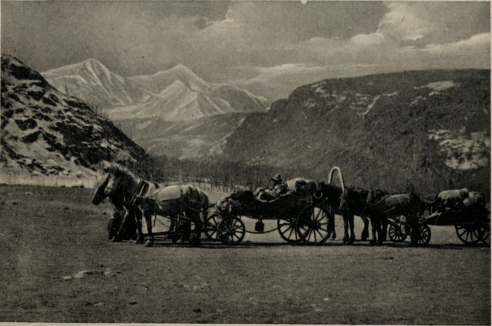

Der erste Ausblick auf die Tschuiski-Alpen dicht hinter Zibith.

Tafel 6.

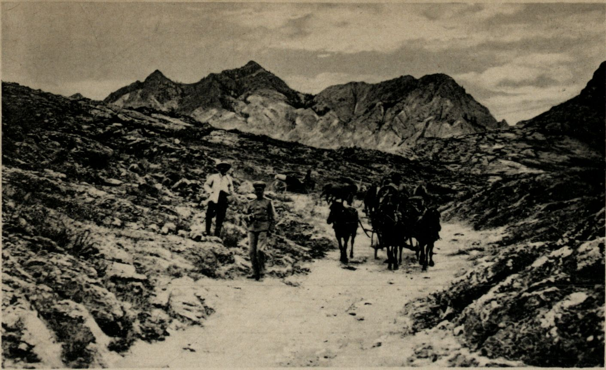

Der Weg nach Jedro.

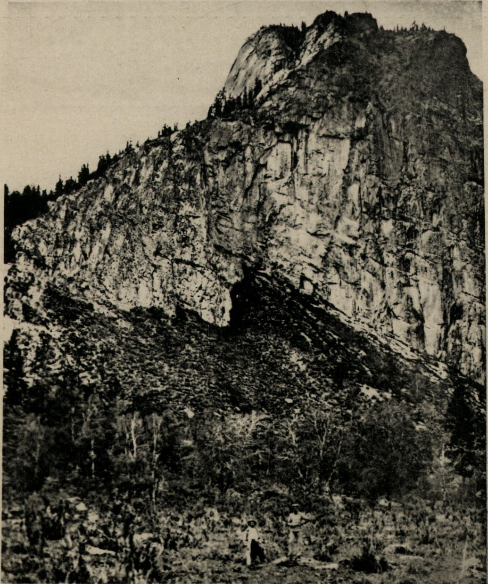

Im Tschuiskitrakt.

Tafel 7.

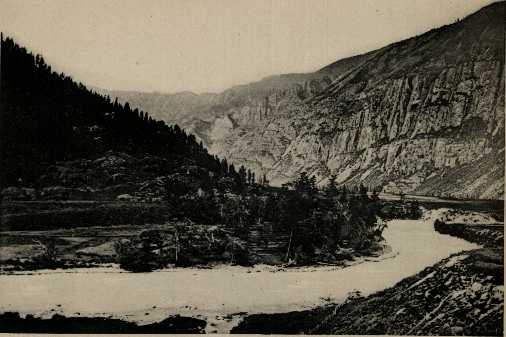

Der Fluß Tschuja.

Tafel 8.

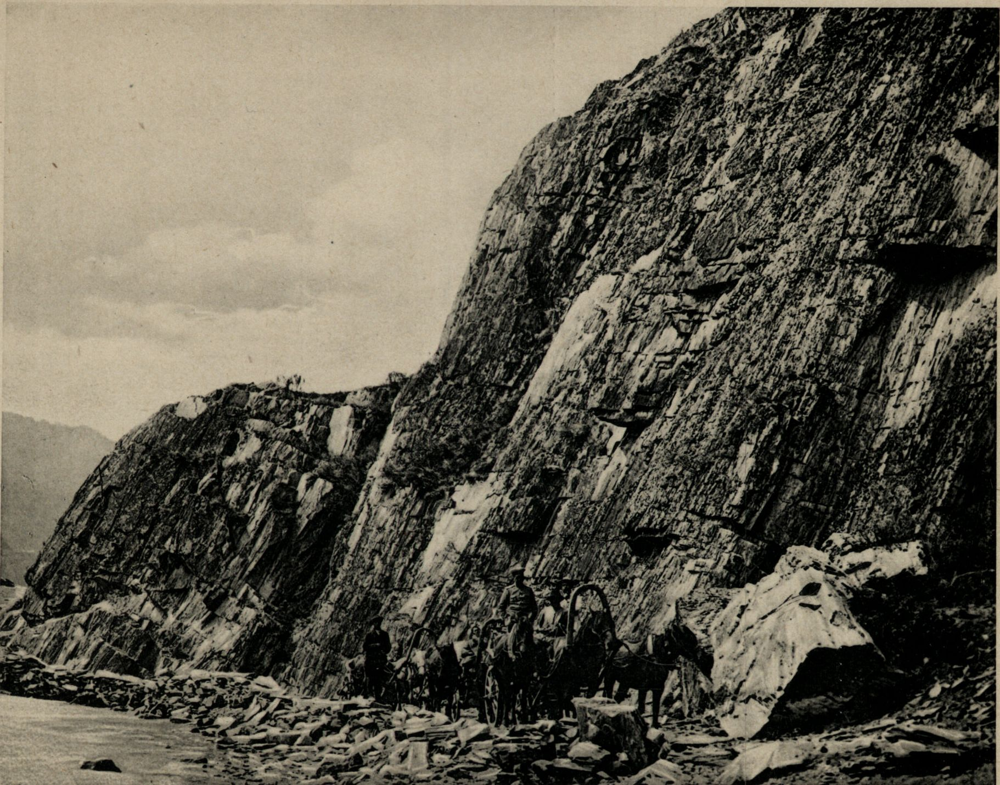

Im Tschuiskitrakt zwischen Jedro und Aigulak bei einem sogenannten Poom.

<a id="49">**-- 49 --**</a>

in 770 m Seehöhe gelegen, mit einigen großen Blockhäusern, deren Fensterrahmen weiß gestrichen sind. Heute macht es in der hereinbrechenden Dämmerung einen düsteren, traurigen Eindruck, schwere, graue Regenwolken hängen auch hier tief im Tal, die mächtigen Berge wie den Wa- Kusik, an deren Fuß sich das Dörfchen schmiegt, verdeckend. Im Stationsgebäude, einem kleinen Blockhaus mit zwei Zimmern, hausen jetzt christianisierte Altai-Kalmücken. Alles ist sauber; in einer Ecke des Zimmers, sowie in der Küche hängt ein vergoldetes Heiligenbild, blitzblank geputzt, so daß das schwarzbraune Madonnengesicht noch dunkler erscheint. Hell schlägt die rote Glut aus dem weiß gestrichenen Backsteinofen, dem Ganzen einen anheimelnden Eindruck gebend. Kalmückische Frauen mit geschlitzten schwarzen, großen Augen, in russischer Tracht, hantieren eifrig um den großen, russischen Ofen. Männer mit strähnigem, pechschwarzem Haar hocken, den Rücken an den Ofen gelehnt, sich wärmend auf der niedrigen Ofenbank. Um den Tisch sitzen, den Tee aus der Untertasse schlürfend, hier und da ein Stückchen Zucker abbeißend, unsere Jaemschiki. Sie erzählen unseren Hauswirten das Neueste. --- Die Hammelkeulen schmecken uns vorzüglich. Unsere Schildkrötensuppe --- ich habe heute einige Suppenwürfel geopfert --- ist delikat. Draußen regnet es immer noch in Strömen. Unsere Gepäckstücke, die wir für die Nacht gebrauchen, werden nach dem Essen hereingebracht. Ich errichte zwischen mir und dem jungen Ehepaar eine kleine Barrikade aus diesen Gepäckstücken, dann krieche ich in meinen Schlafsack, in dem ich mich liegend auskleide. --- Nachts werde ich wach. Patsch --- Patsch macht es mit hartem Aufschlag auf meiner Nase. Es regnet durch die Decke. Ich ziehe den wasserdichten Überschlag des Schlafsackes über den Kopf und schlafe ruhig weiter.

*(Am Tschuja.)* Am anderen Morgen brechen wir um 10 Uhr auf. Der Weg wird lebensgefährlich. Um 12 Uhr erreichen wir den Fluß Tschuja (Tschui). Hoch hinaufkletternd, dann dicht an tiefen Abgründen vorbeiführend, in vielen Windungen und Krümmungen schmiegt sich der Trakt durch und über die Felsen. Die Wasser des Tschuja sind hellgrün. Schäumend und tobend, hier und da mächtige Baumstämme mit sich führend, braust er in seinem wilden Gebirgsbett. Die Gipfel der Berge sind mit Neuschnee gepudert. Konsuls gehen wegen der gefährlichen Passage zu Fuß, wir kommen daher nur langsam vorwärts. --- Ich reite stets in der Nähe der Bagage, um nötigenfalls mit zugreifen zu können. Der Weg wird immer gefährlicher. Die Berge und Felsen nehmen einen bizarren Charakter an. An einigen Stellen gleichen sie dem mächtigen Trümmerfeld einer gigantischen Burg, mit deren Resten Zyklopen Fangball gespielt haben. Die Oberfläche der Steine ist durch Wasser, Wind und Wetter geschliffen.

<a id="50">**-- 50 --**</a>

Rotblau, grün, violett und schwarzblau sehen diese Trümmerfelder aus. Es sind die Überbleibsel mächtiger, durch die Witterungsverhältnisse und Wasser zerstörter Berge. Mächtige Felsblöcke, die sich von den steil am Wege auf ragenden Felsen gelöst haben, sperren fast den ganzen Weg, und die Wagen müssen sich daran herumwinden. Brausend stürzen silberglänzende kleine Wasserfälle zu Tal, den Weg mit ihren Wassern überschwemmend. Im Winter sind die Kaskaden zu einem glänzendenKristall, das in der Sonne in tausend Farben blitzt, gefroren. An einzelnen steilen Kurven wird der Weg so gefährlich, daß ich erleichtert aufatme, als wir glücklich vorüber sind. Manchmal scheint der Tarantas mit Pferden und allem in voller Fahrt an einem mächtigen Felsblock zu zerschellen, aber im letzten Moment führt der Weg haarscharf daran vorbei. Tief unten strömt mächtig die Tschuja.

*(Jedro.)* Gegen drei Uhr sind wir in Jedro, das in 845 m Seehöhe dicht am Tschuja gelegen ist. Hier ist der Jaemschik Kurataiew als Stationshalter angestellt. Jedro ist rings von hohen Bergen umgeben. Fünf achteckige Blockhäuser mit Rinde gedeckt liegen etwa 2 Werst von der Station entfernt. Es sind dies die Wohnungen christianisierter Kalmücken. Die Gipfel der Berge tragen spärlichen Kiefernwald. Kurataiew, die typische Gestalt eines russischen Grenzpioniers, genießt im ganzen Trakt den schlechtesten Ruf. Er ist dafür bekannt, das er alles verspricht und nichts hält. Dabei ist er ein ganz geschickter Bursche, der seine Zunge . tüchtig zu gebrauchen versteht und sich der Behörde gegenüber stets als die gekränkte Unschuld aufzuspielen weiß. Als wir ankamen, war nichts fertig. Kurataiew versprach, die Pferde sofort anzuspannen.

*(Beim Jaemschik Kurataeiw.)* Wir gingen deshalb in das Stationsgebäude und warteten und warteten. Aufenthalt im Zimmer war für uns beinahe unmöglich, da die Frau des Kurataiew im höchsten Grade schwindsüchtig war und aus der Küche ihr trockener, quälender Husten zu uns ununterbrochen herüberschallte. Nach einiger Zeit sah ich Kurataiew in ganz verdächtiger Weise um das Haus herumstreichen. Da ich ihn von früher her schon kannte, nahm ich mir den Jaemschik, der uns hergefahren hatte, ins Gebet. Nun stellte sich heraus, daß weder Telega, noch Kummet, weder Pferd noch Jaemschik auf der Station des Kurataiews verhanden waren. Drei oder vier Pferde hatte er morgens für einen Landmesser gebraucht, drei Pferde waren auf der Station und der Rest von 15---20 Pferden, zu denen er kontraktlich verpflichtet war, und zu deren Unterhalt er vom Gouvernement etwa 2 500 Rubel jährlich erhält, standen auf dem Papier.

Die Stationen werden vom Gouvernement aus alle drei Jahre öffentlich ausgeschrieben. Derjenige, der nun den zu unterzeichnenden Kontrakt für die billigste Summe zu erfüllen bereit ist, bekommt den Zu-

<a id="51">**-- 51 --**</a>

schlag. Vergehen im Dienst, schlechte Wartung der Station, schlechte Pferde werden bis zu 10 Rubel für jeden einzelnen Fall bestraft. Bei Kurataiew regnet es Strafen, das läßt ihn aber vollständig kalt. Hat er doch die obige Summe in der Tasche und von ihm selber ist nichts mehr zurückzubekommen. Schließlich, um nicht noch mehr Zeit zu verlieren, schlage ich dem Konsul vor, er solle mit den drei vorhandenen Pferden und Kurataiew vorausfahren, ich wolle schleunigst durch den Uradnik Pferde requirieren lassen, um dann mit dem Gepäck nachzukommen. Aber unsere Gepäckwagen sind einstweilen noch nicht da, ich hatte sie nach Überwindung der gefährlichsten Stellen unter der Obhut des Uradniks zurückgelassen. Er kam um 5 Uhr an und teilte mir mit, daß die Pferde übermüdet seien und nur noch schlecht vorwärts könnten. Sie trafen erst um 6 Uhr ein, da zwei Pferde auf dem steinigen Wege gestürzt waren. Endlich kam der Konsul fort. Das Geschirr gehört zum größten Teil dem Jaemschik aus Ust-Inja, der sich gegen die Hergabe seiner Sachen heftig sträubt, mit der Begründung, daß er gegebenenfalls von den geliehenen Sachen nichts mehr zurückerhalte. Damals hielt ich das für eine faule Ausrede, weil er sich mit Kurataiew nicht gut stand. Wie ich später hörte, hat er tatsächlich den größten Teil, sogar eine Telega von Kurataiew, nicht zurückbekommen.

*(Bei Nacht durch den Trakt.)* Gegen neun Uhr abends, nachdem der Uradnik im Gebirge und zwei Werst von der Station Pferde und Kalmücken nebst einer Telega aufgetrieben hatte, konnten wir im strömenden Regen aufbrechen. Es ist dunkle Nacht. Kaum sieht man die Hand vor den Augen. Das Gepäck ist auf fünf Telegas verteilt. An jeder Telega haben wir zwei Pferde, darunter drei, die noch nicht ganz eingefahren sind. Kaum sind wir aus der Station heraus, geht schon der Tanz los. Die Pferde schlagen und bäumen sich gegen die ungewohnte Arbeit und machen sich so vorher schon müde. Wie ich mit diesen scheuen, halbwilden Pferden gerade an der gefährlichsten Stelle des ganzen Trakts während der Nacht glücklich durchgekommen bin, ist mir heute noch ein Rätsel. Vier Jaemschiki waren Kalmücken und hatten wohl selber kaum jemals als Kutscher auf einer Telega gesessen, der fünfte war ein Russe. Dieser fuhr voraus, die anderen hinterher. Als letzter unser Uradnik. Auf den Uradnik war kein Verlaß, er fürchtete die scheuenden Kalmückenpferde. So führte ich denn zu Fuß, die Pferde am Zügel haltend, während etwa dreier Stunden jede Telega einzeln über die gefährlichen Stellen. Einige Male landete die Telega hart an der Schutzmauer; dabei gerieten die Pferde mit den Vorderhufen auf die Brustwehr. Im letzten Augenblick gelingt es mir und dem fahrenden Kalmücken, die Pferde vom Abgrund

<a id="52">**-- 52 --**</a>

zurückzureißen und eine Katastrophe zu vermeiden. An der engsten Stelle gab es einen Aufenthalt. Uns entgegen kommt eine andere Karawane. Soeben gebe ich die nötigen Anordnungen, um uns aneinander vorbei zu bugsieren, als ich mich zu meinem größten Erstaunen anrufen höre. Es ist der Konvoioffizier Olunin aus Uljasutai, derselbe, der mich unter dem Einfluß des russischen Konsulats-Sekretärs Xionin trotz meiner dem Konsul damals geleisteten Dienste dem Generalstab von Irkutsk als Spion denunzierte. Doch das erfuhr ich leider zu spät. Olunin war wegen seiner Gutmütigkeit von seinem Posten abgerufen worden, unter ihm war nach einem Bericht desselben Xionin der ganze Uljasutai- Konvoi vollständig verwildert und ohne jede Disziplin. Olunin selbst galt als ein schneidiger Reiter und anständiger Mensch, aber ohne eigenen Wil len und leicht beeinflußbar. Wir hatten beide leider wenig Zeit miteinander zu sprechen, da wir erst unsere Wagen aneinander vorbeibringen mußten. Er erzählte mir, daß der deutsche Hauptmann Rausch in Zibith auf mich warte. Ich dankte ihm für seine Nachrichten über meinen Freund. Olunin selbst hatte als Arrestanten den Postbeamten von der neu eröffneten Post in Uljasutai bei sich. Es sind 10000 Rubel Papiergeld --- die erste größere Summe, die von den Chinesen der Post anvertraut wurde, spurlos verschwunden.

Endlich, endlich haben wir die Pooms und Abgründe hinter uns. Auch das Loch, wo die Tschuitzen früher durchgekrochen sind. Die Strecke wird ebener. Ich reite nun mit einem Kalmücken als Führer voraus. Hoch oben im Gebirge blitzt ein Licht. Das ist Aigulak --- das Bärenöhrchen. Mein kalmückisches Pferd geht unter dem Sattel ganz vorzüglich. Um 1 1/2 Uhr nachts bin ich glücklich in der Station. Auch hier hausen christianisierte Kalmücken. Der blitzblanke Samowar summt auf dem Tisch. Die fertig gekochten Eier --- oh, diese ewige Eieresserei! dreimal täglich ist schließlich ein bißchen viel --- und Brot liegen auf dem Tisch. Konsuls schlafen schon. Schnell mache ich mir noch einige Notizen in mein Tagebuch und lege mich mit sehr wenig Vertrauen in das große Bett, auf dem nach russischer Sitte ein halbes Dutzend Kissen paradieren, denn mein Schlafsack ist bei der Bagage zurückgeblieben. Konsuls schlafen auf ihren aus dem Tarantas genommenen Matratzen auf dem Fußboden. Im Bett kann ich mich, da es auf einer Art Estrade steht, nicht gerade setzen, ohne mit den Händen beim Entkleiden an die Decke anzustoßen. Aber schließlich ist ja auch das Bett nicht da, um sich darin zu setzen, sondern um darin zu liegen. Die Station Aigulak liegt in 1060 m Seehöhe.

Morgens um 9 Uhr reite ich von Aigulak fort, Konsuls und die Gepäckwagen zurücklassend. Der Weg führt über eine alte Moräne (1100 m

<a id="53">**-- 53 --**</a>

Seehöhe). Unterwegs begegne ich einer Karawane. Der Russe, der soeben einen jungen Adler gefangen hat, erzählt mir, daß Hauptmann Rausch im Begriffe stehe, aufzubrechen, er sei im Semstwo-Quartier abgestiegen. Was mein Pferd hergeben kann, jage ich nach Zibith. Dort mitten im Hof steht ein rotgebrannter, dicker Mann, der mit einem kalmückischen Begleiter seine Packpferde belädt. Ich traue meinen Augen kaum. Ist der verwilderte Bursche dort wirklich der schneidige, feine, intelligente Artillerieoffizier!? "Halloh, halloh, Hauptmann Rausch" rufe ich, in den Hof galoppierend, ihm lachend zu. Überrascht fährt er herum und läßt Packen, Packen sein. Das war eine Freude! Wir hatten uns viel, viel zu erzählen. Die Vergrößerung des Körperumfanges von Hauptmann Rausch war dadurch hervorgerufen worden, daß er, um Gepäck zu sparen, möglichst viele Kleidungsstücke übereinander angezogen hatte. --- Nach einer halben Stunde kommt auch der Konsul angerasselt. Wir trinken zusammen Tee, bewundern die prächtigen Argaligehörne, die Hauptmann Rausch als Jagdtrophäen mit nach Hause nimmt. Dann fahren der Konsul und seine Frau weiter, ich bleibe noch bis 2 1/2 Uhr mit Hauptmann Rausch zusammen. Er erzählt mir von seiner erfolgreichen Reise am Amur und im Ussurigebiet. --- Auch für mich wird es Zeit, an den Aufbruch zu denken. Noch ein letzter Händedruck, noch ein letztes Lebewohl und das Versprechen, uns in Berlin zu treffen, und ich galoppiere den anderen nach.

*(Zibith.)* Übrigens habe ich Zibith noch vom vorigen Jahr her in schlechter Erinnerung. Bei der Herausfahrt aus dem Hbftor wurde mir damals mein linker Fuß zwischen dem Türpfosten und dem Tarantas gequetscht und ziemlich stark verletzt. Ich tat auf dieser Fahrt für alle meine Sünden, auch für die zukünftigen, Buße. Fünf talergroße Geschwüre quälten mich damals fürchterlich. "Zwiefach ist der Stich der Gabel, wenn sie zwiefach zugespitzt" singt Busch. Bei mir war sie aber fünffach zugespitzt. Jeden Hopser, jeden Stoß über die Milliarden Steine des Trakts fühlte ich fünffach. Dazu kamen noch die Schmerzen des gequetschten Fußes. Legte ich mich so, daß mich der Fuß nicht schmerzte, so schmerzten die Karbunkel fünffach. Legte ich mich so, daß die Karbunkel nicht wehe taten, so machte mich der Fuß halb wahnsinnig vor Schmerzen. In Kosch-Agatsch kam ich damals in hohem Fieber an. Glücklicherweise war dort ein Feldscher, der mir ganz ausgezeichnet beistand. Zibith selber ist ein kleines, von Russen und russifizierten Eingeborenen bewohntes Dörfchen mit einer Missionskirche und Telegraphenstation. Ringsum wird es von dicht mit Tannenwald bewachsenen Bergen eingeschlossen, in denen der Zobel, Fuchs, Hirsch, Steinbock und Bär noch vorkommen. Die Siedlung liegt in einem kleinen, hüb-

<a id="54">**-- 54 --**</a>

sehen Tal (1145 m Seehöhe), durchflossen von dem dicht hinter den Blockhäusern munter rauschenden Flüßchen Zibith. Die Hänge und Hügel in der Umgebung sind mit gelben und violetten Blumen übersät. Von Zibith aus führt der Weg in östlicher Richtung durch das Tal nach Buchtala und von hier über drei bedeutende Paßhöhen, von denen der Archina die höchste ist. Durch eine etwa 8 Werst lange Talfläche, die rings von bewaldeten Hügeln eingeschlossen ist, schlängelt sich das Flüßchen Zibith, dem ich eine Zeitlang auf dem Wege nach Buchtala folge. Mit seinen, von hochgewachsenem Schilf umgebenen Tümpeln und Sümpfen ist es ein Eldorado für alle Wasservögel. Die Rost- oder Braminengans, von den Russen Waranawka, genannt, sowie verschiedene Arten Wildgänse schwimmen zu Hunderten im Schilf herum.

*(Buchtala.)* Bei der erst im vorigen Jahr errichteten Station Buchtala (1390 m Seehöhe), hole ich die Voraufgefahrenen ein. Buchtala liegt dicht am Fuße des Archina, über den wir hinüber müssen. Der Stationshalter erzählt mir, daß er sich im letzten Winter der Wölfe habe kaum erwehren können. Die drei vorher erwähnten Paßhöhen sind die südlichen Ausläufer des Kurai-Gebirges. Die auf der Hochfläche wohnenden Telen- gyten sind allem Anschein nach sehr geschickt in der Bewässerungsanlage. In schmalen Rinnen leiten sie das Wasser der Bäche zu ihren Weideplätzen, manchmal kam es mir vor, als ob das Wasser in langen Windungen längs der Abhänge hinaufflösse.

*(Über den Archina.)* großen Serpentinen fahren wir den Archina hinan. Der Weg, der nach dem Abgrund zu mit den vorschriftsmäßigen Holzpfosten gesichert ist, führt stellenweise durch dichten Waldbestand. Lärchen und Kiefern bilden die Hauptbestandteile des Waldes. In der Hälfte des Weges stößt dieser an eine steile dunkle, dicht bewaldete Felswand, auf der im ganzen Jahr an einzelnen Stellen Eis und Schnee liegt. Unaufhaltsam rieselt vom Felsen das Schnee- und Eiswasser herab, den Weg in der Kurve aufweichend und ausspülend, oder ihn mit Glatteis überziehend. Steil über uns ragt im grellsten Sonnenschein der Gipfel empor. Es ist hier oben schon empfindlich kalt. Dicht am Wege befindet sich eine früher von einem Schamanen bewohnte Höhle. Leider fehlt es mir auch diesmal an Zeit, dieselbe zu untersuchen. Übrigens gibt es mehrere solcher Höhlen in Tschuiskitrakt, deren regelrechte Untersuchung wohl wertvolle Aufschlüsse über die Höhlenbewohner des Traktes geben würde.

<a id="55">**-- 55 --**</a>

*(Die Tschuiski und die Kuraialpen)* In scharf geschnittenen Linien, die sich in weiter, blauer Ferne ver- lieren, hier und da von einem mit ewigem Schnee bedeckten, steilen Gipfel unterbrochen, die tiefen Täler in violett-blauen Dunst gehüllt, so breitet sich, nachdem wir auf der steilen Klippe angelangt sind, nach rückwärts gesehen, ein Teil der Tschuiski- und Kuraialpen, sowie die ganze Gebirgswelt des Traktes als ein einzigartiges Panorama vor uns aus. Den ersten Ausblick auf die Tschuiskialpen hatten wir schon nicht weit hinter Zibith. Hier in einer etwa drei Werst breiten Talfläche ragten, einem breiten, bewaldeten Quertal als Abschluß dienend, mehrere mit ewigem Schnee bedeckte mächtige Gipfel der Tschuiskialpen empor.

Der Weg führt über die Paßschwelle dicht an den schroffen, dunklen Zacken des Kuraigebirges vorbei. Mitten auf dem Paß liegt ein mit spärlichen, aber hohen Kiefern bestandener Lagerplatz der Tschuitzen in 1800 m Seehöhe. Die höchste Erhebung beträgt 1865 m auf dem Paß. Hier an diesem Lagerplatz sprudelt eine kleine Quelle mit frischem, klarem Wasser; bis Ende April liegt häufig im Schatten der Bäume Schnee. Frisches Gras, wichtig als Futter für die Pferde, ist auch in der schlimmsten Zeit, also von Anfang März bis Mai, wo man nur in ganz vereinzelten Stationen für schweres Geld etwas gepreßtes Heu haben kann --- das Pud wird manchmal mit 2.50 Rubel bezahlt --- vorhanden.

*(Station Krai.**)* Durch mit Hochwald bestandene Schluchten geht es in einigen Serpentinen hinunter zu einer mächtigen Hochebene der Kuraisteppe (1700 m Seehöhe), an deren Beginn, einsam, von einem Gehölz umgeben, die Missionsstation Kurai (1500 m Seehöhe) liegt. Als wir aus dem Walde herauskamen, der uns bisher die Aussicht sperrte, ragen schroff und steil mit ihren wild zerrissenen, von ewigem Schnee bedeckten Graten und Zinken die Tschuiskialpen dicht zu unserer Rechten empor. Zur Linken haben wir eine gute Übersicht über die schneebedeckten Kuppen des Kurairückens. Die Hochfläche neigt sich von dem Kurairücken zu dem gewaltigen Massiv der Tschuiskialpen. In etwa dreiviertel Stunden sind wir abends um 7 Uhr in Kurai. Wir beschließen, die Nacht hier zu bleiben. Leicht gewellt, dann völlig eben, liegt mit Geröll und spärlichem Gras bedeckt, nur dicht vor der Station von einem breiten, trockenen, steinigen Flußbett durchzogen, die Hochebene vor uns. Mühsam schlängelt sich eine kleine Wasserrinne durch das breite Flußbett des Kuräi.. Zur Zeit der Schneeschmelze durchtobt dieser Zwerg, beinahe einen halben Kilometer breit, die Steppe, Steine, Geröll, Baumstämme, alles was sich ihm entgegenstemmt, mit sich reißend. Gegend Abend beobachten wir ein herrliches Alpenglühen. Rubinrot leuchten plötzlich die

<a id="56">**-- 56 --**</a>

Gipfel und Schroffen, langsam läuft ein wunderbares Goldig-rot über den 20 km langen Gletscher und die mächtigen Firnen. Intensiver und glühender wird das Leuchten, vom hellsten Taubenblutrot gehen die Farbentöne dann ins dunkle Rubinrot über. Aus den zahllosen Falten der Täler und Schluchten kriechen dunkelblau-violette Farben an den Hängen und Graden empor. Immer stärker wird das Violettrot, die Schluchten hüllen sich in ihren dunkelblauen Mantel, doch die Gipfel erglühen noch lange. Der mächtige Gletscher wirft wie ein blankes, rot-silbernes Schild sein Licht zu den Spitzen empor. Allmählig verglüht das heilige Feuer der Berge. Graublaue Nebel steigen aus dem Gehölz, das die Station umgibt, die Tschuja und Kuraialpen zur Hälfte einhüllend. Gigantisch und mächtig ragen die Firnen und Gletscher zu dem sternbesäten dunklen Himmel.

Die Kuraialpen haben etwa 2500 m Seehöhe, wogegen die höchsten Gipfel der Tschuiskialpen 3500 bis 4000 m haben.

Die Station besteht aus zwei kleinen Blockhäusern und einer von der Biisker Mission errichteten kleinen, hellgrün gestrichenen Kirche. Etwas abseits davon liegt eine aus Baumstämmen mit Rinde bedeckte Unterkunftshütte für die Kalmücken.

*(Die gute Stube in den Stationen.)* Morgens um 10 Uhr brechen wir auf. Wanzen und anderes Ungeziefer haben Konsuls, die in der guten Stube schliefen, nicht schlafen lassen. Ich zog es vor, in der Küche auf dem Boden in meinem Schlafsack zu schlafen. Die gute Stube ist in allen Stationen beinahe gleich. In der Ecke irgendwo hängt ein Heiligenbild mit einem goldig glänzenden Messingmantel bedeckt, auf dem die Konturen des Heiligen, meistens der Mutter Gottes, in Relief gepreßt sind. Eigentümlich dunkelbraun schaut nur der freigelassene Kopf in die Stube. Ein mächtiges Bett mit turmartig aufeinandergelegten Kopfkissen, manchmal sechs oder sieben, nimmt die eine Seite der Stube in der Nähe des russischen Ofens ein. Ein kleiner Tisch mit einigen Stühlen vervollständigt die Einrichtung des Zimmers. In der Ecke bei der Türe hängt ein kleiner, einfacher Blechapparat mit darunter stehendem Eimer. Hier kann man sich waschen. Der Apparat enthält etwa 1 1/2 Liter Wasser. Stößt man nun den aus dem Apparat heraushängenden Zapfen mit den muschelartig zusammengelegten Händen in den Blechkasten hinein, so fließt, so lange man den Zapfen festhält, das Wasser in die hohlen Hände, schließt sich aber sofort, sobald man den Zapfen losläßt. Über dem Tisch hängt ein Spiegel und rings um den Spiegel Bilder, billige Drucke aus dem russisch-japanischen Kriege, wie sie zu Millionen beim Ausbruch des Krieges verbreitet wurden. Sie kommen einem heute wie eine Parodie auf diesen unheilvollen Krieg vor. Auf einigen Bildern

PHOTOS

Tafel 9.

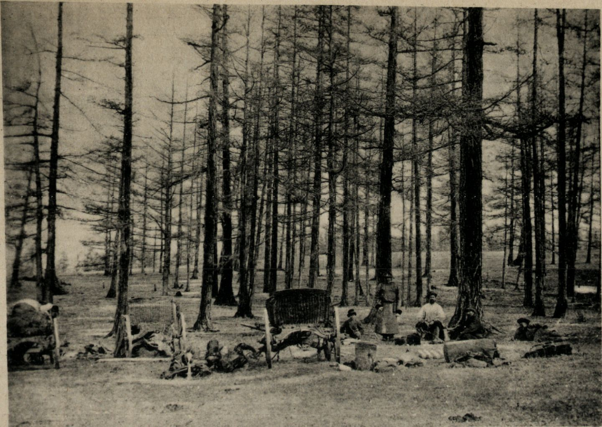

Lager auf dem Archina.

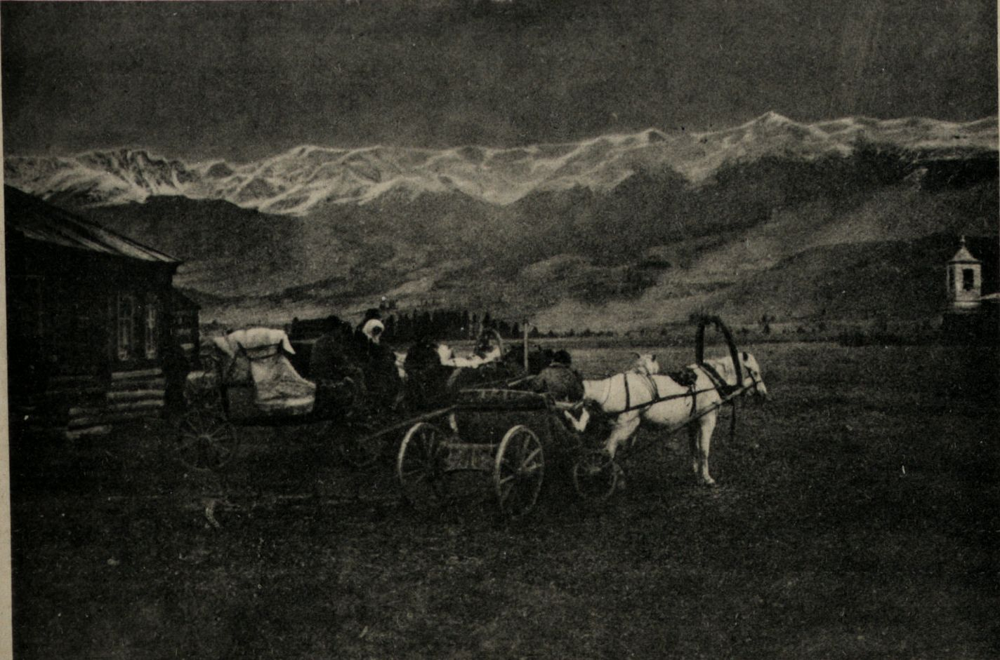

Station Kurai mit den Tschuiski-Alpen.

Tafel 10.

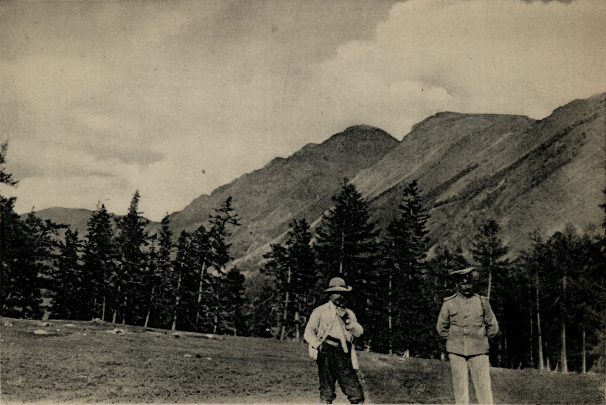

Kuachtanar

Tafel 11.

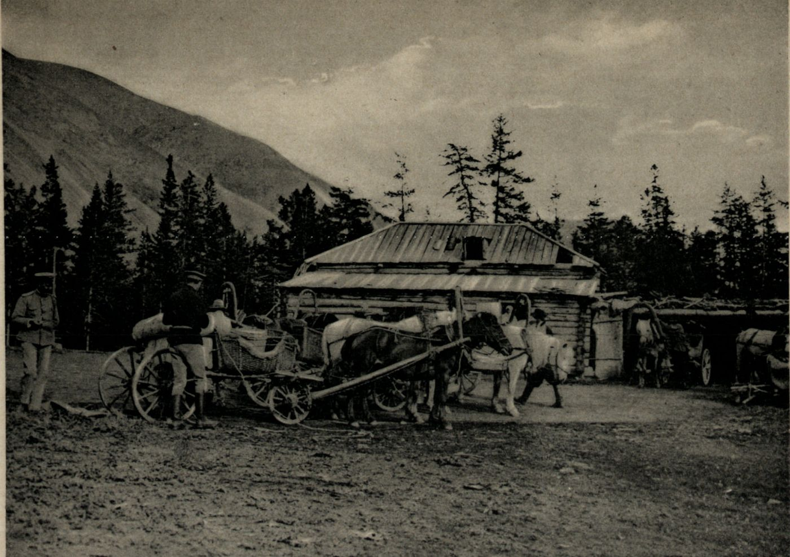

Kuachtanar. Postgebäude.

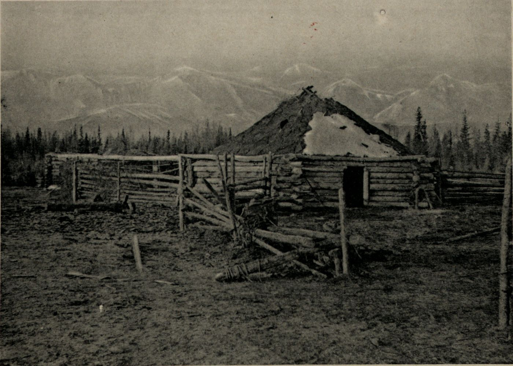

Die Kurai-Alpen. Im Vordergrund die achteckigen Holzkibithken der Tschui-Leute.

Tafel 12.

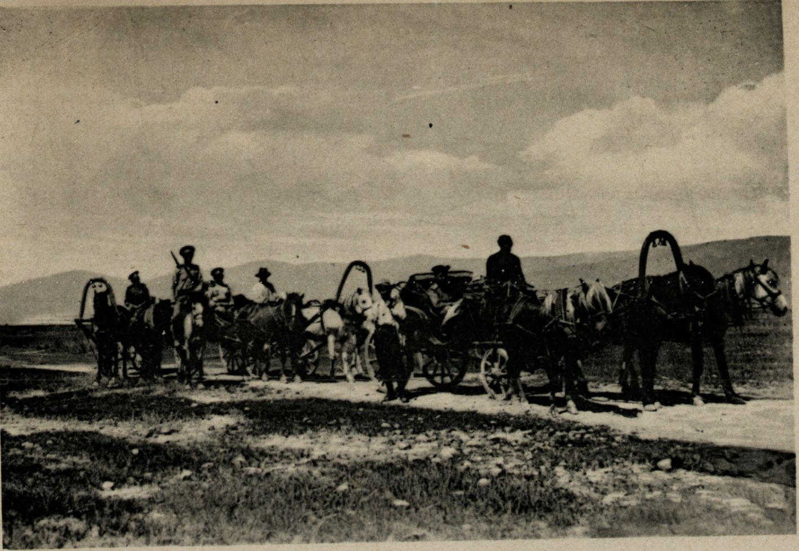

Mit der Troika durch die Tschuja-Steppe. Im Hintergrund das Sailjumengebirge.

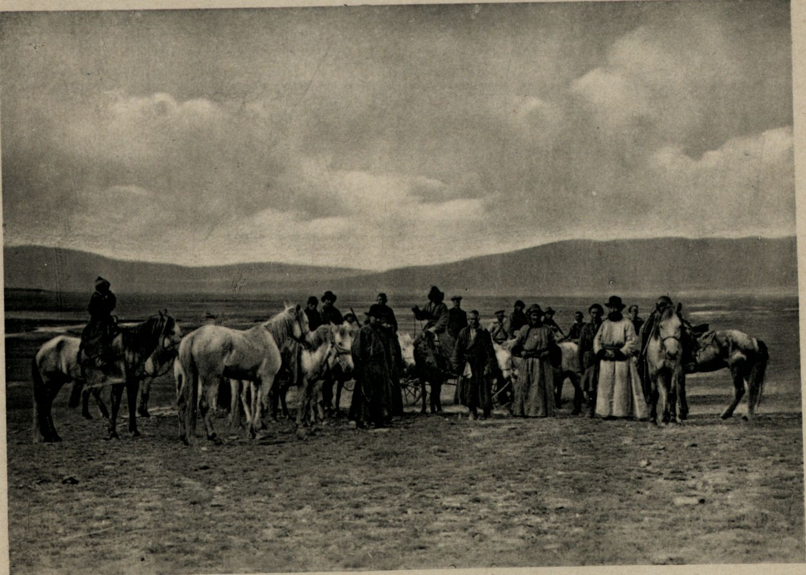

Tilingithen der Tschuja-Steppe.

<a id="57">**-- 57 --**</a>

sieht man den Untergang der japanischen Flotte, wie sie von dem mächtigen russischen Panzergeschwader mit berstenden Granaten überschüttet und versenkt wird. Wieder andere zeigen, wie die Kasaken die Japaner zu Hunderten mit ihren Lanzen und Säbeln niedermetzeln. Die Bilder Kuropatkins und Stössels fehlen nirgendwo. Diese Bilder dokumentieren lebhaft, wie man sich den Ausgang des Krieges vor dem ersten entscheidenden Zusammenstoß von Heer und Flotte in ganz Rußland dachte. Heute wissen es gerade die hier im Trakt lebenden Russen, daß es leider anders kam und kommen mußte, haben doch die meisten von ihnen --- darunter viele mit Auszeichnung --- in der sibirischen Brigade gegen die Gelben gefochten. Aber von irgend einem Haß ist bei ihnen nichts zu bemerken. Überall erkennen diese einfachen, praktischen Bauern die Überlegenheit der japanischen Führung und die todesmutige Tapferkeit der Gelben an.

Im flotten Galopp jagen wir über Stock und Stein. Die Glocken an den Troikas klingen hell durch die einsame, wellige Steppe, zur Linken haben wir den mit tiefem Schnee und Firn bedeckten Kurairücken. Noch einmal steigt stufenförmig der Trakt in engen Talfalten langsam empor. Durch enge, von Sturzbächen durchbrauste Täler schlängelt sich der Weg längs der bewaldeten Abhänge. Die Temperaturschwankungen sind auch hier bis Ende Juni sehr groß. Ende Mai beträgt die Temperatur etwa 22 Grad Reaumur nachmittags, des Morgens dagegen manchmal nur plus 3 Grad Reaumur.

*(Kuachtanar.)* Nach 2 Stunden haben wir Kuachtanar (1700 m Seehöhe), erreicht. Es ist ein kleines Blockhaus, rings von steilen, mit dunklem dichtem Kiefernwald bestandenen Bergen umschlossen. Schwere Regenwolken hängen auf den Gipfeln der Berge. Hier, auf einem der steilen Gipfel, in einem von allen Seiten umschlossenen Talkessel hat Hauptmann Rausch vor einer Woche ein starkes Rudel alter Steinböcke gesichtet, konnte aber leider wegen des stets umspringenden Windes nicht zu Schuß kommen. Noch einmal wechseln wir die Pferde. Der Weg wird breiter und etwas besser, noch einmal geht es über eine kleine Paßhöhe, und vor uns in einer Entfernung von etwa 10 Werst liegt Kosch- Agatsch, dessen Missionskirche weit inmitten der in 1700 m Seehöhe gelegenen Tschuiskisteppe sichtbar ist. An zahlreichen Tümpeln und kleinen Seen vorbei, die mit einer Unmege Wildenten und Wildgänsen bevölkert sind, führt der Weg nach dem einstweiligen Endziel unserer Reise. Noch einmal müssen der Tarantas und die Gepäckwagen halb schwimmend durch den niedrigen Tschui, und wir sind endlich in Kosch-Agatsch, wo uns im Semstwo-Quartier eine Kasaken-Eskorte erwartet, darunter mein alter Kasak vom vorigen Jahr, Popow.

<a id="58">**-- 58 --**</a>

## KAPITEL 4. IN DER MONGOLEI.

*(Von Kosch-Agatsch nach Uljasutai.)* Kosch-Agatsch ist die letzte Telegraphenstation, und schnell verbindet mich für eine kurze Spanne Zeit der Draht mit der fernen Heimat und den Moskauer Freunden.

In Kosch-Agatsch schwirren z. Z. die tollsten Gerüchte über die Kämpfe in der Mongolei. Der Name Kosch-Agatsch hat eine vielfache Deutung erhalten. Die Einen erzählen, der Name komme von "zwei Wälder", Urwälder, die einst die Steppe ausfüllten, andere wieder erklären ihn mit "zwei Bäume", die beiden letzten Überbleibsel jener Wälder, die heute mitten in Kosch-Agatsch als Zeugen der unsinnigen Zerstörungssucht des Menschen einsam in der Hauptstraße stehen, wenn ich es wagen darf, diesen Weg so zu nennen. Wieder andere sagen, der Name bezeichne einen Ort, wo das Holz so rar ist, daß es mittelst Pferdelast dorthin geschafft werden muß.

Auf der russischen Generalstabskarte ist Kosch-Agatsch als Lawki- Russkich Kupzow eingetragen, nämlich als "Verkaufsbuden der russischen Kaufleute".

*(Kosch-Agatsch.)* Der Gründer der Siedlung ist im vorigen Jahr gestorben. Vor etwa fünfzig Jahren drang er bis zum heutigen Kosch-Agatsch vor, handelte hier, erbaute sich ein Blockhaus, dem bald eine kleine Kapelle folgte, die er und sein Begleiter eigenhändig errichteten. Durch seinen ständigen Verkehr mit den Kirgisen war er in seinen Gewohnheiten beinahe selber zum Kirgisen geworden. In letzter Zeit war es sein Stolz, daß seine Pferde in den letzten Jahren beim 25 km Rennen der Kirgisen niemals geschlagen worden waren. Er starb als Millionär. In seinem Testament vermachte er eine große Summe für ein sogenanntes Volkshaus seiner Vaterstadt Biisk.

Auch heute hat Kosch-Agatsch nur eine Bedeutung als Durchgangsstation nach Kobdo und Uljasutai. Fünf russische Buden, einfache hübsche Blockhäuser mit mächtigen Höfen, die als Warenlager dienen; die Höfe und Stapelplätze einiger Biisker Großhändler --- darunter Ignatew, eine von den ältesten Firmen, die in der Mongolei handeln ---;

<a id="59">**-- 59 --**</a>

der große Ladehof eines Biisker Transportkontors, die hübsche Kirche, einige Hütten, die kleine, schmutzige Wohnung des Feldschers, die etwas außerhalb gelegene Post- und Telegraphenstation, sowie die Zoll- und Grenz gebäude, das ist Kosch-Agatsch.

Von Biisk nach Kosch-Agatsch beträgt die Entfernung 525 Werst und zwar verteilt sich die Entfernung auf folgende Stationen:

|                                          |            | Werst |
|------------------------------------------|------------|-------|
| Biisk---Katunskoi                        | 17         | 17    |
| Katunskoi---Smolensk                     | 12         | 29    |
| Smolensk---Staro Bjelekuricha            | 25         | 54    |
| Staro Bjelekuricha---Altaiskoi           | 25         | 79    |
| Altaiskoi---Komar                        | 27         | 106   |
| Komar---Tscherga                         | 25         | 131   |
| Tscherga---Miuta                         | 20         | 151   |
| Miuta---Chebalina                        | 15         | 166   |
| Chebalina---Tabuschaija                  | 20         | 186   |
| Tabuschaija---Werpichanskoi              | 15         | 201   |
| Werpichanskoi---Ust-Tenga                | 20         | 221   |
| Ust-Tenga---Ongudai                      | 37         | 258   |
| Ongudai---Kor-Ketschu (Fähre)            | 38         | 256   |
| Kor-Ketschu---Ust-Inja                   | 40         | 336   |
| Ust-Inja---Jodro                         | 33         | 369   |
| Jodro---Aigulak                          | 35         | 394   |
| Aigulak---Zibith                         | 22         | 426   |
| Zibith---Buchtala                        | 15         | 441   |
| Buchtala---Kurai (über den Archina)      | 20         | 461   |
| Kurai---Kuachtanar                       | 27         | 488   |
| Kuachtanar---Kosch-Agatsch               | 37         | 525   |

(*Witterungs-verhältnisse in der Kosch-Agatsh-steppe.*) Kosch-Agatsch liegt inmitten der Tschuja-(Tschui-)Steppe. Da es vom größten Interesse war, die Witterungsverhältnisse und Regen- mengen gerade hier festzustellen, so wurden die nötigen Beobachtungs- apparate aufgestellt. Der damalige Verwalter der Poststation besorgte die nötigen Ablesungen und Notizen. Nach seinem Weggange kümmerte sich keiner mehr um die kleine Station, man wollte sich, wie ich selbst auf Befragen feststellen konnte, nur dann der Mühe unterziehen, wenn man dafür entsprechend bezahlt würde. Die Daten sind daher äußerst dürftig. Im allgemeinen ist der Februar der kälteste Monat, bei absoluter Windstille und Trockenheit der Luft. Nach den spärlich vorhandenen Aufzeichnungen in Kosch-Agatsch zeigt die Minimal-Temperatur für Januar 1908 Schwankungen zwischen ---43,5 Grad Celsius und --- 25 Grad Celsius und dementsprechende Mittagstemperaturen von

<a id="60">**-- 60 --**</a>

--- 34 Grad und ---16 Grad C. Das äußerste Minimum fiel auf den fünften und sechsten Februar, --- 48,5 und --- 48 Grad, und Mittagstemperaturen von --- 35 und --- 34,2 Grad.

Im April schwankte die Temperatur zwischen --- 19,5 und --- 2 Grad. Erst im Mai steigt das Minimum über Null.

| Mai | 7 Uhr  | 1 Uhr   | 9 Uhr   | Minimum |
| --- |  ---   |  ------ |  ------ |  ------ |
| 5.  | + 3.2  | + 13    | + 3     | --- 0.5 |
| 15. | + 3.3  | + 18.10 | + 13.6  | --- 3.5 |
| 19. | + 9.8  | + 15    | + 9.9   | + 7     |
| 20. | + 6.3  | + 11.3  | + 13.5  | --- 0.5 |
| 23. | + 8.6  | + 15.6  | + 6.8   | + 3.5   |
| 25. | + 11.5 | + 19.6  | + 17.1  | + 7     |
| 26. | + 10.9 | + 13.2  | + 11.12 | + 8.5   |
| 27. | + 7.9  | + 16.8  | ---     | + 2.2   |

Für Frühlingsanfang können die obigen Angaben für den gesamten nördlichen Altai gelten. Das Eis der Flüsse, wie z. B. des Tschuja wurde schon Ende März 1913 stark brüchig, so daß ich beim Überfahren des Eises in Kosch-Agatsch in den Fluß durchbrach. Sonst aber rechnet man bis Ende April damit, daß man, allerdings mit dem Leichtsinn, der dem russischen Bauer und dem Jaemschik insbesondere beim Überfahr en des Eises eigen ist, noch den Tschuja bei Kosch-Agatsch und der mittleren Fähre zur Not passieren kann.

Am 14. April 1910 hatte ich in den Tälern von Zagan-Burgasi ---12 Grad Reaumur und in dem etwa 100 Werst von Kosch-Agatsch gelegenen Tal der Berge des Chor-Sadak am Flusse Chor-Sadak, dicht am Fuße des Kutschulu, eine Durchschnittstemperatur von ---5 Grad und daselbst am 25 April einen mächtigen Schneefall von 20 cm. Ständiger starker Nordweststurm, der oft kleine Steine durch die Luft trieb und eigroße Kieselsteine den Pferden zwischen die Beine rollte, wehte in dieser Jahreszeit beinahe ununterbrochen. ---

(Sailjumem-gebirge.) Das Grenzgebirge Sailjumem ist der äußerste östliche Ausläufer der von SO nach NW gerichteten Höhenzüge des nördlichen Altais. Seine höchsten Erhebungen schwanken zwischen 3000 und 3500 m Seehöhe. Die Höhenkette ist bogenförmig von S nach N gerichtet und nach NW offen.

Das Sailjumem-Gebirge ist die Wasserscheide zwischen den zum Ob- System abfließenden Wasserläufen des Altais und dem abflußlosen nordmongolischen Becken, das im Westen vom Sailjumem und im Norden von dem in 50 Grad nördlicher Breite und 90 Grad östlicher Länge sichelförmig einsetzenden Tannuolagebirge (Schrebet Tannuola) um-

<a id="61">**-- 61 --**</a>

schlossen wird. Die ganze bedeutende Kammhöhe des Sailjumem-Gebirges wirkt regenabfangend. Die mit den Nordwestwinden kommende Feuchtigkeit schlägt sich an den bewaldeten Hängen und Höhen nieder und fließt nach Westen ab. Östlich der Grenze, schon kurz hinter dem Paß Tarschantu im Tale des Bor-Burgasu und des Zagan-Burgasi, sowie auch östlich des Yandu-Gebirges sind die Niederschläge in einzelnen Teilen äußerst selten. Die Tschuja-Steppe selbst stellt eine nach Westen geneigte Hochebene dar, die am westlichen Fuß des Sailjumen-Gebirges wahrscheinlich durch Abtragung entstanden ist; rings umgeben von Gebirgswällen, die sich im Westen, Süden und Osten zu schroffen, schneebedeckten, alpinen Formen aufrichten, ist die Tschujasteppe als eine beträchtliche Einlagerung in die von NW nach SO sie begleitenden Höhenzüge anzusehen. Durch diese sie umsäumenden Höhenränder ist die Steppe arm an Niederschlägen. Die Regenmenge erreicht ihr Maximum im Juli mit etwa 8 mm Durchschnittshöhe, das Minimum mit oo im Februar. Desto reicher ist sie an Wasserläufen, so daß sie sogar in ihrem nordwestlichen Teil stellenweise sumpfigen Charakter annimmt.
Bär, Wolf, Steinbock und auf chinesischem Gebiet das Argali bevölkern die die Steppe umgebenden Gebirge. In der Steppe selber ist die Dseren- Antilope (Antilope Gutturosa) zu Tausenden vertreten.

*(Der Fluß Tschuja.)* Der Fluß Tschuja (Tschui), der der Steppe und dem Trakt den Namen gab, entspringt nordöstlich von Kosch-Agatsch in der Nähe des Wogo-  suk Perewal 1) in einer Höhe von 2750 m Seehöhe. Dicht bei seinem Quellgebiet nimmt er mehrere Wildbäche auf, die vom Karaschaija Perewal kommen. Er fließt an der Nordseite der Hochebene entlang und dicht vor Kosch-Agatsch münden starke, von den Nordabhängen der Tschuja-alpen kommende Wildbäche in ihn. In Kosch-Agatsch ist er etwa 100 m breit und sehr fischreich. Die obere Hälfte der Steppe zum Jandu- gebirge ist demgegenüber verhältnismäßig trocken. *(Die Bevölkerung der Tschuja-Steppe.)* Die Steppe wird hier  von den Kirgisen bevölkert, die als Nomaden leben. Sie sind meistens  tartarischer Abkunft, darunter viele Christen, obwohl es manchmal mit dem Christentum nicht weit her ist. Flotte Reiter, sind sie zu Fuß ganz unbeholfen. In den gelben, grünen, blauen Stiefeln, mit unwahrscheinlich hohen, nach den Zehen zu gebogenen Absätzen, die den Fuß klein erscheinen lassen, können sie nur wackelnd gehen, desto fester sitzt der Fuß im Bügel, der zwischen der Sohle und dem Absatz eingeschoben wird. Ein paar ähnliche Exemplare von Stiefeln sah ich im Hause Romanow zu Moskau; sie waren das Eigentum des ersten Zaren aus dem Haus Romanow, Michail Feodorowitsch.

1) Perewal = Pass.

<a id="62">**-- 62 --**</a>

Mit ihren langen Fuchsfellmützen, den dunklen, mit Silberknöpfen oder russischen Silberrubeln benähten kurzen Jacken und ihren Lederhosen, machen sie bei der Sauberkeit und hellen Hautfarbe, sowie der Intelligenz ihrer Gesichter einen angenehmen Eindruck. Sie sind häufige Besucher von Kosch-Agatsch, wo sie in den kleinen Läden in Gruppen von fünf oder sechs, manchmal mit ihren hübschen Frauen gemeinsam einkaufen.

*(Die politishe Lage in der Mongolei.)* Kosch-Agatsch ist die letzte Telegraphen- und Poststation, sowie auch die Zollstation, die wir zu passieren haben. Draußen hinter den östlichen Bergen und Tälern tobt der Kampf um die Freiheit eines seit Jahrhunderten unterjochten, durch seine friedliche Religion sich selbst zur Knechtschaft verurteilenden Volkes. Mit Rußlands Hilfe versucht der Mongole sich der Chinesen-Herrschaft und Ausbeutung zu entledigen. Alles Recht ist scheinbar auf Seiten der Rebellen, die nur durch Personal- Union mit den Mandschus und so mit dem chinesischen Kaiserreich verknüpft sind. Nach der Vertreibung der Mandschus, der Absetzung des Kaisers und der Erklärung der Republik sagten sich die Mongolen auf Betreiben Rußlands von China, dem sie die tüchtigsten Herrscher geschenkt hatten, los. Die Republik ist dem Mongolen wesensfremd und bei seiner Hierarchie und politischen Einteilung unter den angestammten Fürsten unverständlich. Angeblich kämpft der Mongole für seine Freiheit, offenkundig heute von Rußland darin unterstützt, faktisch für die Vernichtung der chinesischen Kolonisation, die für den Irkutsker Rayon gefährlich werden kann, und dadurch Rußland zwingen würde, an der Grenze große Garnisonen zu unterhalten, --- sowie des chinesischen Handels, der den russischen vollständig erdrückt hat. Daß auch der europäische und amerikanische Handel durch die Vertreibung der chinesischen Kaufleute arg betroffen wird, ist selbstverständlich, da die Chinesen über Tientsin und Kalgan eine Menge ausländischer Waren nach der Mongolei importieren. Tatsächlich kämpft der Mongole für eine Monopolstellung des sterbenden russischen Handels in der Mongolei.

<a id="63">**-- 63 --**</a>

## KAPITEL 5. DER RUSSISCHE HANDEL IN DER MONGOLEI.

Folgende Daten mögen einen allgemeinen Überblick über die Entwicklung und den Rückgang des russischen Handels bis zum Ausbruch der mogolischen Empörung geben. Rußland war damals vor die Alternative gestellt, mit seinem Handel sang- und klanglos aus der Mongolei zu verschwinden und den Chinesen die Ausbeutung der Mongolen allein zu überlassen, oder aber mit dem Schwert den gordischen Knoten zu durchhauen. Es bewaffnete die Mongolen, um seinen Handel zu retten. Da die russischen Handelsbeziehungen sich nicht bloß über die äußere Mongolei, sondern auch in die Ostmongolei erstrecken, so mögen hier einige statistische Daten über den russischen Handel sowohl in der äußeren, wie in der östlichen Mongolei folgen, da man stark mit dem Anschluß der Ostmongolen und der Vertreibung der dortigen Chinesen rechnet.

| Jahr | Wert der Einfuhr in Rubel | Jahr | Wert der Einfuhr in Rubel |
| ---  |  ------------------------ |  --- |  ------------------------ |
| 1899 | 3.117.649                 | 1905 | 3.641.229                 |
| 1900 | 2.737.7I5                 | 1906 | 4.571.175                 |
| 1901 | 2.388.174                 | 1907 | 4.509.064                 |
| 1902 | 3.929.126                 | 1908 | 3.715.487                 |
| 1903 | 4.309.291                 | 1909 | 2.621.029                 |
| 1904 | 3.266.931                 |      |                           |

Der Export, in tausend Rubel gerechnet, verteilt sich wie folgt über folgende Zollämter:

| Jahr | Kosch-Agatsch | Bachtinsk | Saisan | Kiachta |
| ---- |  ------------ | --------- |  ----- |  ------ |
| 1899 | 369           | 1.316     | 458    | 976     |
| 1900 | 373           | 1.316     | 454    | 994     |
| 1901 | 414           | 1.431     | 332    | 212     |
| 1902 | 578           | 2.088     | 507    | 752     |
| 1903 | 496           | 2.483     | 561    | 768     |
| 1904 | 294           | 1.784     | 511    | 677     |
| 1905 | 437           | 1.491     | 474    | 1.239   |
| 1906 | 550           | 1.741     | 688    | 1.592   |
| 1907 | 563           | 2.424     | 776    | 747     |
| 1908 | 364           | 1.995     | 801    | 556     |
| 1909 | 294           | 1.347     | 791    | 189     |

<a id="64">**-- 64 --**</a>

Auffallend und ins Auge springend ist der starke Rückgang der Einfuhr über Kiachta, um so mehr, als sich der Import durch den sich in der Mandschurei abspielenden Krieg, der die Durchfuhr von Waren nach China hinderte, stark gehoben hatte. Die Ware wurde über Kiachta, Urga, Kalgan transportiert. Die Mongolei selber war an dem plötzlichen Hochschwellen der Einfuhr über Kiachta nicht beteiligt. Um so empfindlicher machte sich dann der Rückschlag geltend, als die Eisenbahnlinie wieder frei wurde. Durch den unglücklichen Verlauf des Krieges war das Prestige des weißen Mannes stark gesunken. China schritt zur Kolonisation der Mongolei, der durchaus tüchtige, chinesische Kaufmann machte mit seinen guten deutschen, englischen und amerikanischen Waren dem russischen Händler mit seinen minderwertigen Dodzer und Moskauer Erzeugnissen scharfe Konkurrenz, und drückte den russischen Handel schließlich an die Wand.

Die Zahlen des Zollamtes von Kosch-Agatsch zeigen am besten den Rückgang des russischen Handels in der Mongolei und die Konkurrenz der Chinesen, da Kosch-Agatsch als Exportplatz nach China hin beinahe gar nicht mehr in Betracht kommt.

Die Einfuhr verteilt sich folgendermaßen, in Rubel: Lebensmittel: 65 000---310 000 im Jahr.

Vieh: von 6 000---190 000 im Jahr.

Rohstoffe und halbverarbeitete Stoffe: von 316 000---988 000. Fertige Ware: 1 755 000---3 492 000. Diese letztere macht also 67---89% der ganzen Einfuhr aus.

Den ersten Platz in der russischen Ausfuhr nahmen Baumwollen-erzeugnisse ein.

Baumwollenzeug und Stoffe im Durchschnitt pro Pud berechnet.

|               | 1899 --- 1901 | 1903   | 1904   | 1905   | 1906   | 1907   | 1908   | 1909   |
|---------------|---------------|--------|--------|--------|--------|--------|--------|--------|
| Kosch-Agatsch | 3.604         | 6.861  | 1.850  | 3.909  | 4.014  | 4.178  | 2.282  | 1.607  |
| Bachtinsk     | 25.236        | 44.392 | 24.029 | 18.495 | 21.639 | 30.065 | 23.728 | 12.969 |
| Saisan        | 8.381         | 9.377  | 8.253  | 7.068  | 8.562  | 11.628 | 10.872 | 9.824  |
| Kiachta       | 6.845         | 8.886  | 6.260  | 11.797 | 14.863 | 6.988  | 3.331  | 3.105  |
| Summa         |               | 69.516 | 40.392 | 41.269 | 49.078 | 52.859 | 40.213 | 27.505 |

Das Maximum der Ausfuhr an Baumwollenstoffen zählt das Jahr 1903, während des Krieges ging die Ausfuhr zurück, erholte sich wieder und

<a id="65">**-- 65 --**</a>

fiel plötzlich beinahe um die Hälfte. An den Punkten Kosch-Agatsch ist der Rückgang besonders augenfällig.

Der Handel mit Metallwaren, hauptsächlich Eisen und Stahl, geht über das Bachtinski-Zollamt, und zwar wurden dort in den letzten sieben Jahren etwa 27 000---44 000 Pud eingeführt. Über Kosch-Agatsch und Saisan betrug die Einfuhr 1000---2000 Pud pro anno. Dagegen wurden über Kiachta Eisen- und Stahlwaren nicht eingeführt. Die Einfuhr über Kosch-Agatsch, nach Kobdo und Uljasutai ist in den Jahren 1908 bis 1909 beinahe um das Fünffache gefallen und zwar von 953 Pud auf 207 Pud. In Bachtinsk und Saisan war ein Rückgang nicht zu bemerken.

Dagegen ist die Einfuhr von Eisenwaren und Maschinen nach der Mongolei nicht besonders stark zurückgegangen, obwohl über Kiachta, wie schon gesagt, diese Waren überhaupt nicht mehr eingeführt werden.

Einfuhr der Eisenwaren im Durchschnitt pro Pud berechnet.

|               | 1899 --- 1901 | 1903   | 1904   | 1905   | 1906   | 1907   | 1908   | 1909   |
|---------------|---------------|--------|--------|--------|--------|--------|--------|--------|
| Kosch-Agatsch | 3.783         | 4.672  | 3.132  | 2.851  | 4.025  | 4.566  | 3.172  | 1.776  |
| Bachtinsk     | 11.763        | 12.219 | 18.366 | 16.117 | 14.853 | 10.787 | 9.504  | 8.744  |
| Saisan        | 525           | 518    | 1.520  | 2.169  | 1.939  | 1.744  | 1.435  | 1.815  |
| Summa         | 16.071        | 17.409 | 23.018 | 21.137 | 20.817 | 17.097 | 14.111 | 12.315 |

Der Rückgang der Eiseneinfuhr und Maschinen über Kosch-Agatsch nach der Nordmongolei vollzog sich eben parallel dem allgemeinen Niedergang der russischen Ausfuhr durch den Tschuiski-Trakt.

Die Ausfuhr von gegerbtem schwarzem Juchtenleder nach der äußeren Mongolei erreichte ihre Maximalhöhe 1906, um dann rapid zu fallen.

|               | 1906   | 1907   | 1908   | 1909          |
|---------------|--------|--------|--------|---------------|
| Kosch-Agatsch | 2.613  | 2.185  | 1.302  | 1.012         |
| Bachtinsk     | 1.183  | 1.296  | 1.048  | 561           |
| Saisan        | 1.172  | 1.947  | 2.068  | 1.712         |
| Kiachta       | 30.413 | 6.659  | 5.441  | 280           |
| Summa         | 35.381 | 12.087 | 98.059 | 35.065 Stück. |

Die Ausfuhr russischer Galanteriewaren nach der Mongolei war immer klein, zeigte aber dennoch einen deutlichen Rückgang in den Jahren 1908 und 1909, und zwar fiel sie über Kosch-Agatsch von 1291 Pud auf 721 Pud.

Die russische Ausfuhr von Zucker und Zuckerwaren hält sich ohne

<a id="66">**-- 66 --**</a>

merklichen Rückgang auf der Höhe, weil die Chinesen von Tschuguschak und Urga selber als Käufer auftreten.

Ausfuhr von russischem Zucker und Zuckerwaren in Pud.

|               | 1899-1903 | 1904   | 1904   | 1905  | 1906   | 1907   | 1908   | 1909   |
|---------------|-----------|--------|--------|-------|--------|--------|--------|--------|
| Kosch-Agatsch | 367       | 418    | 332    | 355   | 1.510  | 2.477  | 300    | 711    |
| Bachtinsk     | 3.305     | 8.269  | 6.717  | 3.606 | 13.963 | 13.548 | 17.371 | 10.110 |
| Saisan        | 344       | 54     | 57     | 114   | 185    | 300    | 211    | 194    |
| Kiachta       |           | 13.555 | 10.941 | 2.884 | 4.402  | 8.048  | 15.663 | 12.535 |
| Summa         | 4.956     | 22.296 | 18.047 | 6.959 | 20.066 | 24.373 | 33.545 | 23.550 |

Die Einfuhr von russischem Mehl erreichte auch eine bedeutende Höhe, und zwar schwankt sie zwischen 142 000 Pud und 80 000 Pud. Den Hauptanteil hat Bachtinsk, über Saisan wurden etwa 30 000 Pud eingeführt, und sie zeigt hier eine steigende Tendenz; in der nördlichen Mongolei über Kosch-Agatsch 12 000 Pud. Die Einfuhr von Mehl über Kiachta ist dieselbe wie in jedem Jahr.

Bei den aufgeführten Zahlen ist der starke Rückgang aller wichtigen Handelsartikel nach der nördlichen Mongolei auffallend, besonders an den Zollämtern in Kosch-Agatsch und Kiachta.

Betrachten wir nun den Export der Mongolei nach Rußland.

Rußland führt aus der Mongolei außer den eigentlichen mongolischen Rohartikeln auch chinesische Ware aus wie Tee, Baumwolle und Seidenstoffe, auf die näher einzugehen, da sie nicht rein mongolische Produkte sind, sich erübrigt.

Die Einfuhr von Rohprodukten und halbverarbeitetem Material zeigt eine steigende Tendenz, und zwar

|      |                  |
|------|------------------|
| 1903 | 3.643.432 Rubel  |
| 1904 | 4.151.546        |
| 1905 | 4.266.644        |
| 1907 | 5.143.088 Rubel  |
| 1908 | 5.678.024        |
| 1909 | 8.097.487        |

Die mongolische Ausfuhr von Rohwaren und Lebendvieh spielt im russischen Volksleben und bei der Verpflegung der Armee in Sibirien häufig schon jetzt eine große Rolle. Bekommt man doch schon in Petersburg und Moskau recht oft mongolischen Hammel. Irkutsk schlachtet täglich 400 Stück Rindvieh, davon ist wohl auch der größere Teil mongolischen Ursprungs.

<a id="67">**-- 67 --**</a>

Die mongolische Einfuhr ist an dem allgemeinen russischen Import in folgenden Artikeln wie folgt beteiligt:

|                                            |         |
|--------------------------------------------|---------|
| Rohhäute (trocken und gesalzen)            | 12%,    |
| Wolle und Pelzware (ungefärbt)             | 13%,    |
| Pferdehaare                                | 25.5%,  |
| Pilz und aus Filz hergestellte Gegenstände | 34.2%,  |
| Pferde                                     | 10.8%,  |
| Kleinvieh, Schafe, Ziegen usw              | 24.9%,  |

Aber auch hier droht dem russischen Handel Gefahr.

Die Rührigkeit der Chinesen verstand es, in den letzten zwei Jahren vor Ausbruch der mongolischen Revolution, dem russischen Import empfindlichen Abbruch zu tun und die Ausfuhr der oben genannten Produkte über Kalgan nach Tientsien und von dort nach Europa und Amerika zu leiten. Die Ausfuhr auf diesem Wege wuchs ständig.

Überblick über das ausgeführte Roh- und halbverarbeitete Material und Lebensmittel in Rubel.

|      | Kosch-Agatsch | Bachtinsk | Saisan  | Kiachta   |
|------|---------------|-----------|---------|-----------|
| 1903 | 1.163.729     | 1.564.477 | 357.113 | 558.113   |
| 1904 | 1.334.383     | 2.090.409 | 413.837 | 311.917   |
| 1905 | 1.529.745     | 1.917.828 | 463.685 | 355.386   |
| 1906 | 1.192.298     | 1.858.296 | 614.493 | 867.054   |
| 1907 | 1.571.207     | 1.978.405 | 722.107 | 821.369   |
| 1908 | 1.476.296     | 2.189.987 | 737.134 | 1.274.600 |
| 1909 | 1.502.547     | 2.484.439 | 665.689 | 3.484.812 |

Die auffallende Steigerung des Exports über Kiachta, gerade dem Platz, wo die Einfuhr russischer Waren stark zurückging, ist darauf zurückzuführen, daß die russischen Kaufleute von den chinesischen bedrängt, sich energisch auf die Ausfuhr von Rohartikeln warfen.

Der Mongole verkauft heute an den russischen Händler die Produkte seiner Herden und seiner Jagdbeute, hauptsächlich Vieh, Rauchware, Felle, Häute, Wolle, Pferdehaar und von verarbeiteten Sachen Filz und aus Filz hergestellte Gegenstände. Die Einfuhr dieser Waren nach Rußland über die russischen Zollämter zeigt in den lezten vier Jahren eine steigende Kurve. Die Einfuhr von Rohhäuten in Pud über Kiachta gibt hierüber ein klares Bild.

|               | 1906      | 1907   | 1908   | 1909  |
|---------------|-----------|--------|--------|-------|
| Kosch-Agatsch | 101       | 409    | 455    | 1.130 |
| Bachtinsk     | 11.142    | 11.022 | 8.575  | 12.409|
| Saisan        | 10.609    | 15.013 | 13.548 | 15.096|
| Kiachta       | 747       | 10.894 | 5.268  | 16.931|

Auffallend ist, daß der Export von Rußland nach der Mongolei an fertigem Leder um ein bedeutendes fiel, so z. B. wird über Kiachta

<a id="68">**-- 68 --**</a>

beinahe kein fertiges Leder nach der Mongolei mehr eingeführt; dagegen hat sich die Ausfuhr von Rohhäuten nach Rußland um das 27 fache gehoben. Daraus ergibt sich, daß Rußland für den eigenen Verbrauch die Rohhäute einführt und nicht wieder als Leder in die Mongolei exportiert. In einer ganz ähnlichen Lage befindet sich der Handel mit Hammelund Ziegenfellen.

Es werden eingeführt Hammel- und Ziegenfelle pro Pud:

|               | 1906   | 1907   | 1908    | 1909    |
|---------------|--------|--------|---------|---------|
| Kosch-Agatsch | 2.335  | 2.553  | 1.539   | 8.770   |
| Bachtinsk     | 52.459 | 51.639 | 46.381  | 57.470  |
| Saisan        | 19.360 | 28.358 | 32.077  | 32.129  |
| Kiachta       | 3.065  | 13.252 | 23.681  | 33.707  |
| Summa         | 77.219 | 95.802 | 103.673 | 132.076 |

Hieraus ergibt sich, daß die Einfuhr auf allen Zollämtern eine steigende Tendenz zeigt, besonders aber stark in Kiachta.

Die Einfuhr von rohen Pelzwaren und Fellen von Raubtieren aus der Nordmongolei geht über Kosch-Agatsch und Kiachta. Aus der Ost- mogolei dagegen ist die Menge nicht genau festzustellen.

|                     | 1906   | 1907   | 1908   | 1909   |
|---------------------|--------|--------|--------|--------|
|                     |        | in Pud |        |        |
| Kosch-Agatsch       | 5.899  | 9.237  | 13.172 | 8.629  |
| Bachtinsk u. Saisan | 314    | 220    | 424    | 671    |
| Kiachta             | 8.341  | 4.224  | 10.890 | 24.791 |
| Summa               | 14.554 | 13.686 | 24.486 | 34.091 |

Auch hier ist wieder eine starke Ausfuhr über Kiachta festzustellen. Das liegt allerdings an der Verbindung des russischen Zollamtes Kiachta mit der mongolischen Zentrale Urga, wohin jährlich etwa 100 000 Mongolen wallfahren, um den Chutuchtu zu verehren; sie bringen häufig als Geschenke und Opfergaben edles Pelzwerk mit, das dann von den Mönchen und der Umgebung des Gottes an die russischen Händler losgeschlagen wird.

Die Ausfuhr von Wolle und Pelzen nach Rußland zeigt eine ständig aufsteigende Linie, allerdings nur durch die stark vermehrte Ausfuhr über Kiachta hervorgerufen, wogegen Kosch-Agatsch zurückgegangen ist.

Wolle und Pelzwaren in Pud

|               | 1904    | 1905    | 1906    |
|---------------|---------|---------|---------|
| Kosch-Agatsch | 140.610 | 137.603 | 111.161 |
| Bachtinsk     | 37.103  | 107.721 | 107.849 |
| Saisan        | 16.650  | 16.975  | 30.280  |
| Kiachta       | 12.858  | 17.374  | 24.695  |
| Summa         | 267.221 | 279.673 | 273.985 |

<a id="69">**-- 69 --**</a>

|               | 1907    | 1908    | 1909    |
|---------------|---------|---------|---------|
| Kosch-Agatsch | 131.718 | 122.304 | 108.168 |
| Bachtinsk     | 100.137 | 81.774  | 105.387 |
| Saisan        | 23.858  | 17.084  | 16.502  |
| Kiachta       | 38.794  | 53.070  | 112.334 |
| Summa         | 296.507 | 274.232 | 342.391 |

Pferdehaare werden hauptsächlich über Kosch-Agatsch und Bachtinsk ausgeführt, und zwar etwa 1700---2700 Pud pro Jahr.

Für Filz und aus Filz hergestellte Gegenstände hält sich die Kurve in etwa auf der gleichen Höhe, obwohl Kiachta anfängt, auch hier nachzulassen, wogegen die Ausfuhr aus der Ostmongolei sich hob.

|               | 1904   | 1905   | 1906 in Pud | 1907   | 1908   | 1909   |
|---------------|--------|--------|-------------|--------|--------|--------|
|               |        |        | in Pud      |        |        |        |
| Kosch-Agatsch | 383    | 348    | 402         | 852    | 728    | 526    |
| Bachtinsk     | 5.438  | 3.521  | 3.449       | 3.882  | 3.827  | 6.940  |
| Saisan        | 7.933  | 9.371  | 9.931       | 12.688 | 10.397 | 11.201 |
| Kiachta       | 4.436  | 3.944  | 1.139       | 1.662  | 1.802  | 1.052  |
| Summa         | 18.190 | 17.184 | 14.921      | 19.084 | 16.754 | 19.719 |

Die Ausfuhr von Wolle und Filzhüten, die sich früher gut anließ, ist beinahe ganz zurückgegangen, und zwar werden aus der ganzen Mongolei über Bachtinsk exportiert:

| 1905   | 1906   | 1907  | 1908  | 1909        |
|--------|--------|-------|-------|-------------|
| 44.122 | 19.769 | 9.612 | 1.491 | 2.455 Stück |
| 41.722 | 18.609 | 9.388 | 1.386 | 1.840       |

Die Ausfuhr von Lebendvieh ist statistisch nur in Kosch-Agatsch nachzuweisen. Der Viehtransport aus dem Selenga-Gebiet über Tunku nach Irkutsk und aus Urga nach Kiachta, Troiskoisawsk, sowie Uljasutai Irkutsk ist nicht festzustellen. Über Kosch-Agatsch wird aus der Nordmongolei in reichlichem Maße Lebendvieh ausgeführt, und zwar 1905---1909 jährlich etwa 1325 Stück Großvieh und 4100 bis 11 930 Stück Kleinvieh. Letztere Ausfuhr zeigt eine steigende Tendenz.

Pferde werden jährlich etwa 20 Stück über die Grenze getrieben. Aus der Ostmongolei über Bachtinsk und Saisan ist die Ausfuhr von Lebendgroßvieh äußerst gering, hauptsächlich wird Kleinvieh über beide Zollämter getrieben. Über Bachtinsk wurden von 1904---1909 etwa 52 bis 102 000 Stück im Jahre ausgeführt, über Saisan 36---62 000.

An Großvieh wurden über Bachtinsk ausgeführt 1904 8416 Stück; die Ausfuhr fiel bis 1906 auf 386 Stück. 1907 fand überhaupt kein Viehtransport mehr statt, wogegen er sich von 1908---1909 stark erholte, und zwar 1909 mit 6636 Stück.

Über Saisan wurden jährlich 145 bis 900 Stück nach Rußland eingeführt, die Einfuhr schnellte aber im Jahre 1909 auf 2924 Stück empor.

<a id="70">**-- 70 --**</a>

Über Bachtinsk wurden Pferde hauptsächlich für die russische Armee in Sibirien geliefert, und zwar etwa 154 bis 2835 Stück jährlich. Über Saisan wurden meistens Pferde zum Privatgebrauch eingeführt, und zwar 64 bis 496 Stück pro Jahr.

Aus dem Vorstehenden geht hervor, daß der Viehtransport über Kosch-Agatsch durch den Tschuiski-Trakt aus der Nord- und Ostmongolei sich nicht vergrößert hat.

Auf das wichtige Uranchai-Gebiet, das zur Verwaltung des Konsulats von Uljasutai gehört, werde ich in meiner handelspolitischen Besprechung dieses Punktes zurückkommen.

*(Massenmord der Pelztiere)* Es sei hier noch kurz die Ausfuhr des edlen und und halbedlen Pelz- werks der Mongolei, das allerdings meistens aus dem Uranchai-Gebiet stammt, gestreift.

Inletzter Zeit ist die Nachfrage nach Pelz werk, besonders in Deutschland, stark gestiegen und die Ausfuhr desselben über Rußland steht mit an erster Stelle. Mir sei hier kurz ein Wort über den Massenmord an Pelztieren, den die Mode auf einmal in ganz unsinniger Weise veranlaßte, gestattet. In den Straßen von Moskau, Petersburg, Berlin, London, Paris wurden im Jahre 1913/1914 plötzlich Füchse als letzter Schrei der Mode von unseren Damen, Halbweltdamen und Damen von noch etwas niedrigerer Kategorie theatralisch um die Schultern getragen. Zum größten Teil stammten diese Tiere aus der Mongolei. Eine in Leipzig und London angesessene große Firma gab ihren russischen Angestellten die Order, zu jedem Preise Füchse aufzukaufen. Die Fuchsfelle, die früher etwa 3 bis 4 Lan kosteten, schnellten plötzlich bei der starken Nachfrage auf 10 Lan und mehr. Um das Fell nicht zu ruinieren, wurde den mongolischen Jägern und russischen Kleinhändlern Strychnin, made in Germany, überlassen, und zwar in ganz tollen Mengen. So sah ich in Urga in einer kleinen Bude einen Schrank, einen Meter breit, 2 1/2 m hoch, dichtgefüllt mit Strichnin. Anscheinend ist nun dem Strychnin dieselbe Rolle zugefallen, wie der Büchse in Afrika, nämlich einzelne Tierarten, deren Pelz plötzlich Mode wird, auszurotten. Die obenerwähnte Firma soll nach mir an Ort und Stelle gemachten Angaben in Urga, sowie Uljasutai an Füchsen im letzten Jahre für 1 1/2 Millionen Rubel gekauft haben.

Folgende Tabelle gibt einen Überblick über den Handel mit Pelztieren in Pud:

|               | 1906   | 1907   | 1908   | 1909   |
|---------------|--------|--------|--------|--------|
| Kosch-Agatsch | 5.899  | 9.237  | 13.171 | 8.629  |
| Kiachta       | 8.341  | 4.224  | 10.890 | 24.791 |
| Usinsk        | 402    | ---    | 45     | 4.027  |
| Saisan        | 32     | 32     | 59     | 23     |
| Summa         | 14.674 | 13.493 | 24.166 | 37.470 |

<a id="71">**-- 71 --**</a>

Außerdem gingen über Kiachta:

|                                      | 1906  | 1907  | 1908  |
|--------------------------------------|-------|-------|-------|
|                                      | Stück | Stück | Stück |
| Seebiber                             | 25    | 14    | ---   |
| Gynott                               | 8.276 | 4.145 | 687   |
| Bär und Wolf                         | 9     | ---   | ---   |
| Fuchs                                | 31    | ---   | 513   |
| Luchs und Marder                     | ---   | 65    | ---   |
| Schwänze von Jacks und Eichhörnchen  | ---   |       | 52    |
| Verschiedene Sorten                  | ---   | ---   | 9.626 |

Nach den Angaben der russischen Kaufleute in Kiachta wurden über das Zollamt Kiachta im Jahre 1909 aus der Mongolei Pelzwaren und Felle für 1 882 557 Rubel ausgeführt. Dazu kamen noch die Felle vom Surok (Tabargan = Murmeltier), 1 853 767 Stück im Werte von 1 353 596 Rubel, Füchse 15 017 Stück im Werte von 99 289 Rubel.

Ganz anders sehen allerdings die Zahlen vom Zollamt Kosch-Agatsch aus:

|                                    | 1906   |         | 1907  |         | 1908  |         | 1909  |         |
|------------------------------------|--------|---------|-------|---------|-------|---------|-------|---------|
|                                    | Pud    | Rubel   | Pud   | Rubel   | Pud   | Rubel   | Pud   | Rubel   |
| Surok inkl. Fuchs u. Eichhörnchen  | 5.687  | 209.424 | 9.181 | 397.446 | 8.451 | 368.396 | 8.326 | 449.469 |
| Zobel                              | 8 Pfd. | 820     | 2 1/2 | 5.330   | 1,24  | 5.132   | 1.6   | 5.571   |
| Gynott                             | 58     | ---     |       | ---     | ---   | ---     | ---   | ---     |
| Iltis                              | 55     | 1.655   | 59    | ---     | ---   | ---     | ---   | ---     |
| Eichhörnchen                       | ---    | ---     | ---   | ---     | 261   | ---     | 9     | 1.203   |
| Bär und Wolf                       | 1      | ---     | ---   | ---     | ---   | ---     | 22    | 993     |
| Luchs                              | ---    | ---     | ---   | ---     | ---   | ---     | 31    | 7.332   |
| Seebiber                           | 4      | ---     | 3     | ---     | 11    | ---     | ---   | ---     |
| Maral                              | 21     | 305     | 22    | 388     | ---   | ---     | ---   | ---     |
| Füchse                             | 5      | ---     | 2     | ---     | ---   | ---     | ---   | ---     |

Der Hauptträger des Pelzhandels, der sein Fell lassen muß, ist der Surok (Tabargan), dem nur der Fuchs bedenklich naherückt. Nicht ohne Interesse und Mitgefühl verfolgt man die Vernichtung dieses Tieres, das

<a id="72">**-- 72 --**</a>

allerdings in dem Rufe steht, ein Pestträger zu sein, obwohl die Pest in der äußeren Mongolei meines Wissens nicht vorkommt. Jedenfalls steht dem Surok die Vernichtung ganz ähnlich wie dem Zobel, der ihm an Mengen nichts nachgab, bevor.

Das Jahr 1892 lieferte 6325 Pud Surok, das Jahr 1893 lieferte 70 027 Pud; 1901 170 027 Pud; das Jahr 1909 aber nur 8000 Pud.

Die Preise waren 1892 5 bis 6 Kopeken, 1909 65 Kopeken; 1910 1 1/4 bis 1 1/2 Rubel.

Die Hauptkäufer des Surok sind die Leipziger Firmen Biedermann und Gutbezahler.

Auch auf dem Pelzmarkt ist der russische Handel gegenüber dem der Chinesen ins Hintertreffen geraten. Ich gebe hier als klassisches Beispiel die Ausfuhr aus Urga an:

|                   | Kalgan    | Kiachta   |
|-------------------|-----------|-----------|
| Surok             | 500.000   | 1.556.500 |
| Eichhörnchen      | 1.400.000 | 162.740   |
| Wölfe             | 120.000   | 1.314     |
| I. Sorte Füchse   | 150.000   | 15.456    |
| II. Sorte Füchse  | 80.000    | ---       |
| Luchs             | 3.500     | 479       |
| Iltis             | ---       | 1.313     |
| Zobel             | 200       | 47        |
| Wildkatzen        | 500.000   | ---       |

Tafel 13.

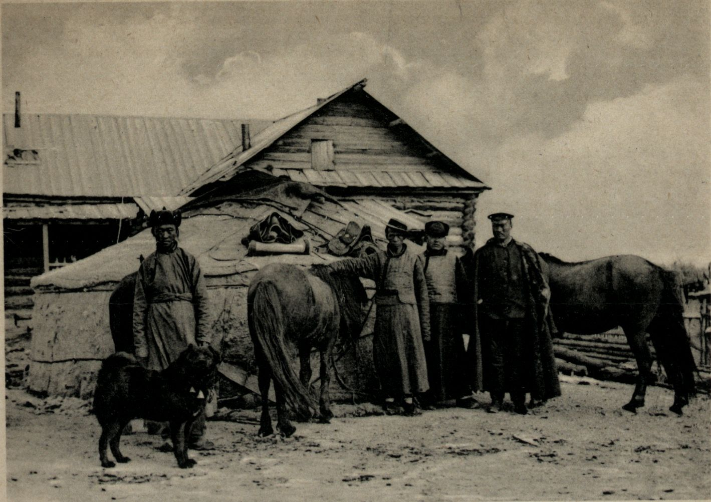

Chinesische Flüchtlinge in Kosch-Agatsch.

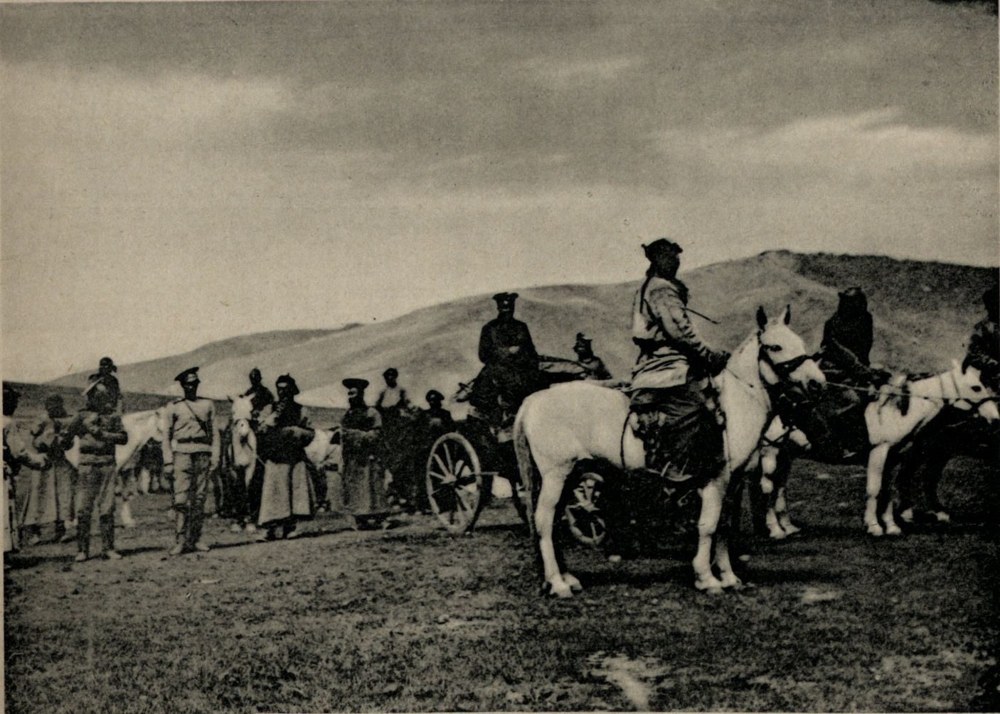

Im Tarschantu-Gebirge zum Zagan-Nor.

Tafel 14.

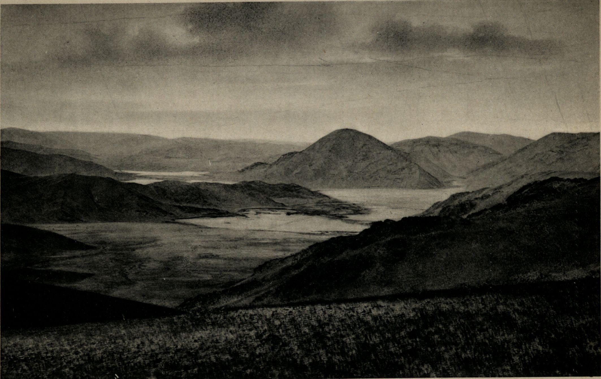

Der Zagan-Nor vom Plateau aus gesehen.

<a id="73">**-- 73 --**</a>

## KAPITEL 6. VON KOSCH-AGATSCH NACH ULJASUTAI.

*(Der nördliche Weg.)* Von Kosch-Agatsch führen zwei Wege nach Uljasutai, der eine ist der sogenannte „nördliche Weg", auch „Kaufmannstrakt" genannt, der zweite geht über Kobdo. Der nördliche Weg zieht sich von Kosch- Agatsch zum Dsapchyn-Fluß an den See Atschik-Nor, zu dem beim Kloster Mingit-Kumir (Namir Kurè) gelegenen Kara-Usu hin. Von Dsapchyn-Fluß folgt dieser Trakt dem Flusse Kungui nach Uljasutai.

Konsuls entschlossen sich, den nördlichen Weg zu marschieren, da der Weg über Kobdo für zu gefährlich gehalten wurde. Ich entschloß mich schließlich, sie dorthin zu begleiten und, wenn möglich nach Kobdo abzubiegen.

*(Chinesische Flüchtlinge in Kosch-Agatsch.)* In Kosch-Agatsch waren ein halbes Dutzend chinesischer Flüchtlinge eingetroffen, die dem Gemetzel auf den Chochuni entronnen waren. Zur Erklärung sei hier bemerkt, daß die ganze äußere Mongolei in 87 Chochuni (einschließlichder 24 Chochuni des Sain-Noin-Chan) der Chalcha und 15 Chochuni der Kobdoer Mongolen zerfällt. In jedem dieser Choehuni saß eine Anzahl chinesischer und russischer Kleinhändler. Die Chinesen wurden beim Ausbruche der Revolution verjagt, erschlagen und ihre Buden ausgeraubt, die Russen ließ man in Ruhe; es haben sich hier ganz fürchterliche Szenen abgespielt. Ich besuchte einen Teil dieser armen, dem Tode entronnenen Schlucker. Einige waren mir und dem Konsul von unserer vorigen Reise bekannt, sie hatten uns damals in ihren Jurten freundlichst aufgenommen. Sie waren über Nacht zum Bettler geworden; nur mit Mühe und Not hatten sie ihr Leben gerettet. Die Mongolen aus dem Suok-Bezirk, wo sie zum größten Teile handelten, hatten sie glücklicherweise erst am Tarchanti-Paß eingeholt und waren eben im Begriff, sie alle, wie die, welche sie schon vorher eingeholt hatten, niederzumetzeln, als die russischen Wachtposten aus Erbarmen mit den ihnen ebenfalls wohlbekannten Chinesen dazwischentraten und kategorisch erklärten, die Chinesen seien schon auf russischem Gebiet angelangt, und die Mongolen möchten sich sofort auf ihr eigenes Gebiet zurückziehen, andernfalls würden auch sie von der Waffe Gebrauch

<a id="74">**-- 74 --**</a>

machen. Darauf ließen die Mongolen die armen, zu Tode gehetz*ten Chinesen laufen und zogen sich zurück. Diese Chinesen trugen ihr Ros mit einer Würde und Ruhe, die ihnen meine volle Achtung eintrug. Viele beklagten weniger den Verlust ihrer eigenen Habe, als den Verlust der ihnen von ihren Firmen anvertrauten Handelsgüter. Einer meiner chinesischen Bekannten, ein großer starker Mann, hatte alles geopfert, um sein einziges Söhnchen, das er von einer Mongolin hatte, mit der er schon seit 15 Jahren im Konkubinat lebte, zu retten. Die auf dem Chochun lebenden Mongolen --- wohl Verwandte seiner Konkubine --- gaben ihm und dem Kleine einnige seiner eigenen Pferde zurück, damit er flüchten konnte. Die Frau, die sich ihnen anschließen wollte, wurde mit Gewalt zurückbehalten. Er erzählte mir von den drei oder vier fürchterlichen Nächten, während derer über ihn und sein Schicksal verhandelt wurde, mit Freuden habe er schließlich alles geopfert, um von den Verwandten seiner Frau die Erlaubnis zu erhalten, seinen Sohn mit sich nach China nehmen zu dürfen. Sein Weib hoffe er, sobald es wieder ruhig im Lande geworden sei, wiederzusehen. Auf dem Wege zur russischen Grenze wären sie dann auf einen Trupp Uranchai-Mongolen gestoßen, die, kaum ihrer ansichtig geworden, sie angegriffen, einen Teil erschlagen und den Rest über die Grenze gehetzt hätten.*

Die Uranchai-Mongolen sind ganz vorzügliche Jäger und Schützen. Sie wurden an der Uranchai-Grenze in einem Dorfe Usu teilweise mit alten russischen Berdang-Gewehren und Munition von der russischen Verwaltung ausgerüstet, sie machten davon den ausgiebigsten Gebrauch und ermordeten oder raubten die eingeschüchterten einzeln wohnenden Chinesen aus. Wenige kamen mit dem Leben davon.

*(Auf dem nördlichem Wege.)* Endlich war alles zum Aufbruch bereit. Wir hatten Kamele gekauft, das Stück für 60 Raan, unter meinen eigenen Kamelen waren zwei prachtvolle junge Tiere, die ich für meinen persönlichen Gebrauch reservierte. Der Kasak Popow übernahm die Führung der Kamelkarawane, die er auch im vorigen Jahr für mich und den Konsul besorgt hatte. Konsuls fuhren im Tarantas, ich wollte die 800 Werst bis Uljasutai reiten.

Bis zur Grenze Tarschanti (Gansu modo) bringt uns der Jaemschik von Kosch-Agatsch, Markow. Er war früher Bevollmächtigter der Firma F. P. Ignatiew, die als Durchgangsstation für ihren Handel in Uljasutai eine Handelsabteilung in Kosch-Agatsch unterhält, mußte aber wegen Trunksucht und Kartenspiel von dem jungen Ignatiew plötzlich entlassen werden. Gegen 1.40 Uhr brachen wir auf. Ich selber ritt zur Grenzstation, um meinen Paß visieren zu lassen. Da die Visierung meines Passes etwas länger dauerte, fuhr der Konsul voraus, ohne sich

<a id="75">**-- 75 --**</a>

weiter um die üblichen Formalitäten zu kümmern. Im Zollamt ist einer der Gehilfen plötzlich erkrankt. Man munkelte, daß seine Krankheit im engsten Zusammenhang mit den abhanden gekommenen 10 000 Rubel stehe, die angeblich im Zollamt verschwunden sein sollen. Als ich endlich fertig war und mein Paß mit dem kleinen, aber wichtigen quadratischen Stempel ,,Kosch-Agatsch-Zollamt" versehen war, erklärte mir der freundliche Gehilfe des Zollvorstehers, daß ich jenseits der Grenze hinreiten könne, wohin ich wolle, ich sei dort frei, wie ein Vogel und vogelfrei; was hinter Tarchanti passiere, kümmere ihn nicht. Übrigens ist dieser stille, dunkelbärtige Mann ein halber Landsmann von mir. Sein Großvater stammt aus Aachen und besaß in Lodz eine kleine Spinnerei, er selber ist ganz verrusst und spricht kein Wort deutsch mehr. Als ich einmal später in ihn drang, ob er sich denn an gar nichts aus seiner eigentlichen Heimat erinnern könne, erklärte er mir, daß seine Großeltern und Eltern stets französisch oder plattdeutsch untereinander gesprochen hätten. Bei Gesprächen in plattdeutscher Sprache sei immer das Wort „Gehe" (Aachen) vorgekommen.

Als ich aus der Zoll- und Grenzstation wegritt, riß mir während des Galopps der Bügelriemen, und ich mußte erst wieder zurück, um mir den Riemen von einem Grenzkosaken zusammen nähen zu lassen. Mein englischer Sattel sieht jetzt bei näherer Untersuchung arg mitgenommen aus, muß aber nun bis Uljasutai halten.

Einsam und menschenleer liegt die Steppe vor mir. Schroff und steil erheben sich im Nordwesten die Grenzgebirge. *(Tarschanti.)* Von Kosch-Agatsch bis zum Grenzposten Tarschanti beträgt die Entfernung 50 Werst. Klar und deutlich hebt sich der Paß am Horizont ab, die Luft ist so klar, daß man glauben könnte, man würde in ein oder zwei Stunden die Grenze zu Fuß erreichen können. Aber erst um 6 Uhr abends sind wir in Tarschanti. Unweit der Grenzwache gabelt sich in südöstlicher Richtung der alte Urtonweg nach Kobdo ab, während wir in östlicher Richtung zu ziehen gedenken.

Die alten Urton wege---Urtons sind von den Chinesen mit Pferden und Kamelen eingerichtete Relais-Poststationen, die von den Mongolen verwaltetwurden, --- existieren einstweilen nicht mehr. Die Mongolen, die auf den Urtons von den Chinesen angestellt waren, sind mit den Pferden und Kamelen ins Gebirge geflüchtet, oder auf Beute gegen Kobdo gezogen. Der größere Teil der Tiere auf den Relais war Eigentum der chinesischen Regierung, diese Tiere, Pferde und Kamele, nahmen die Mongolen als leichte Beute mit. Der Eindruck der Tarschanti-Gebirgskette ist ein ganz anderer als der des Altais. Unentwirrbar, ein Kreuz und Quer muldenförmiger, meist kurzer Täler, die einander überschneiden, kahle,

<a id="76">**-- 76 --**</a>

*(Mongolenpost.)* langgezogene, breite Hügelwellen, deren Kuppen umgestülpten Kaffeetassen gleichen, das ist Gansu modo Wir bleiben über Nacht in Tarschanti (1980 m Seehöhe), denn die Pferde, die den Wagen des Konsuls ziehen sollen, sind noch nicht eingetroffen, ebensowenig die dazu gehörigen Mongolen. Konsul Walter hatte im vorigen Jahr, um von den von den Chinesen unterhaltenen und beobachteten Urtonen unabhängig zu sein, einen eigenen Postdienst auf dem nördlichen Trakt eingerichtet. Ein reicher mongolischer Lama, Dschenschip-Gulun, hatte mit ihm einen einjährigen Kontrakt abgeschlossen, worin sich Dschenschip verpflichtete, für 20 000 Rubel den ganzen Postverkehr zwischen Uljasutai und Kosch-Agatsch und zurück aufrecht zu erhalten. Und zwar verläßt die reitende Post einmal wöchentlich Uljasutai und Kosch-Agatsch. Alle vierzehn Tage geht eine Kamelpost. Natürlich war, echt mongolisch, trotzdem unsere Ankunft seit vierzehn Tagen bekannt war, nichts fertig und in Ordnung.

Wir lassen uns von den Kasaken eine Hammelkeule braten, die wir einstweilen noch als Delikatesse verzehren, aber wenn man ein ganzes Jahr lang als einziges Nahrungsmittel nur Hammel zur Verfügung hat, so verliert auch die schönste mongolische Hammelkeule an Reiz.

Morgens gegen 6 Uhr versuche ich die Mongolen zusammen zu treiben. Endlich haben wir die nötige Anzahl Postpferde zur Stelle, um den Wagen des Konsuls zu ziehen. Die Kamelkarawane ist mit dem Kasaken Popow schon vorauf. Konsul Walter dachte in gewohnter Weise nur an sich... Ich wurde daher sehr energisch und drohte ihm, ich würde allein weiterziehen. Das half.

*(Am Damnur.)* Da die mongolischen Pferde sich nicht einspannen lassen, so wird der Wagen auf folgende echt mongolische Weise am „Damnur" gezogen. An den beiden Deichseln wird vorne eine glatte, nach beiden Enden schmal zulaufende Querstange befestigt, die in der Mitte etwa in der Breite der Entfernung der Deichseln 10---15 cm und an den beiden Enden etwa 5 cm dick ist. Diese Querstange wird mit guten Maralhirschriemen an die Wagendeichseln angebunden. Einer der mongolischen Reiter hebt zu Fuß den Damnur hoch über den Kopf, die anderen Mongolen zwängen ihre scheuenden Pferde an den Damnur heran, ergreifen mit beiden Händen die Querstange, drücken diese auf die Vorderschenkel nieder, und im sausenden Galopp ziehen 3---6 Reiter den schweren Tarantas durch die Steppe. So sieht sich der Damnur theoretisch an. Praktisch ist die Geschichte manchmal anders. Die scheuenden, sich bäumenden Pferde wollen nicht an den Damnur heran. Mit den Fersen ihrer vorne schweinsrüsselartig nach oben gebogenen Stiefel stoßen die

<a id="77">**-- 77 --**</a>

Reiter in harten Stößen gegen die reich verzierten dicken Lederschab*racken, die einen Meter lang vom Sattel herunterhängen. Manch scharfer Hieb mit der schweren, knüppelähnlichen Peitsche trifft das schnaubende Tier. Endlich hat ein Reiter den Damnur erfaßt, er preßt ihn auf seine Vorderschenkel und gegen den Leib, den er mit irgend einem zusammengerollten Kleidungsstück zu schützen sucht. Ein zweiter, dritter Reiter folgt. Bei einem der Reiter bäumt sich das Pferd gerade in dem Moment, als es den Kopf unter die Querstange neigt, durch den Stoß erschreckt brennt es nach vorn durch, der Reiter hängt mit dem Bauch am Damnur, und je nach seiner Geschicklichkeit landet er mehr oder minder sanft auf der Erde. Die anderen Pferde brechen mit ihren Reitern nach rechts oder links aus, und der Damnur liegt wieder auf dem Boden. Nach einigen solchen Versuchen wird dann der Wagen flott, und in vollem Galopp, je nach der Anzahl der Damnurreiter, fährt der Wagen durch die Steppe, über Gebirge, Pässe und durch Flüsse. Manchmal* läuft dabei den Reitern das Blut an den Lenden herunter.

Diesmal hatten wir nur sechs Reiter, da mehr Leute durchaus nicht aufzutreiben waren. Aber wenn so ein Damnur wie im Jahre vorher von etwa zwanzig Reitern in ihren farbenprächtigen Kostümen gezogen und von etwa dreißig Reservepferden begleitet wird, so ist eine solche Damnurfahrt ein buntbewegtes, echt mongolisches Bild, bei dem man die Reitkünste der Mongolen am besten beobachten kann.

*(Durch den Tarschanti.)* Endlich waren wir flott. Der Weg führt im Tarschanti aufwärts und ist ziemlich schlecht und steinig. Es ist dies die schlechteste Strecke auf dem ganzen Wege.

Es ist kalt, hier und da liegt in einer Mulde Schnee, überall sehe ich amWege alte, vermoderte Argali-Gehörne, man soll jedoch durch diese Masse Gehörne nicht auf ein starkes Vorkommen dieser äußerst seltenen Jagdbeute schließen. Die Gehörne modern schon seit zehn und zwanzig Jahren am Wege. Die starken Bestände sind zum größten Teile durch englische und amerikanische Jagdexpeditionen vernichtet worden. Der Paß Tarschanti wird deutlich durch eine alte Moräne (1980 m Seehöhe), von der Steppe getrennt. Die höchste Weghöhe betrug 2450 m Seehöhe. Während unser Wagen langsam über den Paß des Tarschanti von vier Reitern gezogen wird, fällt leichter Schnee, den uns ein heftiger Wind ins Gesicht treibt. Schwarze, mächtige Schneewolken drohen hinter uns her. Vor Tarschanti gabelt sich, wie schon gesagt, der Karawanenweg. Wir ziehen in der östlichen Richtung, während die südöstliche Abzweigung über Suok, Bor-Burgasi, Ucha nach Kobdo führt. Die Hänge und Schluchten weisen spärlichen Graswuchs auf. Dünn und zart ist die Erdkrume, die die Felsen überzieht, überall tritt der kahle, rote oder

<a id="78">**-- 78 --**</a>

schwarze Fels zu Tage. Da nirgends eine Spur von Baumwuchs vorhanden, ist scheinbar das ganze Gebiet „verkarstet", wenn ich mich so ausdrücken darf. Herden von einigen zwanzig bis fünfzig Dseren-Antilopen jagen in einiger Entfernung an uns vorüber, weit und breit ist keine menschliche Wohnung zu sehen. Langsam neigt der Weg sich von der höchsten Paß*höhe zum Zagan-Nor (weißer See). In vielen Windungen ziehen wir durch ein mäßig breites, mit Sand ausgefülltes Tal längs des* Tonsen- Nor mit einer kleinen trockenen Bachrinne zum Zagan-Nor, wo wir um 8 1/2 Uhr abends unser erstes Lager aufschlagen. Ruhig und still liegt der dunkelblaue See vor uns, in seiner Mitte eine bäum- und strauchbewachsene hügelartige Insel, ein echtes Vogelparadies.

*(Lager Zagan-Nor.)* Das Lager am Zagan-Nor hat eine Höhe von 2124 m Seehöhe. Die Nacht war jetzt schon gegen Ende August tüchtig kalt. Abends wurde zum ersten Male abgekocht und in den Zelten geschlafen. Ein kleiner eiserner Ofen, der mit scharfriechenden, am See wachsenden dornigen Sträuchern geheizt wurde, verbreitete eine angenehme Wärme im Zelt, solange das Feuer brannte. Nachher wurde aber die Kälte nur noch empfindlicher fühlbar. Ich selber schlief in meinem dünnen, ungeheizten Sommerzelt.

Am anderen Morgen waren wir zeitig fertig. Die Damnurreiter ziehen den Wagen langsam um den See herum; ich reite vorauf und lasse bald die anderen weit zurück Der Weg führt allmählich talaufwärts zum Plateau. An einigen Stellen ist die Steigung so stark, daß ich nicht weiß, wie der schwachbemannte Damnur von den Leuten hinaufgezogen werden soll. Stellenweise wird die Passage im Engpaß so schmal, daß der Wagen nur knapp durchkommen kann. Der Weg ist mit Geröll bedeckt und durch die zu Tal gebrausten Wasser mit tiefen Rinnen durchzogen. Auch hier liegen alte Argali-Gehörne, darunter einige frische. Endlich komme ich aus der Schlucht heraus, ich bin auf dem Plateau. Zur linken liegen in ihren runden langen Linien einige parallel hintereinander verlaufende Gebirgszüge, an denen der Weg sich zu dem Plateau hinauf vorbeischlängelt. Ich gehe zu Fuß zur anderen Seite bis zum Rande des Plateaus, und nachdem ich einen kleinen Grad überklettert habe, liegt tief unter mir das herrliche Panorama des Zagan-Nor. Schmal, nur als weißer Streifen erkennbar, zieht sich der Weg durch die Steppe. Dicht am Rande des Passes sehe ich einige ameisengroße, schwarze, sich schnell hin und her bewegende Punkte. Es ist die Karawane. Durch meinen Zeiß beobachte ich ihre Vorbereitungen zur Auffahrt. Aber etwas ist da unten nicht in Ordnung, denn alle Kasaken und Mongolen sind um den Wagen versammelt. Endlich sind sie flott und verschwinden in dem Engpaß. Drei große einzelne Seen liegen unter mir in der Steppe.

<a id="79">**-- 79 --**</a>

Jedenfalls sind die beiden ersten Seen der eigentliche Zagan-Nor, nur für das Auge von hier oben durch einen vorspringenden Gebirgszug in zwei Teile geteilt. Der zuletzt liegende See hängt mit dem eigentlichen Zagan-Nor durch einen kleinen Fluß, den Burgut, der vom Karaul Kak kommt, zusammen. Diesen See durchfließt der Fluß Burgut-Kol, der den Chulik-Scherik dicht vor seinem Eintritt in den See aufnimmt. Er verläßt dann den See, fließt kurz darauf in den Zagan-Nor und heißt bei seinem Austritt aus demselben Zagan-Norin-Kol. Er mündet dann in den gewaltigen Atschik-Nor. Der Atschik-Nor wiederum teilt einen kleinen Flußarm zum Kobdo-Fluß ab. Der Zagan-Nor und sein Nachbar hängen auf diese Weise mit dem gewaltigen Kobdo-Fluß-System zusammen. Jedenfalls bildeten die beiden Seen früher ein großes, gewaltiges Seebecken. Durch Austrocknung, Verdunstung und Verminderung der Niederschläge sind sie heute getrennt, aber die alten Uferlinien sind scharf und klar an den Gebirgswänden markiert. Der Weg läuft einstweilen mit dem Zagan-Norin-Kol parallel.

Fern am Horizont taucht im blauen Nebel das Sailjugem-Gebirge auf. Mit meinem Zeiß suche ich Tal und Höhen der hinter mit liegenden Höhe nach Argali ab, aber es ist nichts zu sehen. Endlich ist der Wagen nach mancherlei Schwierigkeiten oben angelangt. Die Damnur-Reiter und Kasaken sind erschöpft. Aber bald rollt der Tarantas wieder seinem fernen Ziel entgegen. Die Höhe der Paßschwelle beträgt 2555 m Seehöhe. Die sich am Wege anschließenden Höhen sind etwa 2---300 m höher. Von dem Geräusch des Wagens erschreckt, prellen einige hundert Dseren-Antilopen, sich am Rande und im Schatten der Berge haltend, davon. Schnell verabrede ich mit Konsuls, uns am Usung-Kol zu treffen. Das Gewehr quer auf dem Sattel, jage ich der flüchtigen Antilopen- Herde nach. Anfangs machen sie elegant wie ein gut geschultes Kavallerieregiment jede Bewegung meines Pferdes mit, immer parallel zu mir, außer Schußweite dahinziehend. Plötzlich brechen sie, durch irgend etwas erschreckt, in ein Seitental ein, an den Hängen hochklettemd sind sie mir bald aus den Augen. Der Weg ist schön, überschreitet den trockenen Zagan-Norin-Kol, zwängt sich durch enge Schluchten, deren Gestein rot und blau im Sonnenschein leuchtet. Endlich bin ich aus diesen Schluchten heraus, und weit vor mir liegt der prächtige Atschik- Nor. Das Panorama ist herrlich. Ich reite, reite, immer den See vor Augen, hier und da stößt ein roter oder dunkelblauer Granitkegel aus der stellenweise mit Sand bedeckten Steppe hervor. Hohes, büschelförmiges Gras wächst überall. Je näher ich dem See komme, desto häufiger werden die Antilopenherden, die zur Tränke wollen, aber mein Schimmel ist zu einer neuen Hetze zu müde.

<a id="80">**-- 80 --**</a>

*(Verirrt am Atschik-Nor.)* Etwa 5 Werst war ich schon parallel zur Uferlinie des Atschik-Nor (1090 m Seehöhe) geritten, vergebens suchte ich den ganzen Horizont nach dem Urton ab. Nichts war zu sehen. Dann ritt ich bis dicht zum Ufer des Sees, um mein Pferd zu tränken und wollte nun auf meiner eigenen Spur zurückreiten. Die Wellen branden prächtig gegen die Ufer. Am Ufer selbst liegen mächtige, von Wind und Wellen geschliffene Felsblöcke, "Findlingen" ähnlich. Mein müdes Pferd säuft in vollen Zügen. Lange suche ich noch den Horizont nach der zurückgebliebenen Karawane ab, nichts ist zu sehen. Die Gipfel der Berge des Ulan-Lonchu (roter Lonchu) um den Atschik-Nor herum sind mit Schnee bedeckt, ebenso der Kara-Lonchu (schwarzer Lonchu). Schließlich reite ich zurück. Plötzlich, ehe ich meine eigene Spur wieder auf gefunden habe, wird es dunkel. Nun sitze ich in der Patsche. Ich überlasse es dem Instinkt meines Pferdes, den schmalen Weg und unsere Spur zu finden. Es trägt mich ruhig zu einem mächtigen Felsblock zurück, der am Fuße einer Gruppe steiler Felsenliegt, von deren Höhe ich kurz vorher die Steppe absuchte. Hier bleibt es stehen. Ich reite in einer anderen Richtung und lasse dem Gaul wiederum die Zügel. Bald darauf hält das Pferd wiederum vor demselben mächtigen, tafelförmigen Stein. So wiederholt sich das Spiel noch einige Male. Jedenfalls war der Platz dem Pferde als Lagerstelle der Mongolen bekannt, und ich beschloß, die Erfahrung meines Schimmels auszunutzen und der Not gehorchend, dort wo wir waren, zu übernachten. Ganz in der Nähe entdeckte ich ein trockenes, tief eingeschnittenes Bett eines Baches. Da es mittlerweile stockdunkele Nacht geworden, beschließe ich, nachdem ich mich nach einer besserenSchlafstelle vergebens umgesehen habe, in der trockenen Bachrinne zu übernachten. Ich klettere, meinen Schimmel am Zügel führend, das steile Ufer hinunter. Das Pferd läuft wie ein Hund, jeden Vorsprung geschickt benutzend, hinter mir her. Unten suche ich mir eine schöne, sandige Stelle aus. Dann sattle ich ab, löse dem Pferd das Kopfstück, binde mir die langen Zügel mit der Hobbel- leine am Gürtel fest, wickle mich in meinen Mantel und lege mich, den Sattel als Kopfkissen benutzend, schlafen. Morgen früh werde ich schon den Weg finden und den Konsul schnell einholen, der auch nicht weit gefahren sein kann. Schlafen werde ich wohl ganz gut; denn erstens bin ich müde und zweitens habe ich den ganzen Tag nichts gegessen und getrunken, und man sagt doch, mit vollem Magen schläft sich's schlecht. Das Absatteln und Anhobbeln des Pferdes war mir eine etwas ungewohnte Arbeit. Aber endlich liege ich, nachdem ich einige Steine aus meiner Schlafstelle herausgeschmissen habe, den Verhältnissen nach ganz komfortabel. Ein kurzes Gedenken an meine Lieben jenseits der asiatischen Grenze, und ich schlafe ein. ---

PHOTOS

Tafel 15.

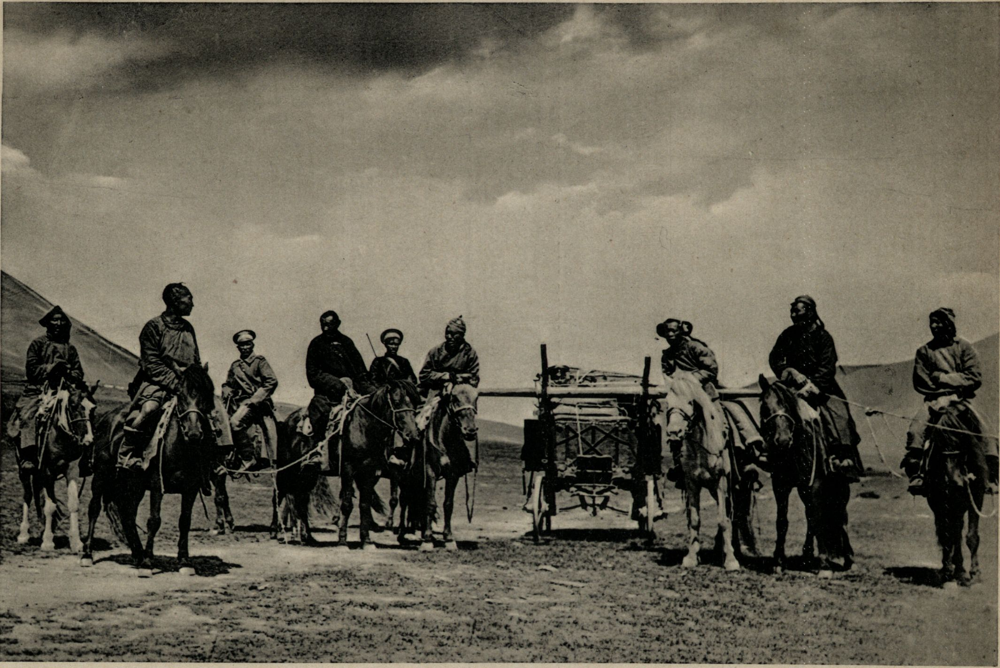

Der Tarantas am Damnür durch mongolische Reiter gezogen.

Tafel 16.

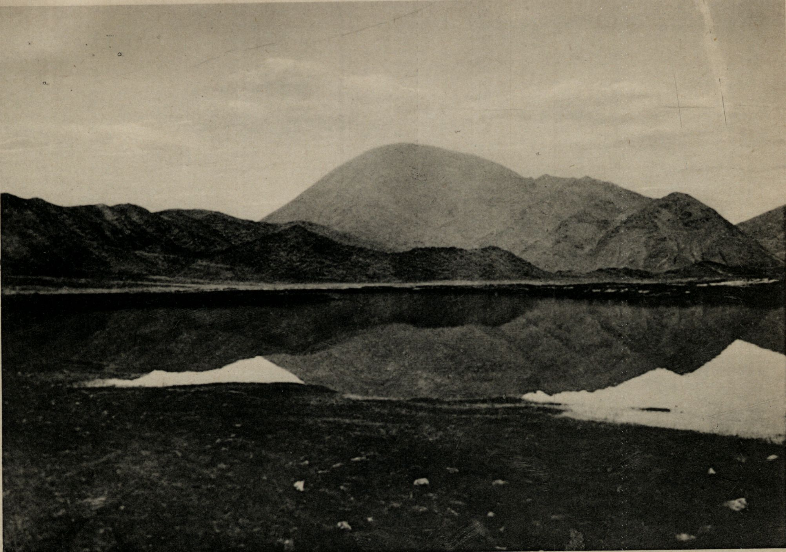

Am Atschick-Nor.

Tafel 17.

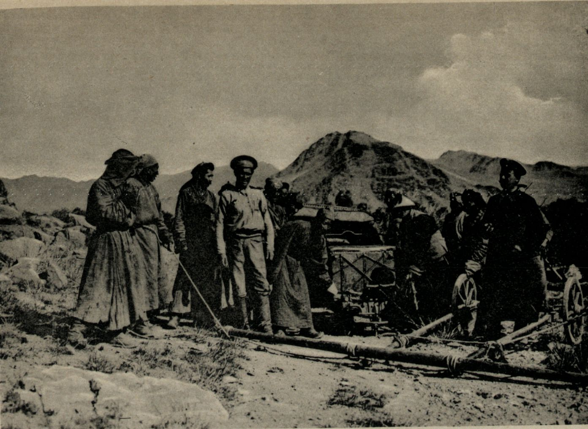

Der auseinandergenommene Tarantas. Im Vordergrund der Damnur.

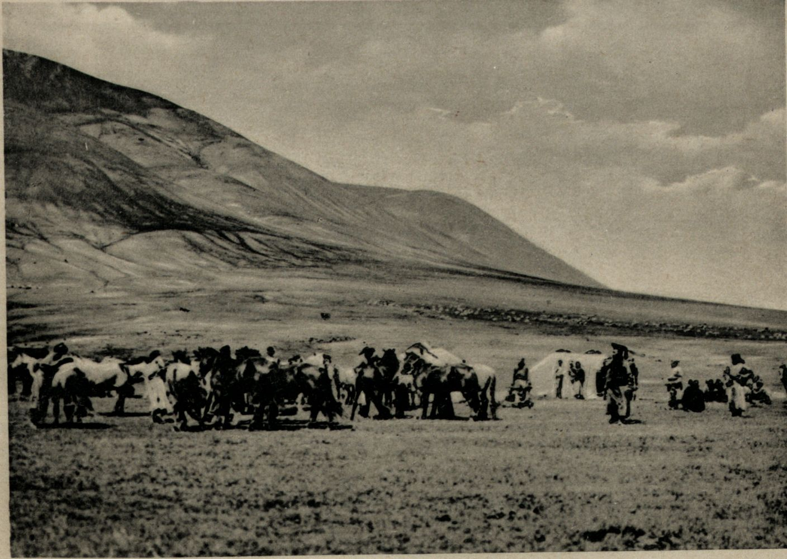

Mongolenlager. Pferde- und Schafherden am Kobdofluß.

Tafel 18.

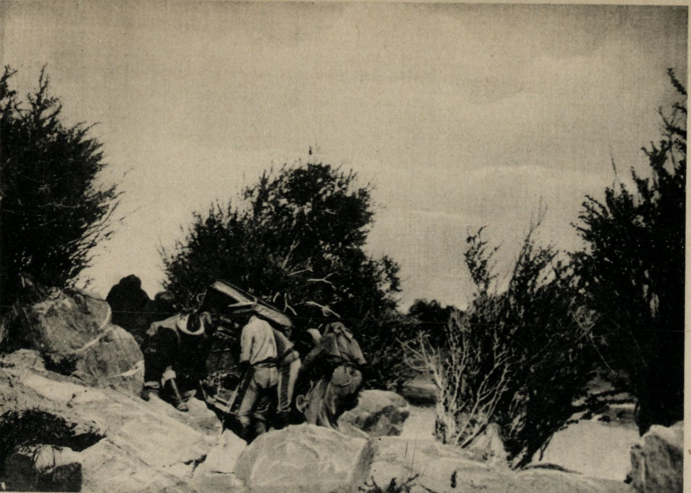

Tragen des auseinandergenommenen Tarantas durch Mongolen und Kasaken über besonders schwierige Stellen.

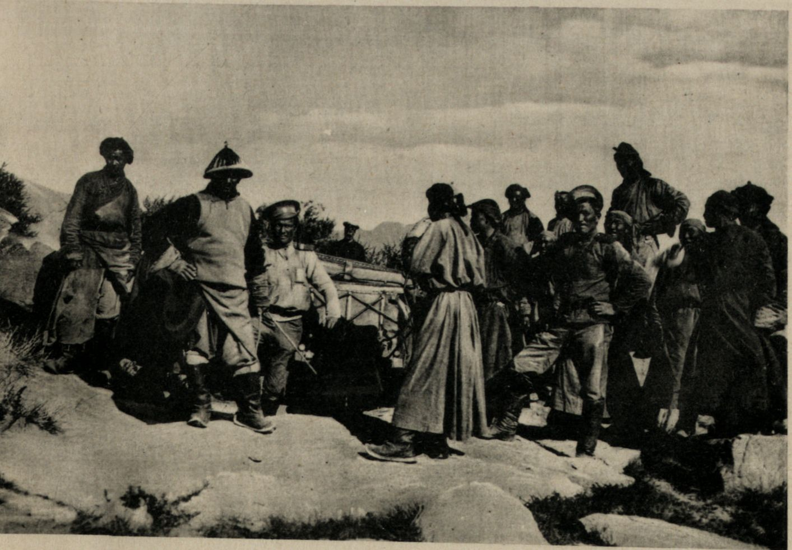

Das Auseinandernehmen des Tarantas.

<a id="81">**-- 81 --**</a>

Da --- habe ich mich getäuscht, oder hat mich irgend jemand gerufen ? Ach nein, es war wohl nur der Schrei eines Nachtvogels. Ich wickle mich wieder in meinen Mantel und schlafe ein; abermals fahre ich hoch., War das nicht der mir so wohlbekannte Schrei eines jagenden Mongolen ? Er dringt, kaum hörbar, zu mir wie aus weiter Entfernung herüber. Leise schnaubt mein Schimmel und legt die Ohren zurück. Sucht man mich? Das wäre mir sehr fatal! --- Jetzt wieder! Kein Zweifel, von dort her, weit über die Steppe, aus der Nähe des Sees, schallt der eigentümliche Ruf zu mir herüber. Ich antworte. Eigentlich bin ich etwas ärgerlich bei der Aussicht, noch einen Nachtritt machen zu müssen. Der Rufer kommt näher und näher, ich bin den steilen Uferwall emporgeklettert und gebe dem Mongolen mit meinem Feuerzeug, dessen Funken hell in der Nacht aufsprühen, Zeichen, damit er den Weg zu mir schneller findet. Dann rufe ich ihn an. "Heujo, Mongol beina?" --- "Dsa," antwortet er mir. "Konsul beina?" gibt er als Gegenparole. --- "Dsa," antworte ich nun auch. 1) Es fiel ihm augenscheinlich ein Stein vom Herzen, als er bei mir eintraf; denn erstens fürchtet der Mongole sich überhaupt, allein des Nachts zu reiten und dann hatte ihn wohl persönlich das Funkenschlagen meines Feuerzeuges ängstlich gemacht; denn es konnte ebenso gut in der Schlucht ein Räuber, ein versprengter Chinese verborgen sein, der nur Feuer schlug, um die Lunte seiner alten, vorsünd- flutlichen Donnerbüchse in Brand zu setzen. Er kletterte zu mir herunter und nun stellte sich heraus, daß ich es nur einem Zufall zu danken hatte, daß er mich traf. Zwei mongolische Reiter vom Urton waren, besorgt um unser langes Ausbleiben, um den See Atschik-Nor herumgeritten, um die Karawane zu suchen. Der eine fand nun zufälligerweise mich, und der andere hatte, wie ich später hörte, dem Konsul aus der Patsche geholfen. Die erste Frage des Mongolen war nach Tabak. Leider hatte er keine Pfeife bei sich und meine Shag-Pfeife wollte ich ihm doch nicht zur Benutzung überlassen, daher bekam er, obwohl mich ein Gefühl der Undankbarkeit diesem Mongolen gegenüber beschlich, keinen Tabak. Mein Pferd wurde gesattelt, wir kletterten den Uferwall hinauf und ritten los, aber mein Führer wußte schließlich ebenso wenig Bescheid wie ich, er behauptete, so oft im Kreise herumgeritten zu sein, daß er die Richtung ganz und gar verloren habe. Er überließ es also der Klugheit seines Pferdes, sich zum Urton zurückzufinden. Die Pferde trugen uns anscheinend auch einige Male im Kreise herum, dann kamen wir an eine breite, mit Schilf dicht umstandene Wasserstelle, die aus dem See

1) Heujo ist der mongolische Steppenanruf. "Ist der Mongole da?" "--- Ja." --- "Ist der Konsul da?" --- "Ja." ---

<a id="82">**-- 82 --**</a>

getränkt wurde und einen Abfluß zum Kobdo-Fluß hatte. Hier tränkten wir unsere Pferde, durchritten das Wasser, dessen Grund mit glatten Steinen übersät war, und ließen unseren Tieren wiederum die Zügel. Dieser Flußstreifen war der Usung, der, aus dem Atschik-Nor kommend, seine Wasser nach etwa 6 oder 7 Werst in den Kobdo-Fluß ergießt.

Plötzlich halten wir dicht am Kobdo-Fluß, dessen Rauschen zu uns durch die Nacht dringt. Jetzt werden wir den Urton wohl finden; denn er liegt, wie mir der Mongole sagt, dicht am Flusse, etwa 5 Werst vom See entfernt. Wir galoppieren, Knie an Knie gepreßt, durch die dunkle Steppe. Die Lippen sind zu trocken, um zu pfeifen, obwohl mich mein Begleiter dringend dazu auffordert, damit uns die Hunde antworten sollen. Doch ich habe ja die Jagdpfeife meines verstorbenen Vaters am Gürtel hängen. Ein eigentümliches Gefühl beschleicht mich, als ich die Pfeife an die Lippen führe; hier, fern im innersten Asien, soll sie uns nun aus der Not helfen. Schrill durchdringt Pfiff auf Pfiff die sternklare, dunkle Nacht. Endlich, dort zur Linken, antworten Hunde, kaum kann man den Ton erkennen. Doch jetzt haben wir die Richtung. Immer deutlicher wird das Bellen und Kläffen der Hunde. Sind sie einen Augenblick still, so brauche ich nur zu pfeifen, und prompt antwortet die ganze Meute. Endlich stoßen wir auf den Weg. Mein Pferd ist etwas schwer zu regieren, und als ich nachschaue, hat der Schimmel sich das Eisen aus dem Maule geschoben. Doch bald ist alles in Ordnung. Nur weiter. Auf einmal scheuen unsere Pferde. Ein Stück Weulok (Filz), der als Unterlage für Kamelsättel benutzt wird, liegt auf dem Wege. Es riecht noch frisch nach Kamel, mithin ist unsere Karawane unter dem Kasaken Popow vor mir vorbeigekommen. Nach einigen Minuten taucht dicht am Wege eine Gestalt auf. Es ist Popow, der hier lagert und ebenfalls den Urton nicht finden kann. Wir geben ihm den Weulok und pfeifend galoppieren wir weiter durch die Nacht. Das Bellen der Hunde wird immer wütender, doch kommt es scheinbar von der anderen Seite des Kobdo-Flusses. Wir versuchen vergebens das Kamisch (Schilf) zu durchdringen, um dann den Fluß zu durchschwimmen. Es ist auch zu gefährlich, wir lassen deshalb davon ab, und das war gut so. Weiter geht die Jagd. Endlich, endlich wird das Bellen zu einem rasenden Chorus von Hundestimmen. Wir sind in der Nähe des Urtons. Nur noch einige Minuten, noch eine Biegung, und wir durchreiten das Dager. Durch Kamisch bis zum letzten Augenblick verdeckt, konnten wir es nicht eher bemerken. Die Lagerfeuer brennen, und vor den Jurten stehen Kasaken und Mongolen herum, eifrig mit Abkochen beschäftigt. Die Hunde, die uns bald auf das jenseitige Ufer des Kobdo gelockt hätten, gehörtenzu nomadisierenden Mongolen, die dort ihr Dager aufgeschlagen hatten. Konsuls sind auch

<a id="83">**-- 83 --**</a>

erst seit einer Viertelstunde eingetroffen da sie auch den versteckt liegenden Urton ohne Hilfe nicht finden konnten. Es ist 12 Uhr nachts. Mein Zelt wird aufgeschlagen, ich esse schnell einige Happen Fleisch, höre noch Popow mit den Kamelen einziehen, dann schlafe ich todmüde ein.

*(Am Kobdo Fluß.)* Morgens weckt mich gegen 9 Uhr das lebhafte Treiben und Schreien der Mongolinnen, das Grunzen der Yacks, die herangetrieben werden, um sich melken und ihre Kälber trinken zu lassen. Frauen in silbernem Kopfschmuck mit fächerförmig ausgebreiteten Haaren, in alten verschmutzten, stinkigen Seidenkleidern, bewegen sich in ihren schweren Stiefeln schreiend, unbeholfen, zwischen den grunzenden Yacks und den blökenden Schafen, die ihre Lämmer locken. Jedes Mutterschaf erkenntsein Kleines unter den hunderten Lämmchen sofort an dem Ton der Stimme. Irrt sich so ein kleines wackliges Geschöpfchen, so wird es recht unsanft von der fremden Mutter abgewiesen.

Wir lagerten dicht an einem Nebenarm des Kobdo-Flusses (1100 m Seehöhe). Der Fluß bildet hier abseits vom Hauptstrom eine Menge kleinerer Arme und Flüßchen, die kleine Eilande und Inselchen umfließen. Auf dem Flusse schwimmen eine Menge Wildenten und Gänse. Der Kobdo- Fluß selber hat, nachdem er den Abfluß des Atschik-Nor, den Usung-Gol aufgenommen hat, eine starke Strömung. Ich reite, um mich genauer zu informieren, längs des Flusses, während die anderen dem eigentlichen Weg längs der Hochebene folgen. Das tief eingeschnittene Bett des Kobdo-Flusses durchzieht eine Bruchstelle der Hochebene, in die sich der Fluß tief eingefressen hat, mit starker, eigentümlicher, wie alte zertrümmerte Burgen wirkender Lößbildung. Dieser Löß ist stellenweise 30---40 m hoch, überall von Brutplätzen der Felsentauben durchlöchert. Die Gegend ist öde, nur in dem tiefen Flußtal steht etwas Baumwuchs und Strauchwerk. Die Inseln sind von Mongolen mit ihren Herden bevölkert. Als ich einer trockenen Bachrinne folge, die sich tief in den Löß eingeschnitten hat, komme ich endlich auf die Hochebene hinaus. Hier oben sind die Berge öde, die Kuppeln unbewaldet, sie erheben sich etwa 2---300 m über die Hochebene. Langsam folgen wir dem Flußlauf. Tagsüber ist es noch ganz warm.

*(Lager am Flüßchen Chirbitä.)* Am Flüßchen Chirbitä (Chibir), in den der Chargaitu fließt, treffen wir mit dem russischen Podpolkownik Bensenger und seinen Kasaken zusammen. Er kommt von Kobdo und war vom Generalstab aus Tomsk zur Beobachtung der Vorgänge in der Mongolei kommandiert worden. Bensenger spielte lange Zeit eine große Rolle in Mesopotamien an der Bagdad-Bahn. Wir beschließen, den Abend zusammenzubleiben und

<a id="84">**-- 84 --**</a>

versammeln uns alle im großen Zelt des Konsuls, wo Frau Konsul mit gewohnter Geschicklichkeit die Honneurs machte. Bensenger wußte allerlei Interessantes aus seiner mesopotamischen Zeit zu erzählen, hauptsächlich aber dreht sich das Gespräch um die kommenden Dinge in der Mongolei. Unter den Kasaken Bensengers war auch der Kasak Buchaiew, der mich im vorigen Jahr von Uljasutai bis Urga begleitete.

Das Flüßchen Chibir und der Chargaitu ist, soweit sein Überschwemmungsgebiet reicht, mit einem ziemlich dichten Buschwald bestanden. Unser Lagerplatz Chirbitä hat eine Seehöhe von nur 1440 m.

Morgens, nachdem wir noch unseren gemeinsamen Lagerplatz photographiert haben, brechen wir in entgegengesetzter Richtung auf. Das Flüßchen Chirbir hat reichlich Wasser, wir überschreiten es, und unser Weg läuft zwischen dornigem Buschwald zum See Tschaisgai-Nor. An den Zweigen und Dornen des Buschwerks durch das sich unser schmaler Pfad windet, hängen Fetzen von Weulok, Kamelhaaren, Kleidungsstücken, ein Zeichen, daß in ruhiger Zeit hier viele Karawanen durchgezogen sind. Vom See Tschaisgai-Nor (1500 m Seehöhe) aus führt der Weg etwas bergan und fällt dann schroff über zerbröckelte Felsplatten in die Steppe. Die Oberschicht der roten Felsen ist von Regen, Frost, Sonne und Wind vollständig verwittert. An ein Durchkommen für den Wagen ist bei der Steilheit dieses Teiles Weges nicht zu denken. Deshalb umfahren unsere Damnur-Leute ihn in einem großen Bogen. Trotzdem muß der Tarantas an besonders schlimmen Stellen auseinandergenommen und über mächtige Felsblöcke weggetragen werden. Von diesem Abhang hat man einen weiten Blick über die Steppe, tief unten glänzt in der Steppe der herrliche Kara-Usu (schwarzes Wasser), unten ziehen meine Lastpferde mit dem photographischen Material wie dunkle Punkte dem See zu. Schritt für Schritt klettert mein Schimmel hinter mir her über die Felsen den Abhang hinunter. Dann geht es in flottem Galopp den Lastpferden nach und ich nehme mir hier ein Dutzend Schrotpatronen, um am Kara-Usu zu jagen.

Der See ist herrlich gelegen, sein Wasser ist tiefblau, ins Schwarze übergehend. Tausende von Wildenten, Gänsen, Schwänen und eine Art Möven bevölkern den See. Darunter Stockenten, (Anas boschar) Spießente, (anas acuba), Kriechente, (anas crecca), rote Enten, (Anas rutica) Schnatterenten (Anas strepera), Schreienten, (Anas glocitans), Saatgänse (Anser regetum), gemeine Wildgänse (A. cinereus), große Wildgänse (A. grandis), Taucher, Lachmöven, Kiebitze, graue Reiher (Ardea cinera) und hoch in den Lüften die Sumpfweihe. Die Ufer des Sees sind eben, vom Ufer verläuft der See flach, langsam zur Mitte tiefer werdend. Schilf ist beinahe gar nicht vorhanden, Ringsherum

<a id="85">**-- 85 --**</a>

ist die Steppe mit niedrigem Steppengras bewachsen. Kaum gehe ich, mein Pferd am Zügel führend, längs des Ufers, so springen hier und da Hasen auf und davon, die aber bald, im Vertrauen auf ihre Schutzfarbe in Deckung gehen. Hier schieße ich vier Stück, aber mit den Enten und Gänsen habe ich kein Glück. Jeder Schuß war beinahe ein Treffer, die Federn der geschossenen Vögel stoben davon, aber allem Anschein nach hat das Pulver der Schrotpatronen stark an Durchschlagskraft verloren. So bekomme ich keinen der getroffenen Vögel. Ärgerlich reite ich den anderen nach. Der Weg steigt hinter dem großen Kara- Usu, wie ich ihn zum Unterschied vom kleinen Kara-Usu, zu dem wir jetzt gelangen werden, nennen will, langsam bergan. Bei dem Wagen angelangt, wird schnell ein kleines Frühstück, aus Wurst, Brot und Tee bestehend, von Frau Konsul serviert, dann reite ich wieder voraus.

*(Im Sumpf am kleinen Kara-Usu.)* Der Weg führt über eine kleine Anhöhe zu dem halb ausgetrockneten kleinen See, an dessen Ufern ich hinreite, um noch einmal den Versuch zu machen, für uns eine Wildgans oder einen Entenbraten zu erwischen.

Der See ist stark natronhaltig. Überall am Rande tritt das weiße Natron zu Tage. Beim Umreiten des Sees gerät mein Rappe, den ich jetzt seit dem Frühstück reite, auf eine sumpfige Stelle und bricht bis an den Leib ein. Ich springe aus dem Sattel; rasch reiße ich dem Pferde den Sattel herunter, den ich auf einen höheren Grasbusch werfe, dann reiße ich ihn selber, auf schwankendem Boden stehend, mit einem kräftigen Ruck hoch. Vorsichtig versuchen wir, festen Boden zu erreichen. Bei jedem Tritt quillt das schmutzige Sumpfwasser, quirlend stinkige Gase in Blasen ausstoßend, unter unseren Füßen hervor. Kaum haben wir etwa zwanzig Schritte gemacht, so bricht das arme Pferd wieder durch, etwa dreißig Schritte vom festen Ufer entfernt. Diesmal sinkt es so rasch und in einer so unglücklichen Stellung ein, daß ich es allein nicht mehr flott kriegen kann. Auch ist die Sumpfdecke rings um die Einbruchstelle dermaßen impertinent schlecht, daß nicht eine einigermaßen feste Stelle zu finden ist. Ich gehe, immer die Zügel des Pferdes haltend, vorsichtig von Grasknollen zu Grasknollen springend, auf der Sumpfdecke hin und her, um für später einen sicheren Pfad zu finden. Die Decke biegt und hebt sich wie Gummi-Elasticum. Wo ich auch nur einige Sekunden stehen bleibe, sinke ich langsam bis zum Knöchel ein. Schwarze Sumpfblasen quellen mir dann unter den Jagdschuhen hervor. Da ich nirgends festen Halt finden kann, von wo aus ich meinen Rappen auf festen Boden bugsieren könnte, bleibt mit nichts anderes übrig, als zu warten, bis die Karawane kommt. Ich gehe zu meinem Pferde zurück, bleibe bei ihm stehen, streichle das arme Tier und spreche beruhigend

<a id="86">**-- 86 --**</a>

mit ihm, damit es ruhig liegen bleibt und sich nicht noch weiter in den Sumpf hineinwühlt. Das Tier scheint seine gefahrvolle Lage vollständig zu verstehen, es tut mir fürchterlich leid. Nach einer unendlich langen Viertelstunde kommt der Wagen des Konsuls, der, wenn ich ihn nicht durch Zuruf gewarnt hätte, beinahe auch in den Sumpf hineingefahren wäre. Mit vereinten Kräften, wobei sich die Mongolen über mein Pech halb tot lachen wollen, wird das Pferd, nachdem wir die Lage der Beine genau untersucht haben, mit Riemen herausgezogen. Es war eine ganz gefährliche Arbeit, und die dünne Grasschicht konnte, obwohl wir weit voneinander verteilt standen, jeden Augenblick unter uns nachgeben. Wir wären dann wohl alle arg in die Klemme gekommen. Endlich hatten wir den Rappen wieder auf dem festen Ufer, das Tier sah zum Erbarmen aus, und so ließ ich mir denn eins der Reservepferde satteln und ritt nochmals der Karawane voraus, um abermals mein Glück auf der Wildentenjagd zu versuchen. Als ich schon das Kloster Namir-Kuré erreicht hatte, mußte ich nochmals zurück. Ich hatte mein kleines Taschenmesser unten am Bache verloren; leider fand ich es nicht, schoß aber ein halbes Dutzend Wildenten und Gänse mit der Mauserpistole. Rebhühner und Steppenhühner sind zu Tausenden hier, zu dreißig und vierzig Stück gehen sie vor den Vorderhufen des Pferdes hoch.

*(Lager bei* *Namir-Kur**é**.)* Namir-Kuré (Mingit Kumir) liegt 1505 m hoch und ist eines der ältesten lamaistischen Klöster der äußeren Mongolei. Der Abend war herrlich, langgezogene Trompetentöne, leise bis zur vollen Kraft anschwellend, dann wieder verklingend, schallen durch die Steppe. Einen eigentümlichen Ton haben diese Muschelhörner der Lamas. Dazwischen schallt der Chorgesang der betendenPriester, gemischt mit dem dumpfen Ton der Trommel, dem Geklingel der Glocken, zu uns herüber; denn unser Lager liegt etwas oberhalb des Klosters auf einer kleinen Insel im trockenen Teil des Flüßchen Namir. Nachts trifft auch der Popow zu unserer allgemeinen Überraschung mit der Kamelkarawane ein.

Am anderen Morgen bricht die Karawane früher auf. Ich reite noch zum Kloster hinüber, um genaue Nachrichten über den Stand der Kämpfe abseits unserer Straße zu erhalten. Das Gelände um das Kloster wird von dem kleinen Flüßchen Namir durchzogen. Ringsherum liegen mehrere kleine, süßwasserhaltige Seen. Hier wächst überall gutes Futter für Pferde und Kamele. Die Karawane ist mir seit zwei Stunden vorauf, als ich wieder an der Klosterpforte, dessen altes Heiligtum ich schnell noch besichtigt hatte, in den Sattel steige. Aber ich habe die Rechnung ohne meinenSchimmel gemacht, das arme Tier ist von den vorhergehenden Tagen noch ganz herunter, und neue Pferde zum Wechseln waren in

<a id="87">**-- 87 --**</a>

Namir-Kuré nicht vorhanden. Nur langsam hole ich die Kamelkarawane mit Popow ein und lasse mir das Pferd von dessen Ulatschin (Führer) geben. Das Pferd des Ulatschin (berittene Führer auf den Urtons) wehrt sich mit Beißen und Schlagen gegen das Auflegen meines Sattels, da es eine faustgroße Wunde auf dem Widerrist hat. Aber endlich ist alles in Ordnung, und ich kann hinter den anderen herreiten. Diese Mongolen haben absolut kein Mitgefühl mit den armen Pferden, im Gegensatz zum Chinesen, der zwar auch von seinem Pferd fast das Unmögliche verlangt, aber es darum auch dementsprechend pflegt.

Als ich an dem für uns besonders eingerichteten Urton ankomme, ist der Konsul schon nicht mehr dort. Er ist möglichst schnell weitergefahren, um aus der gefährlichen Nachbarschaft fortzukommen. Denn ringsherum an beiden Ufern des Dehli-Nur lagern etwa 1000 Uranchai- Mongolen, die einzelnen Gruppen kommen und reiten über das ziemlich wasserreiche Flüßchen, daß sich gerade hier, wo der Weg zum Zapchin über ein Plateau führt, in mehrere Arme teilt. Das ganze Flußbett des Dehli-Nur, der in den Dserik-Nor (Soldaten-See) mündet, ist etwa hundert Meter breit. Ich suche mir ruhig das beste Pferd auf der ganzen Station aus und trinke dann einige Schalen Tee. Dann helfe ich unserer Pferdekarawane über den Fluß, dabei mußte ich diesen halben Banditen gegenüber erst sehr energisch werden, ehe sie uns den Weg frei gaben, unsere Leute waren ihren eigenen Soldaten gegenüber äußerst ängstlich. Plötzlich bemerkte ich, daß sich eine große Kavalkade auf uns zu bewegte. *(Zusammentreffen mit Ming-Bao.)* Ich traue meinen Augen kaum, an der Spitze reitet mein alter Freund Ming-Bao, ein Prinz aus der Mandschu- Dynastie Juan. War das ein frohes Wiedersehen! Wir begeben uns zu seinem Prunkzelt, wo ich auf das kostbarste bewirtet werde. Dann brechen wir auf. Dicht am Flusse lassen Ming-Bao und ich die mit Beute beladenen Mongolen an uns vorüberziehen. Manch freudiger Zuruf begrüßt uns. Hier und da springt ein Anführer auf prachtvollem Beutepferd --- die Ilipferde sind sofort an ihrer edlen Gestalt zu erkennen --- an uns heran, um nochmals seinen Kotau zu machen. Wie der Blitz sind die Kerle von ihren Pferden herunter, das Pferd am Zügel haltend, knien sie, ihren seidenen Rock vor sich ausbreitend, nieder und berühren mit der Stirne

flüchtig den Boden, ebenso schnell sitzen sie wieder im Sattel. Ich traf darunter manchen alten Bekannten von meinen früheren Reisen in der Mongolei her. Bin langer Händedruck für mich und die Bitte, nur ja nicht die versprochenen Mauserpistolen zu vergessen, dann jagen sie hinter ihren Truppen her. Traumverloren schaue ich den mongolischen Soldaten nach, so müssen die Hunnen, die Mongolen Tschengis-Chans

<a id="88">**-- 88 --**</a>

und Kubilais und die des Timur-Lan ausgesehen haben. Auf ihren kleinen zottigen, mit reicher Beute beladenen Pferdchen durchschwimmt eine Partie nach der anderen den Fluß. Ihr Lachen und Schreien schallt zu uns herüber. Ming-Bao, der flüchtige Prinz aus dem Geschlechte des Tschengis-Chan, wendet langsam seinen Schimmel, ein spöttisches Lächeln um die Lippen. "Komm, Gun-Dschi-Djan, was schaust du ihnen so nach, die Wölfe sind satt, sie beißen einstweilen nicht mehr, und dieZeiten, wo sie unter der Führung meiner Familie Asien eroberten, sind unwiderruflich dahin." ---

Auch wir durchschwimmen den hochgeschwollenen Fluß, dann trennen wir uns, Ming-Bao will auf dem kürzeren Wege durchs Gebirge in Bilmärschen nach Uljasutai, wo er, um Plünderungen und Blutvergießen vorzubeugen, eher eintreffen will, als die schon vor uns abmarschierten Truppen. Ich verspreche ihm, so schnell wie möglich nach Uljasutai zu kommen, um mich dann ganz offen auf Seiten der Mongolen zu stellen.

*(Ein unangenehmer Sturz.)* Wir haben gute Reit- und Lastpferde bekommen; die Kamelkarawane lasse ich hier zurück und rasten. Dann jage ich, die mit dem täglichen Gepäck beladenen Lastpferde weit hinter mir lassend, dem Konsul nach. Es wird bald dunkel, nur noch schwach erkenne ich den schmalen Pfad. Die Mauser über dem Rücken, hänge ich, den Kopf weit vorgebeugt, nach vorne über den Hals des Pferdes, damit ich die Wagenspur in der Dunkelheit nicht verliere. Gegen 8 1/2 Uhr nachts taucht vor mir ein Mongole auf, der nach den Lastpferden, die die Zelte tragen, geschickt worden ist. Ich gebe ihm Auskunft und reite weiter. Kaum noch kann ich die Wagenspur erkennen. Da glaube ich vor mir ein Geräusch zu hören. Ich rufe, keine Antwort. Plötzlich taucht hinter einem Strauch ein Mann mit angeschlagenem Gewehr auf, ich greife zur Pistole, da springt von rechts ein zweiter hinzu, mein Pferd scheut, dreht sich im Kreis, springt mit den Vorderhufen in eines der tausend Tabarganlöcher die die ganze Steppe unterwühlen. Wir stürzen beide, und ich falle so unglücklich auf meinen linken Arm, claß ich beinahe ohnmächtig vor Schmerzen werde. Das Pferd rast davon, ein Glück, daß ich nicht im Bügel hängen blieb. Es wäre mir dann wohl wie meinem armen Kasaken Sirkin gegangen, den im vorigen Jahr sein Pferd zu Tode schleifte. Die beiden Männer waren zwei Kasaken unseres Lagers, die vom Konsul zur Sicherung gegen die Mongolen etwa eine halbe Werst vom Lager aufgestellt worden waren. Ich hebe noch die über den Sattel gelegte Decke auf, überzeuge mich, daß ich sonst nichts verloren habe, schimpfe die Kasaken zusammen, weil sie mich nicht vorschriftsmäßig angerufen haben und komme knapp zum Lagerfeuer hin. Hier schmeiße ich mich

Tafel 19.

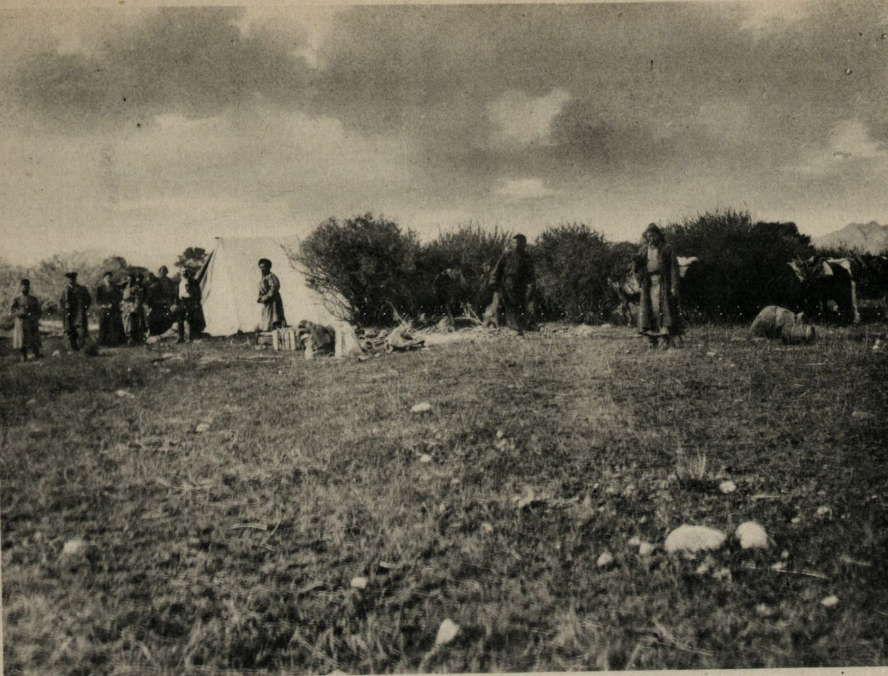

Unser Lager am Chirbita.

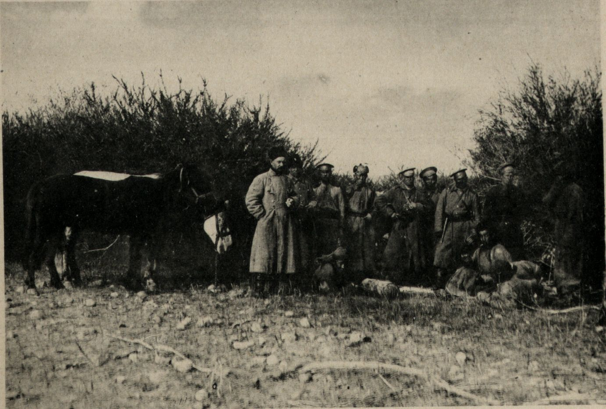

Zusammentreffen mit Podpolkownik Bensenger am Flüßchen Chirbita.

Tafel 20.

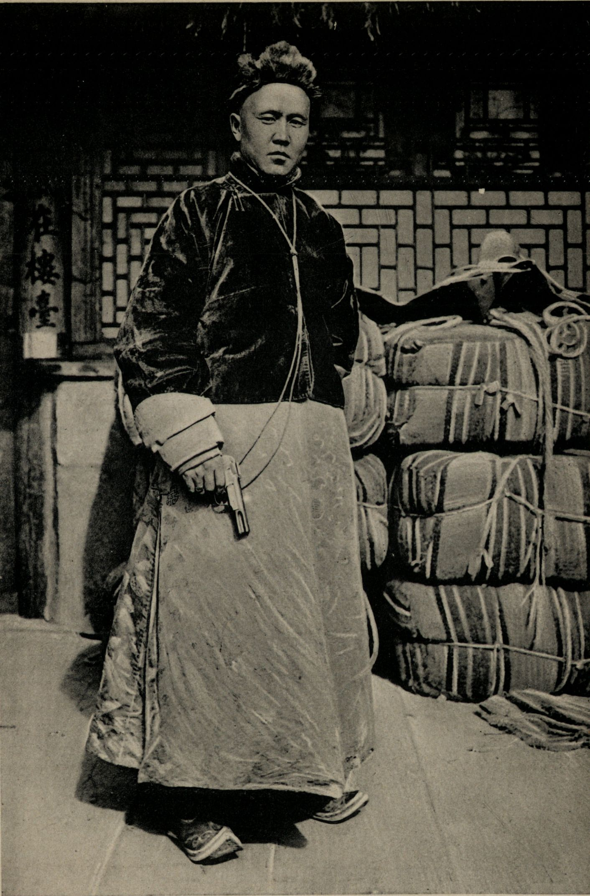

Ming-Bao.

Tafel 21.

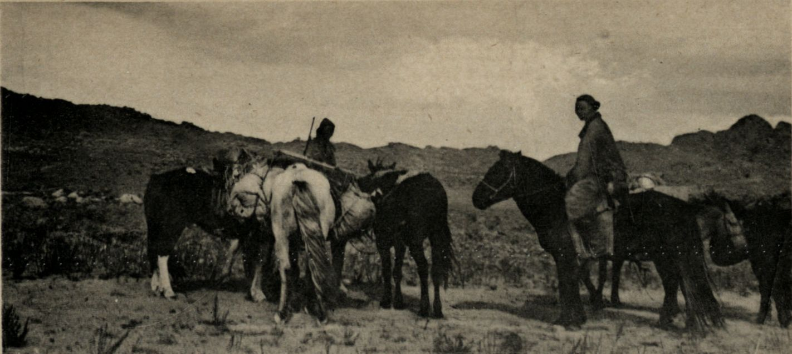

Die mit Photomaterial beladenen Lastpferde in den Ausläufern des Chara-Argalantu.

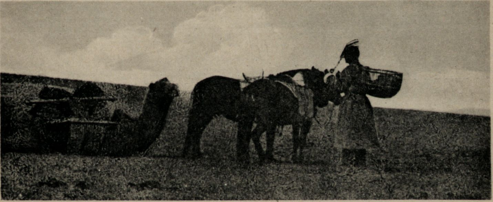

Mongole am Kungui, Kamel- und Pferdemist als Brennmaterial sammelnd.

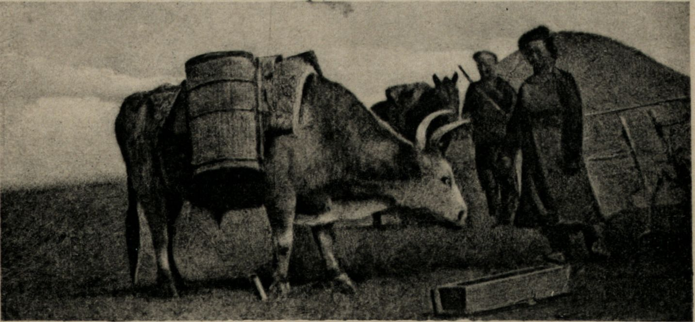

Im Lager am Ust-Nor.

<a id="89">**-- 89 --**</a>

schnell auf die Decke, um einen Ohnmachtsanfall zu verhindern. Anfangs konnte ich nicht feststellen, ob ich den Arm gebrochen oder nur schwer verstaucht hatte; denn er war unbeweglich und hing wie ein Fremdkörper an meiner Seite herunter. Ich ließ mir ünter rasenden Schmerzen den Rock und das Jagdhemd herunterziehen und fing dann leise den schmerzenden Arm zu massieren an. Konsuls zeigten wenig Teilnahme, ärgerlich ging Konsul Walter auf und ab und schimpfte die Kasaken aus, weil die Mongolen mit den Lastpferden noch nicht eingetroffen waren.

Auch ich sehnte die Ankunft der Pferdekarawane mit meiner kleinen Handapotheke herbei. Endlich tauchen die Halunken aus dem Dunkel der Nacht auf. Konsul Walter denkt auch jetzt nur an sich, er möchte dies und jenes zuerst haben. Da wurde ich aber sehr energisch und betonte, daß ich nicht mit ihm reise, sondern er sich mir angeschlossen habe. Wenn er von heute an nicht mehr Rücksicht auf mich und auf seine Frau nehme, die schon als Dame darauf Anspruch habe, so würde ich es vorziehen, zu meinen mongolischen Freunden nach Kobdo zu ziehen, er möge dann sehen, wie er fertig werde. Endlich habe ich meine Apotheke gefunden. Auf der Decke halbliegend massiere ich den verletzten Arm langsam mit Embrocation. Aber der rasende Schmerz läßt nicht nach. Nach sorgfältigem Befühlen stelle ich fest, daß der Arm im Ellenbogengelenk ausgerenkt ist. Nun rufe ich mir den Kasaken Butin und noch einen heran, zwei riesenkräftige Kerle. Der eine f aßt mich von rückwärts um den Leib, der andere nimmt den verletzten Arm vorsichtig wagerecht, und auf mein Kommando ziehen beide mit einem kräftigen Ruck in entgegengesetzter Richtung. Ein Ruck, ein fürchterlicher Schmerz, genau so wie kurz nach dem Sturz, und der Arm ist wieder eingerenkt. Für die Nacht mache ich mir eine Kompresse von kaltem Wasser und Embrocation. Dann lese ich noch die Instrumente ab. Mein Höhenmesser zeigt 1405 m Seehöhe. Wir lagern dicht an der Marschroute nach Dserik-Nor.

*(In den* *Ausläufern des* *Chara-Argalantu.)* Nachts konnte ich vor Schmerzen nicht schlafen. Wir brechen gegen 9 Uhr morgens auf. Zwischen Konsuls scheint es zu einer kleinen häuslichen Szene wegen gestern Abend gekommen zu sein. Die Nacht war bitterkalt, mein Thermometer fiel auf ---5 Grad R. Hatten wir seit zwei Tagen die Ausläufer des Ulan-Tologoe stets zur Rechten gehabt, so erreichen wir heute die Ausläufer des Chara-Argalantu. Die Steppe nimmt in der Nähe des Weges allmählich einen steinigen, stellenweise sandigen Wüsten-Charakter an, sie ist mit dornigen Wüstensträuchern bewachsen. Der Chara-Argalantu hat eine Breite von 35---40 Werst

<a id="90">**-- 90 --**</a>

und läuft von SO nach NW. Seine Höhen sind kahl. Das ganze Gebirge erscheint von der Steppe gesehen blauschwarz, daher auch wohl der Name "Schwarzer Argalantu". Über dies Gebirge führt in der Nähe der Dserik-Nor der direkte Weg nach Kobdo. Die Wüsten-Flora, arm und krüppelhaft, beginnt.

Mein Arm, den ich jetzt während des Reitens in einer Schlinge aus Hirschriemen trage, schmerzt maßlos. Ich kann kaum in den Sattel klettern. Der Weg wird steinig und sandiger, hier und da läuft blitzschnell ein kleiner grauer Wüstenvogel von einem Strauch zum andern. Die Steppe ist mit Feld- und Wüstenhühnern, Murmeltieren, (Tabargane) kleinen Spring- und Feldmäusen, schwarzen Adlern, Habichten und Wüstenfalken bevölkert. Am Horizont zum Argalantu hin ziehen flinke Dseren-Antilopen, die sich von dem dunklen Hintergrund wie kleine weiße Punkte abheben.

Überall wächst Charmyk (Nitra Schoberi) in buschigen Erhöhungen, und Sulchyr (Argriophyllum gobicum). Der Samen dieser stacheligen Salzpflanze ist eßbar und deutet stets auf Flugsand hin.

DieMongolen, die den schweren Tarantas über diesen steinigen, sandigen, schwierigen Weg hinter sich her schleppen, haben es nicht leicht. Einer von ihnen, der sich Amur nennt und einige Worte russisch spricht, scheint wirklich unverwüstlich zu sein. Das Blut läuft ihm an den Lenden herunter, er hat sich zum Schutz schon einen alten Rock über die Oberschenkel gelegt. Der Mann ist dabei unermüdlich und immer lustig. Als ich ihn einmal frug, warum er trotz so schwerer Arbeit so lustig sei, lachte er, fröhlich mit der Zunge schnalzend, mir ins Gesicht. "Ich werde mich in Uljasutai mit dem Gelde, was ich vom Konsul erhalte, vierzehn Tage lang besaufen und mit den Weibern amüsieren; bei so einer schweren Arbeit ist die Freude auf das kommende Vergnügen doppelt schön."

*(Am Dserik-Nor.)* Um 2 Uhr sind wir am Dserik-Nor. Der Dserik-Nor (Soldatensee) besteht aus einer Gruppe kleinerer und größerer Salzseen. Sie sind alle mehr oder minder natronhaltig, von grünen Wiesen und Sümpfen, durch die sich die kleineren Wasserläufe der hier zahlreich sprudelnden Quellen durchschlängeln, umgeben. Enten und Wildgänse bevölkern die Seen und Tümpel. Antilopen zu Hunderten äsen auf der grünen Steppe. Dagegen sind die sonst hier zu Tausenden weidenden Schafe, Pferde und Kamele nebst ihren mongolischen Hirten verschwunden, der unerbittliche Krieg mit seinem mongolischen Raub- und Mordsystem hat die friedlichen, nomadisierenden Mongolen vertrieben. Bei der Anfahrt zur Quelle wäre der Wagen des Konsuls beinahe ebenfalls

<a id="91">**-- 91 --**</a>

in einen Sumpf hineingefahren. Es gelang dem Mongolen Amur im letzten Augenblick, das Unglück zu verhüten. Wir wurden, während wir hier lagerten, von Mücken und Fliegen, die sich hier zu Milliarden angesammelt zu haben scheinen, fürchterlich belästigt. Die Quelle, die von vier Balken eingefaßt war, war unrein und bitter.

*(Am Dsapchyn-Fluß.)* Gegen 6 Uhr sind wir am Dsapchyn, oder vielmehr an einem seiner zahlreichen Arme, dem Sokso. Hier bleiben wir über Nacht. Wir lagern etwa eine Werst von der Niederlassung des russischen Händlers Kissilew, der heute seine Ansiedlung an die Firma Bodonow aus Biisk verkauft hat. Sie liegt auf einer kleinen Anhöhe, besteht aus drei Jurten, einem geräumigen Hof und ist rings von Palisaden umgeben. Von hier aus übersieht man weit die ganze grüne Ebene. Der Dsapchyn mit seinen zahlreichen Armen durchzieht und bewässert die ganze fruchtbare Steppe. Hier kommen übrigens noch die Kulane (Wildesel) sehr zahlreich vor. Der Kasak Palomochnikow schoß auf seinem Wege nach Kosch-Agatsch einen alten starken Hengst.

Einige Tage vor unserer Ankunft waren am Dsapchyn ein Dutzend chinesischer Kaufleute, die von den Uranchai-Mongolen verfolgt wurden, zu Kisselew und den anderen Russen geflüchtet. Die Russen hatten leider nicht denMut, diese armen, verfolgten Leute bei sich aufzunehmen. Sie verweigerten ihnen jede Hilfe und die Aufnahme. Die armen Kerle wurden dann, als sie mit ihren Pferden auf der Flucht den Dsapchyn durchschwammen, erschossen, andere ertranken, wenige entkamen und retteten sich nach Kosch-Agatsch. Ich selber war bei Kisselew im Jahre 1911 als Gast, als ich, von den Chinesen verfolgt, bei ihm auf Anordnung des Ältesten der russischen Kaufleute von Kobdo, Herrn Grechow, frische Pferde erhielt, um schneller mit meinen wichtigen Telegrammen nach Uljasutai zu gelangen. Ich kam damals von Kobdo über den Chara-Argalantu zum hochgeschwollenen Dsapchyn. In jeder Jurte, wo ich ansprach und um einen Führer, der die Furt genau kannte, bat, war die ganze Gesellschaft besoffen. Eine kostbare Stunde ging mir damals verloren, schließlich erbot sich ein halbbetrunkener Sengi, 1) mich hinüber zu bringen. Alles lief damals glücklich ab und bei Kisselew standen die Pferde schon seit einigen Tagen in der Nähe der Ansiedlung. Ich verdanke es nur den vier ganz vorzüglichen Pferden, die mir damals Kisselew überließ, daß ich zeitig und ohne von den Chinesen eingeholt zu werden, in Uljasutai eintraf. Die Tiere machten damals 120 Werst

1) Mongolischer Beamter mit einem weißen, undurchsichtigen Kügelchen an der Mütze, meistens Urtonvorsteher.

<a id="92">**-- 92 --**</a>

täglich, so daß ich schon am dritten Tage nachmittags in Uljasutai ein traf.

Der Dsapchyn ist übrigens als Fluß ganz gefährlich. Er teilt sich durch die Geschiebe-Bänke in mehrere Arme. In der Sommerzeit ist er ziemlich seicht, aber während der Regenzeit oder der Schneeschmelze im Gebirge durchbraust er mächtig sein Bett. Eine Eigentümlichkeit des Dsapchyn ist das plötzliche Verschwinden seiner Wasser in irgend einen Flußarm und sein ebenso plötzliches Auf tauchen in einem derzahlreichen, vielleicht seit langem trocken liegenden Arme, in denen die Mongolen seit Jahren keinen Tropfen Wasser bemerkt haben. Ich hatte Gelegenheit, ein solches plötzliches Hervortreten des Flusses zu beobachten; in einem der trockenen Flußbette in der Nähe der Siedlung des Kisselew quoll und brodelte plötzlich unter den Hufen unserer Pferde das Wasser hervor, und ehe wir das Ufer erreicht hatten, wateten unsere Pferde schon bis zu den Knien in dem Wasser des vorher noch trockenen Fluß-. bettes.

Unser Eager am Dsapchyn hat 1045 m Seehöhe. Die Wohnung des Kisselew liegt auf einem alten Grabhügel, der etwa um 20 m unser Eager überragt. Der Dsapchyn selber, sowie der Fluß Kungui fließen in den Airik-Nor.

Abends koche ich mir etwas Hafergrütze, dann krieche ich, vor Schmerzen stöhnend, in meinen Schlafsack. Während der Nacht fällt die Temperatur auf --- 8 Grad R. Morgens reite ich schnell zu Kisselew herüber, den ich noch um etwas frisches Brot bitte, da das unsrige bis Uljasutai nicht reichen wird. Er erkennt mich sofort, empfängt mich in seiner geräumigen Jurte, die in ihrer Einrichtung fast einer russischen Bauernstube gleicht, sehr freundlich und gibt mir willig das Einzige, was er vorrätig hat, getrocknete Suchari (steinharte Stückchen Schwarzbrot).

*(Über den Dsapchyn.)* Den Tarantas des Konsuls durch den Fluß und über die Geschiebe- bänke zu ziehen, war für Mongolen und Kasaken eine tüchtige Leistung, zweimal wäre beinahe der Wagen auf den Bänken eingesunken, einmal saß er schon bis zu den Achsen fest, aber schließlich bekamen wir ihn wieder flott.

Kurz vor dem Aufbruch schoß der Kasak Butin dem ich mein Mausergewehr soeben zum Entenschießen gegeben hatte, den Kasaken Palomoschnikow, beinahe tot. Kasak Butin konnte sich den Stecher an meiner Mauser nicht erklären und berührte, nachdem er vorher gestochen hatte, den Drücker, ohne zu sichern, die Kugel fuhr Palomoschnikow dicht am Ohr vorbei.

<a id="93">**-- 93 --**</a>

Hinter dem Dsapchyn wird der Weg stark sandig, wir ziehen über den sogenannten unteren Weg, da dieser nur für Wagen gangbar ist, der obere Weg, der über die Ausläufer des Chara-Argalantu und dann durch die Ausläufer des Ulan-Chairchan (roter Chairchan) wegführt, ist für Reiter ganz vorzüglich und kürzt die Strecke ganz bedeutend ab. Der untere Weg hat eine Seehöhe von 1185 m, der obere, der nur eine Werst entfernt parallel zum anderen läuft, 1285 m. Die Kammhöhe ist etwa 3---400 m höher. Der ganze Gebirgsrücken, der sich zwischen den Dsapchyn und dem Kungiu, resp. bis zur sogenannten Warotka in einer Ausdehnung von 40 Werst einschiebt, ist im ersten und letzten Viertel durch ständig in Bewegung begriffenen Sand so stark versandet, daß das ursprügliche Gestein fast gar nicht zu Tage tritt. Nur in der zweiten Hälfte des Weges ist die verhüllende Aufschüttung des wandernden Sandes noch nicht so stark, roter, grobkörniger Kies bedeckt den Boden. Der obere Weg ist vollständig sandfrei. Wir hatten unsere Wassertonne vorsichtigerweise am Dsapchyn gefüllt. Mittags rasteten wir kurz an einem Brunnen, Ochto-Nor 1185 m Seehöhe, der mit Balken und Bohlen von den Russen eingefaßt worden ist. Das Wasser des Brunnens, sowie auch die sumpfigen Weiher sind salzig und kaum zu genießen. Wir kochen unseren Tee mit Wasser aus der Tonne. Auch hier peinigen Milliarden von Stechmücken und Fliegen Mensch und Tier. Eine Unmenge Wüstenhühner fliegen mit lautem Surren und Geschrei durch die Steppe. Der beste Sänger der Wüste, der jeden gefiederten Sangesbruder täuschend nachahmt, die mongolische Lerche fliegt in Schwärmen von hunderten über den Weg.

*(Lager am Ust-Nor.)* Gegen Abend kommen wir an einen kleinen, rings von Hügeln um gebenen Weiher, dessen Wasser beinahe kein Salzgehalt hat. Der Platz heißt Ust-Nor. Wütendes Hundegekläff empfängt uns hier, zahlreiche Kühe und große Schafherden weiden um die hier lagernden mongolischen Jurten. Die Damnurreiter und Pferde können nicht mehr weiter.

Wir beschließen also notgedrungen hier zu bleiben. Ich belege die beste Jurte für den Konsul und Frau mit Beschlag und schlafe selbst in meinem dünnen Zelt. Der Schmerz in meinem Arm ist kaum noch zum Aushalten. Die Temperatur fällt in diesem geschützten Tal auf --- 4 Grad R. Ust-Nor liegt in 1185 m Seehöhe, und hat im SO und NO, so wie NW niedrige Höhenzüge. Trotzdem ist der Weiher noch von Wasservögeln, darunter die Schwanengans (Anser cygnoides), japanische Kraniche, Löffelreiher (Platalea leucorodia) und Möwen bevölkert. Sie sammeln sich hier, so lange die Seen offen bleiben, ehe sie ihren Wanderzug durch die Gobi zum Dolonor, dem Aimak der Zacharen und Kechikten und

<a id="94">**-- 94 --**</a>

von dort nach Indien antreten. Teilweise überwintern sie aber auch dort und an den in der Gobi gelegenen Seen.

*(Durch die Wüste zum Kungui.)* Um 6 Uhr morgens brechen wir, um das Versäumte nachzuholen, auf. Der Weg führt jetzt durch die reine Sandwüste weiter und gegen Mittag erreichen wir den Kungui. Wir haben einen schönen, warmen Tag. Zitternd und flimmernd liegt die Luft auf den Sanddünen zur Linken des Weges vor uns. Fern am Horizont tauchen schmale Gebirgszüge auf. Unübersehbar dehnt sich zur Linken gelber, beweglicher Sand. Dyrisu- (Lasiargrostis plendens) Büschel von einem Meter Höhe, deren Gestrüpp hart wie Draht ist, stehen vereinzelt am Wege.

Am Zagan-Bulok (Weißer Stein) (2500 m Seehöhe) vorbei kommen wir gegen 5 Uhr nach Chara-Usu (Schwarzes Wasser). Ich reite, um nicht bei der anderen Gesellschaft bleiben zu müssen, vor. Mein Arm schmerzt trotz der gestrigen Massage mit Embrocation bei jedem Schritt des Pferdes außerordentlich. Die ehemalige Station Zagan-Bulok ist verschwunden. Die mongolischen Posthalter, die früher hier inmitten der trocknen Flußarme des Kungui hausten, sind vor der drohenden Kriegsgefahr mit ihren Pferden weit weg von der Marschroute gezogen. Der Sand ist auch hier in ständiger Bewegung und bildet, etwas tiefer in der Wüste, regelrechte Sandflüsse. Jedenfalls wird der Sand durch den wochen- und monatelang aus Nord-West wehenden Wind durch alte Fluß- oder Bachrinnen vorwärts getrieben. Im Bach- oder Flußbett mit seinem von dem Ufer rieselnden, klingenden Sand bilden sich scharf gezeichnete Sandwellen, dann schlägt Welle auf Welle des fein singenden Sandes langsam vorwärts. Hier wächst auf erhöhter Stelle das Budargana (Kalidium gracile), das den auf lebensgefährlichen Pfaden durch dieses Tal des Todes ziehenden Kamel-Karawanen, als einziges Futter für ihre Kamele dient.

*(Chara-Usu.)* Um 5 Uhr bin ich in Chara-Usu (1295 m Seehöhe). Der Platz liegt rechts vom Wege auf einer kleinen Höhe, die Leute sind auf Befehl des mongolischen Posthalters Tschenschib-Gulun hierher gezogen, um uns zu erwarten. Das Futter für die Tiere ist schlecht, und sobald wir weiterkommen, ziehen auch die Mongolen ins Gebirge an geschütztere Stellen mit besseren Futterplätzen. Die Pferdekarawane trifft kurz nach mir ein. Beim Kontrollieren des Gepäcks stellt es sich heraus, daß die Halunken mein unersetzliches Kinostativ verloren haben. Ich schimpfe sie natürlich gründlich aus, während dessen trifft Popow, der mit der Kamelkarawane hier in der Wüste schneller vorwärts kommt, ein. Da jetzt genug Leute vorhanden sind, schicke ich einen der Leute, da er behauptet,

<a id="95">**-- 95 --**</a>

die Stelle, wo sie beim Umladen der Pferde das Stativ vergessen haben, zu kennen zurück. Ich wäre am liebsten selber mit ihm geritten, wenn ich nicht den kranken Arm gehabt hätte. Nach einer Stunde, beim Anbruch der Dunkelheit, trifft der Konsul mit dem zurückgeschickten Reiter ein. Als ich mich nach dem Stativ erkundige, erzählt mir der Mongole, der Konsul habe, obwohl er ihm mitgeteilt habe, warum er zurück müsse, ihn und sein frisches Pferd am Damnur mitgenommen, um schneller ins Lager zu kommen. Ich nahm mir nachher die Freiheit, diesem Herrn Konsul im Beisein seiner Frau und der Kasaken einen kleinen Vortrag über Egoismus und Rücksichtslosigkeit zu halten. Ich wurde hierbei sehr deutlich und gab ihm zu verstehen, daß mir die ganze Geschichte mit dem Stativ etwas stark verdächtig vorkomme. Aber was half das jetzt alles; inzwischen war es Nacht geworden, und ich mußte den Tag abwarten.

Um 7 Uhr morgens war ich zum Aufbruch nach rückwärts fertig, um mein Stativ zu suchen. Bin Mongole war schon früh morgens auf die Suche geritten, der Konsul überredete mich schließlich, mit ihm weiter zu reiten, da der Postkasak das Stativ ganz bestimmt von den Mongolen, die schadenersatzpflichtig wären, erhalten und dann mitbringen würde. Der Verlust meines Stativs geht mir den ganzen Tag durch den Kopf. Ich bin daher schlechter Laune, dazu bläst noch ein eisiger Wind vom Gebirge her. Wir ziehen, seit Ochto-Nor immer die Wüste zur Linken, in die je ein Gebirgsstock der Schir-chairschan und Sabun-chairschan hineinragten, längs des Flusses Kungui. Es sind gewaltige Dünen, die auf der anderen Seite des Flusses am Ufer Halt machen, und deren Sand vom Winde zu uns herübergetrieben wird. Ständig rieselt der Sand durch die dürftigen Sträucher zur Rechten unseres Weges. Die armen Leute am Damnur haben es wirklich nicht leicht. Wir passieren den etwa 20 Werst langen, dicht an den Fluß Kungui herantretenden Höhenrücken des Char-Zur.

*(Die Siedlung* *Minin am* *Kungui.)* Hier etwas abseits vom Wege liegt die Siedlung eines Russen Minin. Öde und verlassen ist jetzt das Tal des Kungui-gol. Die mongolischen Siedlungen im Zagan-Bulok und Nuga sind verschwunden, die chinesischen Kleinhändler vertrieben oder ermordet. Ihre mongolischen Weiber haben sich mit Stammesgenossen getröstet. Bei vielen dieser Weiber, die jetzt auf den von Dschenschip-Gulun angelegten Urtonen hausen, bemerke ich von den Chinesen herrührende Gebrauchs- und Schmuckgegenstände. Hier und da sieht man auch kleine schwarze Chinahunde in den Jurten der Mongolen. Die Ansiedlung des Minin liegt vom Wege ab, nicht sichtbar zwischen einem felsigen, steil

<a id="96">**-- 96 --**</a>

abfallenden Höhenzug und der mächtigen, etwa 50 Werst breiten Sandwüste Khangai mit ihren haushohen Dünenwellen. Diesmal lassen wir, da Minin selber in Uljasutai ist, sein Anwesen links liegen und ziehen weiter, ohne uns dort aufzuhalten. Ich besuchte ein Jahr vorher die Siedlung auf meinem Ritt nach Uljasutai, um dort eine Stunde auszuruhen und war überrascht, mitten in der Mongolei zwischen den Sandwellen der Khangai ein so schönes, sauberes Gehöft zu finden. Von der Berghöhe führt der Weg über einen steil abfallenden Hang hinab, bei einer Biegung des Weges liegt ruhig und friedlich diese Siedlung. Große, eingezäunte Wiesen umschließen die drei stattlichen, aus hellen Ziegeln errichteten Gebäude. Originell ist eine kreisrunde, ebenfalls aus Ziegeln errichtete Steinjurte für die Mongolen, die sich dicht an zwei der Gebäude anlehnt. Minin selber ist em junger Mann von etwa 25 Jahren, der nach dem Tode das Anwesen seines Vaters im Namen der Familie übernahm. Er ist Student der orientalischen Fakultät und gilt als einer der besten Kenner der mongolischen Sprache und ihrer zahlreichen Dialekte. Wer die Mongolei bereist, wird diesen unverwüstlichen Reiter in der Uniform seiner Fakultät todsicher dort, wo sich eine lustige Gesellschaft zusammenfindet, treffen. Seine Wohnung war echt russisch, einfach und praktisch eingerichtet. Ein kleiner Bücherschrank mit mongolischen, mandschurischen und chinesischen Handschriften fiel mir besonders auf.

Der verstorbene Vater Minins legte hier erst eine nur vorübergehende Handelsstation an, dann bebaute er in aller Stille das Land und zog um die geackerten Felder und Wiesen einen Zaun. So entstand auf dieser Oase am Rande der Wüste das stattliche Hofgut. Pferde, Rinder und Schafe werden hier gegen russische Handelsartikel von den Mongolen eingetauscht. Aber Schritt für Schritt nähern sich vom Nordrande des Kessels nach jedem Sandsturm die Dünen dem Gehöft, und wie lange diese Siedlung den Wüstenstürmen trotzen wird, ist nicht vorauszusehen. Die Ansprüche Minins an den Grund und Boden wurden, wenn ich nicht irre, im Jahre 1911 beim ersten Taumel der russisch-mongolischen Freundschaft von der neuen mongolischen Regierung ohne weiteres anerkannt.

*(Eintreiben von alten Schulden durch Minin.)* Leider war Minin Familienverhältnisse halber gezwungen, das unter unendlich mühevoller Arbeit Errungene zu verkaufen. Er beschäftigt sich heute damit, alte mongolische Schulden aufzukaufen und diese einzutreiben. Für ein solches Geschäft ist er der geeignetste Mann. Mit allen Schlichen und Kniffen der Mongolen vertraut, arbeitet er nach folgendem Rezept. Hat er eine alte Schuld aufgekauft, so benachrichtigt er hiervon den Chochun (Bezirk). Dieser ist sowohl für die Schuldverschreibungen eines jeden seiner Angehörigen sowie auch für die Schulden der

Tafel 22.

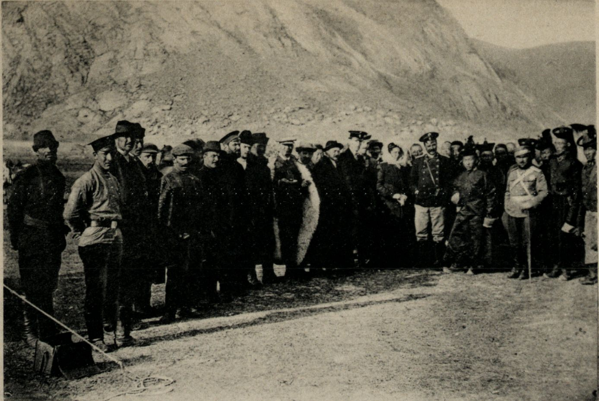

Die russische Kolonie von Uljasutai beim Empfang Konsul Walters.

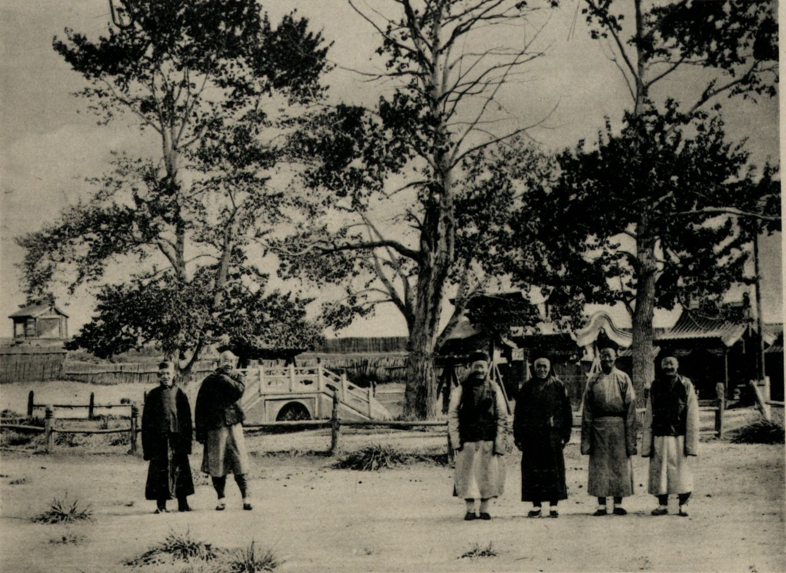

Der Hof der Festung Uljasutai.

<a id="97">**-- 97 --**</a>

Gesamtheit haftbar. Kurz darauf erhält dann der Gläubiger, also in diesem Falle Minin, ein langes Schreiben, er möge doch warten bis zum nächsten Jahre, auch wenn die Schulden schon zwanzig Jahre zurückdatieren. Dann begibt sich Minin mit einigen seiner Leute zu Pferde auf den Chochun, freundlichst von den Mongolen empfangen. Sofort wird ihm eine gute Jurte, die er möglichst in der Nähe des Chochun- Verwalters aufstellen läßt, errichtet. Zwei Tage gehen dann mit den üblichen Verhandlungen hin. Das Resultat lautet gewöhnlich "Warte, warte, warte bis in alle Ewigkeit!"

Minin zieht sich ruhig in sein Zelt zurück und fängt dann an, das ihm unentgeltlich gelieferte Fleisch zu bemängeln, er wird in seinen Ansprüchen immer rücksichtsloser und unverschämter, schläft den ganzen Tag und lockt den jugendlichen weiblichen Teil des Chochuns mit seinem Grammophon in Scharen des Nachts in seine Jurte. Auch sie müssen alle bewirtet werden und dafür hat der Chochun-Verwalter zu sorgen. Unaufhörlich schrillen chinesische Melodien durch die Nacht, dazwischen russische Gassenhauer und Militärmusik. Bei Tagesgrauen schmeißt Minin seine Gäste hinaus, um frische Kräfte für die kommende Nacht zu sammeln. Nach der zweiten, dritten oder vierten Nacht fangen die mongolischen Beamten schüchtern an zu fragen, wann er denn eigentlich abzureisen gedenke. Minin meint dann, es gefiele ihm und seinen Begleitern so außerordentlich gut bei seinen mongolischen Freunden, daß er beschlossen habe, so lange bei ihnen zu bleiben, bis sie ihn bezahlt hätten. Nach einer Woche endlich, nachdem Nacht für Nacht das Grammophon seine Arbeit getan hat, die höheren mongolischen Beamten um die wohlverdiente Nachtruhe zu bringen, werden die Herren weicher, abermals beginnt das Feilschen, und schließlich zieht Minin mit einer größeren Abschla'gssumme, die häufig schon den Kaufpreis der Schuld übersteigt, zum nächsten Schuldner. Bei besonders hartnäckigen Beamten wird Minin auch plötzlich nach dem Genuß von Hammelfleisch krank. Es gibt dann ein heiliges Donnerwetter, die Mongolen, die fürchten, für die Folgen der Krankheit oder den Tod des Russen haftbar gemacht zu werden---dies ist nach altem mongolischem und chinesischem Recht allgemein üblich --- zahlen schleunigst, und der plötzlich wieder gesund gewordene Minin reitet mit Grammophon und Krankheit zum nächsten Chochun. Dieses Nichtzahlenwollen des Mongolen steht in krassem Widerspruch zu seinem Gebaren, wenn er selber an irgend jemanden Forderungen hat. Pünktlich zur Minute findet er sich ein; kann der Schuldner, gleichgültig ob Russe, Chinese oder Mongole, nicht zahlen, so quartiert auch er sich kaltblütig bei dem Schuldner ein und ermahnt ihn alle Stunden, doch endlich zu bezahlen. Schmeißt dann der so Gequälte

<a id="98">**-- 98 --**</a>

endlich den Mongolen zur Tür hinaus, so sitzt er nach zehn Minuten wiederum bei dem Schuldner, als ob ganz und gar nichts passiert wäre, und mahnt und droht so lange, bis er sein Geld oder einen Teil seines Geldes erhalten hat.

Hinter der Siedlung Minins führt der Weg über kahles Hügelland nach Nuga mit dem kleinen Flüßchen Nugi, das hier in den Kungui mündet. Die Weideflächen sind mit salzhaltigen Tümpeln durchsetzt. Nachmittags, als die Sonne tiefer steht, wird es ganz empfindlich kalt, ich friere, abends wird es immer schlimmer. Wir kommen langsam ansteigend über einen Gebirgssattel. Es wird dunkel. Die Füße erfrieren beinahe in dem Bügel. Ich lasse die Karawane herankommen, dann geht es allmählich in ein breites Tal, das zur Rechten von einem Höhenzug begrenzt wird, hinab. Die Kasaken und ich können es kaum noch im Sattel aushalten. Wir gehen daher, um unsere erfrierenden Füße zu erwärmen, zu Fuß. Nach einer halben Stunde blitzt unten in der Ebene ein Licht auf, das ist der für uns angelegte Urton Narym-Kol, am Narym-Kol gelegen. Wir sind dort um Uhr abends. Am lustig flackernden Feuer versuchen wir erst unsere schmerzenden Füße warm zu bekommen, dann erwärmen wir auch den inneren Menschen mit heißem Tee. Narym-Kol liegt in 1485 m Seehöhe. Die Temperatur fällt auf --- 8 Gr. R. Der Weg führt am andern Morgen von Nuga an durch welliges Hügelland des Altyn-Chairchan, die Kammhöhen, die nur um etwa 200 m den Weg überragen, sind stark abgetragen, die Täler weit ausladend und muldenförmig.

Wir haben einstweilen immer noch die Wüste zur Linken, das Terrain wird nach und nach hart und leicht befahrbar. Wir kommen mit unseren neuen Damnurreitern --- nur der Mongole Amur zieht noch immer unverdrossen mit --- und unseren frischen Pferden flott vorwärts. Je näher wir Uljasutai kommen, desto schöner und höher werden die Berge. Wir ziehen über fünf kleine Paßhöhen auf Uljasutai zu. Gegen 2 Uhr kommen wir an einem rechts vom Wege etwas erhöht, in der Nähe von roten Sandsteinfelsen gelegenen Brunnen vorbei.

*(Jarem-Chuduk.)* Es ist Jarem-Chuduk. Jarem-Chuduk ist ein kleiner, schmutziger, mongolischer Brunnen ohne besondere Tiefe und innen nicht einmal mit Steinen ausgelegt. Das Wasser wird mit einem von zwei Hölzern offen gehaltenen Schafsmagen in einen erhöhten Graben gegossen, an dem die Tiere getränkt werden. Hier und an anderen Plätzen könnten die Mongolen ganz leicht eine Anzahl größerer Brunnen anlegen, denn überall ist wohl genügend Grundwasser vorhanden, auch in solchen Gegenden, wo es heute absolut kein Wasser gibt. Aber der Mongole

<a id="99">**-- 99 --**</a>

betrachtet die zum Brunnen nötige Grabarbeit als Sünde, daher die wenigen Brunnen in der Mongolei. Auch heute umlagern Mongolen mit ihrem Vieh den Brunnen; denn je weiter wir uns von Kobdo und dem eigentlichen Mittelpunkte der Kämpfe entfernen, desto zahlreicher werden die Herden und desto häufiger treffen wir auf Mongolen. Das Tal ist breit, reich mit Gras bewachsen, umsäumt von roten Sandsteinfelsen Die Vegetation wird kräftiger und das Futter ist trotz der späten Jahre zeit verhältnismäßig noch frisch.

*(Ussun-Djsul. Dschenschip der Posthalter.)* Um 5 1/2 Uhr sind wir endlich in Ussun-Dsjul. Hier empfängt uns Dschenschip-Gulun in seinem feinsten Festgewande. Sein rotes Seidenkleid, darüber eine gelbe Jacke mit blauen Aufschlägen, eine auf dem Kopf balanzierende Zobelmütze mit einem durch einen hellgrünen Nephrit gehaltenen, fest zusammengepreßten Busch Pfauenfedern, so daß dieser wie eine einzige dicke Pfauenfeder ausschaut, die spitze Mütze mit einer blauen durchsichtigen Kugel gekrönt, kennzeichnet ihn als einen reichen, vornehmen Mongolen. Er macht vor uns den üblichen Kotau, dann geleitet er uns bis zu den für uns auf geschlagenen Prunkjurten. Während des Tees macht er uns in unserer Jurte seinen offiziellen Besuch. Bei dieser Gelegenheit nimmt ihn der Konsul wegen des verschwundenen Geldes ins Gebet. Sofort erklärt sich Dschenschip- Gulun bereit, alles zu ersetzen. Er habe ja erst auch vor einigen Tagen eine Platte Hamburger Silber im Werte von 200 Lan ersetzt. Allem Anschein nach hatte der Konsulatssekretär Xionin, Dschenschip und den Chinesen den Verlust der verschwundenen 10 000 Rubel verheimlicht, um das Vertrauen der Chinesen und Mongolen zur russischen Post nicht von Anfang an zu erschüttern, deshalb lenkte auch der Konsul sofort auf ein anderes Thema über.

Der Usin-Dsjul durchbricht hier in ziemlicher Breite, aber zurzeit wenig Wasser führend, ein hügeliges, steiniges Gelände in einer Seehöhe von 1865 m und fließt in den Kok-Nor. Tagsüber war es so kalt gewesen, daß Hände und Füße während des Reitens froren.

Am anderen Morgen war ich schon um 5 Uhr auf, ich konnte vor Schmerzen nicht schlafen. Wir trinken Tee mit angebrannter Schafmilch, die Dschenschip-Gulun von weither geholt hat. Dschenschip selber ist der Typus des wohlhabenden verschlagenen, von der Dummheit des Volkes lebenden höheren Lama. Gulun, auch Gelun, bedeutet die vierte Rangstufe der mongolisch-tibetanischen Lamas. Ihnen ist das Zölibat erstes Gebot, außerdem haben sie noch 252 Vorschriften und Regeln zu beobachten. Sie tragen während des Gottesdienstes im Kloster einen frauenartigen Rock ohne Hosen, einen roten Gürtel, einen unteren

<a id="100">**-- 100 --**</a>

Überwurf, einen oberen Überwurf (tibet. Namdsiär), der togaartig in viele Falten gelegt wird, und darüber einen Mantel, den Tagam. Die niedrigen Lamas bis zum Toin dürfen heiraten. Dschenschip kehrt sich wenig, wie übrigens auch alle anderen höheren Lamas, an das Keuschheitsgelübde, und ist in Uljasutai, trotzdem er erst seit kurzem dorthin gezogen ist, als ein arger Schwerenöter, wie mir einer der uns begleitenden Mongolen erzählt, bekannt.

Von Usin-Dsjun führt der Weg über zwei kleinere Pässe nach Zubera. Wir sind jetzt mitten in dem Uljasutai umgebenden Hochgebirge. Weitgestreckte Bergzüge mit steilen, schroffen Felsabhängen, die hier und dort in einem mächtigen Absturz an die Perewalls herantreten, dazwischen graue und rote, kahle, in verschiedenen Farben glänzende Bergzüge geben dem Ganzen ein düsteres, wildes Kolorit. Der Gegensatz zu den von uns durchzogenen Sandwüsten und Sandsteppen ist überwältigend, mächtig glänzt zu unserer Rechten der Zagan-Tschugun (Weißer Felsen), ein weißer Kalkstein, der aus dem roten Urgestein wie ein kleiner Gletscher zu uns herüberleuchtet. Wir ziehen jetzt durch eine ausgesprochene wellige, weite Hochebene, die nur noch mit spärlichem Gras bewachsen ist. Vergebens versuchten heute sowie auch gestern die Kasaken, einige der zahlreichen Kraniche zu schießen, die zu dieser Jahreszeit ganz besonders fett und wohlschmeckend sein sollen. --- Der Weg führt dann über eine Halde in das von steilen Felsabhängen umgebene Tal des Narym-Kol. Der Narym Kol durchfließt hier in nordöstlicher Richtung im breiten, grauen Kiesbett ein mit gutem Futter bestandenes breites Tal. Zur Zeit wird sein Quellgebiet und sein Sand auf Gold untersucht. Die Ergebnisse werden wohl negativ ausfallen. Zum letzten Male wird der schwerfällige Tarantas durch den steinigen Kies des Flusses geschleppt; denn am jenseitigen Ufer hält, von einem Kasaken gelenkt, eine mit drei frischen russischen Pferden bespannte Troika. Konsuls machen schnell noch etwas Toilette und von ihren Kasaken begleitet, gehts in flottem Trab auf Uljasutai zu. Wir überschreiten noch ein mächtiges, aus gelbbraunem Gestein gebildetes Hügelmassiv mit abgerundeten, leicht geschwungenen Kuppen. Scharf biegt jetzt die weite Fahrstraße über einen Gebirgssattel ins Tal.

*(Empfang durch die Bevölkerung von Uljasutai.)* Hier am Ausgang des Gebirges steht die ganze Bevölkerung von Uljasu- festlichen Empfang bereit. In doppelter Linie halten die Konvoi-Kasaken vor dem aufgeschlagenen Zelt, befehligt von einem kleinen dicken Kasaken-Offizier. Hinter ihm stehen in Reih und Glied die Begleitmannschaften des mongolischen General-Gouverneurs Zezen-

<a id="101">**-- 101 --**</a>

Beese. Sie sind mit Karabinern bewaffnet, aus deren Lauf ein roter Seidenlappen wie eine züngelnde Flamme theatralisch heraushängt. In Begleitung meines Freundes Zezen-Beese sind alle höheren und niedrigen mongolischen Beamten vollzählig zur Begrüßung erschienen. In dem großen russischen Zelt, bei dem uns die ganze russische Kolonie erwartet, treffe ich viele alte Bekannte, darunter auch meinen Feind Xionin, der den Konsul Walter als rangältesten russischen Beamten offiziell empfängt. Die Herren haben etwa vier Stunden hier auf uns gewartet und stehen nicht mehr ganz fest auf den Füßen. Auch die chinesische Kaufmannschaft ist mit ihren Ältesten vollzählig versammelt, wird aber vom Konsul stark geschnitten. Nachdem ich mich mit den Russen und Mongolen begrüßt habe, schüttle ich auch dem braven Präsidenten der chinesischen Handelskammer von Uljasutai die Handund folge willig seiner Aufforderung, an dem dem Konsul zu Ehren aufgestellten Tisch ein Gläschen chinesischen Schnaps zu trinken. Von allen Seiten umdrängen mich die hier in Uljasutai jetzt stark bedrängten Zopfträger, und ich kann mich kaum der Einladungen erwehren. Die meisten dieser chinesischen Großkaufleute sind mir von meinen früheren Reisen bekannt, und ich verspreche ihnen, sie recht bald in ihren Fansen zu besuchen.

Nachdem endlich die ganze Begrüßungszeremonie vorüber ist, steigen der Konsul und seine Frau in ein auf dem Fahrwege haltendes deutsches Automobil, einen Opel-Wagen, einkurzes scharfes Kommando, die Kasaken schwenken ein, dahinter die mongolische Kavallerie und in wildem Galopp schließen sich die anderen, in eine fürchterliche Staubwolke eingehüllt, an. Ich selber halte ruhig beim aufgeschlagenen Zelt, bis diese wilde Jagd und der Staub sich verzogen hat. Dann reite ich hinterher. Der Weg führt an den von Palisaden umzäumten Feldern chinesischer Ansiedler, an der chinesischen Hinrichtungsstätte vorüber. Die Stadt ist an dieser Seite von einem mächtigen stinkenden Schmutzwall umschlossen, durch den ich durch muß, um durch das Nordtor in die engen Gassen von Uljasutai zu gelangen.

Der Konsul ist bei dem russischen Händler Bodonow abgestiegen, weil das neue Konsulatsgebäude trotz der geleisteten finanziellen Hilfe der chinesischen Großkaufleute noch nicht ganz fertig ist. Wir trafen um 5 Uhr nachmittags in Uljasutai ein. Konsul Walter weiß selber noch nicht, wo er bleiben soll. So begebe ich mich denn auch auf die Suche nach einer Wohnung. Ein Chinese, Bain-Dorschik, der in mir einen Russen vermutet, ist mir dabei behilflich. Er bringt mich schließlich nach längerem Suchen zu einem mir vom vorigen Jahr bekannten chinesischen Großkaufmann Linninfa. Lininfa, der gut russisch spricht, nimmt mich gastlich auf, und ich teile mit ihm seine beste Stube.

<a id="102">**-- 102 --**</a>

Zwei Tage später trifft der Kasak Popow mit der Kamelkarawane ein. Zwei meiner Kamele, gerade die besten, haben sich wund gelaufen, darunter auch mein Reitkamel. Popow hatte die Kamele des Konsuls, die dieser von den chinesischen Kaufleuten in Kosch-Agatsch für billiges Geld erhalten hatte, geschont, da sie alt waren und nicht mehr vorwärts konnten und meine Kamele auch noch mit den Sachen des Konsuls beladen, so daß meine Tiere ganz abgehetzt und mit wunden Füßen in Uljasutai ankamen. Als ich Popow darüber zur Rede stellte, entschuldigte er sich damit, daß er vom Konsul hinter meinem Rücken diesbezügliche Befehle erhalten habe. Ich war gezwungen, die Kamele später mit großem Verlust gegen andere zu vertauschen.

Hier sei kurz die Marschroute von Kosch-Agatsch nach Uljasutai wiedergegeben, wie sie von den russischen Händlern aus Biisk eingehalten wird.

|                                  |                                                                                                      |
|----------------------------------|------------------------------------------------------------------------------------------------------|
| Kosch-Agatsch---Tarschanti       | Steppe, ebener Weg.                                                                                  |
| Tarschanti---Zagan-Nor           | Gebirgstäler, Paß, Tarschanti. Weg schlecht, steinig, am Schluß sandig. Perewal 1) (2555 m Seehöhe.) |
| Zagan-Nor---Namir-Kuré           | Weg gut, enge Talschluchten, dann flach, Perewal, sumpfig.                                           |
| Namir-Kuré---Dsapchyn            | Weg gut, Steigungen, am Dserik-Nor sumpfig.                                                          |
| Dsapchyn---Warotka               | Erstes und letztes Viertel stark sandig.                                                             |
| Warotka---Schabokoba             | Vom Gebirge an starker Sand, Weg eben, Wasser im Kungui-Fluß.                                        |
| Schabokoba---Bailu-Olan          | Ebener Weg, stark sandig.                                                                            |
| Bailu-Olan---Nuga                | Ebener Weg, sandig, Wasser.                                                                          |
| Nuga---Jarem-Chuduk (Brunnen) .  | Unterer Weg sandig, oberer Weg ohne Sand.                                                            |
| Jarem-Chuduk---Ussin-Dsjul       | Brunnen schmutziges Wasser, 5 Perewale.                                                              |
| Ussin-Dsjul---Zubera             | Wasser am Fluß, 2 Perewale, 4 Werst vom Wege immer Wasser.                                           |
| Zubera---Uljasutai               | Weg steinig, Perewal ohne Steine, Fluß, großer Berg.                                                 |

<a id="103">**-- 103 --**</a>

## KAPITEL 7. IN ULJASUTAI.

*(Uljasutai, 1825 m Seehöhe.)*Uljasutai ist einer der wichtigsten Handelsbezirke und Verwaltungs- plätze der äußeren Mongolei mit etwa 3000 Einwohnern, davon sind zwei Drittel Chinesen. Die chinesische Übersetzung des Namens Uljasutai heißt "Pappelstadt"; es klingt beinahe wie Ironie, denn heute steht kein Baum, kein Strauch in großer Entfernung rund um Uljasutai.

Nur hoch auf den Hängen und Gipfeln des Gebirges gibt es noch an den Nordhängen spärlichen Wald. Brennholz und Bauholz muß von 30 oder 40 Wersther, auf vonYacks gezogenen, quietschenden chinesischen Karren herangeschafft werden. Mongolisch lautet der Name der Stadt "Zärägun- Kurja" d. h. Kriegskloster, jedenfalls nach der 2 Werst von der Stadt gelegenen Festung so benannt. Uljasutai zerfällt wie alle chinesischen Siedlungen in eine eigentliche Handelsstadt und die Festung. Uljasutai ist eine echte und rechte Verkehrssiedlung, obwohl sie nach den Erzählungen der höheren mongolischen Lamas durch die Übersiedlung der Einwohner der etwa 300 Werst am Baidarik in der Nähe des Zagan-Nors gelegenen zerstörten alten Stadt Uljasutai entstanden ist. Nur ein leidiger Zufall verhinderte mich später, diese alte Stadt, die tief in der Gobi gelegen ist, aufzusuchen.

Es zeugt von dem Scharfblick der Chinesen, gerade an der heutigen Stelle die neue Stadt und Festung angelegt zu haben. Uljasutai liegt in den Tälern des Flusses Uljasutai, und zwar am Zusammenfluß des Dsagistai und Bogdin-Kol, rings umgeben von hohen, rotbraunen, stark verwitterten Gebirgen. Acht Wege laufen kaum erkennbar durch die verschiedenen Täler in Uljasutai zusammen, darunter auch die große Pekinger Poststraße. Durch die Täler des Uljasutai, des Narim-Kol, des Dsagistai und Bogdin-Kol, sowie des Termirti ziehen die Straßen nach Nord und Ost in die unwirtliche, wild zerklüftete, aber reiche Khanchai, nach Kossogol und dem Baikal-See. Nach dem Westen führen von dem Flüßchen Termirti, an der alten, chinesischen Poststraße ansetzend, sowie von Borcho angefangen an der Poststraße nach Kobdo und dem Flusse Uljasutai gelegen, zwei Wege durch die Dünenwälle des nordmongolischen

<a id="104">**-- 104 --**</a>

Beckens, über die mächtigen Berge des mongolischen Altais nach Zagan- Tonké, Barkul und Urumschi einerseits und nach der Stadt Chami anderseits. Von Peking, Kalgan führt durch die Wüste Gobi die uralte chinesische Poststraße, bei Sair-Usu nach Westen abbiegend, nur durch eine leichte Bergkette von diesem Sandmeer getrennt, nach Uljasutai, und von hier nach dem Westen weiter über Borcho nach Kobdo und nach Kosch-Agatsch, wo auch der sogenannte Kaufmannstrakt der Tschuizen, von Uljasutai kommend, endet. Von Osten kommend stellt, da jetzt die alte Poststraße wegen der Kriegsgefahr von den Mongolen aufgegeben worden ist, ein alter Sumunweg nicht weit an dem Trümmerfeld der ehemaligen Residenz der Großschane, dem alten Karakorum vorbeiführend, die Verbindung mit Urga her. Reit- und Schleichpfade, nur den Mongolen bekannt, ziehen nach allen Richtungen durch die Gebirge, Täler und Wüsten.

Uljasutai macht auf den ersten Blick den Eindruck einer echten chinesischen Handelsstadt. Die Stadt ist in 1825 m. Seehöhe gelegen und von Urga noch 1075 Werst entfernt. Das Klima ist rauh und hart. Die Durchschnittstemperatur im Jahre 1911---1912 betrug ---0,2°, Durchschnittstemperatur bis Juli +19,2° R, bis Januar --- 24,2° R. Größte Hitze +33,1° R. Größte Kälte ---42,3° R. Nach einem kurzen, heißen Sommer folgt ein meistens schneeloser Winter innerhalb der Stadt, dagegen fällt aber schon Mitte Juni auf die die Stadt umgebenden Berge meterhoher Schnee. Wer von dem Westtor kommend, nachdem er sich auch hier an einem Wall von Schmutz und einem mit hohen Palisaden umgebenen Hof eines Lamas, auf dem beinahe den ganzen Tag die Gebetstrommel ertönt und Gebete zu Chutuchtu gemurmelt werden, durch Menschen- und Tierkot durchgearbeitet hat, sieht dann plötzlich die beiden einzigen Hauptstraßen der Stadt mit ihrem Gewimmel von bunt gekleideten Mongolen zu Fuß und zu Pferde vor sich. Die Hauptstraße beginnt beim Westtor und endet am Osttor, hat aber noch eine einzige, nach dem Nordtor führende Seitenstraße. In der Hauptstraße sowohl wie in der Seitenstraße gibt es nur einige enge, von Schmutz triefende kleine Gäschen. Zum Schutz für die Fußgänger ist an beiden Seiten der Hauptstraße eine Art erhöhter Bürgersteig gegen die die Straßen durchrasenden Reiter angebracht. Ein chinesischer Laden drängt sich neben den anderen. Nur manchmal schiebt sich die kleine Behausung eines chinesischen Silberschmiedes dazwischen, auch hier und da der Laden und Hofraum eines Russen. Buntbemalte, verschnörkelte Türen führen meist neben dem chinesischen Laden vorbei nach dem hinteren Teil der Fansa, auf einen fast immer großen, geräumigen Hof, der durch das eigentliche Wohngebäude des chinesischen Kaufmanns,

Tafel 23.

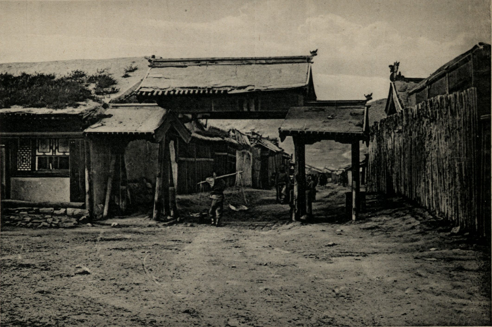

Am Nordtor von Uljasutai.

Tafel 24.

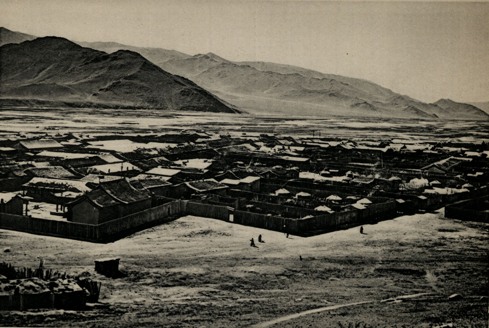

Uljasutai vom Obo aus gesehen. Im Hintergrund der Zusammenfluß des Dsagistai und Bogdin-Kol.

Tafel 25.

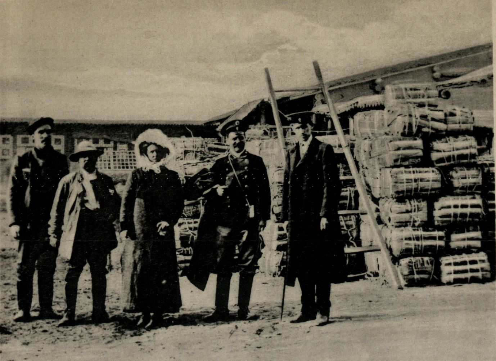

Auf dein Hofe des russischen Kaufmanns Bodonoff. 1. Ignatieff, 2. Der Verfasser, 3. Frau Konsul 4. Konsul Walter. 5. Konsulatssekretär Hionin. Im Hintergrund Ziegelteeballen.

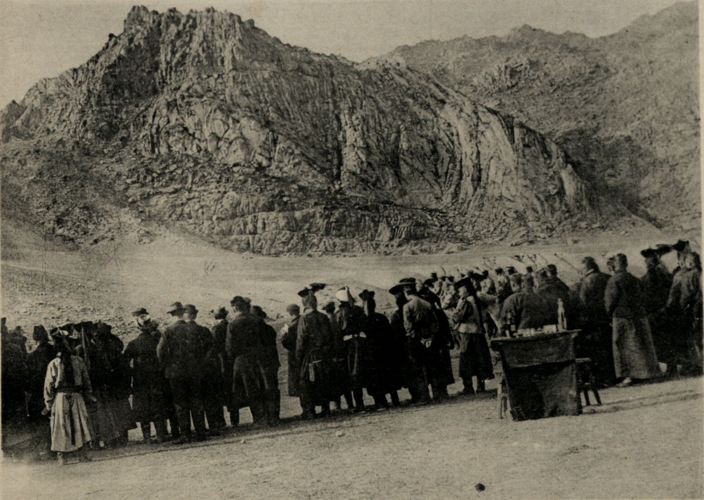

Feierlicher Empfang dicht vor Uljasutai durch russische Händler, Kasaken, mongolische Verwaltungs-Beamte und Militär, sowie durch die chinesische Kaufmannschaft. Im Vordergrund der Ehrentisch der Chinesen.

Tafel 26.

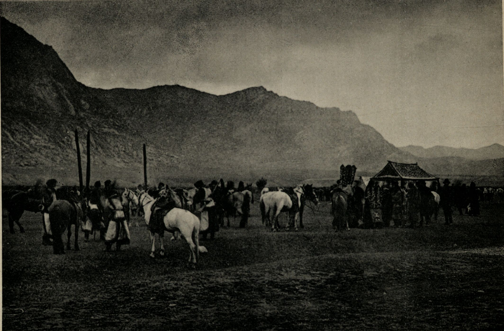

Der Dsänsyn von Uljasutai verläßt unter dem Schutze der Russen die ihm anvertraute Stadt und Festung Uljasutai.

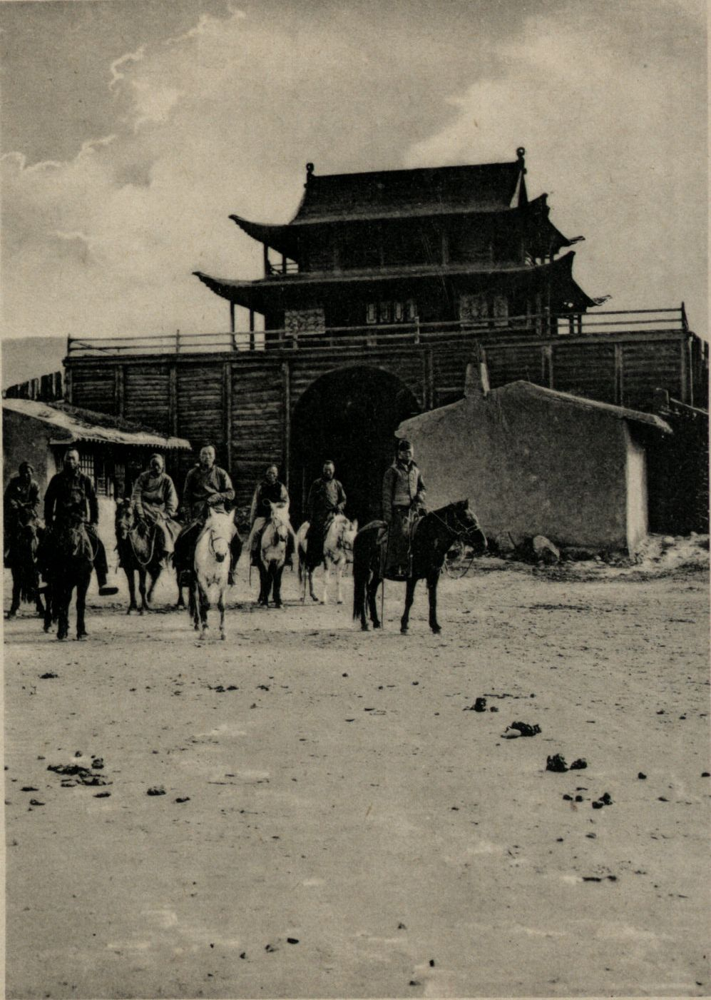

Festungstor von Uljasutai mit chinesischer Besatzung.

Tafel 27.

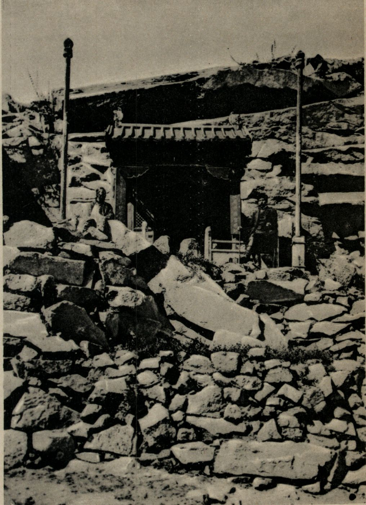

Die heilige Grotte, dem Flußgott des Bogdin-Tol-Kol geweiht.

<a id="105">**-- 105 --**</a>

sowie durch die Lagerräume quadratisch abgegrenzt ist. In solchen Höfen finden manchmal ganze Kamel- und Pferdekarawanen nebst ihren Lasten Unterkunft. Die Fensteröffnungen der Fansa sind groß und mit kunstvollem, durchbrochenem Holzwerk ausgefüllt. Über dieses Holzwerk wird von innen weißes chinesisches Pergamentpapier als Ersatz für die Glasfenster geklebt. Das weiße Papier läßt das schöne Schnitzwerk, nur hier und da durch eine kleine, hier besonders kostbare Glasscheibe, meistens von einer verdorbenen photographischen Platte herstammend unterbrochen, noch viel deutlicher hervortreten. Im Sommer sind die Papierfenster sehr angenehm, aber im Winter bei einer Temperatur von minus 30 Grad R. ist es trotz Pelzen, geheiztem Bett und mit Filz verhängter Fensteröffnung recht kalt in den Fansen.

Die Läden sind meistens ganz einfache, zurStraße hin offene Räume, nur durch einen den ganzen Raum von der Straße abschließenden Ladentisch, der an der Seite eine kleine Tür zum Durchlassen besonders wichtiger Käufer und Verkäufer hat, getrennt. Für gewöhnlich bleiben die von der Straße kommenden Käufer vor dieser langen Theke stehen, verlangend blicken die mongolischen Steppenreiter auf die im Laden geschickt und ins Auge fallend ausgebreiteten Herrlichkeiten. Der älteste Vertreter der Firma mit langen, polierten Fingernägeln sitzt, wöhl hier und da seine mit kostbarem grünem Nephrit-Mundstück versehene Pfeife rauchend, laut sich räuspernd und tief ausholend spucke nd im Laden, um seine wunderbar geräuschlos arbeitenden Gehilfen zu beobachten. Die Kauflust der Mongolen ist oft größer als ihr Geldbeutel und Besitzstand, so daß die Chochune, die, wie ich schon früher erwähnte, für ihre Angehörigen solidarisch haften, oft für deren Schulden aufkommen müssen. Deshalb haben viele Chochune ihren Angehörigen verboten, die Stadt zu besuchen und zu betreten. Auch der letzte Dsiängdsun oder Statthalter (militärischer Generalinspektor) --- früher war dies ein der in China herrschenden Tsing-Dynastie verwandter Mongolenfürst, zuletzt ein Mandschu --- war diesen Herumtreibern nicht gewogen. Er ließ einfach alle in der Stadt herumlungernden fremden Mongolen aufgreifen und mit ihren Pferden und Kamelen kurzfristige Arbeiten in der Festung und am Flusse ausführen. Die Mongolen fürchteten --- schon aus angeborener Faulheit --- den Dsiängdsun dermaßen, daß sie, als Boten oder Karawanenleute in der Stadt eingetroffen, möglichst schnell dafür sorgten, wieder hinauszukommen.

*(Der letzte Dsiängdsun von Uljasutai.)* Der letzte Dsiängdsun war ein Mandschu-Mandarin, da sich kein mongolischer Fürst mehr fand, der die enormen Geldsummen aufbringen konnte, die für diesen Posten in Peking gezahlt werden mußten. Dieser

<a id="106">**-- 106 --**</a>

letzte chinesische Gouverneur und Tartaren-General von Uljasutai hatte im Oktober 1911 allein im Uranchai-Bezirk für etwa 45 000 Lan Zobel, angeblich als Steuer eingezogen, in Wirklichkeit aber, um die für seinen Posten bezahlten Summen einigermaßen wieder einzubekommen. Er konnte sich allerdings nicht lange daran erfreuen. Beim Ausbruch der durch Rußland in Szene gesetzten mongolischen Revolution schlossen 5000 schlecht bewaffnete und unbewaffnete Mongolen die Festung Uljasutai ein. Dem geschickten diplomatischem Eingreifen des Konsuls Walter, der der eigentliche Drahtzieher war, gelang es, den feigen Dsiäng*dsun, seine Beamten und das sogenannte Militär dermaßen einzuschüchtern, daß der Dsiängdsun auf den Knien den Konsul, seinen schlimmsten Feind, um Hilfe bat. Konsul Walter gelang das Spiel dermaßen gut, daß die für mongolische Verhältnisse außerordentlich gut befestigte Festung sich ergab, ohne auch nur einen Widerstand zu versuchen. Die Soldaten standen auf dem Papier, die vorhandenen waren minderwertiges Gesindel und die Löhnung floß in die große Tasche des Dsiängdsun. Ein Einberufen der Miliz von Uljasutai war zwecklos, da die chinesischen Kaufleute an Tapferkeit dem Dsiängdsun und seinen Soldaten nicht nachstanden, es fehlte übrigens auch an der allernotwendigsten Bewaffnung. Später habe ich das Arsenal besichtigt. Bogen, Pfeile, Lanzen, Spieße, einige vorsündflutliche Donnerbüchsen, das war alles. Der Konsul schob den Dsiängdsun, seinen Stab und die Chinesen, die ihren Gouverneur auf eigene Kosten begleiten wollten, unter Bedeckung von fünf Kasaken über Kosch-Agatsch durch den Tschuiski-Trakt, Biisk, Novo-Nikolaijewsk nach Hause ab. Diese fünf russischen Kasaken begleiteten als Wache den Gouverneur und Tartaren-General bis zur russischen Grenze. Jeder erhielt von ihm ein Pferd, fünfzig Rubel und ein Fuchsfell beim Abschied in Kosch-Agatsch als Geschenk.*

Erst in Irkutsk durchschaute der Gouverneur von Uljasutai das Spiel der Russen und sandte deshalb ein Warnungstelegramm an den General-Gouverneur von Urga, das aber selbstverständlich niemals ankam.

Mächtige, schwarzbraune Hunde lungern, im Sommer wohlgenährt, im Winter ihre eigenen Kameraden und die Deichen auffressend, in den beiden Hauptstraßen herum. Zu gewissen Zeiten finden zwischen dem männlichen Teil dieser vierbeinigen Bevölkerung der Stadt heiße Straßenkämpfe statt, schaurig hallt dann Nachts das rasende Knurren der Sieger und das Sterbegeheul der Unterliegenden durch die Straßen. Rings um die Handelsstadt liegen die Jurten der Mongolen am Flußufer und den Schluchten der Hügel.

Etwas außerhalb des Osttores steht auf dem Wege zur Festung ein

<a id="107">**-- 107 --**</a>

kleines Denkmal und darüber etwas näher zum Fluß hin eine dem Fluß*gott geweihte Grotte. Das Denkmal wurde zum Andenken an den Abzug der Dunganen, die im Oktober 1870, bei dem großen Dunganen-aufstand Uljasutai plünderten, errichtet. Eine feste Bohlenbrücke führt über den Bogdin-Tol-Kol zu der drei Werst entfernt gelegenen Festung. Der Weg dorthin ist groß und breit angelegt und zum Teil durch einen Damm gegen das Hochwasser des Flusses geschützt.*

*(Die Festung Uljasutai.)* Die Festung selbst ist etwas größer als die Kobdo-Festung. Die Wälle der Festung Uljasutai sind im Gegensatz zu Kobdo, dessen Wälle aus glattem Mauerwerk bestanden, aus einer doppelten Reihe etwa 4 m voneinander entfernt in die Erde gerammter Palisaden erbaut, deren Zwischenraum mit an der Luft getrocknetem Ziegelmauerwerk ausgefüllt ist. Ein drei Meter breiter und ebenso tiefer, aber jetzt verflachter Graben sollte den ersten Ansturm der Angreifer aufhalten. Ein mächtiges Tor mit geschweiftem Dachgestell führt nachdem man den ausgetrockneten Graben über einer kleinen, etwa 4 m breiten Brücke passiert hat, in das Innere der Festung. Dieses mächtige große Viereck mit seinen Toren und bizarren Wachttürmen ist eine Stadt für sich. Hier liegt der Palast, der sogenannte Jamen des Dsiängdsun, oder wie sein voller Titel lautete, "Din-Ban-Zso-Fu-Dsiängdsun", dessen letzter Bewohner, Kui-Chuing, ein Mandschu-Mandarin war. Rings herum gruppieren sich die öffentlichen Verwaltungsgebäude, Arsenal und Wohnungen der übrigen Mandarinen und Beamten, sowie auch die Lamabuddhistischen Tempel und der stets verschlossene Kaiserliche Tempel mit seinen vergoldeten Dachknäufen und roten Säulen. Hiervon durch einen großen Platz getrennt, liegen die Unterkunftsräume der Soldaten und der niedrigen Beamten rings um einen chinesischen Tempel gruppiert. Ein Gewirr von kleinen Gäschen verbindet diese kleinen, niedrigen Häuschen untereinander. Von einem der Türme kann man weiter nördlich den Tempel des Kriegsgottes "Gesser" am Talausgang liegen sehen. Die Besatzung sollte aus 2---300 Mann bestehen, existierte aber, wie schon gesagt, nur auf dem Papier. Die wirklich diensttuenden Leute waren bei besonderen Aufzügen oder Inspektionsreisen des Dsiängdsun nur Statisten, aber keine Soldaten. Während ihrer freien Zeit verdiente sich diese Besatzung ihren Unterhalt als Sattler, Schmied, Bäcker, Gärtner, Tapezierer oder durch ein anderes, dem Einzelnen sonst zusagendes Handwerk. ---

Die Festung selbst ist neueren Datums, da die alte Festung im Jahre 1870 bei den Aufständen der Dsunganen zerstört worden war. Das kleine Denkmal neben der Grotte des Flußgottes erinnert, wie schon

<a id="108">**-- 108 --**</a>

gesagt, an den Abzug des Feindes, dessen eigene Uneinigkeit die gänzliche Zerstörung der Stadt verhinderte. In dem großen Hof der Festung wächst bei einer hübschen chinesischen Brücke die einzige Gruppe Bäume von Uljasutai. Durch das ganze Innere läuft hintereinander eine Reihe von Ehrenpforten; diese schmalen, wunderbar geschnitzten Ehrenbogen mit sogenannten "spanischen Reitern" täuschen durch ihre Aufeinanderfolge einen gedeckten Gang vor, der den höheren chinesischen Beamten vorbehalten war. Den Eingängen gegenüber befinden sich mächtige, mit glasierten Ziegeln gekrönte Wände, die mit wunderbaren Fresken, Drachen und anderen Tiergestalten aus der Mythologie der Chinesen geschmückt sind.

Am entgegengesetzten Ende der Stadt Uljasutai, also rings um das West- und Nordtor, liegen die Felder der chinesischen Kulis. In zäher Arbeit haben diese geschicktesten aller Landwirte dem harten mongolischen Boden eine Humus-Krume abgerungen. Sie versorgten Stadt und Festung mit Weizen, Kartoffeln, Radieschen, Lauch, Zwiebeln und einem uns Europäern nicht zusagenden Dill. Sorgsam hatten sie den Boden geebnet, Steine und Unkraut entfernt, die Unebenheiten des Bodens verschüttet, Wasserrinnen vom Fluß zu ihren Beeten geleitet und schließlich das Ganze mit einem scharfen Dornengestrüpp oder hohen Palisaden gegen Mensch und Tier geschützt. Diese gelben Bauern verstehen es, ohne viele Hilfsmittel nach hartem, mühseligem Kampf aus einer Wüstenei ein Paradies zu schaffen. Diese Kulis lebten das ganze Jahr über in Gesellschaft ihrer mongolischen Frauen dort draußen auf den Feldern. So sah die Stadt aus, als ich sie zum ersten Male sah.

*(Die Stadt und Festung Uljasutai nach der Vertreibung der chinesischen Machthaber.)* Heute sind die freundlich lächelnden Bevollmächtigten der Chinesen verschwunden, die großen offenen Kaufläden sind durch starke Bohlen- wände verschlossen, und erzwingt man sich den Eingang in ein Laden- lokal, so gähnen einem aus dem Dunkel leere Fächer und Schränke entgegen. Die chinesischen Kaufleute haben ihre Waren zum größten Teile den russischen Kaufleuten für ein Spottgeld abgelassen, versteckt oder sind von den durchziehenden mongolischen Truppen ausgeplündert worden. Scheu und ängstlich schleicht heute der sonst so stolze Chinese durch die Stadt; sich der gewonnenen Freiheit freuend, torkeln besoffene Mongolen hilflos durch die Straßen, manchmal ihre einstigen Herren und Meister verprügelnd. Die Mongolinnen haben ihre plötzlich verarmten chinesischen Ehemänner verlassen und sind mit den beutebeladenen Truppen davongezogen. Nur diejenigen, die Kinder von den Chinesen hatten, blieben ihren Ehemännern, wenn sie auch jetzt mit Mongolen zusammen hausen, im Stillen auf ihre Art treu, sie schleichen

<a id="109">**-- 109 --**</a>

sich nachts zu den Chinesen hin, oder empfangen heimlich, wenn es eben angeht, deren Besuch.

Unter den Hunden haben die Kasaken mit ihren Gewehren aufgeräumt.

Der Dsiängdsun mit seinem großen Beamtenapparat ist verschwunden.

Die Felder sind verwüstet, die Palisaden und das Dornengestrüpp von den faulen Mongolen als billiges Brennholz zu ihren Jurten geschleppt worden. Die Jurten, wo die armen, landbebauenden Kulis hausten, sowie ihre Fansen sind zerstört, verbrannt und niedergerissen worden. Jetzt wohnt jenseits der Festung auf dem erhöhten Ufer des Bogdin- Tol-Kol der neue mongolische General-Gouverneur von Uljasutai und Kobdo, mein Freund Soroktul-Beese, vom Volk Zezen-Beese, "der weise Fürst oder Herrscher" genannt. Mongolische Soldaten mit Mauserkarabinern, aus Erfurt stammend, und Turkos-Bajonetten bewaffnet, sorgen für die Aufrechterhaltung der Ordnung in der Stadt, beteiligen sich aber, wenn es irgendwie möglich ist, ganz gerne an der Verteilung der in aller Stille von den Chinesen erpreßten Waren.

Abends liege ich mit Lininfa auf unserem gemauerten Bett in seinem Privatzimmer. Der im Zimmer brennende, mit Holz geheizte, kleine eiserne Ofen erwärmt durch eine Röhrenanlage auch unser Bett. Über den dünnen Holzbrettem liegen geflochtene Strohmatten, darüber ein dickes rotes Tuch. Ich habe darauf meinen Schlafsack gelegt. Sergei Nikolaiowitsch Lininfa schläft auf feinen, langhaarigen Ziegenfellen und deckt sich auch mit einer Anzahl weicher Schaf- und Ziegenfelle zu. Als Kopfkissen dient uns eine etwa 30 cm dicke und 50 cm lange, weiche Kopfrolle, die ebenfalls mit rotem Tuch überzogen ist. Übrigens sind sämtliche Möbel des Zimmers mit feinstem roten chinesischen Lack gestrichen. Am Kopfende steht für jeden von uns auf dem Bett ein niedriges, ein Quadratmeter breites, großes, etwa 30 cm hohes Tischchen mit den feinen chinesischen Teeschalen, gefüllt mit kostbarem Blütentee, Rosinen, Mandeln und unseren Pfeifen. Behaglich ausgestreckt, den Arm durch den Feldscher der Kasaken in einen regelrechten Verband gelegt, von einem aufmerksamen kleinen, chinesischen Diener bedient, lausche ich den Erzählungen meines Gastfreundes. Unserem 3 1/2 m breiten und 2 m langen Bett gegenüber steht der rote Hausaltar Linin- fas. Es ist ein ringsum verhängter Tisch mit einem alten kostbaren, in Ebenholz eingerahmten, gestickten Bild, 1 m hoch und 1/2 m breit, den Manen der Familie Lininfa geweiht. Löwen und Elefanten aus Bronze, die kleine Türme auf dem Rücken tragen, in denen etwa 20 cm lange, dünne Räucherkerzen brennen, sind um das Altarbild aufgestellt. Das Wahrsagebuch, nebst den zum Wahrsagen nötigen Münzen ist sorgsam

<a id="110">**-- 110 --**</a>

in ein gelbes, seidenes Tuch eingeschlagen und hat seinen Platz hinter dem Altarbild. Zu beiden Seiten desselben sind kleine weiße, rotblumige alte Vasen auf gestellt.

Der Rauch unserer chinesischen Pfeife mischt sich mit dem süßlichen Geruch der blauen feinen Wölkchen der Räucherapparate. Ich fühle mich jetzt nach den letzten zweihundert, mit dem verletzten Arm zurückgelegten Werst, doppelt wohl in der sauberen Wohnung Linninfas. ---

*(Die Lage der Chinesen.)* Die Tage der Chinesen ist äußerst gefährlich. Ihre Mundvorräte gehen zu Ende, ihre Karawanen, die sonst um diese Zeit mit den, dem besseren Chinesen für Neujahr unentbehrlichen Delikatessen durch die Gobi nach Uljasutai kommen, sind nicht eingetroffen. Die ersten, sich über Kalgan hinaus wagenden Karawanen wurden von den Mongolen ausgeplündert, die Begleitmannschaften, meistens arme Kameltreiber oder Angestellte der Firma, abgeschlachtet, zu Tode gepeitscht oder anderweitig gemartert. Eine Abgabe von 10% auf alle Gegenstände, mit denen die Chinesen handeln, oder die sie erhandeln könnten, einschließlich Lebensmittel, macht dem Chinesen sogar den Ankauf von Lebendvieh, wie Hammel oder Schafe als Nahrungsmittel beinahe unmöglich. Die meisten chinesischen Händler verfügten bei Ausbruch der Revolution über große Herden von Schafen, Kühen, Pferden, Kamelen, alles wurde zum größten Teile im Einverständnis mit den Hirten, von deren Angehörigen oder den Soldaten geraubt. Jeden Tag kann man auf dem Markt von Uljasutai den Verkauf von derartigem geraubten Vieh unter den Augen der früheren Besitzer beobachten. Die Chinesen beschuldigen weniger den mongolischen Generalgouverneur Zezen-Beese wegen all dieser Gewalttaten, sondern ihr ganzer Haß richtet sich auf den russischen Konsulatssekretär Xionin, den sie für den eigentlichen Spiritus rector aller vorkommenden Schandtaten ansehen. Tatsächlich unternahm der junge, unerfahrene Zezen-Beese anfangs nichts, ohne sich bei Xionin Rat zu holen und führte dessen Ratschläge, die recht häufig von ganz persönlichen, rachsüchtigen Motiven geleitet wurden, ohne weiteres aus.

Keinen Moment hatten die Chinesen Ruhe, die tollsten Gerüchte wurden in Umlauf gesetzt, alles darauf ausgehend, die Chinesen aus Uljasutai wegzugraulen, ihren Handel zu zerstören und den Profit davon den paar russischen Kaufleuten von Uljasutai in die Tasche fließen zu lassen. Tatsächlich zog ein großer Teil der chinesischen Kaufleute, des ewigen Schreckens und der ständigen Schikanen müde, auf dem Wege nach Kalgan ab, indem sie versuchten, ihre kostbarsten Habseligkeiten auf diese Weise in Sicherheit zu bringen. Ihre Karawanen wurden eine leichte Beute der draußen etwa 100 Werst von Uljasutai lauernden Mon-

<a id="111">**-- 111 --**</a>

golen, die Chinesen wurden ermordet, die Karawanen geplündert und nur ein Einziger entkam. Es war dies der Sohn des Bain-Dorschik, dem es später nach langer Irrfahrt mitHilfe eines seinem Vater befreundeten mongolischen Fürsten gelang, nach Uljasutai zurückzukehren. Treffen solche Hiobsbotschaften in Uljasutai ein, so ist natürlich Heulen und Zähneknirschen unter den Chinamännern. Aber sie halten einstweilen hartnäckig aus, denn, sagen sie sich ganz logisch, schließlich sind wir hier sicherer als auf der Karawanenstraße und brauchen, um totgeschlagen zu werden, nicht erst einige 100 Werst durch die Wüste zu ziehen.

Immer noch hoffen die armen Leute auf die Hilfe ihrer Beamten und den endlichen Sieg ihrer Regierung. Um so bitterer empfinden sie es, wenn sie auf der Straße von dem Herrn Konsulatssekretär beim Eintreffen schlimmer Nachrichten öffentlich ausgelacht und verhöhnt werden; daß ein solches Vorgehen eines russischen Diplomaten würdig ist, kann wohl kaum behauptet werden.

<a id="112">**-- 112 --**</a>

## KAPITEL 8. DIE RUSSISCHEN KONSULATE IN ASIEN.

Zum Verständnis der politischen und handelspolitischen Lage in der Mongolei sei hier näher auf die Organisation der russischen Konsuln in der Mongolei eingegangen.

Durch die Energie und Unternehmungslust der sibirischen Kaufleute hatte sich der russische Handel in der Mongolei ohne jede staatliche Hilfe ausgebreitet. Es gab zwar schon seit 1860 eine russische Konsulatsvertretung in Urga, der 1872 Konsul Schichmarew vorstand, und die in letzter Zeit durch Generalkonsul Luba geleitet wurde, 1913 wurde dann das Konsulat in ein Generalkonsulat verwandelt mit einem Ministerresidenten an der Spitze. Im allgemeinen aber waren die russischen Kaufleute durch die Größe des Verwaltungsbezirkes, der dem Konsulat von Urga unterstellt war, auf sich selber angewiesen. Ein Blick auf die Karte zeigt, daß für einen solchen Riesendistrikt auch die Energie eines Luba nicht ausreichen konnte. Es ist den Kennern der Verhältnisse allgemein bekannt, daß die russischen Konsuln, durch ihre allgemeine Vorbildung behindert, schwerlich sich um den russischen Handel und dessen Ausdehnung kümmern konnten, und tatsächlich hört man von allen Seiten Klagen, daß die Konsulate nicht das leisteten, was man von ihnen erwartete. Mit Unrecht, denn hieran sind die Konsuln selbst zum kleinsten Teil schuld, sondern ihre rein diplomatische Ausbildung. Die Vorschriften über die Tätigkeit der Konsuln im russischen Konsulatsdienst sind für alle Konsulate gleich und zum größten Teil veraltet. Es wird hierbei absolut kein Unterschied zwischen den Konsuln in Paris und Urga oder Berlin und Teheran gemacht, alles wird über einen Kamm geschoren. Richtig ist es ja, daß die Vorschriften über den Konsulatsdienst drei ganze Kapitel über die Tätigkeit der Konsuln in China und Korea enthalten, aber alle drei Kapitel geben nur allgemeine Hinweise auf die russisch-chinesischen Verträge. Hieraus sollte man schließen, daß den russischen Konsuln ein möglichst weiter Spielraum für die Betätigung ihrer Selbstständigkeit gegeben werden soll, aber dem ist nicht so. Wer die russischen Verhältnisse kennt, weiß, daß der Buch-

Tafel 28.

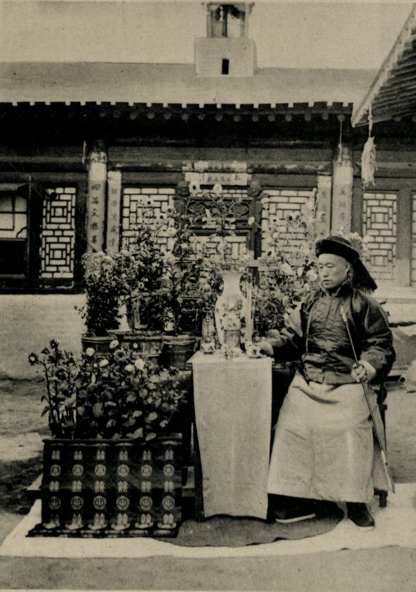

Lininfa auf seinem Hofe. Im Hintergrund unser gemeinsames Schlafhaus.

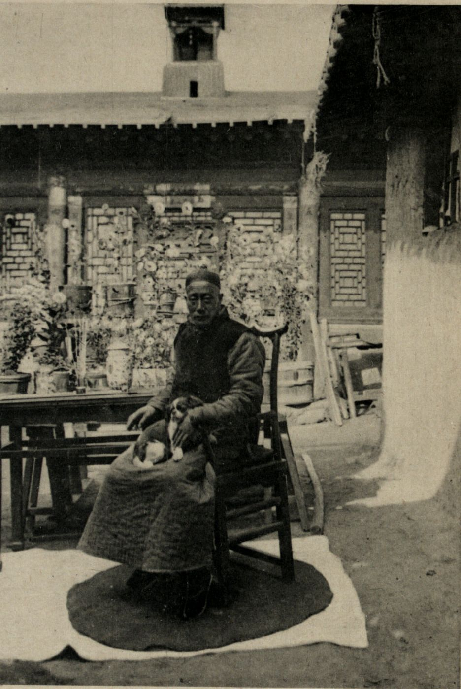

Der chinesische Kaufmann Scho-Su-Schi vom Tonki-Nor.

Tafel 29.

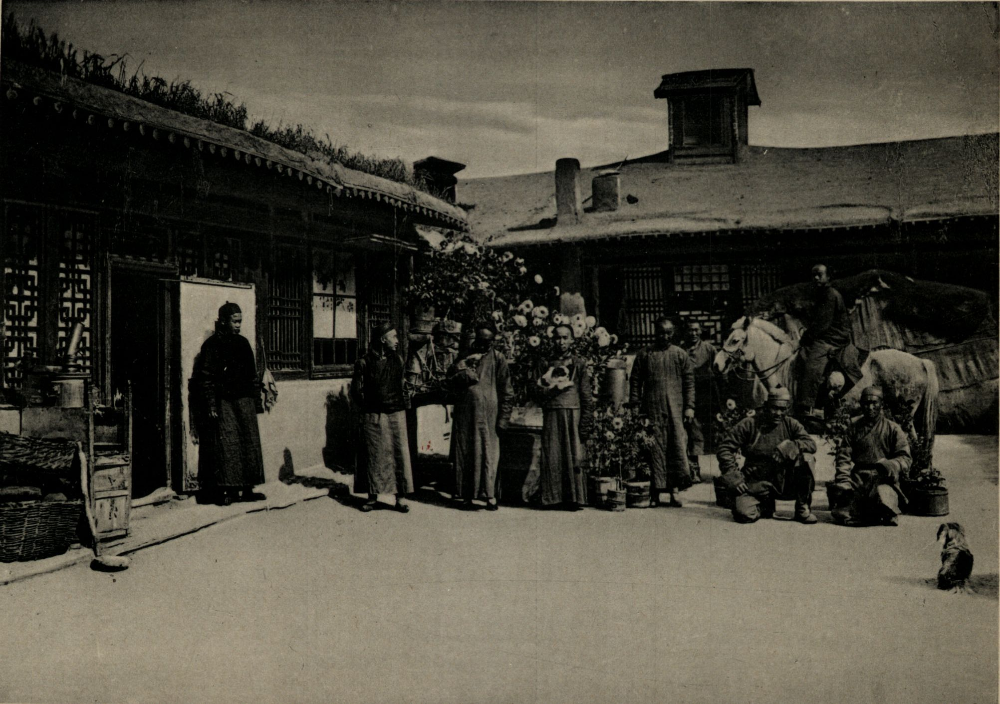

Chinesischer Kaufmannsladen und Hof.

<a id="113">**-- 113 --**</a>

stabe, zum Paragraphen zusammengesetzt der Gott ist, zu dem die gesamte russische Bureaukratie betet. Was nicht bis ins Kleinste vorgeschrieben ist, wird nicht gemacht.

Die Konsuln in China und Korea sind auf den diplomatischen Dienst ganz speziell eingeschult und unterstehen einzig und allein dem russischen Ministerium des Äußeren, mit handelspolitischen Wissenschaften sind sie nicht allzusehr belastet, daher verdankt auch Rußland in Asien häufig seinen Konsuln seine großen diplomatischen Erfolge, und Mißerfolge im Handel, obwohl, wenn die militärischen Kräfte Rußlands und Chinas in etwa gleich wären, den chinesischen modernen Diplomaten manche Schlappe erspart bliebe. Wie so häufig, entscheidet auch hier, trotz aller diplomatischen Kunstgriffe der gelben Herren, das Recht des stärkeren und das wissen Rußlands Konsuln geschickt und gründlich auszunutzen. Auffallend ist es, daß drei der in der inneren Mongolei tätigen Konsuln Schüler der deutschen Petersburger Petri-Paul-Schule sind.

Auf Grund der einseitigen diplomatischen Ausbildung der Konsuln haben denn auch die russischen Handelsinteressenten, Börsenkomitees, Handelspalaten, Exportpalaten sich zusammengeschlossen, um nun ihrerseits ihre eigenen Interessen energisch zu vertreten. Die Gründe für das Fiasko dieser Kapitalistengruppen werde ich Gelegenheit haben, an anderer Stelle zu besprechen. Jedenfalls setzten es obige Interessenten durch, daß für die äußere Mongolei ein russischer Handelsagent mit seinem Sitz in Urga ernannt wurde. Herr Andrei Pawlowitsch Balaban, der neu ernannte Handelsagent, nahm sich denn auch des russischen Handels an, versuchte, ein russisches Handelsmonopol in der Mongolei zu errichten, und geriet durch seine Forderungen in Konflikt mit den Mongolen, die sich nicht ganz in die Hände der Russen geben wollten. Die russische höhere Diplomatie, durch den Ausbruch des Balkankrieges in ihrer Aktionsfreiheit im fernen Osten stark behindert, akzeptierte schließlich durch Exzellenz Iwan Karostowetz den von den Mongolen abgeänderten Handelsvertrag, der von A. P. Balaban aufs heftigste bekämpft wurde. Die alte Antipathie des Handelsagenten "gegen das Ministerium mit den weißen Hosen", wie er in seinen Schriften des öfteren die Herren vom Ministerium des Äußeren betitelt, kam hier wiederum zum Durchbruch. Mittlerweile war das russische Militär in der äußeren Mongolei eingerückt, und jetzt redete das Kriegsministerium auch schon mit. Dem geschickten Beobachter konnte es nicht entgehen, daß der Kampf bald auf der ganzen Linie entbrannte. Die Animosität der einzelnen Ministerien gegeneinander trat bei deren Vertretern in der äußeren Mongolei klar zu Tage und manch geschickt ein-

<a id="114">**-- 114 --**</a>

geleitete Aktion scheiterte nur daran, daß die einzelnen Ressorts nicht zusammen Hand in Hand arbeiten wollten.

Um auf das Konsulat von Urga zurückzukommen, hatte Rußland das Recht, nach § 8 des Vertrages von Peking vom 14. November 1860 in Kaschgar und Urga je ein Konsulat zu errichten, um über die Aufführung der zugewanderten Kaufleute zu wachen, die nach den Gesetzen des Landes, zu denen sie gehörten, zu bestrafen und abzuurteilen waren. Dieses Recht wurde im Vertrag von Ili vom 12. Februar 1881 in § 10 noch auf die Städte Kobdo, Uljasutai, Chami, Urumschi und Gutschen erweitert, allerdings mit der Einschränkung, Konsulate sollten nur dann errichtet werden dürfen, wenn eine wirkliche Bedürfnisfrage vorliege und nachdem dafür ein Einverständnis mit der chinesischen Regierung erzielt worden sei. Dieser Punkt erwies sich in den Händen der chinesischen Politiker als ein ganz vorzüglicher Bremsparagraph, bis sich Rußland schließlich, auf das Recht des Stärkeren pochend, über alle Paragraphen und Punkte wegsetzte und dort, wo es glaubte, eine diplomatische Vertretung zu benötigen, diese einfach einführte, ohne sich um den Widerspruch der lokalen chinesischen Behörden und des Auswärtigen Amtes in Peking zu kümmern. "Hier sind wir und hier bleiben wir" war ihre Devise, und sie blieben. Den Chinesen wurde es allmählich bei diesem Vorgehen ungemütlich, und sie kündigten den abgelaufenen Ilivertrag genau zu der vorgesehenen Frist und weigerten sich, auf eine Erneuerung desselben einzugehen. Aber die russischen Diplomaten wußten sich zu helfen. Prompt erneuerten sie ihrerseits einseitig den Vertrag im Jahre 1911, ohne sich um den Widerspruch der Chinesen zu kümmern, um weitere zehn Jahre. "Right or wrong my country" war hier die Losung, und der einseitig erneuerte Ilivertrag blieb einstweilen, durch vorgeschobene Kasakenregimeuter kräftig unterstützt, bestehen, bis ein neuer Handelsvertrag zustande kam, ohne daß die anderen interessierten Mächte es gewagt hätten, dagegen zu opponieren. 1905 eröffneten die Russen ihr Konsulat in Uljasutai unter Konsul Boley- schew. Hierzu gehörte der Uljasutai-, der Kobdo- und Uranchai-Bezirk. 1912 wurde der Kobdo-Bezirk abgetrennt und in Kobdo selbst von Generalkonsul Luba, dem bald der Konsul Kusminski folgte, das neue Konsulat eröffnet. Ebenso eröffnete Luba unter Bedeckung von 25 Kasaken das Konsulat von Charusumé, auf der Karte Tulta genannt.

Dieses Vorgehen war ebenso zweckmäßig, wie eine direkte Vertragsverletzung und Vergewaltigung. Urga ist das Zentrum der mongolischen Politik und des Handels der äußeren Mongolei, rings umgeben von einer sich intensiv ausbreitenden chinesischen Kolonisation. Uljasutai liegt in seiner politischen Lage nicht so günstig wie Urga, da heute nach der Vertreibung der Chinesen die einflußreichste Persönlichkeit in der Mon-

<a id="115">**-- 115 --**</a>

golei, Dsalchensen-Gegen, in seinem Kloster 300 Werst von Uljasutai lebt. Der neue Gouverneur, der heute an Stelle von Zezen-Beese, der ins Finanzministerium berufen wurde, in Uljasutai residiert, wird wohl schwerlich viel Selbständigkeit entwickeln. Kobdo ist zerstört, und die paar russischen Händler werden sich wohl kaum dort aufhalten. Der Konsul lebt einstweilen mit seinen 500 Kosaken in Zelten und Jurten, bis die neue Stadt gebaut oder die alte zerstörte Stadt wieder hergestellt worden ist. Seine politische Tätigkeit scheint sich darauf beschränken zu wollen, die Chinesen an einem nochmaligen Bindringen in den Kobdo- . Bezirk zu hindern. Charusumé (Tulta) ist heute eigentlich der wichtigste Punkt in dieser Gegend. Hier sitzt der Herzog Palta-Wan, der treu mit dem gesamten Altai-Bezirk bei den Chinesen aushält. Die Tätigkeit des Konsuls beschränkt sich auch dort auf ein Beobachten der politischen und militärischen Vorgänge in Charusumé und Umgebung, da die drei oder vier noch lebenden russischen Untertanen eines Konsulats für ihren Handel wohl kaum bedürfen.

Das Konsulat in Uljasutai war, als ich es zum ersten Male sah, eine schmutzige chinesische Fansa mit Papierfenstern. Konsul Dolbyschew selbst lebte einige Jahre sogar in einer mongolischen Jurte und wurde von der chinesischen Behörde in Uljasutai nicht anerkannt. Ein solches Wohnen des Konsuls trug gerade nicht zur Vermehrung des russischen Ansehens bei den Chinesen bei. Schließlich war denn auch die Bedürfnisfrage brennend geworden, aber die Duma hatte noch keine Zeit gefunden, die Gelder zum Umbau resp. Neubau des Konsulats Uljasutai zu bewilligen. Da griff der Konsulatssekretär Xionin kurz vor der Urlaubsreise des Konsuls Walter zu folgenden Mitteln.

Herr Xionin ließ fünf oder sechs Vertreter der größten chinesischen Firmen zu sich rufen und bat sie, da das Konsulatsgebäude doch das Eigentum eines Chinesen sei, die nötige Summe für den Umbau vorzuschießen. Die Chinesen erbaten sich einen Tag Bedenkzeit, darauf erklärten sie dem Konsulatssekretär, sie würden die verlangte Summe vorschießen, wenn er sich verpflichtete, sie im Uranchai-Bezirk, wo diese Chinesen mit Hunderttausenden Lans interessiert wären, zu schützen, und die Plünderung ihrer Läden dort zu verhindern, was Xionin auch versprach. Die Chinesen garantierten daraufhin die Bausumme und zahlten diese ratenweise ein. Trotzdem plünderten die Mongolen die Läden der betreffenden Firmen im Uranchai-Bezirk, ohne daß die Chinesen bei dem Herrn Xionin die versprochene Hilfe fanden. Sie verloren ihr Vermögen und waren schließlich auch noch verpflichtet, die letzten Ratenzahlungen zur Fertigstellung des Baues zu leisten. Bei ihrer offiziellen Beschwerde im russischen Konsulat wurden sie einfach aus dem Konsulat verwiesen. Mein Gewährsmann mußte, um überhaupt

<a id="116">**-- 116 --**</a>

zahlen zu können, sein Brennholz --- Brennholz besitzt in Uljasutai während der Winterzeit sehr großen Wert --- verkaufen. Als aber die Uranschaizen auch die Russen bedrohten, nachdem sie den chinesischen Handel glücklich zur stillen Freude des russischen Konsulatssekretärs vernichtet hatten, wurden von Herrn Xionin vier Kasaken abgeschickt, die ohne Widerstand der Mongolen die überlebenden chinesischen Angestellten jener Firmen, die zum Ausbau des Konsulats Geld beigesteuert hatten, über die russische Grenze geleiteten. Das Konsulatsgebäude war bei unserer Ankunft in Uljasutai beinahe fertig, und Herr Xionin fuhr nach den Anstrengungen der diplomatischen Kampagne nach Südfrankreich, um sich dort auf sein diplomatisches Examen vorzubereiten. Hinter ihm her schallten die Verwünschungen der ausgeplünderten und ruinierten chinesischen Kaufleute. Aber trotz alledem kann man dem Mann in seinem fanatischem Haß gegen alles nicht rein Nationalrussische, obwohl selber ein Fremdstämmiger, wegen seiner aufs Praktische aufgebauten Politik eine gewisse Anerkennung nicht versagen. Die Tätigkeit der russischen Konsuln in der Mongolei bestand lange Zeit einfach darin, daß sie mit mehr oder weniger Energie und persönlichem Interesse auf die Einhaltung der Verträge achteten,. Dazu gehörte eben keine besondere Diplomatie. Sie fußten, durch die ganze Organisation des Konsulatsdienstes veranlaßt, auf dem Vergangenen, und beschränkten sich darauf, den etwa einlaufenden Klagen der russischen Untertanen so gut es ging abzuhelfen.

Die geschickten chinesischen Diplomaten nutzten selbstverständlich ein solches Verhalten der Konsulatsbehörden gründlich aus, die russischen Händler versuchten trotz aller Schikanen der Chinesen ihr Ziel auf hundert krummen Wegen zu erreichen, und seit langer Zeit war eine allgemeine Spannung durch den vollständigen Niedergang des russischen Handels eingetreten, die schließlich zur Katastrophe führen mußte. Die russischen Konsuln der jüngeren Generation richteten Note auf Note an ihren Gesandten nach Peking oder an ihre Regierung nach Petersburg. China kümmerte sich aber wenig um all diese papiernen Drohungen, war doch das Ansehen Rußlands durch den russisch-japanischen Krieg bei der gelben Rasse stark gesunken.

Man stelle sich nun die Lage der russischen Konsuln in der äußeren Mongolei vor. Bis vor kurzem in schlechten Gebäuden untergebracht, nur mit solchen Möbeln versehen, die sie hier und da von einem chinesischen Großkaufmann, der ihnen zum Dank verpflichtet war, geschenkt erhalten oder von chinesischen Handwerkern hatten anfertigen lassen, ohne tägliche Zeitungen und Telegramme, die sie schnell von allem, was in ihrem Bezirk vorgeht, unterrichten könnten, sind sie beauftragt, die Interessen der russischen Untertanen zu wahren, die selbst weit in einem

<a id="117">**-- 117 --**</a>

großen Bezirk zerstreut leben und die im Durchschnitt in kultureller Beziehung nicht weit über den Mongolen und tief unter dem chinesischen Durchschnittskaufmann stehen; gibt es doch viele unter den russischen Händlern, die heute noch wenig Vertrauen zu ihren Konsuln haben und andere, die allen Grund haben, sich vor den Konsuln zu verstecken. Der Konsul soll den Mittelpunkt der Kolonie bilden, in dessen Händen alle Fäden politischer, sowie handelspolitischer Art zusammenlaufen, aber dies ist bei der Größe des Bezirkes leider unmöglich. So sind die statistischen Angaben, die die Konsuln von ihren eigenen Untertanen über ihr Handeln, ihren Umsatz, die Art des Handels erhalten, alle mit großer Vorsicht aufzunehmen, da, wie ich selbst feststellen konnte, viele russische Groß- und Kleinhändler falsche Angaben über Güte, Bezugsquelle und besonders über die Gangbarkeit der Waren machen, weil sie fürchten, durch die richtigen Angaben ihren Konkurrenten eventuelle Handhaben zu geben. Für gewöhnlich macht der Konsul nur dann die Bekanntschaft seiner Landsleute, wenn sie selber zu ihm kommen, um ihn zu bitten, ihre Interessen wahrzunehmen, oder aber, wenn von den mongolischen oder chinesischen Behörden Klagen gegen sie erhoben werden. In solchen Fällen ist dann der Konsul Richter und Schiedsrichter zu gleicher Zeit. Es hält natürlich bei der Lage der Dinge schwer, wenn der Konsul nicht schon durch vorhergehende Erfahrung mit seinem russischen Landsmann bekannt und mit seiner mehr oder minder ehrlichen Veranlagung vertraut ist, das Recht vom Unrecht zu unterscheiden, und häufig hört man Klagen wie: "Unser russischer Konsul entscheidet gegen uns und für die Mongolen oder Chinesen". Dann aber hat meistens der Konsul mit seinem salomonischen Urteil das richtige getroffen. Doppelt schwer für den Konsul ist es, bei der verzwickten Handelslage und den Kreditverhältnissen mit ihren Wucherzinsen, die mehr oder minder versteckt vom Verkäufer bei Kreditgewährung erhoben werden, richtig zu entscheiden, da den meisten Herren die juristische Vorbildung vollständig abgeht. Bei schweren Verbrechen saßen zur Zeit der Chinesenherrschaft der russische Konsul und der Dsurgan für fremde Angelegenheiten gemeinsam zu Gericht, bei kleinen Vergehen auf den Chochuni ritt der Dolmetscher, recht häufig ein Burät aus der Dolmetscherschule in Urga und ein chinesischer Schreiber hin, um die Sache zu untersuchen. Jetzt sind an Stelle der Chinesen die entsprechenden mongolischen Beamten vertreten. --- Ein solches vorzüglichesVerhältnis, wie es z. B. zwischen der Deutschen Kolonie in Moskau und ihrem leider zu früh verstorbenen Generalkonsul Dr. Kohlhaas bestand, wäre auch beim besten Willen in Uljasutai und Kobdo nicht zu erreichen, aber in Urga, wo in der Stadt selbst eine Menge russischer Untertanen leben, erstrebenswert.

<a id="118">**-- 118 --**</a>

## KAPITEL 9. CHINESISCHES GESCHÄFTSGEBAREN UND HANDELSPOLITIK.

Um die Wut der Mongolen gegen die chinesischen Beamten und auch gegen die chinesischen Kaufleute zu verstehen, sie hier kurz ein Überblick über das Geschäftsgebaren der Chinesen und als typisches Beispiel die Entstehungsgeschichte der chinesischen Firma Da-Schen-Kui erzählt.

Die Chalcha-Mongolen zerfallen in vier Chanate: 1. Dsa-Ssak-Tu-Chan. 2. Tusché-Tu-Chan. 3. Zeezen-Chan. 4. Sain-Noin-Chan.

In den drei ersten Chanaten hatte ausschließlich die Firma Tarchin- Chu das Monopol, im Sain-Noin-Aimak handelte die Firma Kobdo- Nasdu, und in der Stadt Kobdo selbst die Firma Archan, von der bei der Eroberung der Stadt Kobdo beinahe alle Angestellten, etwa 150, getötet wurden. --- Diese Handelshäuser, Tunchi genannt, hatten den ganzen Handel monopolisiert. Sie setzten Silbergeld, sogenanntes "Schwarzes Silber" im Gegensatz zum "Hamburger Silber" in Kurs. Dieses schwarze Silber hatte an seinem unteren Teil eine Bleifüllung, die Mongolen bekamen dieses Silber mit der Bleifüllung ausgezahlt; wollten aber die Mongolen mit demselben Silber, was sie vielleicht eine Stunde vorher von derselben Firma erhalten hatten, bezahlen, so entfernten die chinesischen Händler erst das Blei. Da nun in der Mongolei die Zahlungen mit Silber nach Gewicht geleistet werden, so hatten die Mongolen einen doppelten Verlust, und zwar beträgt der Verlust des Mongolen auf diese Weise an 5 Lan Silber 1 bis 1 1/2 Lan. Verweigern konnten die Mongolen ein solches Silber nicht, da die Chochun- Leute verpflichtet waren, nur bei dem Tunschi ihres Bezirkes oder bei von diesen abhängigen chinesischen Geschäftsleuten zu kaufen, auch wenn sie die Sachen anderwärts billiger hätten haben können. So kostete z. B. eine Kiste schwarzer Plattentee gewöhnlich 15 Rubel, beim Tunschi 30 Rubel bei Barzahlung und auf Schuld genommen plus 35%. Da die chinesischen Kaufleute ein Interesse daran hatten daß der Chochun bei

ihnen möglichst verschuldet blieb --- es war dies ja eine sichere Kapitalsanlage, die sich mit jedem Jahr verdoppelte --- so nahmen die Tunschi niemals die volle Schuldsumme zurück. Hatte z. B. ein Chochun 15 000

<a id="119">**-- 119 --**</a>

Lan Schulden und brachten die Chochun-Verwalter diese volle Summe zurück, so nahmen die Chinesen nur 10 000 Lan, für die restlichen 5000 verweigerten sie glatt die Annahme, trotz aller Bitten der Mongolen. Denn diese 5000 Lan verdoppelten sich ja bis zum nächsten Jahr. Reiste irgend ein Angestellter in Chochun, um dort Handel zu treiben oder in irgend einer anderen Angelegenheit, so hatte ihm der Chochun eine Jurte zu stellen und vier oder fünf gute Pferde mußten ständig vor seiner Jurte stehen, für die er natürlich keinen Pfennig zahlte. Er selbst bezahlte den lebenden Hammel mit 1 Lan 5 Zänn, statt 3 Lan, mit einem Wort, er lebte als großer Herr auf Kosten der Mongolen, bezahlte beinahe nichts, verlangte alles umsonst, sogar die Dienerschaft. Er selbst forderte aber für seine Waren die unverschämtesten Preise. Reiste aber irgend ein mongolischer Beamter in seinem eigenen Chochun, so war er gezwungen, bei den Tunschis abzusteigen und mußte für dies Vergnügen beinahe 3 Lan Silber 8 Zänn pro Tag bezahlen.

Lehrreich für dieses ganze System ist, wie schon oben erwähnt, die Geschichte der Da-Schen-Kui. Sie wurde mir in Uljasutai so erzählt, wie sie dort im Umlauf ist und von dem derzeitigen Vertreter der Firma selbst bestätigt.

Drei bettelarme Chinesen lebten drei ein halb Werst von Uljasutai in einer armseligen Jurte, etwa dort, wo heute das Prachtgebäude der Firma steht. An dem größten Feiertag, dem Zagan-Zar (Weißer Monat, der unserem Neujahr entspricht) wird von den Chinesen aus dem feinsten weißen Mehl eine Art Klops gemacht, wie sie auch häufig mit Fleisch gefüllt in Europa in der Suppe gegessen werden, der Wiener nennt sie Fleischtaschkerln. Diese drei armen Teufel hatten aber nichts in ihrer Jurte als gelbe Hirse (mongolisch Dsamba.) Sie überlegten nun hin und her, wie sie zu dem für die Feiertage unbedingt nötigen Mehl kommen könnten. Schließlich begaben sie sich zu einem reichen Mongolen, der am Westtor von Uljasutai draußen auf dem Felde am Nogun-Kaschan wohnte. Sie trafen dort nur den Diener an, der ihnen nach langem Betteln und Bitten denn auch etwas Mehl überließ, dessen Wert sie später abarbeiten wollten. Als nun der Hausherr nach Hause kam, machte er seinem Diener die heftigsten Vorwürfe und schickte ihn fort, um das Mehl zurückzuverlangen. Die Chinesen hatten bei dessen Ankunft schon den Teig fertig geknetet, er meldete dies seinem Herrn, der ihm kurz und bestimmt befahl, "dann bringe den Teig her". Schweren Herzens gaben die Chinesen alles zurück und kochten sich, über ihr Mißgeschick tief niedergeschlagen, die gelbe Hirse in Wasser ab. Der ärmste Mongol kocht seine Dsamba in Thee. An demselben Abend kehrte bei ihnen ein mongolischer Lama ein, mit dem sie alles teilten, was

<a id="120">**-- 120 --**</a>

sie noch hatten. Sie befreundeten sich auf diese Weise mit dem Lama, der am anderen Tag Weiterreisen mußte und ihnen seinen Mantelsack zur Aufbewahrung zurückließ. Als nun der Lama nach einiger Zeitimmer noch nicht zurückgekehrt war, öffneten die drei den Sack und fanden darin fünfzig Lan Silber, einige mongolische Steigbügel und verschiedene andere Kleinigkeiten. Sie beschlossen nun, mit den fünfzig Lan, den Steigbügeln und den anderen Sachen einen Handel anzufangen und dem Lama bei seiner Rückkehr sein Eigentum mit Zinsen zurückzugeben. Mit einem Teil der fünfzig Lan zahlten sie die zu kaufenden Waren bar und nahmen eine andere Partie wie üblich auf Schuld. Bald blühte das Geschäft durch die Tüchtigkeit der Drei auf, aber der Lama kam nicht wieder. Einige Zeit später schlossen sie mit dem betreffenden Fürsten des Chochuns einen sehr günstigen Vertrag ab, wodurch sie dessen alleiniger Lieferant wurden und er alles, was er und sein ganzer Chochun brauchen würde, nur bei ihnen kaufen durfte. Nur wenn sie die verlangte Ware nicht auf Lager hatten, oder in kurzer Zeit nicht beschaffen konnten, hatten seine Leute das Recht, bei irgend einem anderen Händler zu kaufen.

Die Mongolen der vier Chanate hatten damals in Uljasutai eine Art Hotel, Batre-Djan genannt, auf ihre Kosten auf gebaut, damit ihre Fürsten bei ihren Besuchen in Uljasutai dort eine gute Unterkunft vorfänden. Die Leitung des Hotels wurde einem Chinesen anvertraut, der bald der Besitzer des Hotels wurde. Dieser verband sich nun mit den drei oben erwähnten Chinesen, das Geschäft dehnte sich immer mehr aus, nicht lange nachher hatten sie in den drei Chanaten Tusché\-Tu- Chan, Zeezen-Chan, Dsa-Ssak-Tu-Chan ein unbestrittenes Monopol, das sie unter dem Schutze der chinesischen Beamten immer mehr ausbauten. Heute noch wird in allen Filialen und dem Stammhause der Da-Schen-Kui-Firma am "Zagan-Zar" während des ersten Tages des Festes nur gelbe Hirse zum Andenken an die Gründung der Firma und die näheren Begleitumstände gegessen. Die Da-Schen-Kui hatte beim Ausbruch der mongolischen Revolution ein Vermögen von hundert Millionen Lan in der Mongolei und China erworben.

Diese kleine Erzählung zeigt klar, wie die hier in der Mongolei lebenden Chinesen aus den kleinsten Anfängen hervorgegangen, mit eiserner Konsequenz ihr Ziel verfolgten und schließlich zu Vampiren der Mongolen und deren Fürsten wurden.

In der ganzen Mongolei ist mir nur ein mongolischer Fürst und Chochun bekannt, der diesem chinesischen System nicht unterlegen ist. Es ist dies der zur Zeit wegen seiner politischen Gesinnung von der neuen Regierung in Uljasutai abgesetzte Dsa-Ssak-Tu-Chan.

Die Chinesen handhaben dieses ganze Wuchersystem mit einer Ge-

<a id="121">**-- 121 --**</a>

schicklichkeit, die eigentlich in ihrer logischen Ausnützung der gegebenen Umstände Bewunderung verdiente, wenn sie nicht so verabscheuungswürdig wäre.

Sie gewähren Vorschüsse auf Vieh und Pelze in bestimmter Anzahl mit der Bedingung, daß sich das zu Liefernde bei Nichtlieferung im nächsten Jahr verdoppelt. Selbstverständlich kommt der faule, nachlässige Mongole niemals, auch wenn er wollte, ganz aus seinem Schuldverhältnis zum Chinesen heraus. Die Tunschis treten auch als Bankiers der mongolischen Fürsten auf. Bedürfen diese für ihre obligatorischen Reisen nach Peking Geld, so streckt es ihnen der Tunschi vor, alles, was der Fürst zu einer Reise bis Peking braucht, liefert der Tunschi, auch sorgt er für den Unterhalt des Fürsten und seines Gefolges in Peking selbst und bestreitet deren Unterhalt bis ins Kleinste. Der Tunschi hält sich dann nachher an Rindern, Schafen, Kamelen, Pferden usw. schadlos, deren Wert selbstverständlich von ihm, und zwar zu den niedrigsten Sätzen, berechnet wird. Hierbei befolgen sie manchmal noch folgenden Trick. Sie kaufen das zweijährige Vieh, lassen es aber noch ein Jahr bei dem Mongolen und unter dessen Aufsicht und Verantwortung weiden. Ist das Vieh auf diese Weise kostenlos groß gefüttert, so hat es genau den doppelten Wert von dem, den der schlaue Zopfträger dafür gezahlt oder in Anrechnung gebracht hat.

Um die ganze Ausbeutungspolitik der paar chinesischen Firmen in der Mongolei zu verstehen, die es im Laufe von 60 Jahren verstanden haben, die ganze äußere Mongolei vollständig auszusaugen, sei hier kurz auf die Organisation der chinesischen Händler und Kaufleute, sowie auf das chinesische Kreditwesen, wie es wohl überall im Reiche der Mitte besteht, und die mongolisch-chinesischen Tauschmittel eingegangen. Über ganz China sind gewaltige Handelsvereinigungen verbreitet, an die die größten europäischen Unternehmungen, was Tatkraft und Kühnheit betrifft, nicht heranreichen. So spannt sich auch über die äußere Mongolei ein dichtes Netz der chinesischen Handelsjurten und Läden. An der Spitze einer solchen Vereinigung steht ein General-Bevollmächtigter, jeder mit seinem Hausstand und Gesinde und seiner Verwandtschaft und deren Dienerschaft, dazu gehören dann noch die Verwandtschaften und Freundschaften dieser Familienmitglieder mit ihren Bediensteten, ferner in dritter Reihe von jenen Teilhabern zweiten Grades abermals die Verwandtschaften und Freundschaften nebst Dienerschaften usw., so daß z. B. der geringste Verkäufer und der Koch eines Handelshauses nicht nur besoldete Angestellte, sondern, wie ich dies von Lininfa in Uljasutai weiß, auch Teilhaber des Geschäftes sind. Der Lohn ist gering, aber jeder der Angestellten weiß ganz genau, daß er am Ende des Jahres

<a id="122">**-- 122 --**</a>

voll berücksichtigt wird, genau nach seinen Leistungen. Alle sind sie untereinander eng verbunden, alle arbeiten eifrig und freudig, nur an an einem Ziel, der Firma möglichst großen Verdienst zuzuführen und sie vor Verlusten jeglicher Art zu bewahren. So verfügt eine solche Gesellschaft über eine Unmenge treu ergebener Mitarbeiter, die jedem Wink von oben gehorchen und mit ihrem Gesamtkapital ein Machtmittel darstellen, daß sich nur zu oft auch in politischer Hinsicht geltend macht. Ihr Einfluß ist nicht hoch genug anzuschlagen, und ich hatte in Uljasutai Gelegenheit, Konsul Walter auf die möglichen Folgen hinzuweisen, die eine direkte Vertreibung der chinesischen Kaufleute aus der Mongolei nach sich ziehen würde. Tatsächlich zwangen dann diese vertriebenen Kaufleute Juan-Schi-Kai, der in der mongolischen Frage gerne nachgegeben hätte, um sich Rußlands Wohlwollen zu erwerben und um sich die Niederwerfung der Südrebellen zu erleichtern, zu einer energischen Haltung Rußland gegenüber. Die Kaufleute fanden sich in Kalgan zu einer machtvollen Protest-Versammlung gegen Juan-Schi-Kais mongolische Politik zusammen, die ihn schleunigst einschwenken ließ. Die nötigen Mittel zur Fortsetzung der Kampagne wurden ihm bereitwilligst in Kalgan zur Verfügung gestellt.

Die Tunschi oder Banken verfügen über den gewaltigsten Einfluß. China besaß bis vor nicht langer Zeit nur eine etwa um das Jahr 2600 vor Christus eingeführte, durchlöcherte kupferne Scheidemünze, zu der dann erst vor kurzem die moderne chinesische Silberwährung und Papiergeld traten. Alle größeren Bezahlungen mußten in reinen Silberbarren geleistet werden, die nach ihrem Gewicht und Silbergehalt bewertet wurden. Durch die Schwerfälligkeit eines solchen Zahlungsmodus ist es klar, daß jedermann, wenn er nicht zur Bettlergilde gehörte oder von der Hand in den Mund lebte, über ein kleines Bankkonto verfügen mußte. Ein kleiner Handwerker hat vielleicht in seinem 22. bis 25. Lebensjahre ein Bankkonto von 200 bis 300 Lan. Nun gewährt jede Bank ihren Klienten gegen einen einfachen persönlichen Revers zum Tageskurs des Diskontozinses einen Vorschuß in doppelter Höhe seines Guthabens. Mit einem solchen Betrage lassen sich aber in China und in der Mongolei bei dem herrschenden System schon ganz große Geschäfte abschließen. Die Bank vermittelt sowohl für den kleinsten Bauer, wie den Großkaufmann die Zahlung. Jederzeit kann ohne vorhergehende Kündigung die Einlage zurückgezogen werden, wobei die Zinsverrechnung bis zum Moment der Auszahlung läuft, ebenso garantiert die Bank den Klienten bei Geschäften mit unbekannten Personen oder mit Bewohnern einer anderen Provinz die Sicherheit seiner Kapitalanlage, er zahlt dafür nur einen kleinen Prozentsatz mehr, aber es erleichtert den Geschäftsumsatz um ein Gewaltiges.

<a id="123">**-- 123 --**</a>

Die Tunschi versuchten nun auch, die neue chinesische Währung in der Mongolei einzuführen. Bisher war im Handelsverkehr das reine Silber oder der Tauschhandel üblich wie vor einigen tausend Jahren. Eigentümlicherweise gelten seit langer Zeit in der Mongolei, wie auch in anderen Teilen Chinas, reine Hamburger Silberplatten als das eigentliche Standard-Silber. Diese Silberplatten führen auf der einen Seite die den Chinesen und Mongolen bekannte Hamburger Handelsmarke, auf der anderen Seite die Wertangabe in chinesischen Schriftzeichen. Das Silber entstammt der Norddeutschen Raffinerie in Hamburg und ist wegen seiner stets gleich bleibenden reinen Qualität, wie gesagt, seit langer Zeit in der Mongolei in Umlauf. Das nun von den chinesischen Tunschis in den Handel gebrachte Silber ist, wie ich schon an anderer Stelle sagte, schlecht, oder mit Blei durchsetzt und heißt deshalb im Gegensatz zum Hamburger Silber "Schwarzes Silber". Das Silber wird im Verkehr bei zu leistender Zahlung mit der chinesischen Wage gewogen. Die russischen Kaufleute rechnen in Uljasutai 445 Lan, 7 Zänn, 6 Fin auf ein Pud Silber gleich 16,32 kg. Doch kommen auch hier einige kleine Schwankungen vor. In Urga entsprechen 448 Lan einem Pud, denn dort ist der Lan um einhalb Prozent leichter. Ein chinesisches Pfund Silber wiegt in Uljasutai 14 Lan gleich 1 3/4 Pfund Russisch, aber auf den Chochun bei den Russen 12 bis 24 Lan; man sieht, auch die russischen Händler verstehen das Geschäft der Tunschis. Das Silber wird gewöhnlich von der Platte nach dem Augenmaß in rohen Brocken abgehackt und dann gewogen. Übrigens kommt das russische Wort Rubel von dem Worte "Rubit", abhacken, her. Auch alter zerbrochener Silberschmuck wird recht häufig in Zahlung gegeben. Hieraus erklärt sich auch der reiche Silberschmuck der Mongolinnen. Sie tragen eben ihre Sparkasse, wenn auch unverzinst, auf dem Kopfe herum. So ist der Reichtum einer Familie meistens, wenn die jungen Damen nicht zu den Freudenmädchen oder Freundinnen der Chinesen gehören, an den Viehherden und dem Schmuck der wirklichen Ehefrauen zu erkennen. Ein solcherSchmuck wiegt manchmal 50 bis 60 Pfund und ist von äußerst kunstvoller Arbeit. Bei Zahlungsschwierigkeiten wird der Schmuck zerschlagen und gilt dann seinem Gewicht nach als Zahlungswert. Reines Gold ist, obwohl in der Mongolei gewonnen, erst in letzter Zeit als Zahlungsmittel aufgetreten, und zwar schwankt das Solotnik zwischen 4.50 bis 6 Rubel. Die mongolischen Fürsten und Prinzen benutzen häufig die goldenen 5- und 10-Rubelstücke zu Schmuckgegenständen. Auch schmelzen die Mongolen das Rohgold ein und verarbeiten es zu einem glatten goldenen Ring, ähnlich unserem Trauring.

Die eigentliche Gewichtseinheit für das Silber ist der chinesische Lan.

<a id="124">**-- 124 --**</a>

Ein Lan oder Liang hat 10 Zänn(Tsien)= 100 Fin,=1000 Li,=1000 Choang. Große Kursschwankungen, auch durch außerhalb der Mongolei stattfindende Ereignisse hervorgerufen, verringern oder vermehren die Kaufkraft des Lans. Der niedrige Kurs des Lans ist dem russischen Händler günstig, der zu Hause in Rubel einkauft. Im Jahre 1907---1908 fiel der Lan von 1.75 Rubel auf 1.25 Rubel, ebenso bekam ich 1911 und 1912 wie 1913 1.50 Rubel und 1.24 Rubel pro Lan in Uljasutai und Kobdo, je nachdem erbeutetes chinesisches Silber von den Mongolen an die Russen verkauft wurde. Die Tunchi, sowie die Ta-Sching-Bank, die chinesische Reichsbank, gaben auf Waren Vorschüsse und setzten chinesisches Papiergeld zu 1.5 und 10 Dollar in der Mongolei in Verkehr, sogar kupferne chinesische Scheidemünzen im Werte von 10 Chash sah ich beinahe überall in der Mongolei. Auf der einen Seite hatte die Münze chinesische Schriftzeichen und auf der anderen Seite ist sie mit dem chinesischen Drachenbild geschmückt. Die englische Inschrift lautete: "Hu-pen-Province. Ten-chash." Aber auch hier konnten die Chinesen das Wuchern nicht ganz lassen. Sie liehen den Dollar zu 7 Zänn, 2 Fin Silber aus, vertauschten aber das ungemünzte reine Silber gegen geprägtes, nur gegen einen Diskont von 10%. Hier mag ja wohl auch das unberechenbare hohe Risiko, hervorgerufen durch die starken Silberschwankungen, eine Rolle gespielt haben, und dieses hohe Risiko veranlaßt auch zum größten Teil wiederum den landesüblichen Kursunterschied von 36 bis 100%. Die Chinesen suchen sich dadurch, daß sie den Lan als Gewichtseinheit in Zahlung nehmen und nicht nach der künstlichen Einheit des Taels rechnen, gegen das durch die Silberschwankungen hervorgerufene Risiko zu schützen. Als direktes Zahlungsmittel g 1t für die Banken, chinesische und russische Kaufleute sowohl, als auch für die Mongolen der Ziegeltee. Er ersetzt heute das Silber vollständig und dient im Kleinverkehr sowohl als Geld wie als Nahrungsmittel.

Im Umlauf sind grüner und schwarzer Tee, und diese stufen sich wieder untereinander ab. Die Kisten enthalten in Uljasutai gewöhnlich 27 Stück Ziegeltee, der aus grünem Tee hergestellt ist. Das Stück kostete im Jahre 1909 bis 1911, sowie auch in den früheren Jahren 70 Kopeken, schnellte aber nach Vertreibung der Chinesen auf 2.50 Rubel bis 3.10 Rubel herauf. Jede Kiste schwarzen Ziegeltees enthält 72 Stück a 55 Kopeken, kostet aber heute gleichfalls 1.10 Rubel bis 2.20 Rubel das einzelne Stück. Der bessere grüne chinesische Ziegeltee wird auch in 100 Platten im Gewicht von 150 Pfund franko Biisk für 62 Rubel von den chinesischen Teefirmen geliefert. Die russische und eingeborene Bevölkerung Sibiriens verbraucht allgemein diesen, aus Teeblättern schlechtester Qualität mit Ochsenblut zusammengebackenen Tee, wo-

<a id="125">**-- 125 --**</a>

gegen der sogenannte schwarze Tee, der nur aus den schlechtesten Abfällen und Holzteilchen des Teestrauches besteht, ausschließlich von den Mongolen gekauft wird. Dieser Ziegeltee behält in der äußeren Mongolei bis zu ein Achtzigstel seinen Wert als Tauschmittel.

Als anderes Tauschmittel gelten in der Mongolei die Chadaks. Es sind dies feine hellblaue, seidene Gewebe, häufig mit dem hineingewebten heiligen Zeichen des Buddhismus, "das Rad", oder dem "Bildnis des Buddha" selber verziert. Die kleineren Chadaks dienen als Scheidemünze im Werte von ^1^/~10~ Tee, während die größeren meistens zu Geschenkzwecken gebraucht werden. So ist es üblich, daß man sich gegenseitig, auch wenn man selbst den Besuch nicht abstattet, durch seinen Diener oder einen Beamten, solch einen Chadak mit der Erkundigung nach dem Befinden des zu Besuchenden zuschickt.

Doch sind ältere und kleinere Chadaks mit Vorsicht zu betrachten, da sie häufig auch den Toten als letzte Gabe mitgegeben werden. Die Lamas nun, die bei den mongolischen Begräbnissen anwesend sind, --- ich komme darauf noch an anderer Stelle zurück --- stehlen dem Toten diese letzte Totengabe und setzen sie dann wieder in Umlauf, ganz gleichgültig, ob der Verstorbene an irgend einer ansteckenden Krankheit, wie z. B. den schwarzen Pocken, verstorben ist.

Endlich brachten auch noch die chinesischen Großfirmen sogenannte Tees im Werte von einem Stück Tee bis zu einer ganzen Kiste in Umlauf.

*(Die russisch-chinesische)* Die russisch-chinesische Bank, die im fernen Osten mit ganz be- Bank. deutenden Kapitalien arbeitet, hat auch in der Mongolei versucht, ihre Filialen zu errichten. Lininfa war einer der Bevollmächtigten der Bank in Uljasutai gewesen. Die Bank konnte gegen die örtlichen chinesischen Tunchis nichts ausrichten, und war schließlich zum Schaden der russischen Interessen gezwungen, nach einem großen Kapitalverlust sich zurückzuziehen. Hauptsächlich begründen sich die Verluste der Bank auf Fälschungen, die von ihren eigenen russischen Beamten begangen sein sollen. So wurde z. B. einigen Chochun auf Schuldscheine, die mit dem Siegel längst verstorbener Fürsten beglaubigt waren, angeblich viel Geld geliehen. Als nun diese Schuldscheine dem Chochunverwalter und dem Fürsten zur Einlösung vorgelegt wurden, erklärten diese rund heraus, sie hätten niemals die auf der Urkunde angegebenen Beträge erhalten und das Ganze sei eine raffinierte Fälschung. Diese Tatsachen sind in Urga, sowie in Uljasutai jedermann bekannt. Kurz nachdem die Filiale der russisch-chinesischen Bank in Urga eingegangen war, eröffneten die Chinesen die Ta-Tsching-Bank. So waren wieder einmal die allgewaltigen Tunchi, wenn auch nur noch für kurze Zeit, Sieger bei diesem wirtschaftlichen Kampf um die äußere Mongolei geblieben.

<a id="126">**-- 126 --**</a>

## KAPITEL 10. DER CHINESISCHE UND RUSSISCHE HANDEL IN ULJASUTAI.

Der Handel in der äußeren Mongolei war in den letzten drei Jahren bis 1910 dank der Tüchtigkeit und Verschlagenheit der Chinesen, sowie durch die Indifferenz der Verwaltungsbeamten und der russischen Kaufleute ganz in die Hände der Chinesen geglitten. Im Uranchai- Gebiet hatten die Chinesen innerhalb acht Jahren sich mit Hilfe ihres schon vorher geschilderten Wuchersystems ein sicheres Monopolgeschäft geschaffen, gegen das die kleinen russischen Händler kaum noch ankämpfen konnten, obwohl auch sie es mit ganz ähnlichen Mitteln versuchten. In der übrigen äußeren Mongolei verteilte sich das Verhältnis der russischen Händler zu den Chinesen so, daß auf sechs russische Läden 74 chinesische kamen. Die letzteren hingen recht häufig wieder untereinander zusammen. In dem Uranchai-Bezirk waren die Chinesen vor acht Jahren gegen eine einmalige Zahlung von 600 Lan und eine jährliche Abgabe von 30 Lan an den Dsiängdsun, der damals noch aus der Reihe der mongolischen Fürsten ernannt wurde, zugelassen worden. Im Ganzen hatten sich neun Firmen das Monopol im Uranchai-Bezirk gesichert, aber selbstverständlich blieb es nicht bei der jährlich zu leistenden Abgabe von 30 Lan, sondern der mongolische Dsiängdsun erhielt nebenher auch noch entsprechende Geschenke. Früher war nämlich der chinesische Handel in der sogenannten Uranchai verboten, und zwar erstreckte sich dieses Verbot von den schon besprochenenGrenzstationen, "Karaul" genannt, über die Linie Kiachta, den südlichen Teil vom Kosolo-Gol, Sujok bis nach Tarschanti, angeblich sogar bis Kosch-Agatsch und Biisk. Jedenfalls war es vor dem politischen Vordringen der Russen von Ongudai, der alten Zollstation, nach Kosch-Agatsch erlassen worden.

Bis zum Ausbruch der Revolution kauften die Chinesen das edle Pelzwerk im ganzen Uranchai-Bezirk auf, besonders Zobel, Schwarz- und Silberfuchs, Bichhörnchen, Wolf, Luchs und Bär. Von den Russen aus dem Buchtamirski-Bezirk erhandelten sie die frischen Maral-Gehörne.

<a id="127">**-- 127 --**</a>

Der ganze westliche Teil des Uljasutai-Bezirkes mit dem Dsa-Ssak-Tu- Chan-Aimak und dem Uranchai-Bezirk hat einen überaus gebirgigen Charakter. Das Klima ist rauh und kalt, die Bewohner des Gebietes betreiben beinahe ausschließlich Viehzucht und Jagd, und der Viehreichtum diese Landes ist Dank der großen, guten Weideflächen sehr groß.

Allein in der Kuren (Klosterniederlassung) des Dsal-chen-sen-Gegen, sowie in der Kuren Dsedda-Wan-Chochun handelten ausschließlich Chinesen in achtzehn Ladenlokalen. Ich greife aus den chinesischen Firmen nur die heraus, die mir persönlich bekannt sind und mit deren Vertretern oder Angestellten ich Gelegenheit hatte, zu verhandeln.

1\. Yuan-Zsjui-Fin verkauft Ware für 120 000 Lan, die Firma unterhält in der östlichen Uranchai eine große Handelsniederlassung, kauft Wolle, Häute, Felle und von Russen Maral-Gehörne. Sie gründete die Zweigfirma Zsjui-Fin-Schen. Diese kauft nur Wolle und bezahlt 10 Gin --- das Gin zu anderthalb Pfund russisch gerechnet --- mit einer schwarzen Ziegelteeplatte. Das Gin kostet also der Firma 7 Kopeken beim Einkauf. Die Firma Zsjui-Fin-Schen kaufte jährlich 10000 Gin. Die Maral-Hirschgehörne kaufte die Firma ausschließlich von den in Uljasutai aus dem Tschuiski-und Burtamirski-Trakt eingetroffenen russischen Händlern, und zwar zahlten sie das russische Pfund mit 15 bis 16 Rubeln.

2\. Zsjui-Fin-Schen. Diese kaufte nur Rohmaterialien ein und hatte einen jährlichen Umsatz von 20 000 Lan.

3\. Guan-Mao-Schen. Umsatz 15 000 Lan.

4\. Hui-Fin-Sche, wurde, als sie kaum eröffnet war, durch die Mongolen zerstört.

5\. Die Firma Guan-Zsun-Fin gab den Einkaufspreis für mongolische Rohware folgendermaßen an:

| Ware             | Stück      | Lan                                      | Zänn | Fin |
|------------------|------------|------------------------------------------|------|-----|
| Tabargan         | 2 000      | ---                                      | 1    | 8   |
| Gebirgshammel    | 12 000     | 6                                        | ---  |     |
| kleine Hammel    | 5 000      | ---                                      | ---  | 9   |
| alte Hammel      | 15 000     | ---                                      | 2    | 6   |
| Lämmer           | 8 000      | ---                                      | 2    | 5   |
| Schafwolle       | 10 000 Gin. | 10 Gin für einen gepreßten schwarzen Tee (Ziegeltee) |      |     |

Uranchai-Roh wäre.

|                 |       |     |      |     |
|-----------------|-------|-----|------|-----|
| Zobel           | 20    | 30  | ---  | --- |
| Luchs           | 50    | 9   | ---  | --- |
| Fuchs I. Sorte  | 300   | 3   | ---  | --- |
| Fuchs II. Sorte | 10    | 2   | ---  | --- |

<a id="128">**-- 128 --**</a>

|                   |           |                               |      |     |
|-------------------|-----------|-------------------------------|------|-----|
| Wolf              | 100       | 3                             | ---  | --- |
| Eichhörnchen grau | 80000     | ---                           | 2    | --- |
| Dachs             | 25000     | ---                           | 4    | --- |
| Bär               | 20        | 10                            | ---  | --- |
| Hirschgehörne     | 3000 Gin. | 16 Lan oder 15 Rubel pro Pfd. |      |     |
| Moschus           | ---       | 300                           | ---  | --- |

Die Pracht kostet vom Kloster des Dsal-Chen-Sen-Gegen nach Urga pro Fuhre 8 Lan. Die Entfernung beträgt 837 Werst. In der Nähe des Klosters selbst und im Bezirk des Dsal-Chen-Sen-Gegen handelten 10 chinesische Firmen, wie schon gesagt, in 18 Läden und machten einen Umsatz von 250 ooo Lan. Alle diese Händler wurden beim Ausbruch der Revolte vertrieben oder erschlagen.

Von diesen waren Pekinger Firmen folgende:

|                                                 |            |
|-------------------------------------------------|------------|
| Zjuan-Zsjoi-De (Bank) mit einem Umsatz von      | 80 000 Lan |
| Guan-Zsin-Fin                                   | 20 000     |
| Lun-Schun-Ju                                    | 20 000     |
| Chun-Zsi-Chao                                   | 15 000     |
| Gun-Zsun-Schen                                  | 5 000      |

Aus Kalgan war die Firma Jun-Schen-Zsin mit 15000 Lan. Umsatz.

Der Bezirk des Dedda-Wan schuldete dieser Firma 60 000 Lan und zwar rüstete sie dafür einige nach Peking gerufene Chochun-Beamte aus und bestritt auch deren Aufenthalt in Peking.

Der Ziegeltee hat hier auf dem Chochun des Dedda-Wan folgenden Preis:

Kredit

Gepreßter schwarzer Tee, in Kisten verpackt, a 27 Stück pro Kiste

|         |           |
| ------- |  -------- |
| 1 Kolli | 14 Hammel |
| 2       | 3 Pferde  |
| 3       | 2 Ochsen  |

Als ein ganz vorzüglicher Handelsartikel erwies sich der Tabak, da er ein Hauptgenußmittel der Mongolen ist. Jun-Schen-Sin verkaufte 100 Tjuk, das Tjuk a 180 russische Pfund. Der Tabak stammt aus der Provinz Schan-Sin und wird nur hier angebaut. Die Chinesen nennen ihn Zi-Sijan.

Auch Schnaps, Schao-Zsju genannt, konsumieren die Mongolen ebenso wie die in der Mongolei lebenden Chinesen in anständiger Menge. In der Nähe des Klosters Dedda-Wan wurden im Laufe eines Jahres 30 Wagen Schnaps verkauft. Jeder Wagen enthält zwei Behälter a 180 Gin, der Verkaufspreis von 2 Gin beträgt eine Teeplatte (Ziegeltee).

Die Frachtkosten von Urga zum Kloster betragen 15 Lan, pro Wagen vom Kloster nach Urga 10 Lan, von Urga nach Uljasutai 12 Dan.

In Uljasutai arbeiten 5 russische Firmen und 80 chinesische. Von den

<a id="129">**-- 129 --**</a>

chinesischen Firmen hatten 40 einen Jahresumsatz von nicht weniger als 2000 Lan. Da nun aber die kleineren Firmen meistens mit den großen Zusammenhängen, so verteilt sich der ganze Handel auf etwa 20 Firmen. Davon haben ihren Stammsitz in China in der Provinz Gui-Hua-Schen:

|                                                                                           | Umsatz in Lan |
|-------------------------------------------------------------------------------------------|---------------|
| 1. Da-Schen-Kui (Bank) Handelsmonopol bei Zezen-Beese und Dsa-Sak-Tu-Chan-Aimak           | 150 000       |
| 2. Schi-Schen-Zian (Handelshaus)                                                          | 30 000        |
| 3. I-Schen-Jen                                                                            | 50 000        |
| 4. Tian-I-De (Bank des Sain-Noin-Aimak)                                                   | 100 000       |
| 5. Tian-Schen-Hen (Handelshaus)                                                           | 30 000        |

Aus Schan-Si.

|                                                                            |               |
|----------------------------------------------------------------------------|---------------|
| 1. San-Sin-De (Handelshaus)                                                | 15 000        |
| 2. Sin-Tai-Lun (Bank) handelt ausschließlich mit Ziegeltee                 | 100 000       |
| 3. Tjan-Schun-Ljan (Hotel, Batter-Djan genannt)                            | 15 000        |
| 4. Hen-Lun-Guan-Bank (Transaktionen über das ganze chinesische Reich)      | 200 000       |
| 5. Schen-Lung-Jui (Handelshaus)                                            | 70 000        |
| 6. Schuan-Schun-Zjuan (Handelshaus)                                        | 200 000       |
| 7. Jun-De-Kui (Handelshaus)                                                | 80 000        |
| 8. Jun-Schen-Djan (Hotel)                                                  | 10 000        |

Aus Kalgan.

|                                                                                             |               |
|---------------------------------------------------------------------------------------------|---------------|
| 1. De-Fin-Kui (Handelshaus)                                                                 | 100 000       |
| 2. Dse-Zsejui-Schui (Handelshaus)                                                           | 30 000        |
| 3. I-Schen-Gse Urahchai-Bank                                                                | 300 000       |
| 4. Sin-Lun-Che (Handelshaus)                                                                | 200 000       |
| 5. Sin-Mao-Juan (Handelshaus)                                                               | 4 000         |
| 6. Tun-I-Chou (Handelshaus)                                                                 | 6 000         |
| 7. Tjan-Zin-Lun (Handelshaus)                                                               | 100 000       |
| 8. Fu-Che-Kui Handelshaus                                                                   | 2 000         |
| 9. Hse-Schen-Djan (Hotel)                                                                   | 2 000         |
| 10. Hsen-Schen-De (Händler)                                                                 | 5 000         |
| 11. Juan-Schen-Schan (Händler)                                                              | 3 000         |
| 12. Jü-Zse-Jan-Schan (Handelshaus), handelt mit Ziegeltee und Tabak                         | 200 000       |

Alle diese Handelshäuser und Banken arbeiteten ausschließlich mit mongolischen Rohprodukten und chinesisch-amerikanisch-deutscher Ware, die häufig in der Heimatstadt der Banken oder Handelshäuser dem mongolischen Geschmack angepaßt wurde.

Firmen aus Peking, die nur mit Pekinger Ware handelten.

|                   | Umsatz in Lan |
|-------------------|---------------|
| 1. Boo-Juan-Schen | 8 000         |
| 2. De-Schen-He    | 10 000        |
| 3. Sje-He-Gun     | 10 000        |

<a id="130">**-- 130 --**</a>

|                                                   | Umsatz in Lan |
|---------------------------------------------------|---------------|
| 4. Tjan-Zsui-Tschsen                              | 7 000         |
| 5. Hsin-Lun-Hou                                   | 30 000        |
| 6. Hen-He-I                                       | 100 000       |
| 7. Zsjui-He-Sin                                   | 3 000         |
| 8. Zsjui-Tschan-Jun                               | 50 000        |
| 9. Juan-Zseen-He                                  | 4 000         |
| 10. Juan-Schen-He                                 | 50 000        |
| 11. Jun-Sin-Hen                                   | 100 000       |
| 12. Jun-Zsejui-Tschen kauft auch Russische Rubel  | 100 000       |

Von allen diesen Firmen erhob die chinesisch-mongolische Regierung für ein-, sowie ausgeführte Waren keinen eigentlichen Zoll. Dagegen war die Polizei berechtigt, für jedes mit Ware beladene Kamel 3 Zänn, für jedes mit Schnaps beladenene Kamel einen Lan zu erheben. Diese Einnahme, die zwischen 60 und 70 000 Rubel schwankte, floß in die Kasse des Dsjan-Dsyn, der sie zur Deckung der laufenden örtlichen Ausgaben verwenden durfte.

Zum Uljasutai-Bezirk gehören, wie ich schon betonte, auch der Klosterbezirk des Dsal-Chan-Sen-Gegen und der Bezirk des Dedda-Wan.

Der Dedda-Wan-Bezirk ist als ein schlechter und böswilliger Zahler bekannt. Sechs oder sieben russische Firmen konnten ihr Geld auf keine Weise von dem Chochun-Verwalter erhalten. So schuldete der Chochun Dedda-Wan einem einzelnen Russen etwa 18 Jahre schon eine größere Summe.

Ob der Vorwurf, das russische Konsulat in Uljasutai hindere mehr die Eintreibung alter Schulden, als es diese fördere, berechtigt ist, möchte ich hier nicht entscheiden. Hier spielt wieder einmal die Politik mit hinein, die in den letzten Jahren, als der Aufstand organisiert wurde, es um keinen Preis mit den mongolischen Fürsten verderben wollte, aber jetzt werden sich die russischen Konsuln wohl bald keinen Zwang mehr aufzulegen brauchen und ebenso energisch bei der Schuldeintreibung ihren Schutzbefohlenen Hilfe leisten, wie es früher der Dsiäng-Dsun bei so böswilligen - Zahlern für seine Chinesen machte. Allerdings hat der russische Konsul hierbei keinen allzu leichten Stand; denn häufig sind solche Schuldforderungen sehr zweifelhafter Natur und bei dem weiten Gewissen des russischen Händlers, der versteckten Form des Wuchers, die der Art und Weise der Chinesen in nichts nachsteht, hat es ein gewissenhafter Konsul nicht leicht, das Richtige zu treffen und anzuordnen. Meistens trifft die Mongolen die Schuld, denn sie sind die faulsten Zahler, die es wohl auf der Erde gibt. So verbot Dedda-Wan einfach einem Russen, der etwas zu energisch auftrat, um sein Geld zu erhalten, den Aufenthalt in seinem Chochun. Dies ist jedenfalls ein praktisches Mittel, um einen unbe-

<a id="131">**-- 131 --**</a>

quemen Gläubiger los zu werden. Auf dem Chochun von Dedda-Wan existieren heute drei russische Händler, die sich recht kümmerlich durchschlagen müssen, zwei davon sind heute schon bankerott und der dritte von ihnen kauft jährlich nur 2000 Pud Wolle und 10 000 Tabargan.

Auf dem Chochun Abascha-Gun leben ebenfalls drei Russen. Der eine davon ist der frühere Duma-Abgeordnete Iwanow. Er vertrat in der zweiten Duma die Bauern des Gouvernements Irkutsk. Herr Iwanow vertreibt auf dem Chochun 3000 Pud russischer Ware, dagegen 18 000 Pud chinesischer und ausländischer Ware, die ihm über Irkutsk zugeschickt werden.

Östlich vom Chochun Abascha-Gun liegt der Chochun Birba-Zsasaka. Hier handeln zwei russische Kleinhändler. Der eine davon kauft jährlich etwa 1000 Pud Wolle und 7000 Stück Tabargan, der zweite erreicht diese Quantitäten überhaupt nicht. In Uljasutai waren selbstverständlich die Einkaufspreise wegen der scharfen Konkurrenz, die sich die Chinesen und Russen untereinander machten, bedeutend höher als auf den Chochunen.

Die russischen Händler sind teilweise schon 1860 nach Uljasutai ge- gekommen und haben sich hier nach und nach festgesetzt. Der jährliche Umsatz der russischen Händler in Uljasutai beläuft sich nach den Angaben des russischen Konsulats in Uljasutai selbst auf 3 Millionen Rubel, und zwar verteilt sich dieser Umsatz auf fünf russische und eine deutsche Exportfirma. Vier von diesen russischen Firmen haben auch offene Läden, die fünfte Firma kauft ausschließlich Wolle und Tabargan gegen Silber. Rings im Uljasutai-Bezirk zerstreut leben etwa 200 Russen, die mehr oder minder in geschäftlicher Beziehung zu den genannten Firmen stehen und auch häufig von diesen abhängig sind.

Wer zum ersten Male durch die Stadt Uljasutai wandert, wird kaum einen Unterschied zwischen den Läden der Chinesen und Russen bemerken, da die russischen Läden meistens in chinesischen Fansen untergebracht sind, weil bis zur Vertreibung der Chinesen die Russen in Uljasutai keinen Grund und Boden erwerben durften. Sogar das russische Konsulat ist ja, wie ich schon an anderer Stelle erwähnte, eine chinesische, allerdings umgebaute Fansa. Für gewöhnlich erkennt man die Läden der russischen Firmen des Abends oder, wenn das Ladenlokal z. B. an einem russischen Feiertag geschlossen ist, erst dann, wenn man den gewöhnlich sehr geräumigen Hof betritt. Hier fehlen die geschnitzten, feinen papierbeklebten chinesischen Fenster, sie sind durch solide Fensterscheiben in festen Fensterrahmen ersetzt. Welch unsägliche Mühe und Arbeit es kostet, diese Fensterscheiben unzerbrochen durch den Tschuiski-Trakt zu bringen, kann nur der verstehen, der dort hindurch ge-

<a id="132">**-- 132 --**</a>

mußt hat, bekamen doch 1911 meine auf dem Tarantas auf geladenen Stahlblechkoffer von den Stößen faustgroße Beulen und Löcher.

Die vier russischen Läden machen durchschnittlich einen großen Umsatz, allerdings gibt es auch noch einige kleinere russische Händler, die von der Hand in den Mund leben. Sehen wir einstweilen von diesen kleineren Händlern ab. Alle europäischen Firmen, also die fünf russischen und die drei Vertreter einer deutschen Firma kaufen hauptsächlich Rohprodukte bei den Mongolen in scharfer Konkurrenz mit den Chinesen.

Die Durchschnittsumsätze der einzelnen Firmen sind ungefähr folgende:

|                                                 | Umsatz in Rubel |
|-------------------------------------------------|-----------------|
| Ignatieff (Laden)                               | 300 000         |
| Kalmikow (arbeitet hauptsächlich in Silber)     | 250 000         |
| Bodonow (Laden)                                 | 200 000         |
| Koschunow (Laden)                               | 100 000         |

Die deutsche Firma Biedermann aus Leipzig hatte einen Durchschnittsumsatz von 250 000 Rubel.

In Uljasutai befinden sich auch fünf Wollwäschereien, die den obengenannten russischen Firmen gehören.

Eingekauft wird nach Angabe des chinesischen Großkaufmanns Lininfa sowohl von Russen, wie von Chinesen zu folgenden Preisen. Ich füge die mir von ihm genannten Verkaufspreise in China hinzu. Die Verkaufspreise der Russen werden unabhängig von ihrem Einkaufspreis in Irbit, Jakutzk und Nischni-Nowgorod, sowie Leipzig bestimmt.

|                              | Einkauf---Rubel          | Verkauf Chinas in Rubel                           |
|------------------------------|--------------------------|---------------------------------------------------|
| Zobel pr. St                 | 30 40 50                 | 50 70 100---1000                                  |
| Eichhörnchen                 | 0,25 0,30 0,35           | 0,40 Kop.                                         |
| Fuchs                        | 5---25                   | 7 9 12 50                                         |
| Wolf                         | 3                        | 7                                                 |
| Kleine Schaffelle Merluschki | 0,20 0,25                | 0,40 0,50                                         |
| Ziegenfelle                  | 0,45 0,50                | 0,60 0,65                                         |
| Schaffelle                   | 0,45 0,50                | 0,60 0,65                                         |
| Kuhfelle                     | 2,50 3,50 4,0            | werden von den Chinesen nur in Uljasutai verkauft |
| Pferdefelle                  | 1,25 1,50 2,50 3,0       | ebenfalls                                         |
| Tabargan                     | 0,50 1,50                | 1,50 1,80                                         |
| Storia                       | 4.0                      | Verkauf in Uljasutai 6,0 bis 7,0                  |
| Maralgehörn                  | 6,0 7,0---15,0 16,0      | Preis in China Geheimnis                          |
| Maralfelle                   | 2,0 3,0                  | 6,0---8,0                                         |
| Yackschwänze                 | 0,60 0,70                | 1,0---1,40                                        |
| Pferdeschwänze               | 0,50                     | Weiterverkauf in Uljasutai zu 0,60---0,70         |

<a id="133">**-- 133 --**</a>

|                    | Einkauf---Rubel         | Verkauf Chinas in Rubel                                                   |
|--------------------|-------------------------|---------------------------------------------------------------------------|
| Hammelfett, Pfund  | 0,15                    | 0,20---0,30                                                               |
| Kulifett, Pfund    | 0,25                    | 0,30---0,35                                                               |
| Ochsen (Yak)       | 20,0 25,0 30,0          | unbekannt. Weiterverkauf an die russischen Händler zu 50,0 60,0 und 100,0 |
| Kamele             | 50,0---110,0            |                                                                           |
| Pferde             | 20,0 25,0 100,0---300,0 | Gute Rennpferde, Paßgänger 300,0---3000,0                                 |
| Hammel p. St       | 1,50---2,0              | 3,0 3,50                                                                  |
| Gold (Solotnik)    | 4.50                    | 5,50 6,50                                                                 |

Verkaufspreis der Ware in Uljasutai vor dem Ausbruch der Unruhen und nach der Vertreibung der Chinesen.

|                                    |                 |                                                          |
|------------------------------------|-----------------|----------------------------------------------------------|
| Dalambu (Drell) pr. Archin         | 1.30            | 2,50                                                     |
| Teeplatte (Ziegeltee) grün         | 0,70            | 1,20---3,0 pr. Stück, in Kisten                          |
| Tabak (Paket)                      | 0 40            | zu 27 Stück 0,80---2,50                                  |
| Teeplatte (Ziegeltee) schwarz      | 0,50            | 1,10---3,50 pr. St., in Kisten zu 72 Stück gekauft       |
| Tojambu (Stoff) das ganze Stück    | 3,50---7,50     |                                                          |
| Seide (Fansa) für Männer das ganze Stück a 12 Archin. Einkaufspreis in China 6 Lan | 12,50---16,0       |       |
| Seide für Frauen, Einkauf 3 Lan    | 7,0---10,0      |                                                          |
| Schin-Schun-Scha (rohgewebte Seide) Männer St. a 12 Archin. Einkauf 9 Rbl | 15,0                        | 25,0  |
| Seide für Frauen 12 Archin. Einkauf 4 Rbl                                 | 8,0                         | 12,0  |
| Kupferne Teekannen                 | ---             |                                                          |
| Emaillierte Teekannen.             | Deutsches Fabrikat, über Lodz und Moskau eingeführt, Preise unbekannt. |   |

Durchwandert man die Straßen der Stadt Uljasutai, so fallen einem sofort die ganz offenen Läden, nur durch eine durchgehende Theke mit Klapptür versehen, auf. Es sieht genau so aus, als habe der Baumeister die vordere Wand im Ladenraum vergessen. Der Handel spielt sich hierdurch gewissermaßen auf der Straße ab, doch sind die ausgestellten Sachen meistens nur für die Zufallskäufer zur Schau gestellt. Häufig sieht man die Mongolen, scheinbar hilflose, krummbeinige Reitergestalten, meistens in roten Stoff gekleidet mit gelbem Gürtel --- es sind dies Lamas niedrigeren Grades --- in ihren mongolischen Stiefeln von

<a id="134">**-- 134 --**</a>

Laden zu Laden wackeln, um hier ein Stück Dalambu, dort Tabak oder irgend etwas anderes von den ausgestellten Herrlichkeiten zu erhandeln. In den russischen Läden werden sie von russischen Verkäufern bedient, die meistens als kleine Knaben in die Mongolei gekommen sind, selbstverständlich sind diese später mit Sitten, Sprache, und Gebräuchen der Mongolen ebenso vertraut wie diese selbst. Von den russischen Firmen handelt die Firma Ignatieff ausschließlich nur mit russischer Ware. Der alte verstorbene I. G. Ignatieff, dessen Bekanntschaft ich in Ongudai 1910 machte, war einer der letzten alten Pioniere, die noch übrig geblieben waren; er lebte in der Mongolei ungefähr 45 Jahre--- die mir von seinem Sohn mitgeteilte genaue Zeit ist mir entfallen. So viel mir bekannt, hat I. G. Ignatieff mit Hilfe seiner überaus tüchtigen Frau in dieser Zeit nur ein Vermögen von etwa 50 000 Rubel erworben. Das beweist, daß entweder der ausschließlich russische Ware führende Kaufmann weniger Aussicht hat, ein gutes Geschäft zu machen, als seine auf das Ganze ausgehenden russischen und chinesischen Konkurrenten, wie z. B. die Firma Assanow in Kobdo, oder aber er war zu ehrlich, um sich auf solche verzweifelte und häufig recht schmutzige Spekulationen einzulassen, wie das bei anderen Firmen üblich war. Heute nach seinem Tod wird das Geschäft von seinem ältesten Sohn in Uljasutai, der auch der Vorsteher der russischen Kaufmannschaft in Uljasutai ist, unter Oberaufsicht seiner allzu energischen Mutter weitergeführt.

Die Firma Bodonow, vertreten durch A. G. Bodonow, hat neben der Firma Ignatieff ihren Laden. A. G. Bodonow selber ist ein hochintelligenter, tüchtiger Kaufmann mit einem für Biisker Verhältnisse überaus weiten Blick und großer Unternehmungslust. Seine geschäftliche, wie sportliche Kaltblütigkeit ist unter seinen Bekannten sprichwörtlich. Der Umsatz im Laden der Firma Bodonow war, genau so wie der Umsatz bei den anderen Russen, bis kurz vor der Vernichtung des chinesischen Handels sehr stark zurückgegangen. Betrug des Handelsumsatz früher 200 Lan pro Tag, so galt in letzter Zeit 50 Lan pro Tag schon als eine gute Hinnahme.

Der Laden selber ist eine Art Kaufhaus, ähnlich Tietz und Wertheim im Kleinen, nur für Mongolen, Chinesen und Europäer eingerichtet und den mongolischen Verhältnissen entsprechend zugestutzt. Hier findet man feingearbeitete Metallwaren aus Deutschland, englische photographische Platten, deutschen Agfa-Entwickler, mit einem Wort, hier kann sich auch ein nach hierher verschlagener Reisender oder Sportsmann mit manchen nützlichen, und wenn er nicht allzu große Ansprüche stellt, auch zum Komfort nötigen Sachen versehen.

<a id="135">**-- 135 --**</a>

Betritt man einen der russischen Läden, so wird man von einem der Angestellten --- die halb russisch, halb mongolisch gekleidet sind --- in das Kontor des betreffenden Kaufmanns geführt. Auch hier nimmt, wie bei den Chinesen, der "Kamon", --- allerdings nicht immer ganz so sauber wie bei diesen --- beinahe ein Drittel des Zimmers ein. Dieser niedrige, die ganze Zimmerbreite ausfüllende Kamon ist mit besserem Filz und rotem Tuch überzogen. Bei Bodonow und Ignatieff sind die eigentlichen Wohnungen der Inhaber der Firmen vollständig russisch eingerichtet. So steht z. B. im Empfangsraume der Firma Ignatieff ein mächtiges, stark vergoldetes, protzenhaft bis zur Decke reichendes Heiligenbild. Hier wird man mit ruhiger Gastfreundschaft, die mir gegenüber mit einem tüchtigen Teil Mißtrauen gewürzt war, bewirtet. Betrat ich den Laden eines chinesischen Großkaufmanns, so war ich gewöhnlich überrascht von der klugen und doch zurückhaltenden Liebenswürdigkeit des chinesischen Besitzers. Kaum hatte ich auf dem sauberen Kamon Platz genommen --- der Hausnerr trat mir gewöhnlich mit ausgesuchter Höflichkeit seinen Platz ab --- so stand auch schon, von einem flinken, schwarzgekleideten Chinesen herbeigetragen, eine kleine, mit köstlich schmeckendem Tee gefüllte Teeschale auf dem rot lackierten Tische. Rosinen, Mandeln und ein gezuckertes, trockenes, nach ranziger Butter schmeckendes Gebäck hatte ebenso flink ein anderer schon aufgetischt. Der dritte und vierte schob die langen chinesischen Tabakspfeifen mit dem nötigen Tabak vor mich hin, ein anderer reichte mir einen brennenden, dünnen, wohlriechenden, kerzenartig fest zusammengerollten Papierfidibus. Alle Hantierungen dieser chinesischen Dienerschaft geschehen schnell und geräuschlos und verdoppeln dadurch die Annehmlichkeit der Bewirtung. In der Nähe des Fensters hockte gewöhnlich der Buchhalter der Firma, der mit senkrechtem, nach unten gehaltenen spitzen Pinsel seine Eintragungen in das Hauptbuch machte und hier liegt, glaube ich, die Hauptstärke und Überlegenheit der Chinesen den Russen gegenüber. Alles, auch das geringste, wird mit pedantischer Genauigkeit eingetragen und vermerkt. Ist doch der Buchhalter nicht etwa nur dem Vorsteher der Abteilung, sondern auch dem eigentlichen Spezialbevollmächtigten in der Heimat besonders verantwortlich. Vor dem Kamon brennt in einem kreisrunden, schwarzen, zugedeckten, dünnwandigen Eisenblechbehälter ständig ein Holzkohlenfeuer, um den Tee warm zu erhalten. An den Wänden hängen Papierrollbilder mit Abbildungen aus dem Heldenzeitalter der Chinesen. Sämtliche Rollbilder erzählen meist die ganze Geschichte eines Helden. Wilde Reitergestalten mit fratzenhaften, Furcht erweckenden Gesichtern, speerschwingende Amazonen, böse und gute Geister im Himmel und auf der

<a id="136">**-- 136 --**</a>

Erde in feiner, bunter, aber geschmackvoller Ausführung, geben dem Ganzen einen künstlerischen Ausdruck.

Legt man sich nach all dem die Frage vor, warum ist eigentlich der russische Handel in Uljasutai, sowie in der ganzen äußeren Mongolei zurückgegangen, oder vielmehr warum hat er niemals eigentlich im Verhältnis zu dem chinesischen Handel festen Fuß fassen können, so sind dafür folgende Gründe anzuführen:

1\. Die Chinesen haben eine straffere Organisation und haben sich dort, wo der Handel am einträglichsten war, auf den vier Aimaks der Chalcha eine Monopolstellung gesichert.

2\. Die russische Ware ist teurer und meistens bedeutend schlechter als die von den Chinesen vertriebene ausländische Ware.

3\. Die Russen nehmen auf russische Ware von ihren Händlern zu hohe Prozente.

4\. Die Moskauer und Lodzer Fabrikanten können keinen so wohlfeilen und den mongolischen Verhältnissen angepaßten Stoff, wie z. B. der englische Dalambu (Drell) und Zujamba (Tuch), liefern.

5\. Die Unredlichkeit und Raubgier der kleineren russischen Händler.

Rings um Uljasutai sitzen, wie schon erwähnt, 200 dieser kleinen russischen Händler, die häufig ihre feststehenden Jurten und auch kleinen Häuschen haben, oder aber mit den auf und ab nomadisierenden Mongolen ziehen, doch ist letzteres selten der Fall. In solch einem kleinen, für die Mongolen aber wichtigen Handelspunkt ist die Ware gewöhnlich in einer geräumigen Jurte, die als Lagerraum dient, untergebracht, während eine andere Jurte als Empfangsraum dient. Die verschiedenartigsten Waren werden von diesen Kleinhändlern auf den Chochunen verkauft. Folgende Tabelle soll über diesen Kleinhandel einigermaßen Auskunft geben:

| Ware                                                                                      | Archin   | Rubel | Tee     | Tabargan |
|-------------------------------------------------------------------------------------------|----------|-------|---------|----------|
| Suknow (Tuch), dünn, bei den Mongolen sehr behebt, zahlen jeden Preis                     | 1        | 3,20  |         |          |
| Soldatentuch dick, rot gefärbt (Zujamba), ist die begehrteste Ware                        | 1        | 3,30  | ---     | ---      |
| Plüsch (im Bezirk des Chan-Dischi-Wan)                                                    | 1        | 0,30  | 1/2     | ---      |
| Halbsamt bunt, geht sehr gut                                                              | 1 1/2 qu.| 0,60  | 1       | ---      |
| Moleskin                                                                                  | 2        | 0,60  | 1       | ---      |
| Satin, geht mittelmäßig                                                                   | 1        | 0,60  | 1       | ---      |
| Flanell, geht schwach                                                                     | 2        | 0,60  | ---     | ---      |
| Kaschmir                                                                                  | 1        | ---   | 1 1/2   | ---      |
| Boumassé leichter Stoff                                                                   | 1 1/2    | 0,60  | 1       | ---      |
| Lastik                                                                                    | 1 1/2    | 0,60  | 1       | ---      |

<a id="137">**-- 137 --**</a>

| Ware                                      | Aichin | Rubel  | Tee   | Tabargan |
|-------------------------------------------|--------|--------|-------|----------|
| Zwillich                                  | 2 1/2  | 0,60   | 2 1/2 | ---      |
| Teekannen                                 | ---    | 1,20   | ---   | ---      |
| Kessel                                    | ---    | 1,50   | ---   | ---      |
| Krüge                                     | ---    | 0,30   | ---   | ---      |
| Tassen                                    | ---    | 0,50   | ---   | ---      |
| Kochkessel                                | ---    | 0,40   | ---   | 2        |
| Teller                                    | ---    | 0,30   | ---   | ---      |
| Emailleeimer                              | ---    | 2,40   | ---   | ---      |
| Emaillierte Waschbecken                   | ---    | 12,--- | ---   | ---      |
| Emaillierte Krüge                         | ---    | 1,40   | ---   | 7        |
| Kleine kupferne Krüge                     | ---    | 2,---  | ---   | 50       |
| Eisenstangen                              | 8      | ---    | 2     | ---      |
| Stabeisen                                 | 2 1/2  | ---    | 2     | ---      |
| Rundeisenstab                             | 2 1/2  | ---    | 2     | ---      |
| Hammer                                    | ---    | 1,20   | ---   | ---      |
| Feile                                     | ---    | ---    | 4     | ---      |
| Gußeiserne Kessel, groß                   | ---    | 4.50   | ---   | ---      |
| Gußeiserne Kessel, klein                  | ---    | 1.50   | ---   | ---      |
| Bohrer                                    | ---    | ---    | 1     | ---      |
| Schloß                                    | ---    | ---    | 1/2   | ---      |
| Nägel klein, dünn, 120 Stück              | ---    | 1,60   | ---   | ---      |
| Ketten                                    | ---    | ---    | ---   | 8        |
| Bratpfanne                                | ---    | ---    | 1 1/2 | ---      |
| Taschenmesser, gewöhnlichste Sorte        | ---    | 1,40   | ---   | 7        |
| Einfaches Stellmesser                     | ---    | 0,60   | ---   | 3        |
| Verarbeitetes Leder (Fabrik Marosow)      | 1/4    | 1,90   | ---   | ---      |
| Leder (Kiachta)                           | 1/4    | 1,20   | ---   | ---      |
| Ganzes Lederstück                         | ---    | ---    | ---   | 100      |
| Streichhölzchen (sehr gesucht)            | ---    | 0,20   | ---   | 2        |
| Antwerpener Kerzen                        | ---    | 0,60   | ---   | ---      |
| Zucker, 2 1/2 Pfund                       | ---    | 0,80   | ---   | ---      |
| Schreibpapier, 3 Bogen                    | ---    | 0,05   | ---   | ---      |
| Migränestift (sehr gesucht)               | ---    | 0,20   | ---   | 2        |
| Toillettenseife mit Blumengeruch          | ---    | 0,30   | ---   | ---      |
| Wachstuch                                 | 1      | 0,60   | ---   | ---      |

Brillen und Konserven werden, letztere besonders in der Stadt Ulja- sutai flott verkauft, kleine Taschenspiegel, sowie eingerahmte Spiegel, auf deren Rückseite die Photographie irgend einer chinesischen Schönheit angebracht ist, sind sehr gesucht. Die oben angeführten Preise sind als die niedrigsten anzusehen, da es dem Kleinhändler jeden Augenblick freisteht, dieselben nach oben abzurunden. Um einen Begriff über die Kaufkraft der Mongolen zu bekommen, sei hier einmal das Budget einer mittleren begüterten Mongolenfamilie nach I. M. Marosow, Mitglied der Moskauer Handelsexpedition in der Mongolei, aufgeführt:

<a id="138">**-- 138 --**</a>

Wert eines Haushaltes.

| ------------------ |  ------- |
| Jurte              | 37 Rubel |
| Vieh               | 775      |
| Kleider und Schuhe | 165      |
| Arbeitsinventar    | 24       |
| Hausgeräte         | 57       |

Summe 1058 Rubel

Zubehör zu einer Privatjurte während ihres Gebrauches und ihre jährliche Amortisation.

| Ware                          | Anzahl        | Preis Rbl. | Summe Rbl. | Anzahl der Jahre im Gebrauch | Jährl. im Amortisation Rbl. Kop.   |                                      |
|-------------------------------|---------------|------------|------------|------------------------------|------------------------------------|--------------------------------------|
| Holzreifen                    | 1             | 1,40       | 1,40       | 4                            | 0,35                               | 1,40 Rubel Verbrauch Holzteile       |
| Holzstangen dazu              | 60            | Dtz. 0,28  | 1,40       | 4                            | 0,35                               |                                      |
| Holzgerüst in Scherenform     | 4             | 0,70       | 2,80       | 4                            | 0,70                               |                                      |
| Schnur                        | ---           | 2,60       | 2,60       | 4                            | 0,65                               | 65 Kop. Hausarbeit                   |
| Gereinigte Wolle für 5 Aldan = 15 Archin = 11 1/4 m für obere Bedeckung | 2 Pud         | 4,80       | 9,60       | 4    | 2,40             | 6 Rubel gewalkte Filzgegenstände     |
| Gereinigte Wolle für Filz für die seitliche Bedeckung 7 Aldan = 21 Archin = 17 1/2 m | 3 Pud         | 4.80       | 14,40      | 4   | 3.60 |                                      |
| Verarbeitung der Wolle zu Filz| 12 Aldan      | 0,40       | 4.80       | 4                            | 1,20                               |                                      |
| Summe                         |               |            | 37, ---    |                              | 9,25                               |                                      |

Viehbestand einer mittleren Haushaltung.

| Art                 | Anzahl | Preis Rbl. | Summe Rbl. |
|---------------------|--------|------------|------------|
| Schafe, Ziegen      | 40     | 3          | 120        |
| Hornvieh            | 15     | 15         | 225        |
| Pferde              | 20     | 20         | 400        |
| Kamele und Yacks    | 1/2    | 60         | 30         |
|                     |        |            | 775        |

Anzahl, Preis und jährliche Abnutzung der Kleider und Stiefel einer sechsköpfigen Familie, bestehend aus drei Erwachsenen und drei Kindern.

| Ware                           | Anzahl | Kostenpreis | Summe Rbl. | Anzahl d. Gebrauchsjahre | Jährliche Amortisation  |                                 |
|--------------------------------|--------|-------------|------------|--------------------------|-------------------------|---------------------------------|
| Rockartiger Mantel auf Pelz    | 2      | 12,---      | 24,---     | 5                        | 4,80                    | 44,80 Rubel Manufakturwaren     |
| Rockartiger Mantel (Sommer)    | 3      | 3,10        | 9,30       | 2                        | 4,65                    |                                 |
| Für Festtage                   | 2      | 15,---      | 30,---     | 3                        | 10,0                    |                                 |
| Regenmantel                    | 2      | 8,40        | 16,80      | 4                        | 4,20                    |                                 |
| Rock, Kinder                   | 3      | 2,---       | 6,---      | 2                        | 3,---                   |                                 |

<a id="139">**-- 139 --**</a>

| Ware                                  | Anzahl | Kostenpreis | Summe Rbl. | Anzahl d. Gebrauchsjahre | Jährliche Amortisation |                                          |
|---------------------------------------|--------|-------------|------------|--------------------------|------------------------|------------------------------------------|
| Pluderhosen, Männer und Frauen        | 3      | 0,80        | 2,40       | 1                        | 2,40                   | 44,80 Rubel Manufakturwaren              |
| Beinkleider, Kinder                   | 3      | 0,40        | 1,20       | 1                        | 1,20                   |                                          |
| Große Hemden                          | 6      | 1,10        | 6,60       | 1                        | 6,60                   |                                          |
| Kinderhemden                          | 6      | 0,55        | 3,30       | 1                        | 3,30                   |                                          |
| Hut, Erwachsene                       | 3      | 4, ---      | 12, ---    | 5                        | 2,40                   |                                          |
| Hut, Kinder                           | 3      | 0,50        | 1,50       | 2                        | 0,75                   |                                          |
| Gürtel, Männer                        | 3      | 1, ---      | 3, ---     | 2                        | 1,50                   |                                          |
| Frauen, Kopfschmuck                   | I      | 15, ---     | 15, ---    | 10                       | 1,50                   | Galanteriewaren                          |
| Schuhe, Erwachsene                    | 3      | 6, ---      | 18, ---    | 2                        | 9, ---                 | 12,75 Rubel Lederwaren                   |
| Schuhe, Kinder                        | 3      | 2,50        | 7,50       | 2                        | 3,75                   |                                          |
| Strümpfe, Erwachsene                  | 3      | 0,80        | 2,40       | 1                        | 2,40                   | 4,40 Rubel gewalkter Filz (Hausarbeit)   |
| Filz für Betten und Unterlage         | 5      | 1,20        | 6, ---     | 3                        | 2, ---                 |                                          |
|                                       |        |             | 165, ---   |                          | 64,20                  |                                          |

Arbeitsinventar. Preis, Zeit des Verbrauchs und jährliche Amortisation.

| Ware                   | Anzahl | Kostenpreis | Summe Rbl. | Anzahl d. Gebrauchsjahre | Jährliche Amortisation |                             |
|------------------------|--------|-------------|------------|--------------------------|------------------------|-----------------------------|
| Zweirädriger Karren    | 1      | 5,50        | 5,50       | 2                        | 2,75                   | 2,92 Rbl. Abnutzungs Holzt. |
| Joch                   | 1      | 0,50        | 0,50       | 3                        | 0,17                   |                             |
| Sattel                 | 3      | 6, ---      | 18, ---    | 5                        | 3,60                   | 3,60 Lederverbr.            |
|                        |        |             | 24, ---    |                          | 6,52                   |                             |

Hausrat. Preis, Dauer des Gebrauchs, jährliche Amortisation.

| Ware                              | Anzahl | Kostenpreis | Summe Rbl. | Anzahl d. Gebrauchsjahre | Jährliche Amortisation |                                                       |
|-----------------------------------|--------|-------------|------------|--------------------------|------------------------|-------------------------------------------------------|
| Großer gußeiserner Kochkessel     | 1      | 4, ---      | 4, ---     | 4                        | 1, ---                 | 583 Rbl. für eiserne, kupferne und gußeiserne Sacher. |
| Kleiner dto                       | 1      | 0,80        | 0,80       | 6                        | 0,14                   |                                                       |
| Kupferne Teekanne (Dambo)         | 2      | 1,90        | 3,80       | 4                        | 0,95                   |                                                       |
| Mörser z. Teestampfen (Metall)    | 1      | 2,10        | 2,10       | 7                        | 0,30                   |                                                       |
| Messer                            | 2      | 2,50        | 5, ---     | 4                        | 1,20                   |                                                       |
| Schöpflöffel                      | 1      | 0,70        | 0,70       | 5                        | 0,14                   |                                                       |
| Rasierzeug                        | 1      | 1,60        | 1,60       | 6                        | 0,26                   |                                                       |
| Schere                            | 1      | 0,60        | 0,60       | 4                        | 0,15                   |                                                       |
| Gewehr                            | 1      | 8, ---      | 8, ---     | 10                       | 0,80                   |                                                       |
| Fallen (Wolf u. Fuchs)            | 1      | 2, ---      | 2, ---     | 5                        | 0,40                   |                                                       |
| Götterfiguren                     | 3      | 1,60        | 4,80       | 4                        | 1,20                   |                                                       |
| Leuchtschalen f. Talgkerzen       | 1      | 1, ---      | 1, ---     | 2                        | 0,50                   |                                                       |
| Tabaksbeutel                      | 1      | 2, ---      | 2, ---     | 2                        | 1, ---                 | 1 Rbl. Galanteriewaren                                |
| Holzeimer                         | 2      | 1, ---      | 2, ---     | 2                        | 1, ---                 | 3,10 Rbl. Ausgaben für Holzgeschirr                   |
| Teetassen (Holz)                  | 6      | 0,20        | 1,20       | 1                        | 1,20                   |                                                       |
| Kisten                            | 3      | 3, ---      | 9, ---     | 10                       | 0,90                   |                                                       |

<a id="140">**-- 140 --**</a>

| Ware                                      | Anzahl | Kostenpreis | Summe Rbl. | Anzahl d. Gebrauchsjahre | Jährliche Amortisation |                       |
|-------------------------------------------|--------|-------------|------------|--------------------------|------------------------|-----------------------|
| Lampen vor d. Heiligenbildern             | 3      | 0,80        | 2,40       | 4                        | 0,60                   | 1,75 Rbl. Fabrikware  |
| Schnupftabaksdose                         | 2      | 1, ---      | 2, ---     | 5                        | 0,40                   | 1,75 Rbl. Fabrikware  |
| Tabakspfeife                              | 1      | 1,50        | 1,50       | 2                        | 0,75                   | 1,75 Rbl. Fabrikware  |
| Kuhmagen als Sack für Pferdemilch         | 1      | 2,50        | 2,50       | 2                        | 1,25                   | 1,25 Rbl. Hautware    |
|                                           |        | 57, ---     |            |                          | 14,13                  |                       |

Einnahmen einer mittleren Familie.

Die hier aufgeführten Verkaufspreise sind niedriger als in Tabelle II, weil der Mongole das jüngere und schwächere Vieh verkauft und das stärkere zur Überwinterung behält.

| Ware                                      | Anzahl    | Preis   | Summe    | Bemerkung                    |
|-------------------------------------------|-----------|---------|----------|------------------------------|
| Verkauf, Hornvieh                         | 3         | 20, --- | 60, ---  | 306,60 Rubel Viehbestand     |
| Pferdeverkauf                             | 4         | 25, --- | 100, --- |                              |
| Kamele und Yacks                          | 1 --- 10  | 80, --- | 8, ---   |                              |
| Hammelfleisch v. 8 Hammeln                | Pud 6     | 2, ---  | 12, ---  |                              |
| Hammelfett                                | Pud 2     | 4, ---  | 8, ---   |                              |
| Fleisch v. anderen Tieren                 | Pud 7 1/2 | 2, ---  | 15, ---  |                              |
| Milch                                     | Eimer 88  | 0,50    | 44, ---  |                              |
| Pferdemilch gegoren                       | Eimer 55  | 0,50    | 25, ---  |                              |
| And. Produkte aus Milch                   | Pud 4     | 2, ---  | 8, ---   |                              |
| Kuh- und Ochsenfelle                      | Stck. 5   | 1,70    | 8,50     |                              |
| Hammelfelle von geschlachteten Hammel     | Stck. 8   | 0,45    | 3,60     |                              |
| Lammfelle                                 | Stck. 5   | 0,20    | 1, ---   |                              |
| Hammelwolle                               | Pud 3     | 4, ---  | 12, ---  |                              |
| Kamelwolle                                | Pfd. 10   | 0,15    | 1,50     |                              |
| Tabargan                                  | 4         | 0,70    | 2,80     | ---                          |
| Haarwild                                  | 1/2       | 4, ---  | 2, ---   | 4,80 Rbl. aus Jagd           |
| Ackerbau                                  | ---       | ---     | 10, ---  | 10 Rbl. Landwirtschaft       |
|                                           |           |         |          | 6 Rubel                      |
| Transport und Botenreiten                 | ---       | ---     | 6, ---   | Transport u. Reiten          |
| Verschiedene Einnahmen                    | ---       | ---     | 2, ---   | 2 Rbl. Verschied.            |
|                                           |           |         | 330, --- |                              |

Der Mongole verbraucht von seinem Viehbestand 20% zur Ernährung der Familie, die Schafe liefern ihm Fleisch, Fett und teilweise Winterkleidung. Bei gutem Winter beträgt der jährliche Abgang von Vieh 10%, von Lämmchen 20%. Der Mongole läßt aber gewöhnlich das Tier nicht eingehen, sondern tötet es, um es im Haushalt zu verbrauchen.

<a id="141">**-- 141 --**</a>

Jährliche Ausgaben.

| Ware                               | Anzahl     | Preis Rbl. | Produkt s. Betriebes Rbl. | Produkte bez. mit Silber u. Ware | Summe Rbl.          | Bemerkung                         |
|------------------------------------|------------|------------|---------------------------|----------------------------------|---------------------|-----------------------------------|
| Fleisch und Fett                   | Pud 13 1/2 | 2, ---     | 27, ---                   | ---                              | 27, ---             | Nahrung 157,30 Rbl.               |
| Fett                               | Pud 2      | 4, ---     | 8, ---                    | ---                              | 8, ---              |                                   |
| Milch                              | Eimer 88   | 0,50       | 44, ---                   | ---                              | 44, ---             |                                   |
| Pferdemilch, gegoren               | Eimer 50   | 0,50       | 25, ---                   | ---                              | 25, ---             |                                   |
| And. Milchprodukte                 | Pud 4      | 2, ---     | 8, ---                    | ---                              | 8, ---              |                                   |
| Tee                                | Ziegel 24  | 0,70       | ---                       | 16,80                            | 16,80               |                                   |
| Salz                               | Pud 2      | 1, ---     | ---                       | 2, ---                           | 2, ---              |                                   |
| Zucker                             | Pfund 5    | 0,30       | ---                       | 1,50                             | 1,50                |                                   |
| Mehl, geröstete Gerste             | Pud 12     | 2, ---     | 10, ---                   | 14, ---                          | 24, ---             |                                   |
| Getränke                           | ---        | ---        | ---                       | 1, ---                           | 1, ---              |                                   |
| Tabak                              | Pak. 30    | 0,40       | ---                       | 12, ---                          | 12, ---             |                                   |
| Feiertag (Dsam)                    | ---        | ---        | ---                       | 3, ---                           | 3, ---              |                                   |
| Seelsorge                          | ---        | ---        | ---                       | 4, ---                           | 4, ---              |                                   |
| Amortisation der Jurte             | ---        | ---        | 6, ---                    | 3,25                             | 9,25                | Besondere Ausgaben 114,70 Rbl.    |
| Amort. Kleider u. Stiefel          | ---        | ---        | 2, ---                    | 62,20                            | 64,20               |                                   |
| Amort. Handwerkszeug               | ---        | ---        | ---                       | 6,52                             | 6,52                |                                   |
| Amort. Haushaltungsgegenstände     | ---        | ---        | ---                       | ---                              | ---                 |                                   |
| Kleinere Ausgaben                  | ---        | ---        | ---                       | ---                              | ---                 |                                   |
| Alba (Steuer) 10% des Besitzes     |            |            |                           | 77, ---                          | 77, ---             | Steuer 77 Rbl.                    |
| Weideunkosten Vieh                 | ---        | ---        | ---                       | 8, ---                           | 8, ---              | Viehzucht 10 Rbl. Ackerbau 1 R.   |
| Salz für Vieh                      | Pud 2      | 1, ---     | ---                       | 2, ---                           | 2, ---              |                                   |
| Ackerbau                           | ---        | ---        | ---                       | 1, ---                           | 1, ---              |                                   |
|                                    |            |            | 138, ---                  | 222, ---                         | 360, ---            |                                   |

Berechnet man nun die Einwohnerzahl der äußeren Mongolei auf 3 Millionen Seelen mit 500 000 Jurten, so stellt sich der Reichtum der Chalcha folgendermaßen dar:

Anzahl der Jurten und Wert des Viehbestandes, in der äußeren Mongolei bei 500 000 Familien.

| Art                 | Anzahl     | Summe Rbl.  |
|---------------------|------------|-------------|
| Hammel und Ziegen   | 20 000 000 | 60 000 000  |
| Pferde              | 7 500 000  | 112 500 000 |
| Hornvieh            | 10 000 000 | 200 000 000 |
| Kamele und Yacks    | 225 000    | 15 000 000  |
|                     | 37 725 000 | 387 500 000 |

<a id="142">**-- 142 --**</a>

Aus den obengenannten Zahlen ist es nun nicht schwer, die Einnahmen und Ausgaben der Einwohnerschaft der äußeren Mongolei herauszuziehen und auch die Kaufkraft für die verschiedenen Fabrikate festzustellen.

Jährliche Einnahmen.

| Art                 | Eine Haushaltung Rbl. | In der ganzen äuß. Mongolei Rbl. | Prozentual |
|---------------------|-----------------------|----------------------------------|------------|
| Viehzucht           | 306,70                | 153 350 000                      | 92,8       |
| Ackerbau            | 10, ---               | 5 000 000                        | 3, ---     |
| Fuhr- und Botenwesen| 6, ---                | 3 000 000                        | 1,0        |
| Jagd                | 4,80                  | 2 400 000                        | 1,5        |
| Verschiedenes       | 2,50                  | 1 250 000                        | 0,8        |
|                     | 330, ---              | 165 000 000                      | 100 %      |

Jährliche Ausgaben.

|                    | Eine Haushaltung | In der ganzen äußeren Mongolei Rbl. | Prozentual | Jährl. Anhäufung der Schuld bei einem Haushalt Rbl. | Jährl. Anhäufung der Schuld auf der ganzen Mongolei Rbl. |
|--------------------|------------------|-------------------------------------|------------|------------------------------------------------------|---------------------------------------------------------|
| Nahrungsmittel     | 157,30           | 78,650 000                          | 43,8       | ---                                                  |---                                                      |
|Persönliche Ausgaben| 114,70           | 57 350 000                          | 31,8       | ---                                                  |---                                                      |
| Steuer (Alba)      | 77, ---          | 38 500 000                          | 21,4       | ---                                                  |---                                                      |
| Viehzucht          | 10, ---          | 5 000 000                           | 2,8        | ---                                                  |---                                                      |
| Ackerbau           | 1, ---           | 500 000                             | 0,2        | ---                                                  |---                                                      |
|                    | 360, ---         | 180 000 000                         | 100 %      | 30, ---                                              |15 000 000                                               |

Nachfrage nach den einzelnen Handelsartikeln, ihre Art und Benennung in Rubel.

Aus obigen angegebenen Ziffern ergibt sich ganz von selbst, welch ein großes Interesse Rußland und China, sowie die über China impor-

<a id="143">**-- 143 --**</a>

tierenden anderen Staaten an der Anknüpfung fester Handelsbeziehungen oder einer Monopolstellung, wie sie von den Russen und Chinesen an*gestrebt wurde, haben. Das jährliche Defizit von 30 Rubel pro Familie, die bei 500 000 Familien etwa 15 Millionen Rubel jährlich ausmachen, spielt absolut keine Rolle, wenn der Mongole sich entschlösse, jährlich nur einen Monat zu arbeiten, da es überall an Arbeitskräften fehlt, wie z. B. auf den Jero-Goldminen. Ebenso wäre diese jährliche Schuldenlast durch eine etwas bessere Ernährung und vorsichtigere Behandlung seiner Viehherden, die er im strengsten Winter sich selbst überläßt und durch seine Faulheit dem Hungertode nahe bringt, leicht aus der Welt du schaffen. Für Rußland kommt besonders die Produktion von 153 Millionen Rubel Lebendvieh in Betracht, da es über kurz oder lang darauf angewiesen ist, seine ganze sibirische Armee mit mongolischem Fleisch zu versorgen, ebenso wären den naheliegenden Kreisen des westlichen Sibiriens bei einer rationellen Einfuhr des Getreides nach der Mongolei statt nach Rußland und dem fernen Osten die besten Aussichten geboten, für dieses in der Mongolei äußerst seltene Produkt einen vorzüglichen Käufer zu finden.*

Um nun zu dem mongolisch-chinesischen Kleinhandel zurückzukehren. Der mongolische Kleinhandel spielt sich häufig folgendermaßen ab --- ich spreche von den Zeiten, da die Chinesen noch die Herren waren ---:

Ein Mongole betritt den Laden oder den Hof eines Chinesen, um ihm Schaffelle zu verkaufen. Er verlangt dafür zwei Pakete Tabak; der Chinese taxiert die Felle ruhig, schmeißt sie auf den Boden und bietet ein Paket Tabak. Erst bleibt der Mongole fest, geht dann auf anderthalb Paket herunter, der Chinese geht daraufhin zu seinem Stapel, nimmt dort aus der Ecke ein schon am Rande aufgerissenes Paket, was vielleicht nicht einmal das volle Gewicht hat, drückt es dem sich sträubenden Mongolen in die Hand und läßt die Felle in den Lagerraum bringen. Der Mongole sucht noch etwas herauszuschlagen, aber für den Chinesen ist die Sache erledigt, brummend trottet der Mongole weiter. Ein anderes Mal betritt ein Mongole mit seiner ganzen Familie einen chinesischen Laden, um ein Pferdegeschirr zu kaufen. Der Chinese verlangt für das allerbeste, was er ihm zeigt, einen ganz horrenden Preis, der Mongole bietet die Hälfte. Der Chinese schaut ruhig in seinem großen. Hauptbuch nach, und nach einiger Zeit nennt er gelassen seinen äußersten Preis. Jetzt fängt der Mongole erst recht an zu handeln und zu feilschen, und da alles nichts hilft, behauptet er, das Zaumzeug wäre schlecht gearbeitet, das Material tauge nichts usw. Ohne die geringste Aufregung nimmt der Chinese das Zaumzeug dem Mongolen aus den Händen und haut es ihm einige Male recht kräftig über den Schädel, damit er sich von

<a id="144">**-- 144 --**</a>

der Güte des Materials überzeugen könne und jagt ihn zum Laden hinaus. Wunderlich war es mir damals, daß sich diese, durch ihren sportlichen Ringkampf gewandten Mongolen eine solche Behandlung von den phy*sisch bedeutend schwächeren Chinesen gefallen ließen. Jedenfalls fürchteten die Mongolen, durch Erfahrung gewitzigt, die Folgen einer Keilerei mit den Chinesen, da der finanzielle Einfluß der chinesischen Händler sowohl bei den mongolischen, wie chinesischen Beamten stets gegen sie entschied.

Tafel 30.

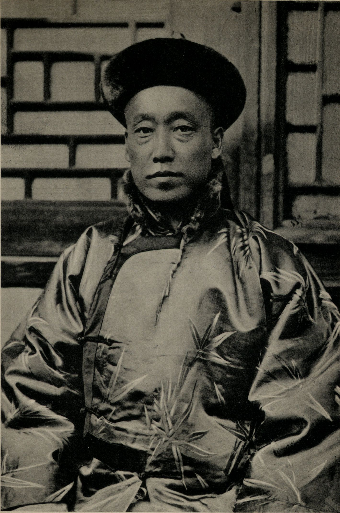

Der chinesische Großkaufmann Lininfa.

Tafel 31.

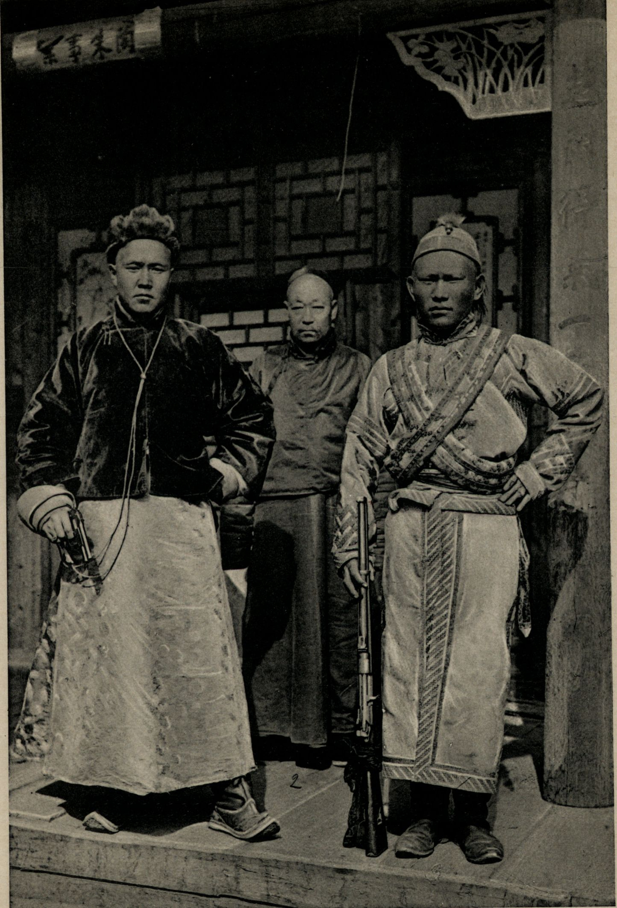

Ming-Bao verhindert in Uljasutai die Plünderung des Handelshauses des Ältesten der chinesischen Kaufmannschaft.
1\. Ming-Bao. 2\. Der Älteste der chinesischen Handelskammer. 3\. Chailaimongole.

<a id="145">**-- 145 --**</a>

## KAPITEL 11. DIE MONGOLEN ALS BESIEGER DER CHINESEN.

*(Wieder in Uljasutai.)* Nach dieser Abschweifung nehme ich den Faden der Erzählung wieder auf und halte mich dabei an die Aufzeichnungen meines Tagebuchs. Kobdo war gefallen, die schönste Stadt der äußeren Mongolei war ein einziger großer Trümmerhaufen, alles Leben in der Handelsstadt war von den mongolischen Truppen vernichtet worden, nur was sich in die Festung geflüchtet hatte, 780 Mann von etwa 5000 (chinesische Angabe), wurde gerettet. Die Mongolen arbeiteten im 20. Jahrhundert genau nach dem bewährten Rezept des Tschengis-Chan oder des Timur- Leng. Rings um die Stadt Kobdo war die Luft durch die, für die Hunde dort hingeworfenen Leichen der Erschlagenen verpestet. In Uljasutai herrscht ein Leben wie nie zuvor. Frische mongolische Truppen durchziehen die Stadt. Kurze russische Trompetensignale durchgellen morgens und abends die Gassen. Es sind dies die Mongolen truppen, die von den russischen Instrukteuren in aller Eile in Urga ausgebildet worden sind. Dazwischen tauchen die klugen, fein geschnittenen Gesichter der zum Kampf und Raub herbeigeeilten Zizikar oder Chailar-Mongolen auf. Ming-Bao und ich bummeln durch die Straßen der Stadt. Hier und da fällt ein Schuß, der schnell und sicher, meistens aber unblutig, irgend eine Meinungsverschiedenheit zwischen einem mongolischen Soldaten und einem Chinamann erledigt, da der Chinese meistens nach dem abgegebenen Drohschuß, wobei ihm die Kugel dicht an dem Schädel vorbeigeht und in seinen Wänden stecken bleibt oder diese durchschlägt, zu jedem unannehmbaren Preis seine nicht versteckten Sachen verkauft. Gerade als ich mit Ming-Bao in die Nähe des Ladens des Chinesen Bain Dorschit komme, versucht ein Chailar-Mongole nach langem, vergeblichem Klopfen an die Bohlenwände, die den Laden gegen die Straße abschließen, die Durchschlagskraft seiner Mauserpistole. Es ist ihm anscheinend ganz gleichgültig, ob sich hinter den Bohlenwänden im Zimmer Leute befinden oder nicht. Tatsächlich fehlte nicht viel, so wäre Bain Dorschit mit einem Verkäufer durch die die Holzwand durchschlagenden Kugeln erschossen worden. Ein kurzer, energischer Zuruf Ming-Baos und eine nicht miß-

<a id="146">**-- 146 --**</a>

zuverstehende Handbewegung unsererseits nach unseren Brownings lassen den halbbetrunkenen Halunken aufhören zu feuern. Einige herbeigeeilte Leute, die zur persönlichen Leibwache Ming-Baos gehören, entwaffnen den Mann und verabfolgen ihm sofort auf dem Hofe der Wohnung Ming-Baos 25 Hiebe mit einem Bambusstock.

Die Türen der Chinesen sind noch fester verrammelt als sonst, alles, was sie in Sicherheit haben bringen können, ist versteckt worden, kaum wagt sich einer von ihnen noch auf die Straße.

Der Postkasak ist seit langem wieder einmal in Uljasutai eingetroffen, selbstverständlich ohne mein Kinostativ, und ich beschließe nach langer Überlegung mit meinem Wirt Lininfa, mir mit Hilfe eines chinesischen Handwerkers ein neues zu konstruieren. Auf der Post wurde mir ein an mich adressierter Brief geöffnet übergeben. Als ich den Posthalter darüber zur Rede stellte, behauptete dieser, den Brief hätte er so mit dem Postsack empfangen. Ich sagte ihm glatt auf den Kopf zu, daß ich genau wüßte, wer den Brief habe öffnen lassen, der Brief sei aber widerrechtlich aufgemacht worden, dies sei daraus zu ersehen, daß ein Vermerk über das Öffnen des Briefes und der Name des betreffenden Beamten, der den Brief geöffnet habe, auf dem Briefumschlag . fehle. Durch Zufall traf ich Konsul Walter und Frau, als ich die Post verließ und zeigte ihnen den geöffneten Brief. Selbstverständlich hielt ich nicht mit meiner Meinung über das Zulässige oder Unzulässige eines solchen Vorgehens zurück, um so mehr, als Frau Konsul das Öffnen des Briefes auf das Fehlen der Briefmarke zurückführen wollte. Ich konnte ihr aber erklären, daß der Empfänger eines ohne Briefmarke aufgegebenen Briefes auch bei der russischen Post nur mit der Zahlung eines doppelten Portos bestraft wird, niemals aber mit dem Durchlesen des Inhalts des Briefes. Übrigens war unter meiner, sofort aus der Tasche gezogenen Lupe der feine Rand des schwarzen Poststempels um die Stelle der abgerissenen Marke zu erkennen. Bei der eine Woche später eintreffenden Post war die Ecke eines Briefes, den ich persönlich aus den Händen des Konsuls erhielt, abgerissen, der Brief war an mich aufgegeben und zwar zu Händen des russischen Konsuls, auch hier behauptete der Konsul, der Brief sei mit der abgerissenen Ecke eingetroffen. Aber eine genaue Untersuchung unter meiner stark vergrößernden Lupe zeigte ganz deutlich, daß die Ecke erst ganz vor kurzem abgerissen sein mußte, da die feinen Härchen der Reißstelle noch nicht verscheuert waren. Da nun aber die nächste Poststation vierzehn Tage zu Pferd entfernt liegt, so wäre wohl an der abgerissenen Stelle der Rand des Risses stark verscheuert gewesen.

<a id="147">**-- 147 --**</a>

*(Leben und Treiben in Uljasutai. Ein chinesisches Gastmahl.)* Eines Abends waren wir, d. h. der Kommandant des Kasaken-Convoys M. O. Charanow, der Konsul, seine Frau und noch einige andere russisehe Honoratioren, sowie auch ich zum Abendessen bei einer chinesischen Firma eingeladen. Wir trafen uns alle in dem großen Empfangssaale der Firma, einzeln von den Angestellten abgeholt. Die zuerst Angekommenen, darunter auch ich, hockten mit untergeschlagenen Beinen auf dem Kamon teetrinkend, Mandeln und süßes, ranziges Gebäck dazu knabbernd. Der Raum ist ähnlich dem Lininfas und wohl bei allen chinesisch-mongolischen Kaufleuten fast ganz gleich eingerichtet.

Hier lernte ich auch einige der wenigen in der Mongolei lebenden russischen Frauen kennen. Darunter die Ehefrau eines russischen kleinen Kaufmannes Paromonow, energisch und klug scheint sie das Zepter im Hause zu führen. Endlich erscheint auch der Konsul mit seiner Frau, mit dem Kasakenoffizier Charanow. Rings um zwei kreisrunde russische Tische nimmt die Gesellschaft in hohen chinesischen, mit roten Kissen belegten Stühlen Platz. Auf jedem Tisch stehen etwa zwanzig kleine und große, grünlich-gelbe, henkellose, kostbare chinesische Porzellantassen, gefüllt mit ebenso vielen verschiedenen chinesischen Speisen. Es ist dies nur der Auftakt zum eigentlichen Essen, ähnlich, wie der russische "Sakuski". Obwohl die Vorräte der Chinesen dadurch, daß sie schon seit einem Jahr keinerlei Zufuhr aus Kalgan erhalten haben, sehr erschöpft waren, so war das Essen doch noch überraschend mannigfaltig und gut. Die verschiedenartigsten chinesischen Leckerbissen wurden uns gereicht. Kaulquabben in einer grünlich dünnen Suppe schwimmend, wurmartige Fische, gezuckert oder in einer süßlichen Brühe liegend, eine wohlschmeckende Schlange, weich gekocht und in Würfel geschnitten, sowie die grünlich glitscherigen, feinschmeckenden Rückenflossen des Haifisches, Tintenfische in verschiedenster Aufmachung und Schwalbennestersuppe waren wohl die Hauptgerichte mit wunderbar zubereitetem Geflügel und Hammel, die uns gereicht wurden. Als Zwischengerichte gab es Bambus gekocht und als Salat, Seetang und Algen als Suppe. Zwischen jedem gewöhnlichen Gericht erhielten wir zur Abwechslung immer ein süßes, wie gezuckertes Holundermark oder in Zucker glasierte glühend heiße, gebratene Kartoffeln. Diese Abwechlung gab dem Essen einen ganz besonders pikanten Geschmack. Zu den gezuckerten Kartoffeln wurden kleine Schalen mit kaltem Wasser neben jeden Gast hingesetzt. Man nahm, selbstverständlich alle gemeinsam, aus der kleinen Kartoffelschüssel dieses duftende Meisterwerk chinesischer Kochkunst mit den Stäbchen heraus und tauchte die Kartoffel dann mit den Eßstäbchen in die Wasserschale, um den glasierten Zucker abzukühlen. Wer zu happig war und das Abkühlen des glühend heißen

<a id="148">**-- 148 --**</a>

Zuckers in der Wasserschale vergaß, verbrannte sich gründlich den Mund. Die Neulinge, die es noch ungewohnt waren, mit den feinen, unten silberbeschlagenen Eßstäbchen umzugehen, verloren übrigens die Hälfte ihrer Portionen beim Herauslangen aller dieser Leckerbissen aus der gemeinsamen Schüssel auf dem Wege von der Schüssel zum Munde oder zu den kleinen silbernen Tellerchen. Daß unser kreisrunder Tisch dadurch nachher sehr appetitlich aussah, konnte keiner behaupten. Eingemachter Knoblauch und von den Chinesen aus Brot hergestellter Essig, der übrigens in kleiner Menge zu jeder europäischen Suppe hinzugefügt, auch dieser einen wunderbar feinen Geschmack verleiht, fehlte natürlich nicht. Chinesische Eier, dunkelgrün, ähnlich unseren Kibitzeiern, die einige Monate in einer ganz besonderen Art von Tonerde unter der Erde gelegen haben, bildeten ein übliches Zwischengericht. Dazu wurde aus kleinen silbernen, chinesischen Täßchen, etwa so groß wie ein Fingerhut, chinesischer heißer und lauwarmer Reisschnaps getrunken. Die Chinesen sind im allgemeinen wunderbare und feine Gesellschafter und Gastgeber. Witzige Bemerkungen, Anspielungen auf ihre bedrängte Lage fliegen auch hier hin und her. Der Sohn des Gastgebers, der wie durch ein Wunder dem allgemeinen Blutbad in Kobdo entgangen war, machte uns, die er doch alle innerlich als seine und seines Volkes Todfeinde betrachtete, die Honneurs. Bei den Chinesen habe ich ein eigentliches Zutrinken, wie es bei uns Europäern Sitte ist, nie bemerkt. Aber lustig, mit schlagendem Witz fordert irgend einer seinen Nachbar zu einem Spielchen auf; wer verliert, muß trinken, und zwar stets bis zur Nagelprobe. Eines dieser Spiele ist mit unserem Fingerknobeln, das ja beim deutschen Militär im Schwünge ist, verwandt, nur mit dem Unterschiede, daß der Chinese als leidenschaftliche Spielratte das Spiel bedeutend verwickelter zu spielen liebt. Jeder Finger der Hand ist dem anderen über- oder unterlegen. Die beiden Gegner beobachten einander scharf, häufig wird mit beiden Händen zu gleicher Zeit gespielt, Zahlen, die im umgekehrten Verhältnis zum Spielwert der Finger stehen, feintreffende Witzworte werden dem Gegner plötzlich mit hoher, voller Bruststimme entgegen geschleudert, um ihn verwirrt zu machen. Dabei dauert häufig die Entscheidung nur einige Sekunden. Bei ebenbürtigen Spielern wie Lininfa und sein Gegner, interessiert ein solches Fingerduell die ganze Gesellschaft, und unter den Chinesen bildeten sich sofort zwei Parteien, die wieder untereinander wetteten. Wessen Spieler verlor, mußte seinen Fingerhut voll Reisbranntwein bis zur Neige austrinken. Häufig versuchten sie, die Undurchsichtigkeit der silbernen Schälchen ausnutzend, mit mächtigem Schwung nur den halben Fingerhut leer zu trinken. Aber der Gegner gab nicht locker, ausgetrunken mußte werden.

<a id="149">**-- 149 --**</a>

Jedenfalls habe ich selten, auch bei ihren Festlichkeiten, so mäßige Leute im Essen und Trinken gesehen, wie die Chinesen. Ein anderes Spiel bestand darin, daß ein Chinese an den Gegner herantrat, er legte vor dessen Augen eine Mandel in die mittlere Handfläche der linken Hand, bedeckte dann den Mandelkern mit dem Zeige- und Mittelfinger der rechten Hand, ein blitzschneller Ruck, und die Mandel war ver*schwunden. Nun hielt der Chinese dem Gegner die beiden geballten Fäuste hin mit der Frage: "Wo ist die Mandel ?" Erriet man die richtige Hand nicht, und das war mit der Schnelligkeit, womit die ganze Bewegung vollführt wurde, anfangs sehr schwierig, so mußte wieder das stets von dem aufmerksamen, bedienenden Chinesen gefüllte Schälchen leer* getrunken werden. *(Chinesisches Gastmahl)* Bald stand ich bei diesem Spiel im Mittelpunkt des Interesses, da ich mit größter Sicherheit stets erriet, in welcher Hand die Mandel versteckt war. Ich benutzte nämlich den Trick, den Chinesen bei der ganzen Geschichte scheinbar nicht zu beobachten, beobachtete dabei aber scharf, nicht etwa seine Hände, sondern sein Gesicht und seine Augen, und je leidenschaftlicher mein Partner wurde, je leichter wurde für mich das Spiel. --- Den Schluß eines jeden Essens macht das Reisgericht mit Schwalbennestersuppe oder einer wunderbaren Kraftbrühe. Zu meinem größten Erstaunen meldete sich plötzlich "Veuve Cliquot" mit einem echt französischen Knalleffekt an. Alles hätte ich in der Mongolei gesucht, nur keinen guten französischen Champagner.

Als wir unseren chinesischen Gastgeber verließen, erwartete uns der chinesische Koch vor der Ausgangstür und dankte uns dort unter Kniebeugungen dafür, daß wir ihm dieEhre angetan hatten, seine geringe Kochkunst zu probieren. Papierlaternen tragende Chinesen erleuchteten uns den Weg und brachten uns zu unseren Wohnungen zurück.

Wer China und die Chinesen kennt, wird wohl nie bei allen Festlichkeiten, die er auch dort mitgemacht haben mag, die weiblichen Mitglieder der Familie zu Gesicht bekommen haben. Ausgenommen sind vielleicht die Hafenstädte --- die man wohl kaum als chinesisch ansehen kann --- und Peking, wo man glaubt, den Europäern jetzt einige gesellschaftliche Konzessionen machen zu müssen. Bei allen offiziellen Festlichkeiten, wozu auch Nachbarn eingeladen werden, erscheinen im eigentlichen China die weiblichen Mitglieder der Familie nicht. Dagegen bei den Familienfesten, auf denen nur die Mitglieder der Familie, d. h. der ganze Clan erscheint, mischen sich die Frauen unter die Männer. Es ist dies stets ein harmloser, lustiger Verkehr, dem jedes Kokettieren, Anbändeln und Flirten fehlt, ein Verkehr, der auch zwischen den entfernteren Verwandten sich in den Normen bewegt, wie bei uns zwischen sich gut verstehenden Brüdern und Schwestern. Das erotische Moment

<a id="150">**-- 150 --**</a>

ist hierbei ebenso selbstverständlich ausgeschlossen wie bei uns. China kennt durch den Aufbau seines Staatswesens, dem die Familie auch heute noch als das Wichtigste im ganzen Staat erscheint, --- da dieser auf der*selben Grundlage beruht wie die Familie --- keine Frauenfrage und keinen Heiratsmarkt mit all dem daraus entspringenden Luxus, der den Ehemann ruiniert. Frauenkultus in abendländischer Form, öffentliches Kurmachen, Kokettieren, Flirten sind den Frauen Chinas unbekannte Begriffe. Dafür bietet aber China den Frauen eine sichere, dem Manne gleichwertige Existenz. Alle Erzählungen über Mädchenmord, kinderfressende Schweine sind in das Reich der Fabel zu verweisen.*

Lininfa, mit dem ich abends die Tagesneuigkeiten bespreche, ist seit einiger Zeit doppelt liebenswürdig. Seitdem ich bei ihm wohne, betritt unter irgend einem Vorwand kein Mongole mehr sein Haus. Ich zeigte ihm eines Abends meinen, vom chinesischen Ministerpräsidenten Lu unterzeichneten chinesischen Reisepaß. Seit dieser Zeit erhalte ich von den chinesischen Großkaufleuten Tag für Tag Besuche, die mir ihr Leid klagen. Die armen Leute fürchten für ihr Leben. Ich verspreche ihnen, bei der mongolischen Behörde ein gutes Wort für sie einzulegen. Unter den Besuchern befand sich auch ein Chinese, der am Tonki-Nor für die russische Firma Batujow-Kawani aus Tientsien handelte und dort eine Faktorei betrieb. Er wurde am 10. August 1912 von einer mongolischen Bande vom Mani-Gun-Chochun unter Führung des Mongolen Chambete-Changa überfallen. Seine sämtlichen Angestellten und auch ihn bedrohten die Mongolen mit dem Tode, wenn er nicht das bare Silbergeld herausgäbe. Als sich die Chinesen weigerten, wurden sie alle ohne Ausnahme gequält, gemartert und gepeitscht. Mein Besucher erhielt 250 Hiebe mit der schweren, mongolischen Peitsche, ohne daß er den Ort angegeben hätte, wo er das seiner Firma gehörige Geld versteckt hielt. Die Mongolen bemerkten bald, daß sie auf diese Weise ihr Ziel nicht erreichen würden. Sie brachten dann einen ganz raffinierten Plan zur Ausführung. Zwar waren sie überzeugt, mein Besucher allein kenne das Geheimnis, wo das Geld verborgen liege, aber aus Furcht, ihn nach den 250 Hieben durch weitere Martern zu töten, ließen sie ihn persönlich unbehelligt. Dafür nahmen sie sich die beiden jüngsten Angestellten vor, peitschten sie ganz fürchterlich, hingen sie mit den Zöpfen auf und drohten, alle Angestellten einen nach dem anderen sofort zu erschießen. Keiner der Angestellten verriet auch unter den fürchterlichsten Qualen das Geheimnis. Schließlich erbarmte sich Scho-Su-Schi seiner Leute und nannte den Aufbewahrungsort des Geldes. Dicht vor der Hundehütte, von einem Haufen Kehricht zugedeckt, lagen 24 000 Lan in Silber, bewacht von dem riesigen mongolischen Hund. Der Hund

<a id="151">**-- 151 --**</a>

wurde erschossen und das Geld, sowie alles, was nicht niet- und nagel*fest war, geraubt. Dann legten die Mongolen Scho-Su-Schi an Händen und Füßen, mit dem Zopf nach rückwärts zusammen gebunden, auf ein Kamel, um ihn ins Lager nach Kobdo zu bringen. Wie dieser Mann mit seinen ganz fürchterlich zerfleischten Lenden den viertägigen Transport nach Kobdo --- auf dem er nichts zu essen und zu trinken erhielt --- ausgehalten hat, ist mir heute noch unverständlich. Zwei ihm bekannte Chinesen, die auf der Flucht vor anderen Mongolen mit der Bande zusammen trafen, wurden, als sie ihren stöhnenden Landsmann durch einige mitleidige Zurufe trösten wollten, kurzer Hand erschossen, weil die nicht Chinesisch verstehenden Mongolen eine Verständigung zwischen Scho- Su-Schi und den beiden befürchteten. Bei seiner Ankunft in Kobdo wurde Scho-Su-Schi sofort in Ketten gelegt. Als einzige Antwort auf sein wiederholtes Verlangen, den Dolmetscher des russischen Konsuls oder den russischen Konsul Kusminski selbst sprechen zu dürfen--- da er unter russischem Schutz stehe --- wurde ihm der Büchsenlauf an die Stirne gesetzt. In der dritten Nacht wurde er dann ebenso plötzlich, ohne jemand anders als seine Mitgefangenen gesehen zu haben, nach Tonki- Nor abgefertigt und dort in Freiheit gesetzt. Ein mitleidiger mongolischer Lama verband ihn hier, so daß er schließlich nach Uljasutai gelangen konnte. Ich habe selten so etwas Entsetzliches gesehen, als die zerfleischten, in allen Farben schimmernden Lenden des Scho-Su-Schi.

*(Haisan.)* Große Angst haben jetzt die Chinesen Uljasutais vor dem Anrücken Haisans, der mit einer Bande von etwa 300 Mann im Anmarsch auf Uljasutai ist. Die tollsten Gerüchte schwirren wieder einmal durch Uljasutai und werden prompt von den Russen ausgenutzt. Selbstverständlich verkauften die Chinesen, sobald sich der Anmarsch Haisans fühlbar machte, alles zu einem Viertel des Wertes und dazu noch auf langfristige Wechsel. War nun aber ein Chinamann besonders hartnäckig und wollte er nicht zu den ihm gebotenen Preisen die Ware losschlagen, so wurde ein kleiner mongolischer Überfall inszeniert und der so von den Mongolen geängstigte Zopfträger verkaufte nachher seine Ware zu jedem annehmbaren Preise an die Russen, denn besser "wenig als gar nichts".

Die Lage der Chinesen in Uljasutai wurde mit jedem Tag verzweifelter. Ich saß eines Abends beim Konsul, als der Chinese Bain-Dorschit plötzlich mit einem unserer chinesischen Gastgeber, bei dem wir einige Abende vorher zu einem großartigen chinesischen Essen eingeladen gewesen waren, atemlos hereingestürzt kam mit der Meldung, daß die Mongolen den Laden unseres Gastgebers, einige Dutzend Häuser weit vom Konsulat

<a id="152">**-- 152 --**</a>

entfernt, plünderten. Konsul Walter wurde bei dieser Nachricht etwas verwirrt und blaß, ebenso erschrak seine Frau, denn die zu erwartende russische Verstärkung von 120 Mann Kasaken war noch nicht eingetroffen. Als der Konsul noch zögerte, sagte ich ihm gerade ins Gesicht, daß die Zustände in Uljasutai allmählich unhaltbar geworden seien. Fine jetzt einsetzende Plünderung sei in der Nacht gefährlich, da wohl die Mongolen Haisans kaum vor den Fäden der Russen, wo jetzt eine Menge angekaufter und zur Aufbewahrung gegebener chinesischer Waren lagern, Halt machen würden. Auch mache etwaiges bei einer Plünderung ausbrechendes Feuer bei dem herrschenden Winde wohl schwerlich einen Unterschied zwischen den chinesischen und russischen Wohnungen. Eine einsetzende Plünderung müsse unbedingt im Keime erstickt werden, da die anwesenden 25 Mann Konvoi-Kasaken nicht den mit alten Berdang- und Mauserkarabinern bewaffneten Mongolen gewachsen wären. Während der Konsul noch unentschlossen zögerte, fielen draußen mehrere Schüsse. Unwillkürlich fühlte ich nach meinem Browning, erklärte aber lachend der Frau Konsul auf ihre ängstliche Frage, dies sei eine alte, schlechte afrikanische Angewohnheit; wenn in einem unruhigen Bezirk plötzlich scharfe Schüsse fielen, müsse man sich stets davon überzeugen, ob man in der Lage sei, gegebenenfalls in derselben Tonart antworten zu können. Nun ließ Konsul Walter seinen Konvoi-Offizier M. O. Charanow rufen. Dieser erschien sofort mit einem .etwas stark geröteten Kopf ohne Mütze und Säbel. Denn er war durch den Konsul gerade bei der Feier der Ankunft seines Regimentskameraden und Vorgesetzten, des Fürsten Uchtomski, gestört worden. Er versprach sofort, einige Leute zu den angegriffenen Läden zu schicken, und Patrouillen während der ganzen Nacht durch Uljasutai ziehen zu lassen. Michael Osipowitsch Charanow gehörte früher dem Kaiserlichen Konvoi in Petersburg an, genau so wie sein Vater. Er ist kaukasischer Abstammung, wenn ich nicht irre auch, wie die übrigen Konvoi-Kasaken Sr. Majestät des Kaisers von Rußland, ein Tsche- schenze, von deren unverbrüchlicher Treue und glühender Anhänglichkeit an das gesamte Haus Romanow man in den Hofkreisen fest überzeugt ist; zum größten Mißvergnügen vieler tüchtiger, patriotischer russischer Offiziere, wie z. B. Fürst Uchtomski. ---*

Ich selbst verließ, kurz nachdem die Chinesen unter tiefen Verbeugungen gegangen waren, das Konsulat. Dunkel und menschenleer lag die Straße vor mir, nicht einmal ein paar der sonst nachts in den Straßen herumlungernden schwarzen, mongolischen Hunde waren zu bemerken. Plötzlich fielen abermals drei oder vier scharfe Schüsse in der Gegend des Westtores, dort wo auch die angegriffenen chinesischen Geschäfte

Tafel 32.

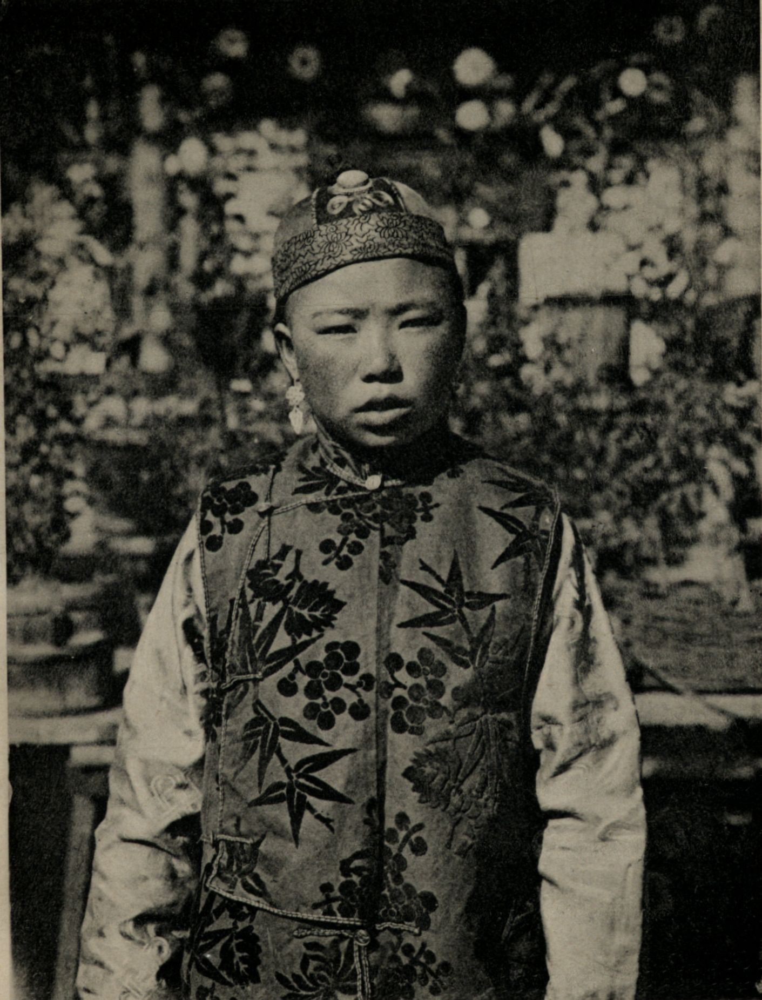

Mongolisches Mädchen (15 Jahre alt)

Tafel 33.

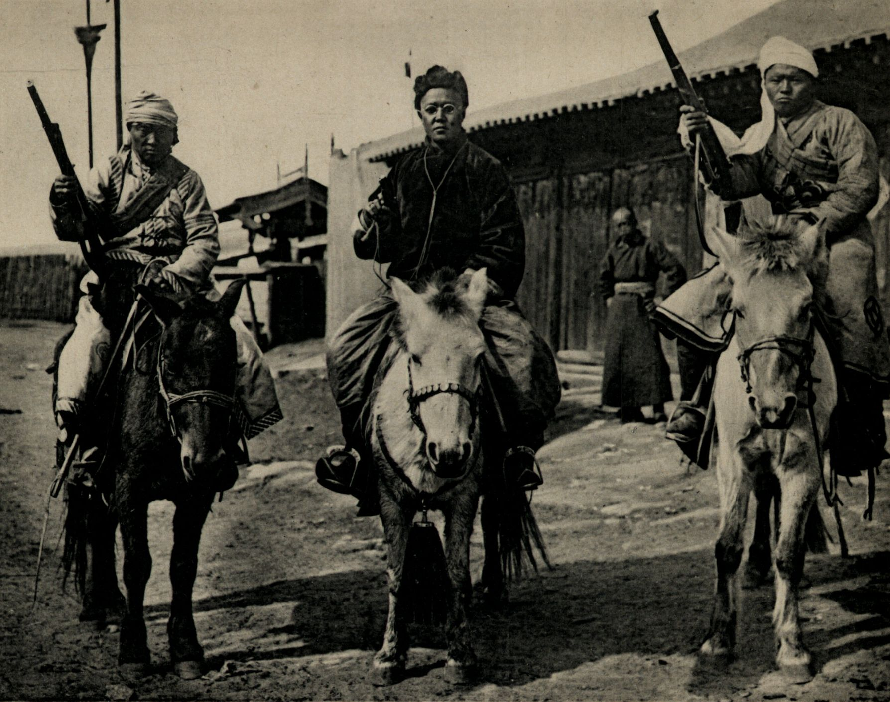

Ming-Bao reinigt die Straßen von Uljasutai von Marodeuren und Plünderern.

Tafel 34.

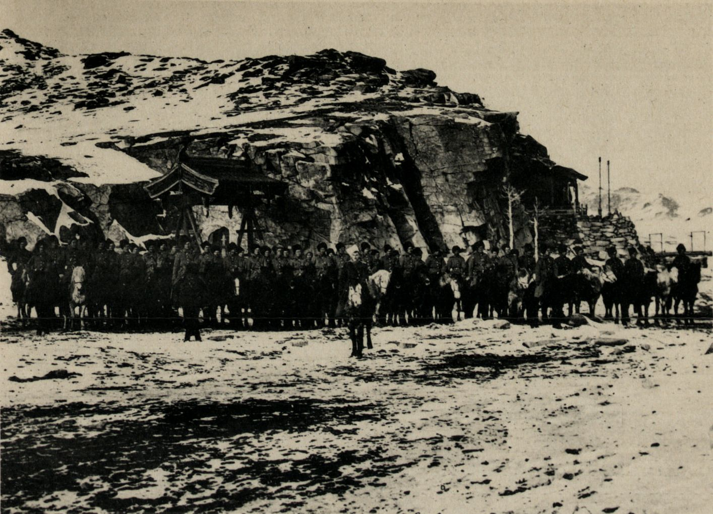

Die dritte Sotnije der Sabaikalkasaken zieht in Uljasutei ein.

Verbrüderungsfest der Mongolen und Russen in Uljasutai. Kasakenparade.

Tafel 35.

Dsal-Chen-Sen-Gegen (Dsal-Chan-dsa Chutuchtu)

<a id="153">**-- 153 --**</a>

lagen. Ich lief sofort dorthin und traf fast gleichzeitig mit der Kasaken- patrouille ein, aber die Mongolen waren, nachdem sie für einige hundert Rubel gestohlen hatten, plötzlich verschwunden.

Daraufhin verkaufte der so mürbe gemachte Chinese seine ganzen Vorräte an einen mir bekannten Russen und zwar zu einem Spottgeld und auf Wechsel mit sechs Monaten Ziel. Ich konnte es mir nicht versagen, dem Käufer zu verstehen zu geben, daß der Chinamann wohl einen guten Freund gehabt habe, der ihm die Mongolen auf den Hals gehetzt habe.

*(Am andern Tag.)* Am anderen Tage traf ich in dem Laden der Firma Bodonow Ming-Bao, der dort europäische Sachen einkaufen wollte, und zwar Zahnpulver, Seife, Konserven, Senf und eine warme, pelzgefütterte Mütze. Ich erzählte ihm auf dem Heimwege die ganze Geschichte. Er erklärte mir rund heraus, daß diese Plünderungen nicht von seinen Leuten angezettelt worden wären. Die Truppen Haisans seien noch weit weg, Damding- Zurun erst im Anmarsch, das Ganze sei wohl, fügte er mit feinem Lächeln hinzu, bestellte Arbeit gewesen. Und Ming-Bao behielt Recht; denn kaum waren am anderen Morgen die Patrouillen aus den Straßen zurückgezogen, so wurde in demselben Geschäft abermals ein Überfall ausgeführt, und als die Kasaken erschienen waren die Täter wie vom Erdboden verschluckt. Von jetzt an blieben die Kasaken als Wache in dem am Laden anstoßenden Kontorraum zurück. Sie saßen dort, gemütlich teetrinkend, eine chinesische Pfeife nach der anderen rauchend, aufs Aufmerksamste von den Chinesen bedient, die sich unter der Kasakenbewachung allmählich beruhigten, ohne daß sich weiter etwas ereignet hätte. Als ich nachts nach dem ersten Plünderungsversuch meine chinesische Wohnung aufsuchte und Lininfa die ganze Sache erzählte, blieb er äußerlich ruhig, schwitzte aber vor Aufregung. Auch er hatte die Schüsse gehört. Während wir uns noch unterhielten, fielen in derselben Nacht hier und dort draußen vor der Stadt noch einzelne Schüsse.

Jedesmal fuhr er erschrocken zusammen. Schließlich beruhigte ich ihn mit der Versicherung, sofort von meinen Schußwaffen Gebrauch machen zu wollen, wenn es sich die Mongolen einfallen lassen würden, sein Haus ohne meine Einwilligung zu betreten. Übrigens würde schon Ming-Bao dafür sorgen, daß er unbehelligt bliebe.

Täglich besuchte mich während meines Aufenthaltes in Uljasutai nun Ming-Bao und häufig sandteer mir Geschenke, so daß ich manchmal in Verlegenheit geriet, wie ich mich dafür erkenntlich zeigen sollte. Ming-Bao fällt hier in Uljasutai durch die vornehme Eleganz seiner Kleidung auf. Über einem hellblauen, schweren seidenen Kleid trägt er eine feine schwarze, seidene Jacke. Um den Hals schlingt sich als einziger Schmuck

<a id="154">**-- 154 --**</a>

eine dünne gelbe Seidenschnur, die nur mit einem goldenen Karabiner*haken am Browning angehakt ist.*

*(Einzug der Kosaken in Uljasutai.)* Am 17. September zogen die schon längst erwarteten 120 Kasaken in Uljasutai ein. Ich stand mit Lininfa auf dem Dache seines Hauses und

beobachtete deren Einzug. Am Ufer des Bogdm-Kol hielt, wie ich mit meinem Glase deutlich erkennen konnte, der Führer der Abteilung, Fürst Uchtomski eine Ansprache, dann führten die Truppen einige Bewegungen aus und schließlich durchritten sie den trockenen, teilweise mit Eis bedeckten Fluß. Ein grauer Tausendfuß, der hundert dunkle Fühler mit blitzender Spitze in die Luft reckte, wälzte sich verstaubt und verschmutzt durch das Westtor. Die Pferde sahen stark mitgenommen aus, die Kasaken selber waren frisch und gesund. Der Kasakenabteilung folgten unter einem besonderen Offizier zwei Maschinengewehre und Munitionskarren, dahinter die fahrbaren Küchen und der Train.

Auch Dsal-Chen-Sen-Gegen 1), der zweite Kirchenfürst der Mongolen, ist fast gleichzeitig mit den Kasaken auf einem anderen Wege, von Kobdo kommend eingetroffen. Er lagert sich mit seinen Leuten und seinem Stab dicht bei der Festung, während die Russen in die Festung verschwinden. Dieser 17. September kann für die mongolische Geschichte ein denkwürdiger schwarzer Tag werden, denn es ist viel leichter, eine noch so erbärmliche Festung zu verschenken, als sie später zurückzubekommen. Ich glaube, mein Freund, der mongolische Generalgouverneur von Kobdo und Uljasutai, Zartul-Beese, vom Volk Zezen- Beese --- der weise Fürst --- genannt, hat heute eine Bombendummheit gemacht. Anderen Tages machte Dsal-Chen-Sen-Gegen mit Zartul- Beese beim russischen Konsul Besuch. Dieser Dsal-Chen-Sen-Gegen ist eine der merkwürdigsten Persönlichkeiten, denen ich in meiner fünfzehnjährigen Wanderzeit begegnet bin.

*(Dsal-Chen-Sen-Gegen.)* Dsal-Chen-Sen-Gegen ist die zweite lebende Verkörperung des Buddhas in der Mongolei. Sein Einfluß ist beinahe gleich dem des Je-Tsun-Dampa-Chutuchtu, des neuen mongolischen Herrschers und Kaisers. Er ist berühmt als Arzt und Wettermacher und das Volk wallfahrt zu seinem Kloster, um Heilung und Trost dort zu suchen. Wer einmal in die wundervoll glänzenden Rehaugen des Gegen geschaut hat, wird sie so schnell nicht wieder vergessen.

1) Gegen bedeutet erhaben, auch göttliche Person, etwa den katholischen Heiligen, nur eine Rangstufe höher, entsprechend. Bei den Mongolen wird jeder Chubilgan "Gegen" betitelt.

<a id="155">**-- 155 --**</a>

*(Mongolische Wiedergeburten.)* Sein Einfluß auf die mongolische Hierarchie ist ganz bedeutend, er weiß, wann und wo nach dem Tode des Chutuchtu dessen Wiedergeburt stattfindet, er trifft aus den drei zur engeren Auswahl gestellten Kindern die Wahl, mit einem Wort, er bestimmt die Person des Chutuchtu und somit jetzt auch den zukünftigen Beherrscher der Mongolen. So ist er auch die einzige Persönlichkeit, die es wagen darf, jederzeit unangemeldet, ohne vorhergehende Anzeige den Chutuchtu aufzusuchen. Hier sei kurz auf die für die ganze äußere Mongolei wichtige Zeremonie der Wiedergeburt des Chutuchtu eingegangen, so wiesiemir von den Lamas in der Umgebung des Dsal-Chen-Sen-Gegen erzählt wurde. Stirbt irgend ein Großlama, wie z. B. der Chutuchtu, oder ein anderer der sieben Inkarnationen, die in den Klöstern der äußeren Mongolei leben, so machen sich bald höhere Lamas auf die Suche nach dem unbekannten Kinde, in dessen Körper die Seele des Verstorbenen eingekehrt ist. Es kann dies nur ein Knäblein sein, das nicht über ein Jahr alt ist, ebenso kommen die noch ungeborenen Kinder in Betracht, deren Geburt kurz nach dem Tode des Verstorbenen zu erwarten ist, aber nur bis zum 49. Tage, nachdem die Seele die Hülle des Verstorbenen verlassen hat. Jeder der suchenden Lamas führt einen Gebrauchsgegenstand des Toten bei sich. Jede Jurte, wo ein für den Zweck in Frage kommendes Knäblein existiert, wird aufgesucht, gleichgültig, ob arm oder reich. Allerdings ist der Ort der Geburt durch bestimmte Orakel näher festgestellt. Während der Unterhaltung mit den Eltern, wobei das Kind zugegen ist, zieht nun der Lama irgend einen Gebrauchsgegenstand des Verstorbenen, wie z. B. die Tabakspfeife, die kostbare Nephrit-Schnupftabaksdose heraus, um sie selber zu benutzen. Greift nun das Kind nach der Tabakspfeife oder der Dose, und will sie nachher nicht wieder hergeben, sondern weint und schreit, um den Gegenstand behalten zu können, so hat das Kind die ihm früher gehörigen Gegenstände erkannt und will nach der Meinung der Mongolen sein früheres Eigentum nicht mehr herausgeben. Nun wird er, nachdem bei dem Knaben noch gewisse, nur dem Suchenden bekannte, geheime Zeichen festgestellt worden sind, mit noch zwei anderen Knaben, bei deren Besuch sich dieselbe Geschichte abgespielt hat, zur engeren Wahl zu Dsal-Chen-Sen-Gegen geschickt, der dann unter den drei Knaben mit Hilfe der heiligen Bücher die entscheidende Wahl trifft. Selbstverständlich spielt der Zufall, sowie auch das Familieninteresse eine große Rolle, aber der Schein wird dem Volk gegenüber aufs strengste gewahrt. So vererbte sich seit langer Zeit die Wiedergeburt des Chutuchtu in der Familie des mongolischen Kaisers Altan-Chan, deren Einfluß die chinesische Regierung unter Kaiser Kansi veranlaßte, bei der Neuwahl des Chutuchtu ein Wörtchen mit zu reden. Sie bestimmte kurzer Hand,

<a id="156">**-- 156 --**</a>

daß für die Wiedergeburt nur ein in Tibet geborenes Knäblein in Betracht zukommen habe, und zwar wurde diese Verordnung veranlaßt durch den Rangstreit des vom vierten Dalai-Lama eingesetzten Gyal-Tsab (Kronprinz) für die Mongolei. Es war dies der Sohn des Altan-Chan der Chalchas, Dshab- dsiun Dombo Chutuchtu, der alsMaidari-Chutuchtu wiedergeboren worden war. Dieser ließ Werkmeister und Baumaterial aus Peking kommen und erbaute das erste am Flusse Tola gelegene Kloster zu Urga, das von Haldan niedergebrannt wurde. Er selbst verkörperte den Burchan Boddi-Sado-Därnatu. Sein Rangstreit mit dem Fürsten der Oleuten Haldan (der den Burchan Machagallan verkörperte) führte zu den furchtbarsten Kämpfen mit den Dsungaren. Durch die Hilfe des chinesischen Kaisers, der damals die zu ihm geflüchteten Chalchas beschützte, wurden die Dsungaren schließlich i. J. 1696 vernichtet. Der mongolische Kaiser verzichtete auf diesen Titel und wurde ein chinesischer Wan. Der jetzige Jebtsu-Damba Taranatha, der Maidari Chutuchtu, ist also ein Tibetaner, und es ist fast eine Ironie des Schicksals, daß gerade dieser Fremde sich von China lossagte und ein neues mongolisches Reich mit Hilfe der Russen gründete, also das ausführte, was die Chinesen in kluger Voraussicht von den mongolischen Fürstenfamilien befürchtet hatten.

Bei dem Besuch des Dsal-Chen-Sen-Gegen im Konsulat war der Aufzug für mongolische Verhältnisse prächtig. Umgeben von seinen Lamas, in kostbaren roten Gewändern kam er von seinem, etwa drei Werst entfernten Lager in die Stadt gezogen. Voraus eine Menge Soldaten, die mit der Reitpeitsche die sich zu nahe herandrängenden Mongolinnen zurücktrieben. Dsal-Chen-Sen-Gegen selber war ganz in gelber Seide gekleidet, auf dem Kopf trug er den durch ein breites rotes Band festgehaltenen mongolischen Hut aus schwarzem Zobel. Neben ihm reitet, nicht minder kostbar in hellblauer Seide gekleidet, Zezen-Beese. Das Pferd des Dsal-Chen-Sen-Gegen wird von zwei Lamas geführt. Verschiedene Mönche tragen die Insignien seiner Würde, den Donnerkeil und ein langes, seidenumwickeltes schmales Buch, eine Art Zepter. Den Schluß bildete Ming-Bao, umgeben von seinen Chailarmongolen, die so gefürchteten Battr, wie sie das Volk nennt. Ein mächtiger großer, gelber Seidenschirm, ähnlich wie unsere seidenen Lampenschirme wird vor ihm hergetragen. Dieser Schirm ersetzt bei Dsal-Chen-Sen-Gegen die Stelle der Fahne und wurde ihm erst an diesem Morgen von Ming-Bao geschenkt. Die schwere, kreisrunde Standarte, mit ihren herunterhängenden Seitenrändern macht dem reitenden Träger bei dem herrschenden Winde viel zu schaffen. Sofort wurde die Straße in der Umgebung des Konsulats abgesperrt. Ich war gerade beim Konsul, als der Gegen und Zezen-Beese eintrafen. Wir grüßten uns herzlich und ich zog mich

<a id="157">**-- 157 --**</a>

dann zurück, um die diplomatischen Verhandlungen nicht zu stören. Auffallend war mir der Gegensatz zwischen dem freien Benehmen dieser beiden hohen Staatsbeamten in ihren Jurten und Zelten und ihrer Un*beholfenheit inmitten eines noch so einfachen russischen Zimmers. Auf der abgesperrten Straße entwickelte sich ein buntbewegtes Bild. Reiter mit Mauserkarabinern, aus deren Lauf phantastisch blutigrot ein seidener Lappen wie eine rote Fahne flattert, umgürtet mit dem französischen Turkobajonett, versuchen sich die Langeweile und Wartezeit so gut zu vertreiben, wie es eben geht. Nachdem sich Ming-Bao mit seinen Leuten in seine Wohnung zuückgezogen hat, ist keine Spur von Ordnung und Zucht mehr zu bemerken. Die Soldaten stehen schreiend und schwatzend herum oder hocken auf dem Boden, um sich gegenseitig die den chinesischen Soldaten abgenommenen Mauserkarabiner zu zeigen. Frauen und Hunde werden, erstere mit der Peitsche, letztere mit Steinwürfen vertrieben. Dazwischen mischen sich russische Kasaken in Uniform und neuangekommene russische Offiziere in Paradeuniform. Welch ein Gegensatz! Die Kasakenoffiziere unter Führung Uchtomskis sehen hochelegant aus, auf der breiten Brust Charanows prangt der Stern von Buchara. Als Dsal-Chen-Sen-Gegen das Konsulat verließ, durchbrachen die harrenden, reich geschmückten Mongolinnen trotz der Hiebe die Soldatenkette und eilten auf Dsal-Chen hinzu, der ruhig von einem höheren Lama das schmale, seidenumwickelte Buch nahm und damit die Stirn einiger der mit gefalteten Händen vor ihm stehenden, anbetenden Frauen berührte. Dann stieg er zu Pferde, um sich zum Paradeplatz zu begeben. Die von ihm so ausgezeichneten Frauen liefen in heller Freude zu ihren Freunden und Freundinnen, die Übergangenen schlichen tief betrübt davon. So harmlos dem Uneingeweihten die ganze Sache vorkommt, so wichtig ist sie für die Frauen. Denn die so von Dsal-Chen-Sen-Gegen ausgezeichneten Frauen tragen nun die Gewißheit mit sich nach Hause, daß sie nicht mehr --- als Frauen wiedergeboren werden. Wenn auch die Stellung der Frau in der Mongolei keine besonders schlechte ist, so gilt sie, obwohl sie recht häufig in der Familie dem Ehemann gegenüber den Pantoffel oder den mongolischen Stiefel schwingt, --- ich meine dies nicht nur bildlich --- doch als dem Manne gegenüber minderwertig, und alle unangenehmen Arbeiten werden ihr aufgehalst.

*(Kasakenparade in Uljasutai.)* Um zwölf Uhr fand die große Kasakenparade vor Dsal-Chen-Sen- Gegen und dem Konsul statt. Es war damit eine kleine Verbrüderungsfeier, die mehr schon einer verkappten Annexion glich, verbunden.

Ich sah mich veranlaßt, diesen historischen Augenblick mit meinem Kinoapparat festzuhalten. Die Pferde der Kasaken sahen schwach und heruntergekommen aus. Sie hatten sich noch nicht von dem Her-

<a id="158">**-- 158 --**</a>

marsche Werchnoe-Udinsk, Urga, Uljasutai erholt. Die Kasaken waren kaum imstande, die nötigen zur Parade gehörigen Vorbeimärsche auszuführen. Später wurden die Kasaken von den russischen Händlern im neuen Konsulatsgebäude bewirtet. Während ich meine photographischen Platten entwickelte, schallten die fröhlichen Hurras der Russen zu meiner Wohnung herüber. Die Reden, die gehalten wurden, sollen, nachdem sich die Mongolen kurz nach der Parade zuückgezogen hatten, ganz anders geklungen haben. Die Chinesen, die überall herumlungerten und spionierten, meinten, es wäre von einer Verbrüderung mit den Mongolen dabei ganz und gar nicht die Rede gewesen, eher vom Gegenteil.

*(Besuch bei* *Dsal-Chen-Sen-Gegen.)* Mitten in meiner Arbeit wurde ich von Ming-Bao und drei Reitern, von denen einer ein Reitpferd für mich am Zügel mitführte, mit der Botschaft abgeholt, Dsal-Chen-Sen-Gegen wünsche mich sofort zu sprechen. Sobald ich mit dem Entwickeln fertig war, ging es im flotten Galopp zum Eager des Gegen. Etwas abseits von den Jurten der höheren mongolischen Offiziere, gleichsam als wolle er betonen, daß er mit ihrem blutigen Gewerbe nichts gemeinsames haben wolle, lag rings umgeben von drei größeren Jurten und einigen niedrigeren blauen Küchenzelten die große, prächtige Jurte des Gegen. Dort wurde ich erst von einer Anzahl höherer Lamas empfangen, rings herum drängte sich das Volk, aber alle wagten nur im Flüsterton zu sprechen. Einige Minuten mußten Ming-Bao und ich warten. In dem Zelt, das als Empfangszimmer diente, lagen wohlverschnürt die verschiedensten Ballen mit Seide, Kisten mit Patronen und Mausergewehren. Ich war gerade im Begriffe, mir die Sachen etwas genauer anzusehen, als mich ein Eama flüsternd aufforderte, einzutreten. Er schlug den schweren, mit blauer Seide überzogenen Filzvorhang nach oben auf die Jurte, und in gebückter Haltung, um mir nicht den Kopf an dem oberen Türpfosten anzustoßen, trat ich in die Jurte. Hier saß Dsal-Chen-Sen-Gegen, umgeben von einigen höheren Eamas, ihm dicht zur Seite der jugendliche Zezen-Beese. Ich machte dem Gegen meine stumme Verbeugung, währendMing-Bao den vorgeschriebenen Kotau vollführte. Hierauf erhob sich Dsal-Chen-Sen- Gegen, kam mir einige Schritte entgegen, begrüßte mich als seinen alten Freund und lud mich ein, zu seiner Rechten auf einem gelben Kissen an seiner Seite Platz zu nehmen, während Ming-Bao ihm zur Linken unterhalb des Zezen-Beese, der auf einem blauen Kissen hockte, auf einem roten Platz nahm. Sofort erkundigte sich Gegen nach dem Ergebnis meiner letzten Reise und ließ sich nochmals die Einzelheiten meines Ritts Kobdo-Kosch-Agatsch und meine Verfolgung durch die Chinesen, sowie meinen darauffolgenden Rückmarsch quer durch das von den Chinesen besetzte Gebiet Kosch-Agatsch---Kobdo---Uljasutai erzählen.

<a id="159">**-- 159 --**</a>

Dann erkundigte sich der Gegen ganz unvermittelt nach Kaiser Wilhelm, wieviel Söhne er habe, ob er nicht bald in den Krieg gegen Rußland ziehen würde, wie stark unsere Armee sei und ob alle unsere Soldaten so gute Mauserbüchsen und Pistolen hätten, wie die von den Mongolen geführten Mauserkarabiner. Als ich meine Mauser, Modell 1910, herbeiholen ließ, wurde ihm der Unterschied zwischen ihren alten Karabinern und meiner Waffe sofort klar. Ich erzählte ihm nun, daß solche Schußwaffen, wie sie sie jetzt führten, für unsere Armeen schon nicht mehr gut genug wären usw. Schließlich bat er mich, ob ich ihm ein Bild von unserem Kaiser zeigen könne. Zufälligerweise hatte ich irgendwo in Biisk oder Kosch-Agatsch eine Ansichtspostkarte mit dem bekannten Bild unserer Kaiserfamilie erhalten, die ich noch in meiner Brieftasche bei mir trug. Ich zeigte ihm dieselbe, lange und aufmerksam studierte er jede einzelne Person, frug nach Name, Alter und Rang eines jeden einzelnen Prinzen. Ich mußte meine ganzen Kenntnisse zusammennehmen, um ihm Auskunft geben zu können. Mit den drei ersten Prinzen wußte ich ja noch leidlich Bescheid, ob aber bei den übrigen nicht allerlei Verwechslungen oder Irrtümer unterlaufen sind, möchte ich stark bezweifeln. Schließlich bat der Gegen mich, das Bild behalten zu dürfen. Ich zögerte scheinbar einige Sekunden, um die Gabe etwas kostbarer zu machen und überließ ihm dann, innerlich schmunzelnd die Ansichtspostkarte ganz gerne. Wenn ich alle die nachher den mongolischen Fürsten und Prinzen versprochenen Kaiserbilder in die Mongolei hätte mitbringen sollen, so hätte das eine schöne Kamelladung gegeben. Ich hatte die seltene Ehre, von Dsal-Chen-Sen-Gegen aufgefordert zu werden, mit ihm zu speisen. Während wir uns noch unterhielten, traten einige höhere Lamas, eine Art Kardinäle, herein. Auf großen Silberschüsseln trug der eine von ihnen gekochtes Hammelfleisch, ein anderer zwei schwere silberne Teekannen. Ich war wirklich neugierig, unter welchen Zeremonien dieses mongolische Essen sich abspielen würde. Ein Lama, jedenfalls der Mundschenk, füllte aus der großen silbernen Schüssel die kleinen kostbaren Nephritschalen mit einer dicken Nudelsuppe, gemischt mit gehacktem, gekochtem Hammelfleisch. Die Nudeln waren von jener feinen, dünnen Sorte, wie man sie nur in China erhält. Knieend hielt der Lama dem Gegen die Nephrit-Schale dicht unter den Mund, der dann mit den feinen, am unteren Ende silberbeschlagenen Elfen- beineßstäbchen elegant und geschickt die Suppe auslöffelte. Dann putzte Dsal-Chen-Sen-Gegen die Nephritschale mit seinem roten, seidenen Taschentuch aus, ließ sie bis zum Rande füllen und mir überreichen. Ich nahm dem vor mir knieenden Lama die Schale und die Eßstäbchen des Gegen aus der Hand und aß nun, in der linken Hand die Schale mit

<a id="160">**-- 160 --**</a>

der Suppe, in der rechten Hand die Stäbchen, meine Portion genau so schlürfend wie der Gegen. Dabei muß ich mich allem Aischein nach ganz dem Zeremoniell nach benommen haben, denn Dsal-Chen-Sen- Gegen frug mich ganz überrascht, wo ich gelernt hätte, mit den chinesischen Eßstäbchen so geschickt umzugehen. Ohne mit einer Wimper zu zucken, antwortete ich ihm, "bei meinen chinesischen Gastfreunden". Hatte ich erwartet, daß er über meine Dreistigkeit erzürnd sein würde, so hatte ich mich gewaltig getäuscht. Gelassen sah er mich mit seinen klaren Augen an, als wollte er bis auf den Grund meiner Seele lesen, und antwortete mir daraufhin ganz ruhig, "dann haben die Chinesen an dir einen gelehrigen Schüler gehabt, aber wenn die Chinesen das damals gewußt hätten, was sie heute wissen, ich glaube, ich glaube, sie hätten dir die Suppe gründlich versalzen". Alles lachte über mein betroffenes Gesicht, sogar der Gegen schmunzelte ganz vergnüglich. Als zweites Gericht erhielten wir gekochten Hammel. Der Gegen speiste wieder zuerst und allein, putzte mit seinem roten Taschentuch erst das Messer ab und schlug sich die langen Seidenärmel zurück, so daß der untere Arm etwa bis zur Hälfte frei wurde. Ein Oberlama goß :hm und uns heißes Wasser aus einer der silbernen Kannen über die Hände und reichte uns ein etwas fragwürdiges rotes Tuch zum Abtrocknen derselben. Dann nahm Dsal-Chen-Sen-Gegen ein Stück von dem glühendheißen Fleisch in die Hand und schnitt sich nun Stückchen vor Stückchen davon ab, es mit Messer und Daumen zum Munde führend. Nachdem er einige Bissen genossen hatte, reichte er mit der rechten Hand zuerst dem Fürsten Zezen-Beese ein großes Stück Fleisch, dann Ming-Bao und mir. Niemals habe ich so köstlich schmeckenden Hammelbraten gegessen wie diesmal bei dem Gegen. Es war hochinteressant, diese drei hohen Staatsbeamten zu beobachten, wie geschickt sie das Fleisch in der Hand zerschnitten und aßen. Übung macht eben den Meister, und schließlich ist es ja nicht weniger unappetitlich, als wenn wir Europäer den Spargel oder die Artischoken mit den Händen essen oder aussaugen. Nachher wurde uns nochmals heißes Wasser aus der silbernen Kanne über die Hände gegossen. Der Tee wurde in wunderbaren, aus der Wurzel einer besonderen Birkenart hergestellten innen mit dickem Silber ausgelegten Schalen die aus Tibet eingeführt werden und deshalb als besonders kostbar gelten, gereicht, dazu gab es allerlei zu naschen. Besonders gut schmeckten zum Tee die großen, dunkelblauen chinesischen Tafelrosinen und das ranzige chinesische Gebäck. Der Gegen raucht gewöhnlich nach dem Essen seine Pfeife, aber Alkohol verschmäht er ganz und gar im Gegensatz zu seinem göttlichen Amtsbruder in Urga. Als der Gegen zu rauchen anfing, frug ihn Ming-Bao, ob er auch meine Pfeife schon gesehen

Tafel 36.

Sorcktul, Zartul oder Zezen-Beese. Der erste mongolische Generalgouverneur von Kobdo und Uljasutai.

Tafel 37.

Mongolischer Lama (Maler).

Mongolische Lamas im Sommer vor der Jurte in der Nähe ihres Klosters.

Tafel 38.

Mongolisches Mädchen im Festschmuck.

Tafel 39.

Mongolische Frauen.

<a id="161">**-- 161 --**</a>

hätte. Ich reichte Dsal-Chen-Sen-Gegen meine englische Shagpfeife, er betrachtete sie aufmerksam und lange und forderte mich dann auf, ebenfalls zu rauchen. Als er die Menge Tabak sah, die im Gegensatz zu den mongolischen Pfeifen in dem großen Kopf der Shagpfeife verschwand, war er ganz erstaunt. Selbstverständlich mußten er und die anderen hohen Herrschaften, einer nach dem anderen meine Pfeife und den Tabak probieren. Alle erklärten übereinstimmend, daß für ihren Geschmack der Tabak zu scharf sei. Als ich meine Pfeife ausgeraucht hatte, überließ ich sie Dsal-Chen-Sen-Gegen, der mich darum bat, ganz gerne zum Andenken nebst einem Päckchen meines englischen Tabaks (made in Germany). Mit dem Gegen bewohnen dessen Jurte noch zwei kleine, echt chinesische Hunde von jener kostbaren Rasse, wie sie nur im kaiserlichen Zwinger zu Peking gezüchtet werden. Das eine kleine Hündchen war weiß und braun gefleckt und nur drei Monate alt. Es lief ständig hin und her und ließ auf den seidenen Teppichen und Kissen überall seine Visitenkarten zurück. Die kleine Hündin war rehbraun und wurde von Gegen sehr verwöhnt. Nach dieser Audienz, die etwa dreieinhalb Stunde gedauert hatte, wurde ich vom Gegen auf das Freundlichste mit der Aufforderung entlassen, täglich bei ihm vorzusprechen. Sofort gab er auch die nötigen Befehle, daß ständig für mich und einen meiner Diener zwei Pferde bei meiner Wohnung bereit zu stehen hätten, ebenso sollte stets ein chinesischer Wagen oder besser gesagt Karren, bespannt nebst Kutscher zu meiner Verfügung bereit sein. Der Gegen begleitete mich bis vor seine Jurte, wo ich noch schnell eine Aufnahme von ihm machte. Zezen-Beese, der mit uns herausgetreten war, lud mich nun ein, ihn zu seiner Staatsjurte zu begleiten, um ihm dort noch etwas Gesellschaft zu leisten. Hier fiel selbstverständlich jeder chinesisch-mongolische Etiquettenzwang weg, rauchend und plaudernd unterhielten wir uns auch hier von dem einzigen Thema, das uns am Herzen lag: "Was wird nun werden? Wird es gelingen, die Mongolei von jedem fremden Einfluß frei zu machen ? Werden die Chinesen nochmals einen Versuch unternehmen, nach Kobdo und Uljasutai vorzudringen? Wird Rußland durch den Balkankrieg nach Westen abgelenkt, hier im fernen Osten den Chinesen, die im Stillen damit rechnen, im Westen werde sich ein allgemeiner europäischer Krieg entwickeln, energisch entgegentreten, oder die Mongolen im Stiche lassen ?" Zezen-Beese meinte zwar, wenn es wirklich schlimm kommen sollte, so wären ja Chutuchtu und Dsal- Chen-Sen-Gegen da, die durch ihre Gebete und ihre Wunderkraft schon den Mongolen zum Siege verhelfen würden. Ich konnte es nicht unterlassen, Zezen-Beese darauf aufmerksam zu machen, daß es viel praktischer und auch sicherer wäre, die Mongolen verließen sich weniger auf Gebete

<a id="162">**-- 162 --**</a>

als auf ihre Tapferkeit und sorgten für die Ausbildung einer kleinen, gut bewaffneten Armee, denn der Herrgott wäre auch hier, wie in meinem Vaterlande, gewöhnlich mit den stärksten und tapfersten Bataillonen.

Andern Tages kam Ming-Bao, um von mir Abschied zu nehmen, er mußte noch nachmittags mit wichtigen Briefen nach Urga auf brechen. Der Abschied von diesem gelben Gentleman tat mir weh, wußten wir doch nicht, ob wir uns nochmals wiedersehen würden; denn in solch wilden Zeitläufen weiß ja niemand, wann ihn das tödliche Geschoß ereilt.

Ich versprach ihm, sobald ich von Uljasutai loskommen könnte, nach Urga zu kommen. Meine Hand in der seinen haltend, durchschritt er den Hof, den leeren, ausgeräumten Laden Lininfas, und erst auf der Straße ließ er mich los. Chinesische Kaufleute, die von seiner Abreise gehört hatten, kamen von allen Seiten herbeigelaufen, um ihn bis zu seinem Pferde zu begleiten und ihm nochmals dafür zu danken, daß er jeden Versuch einer Plünderung in Uljasutai verhindert habe. Gleichmäßig freundlich und liebenswürdig wies er die ihm angebotenen kleinen Geschenke zurück. Noch einmal reichte er mir die Hand vom Pferde herunter, "Auf Wiedersehen in Urga," flüsterte er mir noch zu, dann jagte er mit vier seiner besten Leute seinem fernen Ziel entgegen. Jeden Tag war ich nun bei Dsal-Chen-Sen oder Zezen-Beese. War ich zur gewöhnlichen Stunde nicht oben im Lager, so kam schon der Leibdiener des Fürsten, um sich nach dem Grunde meines Nichterscheinens zu erkundigen.

Es war ein Glück, daß ich tausend Bromsilberpostkarten und den dazu nötigen Entwickler mit nach Uljasutai genommen hatte; denn ich war in der kurzen Zeit meines Aufenthaltes der Hofphotograph Seiner Heiligkeit, Seiner Durchlaucht und aller hübschen Frauen von Uljasutai geworden. Ich hatte mir in einem leeren Raum Lininfas, genau meinem Schlaf- und Empfangszimmer gegenüber, eine Dunkelkammer eingerichtet und dort kopierte ich an einem einzigen Abend mit Hilfe Lininfas 120 Bromsilberpostkarten. In der Nacht ist es jetzt in Uljasutai empfindlich kalt geworden, und das Thermometer fällt ständig unter Null. Ich will hier kurz die in dieser Zeit von mir gemessenen Temperatur-Schwankungen aufführen.

*Temperatur im September.* Monat September.

|     | Morgens 8 Uhr | Quecksilber | Abends 6 Uhr | Quecksilber |
| --- | ------------  | ----------- | ------------ | ----------- |
| 10. | Max.          | ---         | Max. + 17    | + 9         |
|     | Min.          |             | Min. + 11    |             |
| 11. | Max. + 5      | ---         | Max. ---     | + 6         |
|     | Min. + 4      |             | Min. ---     |             |

<a id="163">**-- 163 --**</a>

|     | Morgens 8 | Uhr       | Quecksilber | Abends 6 | Uhr       | Quecksilber       |
|-----|-----------|-----------|-------------|----------|-----------|-------------------|
| 12  | Max.      | + 16 1/2  | + 8         | Max.     | + 14      | +8                |
|     | Min.      | + 0       |             | Min.     | + 13      |                   |
| 13. | Max.      | + 8       | + 5         | Max.     | + 15      | + 7               |
|     | Min.      | + 1       |             | Min.     | + 4       |                   |
| 14. | Max.      | + 8       | + 8         | Max.     | ---       | ---               |
|     | Min.      | + 1/2     |             | Min.     | ---       |                   |
| 15. | Max.      | ---       | ---         | Max.     | + 7       | + 3               |
|     | Min.      | ---       |             | Min.     | + 3       |                   |
| 16. | Max.      | + 3 1/2   | + 2 1/2     | Max.     | + 3 1/2   | + 7               |
|     | Min.      | --- 3     |             | Min.     | + 7       |                   |
| 17. | Max.      | + 9 1/2   | ---         | Max.     | + 16      | + 11              |
|     | Min.      | --- 1/2   |             | Min.     | + 9       |                   |
| 18. | Max.      | + 11 1/2  | + 8         | Max.     | + 17      | + 11 im Gebirge   |
|     | Min.      | + 2       |             | Min.     | + 12      | Schnee            |
| 19. | Max.      | + 11 1/2  | + 9 1/2     | Max.     | + 10      | + 1               |
|     | Min.      | + 2       |             | Min.     | + 0       |                   |
| 20. | Max.      | + 3       | + 1         | Max.     | + 8       | + 0               |
|     | Min.      | --- 3     |             | Min.     | --- 3     |                   |
| 21. | Max.      | + 1/2     | --- 6       | Max.     | + 6       | --- 1             |
|     | Min.      | --- 7     |             | Min.     | --- 5 1/2 |                   |
| 22. | Max.      | --- 1     | --- 7       | Max.     | + 18      | + 1               |
|     | Min.      | --- 9     |             | Min.     | + 1/2     |                   |
| 23. | Max.      | + 2       | + 0         | Max.     | + 9       | --- 4             |
|     | Min.      | --- 6     |             | Min.     | + 1/2     |                   |
| 25. | Max.      | + 10 1/2  | + 8         | Max.     | + 14      | + 8               |
|     | Min.      | --- 7     |             | Min.     | + 7       |                   |
| 26. | Max.      | + 8 1/2   | + 4         | Max.     | + 5       | Schneefall        |
|     | Min.      | + 3       |             | Min.     | --- 1     |                   |
| 27. | Max.      | + 1       | --- 3       | Max.     | + 4       | + 3 Schnee        |
|     | Min.      | --- 8     |             | Min.     | --- 3     |                   |
| 28. | Max.      | --- 2     | --- 4       | Max.     | + 8       | + 1               |
|     | Min.      | + 9 1/2   |             | Min.     | --- 5     |                   |
| 29. | Max.      | + 2       | + 0         | Max.     | + 6 1/2   | --- 1             |
|     | Min.      | --- 1     |             | Min.     | --- 2     |                   |

Eines Tages lud mich der Gegen ein, ihn einmal in meiner vollen Jagdausrüstung aufzusuchen. Ihn interessierte meine Jagdausrüstung ebenso sehr, wie mich seine priesterliche. Gewehr, Messer, Patronengürtel, Modell Südwest, Dum-Dum- Geschosse, Nagel- und Kletterschuhe, alles ist für ihn interessant, denn in diesen Zeiten ist dem sonst so friedlichen Mongolen, dessen höchstes Gebot lautet, "Du sollst nicht töten", nichts wichtiger, als moderne Mordwaffen.

<a id="164">**-- 164 --**</a>

Dann wieder sollte ich eines Abends zu ihm kommen, um einen kleinen Kinder-Kino-Apparat, den ihm ein Russe für schweres Geld aufgehängt hatte, in Ordnung zu dringen.

*(Festessen der russischen Kaufmannschaft.)* Diesen Wunsch konnte ich leider nicht gleich erfüllen, da ich am Morgen zu meinem größten Erstaunen den Besuch der Kaufleute Ignatieff und Bodonoff erhalten hatte, die mich als die Altesten der russischen Kaufmannschaft einluden, an dem zu Ehren des russischen Konsuls stattfindenden Essen teilzunehmen. Auch der Konsul selbst nebst Frau und die Offiziere Charanow und Fürst Uchtomski erschienen kurz nachher, um mich zu besuchen. Ich opferte einen Teil meines kostbaren Kognaks, um cliese seltenen Gäste zu bewirten.

Abends war die ganze russische Kolonie im Hause Bodonoff versammelt. Der Tisch war überladen mit russischen und chinesischen Vorspeisen. Nach langem Warten waren wir alle zusammen. Das Essen nahm im allgemeinen einen urgemütlichen Verlauf. Neben mir saß anfangs der Kaufmann Bodonoff und später Charanow, die dem russischen Wodka und dem französischen Champagner eifrig zusprachen. Es wurden die verschiedensten Reden gehalten. Schließlich forderte auch mich der Konsul auf, zu sprechen, ich trank kurz auf das Wohl der russischen Kaufleute und Kolonisten.

Nachher, ich weiß nicht aus welchem Grunde, wünschte der Konsul, daß ich nochmals eine Rede halten sollte. Ich bat den Konsul, er möchte doch diesmal als der Dolmetscher zwischen mir und der Kolonie dienen und meine Rede übersetzen, da ich Deutsch zu sprechen wünschte und vielleicht mißverstanden werden könnte. Konsul Walter war auch dazu bereit, ich führte nun kurz aus, es wäre heute abend so viel schon von dem Zusammenarbeiten der Kasakenpicke und der diplomatischen Feder gesprochen worden, daß ich es nicht unterlassen könnte, auch des Mannes zu gedenken, der im weiten heiligen Rußland Picke und Feder in seiner Person vereinige. Ich tränke auf das Wohl Sr. Majestät des Kaisers von Rußland und aller Reußen.

Die Herren Staatsbeamten und Offiziere waren selbstverständlich nachher etwas stark verschnupft.

Am 24. September ist der Schnee rings im Gebirge höher geworden, es ist kalt und frisch und auf der Straße läuft alles schon im Pelz herum. Ich trage einstweilen über meinem gelben Khaki-Rock meinen schweren, echt englischen Sweater, made in Germany, der mir jetzt bei Wintersanfang noch gute Dienste leisten wird.

*(Ein kleines Fest bei Dsal-Chen-Sen-Gegen.)* Heute abend war ich beim Gegen und führte dort mit dem kleinen Kinder-Kino-Apparat einige Bilder vor, nachdem ich ihn vorher

<a id="165">**-- 165 --**</a>

in Ordnung gebracht hatte. Oben dicht bei seiner Jurte hatte der Gegen ein weißes Leinentuch unter dem breiten Eingang des Zeltes anbringen lassen. Die Anordnung war an sich ganz ausgezeichnet. Klar und deutlich erschienen die kleinen bunten Bildchen auf der Bildfläche, rings herum in der dunklenNacht hockten im Freien die Zuschauer, die fröhlich lachend den lustigen Szenen folgten. Selten hat wohl jemand vor so einem illustren und dankbaren Publikum mit so einem einfachen Kinder-Kino-Apparat einen solchen Bombenerfolg gehabt. Besonders gefiel den Mongolen die Vorführung eines Schulpferdes. Alles, was über einen mongolischen Titel und Rang verfügte, war vom Gegen für diesen Abend eingeladen worden. Mutter und Frau des Fürsten Zartul-Beese und dessen kleiner Sohn saßen etwas abseits vom Gegen auf besonders hingestellten Stühlen. Dsal-Chen-Sen-Gegen, Delobin-Gegen --- der erst am Abend eingetroffene lebende Buddha des Katschu-Schi-Beese Chochun --- saßen jeder unter einem besonderen Baldachin. Dieser Chochun liegt etwa 45 Werst südöstlich von Uljasutai. Rings um diese beiden höheren Lamas gruppierten sich die niedrigen Lamas, dazwischen mongolische Offiziere mit ihren Frauen "auf Zeit", alle in ihrer bunten malerischen Tracht. Spät abends, nachdem ich noch mit den beiden Gegen Tee getrunken, ritt ich unter Begleitung zweier bewaffneter Mongolen nach Hause. Delobin-Gegen, dessen Bekanntschaft ich diesen Abend machte, ist ein äußerst sympathischer, angenehmer Mensch.

<a id="166">**-- 166 --**</a>

## KAPITEL 12. DIE STELLUNG DER MONGOLISCHEN FRAUEN UND MÄNNER.

*(Mongolische Frauen.)* Am meisten mag es den Leser befremden, daß die Frauen "auf Zeit" und vielleicht auch die Geliebte irgend eines niedrigen Lamas zu solchen Festen der Fürsten erscheinen. Die Stellung der Frauen im allgemeinen ist, wie ich schon an anderer Stelle betonte, eine weit bessere als gewöhnlich bei den Nomadenvölkern. Die Stellung der afrikanischen Frau bei den Hirtenvölkern Ostafrikas steht ungefähr im selben Verhältnis zur Stellung der Mongolin wie etwa die der Mongolin zur Europäerin. Die Mongolin hat jedenfalls mehr und unangenehmere Arbeit im Haushalt zu verrichten als der Ehemann, der in den meisten Fällen ein niedriger Lama ist und äußerst selten ein Handwerk und beinahe nie Feldarbeiten betreibt. Die Feldarbeiter, Handwerker, sowie die Jäger sind die sogenannten chara hun "Schwarze Menschen" und tragen zum Unterschiede vom gläubigen Lama einen kurzen Zopf. Zu dieser Kategorie gehören auch die Staatsbeamten, die nicht Lamas oder doch Schriftgelehrte sind. Gewöhnlich wird, wenn schon ein Knabe vorhanden, die Geburt eines Mädchens mehr gewünscht als die noch eines Knaben. Dies hat wohl hauptsächlich seinen Grund darin, daß in der Mongolei ein Mangel an Frauen, hervorgerufen durch die bedeutend größere Sterblichkeit des weiblichen Geschlechtes, herrscht. Das junge Mädchen und deren Eltern erhalten vom Bewerber und Bräutigam Geschenke, die natürlich nach der Schönheit und Vollkommenheit des jungen Mädchens höher oder niedriger taxiert werden. Erst nachdem die zukünftigen Schwiegereltern und die Braut möglichst viel Geschenke von dem Bräutigam herausgepreßt haben, kann er sie als seine Frau in seine Jurte führen. Auch fließt der größte Teil des Erlöses, den die Tochter aus der Prostitution bezieht, in die Familienkasse, wenn nicht die kleine Schöne es vorzieht, in ihrer eigenen Jurte zu wohnen. Der Hetärismus ist bis in seine letzten Konsequenzen in der Mongolei allgemein üblich und niemand findet etwas dabei, daß sich ein junges Mädchen gegen Entlohnung oder aus Liebe den Männern hingibt. So haftet auch einer Zeitehe mit Fremden, z. B. Russen und Chinesen in den Städten ganz und gar kein

<a id="167">**-- 167 --**</a>

Makel an. Die Frau nimmt sogar gesellschaftlich mit an der Stellung des Fremden teil und wird von den höchsten mongolischen und chinesischen Staatsbeamten empfangen. Sie verkehrt mit den Bekannten ihres Pseudo-Ehemannes und deren Frauen vollständig gleichberechtigt.

Das Leben der Mongolin ist im allgemeinen höchst unhygienisch. Viele mongolische Frauen, die sich streng an ihre religiösen Gesetze halten, waschen den Körper in ihrem Leben nie, nur Hände und Gesicht. Das rauhe Klima des Landes, Geschlechtsverkehr in sehr jugendlichem Alter, allgemein übliche Abtreiberei und die Syphilis lassen die Mongolin bald altern. Die Kinder sind Eigentum der Frau. Das Mutterrecht gilt hier beinahe noch in seiner uneingeschränktesten Form, und manche ältere Matrone undNonne, "Scha-Bu-Gun-Ze" genannt, erhält mit ihrer Arbeit, allerdings oft unterstützt von ihren mit Silberschmuck behangenen, der freien Liebe huldigenden Töchtern, die ganze Familie. Der direkte Verkauf von kleinen neugeborenen Mädchen findet öfterstatt, ebenso werden Knaben verkauft. Der Erlös kommt den Angehörigen zugute. Die Käufer dieser Knaben und Mädchen sind meistens wohlhabende kinderlose Ehepaare. Die Frauen nähren ihre Kinder oft bis zum fünften oder sechsten Jahr und suchen sich die Fähigkeit dazu möglichst lange zu erhalten. Häufig verkaufen die Frauen ihre Milch und bewahren sie in Gefäßen auf, um sie auch noch am anderen Morgen verkaufen zu können. Wer die schmutzigen, stinkigen Gefäße der Mongolen kennt, kann sich leicht den Geschmack dieser in solchen Gefäßen aufbewahrten Menschenmilch vorstellen.

Unbeeinflußt von etwaiger bestehender Ehe oder einem Liebesverhältnis vollzieht sich, nur auf den Rat der Lamas begründet, der Übergang aus der Mädchenzeit in den geachteteren Stand der Frau. Von nun an trägt das Mädchen den vollen Frauenschmuck. Die Haare sind dann fächerförmig hinter den Ohren auseinandergekämmt und durch silberne Spangen und Leim in dieser Form festgehalten. Die vorderen Haare sind kreuzweise flach über die Stirn gekämmt und werden durch ein breites rotes Band zusammen gehalten. Eine kleine Silberkrone von feiner Arbeit mit darauf baianzierendem Zobelhut krönt das Ganze. Die schweren, stellenweise falschen Zöpfe stecken in seidenen, mit Silber und Korallen geschmückten Futteralen, lange silberne Ohrgehänge, häufig auch solche aus grünem Nephrit, vervollständigen den Schmuck. Früher war, wie gesagt, der Übergang aus dem Mädchenstand in den Stand der Frau vom Rate der Lamas abhängig, heute hängt er meistens davon ab, ob sich die betreffende Schöne den Schmuck schon zusammenverdient hat, "denn in dieser Beziehung sind die Frauen schlechter geworden", sagte mir ein alter Lama.

<a id="168">**-- 168 --**</a>

Aus dem Stand der Frau gleitet diese, nachdem ihre Reize verblüht sind, schließlich in den der Matrone und Nonne hinüber. Die Scha-Bu-Gun- Ze dokumentiert dies durch Ablegen ihres Silberschmuckes und dadurch, daß sie fromm wird; allerdings habe ich es häufig auf meinen Reisen bemerkt, daß auch die ältesten Matronen sich für gewöhnlich nicht entschließen konnten, den Silberschmuck abzulegen.

Die Frau ändert beinahe nie ihren Namen, wogegen die Männer recht häufig auf Anraten der Lamas, um dem Teufel ein Schnippchen zu schlagen oder einer bösen Krankheit zu entgehen, den Namen wechseln müssen. Aber ebenso oft geben wohl erwogene Privatgründe, wie z. B. die Furcht vor den Folgen irgend einer Schurkerei, zu einem solchen Namenswechsel Anlaß, und der Rat eines Lamas wird bei solcher Gelegenheit nur zur Deckung vorgeschoben. Die Tracht der Mongolin ist ebenso originell wie schwerfällig. Die Mongolin trägt als Unterkleider gewöhnlich eine dunkelblaue lange Hose und Jacke, darüber nochmals eine farbige Hose. Das Obergewand ist ein langärmeliges, breites Kleid, das auf der rechten Schulter zugeknöpft wird. Seitwärts ist das Kleid an beiden Seiten bis weit über die Kniee geschlitzt. Der Schlitz wird etwa zwei Hände breit oberhalb des Knies durch vergoldete Knöpfe, die durch Schleifen verbunden sind, zusammengehalten. Bei jeder eiligen Bewegung der Mongolin sieht man die blaue oder rote Hose und die plumpen bunten, schweinsrüsselartig vorn nach oben gebogenen Stiefel. Das Kleid selber wird über den Hüften mit einem Stoff- oder Seidengürtel zusammengehalten. Nur bei den seidenen Staatskleidern der Frau fällt der Gürtel weg. Die Ärmel sind gepufft. Die Obergewänder werden im Winter mit Pelz gefüttert, und zwar meistens mit weißem Lammpelz. Strümpfe trägt die Mongolin im Sommer nicht, dagegen im Winter dicke Filzsocken, die in die Stiefel hineingesteckt werden.

*(Mongolische Männer.)* Die Männerwelt zerfällt in Lamas und Schwarze (Charahun). Die Lamas haben wieder eine Unmenge Rangabstufungen, "Schwarze" werden alle nicht Geschorenen genannt, die einen Zopf tragen. Jeder Chochun, jeder Sommun, beinahe jeder Urton (Poststation) und fast jeder Wachtposten hat sein Kloster, wenn dies auch nur aus Filzjurten besteht, mit Lamas von zehn bis zehntausend. Z. B. beherbergt das Kloster zu Urga gewöhnlich etwa 10 000 Mönche, das Kloster von Ulankomo 2000 bis 5000 Mönche. Diese Zahlen versteht man erst, wenn man bedenkt, daß der Vater von zwei oder drei Söhnen mindestens einen auf Anraten der Lamas in ein Kloster eintreten läßt. Bis etwa zum zehnten Lebensjahr, allerdings schon rot eingekleidet und geschoren, bleiben die Knaben bei den Eltern. Dann ziehen sie ins Kloster und

Tafel 40.

Mongolische Frau im Haarschmuck mit Krone ohne Zobelhut.

Tafel 41.

Eine ältere Matrone, Scha-Bu-Gun-Ze.

Tafel 42.

Mongolin von rückwärts gesehen.

Tafel 43.

Mongolische Hetäre, 30 Jahre alt, mit Zobelhut und Silberschmuck.

<a id="169">**-- 169 --**</a>

werden dort unter der Obhut eines älteren Lamas unterrichtet. Hierdurch ist solch ein Kloster eine einzige große, geistliche Familie einiger tausend Mongolen in den verschiedensten Lebensaltern von zehn Jahren angefangen bis zu dem schneeweißen Greise. Diese ganze Sippschaft lebt aber auf Kosten des arbeitenden einfachen Volkes. Der Aberglaube des Volkes wird durch die Lamas wegen des Almosengebens aufs kräftigste unterstützt und ausgenutzt. Die Mönche selbst sind Ärzte, Juristen, Priester, Berater und Wahrsager. Das ganze Leben der übrigen Mongolen ist hierdurch so eng mit dem der Lamas verbunden, daß von den Mongolen selbst eigentlich kein Schritt geschieht, ohne die Einwilligung und ohne Wissen dieser Mönche. Jedenfalls gehört zu den Lamas der größere Teil der mongolischen Intelligenz und der einflußreichste Teil des ganzen Bezirkes. Ganz allgemein ist die Homo-Sexualität in jeder Form und Art in den Klöstern verbreitet, und zwar werden meistens die frisch eingetretenen jungen Lamas von den schon in den Klöstern wohnenden älteren Mönchen verführt. Selbstverständlich ist dies dem Volke allgemein bekannt, ohne daß daran Ärgernis genommen wird. Jedes dieser Klöster hat irgend einen älteren höheren Lama, dessen Ruf als Arzt, Wahrsager, dessen frommer Lebenswandel dem Kloster viele Pilger und Einnahmen zuführt. Hat solch ein Kloster nun das Glück, daß ein- oder zweimal hintereinander so ein wundertätiger Mann in seinen Mauern gelebt hat, so wissen die geschäftskundigen Lamas recht bald dessen Wiedergeburt zu konstruieren; denn stirbt solch ein heiliger Lama, so nimmt seine Seele nicht etwa Wohnung in dem Körper eines Vogels, Käfers oder Säugetieres, wie das bei dem Tode eines gewöhnlichen Mongolen der Fall ist, sondern er wird als Mensch und Lama wiedergeboren. Hierdurch steigt das Ansehen des Klosters, seine Einnahmen vergrößern sich, und bei jeder Wiedergeburt erhöht sich auch die Rangstufe des Wiedergeborenen selbst, selbstverständlich wieder zum Vorteil des Klosters, wenn die anderen Inkarnationen nicht Einspruch dagegen erheben. Das Knäblein, in dessen körperliche Hülle die Seele eines solchen Lamas eingekehrt ist, heißt Chubilgan. Der kleine Chubilgan wird dann nach seiner Bestätigung sofort mit der Mutter ins Kloster selbst oder in eine der dem Kloster gehörigen Jurten gebracht. Diesem Kinde wird dann die Wunderkraft und der Einfluß zugeschrieben, deren die herbeigeeilten opfernden Pilger teilhaftig werden wollen. Jeder Chubilgan hat bis zu seiner Großjährigkeit einen Lehrer, der mit ihm und im frühesten Alter für ihn die göttlichen Ehrungen empfängt. Jedes Wort des Chubilgan gilt als vom Himmel selbst gesprochen und ist den abergläubischen Mongolen Gesetz. Durch tüchtige Lehrer geschult, überragt das Kind bald an Intelligenz und Wissen die anderen gleich-

<a id="170">**-- 170 --**</a>

alterigen Lamas. Der Ruf seiner Klugheit, seines Wissens verbreitet sich unter dem abergläubischem Volke immer mehr. Aber auch häufig entwickelt sich in dem Knaben ein Machtgefühl, das im typischen Größenwahn zum Ausdruck kommt und dadurch seiner Umgebung gefährlich werden kann. Oder es werden Instinkte wach, die seinen Lehrern nicht angenehm sind, er fängt an, einen liederlichen, mit seiner Heiligkeit nicht in Einklang zu bringenden Lebenswandel zu führen. Sehen dann seine Lehrer eine Besserung nicht voraus, so wird er nach und nach in aller Stille vergiftet, und seine Seele kehrt in den Körper eines anderen Knäbleins ein.

Auch der Chubilgan ist den herrschenden Rangstufen wie jeder andere Mönch (Chutarak) wobei er jedesmal seinen Klostemamen ändert, unterworfen. Die Rangstufen, von der niedrigsten angefangen sind folgende:

1\. Obuschi: ist weltlich, darf sich verheiraten, trägt einen roten Gürtel und schneidet sein Haar nicht ab, wohnt mit seiner Familie zusammen und hat nur ein sittenreines Leben zu führen.

2\.  Toin: Dieser hat der Welt entsagt, bleibt ehelos, lebt im Kloster, trägt gelbe Kleidung und roten Gürtel und muß 58 Lebensregeln beobachten.

3\.  Gezul: trägt zu der Ausstattung des Toin noch Überwurf und hat sich 112 Regeln zu unterwerfen.

4\.  Gelun (Gulun): trägt zu der Kleidung des Gezul noch einen oberen Überwurf und gelobt, 253 Lebensregeln zu halten.

5\.  Chambá: erhält seine Weihe durch den Chutuchtu. Er kann selber die drei niedrigen Weihen erteilen. Während des Kirchendienstes sitzt er auf einem Thron und trägt als besondere Auszeichnung einen faltenlosen viereckigen Mantel.

Die Tracht der Lamas ist gewöhnlich rot, auch die der höheren Lamas. Nur Dsal-Chen-Sen-Gegen trug ein gelbes Kleid mit dem eingewebten buddhistischen Rad und auf dem Kopfe eine kleine, tassenförmige Mütze, an deren vorderer Seite ein großer Rheinkiesel befestigt war. Gewöhnlich gehen die Lamas mit ihrem geschorenen Kopf ohne Hut, bei festlichen Gelegenheiten tragen sie dagegen habichtsnasenartige hohe, gelbe Mützen, Schasser genannt, mit einer gelben Raupe darauf, ähnlich der Raupe, wie sie früher auf den bayrischen Helmen getragen wurde.

Die Tracht der "Schwarzen" ist bunt und stark durch die Chinesen beeinflußt.

*(Bei Dsal-Chen-Sen-Gegen.)* Am 25. September ließ mich Dsal-Chen-Sen-Gegen rufen. Ich fuhr diesmal mit dem chinesischen Karren hin, da mich Lininfa und der Älteste der chinesischen Kaufmannschaft, die beide persönliche Anliegen an Dsal-Chen-Sen-Gegen hatten, begleiteten. Ich machte zuerst dem

<a id="171">**-- 171 --**</a>

Delobin-Gegen, der mir äußerst sympathisch ist, einen Besuch. Dort traf ich auch Zezen-Beese. Wir waren gerade in der besten Unterhaltung, als die Ankunft des Manlai-Battre-Damding-Zurun, Höchstkommandierenden der ganzen mongolischen Armee, uns gemeldet wurde. Sofort erhob ich mich der Etiquette gemäß, um mich zu verabschieden, Damding und ich prallten an der Türe zusammen. Sein altes Fuchsgesicht leuchtete auf, als er mich erkannte. "Komm später zu mir", flüsterte er mir schnell zu und verschwand in der Jurte. Dann ging ich zu Dsal-Chen-Sen, der sich für meine photographischen Apparate sehr interessierte. Auch brachte ich ihm fünfzig Patronen für seine Mauserpistole, obwohl ich ihm diese Bitte zuerst höflich aber bestimmt abgeschlagen hatte. Er war ganz überrascht; denn er verstand es sehr wohl, daß ich mich nur ungern von solchen unersetzlichen Patronen in einer solch unruhigen Zeit trennte. Nachher fand sich auch Delobin-Gegen zu uns in der Jurte ein. Wir plauderten lebhaft etwas über eine Stunde, als sich der Älteste der chinesischen Kaufmannschaft bei dem Gegen meldete. Er trat in die Jurte, kniete vor Dsal-Chen-Sen-Gegen nieder und bat um Gnade für zwei seiner Angestellten, die der Gegen hatte aufgreifen und in Ketten legen lassen. Die beiden Chinesen hatten die Poststationen von Charusumé (Tulta) nach Uljasutai ohne Berechtigung und ohne Erlaubnis des Dsal-Chen-Sen-Gegen benutzt, und auf den kleinen Poststationen die dort hausenden mongolischen Posthalter bedroht und verprügelt. Gerade dieser Fall war ein Schulbeispiel für die den Mongolen seit Jahrhunderten anerzogene und ins Blut übergegangene Angst vor ihren chinesischen Unterdrückern. Dsal-Chen-Sen-Gegen hörte ruhig den vor ihm knieenden Chinesen---ein mehrfacher Millionär, bei dem der Gegen bei Ausbruch des Aufstandes stark verschuldet war --- an und lehnte dann seine Bitte ruhig aber bestimmt ab. Da wandte sich der Bittsteller an Delobin-Gegen, der selber ein durch und durch gutmütiger Mensch ist und den Chinesen innerlich stets zugetan war. Delobin-Gegen hätte dem Ältesten der chinesischen Kaufmannschaft, mit dem er wohl von früher her gut befreundet war, gerne geholfen, aber da Dsal-Chen-Sen die Bitte des einst so mächtigen Mannes rundweg abgeschlagen hatte, wagte er ebenso wenig wie alle anderen Anwesenden auch nur ein gutes Wort für ihn einzulegen, selbst Zezen-Beese gab ihm nur ausweichende Antworten und verwies ihn immer wieder an den unerbittlichen Dsal- Chen-Sen. Die beiden Gefangenen wurden später hingerichtet.

*(Bei Damding-Zurun.)* Es wurde Zeit, daß ich mich zu Damding-Zurun begab, obwohl Delobin- Gegen mich nicht fortlassen wollte. Hier wurde ich vom General und seinen Battren in feierlicher Audienz empfangen. Unter seinen Leuten

<a id="172">**-- 172 --**</a>

sah ich viele alte Bekannte wieder. Alle strotzten von schwerer Seide und Silber. Gold sah ich gar nicht, nur wenige trugen einen goldenen Ring aus Feingold, der unserem Ehering nachgebildet war. Damding- Zurun wollte meine Mausergewehre und Pistolen sehen, so mußte denn Lininfa mit der chinesischen Karre nach Hause fahren und mein Arsenal heranholen. Selbstverständlich drehte sich unser Gespräch um die Kämpfe von Kobdo, die Feigheit des Ambans insbesondere und die des Chinesen im allgemeinen. Die sonst so friedliche Mongolei ist durch ein Häuflein Chailar-Mongolen, die Tochto-Chogun ins Land brachte, wie verwandelt. Die feigen mongolischen Lamas starren diese mit reicher Beute zurückgekehrten Räuber mit neidischen Blicken wie Wundertiere an.

Das Innere der Jurte des Damding-Zurun ist im Gegensatz zu der des Dsal-Chen-Sen und des Zezen-Beese, höchst einfach, obwohl er als Höchstkommandierender vor Kobdo für Millionen erbeutet hatte.

*(Das Innere der Jurte des Dsal-Chen-Sen-Gegen)* Bei Dsal-Chen-Sen-Gegen stehen auf der rechten Seite vor der Türe kleine, rot lackierte Schränke, dieeineMengeFächerenthalten, beschlagen mit alter Bronze. Auf diesen niedrigen Schränken steht altes chinesisches Porzellan und Silberschalen, sowie Opfergeräte. Große Hamburger Silberplatten und kleine Silberstücke im Werte von zwanzig Lan, die einem Miniaturtropenhut täuschend ähnlich sehen, liegen rings auf den Schränken. Es sind die gestrigen Opfergaben des gläubigen Volkes. Unter einem gelben Baldachin stehen friedlich die beiden Bilder des Dalai-Lamas und des Chutuchtus; es ist dies für jeden Eingeweihten um so überraschender, als der Dalai-Lama mit einem Fluch auf den Lippen für seinen hohen Amtsbruder, der ihm aus Geschäftsneid jede Hilfe in Urga verweigerte, auf der Flucht vor den Engländern Urga verließ, um auf Umwegen wieder in seine tibetanische Heimat zurückzukehren. Die ganze Rückwand der Jurte des Dsal-Chen-Sen wird von einem transportablen Bett ausgefüllt, das Kopfende und ein Stück der Seitenwand des Bettes sowie das Fußende ist aus geschnitztem Zedernholz und gute chinesische, alte Arbeit. Der mittlere Teil ist auf beiden Seiten vollständig frei, das Polster liegt direkt auf dem Boden auf, so daß die Umrahmung nur zur Abgrenzung des Polsters von der übrigen Jurte dient. Über dem Bett selber ist ein prächtiger, gelber Baldachin angebracht. Auf der linken Seite sind ebenfalls kleine Schränke aufgestellt, die profanen Zwecken dienen, hier hängt auch die Mauserpistole des Gegen und ein kurzes, leicht gebogenes Schwert, dessen Griff ein silberner Adlerkopf in kunstvoller chinesischer Arbeit schmückt. Dieses Schwert ist das Richtschwert der Stadt Kobdo und versinnbildlichte die Macht des

<a id="173">**-- 173 --**</a>

chinesischen Generalgouverneurs oder des von den Chinesen eingesetzten mongolischen Fürsten. Die Staatsjurte des Zartul-Beese dagegen ent*hält einen prachtvollen, durch kostbare gestickte Kissen erhöhten Thron, dessen Baldachin außen aus roter und innen aus gelb gefalteter Seide besteht. Links und rechts vom Throne stehen Schränke, die die Staatsdokumente enthalten. Auf denselben prangen die Bilder des Chutuchtu, des Dalai-Lama und des Dsal-Chen-Sen-Gegen. Das letztere Bild ist von mir photographiert und in Hunderten von Exemplaren auf Bromsilberkarten gedruckt und an die Mongolen verteilt worden. In der Mitte der Jurte befindet sich genau so, wie auch bei dem Gegen die Feuerstelle mit dem eisenblechernen Ofen, dessen Ofenröhre direkt durch die kreisrunde Öffnung der Jurte ins Freie führt, damit nicht der Rauch, wie in den gewöhnlichen Jurten, die obere Hälfte derselben ständig ausfüllt und ein Aufrechtstehen in der Jurte unmöglich macht.

*(Die Jurte des Damding-Zurun.)* Die Jurte des Damding-Zurun ist wie gesagt geräumiger, aber einfach. Innen liegen gut verpackte, große Ballen der besten chinesischen Seide.

Das Bett ist einfach, ein paar Schaf- und Ziegenfelle übereinander geschichtet, darauf liegen einige pelzgefütterte seidene Mäntel zum Zudecken, das ist alles. Ein kleiner Altar nebenan mit den obligatorischen Bildern des Dalai-Lama, Chutuchtu und des Dsal-Chen-Sen-Gegen, nebst Gebetmühlen bekunden, daß der General sich bekehrt und ein Anhänger des Chutuchtu geworden ist. Rings an den Wänden stehen die alten Mauserkarabiner seiner Leute, alte Berdangewehre und das große Schlachtschwert des Mongolen-Generals. Er hatte zur Erinnerung an die Tötung vieler von seiner Hand gefallenen Chinesen das Blut von der alten Plempe nicht abgewaschen. Vor seiner Jurte flattern lustig im Winde drei Fahnen aus heller, gelblicher, chinesischer Rohseide, mit dunklen, schwarzbraunen, mongolischen Buchstaben beschrieben. Mit diesen Fahnen hat es seine eigene Bewandtnis und nur mit Schaudern konnte ich das Fahnentuch betrachten, denn sie waren mit den noch zuckenden Menschenherzen, die gefangenen Chinesen aus dem Leibe gerissen wurden, gemalt.

*(27. September. Besuch des Delobin-Gegen.)* Heute war für mich und meine Leute großer Waschtag. Eine alte Mongolin besorgte das Waschen der bunten Wäsche, Khaki-Anzüge, Gamaschen usw. Meine weiße Wäsche und Unterwäsche verarbeiteten ich und einer der Chinesen Lininfas selber. Mitten in der Wascharbeit kam der gute Delobin-Gegen mit seinem Gefolge hineingeschneit. Alles was aus Europa kommt, interessiert ihn und seine Leute. Auch die von mir mitgebrachten Photographien meiner früheren Reisen in Afrika

<a id="174">**-- 174 --**</a>

und Indien musterte er lange und eingehend und das Fragen und Erklären wollte kein Ende nehmen. Auch die Bilder mancher von mir auf früheren Reisen in Asien photographierten Lamas und Klöster erkannte er sofort. Ich behielt ihn trotz der Wascherei zum Essen bei mir. Unsere Speisenfolge war zur Abwechslung einmal ganz europäisch. Ochsenschwanzsuppe (aus Würfeln der Maggifabrik), Hammelbraten, Kartoffeln, Pudding, Kompott aus getrockneten Früchten, weißes Brot und Käse schmeckten dem Gegen und seinem Gefolge, unter dem er anscheinend auch seine Lieblinge hatte, denen er besonders gute Bissen in den Mund steckte, ausgezeichnet. Auffallend war, daß er von dem gebratenen Fleisch selber nur ein ganz kleines Stückchen genoß, um es zu probieren, er verteilte dann mit sichtlichem Ekel eine Kostprobe an jeden der anwesenden Mongolen, die den Bissen auch nur widerwillig hinunterwürgten. Es ist nämlich eine große Seltenheit, daß der Mongole gebratenes Fleisch genießt, da bei ihnen der Hammel nur gekocht wird. Es ist mir auf meinen jahrelangen Reisen und Kreuz- und Querzügen in der äußeren und inneren Mongolei nie vorgekommen, daß ich als Gast gebratenes Hammelfleisch vorgesetzt erhielt.

Erst nach zwei Stunden verabschiedeten sich Delobin-Gegen und seine Leute. Letztere waren in der Zwischenzeit von Lininfa bewirtet worden. Delobin-Gegen ist von hohem Wuchs, breitschulterig und äußerst sympathisch, leider durch Pockennarben etwas entstellt. Ich begleitete Gegen auf den großen Hof Lininfas, wo meine Karawanentiere untergebracht waren. Hier wollte er durch meinen Zeiß (sechzehnfache Vergrößerung) das umliegende Gebirge betrachten. Aber er kam nicht zum Genuß der herrlichen Gebirgskuppen und Täler, die hinter der Mauer Lininfas dicht vor unseren Augen aufsteigen, denn plötzlich fuhr der an der Kette liegende große mongolische Karawanenhund auf die heilige Gesellschaft los, die sich so schnell wie möglich davonmachte, um einer über den anderen kugelnd durch die enge Hoftüre hinaus zu gelangen. Der Hund hatte sich mit einem Ruck losgerissen. Der Gegen hatte sich hinter mich geflüchtet, überragte mich aber um zwei Kopflängen und suchte mich als Schutzschild gegen die anstürmende Bestie zu benutzen. Mit einigen Hieben, die ich dem schwarzbraunen Menschenfresser mit meiner schweren Reitpeitsche über den Kopf versetzte, belehrte ich ihn eines Besseren. Inzwischen war einer der Chinesen herbeigelaufen und uns beiden gelang es schließlich, das rasende Tier zurückzutreiben und den Gegen zum Hofe hinauszulassen. Der arme Mann war so bleich, wie es eben bei seiner gelben Haut nur möglich war. Nachher verabschiedete er sich schnell und ich versprach ihm, an einem der folgenden Tage mit dem Zeiß zu ihm zu kommen.

<a id="175">**-- 175 --**</a>

Den ganzen Tag über war es heute frisch und es schneite leicht. Temperatur --- 4 Grad R. Die Post, die durch Kasaken befördert wird, ist schon seit 14 Tagen überfällig und soll heute eintreffen.

Gegen Abend schickte mir Damding-Zurun nochmals Pferde zu einer Besprechung, aber ich konnte nicht zu ihm herüberreiten. Abends besuchte ich den russischen Konsul Walter und Frau in ihrem neuen Konsulat. Die Chinesen haben zur neuen Einrichtung des Konsulats alles ihnen jetzt entbehrliche herbeigeschleppt, Vasen, Bilder, Blumen usw. Hier traf ich auch Fürst Uchtomsky von den Kasaken, in dessen Wohnung wir später noch bis 11 Uhr plauderten.

Während meiner Abwesenheit drangen Mongolen, die der Bande des Haisan angehörten, in den Laden Lininfas, schleppten die Chinesen am Zopfe weg, erwischten meinen chinesischen Koch und zwangen sie, die Kamele der Karawane, die mit gestohlenen Gütern nach Urga abgehen sollten, zu beladen. Später erzählte ich dann diese Angelegenheit dem Zartul-Beese, der darauf aufs strengste verbot, das Haus Lininfas zu betreten. Damit fremde, durchziehende mongolische Soldaten von dem Verbot Kenntnis erhalten konnten, wurde oberhalb der Türe des Hauses eine weiße Fahne mit entsprechender mongolischer Aufschrift herausgehängt.

*(28. September.)* In aller Frühe schallen die Muschelhörner durch die Straßen der Stadt. Ängstlich verkriechen sich die Chinesen in ihre dunklen Läden und Wohnungen, nur die mutigsten wagen einen schnellen, prüfenden Blick auf die Straße zu werfen und atmen erleichtert auf, als sie Damdin-Zurun mit seinen Battren durch die Hauptstraße zu dem fünf Werst außerhalb der Stadt Uljasutai liegenden Tempel des Kriegsgottes Gesser ziehen sehen.

Gegen Mittag erschien wieder mein Freund Delobin-Gegen, der mir persönlich eine Einladung des Dsal-Chen-Sen-Gegen überbrachte. Diesmal konnte er ohne Hindernisse meinen Zeiß ausprobieren, da wir vorsichtshalber die Karawanenhunde eingesperrt hatten.

Wie mir Delobin im Vertrauen mitteilte, will Zartul-Beesen sich auf seinen Chochun zurückziehen, die nähere Ursache würde Dsal-Chen-Sen mir schon mitteilen, meinte der Delobin. Es würde mir äußerst leid tun, wenn dieser außerordentlich tüchtige und begabte junge Generalgouverneur von Kobdo und Uljasutai den plumpen Intriguen der Russen weichen müßte.

Unter der chinesischen Bevölkerung der Stadt herrscht eine stille, aber desto tiefere Erregung. Gegen Mittag kommt der Barbier Lininfas in unsere gemeinsame Wohnung hineingestürzt und meldet das schon

<a id="176">**-- 176 --**</a>

lange befürchtete Anrücken der Hauptstreitkräfte Haisans. --- Diese Banden werden von den Chinesen als Räuber und Plünderer besonders gefürchtet. Haisan und seine Leute wußten aber bisher geschickt jedem ernstlichen Zusammenstoß mit regulären chinesischen Streitkräften auszuweichen. Haisan selbst ist ein Mongole, der perfekt chinesisch spricht und lange Zeit als höchster Verwaltungsbeamter in chinesischen Diensten gestanden hat. Er hat seinerzeit bei seinem ersten Durchmarsch durch Uljasutai einer chinesischen Abordnung unter Führung Lininfas versprochen, sich der Chinesen anzunehmen und sie gegen Übergriffe zu beschützen. Er hat jedoch die Raubsucht und Mordgier seiner Banden in keiner Weise gezügelt und heute fürchten die Chinesen in Uljasutai gerade von ihm das Allerschlimmste. Während die möglichen Folgen des Anrückens der Mongolen besprochen werden, finden sich die Vertreter der großen chinesischen Firmen, einer nach dem anderen bei mir ein. Alle fürchten eine allgemeine Plünderung und ein großes Blutbad. Schließlich gelingt es mir, die armen Leute zu beruhigen, da ich ihnen klar mache, daß unter den Augen des russischen Konsuls und 150 russischer Kasaken doch wohl keine Plünderung stattfinden dürfe. Doch die armen Leute sind schwer zu überzeugen und immer wieder wird mir entgegengehalten: "Wie war es denn in Kobdo? War dort kein Konsul, habt ihr da nicht auch mit den chinesischen Läden russische Häuser und russische Händler geplündert?" --- Während dieser aufgeregten Verhandlung waltet der Barbier bei Lininfa seines Amtes. Er hat ihm zuerst das Gesicht mit einem in kochendes Wasser getunkten Lappen abgewaschen, ebenso die vordere geschorene Partie des Kopfes, dann nimmt er ein sichelförmiges, nach außen gebogenes Rasiermesser, dessen Klinge etwa 5 cm lang und 1 1/2 cm breit ist, und rasiert so ohne jede Seife Gesicht und Vorderkopf. Mit demselben Messer wurden auf sehr geschickte Art und Weise die Haare aus Nase und Ohren entfernt. Dann wusch der Barbier abermals das Gesicht und den Kopf seines Delinquenten mit heißem Wasser ab, und hierauf erfolgte die Bearbeitung des Wichtigsten, des Erhabensten, was der Chinese bis vor kurzem sein Eigen nannte, das Frisieren des Zopfes und das Einflechten der falschen Haare. Es war hochinteressant, die Liebe und Sorgfalt zu beobachten, die der chinesische Barbier darauf verwendete, daß der Zopf elegant, gleichmäßig, fest bis zu seinem dünnen Ende geflochten wurde, wo er noch zum Schlusse eine feine schwarze, seidene Quaste einflocht. Die Tage für solche Spezialisten des Zopfes sind gezählt, wollte doch sogar in Uljasutai ein Teil der Chinesen sich die Zöpfe abschneiden lassen, als die Republik in China anerkannt worden war. Aber als vorsichtige Leute frugen sie erst bei dem mongolischen General-

<a id="177">**-- 177 --**</a>

gouverneur Fürst Zartul an. Die Antwort des "weisen" Fürsten war kurz und bündig: "Wer sich in der Mongolei als Republikaner gebärdet und sich den Zopf abschneidet, dem lasse ich durch den Henker den Kopf dazu abschneiden, denn er begeht Verrat an der mit uns verwandten und verbrüderten Mandschu-Dynastie." Selbstverständlich trugen die Chinesen ihre Zöpfe weiter und die drei Barbiere Uljasutais behielten ihre bezopften Kunden.

*(29. September.)* Heute scharren draußen in aller Frühe die gesattelten mongolischen Pferde. Zwei höhere Lamas des Dsal-Chen-Sen-Gegen sind da, um mich abzuholen. Der Gegen hatte die Aufmerksamkeit, mir ein ganz weißes Pferd mit tiefdunklem rotem, mongolischem Seidensattel mit langen, roten Quasten zu schicken. Ich frühstücke erst mit Lininfa in aller Ruhe, weiß ich doch, daß die heutigen Beratungen recht lange dauern werden. Wir speisen zusammen immer ganz chinesisch. Scharf schmeckende chinesische Salate aus Algen und Seetang, eingemachter Knoblauch, fein gehacktes Hammelfleisch in der Art des russischen Boeuf- Strogonow, nur bedeutend pikanter und wohlschmeckender, einen Fingerhut voll sehr starken, heißen Schnaps, der nebenan auf der Herdplatte in einer metallenen, kleinen Teekanne heißgehalten wird, frisches Brot, Altaikäse, den ich aus Biisk mitgebracht habe, und einige in der Asche gebackene Kartoffeln sind unser gewöhnliches Frühstück.

In Uljasutai liegt Schnee. Es ist dies für die Stadt eine große Seltenheit, wogegen das Gebirge während der Winterzeit immer schneebedeckt ist.

*(Der Kaschan.)* In flottem Traben geht es durch die Stadt, am Kaschan vorbei, der dem Hause Bodonow und Ignatieff gegenüber liegt, und der das Eldorado der Kasaken und russischen Junggesellen ist. Denn hier hausen, rings von Palisaden umgeben, in einzelne Abteilungen geteilt die Mongolen der Stadt Uljasutai. Allerdings wiegt der weibliche, galantere Teil hier vor, und nachts sowie am Tage kommt es häufig zwischen den eifersüchtigen Mongolen und Kasaken zu recht unangenehmen Szenen.

Die Mongolen behaupten gewöhnlich, die Kasaken oder Russen hätten ihren Frauen oder Geliebten, die sich nach meiner Meinung allerdings nur wenig gesträubt haben dürften, Gewalt angetan. Jedenfalls hat sich der Spektakel in dem Kaschan seit der Ankunft der Kasaken verdoppelt und verdreifacht. Früher hatte der junge Ignatieff als Ältester der Kaufmannschaft häufig nachts das Vergnügen, von streitenden, schreienden Mongolinnen geweckt zu werden, die mit Hilfe ihrer Freunde irgend einen betrunkenen Russen festhielten, der den vereinbarten

<a id="178">**-- 178 --**</a>

Obolus für genossene Freuden nicht zahlen wollte oder konnte. Fürst Uchtomsky hat schließlich, als alle Strafen nichts fruchteten, den Kasaken angedroht, sie zu ihrem Regiment nach Werchnoe-Udinsk zurückzuschicken und tatsächlich auch zwei der tollsten Burschen zurückgeschickt.

Es ist dies für den Kasaken die empfindlichste Strafe, denn erstens werden solche Zurückgeschickten bei ihrer Ankunft im Regiment besonders hochgenommen und zweitens verliert der Kasak dadurch eine Menge Geld. Der Kasak stellt bekanntlich beim Eintritt in den Militärdienst alles selber. Alles muß er dem Regiment bar bezahlen, Uniform, Säbel, Sattel, Pferd, alles ist sein Eigentum, ausgenommen das Gewehr, das dem Regiment gehört. Er erhält monatlich drei Rubel zur Ausbesserung seiner Kleidung; selbstverständlich sucht er von diesen drei Rubeln soviel zu ersparen als er kann, und wenn die Offiziere nicht besonders darauf acht geben, haben die Leute niemals kriegstüchtige Kleidung. Deshalb bekommen die Kasaken häufig durch Vermittlung ihres Offiziers gute Pelze und Stoffe für Hosen vom Regiment zu äußerst billigen Preisen geliefert. Der Betrag wird ihnen monatlich von den drei Rubeln abgezogen.

Da nun der Kasak sich in der Mongolei auf "Kommandirowka'' befindet, wie der Russe es nennt, also nach der Mongolei abkommandiert ist, bekommt er für jeden Dienst, der über das tägliche Exerzieren herausgeht, 50 Kopeken pro Tag extra. Will z. B. ein Offizier sein Brennholz zerkleinern lassen und hat sein Bursche dazu keine Zeit, so kommandiert er so viele Kasaken in ihrer freien Zeit dazu, als er nötig zu haben glaubt, muß aber jedem von ihnen pro Tag 50 Kopeken zahlen. Werden die Kasaken mit der Post als Begleitmannschaft geschickt oder selber als Melder oder Postreiter, so bekommen sie ebenfalls pro Tag ihre 50 Kopeken. Häufig sind die Kasaken zwei und drei Monate von ihrer Sotnie weg. Da sie nun auf ihrem Ritt die Gastfreundschaft der Mongolen auch im Punkte der Frauen in Anspruch nehmen, so haben sie beinahe keine Ausgaben. Mancher arme Kasak kommt nach Ablauf seiner Dienstzeit mit der für seine Verhältnisse großen Summe von 500 Rubeln nach Hause. Am unbeliebtesten bei den Kasakenregimentern sind die Buräten, sie bringen die schlechtesten Pferde zur Sotnie mit, um sie dann der Sotnie laut Gesetz für die ein für allemal festgesetzte Summe von 60 Rubeln --- auch wenn das Pferd nur 10 Rubel wert ist --- zu überlassen. Die Kasaken russischer Abstammung suchen häufig eine Ehre darin, gute und gut dressierte Pferde mit zum Regiment zu bringen, die sie allerdings meistens wieder mit nach Hause nehmen.

Der Weg längs der Kaschans ist über alle Maßen schmutzig, so schmutzig, wie ich noch selten etwas gesehen habe. Die unbeschlagenen

Tafel 44.

Delobin-Gegen.

Tafel 45.

Damding-Zurun und seine Batre.

<a id="179">**-- 179 --**</a>

Pferde gleiten auf dieser schiefgefrorenen Fläche von Kot und Urin beinahe ständig aus. Nach einigen Minuten sind wir an diesem Infektionsherd vorbei. Unverständlich ist es mir, daß im Kaschan die ansteckenden Krankheiten nicht noch größere Opfer fordern.

*(Ritt ins Lager des Gegen.)* Auf schmalen, im Schnee leicht erkennbaren Pfaden reiten wir sofort zu dem über der Stadt gelegenen Berge hinauf, der von einem hohen Obo gekrönt wird. Etwa 100 m unter uns liegt Uljasutai. Aus allen Hütten und Fansen steigt der Rauch gegen Himmel. Ich reite heute zum ersten Male über diese Höhe, da ich sonst den kürzeren Weg durch den Bogdin- Kol wählte, aber der trägt jetzt schon Eis und die Pferde zerschneiden sich leicht in den brechenden Schollen die Fesseln. Dazu stolpern sie in dem dreiteiligen steinigen Bett über die von den Wassern rundgeschliffenen Steine. Unten in den Straßen ist wenig Leben. Mongolen und Mongolinnen gehen schwerfällig die Hauptstraße entlang, hier und da huscht ein Chinese zum Nachbarn hinüber. Am Eingang zum Nordtor steht eine Reihe von mit Brennholz beladenen Karren, die von grunzenden Jacks gezogen werden. Aus dem Kaschan schallt hier und dort eine keifende Frauenstimme zu uns herauf. Das Obo besteht aus einem großen Steinhaufen, am oberen Teile sind einige Steinplatten mit eingemeißeltem tibetanischem Spruche "Om mane padme hum", O du ewige Blume im Lotos", aufgestellt. Darüber flattern, von Wind und Wetter zerfetzt und verblichen, an Holzstangen kleine Gebetsfahnen. In einer Höhlung liegen aus Brotteig geformt einige Opfergaben, und von einem Lama dorthin gelegte halbverfaulte, zusammengerollte Götterbilder.

Der Weg zum Obo war einfach fürchterlich, durch von Wind und Wetter glatt geschliffene mächtige Blöcke, dazwischen kleinere und kleine Steine von einem halben Meter Höhe, so schlängelt sich der Pfad bis ganz zur Höhe hinauf. Die Steine sind mit Eis überzogen und spiegelglatt. Der Schnee liegt hier oben 5 cm hoch. Unsere Pferde sind solche Kletterpartien, obwohl unbeschlagen, gewöhnt und schließlich sind wir ohne Hals- und Beinbruch glücklich auf der Höhe angelangt. Plötzlich pfeift von der anderen Seite des Gebirges her ein eisig kalter Wind. Er fegt über die jetzt tief unten im Tal vor uns liegenden Jurten der mongolischen Fürsten, tanzt in der Steppe erst hin und her, jagt zwischen den Zeltstraßen hindurch, wirft hier und dort ein nicht gut festgemachtes Zelt um, reißt einem Mongolen seinen sowieso schon schiefsitzenden Galahut vom Kopfe und wirft ihn sofort wie ein lästiges Spielzeug zwischen die Pferde, die erschrocken an ihren Riemen zerren. Unten im Lager laufen rufende und schreiende Menschen hin und her, einige Mongolen jagen einem Rappen nach, der sich losgerissen hat und direkt auf uns zukommt.

<a id="180">**-- 180 --**</a>

Dann dreht sich der Wind einigemale im Kreise, wirbelt eine dichte Staubwolke auf, hinter der das Lager für einige Minuten verschwindet. Immer rascher, in drehender Bewegung werden erst einige wenige Steinchen und Staub im Kreise herumgewirbelt und nehmen eine breite, trichterförmige, sackartige Gestalt an, die nach oben hin schwärzer und schwärzer wird. Je breiter und höher diese sich bildende Windhose wird, desto feiner wird das Ende, daß sie mit der Erde verbindet. Langsam nähert sich die Windhose, es kommt mir beinahe so vor, als ob die Erde am unteren Ende dieser langen, in sich selbst schwankenden Röhre feinen Dampf ausströme, aus dem sich diese 30---40 m hohe Staub- und Windhose bildet. Scharf und klar scheint die Wintersonne besonders auf dieses feine, rauchende Ende. Wir drücken uns rechts zum Bogdin-Kol hinüber und lassen die vom schönsten Sonnenschein beleuchtete Wind- und Staubhose vorüberziehen.

Ebenso schnell wie das Unwetter aufgetaucht ist, verschwindet es auch, aber nun hängen schwer dräuend am Hange der Gebirge grauschwarze Schneewolken. Kurz nachher fallen erst einzeln, dann dichter und dichter schwere Flocken und bald wirbelt es im tollen Flockentanz um uns herum, So daß wir kaum einige zwanzig Schritte weit sehen können. Während wir durch ein trockenes Bachbett hindurch reiten, kommen die Mongolen mit dem ausgerissenen Rappen zurück.

Bei Dsal-Chen-Sen-Gegen treffe ich wie gewöhnlich dieselbe Gesellschaft, nur daß auch heute noch Damdin-Zurun dabei ist. Im Laufe des Gespräches erzählt mir Dsal-Chen-Sen-Gegen, daß mein Freund Zartul- Beese seinen Posten als Generalgouverneur von Kobdo und Uljasutai niedergelegt habe. Er werde sich einige Zeit der Verwaltung seines Chochuns widmen und dann zweiter Finanzminister in Urga werden. Das hieß auf gut deutsch: Zartul-Beese ist wegen der dem russischen Konsul erteilten Erlaubnis, die Kasaken inder eigentlichen Festung Uljasutai unterzubringen, zur Disposition gestellt worden.

*(Polta-Wan in Charusumé.)* Aus Charusumé (Tulta) lauten die Nachrichten äußerst bedenklich. Polta-Wan, der Herzog des chinesischen Altai-Bezirkes, hält treu und fest zu den Chinesen. Alle Versprechungen der Urgaischen Regierung vermögen ihn nicht abtrünnig zu machen. Wer nur etwas die Geschichte der Dsungarischen Kämpfe und Erhebungen kennt, konnte diese Folge voraussehen. Die Chinesen überschütten den Herzog mit allen möglichen Ehren, haben ihm insgeheim für die am Bajantu-Kol von Ginden-Gun erschossenen 150 Chinesen modernen Ersatz geschickt, dazu Maschinengewehre und vier Geschütze nebst Munition. Damdin-Zurun war im Laufe der Beratung gar nicht davon erbaut, nochmals nach Kobdo und

<a id="181">**-- 181 --**</a>

vielleicht gegen Charusumé marschieren zu müssen. Da die Pässe nach Tulta jetzt schon so verschneit sind, daß der einzelne Mann Mühe und Not hat hinüberzukommen, so ist es allerdings sehr fraglich, ob das Gros der nicht kriegstüchtigen Mongolen hinüberkommen wird.

Dsal-Chen-Sen-Gegen sehnt sich nach seinem stillen, friedlichen Kloster und möchte auch nicht noch einmal nach Kobdo ins Feld ziehen.

Delobin hält äußerst vorsichtig mit seiner Meinung zurück, seine Sympathien sind auf Seiten der Chinesen, deshalb ist er der Regierung in Urga sowieso schon stark verdächtig. --- Auch er möchte am liebsten nichts von all diesem Kriegsgreuel sehen und sich ganz der Erziehung des jungen, sechsjährigen Chubilgan in seinem Kloster widmen, als dessen Lehrer man ihm einstweilen alle dem Knaben zukommende Ehren erweist.

Lange dauerten die Beratungen der Mongolen untereinander, die schließlich damit endeten, daß einstweilen niemand von den versammelten Fürsten mit einem neuen Heerhaufen gegen Kobdo ziehen will.

Wenn die Chinesen jetzt noch einen Funken von militärischem Verstand haben, so können sie mit einem geschickten schnellen Vorstoß innerhalb einer Woche den ganzen Kobdo-Bezirk zurückgewinnen, denn die Mongolen wollen auseinanderlaufen, wie eine satte Hammelherde. ---

Dabei sind die Chinesen durch die mongolischen Frauen, die mit ihren chinesischen Liebhabern immer noch in Verbindung stehen, genau über alle Vorgänge bei den Mongolen unterrichtet. Die Chinesen selber sind nicht, wie wir durch unsere Späher erfahren haben, nach Gütchen zurückgegangen, sondern rücken vor und zwar von Zagan-Tonké angeblich gegen Kobdo und Uljasutai.

Bei der Gefangennahme des chinesischen Gouverneurs Poji-Amban und des Surgan-Bao hatten sich die Chinesen verpflichtet, sobald die beiden Würdenträger mit ihrem Gefolge die russische Grenze erreicht hätten und dort auf freien Fuß gesetzt würden, mit sämtlichen Truppen die äußere Mongolei zu räumen.

Nach meiner Erfahrung ist es ausgeschlossen, daß die Chinesen mit Geschützen und Kavallerie den Olan-Daba jetzt überschreiten können. Der Paß ist verschneit und auch für leicht beladene Kamele und Pferde nicht passierbar. Allerdings könnten die Chinesen durch gefangene Mongolen den Paß vom Schnee freischaufeln lassen. Auch führen groß im Bogen noch zwei Wege um das Gebirge mit niedrigeren Paßhöhen. Aber das letztere würde zu lange dauern und die Mongolen hätten wieder Zeit, sich zu sammeln.

Ich setzte dies alles den mongolischen Fürsten auseinander und es wurde beschlossen, daß einstweilen eine starker Beobachtungsposten gegen Zagan-Tonké geschickt werden sollte.

<a id="182">**-- 182 --**</a>

*(30. September.)* Temperatur: 1)

|             | Morgens | Abends  |
|-------------|---------|---------|
| Maximum     | --- 1/2 | 1 1/2   |
| Minimum     | --- 4   | --- 5   |
| Quecksilber | --- 3   | --- 4   |

Immer ist noch keine Post hereingekommen und ich warte nur das Eintreffen meiner Briefe ab, um dann nach Verabredung mit Dsal-Chen- Sen nach Urga zu ziehen.

Gegen Mittag erscheinen die beiden Adjutanten des Damdin, die mir ein prachtvolles Stück von einigen zwanzig Metern der besten schwarzen chinesischen Seide als Geschenk überbringen. Diese Seide ist nach chinesischer Auffassung das beste, was überhaupt gearbeitet wird; hält man ein brennendes Streichhölzchen an solch einen Seidenfaden, so darf er nur leicht glimmen und muß ohne jede Flamme verkohlen. Als Gegengeschenk schicke ich Damdin zwei Dutzend Bromsilberkarten mit Photographien von Dsal-Chen-Sen-Gegen, Delobin und seiner Person.

Auch heute dreht sich unser Gespräch um das angebliche Vorrücken der Chinesen. Die beiden Chailar-Mongolen, denen ich etwas auf den Zahn fühle, sind sofort bereit, nach Kobdo zurückzumarschieren. Der eine von ihnen meint boshaft, daß die höheren Führer der Mongolen zu viel und zu leicht Beute gemacht hätten, die sie jedenfalls möglichst schnell in Sicherheit zu bringen wünschen. Auf dem Konsulat ist man wegen des Ausbleibens der Post stark beunruhigt.

Später war Fürst Uchtomski bei mir, wir unterhielten uns über die Möglichkeit eines zwischen Rußland und China ausbrechenden Krieges. Aus allem fühlte ich heraus, daß die intelligenteren Offiziere einem Krieg wegen der Mongolei nicht sehr sympathisch gegenüberstehen, denn die mit den Mongolen erlittenen Enttäuschungen haben auf die Herren einen zu tiefen Eindruck gemacht. Diese Enttäuschung ist leicht zu verstehen, wenn Offiziere, wie Fürst Uchtomski mit ihren Kasaken nach der Mongolei kommandiert werden, die von dem wahren Volkscharakter der Mongolen keine Ahnung haben. --- "Mongolen --- das sind doch die Nachkommen des Tschengis-Chan, Kubilais, Ottai und Timur-Leng, jener wilden Reiter, die Buchara-Samarkand vernichteten und das chinesische Kaiserreich der Kara-Kitai unterjochten, die Bagdad in einen einzigen Trümmerhaufen verwandelten und anderthalb Millionen Menschen in dreiwöchentlichem Straßenkampf vernichteten, deren Meldereiter und Brieftaubenpost den Fall Bagdads am Indus und Nil, an den Grenzen Deutschlands und Japans zu gleicher Zeit verkündeten." --- Wer mit solchen Gedanken

1) Die Temperaturen wurden morgens um 8 Uhr und abends um 8 Uhr abgelesen. Die des Morgens abgelesenen Zahlen bedeuten also das Maximum und Minimum der ganzen Nacht, die des Abends abgelesenen die des Tages.

<a id="183">**-- 183 --**</a>

zu den Chalcha-Mongolen kommt, muß freilich bitter enttäuscht werden. Mongolen, ja, auch "Nachkommen des Tschengis-Chaniden" sind da, aber der kriegerische Geist ist verflogen, Buddhas heilige Friedenslehre hat trotz ihrer Entartung oder vielleicht gerade wegen ihrer Entartung, das Volk der Mongolen durchdrungen. Von soldatischem Sinn ist bei dreiviertel der Bevölkerung nichts übrig geblieben, sie summen und brummen Gebete, den ganzen lieben langen Tag halten sie statt des Schwertes den Rosenkranz in den Händen, dessen Kügelchen sie mit .großartiger Geschicklichkeit durch die Finger rollen lassen, aus dem eroberungssüchtigsten Volk der Welt wurde ein Land der Priester, Mönche und Zauberer, deren alter, tapferer Geist kaum noch bei den alljährlich stattfindenden Ringkämpfen und Pferderennen für kurze Zeit durchbricht.

Abends lag ich, wie gewöhnlich, mit Lininfa auf unserem gemeinsamen Bett. Lininfa erzählte mir von den großen Goldfunden der Chinesen in der Mongolei, die die Chinesen aber verheimlicht haben, um nicht die Gier ihrer eigenen Beamten, sowie der Russen zu wecken. An Lininfa fieberte alles, er wollte erst nicht mit der Sprache heraus, er hatte wohl einen heißen Schnaps mehr getrunken, als sonst, denn sein Gesicht war brennend rot. Die Chinesen wissen sich sonst ausgezeichnet zu beherrschen, aber wenn sie einen über den Durst getrunken haben --- und das ist bei ihrer großen Mäßigkeit leicht möglich --- werden sie mitteilsamer.

Lininfa zeigte sich sehr genau über die Vorgänge bei Charusumé und Kobdo unterrichtet, und er verhehlte mir nicht seine Freude darüber, daß jetzt schon die Stunde der Vergeltung geschlagen habe. Ich glaube, der Haß all dieser Chinesen richtet sich nicht so sehr gegen die Mongolen, als gegen die Russen. Als Lininfa sah, daß ich bei der ihm an den Lebensnerv gehenden Frage, was um Kobdo und Zagan-Tonké vorgehe, teilnahmlos blieb, schaute er mich ganz verdutzt an. Auf meine Frage, woher er denn so genau informiert sei, gab er die überraschende Antwort: "Von den Mongolen, wir wissen alles ganz genau, hier und tausend Kilometer im Umkreise. Die mongolischen Fürsten erhalten keine Nachricht, wir wüßten es denn eine Stunde später, aus den mongolischen Jamen geht kein Brief, dessen Inhalt wir nicht kennen." Als er meine Überraschung sah, erzählte er mir, daß die Chinesen unter den Mongolen eine Menge Freunde hätten, die sie von allem, was sie hörten, genau unterrichteten. Dies sei gar nicht schwer. Die mongolischen Beamten erzählten alle Vorgänge, auch die geheimsten, ihren guten Freunden, und diese guten Freunde hätten wieder andere Freunde und innerhalb einer Stunde lande dann richtig die Nachricht bei den Chinesen.

<a id="184">**-- 184 --**</a>

## KAPITEL 13. ERDBEBEN, ALARMNACHRICHTEN UND FÜRSTENBESUCHE.

*(1. Oktober.)* Temperatur:

|             | Morgens | Abends  |
|-------------|---------|---------|
| Maximum     | --- 7   | + 2     |
| Minimum     | --- 13  | --- 9,5 |
| Quecksilber | --- 8   | --- 3   |

Während der Nacht war es bitterkalt und der Wind pfiff durch unsere Papierfenster. Ich hatte mit Lininfa so lange geplaudert, bis der Ofen, der unsere Betten heizte, ausgebrannt war, dann krochen wir unter unsere Felle und Decken. Während der Nacht ist Schnee gefallen. Wenn das so weiter geht, wird es für die Mongolen ein schlimmer Winter werden. Krieg und hohen Schnee in Uljasutai haben die Mongolen lange nicht mehr gehabt.

*(Besuch des Damding-Zurun.)* Bei einem Spaziergange durch die Stadt --- ich hatte einige Kamele besichtigt, die ich ankaufen wollte --- treffe ich Damdin-Zurun auf der Straße. Er war bei mir zu Hause gewesen und hatte durch meine Diener erfahren, daß ich Kamele kaufen gegangen sei. Er kam mit einem Gefolge von etwa 25 Mann angeritten. Als wir uns trafen, stieg er sofort von seinem Pferde und ging zu Fuß mit mir zu meiner Wohnung, während sein Gefolge mit seinen Pferden rings um uns einen Kreis zog und neugierige Weiber und Bettler mit der Peitsche davonjagte. Russen und Kasaken, die uns begegneten, wußten sich diesen Vorgang nicht recht zu erklären, da sie alle den Hochmut dieses Chailar-Mongolen kannten und manche Probe davon erlebt hatten. Tatsächlich hatte Damdin-Zurun bisher noch niemandem der russischen Kolonie, Offizieren und Großkaufleuten, Besuche gemacht. Er war nur einmal beim russischen Konsul Walter als offizieller Vertreter der russischen Monarchie und dann nur noch bei mir.

Wir saßen lange, lange zusammen und plauderten. Einer seiner Leute erinnerte ihn daran, daß die Chinesen des Pekinger Handelshauses mit ihrem Festessen auf ihn warteten, ein nicht gerade liebenswürdiger Blick scheuchte den Mahner zurück. Es ist eigentümlich, wie dieses von Falten durchzogene Gesicht, das eben noch so freundlich lächelte, sich im nächsten Augenblick versteinern kann, dann schießen diese Augen rasende Blicke,

Tafel 46.

Dsal-Chen-Sen-Gegen und Delobin-Gegen in der Jurte des Dsal-Chen-Sen-Gegen.

Tafel 47.

Damding-Zurun vor seiner Jurte. Im Hintergrund die mit Menschenblut beschriebenen Fahnen.

Tafel 48.

Damding-Zurun mit seinen beiden Adjutanten (Salon-Bargunwngolen).

Tafel 49.

Yacks mit beladenen Holzkarren.

Yacks durchschwimmen mit den leeren Holzkarren dicht bei der Brücke von Uljasutai den Bogdin-Kol.

<a id="185">**-- 185 --**</a>

die seine Umgebung erzittern machen. Die schwersten chinesischen Strafen sind in seiner Umgebung an der Tagesordnung, aber er hält unter dieser, aus den tollsten Elementen zusammengesetzten Gesellschaft eine eiserne Disziplin aufrecht.

Seine von mir gemachte Photographie gefiel ihm außerordentlich und er bat sich nur 35 Stück davon aus. --- Glücklicherweise hatte mir mein Freund Ming-Bao vor seiner Abreise von Uljasutai als Abschiedsgeschenk ein halbes Dutzend Flaschen feinen, alten Madeira und einige Blechdosen voll Bisquits geschickt, womit ich nun Damdin und seine Hauptleute bewirtete. Der Madeira schmeckte ihnen allen anscheinend ausgezeichnet, er besah sich alle meine Sachen, was ihm gefiel und mir entbehrlich war, steckte er ein. So nahm er sich auch von Lininfas Hausaltar einen alten schönen Bronzeelefanten, auf dessen Rückenturm Li morgens und abends, während er vor sich Gebete murmelte oder sein Wahrsagebuch mit Hilfe von sieben durchlöcherten Geldstücken um Rat frug, zu Ehren der Ahnen dünne, einen Viertelmeter lange Räucherkerzen verbrannte. Während unserer Unterhaltung hatte ich öfters im Hintergründe einen aufgeregten Chinesen auf tauchen sehen. Im Glauben, es handelte sich um einen Bittsteller, frug ich Lininfa auf russisch, was der Mann wolle. Li erzählte mir dann höflich lächelnd, als ob er mir die netteste Geschichte der Welt erzähle, seine Landsleute seien außer sich, da der General schon seit einer Stunde erwartet werde, alle Gäste, auch die höheren mongolischen Beamten wären schon versammelt aber man wage nicht mit dem Essen anzufangen, bis Damdin- Zurun erschienen sei. Die mongolischen Beamten wären schon ungeduldig und der chinesische Koch fürchte für den Wohlgeschmack seiner Speisen.

Mich dauerten die Chinesen und ich komplimentierte schließlich Damdin und die übrige Gesellschaft hinaus. Li hatte zwar der Not gehorchend seinen Bronzeelefanten höflich lächelnd wie ein echter chinesischer Grand-Seigneur dem Mongolen überlassen, kaum war aber die Gesellschaft draußen, als er über die kindische Habsucht dieser Mongolen ganz fürchterlich herzog. Hatte doch der Mongolen-General sogar einen kleinen, eingerahmten Spiegel, auf dessen Rückseite ein paar halbbekleidete chinesische Schönheiten gemalt waren, eingesteckt. Ich erbot mich, Li seinen Elefanten, da Damdin-Zurun mein Gast gewesen war, durch einen Bronzelöwen aus meiner Sammlung zu ersetzen. Lächelnd lehnte er das aber ab und meinte, er habe sowieso schon durch mich und den Besuch so vieler mongolischer Würdenträger, die dadurch mit ihm persönlich bekannt wurden, so großen Nutzen, daß dadurch sein Kopf, obwohl er als chinesischer Patriot und Republikaner bekannt sei, bedeutend fester auf seinen Schultern sitze.

<a id="186">**-- 186 --**</a>

Gegen elf Uhr morgens klangen scharf und hell plötzlich russische Trompetensignale durch die Straßen von Uljasutai. "Das ganze Sammeln, in Eskadronen links schwenkt, Galopp zur Attacke, marsch-marsch" schmetterten in wirrem Durcheinander durch die Luft. Alles eilt auf die Straßen, aber statt Kasaken durch die Stadt jagen zu sehen, galoppierten etwa 45 Mann frische von Urga kommende Chailar-Mongolen durch die Straßen, vorauf der Trompeter, der als Einzugsmusik ein Signal nach dem anderen in den klaren Wintertag hinausschmetterte. Die Leute trugen fellgefütterte blaue Kleidung und chinesische Schuhe, Karabiner, Berdanka und französische Haubajonetts.

Am Nordtor der Stadt haben die mongolischen Soldaten eine militärische Sammelstelle und eine Zollstation eingerichtet. Da die Herren mongolischen Zollbeamten dem ihnen vor zwei Tagen zugegangenen Befehl, denTempel für dieTruppen ganz frei zu machen, wie gewöhnlich, nicht nachkamen, so wurden sie jetzt einfach kurzerhand hinausgeschmissen und das Zollschild zur stillen Freude der Chinesen entfernt. Auch die neuangekommenen Deute begaben sich zu dieser Sammelstelle. Alles was man dort von ihnen sieht, ist wenigstens halb diszipliniert. Haben sie doch unter dem russischen Instrukteur Podesaul Wassiliew in Urga die Anfangsgründe der militärischen Disziplin beigebracht bekommen.

*(Neue Alarmnachrichten.)* Gegen ein Uhr ging ich ins Konsulat, wo alles schon seit drei Tagen in Aufregung ist. Die Chinesen sind, wie ich schon oben mitteilte, von Zagan-Tonké nicht nur nicht, wie sie im Vertrag von Kobdo versprochen hatten, zurückgegangen, sondern haben Verstärkungen herangezogen und rücken nun angeblich mit 5000 Mann vor. Mongolen und Russen sind in größter Aufregung: --- "Hannibal ante portas." ---

Wer einigermaßen in den dungaischen Aufständen Bescheid weiß, dem mußte es auch von Anfang an klar sein, daß die chinesischen Truppen unter keinen Umständen sich von Zagan-Tonké zurückziehen würden, da dieser Punkt faktisch jedem dort sitzenden Truppenführer gewaltige strategische Vorteile bietet. So war er schon während der dungaischen Kämpfe wegen seiner prachtvollen Verbindungen mit Urumschi und Gutchen und seiner gleichzeitigen Anmarschstraße nach Kobdo, Charusumé und Uljasutai ein Hauptsammelpunkt und als befestigtes Dager eingerichtet worden. Der russische Konsul Walter hat einen langen Brief an den Führer der angeblich vorrückenden Chinesen verfaßt und den Oberleutnant Michel Ossipovitsch Charanow mit 4 Kasaken mit demselben an den chinesischen Kommandanten geschickt. Ich zweifle sehr, daß, wenn die Chinesen wirklich den strikten Befehl haben, bis Kobdo und

<a id="187">**-- 187 --**</a>

Uljasutai vorzurücken, diese papierene Bombe irgendwelche Wirkung haben wird. Charanow und Kasaken werden ganz unnütz einer Gefahr ausgesetzt, deren Tragweite sowohl der Konsul, wie auch Charanow nicht zu übersehen scheint. Als Konsul Walter mit mir die Ange*legenheit besprach, machte ich ihn auf diesen Punkt aufmerksam und betonte besonders, daß die Chinesen durch ihre Spione über alles, was in Uljasutai vorgehe, unterrichtet seien, der Brief würde nur dann eine Wirkung haben, wenn die nötige militärische Macht dahinter stände. Gehe Charanow aber ins Lager, so setze er sich bei der allgemeinen Erbitterung der Chinesen gegen die Russen der Gefahr aus, gefangen und eventuell auf grauenvolle Art getötet zu werden. Ein Eilbote verständigte dann später Charanow, nicht ins Lager hineinzureiten, sondern den Brief unter der weißen Flagge und ständigem Signalblasen durch den Dragoman ins chinesische Lager zu schicken. Später erzählte mir Zartul, daß Konsul Walter ein Hilfe heischendes Telegramm nach Petersburg geschickt und um Instruktionen gebeten habe. Dafür ließ er sich aber von den Mongolen 140 Lan, also etwa 180 Rubel Spesen bezahlen. Die mongolischen Fürsten sind über die 140 Lan, die sie aus ihrer eigenen Tasche haben bezahlen müssen, etwas ärgerlich, waren sie es doch bisher gewöhnt, alles von den Russen umsonst zu erhalten.*

Die Kopflosigkeit unter den Russen ist ziemlich allgemein. Wohin man hört und sieht, ist alles in Aufregung. Der Konsul spricht sogar davon, beim Anmarsch der Chinesen Uljasutai zu räumen und die Mongolen ihrem Schicksal zu überlassen Ich erklärte ihm rund heraus, daß ich auch beim Einmarsch der Chinesen in Uljasutai bleiben würde und ich es überhaupt nicht verstehen könnte, wie man schon bei dem einfachen Gerücht von einem Anmarsch chinesischer Truppen von einer Räumung sprechen könne. Übrigens würden bei einem eventuellen Einmarsch der Chinesen diese sich schwer hüten, dem russischen Konsul, umgeben von 150 gut bewaffneten Kasaken, auch nur ein Haar zu krümmen, schon um jede direkte Einmischung Rußlands in die inneren Angelegenheiten Chinas zu verhüten. Ich erbot mich schließlich, wenn Konsul Walter es wünsche, im allgemeinen Interesse den anrückenden Chinesen entgegenzureiten um festzustellen, was an der ganzen Sache Wahres sei. --- Wenn mich die Chinesen dabei abfingen, so habe ich ja meinen großen chinesischen Mandarinen-Paß bei mir, der nicht nur das kaiserliche Siegel, sondern auch die sachgemäße Abstempelung der neuen republikanischen Regierung friedlich nebeneinander trug, und beide feindliche Gewalten würden mich wohl je nach der Gesinnung des führenden chinesischen Offiziers, vor dem schlimmsten bewahren. Konsul Walter wollte sich mein Anerbieten überlegen. Die Mongolen, denen

<a id="188">**-- 188 --**</a>

die Angst und die Aufregung der Russen natürlich nicht entgangen ist, sind riesig niedergeschlagen, obwohl sie es weniger deutlich zeigen.

*(2. Oktober.)* Temperatur:

|             | morgens 8 Uhr | abends 6 Uhr |
|-------------|---------------|--------------|
| Maximum     | --- 7         | + 6          |
| Minimum     | --- 11        | --- 6        |
| Quecksilber | --- 5         | --- 2        |

Lininfa und ich erhalten während des Frühstücks ununterbrochen chinesischen Besuch. So zurückhaltend und vorsichtig auch die Chinesen sind, so glänzt doch in aller Augen die Freude und die Hoffnung, daß sie bald wieder Herren der Lage sein werden. Wieder gellen mißgestimmte Trompetensignale durch die Straßen; als ich mit Lininfa aus unserer Wohnung heraustrete, ziehen oben auf dem Berge in der halben Höhe des Obos die gestern angekommenen Mannschaften im Gänsemarsch, gravitätisch die Beine im Takte hochhebend. Voraus flattern dreieckige weißgelbe Fahnen, auf denen grüne mongolische Schriftzeichen aufgenäht sind.

*(Korostowetz.)* Nachher besuchte ich den Konsul. Wie er mir erzählt, ist Exzellenz Korostowetz, der frühere russische Botschafter und Bevollmächtigte in Peking in besonderer Mission auf allerhöchsten Befehl in Urga eingetroffen. Generalkonsul Luba in Urga wird wohl von dem hohen Besuch nicht sehr erbaut gewesen sein, denn schließlich ist es ja leicht möglich, daß Exzellenz Korostowetz das erntet, was Luba in jahrelanger stiller Arbeit in der Mongolei gesähet hat.

*(Erdbeben in Uljasutai.)* Um 1 Uhr 6 Minuten, als ich mit Lininfa und mehreren Chinesen in meinem Zimmer zusammensaß, fingen plötzlich die chinesischen Papierfenster heftig zu zittern an. Sofort sagte Lininfa: "Herr, das ist ein Erdbeben." --- Wir traten auf den Hof hinaus, um das Leben besser beobachten zu können. Das Zittern der Fenster dauerte zwei Minuten 24 Sekunden ohne irgendwelche Unterbrechung und ohne daß Schaden angerichtet worden wäre.

In der Umgebung von Uljasutai sind solche Erdbeben nicht selten. So kommen, wie mir Dsal-Chen-Sen-Gegen mitteilte, unmittelbar in der Nähe seines Klosters sowie des Klosters "Mirin" Erdbeben recht häufig vor. Diese Erdstöße werden für gewöhnlich von Donner ähnlichen Schlägen begleitet. Im Jahre 1905 wurde von stürzenden Gesteinmassen eine berittene Mongolin verschüttet, in der Nähe des Klosters des Dsal-Chen-Sen stürzte ein kleiner Laden der chinesischen Firma Guan-zsjun-fin durch den fürchterlichen Schlag zusammen.

Wir haben es hier jedenfalls mit starker tektonischer Verschiebung und unterirdischen Einstürzen zu tun.

<a id="189">**-- 189 --**</a>

Vorgestem kam der russische Offizier Charanow erst abends von hier fort, um in das chinesische Rager am Zagan-Tonké, das ungefähr 1000 km von Uljasutai entfernt liegt, zu reiten. --- Die Mongolen hatten es auf einmal wieder nicht mehr eilig und die nötigen Pferde und Kamele waren kaum zusammenzubringen. Charanow mußte sogar, wie er mir erzählte, erst dem Zartul-Beese grob werden und ihn vor die Alternative stellen: --- "Entweder Ihr gebt die nötigen Tiere und Begleitmannschaften bis heute abend, oder ich reite überhaupt nicht." --- Die Mongolen standen, wie mir Zartul später erzählte, auf den Standpunkt, daß die Russen an der schnellen Beförderung des russischen Konsulatsbriefes ein ebenso großes Interesse hätten wie sie selbst und deshalb auch ihre eignen Tiere benutzen könnten.

Charanow hat einen Trompeter und eine weiße Fahne mitgenommen. Seine Pferde und Kamele soll er auf jedem Urton gegen die alten Tiere ausgewechselt erhalten.

*(3. Oktober.)* Temperatur:

|             | morgens 8 Uhr | abends       |
|-------------|---------------|--------------|
| Maximum     | --- 1         | + 8          |
| Minimum     | --- 9         | + 3          |
| Quecksilber | --- 2         | + 1          |

Heute war ich zu einer Besprechung bei Damdin, mit dem ich Dsal- Chen-Sen und Zartul-Beese aufsuchte. Zartul beklagte sich über den groben Ton des Tscheschensen Charanow. Als ich ihm erklärte, daß die Forderung doch wohl berechtigt gewesen sei, meinte Damdin, die ganzen Gerüchte über Zagan-tonké wären, wie sie erfahren hätten, stark übertrieben und alles sei wohl blinder Alarm gewesen. Dsal-Chen-Sen- Gegen glaubte, die Reise Charanows wäre einstweilen besser unterblieben, denn auf der ganzen Wegestrecke würde er nur mit allergrößten Schwierigkeiten frische Pferde und Kamele erhalten können, da die Mongolen aus Furcht vor dem Anrücken der chinesischen Truppen mit ihren Tieren ins Gebirge geflüchtet seien.

Ich reite zum erstenmale mein neues braunes Jagdpferd. Als wir, von Dsal-Chen-Sen kommend, einem Fuhrwerk begegnen, wird der Hengst beinahe wahnsinnig vor Schrecken. Er bäumt sich und zittert am ganzen Leibe. Die Bestie ist noch wild und hat die Steppenmanieren noch nicht abgelegt. Er beißt und schlägt nach jeden Menschen, der ihm auf der Straße begegnet. Verschiedentlich zwinge ich ihn in die Nähe der quitschenden chinesischen Karren, die er mit lang vorgestrecktem Kopfe mißtrauisch schnaubend mustert. Er tanzt dabei beinahe mit mir in einen chinesischen Laden hinein. Aber der Hengst ist ein ganz vorzüglicher Renner und das ist draußen in der Steppe schließlich die Hauptsache. --- Er macht mich in den fünf Minuten, die wir nötig haben,

<a id="190">**-- 190 --**</a>

um durch die Straßen zu reiten, müder, als draußen in der Steppe in zwei Stunden.

Die Chinesen sind in Aufregung, sie behaupten steif und fest, die chinesischen Truppen schwärmten schon in kleinen Trupps in der Nähe von Kobdo und jetzt sollen sie, wo die Erlösung anscheinend so nahe ist, an alle Truppen in Uljasutai warme Kleidung und Pelze liefern. Ebenso haben die Chinesen für den Unterhalt sämtlicher mongolischer Truppen aufzukommen, sogar einen Koch müssen sie stellen, selbstverständlich alles ohne einen Pfennig Bezahlung zu erhalten. Es ist dies eine Art Kriegssteuer, die die Mongolen von den chinesischen Firmen erheben. Innerhalb drei Tagen müssen sie z. B. 100 Schafpelze liefern oder die Ältesten der Kaufmannschaft werden schwer bestraft. Es ist den Chinesen offenbar nicht leicht, das Gewünschte herbeizuschaffen. Die Mongolen aber sind der Meinung, daß die nicht geplünderten Chinesen noch große geheime Vorräte besitzen. Lininfa ist außer sich, auch er ist von den Ältesten der Kaufmannschaft zur mongolischen Lieferung herangezogen worden, obwohl er schon beinahe alles verloren hat. Ich glaube, daß diese Kriegssteuer auf Anraten Haisans, der persönlich in aller Stille ohne seine Truppen eingetroffen ist, verhängt wurde. --- Er liebt es, die Leute langsam aber desto sicherer wie eine Zitrone auszuquetschen. Ganz verzweifelt fragt mich Lininfa um Rat. Ich kann ihm absolut keine Hoffnung auf Besserung seiner eigenen Lage und der seiner Landsleute machen, da ich an ein Vorrücken der Chinesen über Kobdo nach Uljasutai nicht glauben kann. Woher sollen die Chinesen plötzlich diesen Mut haben, nachdem sie es nicht gewagt haben, als in Uljasutai nur 25 Kasaken waren, rasch und entschlossen in den von den mit ihrer Beute abziehenden Mongolen preisgegebenen Kobdo- Bezirk einzufallen und nach Uljasutai vorzurücken. Heute ist die Lage zehnmal schlimmer. Aber ein Ertrinkender greift auch noch nach einem Strohhalm.

*(4. Oktober.)* Temperatur:

|             | morgens | abends 8 Uhr |
|-------------|---------|--------------|
| Maximum     | + 1 1/2 | + 3,5        |
| Minimum     | --- 8   | --- 3        |
| Quecksilber | --- 4,5 | --- 3        |

In aller Frühe erhielt ich schon den Besuch von Zartul-Beese, der bei mir den Tee trank. Als wir uns so mit untergeschlagenen Beinen auf dem Kamon gegenüber saßen, hatte ich die beste Gelegenheit, dies feingeschnittene Gesicht zu beobachten. Er erinnert in seinem ganzen Typus sehr stark an einen nordamerikanischen Indianer, nur daß seine Züge noch viel feiner sind. Zeezen-Beese ist im Essen und Trinken sehr mäßig, da er magenleidend ist. Auch er hat die schöne Angewohnheit, alles,

<a id="191">**-- 191 --**</a>

was ihn interessiert, in die Hände zu nehmen. Er schien mir etwas mitteilen zu wollen, aber schließlich stand er davon ab. Ich begleitete ihn selbstverständlich bis zur Haustüre, wo er sich recht freundlich von mir verabschiedete und mich aufforderte, heute Abend noch zu Dsal- Chen-Sen zu kommen. Zartul-Beese muß von irgend einem schweren Kummer beherrscht sein.

Um Karawanentiere zu kaufen begab ich mich zu dem russischen Händler Wassili Paromonow, seine Frau sowohl wie er erzählten mir viel von meinem deutschen Landsmann Dr. Alfons Paquet, mit dem sie im Tschuiskitrakt und später hinter Kobdo vor einigen Jahren zusammengetroffen waren. Als ich bei Wassili Paromonow bin, rücken die Leute Haisans, empfangen von den vor einigen Tagen eingetroffenen Truppen aus Urga, ein. Haisan ließ sich bei diesem feierlichen Einzug in die Stadt in einem von zwei chinesischen Pferden gezogenen geschlossenen Wagen fahren. Die Muschelhörner machten mehr Lärm, als die ganze Geschichte wert war. Hinter den Soldaten kamen etwa 120 hochbeladene Kamele, sie trugen zum größten Teil Beute Haisans aus der Plünderung Kobdos, wie Silber und Seide, andere wieder schwere Munitionskasten mit Mauserund Berdan-Patronen, erbeutete Gewehre und zwei alte lange Eisenröhren. --- Mir kamen diese Dinge im ersten Moment so bekannt vor. --- Richtig, das waren ja die Vorderlader-Kanonen der Festung Kobdo. Eine andere Abteilung trug Lanzen und Speere. Ich glaubte, die Kolonne würde größer sein, wie ich aber später hörte, hat der Haisan etwa 1000 beladene Beute-Kamele auf Umwegen nach der russischen Grenze bei Kiachta geschafft und so seine Beute halbwegs in Sicherheit gebracht. Rechnet man das unbeladene Kamel zu 60 Lan, so hatte er durch sein verspätetes Eintreffen bei Kobdo, ohne einen Schuß zu tun, 60 000 Lan nur an den Kamelen verdient. Der ganze Einmarsch bestand aus etwa 200 Mann inklusive der Uljasutaier Garnison, mit einem Dutzend Fahnen, 120 Kamelen und 150 Pferden. Die Sache wirkte mehr komisch als gefährlich, genügte aber, um den Chinesen einen heillosen Schrecken einzujagen.

Sobald es dunkel geworden war, machte ich mich fertig, um zum Dsal- Chen-Sen zu reiten. Dabei wählte ich, um nicht gesehen zu werden, den Weg durch den Bogdin-Kol. Die Sache war etwas gefährlich, aber die schlimmsten Stellen auf dem Eise hatten die Mongolen mit Erde bestreut, so daß ich mit meinem unbeschlagenen Pferd hinüber konnte. Mein Brauner ist ängstlich wie ein kleines Mädchen, er läuft sogar vor einem Esel davon. Mit Mühe und Not bekomme ich ihn an dem schreienden Langohr vorbei. Da ich meinen photographischen Apparat bei mir auf dem Gaule habe, ist mir ein Purzelbaum, bei dem der Apparat leicht

<a id="192">**-- 192 --**</a>

zerbrechen kann, auf dem glatten verschneiten Wege nicht eben erwünscht.

Als ich im Lager bei Dsal-Chen-Sen-Gegen ankomme, ist niemand zu sehen. Nur zwei Diener erwarten mich, um mein Pferd in Empfang zu nehmen. Einer verschwendet, um meine Ankunft zu melden.

*(Gottesdienst bei Dsal-Chen-Sen-Gegen.)* Aus einer großen geräumigen Jurte erschallt eintöniger Gesang, langsam anschwellend und verklingend, ähnlich wie ich ihn vor einigen zwanzig Jahren als Klosterschüler bei den Lazaristen hörte. Manchmal setzt leise summend und dann bis zur halben Kraft anschwellend eine große Trommel ein, hell rasselt eine kleinere, scharf zischt der Schlag der chinesischen Becken dazwischen, hie und da fallen klagende Muschelhörner ein, dazu trillern, um die Disharmonie für europäische Ohren noch vollständiger zu machen, in rythmischen Pausen schrille Jagdpfeifen, und doch ist dem Ganzen ein bestimmter Rythmus und Melodie nicht abzusprechen. ---

Klar ertönt die wohllautende Baritonstimme des Dsal-Chen-Sen, dem von verschiedenen Mönchen im tiefsten Baß geantwortet wird, im Wechselsang aus der Jurte. Mich ergreift dieser Gottesdienst hier draußen in der sternklaren kalten Nacht tief. Der rote Feuerschein aus der oben geöffneten Jurte wirft einen klaren Lichtkegel gegen den Himmel. Links von mir stehen etwa zehn Meter von der Jurte entfernt die etwas wohlbeleibte Ziehmutter des Fürsten Zartul-Beese und seine junge hübsche Frau. Laut aufstöhnend lassen sie sich mit hoch gehobenen zum Gebet gefalteten Händen auf beide Knie fallen. Dann strecken sie sich der Länge nach, auf dem Leib liegend, in ihren Prachtgewändern in den Schnee --- indem sie mit dem Oberkörper nach vorn rutschen, legen sie die wagerecht ausgebreiteten Arme mit den Fingerspitzen der Hände zusammen, als wollten sie schwimmen, drücken die Stirn gegen die Erde und richten sich dann, den Rosenkranz zwischen den Fingern, schwerfällig wieder auf. Häufig, wenn die Stimme des Dsal- Chen-Sen-Gegen besonders deutlich herausschallt und der Baß mit Pauken und Muschelhörnern scharf einsetzt, lassen sie sich wie von großer Angst gepackt, auch wenn sie schon halb aufgerichtet sind, laut stöhnend wieder hinfallen und drücken die Stirne in den Schnee. --- Die ganzen Bewegungen werden schnell in drei einzelnen Bewegungen ausgeführt. Ich zählte innerhalb von 15 Minuten 60 solche Kotaus. Wie lange die Damen diese gymnastische Übung vor und nach meiner Ankunft ausgeführt haben, ist mir unbekannt. Den beiden Fürstinnen muß der Tee nachher besonders gut geschmeckt haben, denn dänische und amerikanische Lehrer für Körperpflege empfehlen ähnliche Übungen, besonders bei Magenbeschwerden.

Tafel 50.

1\. Fürst Uchtomski. 2\. Konsul Walter.

Japanischer Besuch im russischen Konsulat in Uljasutai.

Tafel 51.

Zezen-Beese (Zartul-Beese) mit seiner Umgebung und Dienerschaft.

<a id="193">**-- 193 --**</a>

Von dem zurückkehrenden Lama wurde ich allein in die große Jurte des Dsal-Chen-Sen geführt. Nur die beiden kleinen China-Hunde liefen in der Jurte herum und kamen freundlich wedelnd zu mir auf den Schoß gekrochen. Bald brach drüben der Chorgesang ab und die beiden Gegen nebst Zartul-Beese traten in die Jurte. Delobin war ganz in rot gekleidet, er trug dazu noch einen togaartigen roten Überwurf mit schwarzem Rand und war frisch geschoren. Bei der Begrüßung stieß ich einen einfach gekleideten Mongolen, der sich an mir vorbeidrängen wollte, bei einer unvorsichtigen Bewegung auf die Seite. Dsal-Chen-Sen machte mich lachend darauf aufmerksam, daß der etwas unsanft auf die Seite geschobene ein Minister und zwar der neu ernannte Gouverneur von Kobdo sei. Als ich mich höflich bei ihm entschuldigte, meinte er lachend, es treffe ihn ebensoviel Schuld wie mich, nur stände ich scheinbar etwas fester auf den Beinen als er. ---

Delobin verabschiedete sich bald, um mit den anderen Lamas weiter zu beten und zu singen, während wir Anderen noch Tee tranken und uns lange unterhielten. Spät Nachts ritt ich in Begleitung eines Lamas nach Hause, diesmal über den Berg am Obo vorbei. Der Braune scheute einigemale, aber an der gefährlichsten Stelle dicht neben dem Obo zwischen den hohen schlüpfrigen Steinen benahm er sich vernünftig.

*(Kasakenbesuch.)* Am Hause erwartete mich der chinesische Koch, um mein Pferd in Empfang zu nehmen. Als ich eintrat, saßen vorne in dem Verkaufsraum drei Kasaken, ein Uratnik und zwei Gemeine. Sie hatten, wie mir Li sagte, Schnaps verlangt und auch trotz des Verbotes etwas erhalten.

Bei meinem Erscheinen zogen sie es vor, sofort zu verschwinden. Li und ich saßen noch wie gewöhnlich mit untergeschlagenen Beinen auf unserem gemeinsamen Kamon und rauchten unsere langen chinesischen Pfeifen. Leise brodelte der Tee auf unserem Ofen. Die Unterhaltung drehte sich um die Politik und die Gefahr, in der die Chinesen jetzt durch die Ankunft Haisans schweben. Plötzlich horcht Li auf, springt von dem Kamon herunter und läuft geräuschlos zur Türe. Da wir die Holztüre noch nicht geschlossen haben, trennt ihn nur der schwere seidenüberzogene Filzvorhang von dem Vorzimmer, wie ein Aal verschwindet er hinter dem Vorhang. Dann höre auch ich die von meiner Wohnung zum Hof führende Tür gehen. Ein kurzes mongolisches Hin-und Herrufen und dann stürzt Li schreckensbleich in das Zimmer zurück und flüstert mir dicht zu mir herabgebeugt ins Ohr: "Die Mongolen klettern über das Dach und wollen mich herausholen und totschlagen." In der linken Hand die Kerze, in der rechten Hand den Browning will ich durch das Vorzimmer auf den Hof hinaustreten. Aber schon im Vorzimmer

<a id="194">**-- 194 --**</a>

pralle ich mit zwei Kasaken zusammen, die mich wie entgeistert anstarren, als ich mit dem Browning so plötzlich vor ihnen stehe. Es waren zwei Buräten, daher auch die mongolischen Antworten, die Lininfa so ängstlich gemacht hatten. Die beiden Kerle waren, da das Hoftor gesperrt war, über das Dach geklettert, um von Li Schnaps zu erpressen. Schleunigst beförderte ich die beiden Halunken an die frische Luft, einen dritten, der sich im Verkaufsraum verstecken wollte, jagte ich mit dem Browning heraus, zwei andere flüchteten unerkannt über das Dach zurück. Meinem armen Li war der Schrecken dermaßen in die Knochen gefahren, daß er kaum sprechen konnte. Ich tröstete ihn damit, daß, wenn Fürst Uchtomsky diese Geschichte hört, er den Kasaken den Wotka schon versalzen wird, besonders da die Kerle Buräten waren. Wie mir jetzt Li ausführlich erzählte, hatten die beiden sich als Mongolen ausgegeben und hatten ihm verschiedentlich zugerufen: "Wir wollen dich haben, du chinesischer Schuft, gib uns Schnaps, du Hund, sonst schlagen wir dich tot." --- Das war für den armen Li gerade genug.

<a id="195">**-- 195 --**</a>

## KAPITEL 14. DIE CHINESEN VERLASSEN ULJASUTAI.

*(5. October)* Temperatur:

|             | morgens   | abends 8 Uhr    |
|-------------|-----------|-----------------|
| Maximum     | --- 1/2   | --- 1/2 Schnee  |
| Minimum     | --- 6 1/2 | --- 1 1/2       |
| Quecksilber | ---       | 0               |

*(Eintreffen der Post.)* Endlich ist die Post mit einem Monat Verspätung eingetroffen. Die beiden letzten Postsendungen sind auch schon überfällig. Für mich waren nur wenige Postsachen dabei.

Der Postbote behauptet, Dschenschip-Gulun habe nicht genügend Pferde auf den einzelnen Urtons. Er redet etwas viel und macht überhaupt einen schlechten Eindruck. Dschenschip erzählte mir später, daß der russische Postbote, der den mongolischen Postboten begleiten sollte, überhaupt nicht habe reiten können, so daß sie nur etwa 20 Werst pro Tag vorwärts gekommen wären, ihn treffe daher an der Verspätung der Post keinerlei Schuld. Die Postverhältnisse in Kosch-Agatsch scheinen in letzter Zeit überhaupt ganz wunderlich geworden zu sein.

*(Chinesisches Festessen der Firma Da-Schen-kui im russischen Konsulat.)* Heute Abend war ein großes chinesisches Festessen der Firma Da- Sehen-kui dem Konsul zu Ehren --- im Konsulat. Da nämlich das Hauptgebäude der Firma, wie ich schon erzählte, etwa 5 Werst außerhalb der Stadt liegt, so nahm Konsul Walter zwar die Einladung an --- es wäre ja schade um das schöne chinesische Essen gewesen --- aber unter der Bedingung, daß das Essen bei ihm im Hause serviert würde. Selbstverständlich erklärte sich die Firma unter den Umständen dazu bereit. Punkt 6 Uhr fanden sich alle Geladenen ein, darunter auch ich, empfangen von dem alten Vertreter der Firma, einem typischen Chinesen. Lininfa, der sich bei den Russen Sergei Nikolajowitsch Lininfa nennt, machte den maitre de plaisir. Das Essen war zwar durch die bösen, über die Chinesen hereingebrochenen Zeiten nicht so glänzend, wie es die Millionenfirma uns wohl sonst serviert hätte, aber es übertraf alles, was uns bisher in Uljasutai vorgesetzt worden war. Der alte Gastgeber und Chef der Firma entschuldigte sich, daß er wegen seines hohen Alters

<a id="196">**-- 196 --**</a>

uns nicht selber bedienen könnte und bat uns, sich zurückziehen zu dürfen. Auf den Arm Lininfas und eines anderen Chinesen gestützt, verließ er das Konsulat. Jetzt waltete Li als Wirt seines Amtes. Alles ging Anfangs ganz gut. Aber der gute Li war seiner Aufgabe nicht ganz gewachsen, denn sein schwacher Punkt ist das Trinken. Er kann nicht viel vertragen und hat er sein kleines Quantum erreicht, so fällt er aus der Rolle. Er sagte dem russischen Konsul einige unangenehme Wahrheiten, wurde unvorsichtig in seinen Worten und Andeutungen, benahm sich mit einem Wort ganz unkommentmäßig. Ich verließ deshalb schon um 8 Uhr das Konsulat unter dem Vorgeben, noch Post erledigen zu müssen. Während ich noch schrieb, kam Li schwer angeheitert mit zwei Chinesen nach Hause und trieb draußen im Hofe allerlei Dummheiten, getraute sich aber nicht in unser gemeinsames Schlafzimmer hinein. Draußen schneite es lustig. Seit zwei Stunden waren schon anderthalb Zentimeter Schnee gefallen. Das wird für die Mongolen, wenn der Schneefall in der Steppe auch so anhält, ein böses Jahr werden. Die meisten Tiere, die nicht in die Gobi getrieben worden sind, werden wohl verhungern müssen. ---

*(6. Oktober.)* Temperatur:

|             | morgens | abends 8 Uhr |
|-------------|---------|--------------|
| Maximum     | + 1     | + 1          |
| Minimum     | --- 6,5 | --- 6        |
| Quecksilber | --- 3,5 | --- 6        |

Heute ist es frisch, die Sonne lacht hell und klar von tiefblauem Himmel auf das beschneite Uljasutai. Die Elstern und Krähen scheinen sich über das ungewohnte Schauspiel eines klaren hellen Tages ebenso zu wundern, wie die Mongolen und Chinesen.

Gestern Abend hatte ich Uchtomsky den Vorfall mit dem Kasaken erzählt. Der Fürst ließ mich heute rufen und forderte vor versammelter Mannschaft die zwei bei mir eingedrungenen Kasaken auf, sich freiwillig zu melden, denn ich hatte ihn gebeten, von einer Bestrafung abzusehen. Die beiden Leute traten, trotzdem sie wußten, daß ich sie genau kannte, nicht vor. Ich bezeichnete ihm darauf die beiden Buräten, aber beide leugneten dummerweise die ganze Geschichte. Nun wurde der Fürst Uchtomsky ungemütlich. Er ließ beide Leute in Reih und Glied zurücktreten und dann Lininfa und die beiden Verkäufer kommen. Jeder Einzelne von diesen bezeichnete die beiden zurückgetretenen Buräten als die Täter. Uchtomsky hielt erst der ganzen Mannschaft eine Strafpredigt im allgemeinen, appellierte nochmals an das Ehrgefühl der Kasaken, aber die beiden leugneten hartnäckig, sie wurden zu 20 Tagen "pod-windowka" verurteilt.

<a id="197">**-- 197 --**</a>

*(Kasakenstrafen.)* Die Strafe besteht darin, daß sich der Bestrafte vollständig feldmarschmäßig angekleidet mit Karabiner (daher pod-windowka) vor dem Fenster des diensttuenden Offiziers aufstellen muß. Mit gezogenem Säbel hat er von morgens 8 Uhr bis 12 Uhr und nachmittags von 2 Uhr bis 6 Uhr stramm und still zu stehen, das Gesicht gegen die Sonne gestellt, die ihm prall in die Augen scheint, ohne sich auch nur ein einziges Mal rühren zu dürfen. Bei jedem Wanken oder Wackeln vergrößert sich die Strafe.

Dies ist bei der Länge der Zeit eine fürchterliche Qual. Mir taten bei der herrschenden Kälte schon nach den ersten zwei Stunden die Kerle leid und ich bat Fürst Uchtomsky sie beide laufen zu lassen, aber mein sonst so freundlicher Knjas (Fürst) wollte davon absolut nichts wissen, er meinte, die Buräten müßten in Zucht gehalten werden, sonst mache man nur schlimme Erfahrungen mit ihnen.

*(Die Chinesen wollen Uljasutai verlassen.)* Li ist wieder einmal niedergeschlagen. Die Mongolen erheben neue Kriegssteuern von den Chinesen, und diese können kaum noch den *, , , . .,*

Forderungen nachkommen. Li betet lange vor seinem Altar, ununterbrochen rasselt er seine Gebete herunter. Zum Schluß bedeckt er das Gesicht mit beiden Händen, murmelt noch einige Sprüche und macht drei neue Kotaus vor dem Ahnenbild, vor dem drei Räucherkerzenbrennen.

Dann nimmt er sein chinesisches Wahrsagebuch, schüttelt fünf durchlöcherte alte chinesische Münzen in die hohlen zusammengelegten Hände, und je nachdem eine bestimmte Münze sich während des hierzu gemurmelten Gebets mit den anderen vermischt hat, schlägt Li in seinem Buche die betreffende Seite auf und liest den hier ihm auf diese Weise geweissagten Spruch. Selbstverständlich lache ich Li nicht direkt aus, sage ihm aber, daß er an solche Sachen doch nicht wohl glauben könne. ---

Später stellte er mir im Auftrage der chinesischen Kaufmannschaft von Uljasutai die Gewissensfrage, ob ich ihm und seinen Freunden noch raten könne, in Uljasutai zu bleiben oder ob sie alles einstweilen im Stiche lassen und nach China zurückkehren sollten. Obwohl ich eine allgemeine Flucht der Chinesen nicht für richtig hielt, mußte ich doch Lininfa, so wie nun einmal die Verhältnisse lagen, raten, über Irkutsk nach Hause zurückzukehren, um bessere Zeiten abzuwarten, da sie hier in Uljasutai langsam aber sicher ausgehungert werden würden. Ich wollte für ihn und seine Freunde bei Dsal-Chen-Sen-Gegen die Erlaubnis erwirken, daß er mit den übrigen Chinesen Uljasutai verlassen könne und zwar unter der Zusicherung von freiem Geleit bis zur russischen Grenze. Sofort befrug er wieder seine Münzen und siehe da, das Buch besagte, er solle den Rat des Fremden unbedingt befolgen, da er ihm von Nutzen sein würde. Ganz aufgeregt verließ mich Lininfa, um sich mit seinen Freunden zu beraten.

<a id="198">**-- 198 --**</a>

*(7. October.)* Temperatur:

|             | morgens | abends 8 Uhr |
|-------------|---------|--------------|
| Maximum     | --- 4   | --- 1 1/2    |
| Minimum     | --- 9   | --- 5 1/2    |
| Quecksilber | --- 4   | --- 4        |

Ein Tag fliegt wie der andere dahin. Ein neues Gerücht jagt das andere. Wenn ich nicht heute zufälligerweise in mein Tagebuch einschreiben müßte, daß es Sonntag ist, ich hätte den siebten Tag der Woche gänzlich vergessen. An einen Ruhetag ist jetzt weniger denn je zu denken. Auch ich will jetzt Uljasutai verlassen und deshalb neue Karawanentiere einkaufen.

Bis nachts 2 1/2 Uhr dreht sich unser Gespräch über Lininfas große Reise nach Irkutsk. Wie er mir mitteilte, wollen alle großen chinesischen Firmen mit ihm zusammen Uljasutai verlassen. Ich bat ihn, mir ein Verzeichnis von diesen Firmen aufzustellen, sowie die Zahl der Angestellten und deren Namen, damit ich morgen mit dem Gegen darüber reden kann. Er selbst solle mich morgen zu Dsal-Chen-Sen begleiten. Die Bevollmächtigten der Firma Juan-ché\-té, Da-Schenkui und Tiansité wollen mit zweidrittel ihrer Leute zum Teil über Kalgan mit eigener Karawane unter rein mongolischem Schutz ohne russische Kasaken- begleitung ziehen. --- Der größere Teil will mit Lininfa unter Kasaken- begleitung nach Irkutsk marschieren und von dort aus die Bahn bis Peking benutzen. Ich rate ihm entschieden zur Kasakenbegleitung. Wenn auch drei Kasaken im Ernstfalle nichts nützen können, so werden sich die Mongolen doch hüten, eine Karawane, die unter russischem Schutz steht, zu plündern. Dringend riet ich auch Lininfa seine Landsleute, die nach Kalgan reisen wollen, dahin zu beeinflussen, ebenfalls Kasaken mitzunehmen, da ich an Stelle der Chinesen der mongolischen Begleitmannschaft nicht vertrauen würde, denn der Weg durch die Gobi ist lang und die Gobi verschwiegen. ---

*(8. Oktober.)* Temperatur:

|             | morgens | abends 8 Uhr |
|-------------|---------|--------------|
| Maximum     | --- 1   | + 3          |
| Minimum     | --- 6   | --- 2        |
| Quecksilber | --- 2   | + 0          |

*(Abschiedsbesuch bei Delobin-Gegen.)* Lustig wirbeln die Flocken durch die Luft. Es ist ein herrlicher Wintertag. Die Mongolen schauen besorgt auf dies Schneetreiben. Li und ich klettern mit unseren Pferden zum Obo hinauf und dann über den höheren Rücken hinab zum Lager. Alles ist weiß, die grau-schwarzen Palissadenmauern der Festung heben sich kaum von den dahinter liegenden Höhen ab, Wege und Stege sind verschneit. Im Lager laufen die Mongolen schon im Pelze herum. Die Pferde sind verschwunden, man hat sie

<a id="199">**-- 199 --**</a>

auf entferntgelegene Weideplätze schicken müssen, da hier das Futter für die armen scharrenden hungrigen Tiere kaum noch zu erreichen ist. Ich treffe Delobin-Gegen gerade in dem Moment, als er aufbrechen will. Seine Karawane, ein Dutzend mit rot eingeschlagenen Lasten beladene Kamele, berittene Lamas als Treiber, ziehen mit dem gesammelten Gelde der armen Mongolen und den Seidenballen der Chinesen an mir vorbei.

Doch ist dieser Gegen nicht habsüchtig, er ist in seinem Wesen von einer großen Herzensgüte und obwohl schon 25 Jahre alt, von einer so knabenhaften Lustigkeit, daß man ihm nicht Gram sein kann. Überraschte ich ihn doch gerade heute, als ich unangemeldet seine Jurte betrat, wie er sich mit einem älteren Lama herumbalgte. Lachend ließ er, als er mich sah, von dem improvisierten Ringkampf ab, der übrigens der Nationalsport der Mongolen ist, um mich zu begrüßen. Wir tauschten Abschiedsgeschenke, ich brachte ihm ein Dutzend Abzüge seiner Photographie, er schenkte mir eine kostbare chinesische seideneTasche und einen mächtigen blauen Seidenschal (Chadak), dann nahm er eins von seinen Bildern und ließ von einem seiner Lamas seinen Namen, sein Kloster und den Aimak mongolisch darauf niederschreiben, während er selbst oben über dem Kopf seiner Photographie in wunderbar feinen Schriftzeichen einen Segenswunsch für mich in tibetanischer Sprache schrieb. Er begleitete mich zur Jurte des Dsal-Chen-Sen-Gegen, wo ich ebenfalls zu meiner größten Überraschung reichlich beschenkt wurde, denn nach meinen bisherigen Erfahrungen sind die mongolischen Fürsten und geistlichen Würdenträger mehr für das Nehmen denn für das Geben. Dsal- Chen-Sen schenkte mir eine Pfeife, ein seidenes Pfeifenfutteral, Tabaksbeutel, eine seidene Tasche, eine doppelte, auf beiden Seiten ganz gleich gestickte Decke und ebenfalls einen großen seidenen Chadak.

*(Lininfa bittet um freien Abzug und sicheres Geleit für seine Landsleute.)* Im Laufe des Gespräches sprach ich ihm von den Wünschen der Chinesen und sagte ihm, daß Lininfa draußen wäre, um ihn im Namen der Chinesen zu bitten, sie ziehen zu lassen. Er überlegte sich eine Weile ruhig, ohne ein Wort zu sprechen, die Angelegenheit und besprach sich dann mit allen anwesenden Würdenträgern, darunter auch Zartul, schließlich ließ er auf mein Drängen Lininfa eintreten. ---

Li trat ein, kniete direkt am Eingänge, dicht bei der Tür links nieder, machte jedem der Anwesenden, auch mir, einen dreifachen Kotau und bat nun in einer halbstündigen Rede den Gegen um Schutz für die durch die Gobi ziehende Karawane, die etwa 300 Mann stark sein würde. Zu gleicher Zeit teilte er dem Gegen mit, daß der russische Konsul eingewilligt habe, der nach Irkutsk gehenden Abteilung drei Kasaken zum

<a id="200">**-- 200 --**</a>

Schutze mitzugeben. Dsal-Chen-Sen versprach, ihm im Laufe der nächsten Tage eine definitive Antwort zu geben. Ein nochmaliger Kotau Lininfas und er wollte sich schon zurückziehen, als Dsal-Chen-Sen ihn einlud, zum Tee zu bleiben, da ich doch Lis Gastfreund sei.

Neugierig frug nun der Gegen den Li, wovon ich lebe und was ich esse. Li wußte von unserer chinesisch-russischen Speisefolge so drollig zu erzählen, daß der Gegen nicht aus dem Lachen herauskam. Sehr erstaunt war Dsal-Chen-Sen als er erfuhr, daß Li fünf Jahre in Irtutsk, Nichni- Nowgorod und Moskau gelebt hatte. Beim Aufbruch verabschiedete ich mich von Delobin-Gegen, der sich in sein Kloster zurückbegeben wollte. Er, sowohl wie Dsal-Chen-Sen forderten mich überaus herzlich auf, Delobin und den dort lebenden jungen Gegen zu besuchen. Den Arm um meine Schultern gelegt, schritt er plaudernd noch eine Weile vor den Jurten auf und ab. Dann ritt er mit seiner Karawane davon. Li meinte, der Delobin-Gegen müsse doch ein guter Kerl sein und mich ganz besonders in sein Herz geschlossen haben. Auch ich schied nicht leicht von einem der liebenswürdigsten Menschen, denen ich auf meinen langen Wanderungen je begegnet bin. Li ist voller Zuversicht und hofft durch mich die Erlaubnis zu erhalten.

*(9. Oktober.)* Temperatur:

|             | morgens | abends 8 Uhr |
|-------------|---------|--------------|
| Maximum     | + 1     | + 5          |
| Minimum     | --- 4   | --- 4        |
| Quecksilber | + 1     | --- 4        |

*Die Lage um Charu-sumé (Tulta).* Wie mir gestern Dsal-Chen-Sen-Gegen erzählte, wünschte der russische Konsul, daß die Mongolen gegen den chinafreundlichen Terbioten Chan Polta-Wan endlich einmal energisch losschlügen. Polta-Wan ist in Japan erzogen und seine Mutter ist eine Chinesin. Er soll den Chalcha-Mongolen schon seit etwa fünfzehn Jahren Schwierigkeiten machen. Im Grunde genommen ist es nicht zu verwundern, daß Dsungaren zu den Calcha stehen, wie etwa die Franzosen zu den Deutschen, da die Chalcha seit Haldans (Galdan) Zeiten immer die Erbfeinde der Terbioten und Dsungaren gewesen sind.

Am liebsten würden es die Russen sehen, wenn die Mongolen Charu- sumé durch Überrumpelung nähmen, um Polta-Wan zur Aburteilung nach Urga zu schicken. Das Gerücht will wieder einmal wissen, die Chinesen seien aus Charu-sumé abgezogen und hätten Polta-Wan seinem Schicksal überlassen. Im Gegenteil, dieser kluge in Japan erzogene Herzog zieht Verstärkungen aus China heran; ob das zwar ähnliche Truppen sind, wie sie von Ginden-gun am Bajantu-kol vernichtet wurden, weiß ich nicht. Sein bester Verbündeter ist jetzt der Winter. Die Chalcha können mit ihren Pferden nirgends hin, da die Tiere im Gebirge

<a id="201">**-- 201 --**</a>

kein Futter finden würden. Als Fußsoldaten sind sie noch schlechter zu verwenden wie als Reiter. --- Dazu ist der einzige Paß Urochaibu jetzt hoch verschneit, so daß an einen Durchgang nicht zu denken ist.

Im russischen Konsulat hörte ich, daß zweihundert Kasaken nach Tulta (Charu-sumé) zum Schutze des dortigen Konsulats und des Konsuls Kusminski geschickt werden sollen. So ein Konsulat hat immer etwas für sich. In Charu-sumé leben vielleicht drei Russen, vielleicht aber auch nur einer und das Konsulat braucht plötzlich zweihundert Mann sibirischer Kasaken zum Schutze seiner Untertanen, trotzdem dort nicht das Geringste gegen russische Untertanen vorgefallen ist.

Uljasutai soll nun sogar 400 Sabaikail-Kasaken, vier Geschütze und eine Maschinengewehrabteilung erhalten. Das würde nach meinem Dafürhalten genügen, um damit die ganze Mongolei zu erobern und dieser traurigen Komödie ein Ende zu machen. ---

*(Gerüchts in Uljasutai.)* Da das Konsulat in Uljasutai ohne jedes geographische Kartenmaterial über die Mongolei war, ließ mich der Konsul bitten, ihn doch mit meinen Karten aufzusuchen. Es waren Nachrichten von Charanow und von Konsul Kusminski aus Charu-sumé eingetroffen. Wir gingen an der Hand meiner Karten die eingelaufenen Nachrichten durch. Aus Charu- sumé wurde gemeldet, daß jenseits des Ulan-daba von Zagan-Tonké aus 2500 Chinesen im Vorrücken seien, und zwar ein Regiment Kavallerie, zwei Regimenter Infanterie, ein Regiment Artillerie. --- Besonders zahlreich schienen ja diese Regimenter nicht zu sein, oder Kusminski hat sich in der Anzahl der Regimenter vergriffen. Wenn die Nachricht stimmen sollte, was, da sie amtlich ist, keinem Zweifel unterliegt, so kann ich die Aufregung der Russen begreifen.

Ich glaube aber immer noch nicht an ein Vorgehen der Chinesen in der jetzigen Jahreszeit, da ich den Ulan-daba zur Zeit für unpassierbar halte. Konsul Walter glaubt, daß vielleicht doch ein Übergang möglich sei, ich konnte ihm aber darüber aus eigener Erfahrung mitteilen, daß ich einmal Anfangs Winter unter äußerst günstigen Schneeverhältnissen den Paß überschritt und daß damals nur unter den allergrößten Anstrengungen meine kleine Karawane durchkommen konnte. --- An ein Hinüberschleppen der Geschütze ist überhaupt nicht zu denken. Meine Einwendungen schienen sichtlich einen beruhigenden Eindruck auf den Konsul zu machen.

Abends war ich bei Bain-Dorschit zum Essen eingeladen. Nur ungern folgte ich der Einladung dieses überaus liebenswürdigen und gutmütigen Chinesen, da ich seine verzweifelte finanzielle Lage genau kannte. Auch dieses Essen fand der Bequemlichkeit halber und um dem armen Bain-

<a id="202">**-- 202 --**</a>

Dorschit ein gewisses Ansehen zu verleihen, im Konsulat statt. Der arme Kerl hatte seine letzten Vorräte geopfert und viele seiner chinesischen Freunde hatten dazu beigesteuert, damit das Essen dem Orte, wo es gereicht wurde, entsprechend gut und vornehm sei. Ich sehe immer noch das runzelige Großmuttergesicht des Bain-Dorschit vor mir, wie er uns mit großer lebhafter Liebenswürdigkeit und doch mit einer gewissen Würde seine Speisen anbietet. Aber es will keine rechte Festfreude auf*kommen. ---- Die Russen sind durch die Nachrichten aus Charu-sum*é etwas gedrückt, und wir alle verstehen die Tränen, die sich bei dem armen Bain-Dorschit verstohlen einen Weg über die runzeligen Wangen suchen. Hat er doch noch immer keine Nachrichten von seinem Sohn, der mit einer Karawane Chinesen nach Kalgan zog. Als diese überfallen wurde, soll er als einzig Überlebender geflüchtet sein. Zwei russische Kasaken, die im Auftrage des Konsuls auf Kosten des Bain-Dorschit mit dem Bilde seines Sohnes versehen nach dem Tatort abgeschickt wurden, sind noch nicht zurück. Gestern hat man seinen ältesten Verkäufer, der an einer fürchterlichen Krankheit starb, aus seinem Hause getragen.

Ich verließ früh das Konsulat, während die anderen Europäer Karten spielten. Es war ein wunderbarer Abend. In meinem chinesischen schwarzen Seidenmantel, der innen mit weißen Lammfell gefüttert war, den Browning für alle Fälle umgeschnallt, bummele ich durch die Stadt zum Nordtor hinaus, um etwas frische Luft zu haben.

*(10. Oktober.)* Temperatur:

|             | morgens | abends 8 Uhr |
|-------------|---------|--------------|
| Maximum     | --- 2,5 | + 1 1/2      |
| Minimum     | --- 7,5 | --- 6        |
| Quecksilber | --- 4   | --- 6        |

Gegen 11 Uhr morgens kam ein Bote mit einem gesattelten Handpferd, der mich sofort zum Gegen rief. Als ich angeritten kam, war rings um die Jurte keine Menschenseele. Tiefe Stille herrschte in der Nähe der Jurte, ich hatte mein Pferd dem mongolischen Führer übergeben und ging auf die Jurte zu. Der Schnee dämpfte meine Schritte und so überraschte ich den Posten dabei, wie er das Ohr an die Jurte gepreßt den mongolischen Staatsrat belauschte. Erschrocken fuhr er herum, als ich ihn anrief. Sofort machte er die übliche Ehrenbezeugung und meldete mich an. In der großen Fürstenjurte saß Gegen unter dem prächtigen gelbseidenen Baldachin, rings herum "die Großen der Krone" und zwar alle, die in Uljasutai und Umgegend vorhanden waren. Zur Rechten des Gegen tronte Zartul-Beese etwas tiefer als der Gegen, ebenso zur Linken der neu ernannte Gouverneur von Kobdo, daneben zur Rechten Damdin- Zurun und die Chailar-Führer, zur Linken die höheren Lamas. Dsal- Chen-Sen-Gegen winkte mir zu, neben ihm an seiner Rechten Platz zu

<a id="203">**-- 203 --**</a>

nehmen. Selbstverständlich drehte sich die ganze Unterhaltung um das angebliche Vorrücken der Chinesen. Ich bat Damdin-Zurun den Posten vor der Jurte so aufzustellen, daß er die Besprechung nicht unbemerkt belauschen könne, eventuell wäre es besser, einen taubstummen Menschen als Wache aufzustellen, da die Chinesen auch von den geheimsten Beratungen genau unterrichtet seien. Damdin-Zurun war über meine Mitteilung riesig erbost und schickte den Adjutanten heraus, um den Mann sofort ablösen und bestrafen zu lassen. Auch dem Gegen setzte ich an der Hand meiner Karten auseinander, daß ein Überschreiten des Ulan-daba zur Zeit nicht möglich wäre. Nun teilte mir der Gegen mit, daß der chinesische Kommandant von den Truppen und eingefangenen Mongolen den Paß habe freischaufeln lassen. Eine Abteilung von 500 Chinesen habe den Paß schon überschritten und rücke gegen Kobdo vor. Die anderen Truppen seien im Begriffe nachzufolgen. Dem Gegen konnte ich darauf nur erwidern, daß die 500 Mann, wenn sie nicht schleunigst umkehrten, verloren seien, da ihnen der Rückweg durch die fallenden Schneemassen und zu Tal gehenden Lawinen leicht unmöglich gemacht werden könnte. Besonders stark bezweifelte ich es, daß der chinesische Kommandant so unvorsichtig sei, seine gut befestigte Stellung am Zagan- tonké aufzugeben, um nach einem erzwungenen Übergang über den Ulan-daba nachher durch Witterungsverhältnisse von seinen rückwärtigen Verbindungen mit Gutschen und von seinem Train abgeschnitten zu werden, da er dann den nach Kobdo marschierenden Truppen der Mongolen ohne Hilfstruppen gegenüberstehen würde. Ganz anders würde sich die Situation gestalten, wenn die Chinesen nicht direkt nach Kobdo marschierten, sondern das Gebirge und die Hochpässe umgingen, das Tal des Tscharligen-gol hinaufzögen, den Ölin-daba --- wo die Schneeverhältnisse günstiger seien --- überschritten und zum Chulmu-nor marschierten, von wo ihnen der Weg nach Kobdo und Uljasutai nach Belieben offen stehe. Ebenso käme noch ein zweiter Weg in Betracht, der den Tchibschen-gol aufwärts führe, dann den Tamin-daba überschreite und zum Tunnul-See führe, wo er mit dem vorgenannten Wege zusammenlaufe. Auch glaubte ich nicht, daß der chinesische Kommandant trotz seiner vier in Japan ausgebildeten Offiziere den Mut haben werde, direkt nach Uljasutai zu marschieren, seitdem sie durch ihre Spione von der Ankunft der 140 Kasaken unterrichtet worden seien. Besonders hielt ich einen ernsthaften Versuch der Chinesen sich wieder Kobdos zu bemächtigen deshalb für ausgeschlossen, weil die zerstörte Festung heute keinerlei Wert mehr besitze und die Verproviantierung in dem geplünderten und ausgesogenen Bezirk von Gutschen oder Charu-sum aus kaum möglich sei. Dagegen halte ich das ganze Anrücken der

<a id="204">**-- 204 --**</a>

Chinesen für ein Manöver, um die aufgeregte öffentliche Meinung in China zu beruhigen und um eventuell günstigere Friedensbedingungen bei den Mongolen herauszuschlagen, so wie auch um Palta-Wan bei einem etwaigen Angriff durch die Mongolen durch einen fingierten Vormarsch auf Kobdo und Uljasutai zu decken, und so die nicht zahlreichen Streitkräfte der Mongolen zu teilen. Dies alles leuchtete denn auch den Herren ein und Damdin-Zurun gab mir sein lebhaftes Einverständnis durch einen kräftigen Rippenstoß zu erkennen. Nach zwei Stunden konnte ich schließlich zurückreiten, gerade als der Adjutant den Vollzug der Bestrafung des Postens meldete. Er hatte 25 Hiebe mit der Kuhpfote ins Gesicht und 50 Hiebe mit dem Bambusrohr anderswo erhalten. Der Mann tat mir leid, aber er war eigentlich nach mongolisch-chinesischem Gesetz sehr gelinde bestraft worden. Im Konsulat herrscht ebenso große Aufregung, wie bei den mongolischen Fürsten jenseits des Flusses. Der russische Konsul Kusminski, der in der Nähe von Kobdo residierte, erbat heute durch Kurier 100 Kasaken von Konsul Walter, der ja etwa 150 Mann zur Verfügung hatte. Aber der Konsul von Uljasutai hütete sich, ihm die gewünschten Kasaken abzulassen, denn Vorsicht ist der bessere Teil der Tapferkeit. Aus dem Telegramm des Konsuls Kusminski ging hervor, daß 2500 Mann guter Urumschi-Truppen nach Zagan-Tonké unterwegs seien. In Zagan-Tonké sollen nach Berichten von Charanow 5000 Mann stehen. Über das Schicksal Charanows ist man auch stark beunruhigt. Ich halte zur Zeit eine Gefahr für Charanow, wenn er seinen Instruktionen nachkommt, für ausgeschlossen, dagegen schweben die ihn begleitenden Mongolen, die als Dolmetscher dienen, tatsächlich in großer Gefahr. Diese Leute kommen sicherlich nicht mit heiler Haut aus dem chinesischen Lager heraus. Bis zum Tulu-nor herrscht unter den Mongolen nach einem Bericht Charanows große Panik und Alles ist mit dem Vieh und Pferden ins Gebirge geflohen.

Ich sprach mich mit dem Konsul über die Lage ganz offen aus. Auch ich hielt die Situation für verteufelt ernst, Rußland schickte ein Ultimatum nach dem anderen nach Peking, J uanschikai versicherte immer und immer wieder, den Mongolen kein Haar krümmen zu wollen, zieht aber ständig bei Zagan-Tonké neue Truppen aus Urumschi und Gutschen zusammen. Es ist dies alles ein echt chinesisches Spiel. Jetzt standen die beiden Konsuln vor der Frage, ob sie die Chinesen nach Kobdo und Uljasutai hineinlassen wollten. Hinderten die Konsuln den Einmarsch mit Gewalt, so war der russisch-chinesische Krieg da. Aber um wirklich Gewalt gegen die Chinesen anzuwenden, fehlte es den Konsuln Kusminski und Walter an Mitteln und Mut. Sollte es zu einem Konflikte kommen --- die Dinge standen ja auf des Messers Schneide --- so war es

<a id="205">**-- 205 --**</a>

noch sehr die Frage, ob ein Krieg um die Mongolei in Rußland volkstümlich sei und ob sich nicht ähnliche Ereignisse wie im Jahre 1905 wiederholen würden. Übrigens ließen die russischen Ultimatums und die einseitige Erneuerung des Vertrags von Ili bis zum Jahre 1923 durch die Russen Juanschikai anscheinend kalt, da ja seit einem Jahre die fremden Minister in Peking ziemlich genau über den Vertrag selbst unterrichtet sind und wohl im entscheidenden Augenblick auch noch ein Wort mitzureden haben würden.

*(11. Oktober.)* Temperatur:

|             | morgens | abends 8 Uhr |
|-------------|---------|--------------|
| Maximum     | --- 5.5 | + 3.5        |
| Minimum     | --- 8   | --- 6.5      |
| Quecksilber | --- 6   | --- 6        |

Wieder ist Post aus Kosch-Agatsch eingetroffen. Abermals war nichts für mich dabei. Sollten vielleicht meine Briefe ebenso in ein falsches Postfach geraten sein, wie die Briefe der Chinesen im vorigen Sommer unter dem Regime Xionin ? --- Vertraulich erfahre ich, daß die Chinesen dem Kommandanten der bei Zagan-Tonké stehenden Truppen Nachrichten zukommen lassen und ihn auf fordern wollen, die Verwirrung und Angst der Mongolen sowohl wieder Russen schnell auszunützen und durch einen kühnen Handstreich das ganze Gebiet bis Uljasutai zurückzugewinnen. Vier schwarze Pferde, ausgezeichnete Renner stehen im Geheimen bereit. Der Chinese, der dasWagestück unternehmen wollte, war mir genau bekannt. Ich riet ihm indirekt dringend davon ab, da ich an ein Vorrücken des Kommandanten einfach nicht glaube, auch wenn er die Aufforderung dazu erhielte. Besonders betonte ich, daß wenn der Fall eintrete, daß die chinesischen Truppen dicht vor Uljasutai einträfen, die Mongolen sicherlich sämtliche Chinesen der Stadt abschlachten würden. ---

Nachmittags ritt ich zur Festung hinaus, um mir dort noch einige Kamele und Pferde zu kaufen. Gerade als ich mit den mongolischen Händlern einig geworden war, trafen wieder einige hundert Stück mit Beute beladene Kamele ein.

*(12. Oktober.)* Temperatur:

|             | morgens | mittags | abends 8 Uhr |
|-------------|---------|---------|--------------|
| Maximum     | --- 2.5 | + 4     | + 0          |
| Minimum     | --- 8   | + 1     | --- 3.5      |
| Quecksilber | --- 5   | ---     | ---          |

Ein leichter Schnee rieselt ununterbrochen auf die Dächer Uljasutais. Besorgt schaue ich zum Gebirge auf, wenn es so weiter schneit, kann ich mich auf eine gefahr- und mühevolle Reise gefaßt machen. Ich treffe die nötigen Vorbereitungen zum endlichen Aufbruch von Uljasutai. Auch Lininfa packt seinen ganzen Hausstand ein, um seine lange und

<a id="206">**-- 206 --**</a>

beschwerliche Reise in den nächsten Tagen anzutreten. --- Sein Koch bäckt ihm in siedendem Fett ganz kleine vorzügliche runde und längliche aus bestem Weißmehl hergestellte Brotmandeln. Ein halbes Dutzend kleiner handlicher Säcke werden damit gefüllt. Chinesen kommen und gehen. Ich empfange und mache Abschiedsbesuche. Dazwischen wird eingepackt, Waffen und Munition werden nachgesehen und Leute angeworben. Die Zeit vergeht wie im Fluge. Alles was während meines Aufenthaltes in Uljasutai verbraucht worden ist, muß bei der Firma Bodonow ersetzt werden.

*(13. Oktober.)* Temperatur:

|             | morgens     | abends 8 Uhr |           |
|-------------|-------------|--------------|-----------|
| Maximum     | --- 1       | --- 4        | Vollmond. |
| Minimum     | --- 3       | --- 5        |           |
| Quecksilber | --- 1 1/2   | --- 5        |           |

Es schneit immer noch. Auch heute werden wieder neue Pferde und Kamele gemustert und gekauft. Ich will trotz des Winteranfangs den Kölön-daba überschreiten und so den Weg nach Urga um ein wesentliches Stück abkürzen, besonders aber reizte mich die Nachricht, daß in den Tälern des Kölön-daba die Argali (Wildschafe) und Maralhirsche sowie Schneepanther sehr zahlreich vorkommen sollen. --- Einstweilen sitze ich und warte auf meine schon früher gekauften Kamele und Pferde, die ich der Billigkeit halber draußen in der Steppe unter Aufsicht eines Mongolen weiden lasse. ---

(14. Oktober.) Temperatur:

|             | morgens | abends 8 Uhr |              |
|-------------|---------|--------------|--------------|
| Maximum     | --- 4   | + 1/2        | Mondschein,  |
| Minimum     | --- 9   | --- 7.5      | windig       |
| Quecksilber | --- 7   | --- 7        |              |

Heute morgen war Damdin-Zurun bei mir. Er trank den Rest meines mir von Ming-Bao geschenkten Liqueurs. Sein Adjutant scheint recht müde zu sein. Ich kann das leicht verstehen, da er eine der hübschesten Frauen Uljasutais zur Geliebten hat, die ihm seinen ganzen Beuteanteil Stück für Stück abnimmt. Er gähnt, reckt und streckt sich, aber das stört Damdin-Zurun ganz und gar nicht. Ihm schmeckt mein Madeira, und als ich den Adjutanten schließlich frage, woher er so müde sei, antwortet mir Damdin lachend, er habe heute Nacht wohl zu viel geküßt. Während Damdin bei mir war, trifft einer der mongolischen Begleiter Charanows ein. Er hat sich krank gemeldet. Wie er uns mitteilt, sollen die chinesischen Truppen schon in das Gebiet des Tscha-Alchin-Bis eingedrungen sein. Es ist dies das Gebiet rund um den See Tunki-nor.

Mit Damdin und Lininfa ritt ich dann zu Dsal-Chen-Sen, der uns Alle zum Essen einlud. Das Essen wurde dem Lininfa auf anderen Schüsseln gereicht. Nach dem Essen plauderte ich mit Dsal-Chen-Sen noch lange.

<a id="207">**-- 207 --**</a>

Er versprach mir alle möglichen Pässe, sowie Anordnungen zu treffen, damit ich nirgend auf Schwierigkeiten stoße. Es ging lebhaft bei Dsal- Chen-Sen zu. Häufig kamen Lamas und höhere Beamte in die Jurte hinein, knieten nieder, opferten dem Gegen Silber und brachten ihre Angelegenheiten vor. Ruhig prüfend ruhte dann sein eigentümlich glänzendes Auge auf dem Bittsteller, als wollte er seine geheimsten Gedanken erforschen. Kurz und bündig lautete gewöhnlich die Antwort des Gegen. Viele der Bittsteller, die sich durchschaut sahen, zogen betrübt ab. Während unserer Unterhaltung kam auch der neue Gouverneur von Kobdo, Noin-Zerun-Sorukto-Bis, in die Jurte. Auch er war über die Nachricht des Mongolen, der Charanow begleitet hatte, aufgeregt. Ich beruhigte ihn mit den Hinweis darauf, daß wenn ich an ein ernsthaftes Vorgehen der Chinesen glaubte, ich nicht jetzt nach Urga marschieren würde, denn er werde doch sicherlich nicht denken, daß ich bei einem Vorgehen der Chinesen meine mongolischen Freunde im Stiche lassen werde. ---

(15. Oktober.) Temperatur:

|             | morgens | abends 8 Uhr |         |
|-------------|---------|--------------|---------|
| Maximum     | --- 6   | --- 0        | Schnee- |
| Minimum     | --- 12  | --- 9        | wolken  |
| Quecksilber | --- 9   | --- 3        |         |

Der Himmel ist mit schweren beinahe schwarzen Schneewolken verhangen. Die Post von Kosch-Agatsch ist eingetroffen. Für mich war wieder nichts dabei.

Li packt schon seit fünf Tagen mit allen seinen Leuten und kann immer noch nicht fertig werden. Er reist mit 120 der reichsten Chinesen unter dem Schutze von drei Kasaken und dem Reisepaß des Gegen nach Irkutsk. Dschenschip-Gulun, unser Posthalter, macht ein Bombengeschäft in Uljasutai. Er hat alle Kamele angekauft, die er auftreiben konnte, und vermietet jetzt jedes Kamel für 20 Lan an die Chinesen bis zur russischen Grenze. Ihn selber kostet das Kamel auch nur 20 Lan Einkaufspreis. --- Li klagte mir, es sei doch eine Ironie des Schicksals, daß sie jetzt auf ihren eigenen, ihnen von den Mongolen gestohlenen Kamelen gegen Zahlung der Transportkosten nach Hause reiten dürfen. Dschenschip-Gulun hat bisher etwa 1000 Kamele gekauft.

*(16. Oktober.)* Temperatur:

|             | Morgens | Abends 8 Uhr |
|-------------|---------|--------------|
| Maximum     | --- 1/2 | --- 2        |
| Minimum     | --- 5   | --- 8 1/2    |
| Quecksilber | --- 5   | --- 7        |

Auch heute schneit es stark. Ich ritt in dem tollen Schneegestöber zum Gegen, der mich hatte rufen lassen. ---Wir aßen zusammen zu Mittag und unterhielten uns über meine Marschroute. --- Ich nahm an, daß ich

<a id="208">**-- 208 --**</a>

in zehn Tagen in Urga sein, etwa zehn Tage dortbleiben und schließlich in abermals zehn Tagen wieder in Uljasutai sein würde. Lachend meinte ich, ich würde dann dem Gegen hier alles erzählen, was ich in Urga gesehen. --- Da sah mich der Gegen sehr ernst an und sagte: "Du glaubst in zehn Tagen in Urga zu sein, dem ist nicht so. Erst nach einem Monat wirst Du dort eintreffen und bei deiner Rückkunft nach hier werde ich schon wieder in meinem Kloster sein." Mich überraschte diese ganz bestimmte Behauptung des Gegen und ich sagte ihm, daß ich im vorigen Jahre nur sieben Tage von Uljasutai nach Urga gebraucht hätte. Dsal- Chen-Sen empfahl mir dringend mich bei meiner Ankunft in Urga nur an Said-Sain-Noin-Chan, den Minister des Innern zu wenden. Er sei durch einen Eilboten von meiner Abreise unterrichtet. Der Gegen schenkte mir bei dieser Gelegenheit als Andenken ein kostbares altes chinesisches Nephrit-Armband. Um dieses Armband hat die Zeit eine Menge Legenden gewoben; so soll, wie der Gegen erzählte, noch jeder Träger des Armbandes eines unnatürlichen Todes durch sein Pferd gestorben sein. Jetzt sei jedoch der Fluch, der dem Armreifen anhafte, gebrochen, da das Stück seit etwa 500 Jahren in seinem Kloster oder in dem Kloster seiner Vorgänger auf bewahrt gewesen sei. --- Dann machte ich schnell dem Damdin-Zurun einen Abschiedsbesuch. --- Als ich ihm lachend viel Glück in den Kämpfen mit den Chinesen wünschte, meinte er schmunzelnd, wir würden uns bald in Urga sehen. --- Ich machte ihn darauf aufmerksam, daß jetzt nach dem Ausbruch des Balkankrieges die Chinesen vielleicht doch einen ernstlichen Versuch machen könnten, vorzugehen, da es wahrscheinlich sei, daß Rußland in diesen Krieg hineingezogen würde. --- Da meinte Damdin, die Chinesen hätten viel mit sich selber zu tun und Juanschikais Thron sei noch nicht aufgerichtet. Dabei würde es wohl ohne Unruhen nicht abgehen und die besten Truppen Juanschikais festgelegt werden. Mit dem anderen Zeug würde er trotz der verhältnismäßig guten Bewaffnung schon fertig werden. --- Er begleitete mich in überaus großer Liebenswürdigkeit bis zu meinem Pferd und wartete bis ich aufgesessen war. --- Dann reichte mir dieser originelle Mann, der es von einem verfolgten Chailar-Flüchtling zum Chef der kleinen mongolischen Armee gebracht hatte --- allerdings mehr durch seine Verschlagenheit, als durch die Tapferkeit seiner Truppen --- noch einmal die Hand. Auf frohes Wiedersehen in Urga! Ein Händedruck und ich galoppierte mit meinem Jagdschimmel nach Uljasutai zurück. --- Vom Obo aus blicke ich noch einmal auf das Lager der Mongolen, das so manchen meiner guten Freunde unter seinen Filzjurten beherbergt.

<a id="209">**-- 209 --**</a>

*(Ansichten über den Balkankrieg)* Beim Konsul sind die ersten russischen Zeitungen mit den Nachrichten über den Balkankrieg eingetroffen. --- Die Siege der Verbündeten über die Türken sieht der Konsul als einen Triumph der Tüchtigkeit der russischen Instrukteure und der in Rußland ausgebildeten bulgarischen Offiziere an. Die Russen behaupten triumphierend, das System von der Goltz-Pascha und mit ihm das ganze übrige System der deutschen Armee sei glänzend zusammengebrochen. Die russischen Offiziere und der Konsul Walter (deutscher Renegat) sagen unverhohlen, daß die Türken als Asiaten, auch wenn wir Deutsche ihnen noch mehr beistünden, aus Europa herausgeschmissen werden müßten. Ich machte die Herren darauf aufmerksam, daß bekanntlich viele Hunde des Hasen Tod seien und das Alles habe ja schließlich mit dem deutschen System nichts zu tun. Vor allen Dingen seien die Türken ein altes Kulturvolk, die Balkanvölker dagegen jung und frisch. Solchen jungen Völkern wohne oft eine Stoßkraft inne, die alle Berechnungen über den Haufen werfe. Übrigens würde ich den Russen und Rußland einen vollständigen Sieg der Verbündeten über die Türkei nicht wünschen, da die Wölfe, wenn sie ein gemeinsam gehetztes Wild niedergerissen haben, sich leicht nachher wegen des Beuteanteils in die Haare geraten und einer dem anderen dann noch viel grimmer an die Kehle springt. Die Hauptsache ist und bleibt aber für alle diese hier in Uljasutai lebenden Russen die Behauptung der russischen Zeitungen, das deutsche Kriegssystem sei zusammengebrochen und das deutsche Heer habe seine überragende Stellung für immer verloren.

Trotzdem verstehen sie alle ihre eigene kritische Lage in der Mongolei, die durch die Aussicht auf einen großen europäischen Krieg geschaffen worden ist. Denn die Russen inUljasutai haben den Besuch der angeblichen japanischen Hauptleute Isome und Katzura im Jahre 1911 noch nicht vergessen. Damals konnte ich den beiden Japanern bei einer geheimen Besprechung ins Gesicht sagen, daß ich in dem einen einen General und in dem andern den Sohn eines damaligen Führers der japanischen Opposition wieder erkannt hätte. Beide leugneten ganz und gar nicht und erklärten mir, daß sie im Interesse des japanischen Handels ihr Hauptaugenmerk auf die Dsungarai, die innere Mongolei und das Chailar- Gebiet richten würden. Isome lud mich damals zu einem Besuch nach Tokio ein, um dort inder geographischen Gesellschaft über die mongolische Frage zu sprechen. ---

Der Konsul teilte mir heute mit, er sei fest entschlossen, beim ersten Anmarsch der chinesischen Truppen, um einen Präzedenzfall zu schaffen, Uljasutai aufzugeben und zu verlassen, ganz gleichgültig, ob er einen wirklichen Grund dazu habe oder nicht. Doch sind heute zum Glück für die Chinesen eine Menge Pläne der russischen Konsuln in Asien durch

<a id="210">**-- 210 --**</a>

die drohende europäische Kriegsgefahr durchkreuzt und für Juanschikai heißt es auch: Zeit gewonnen, Alles gewonnen.

*(11. Oktober.)* Temperatur:

|             | morgens | abends 8 Uhr |                           |
|-------------|---------|--------------|---------------------------|
| Max.        | --- 6   | --- 3        | windig, leicht bewölkt,   |
| Min.        | --- 13  | --- 11       | leichter Schneefall.      |
| Quecksilber | --- 11  | --- 9        |                           |

*(Abschied von Lininfa.)* Lininfa brach heute mit seiner Karawane auf. Es hatten sich ihm ungefähr 120 Chinesen angeschlossen. Der Abschied fiel uns beiden sehr schwer. Noch einmal betete er vor seinem Hausaltar um eine glückliche Reise und Heimkehr. Nochmals schärfte ich ihm ein, den Brief, den er an sicherer Stelle versteckt für die kaiserliche deutsche Gesandtschaft in Peking bei sich trug, nur, auch wenn es sein Leben koste, in die richtigen Hände gelangen lassen. --- Er war fürchterlich aufgeregt, noch ein Händedruck, ein herzliches Abschiedswort und er schwang sich auf meinen Braunen, den er mir gegen Abend zurückschicken wollte, um der vorausgezogenen Karawane nachzureiten.

Alle diese chinesischen Kaufleute, die sich Lininfa angeschlossen haben, und vielleicht gerade noch so viel besitzen, daß sie nach Hause gelangen können, haben untereinander und mit den Zurückgebliebenen ihre kleinen Schulden getilgt, wogegen die Regulierung der größeren Schuldkontos durch Beschluß der chinesischen Handelskammer bis auf bessere Zeiten verschoben worden ist. In dem gastlichen Hause Lininfas ist es nun recht ungemütlich geworden. Alles ist eingepackt und nur die leeren Wände mit ihren Papierfenstern gähnen mir entgegen. Die Sachen Lis sind zum Teil bei meinem langen chinesischen Koch untergebracht, der in Uljasutai zurückbleibt, um Lininfas Haus und Sachen zu bewachen. *(Letzte Vorberestung zur Reise.)* Der heutige Tag verging mit Packen und Abwiegen der Lasten nur Alle Sachen, die ich auf meiner Reise nach Urga brauchen werde, müssen in gleich schweren und gleich großen Kamellasten verpackt werden. In einigen Kisten wird zu oberst die Munition verteilt. Die photographischen, schon entwickelten Platten werden mit besonderer Sorgfalt in Filz eingenäht. Die Gewehre und Pistolen nochmals gründlich nachgesehen, die Küchenkiste gescheuert und gründlich gereinigt, das Sattelzeug mit Fett eingerieben und abends spät sind wir alle todmüde, aber reisefertig. --- Heute Abend liege ich allein auf dem Kamon, es fehlt mir die gewohnte politische Abendunterhaltung meines Freundes Li, der heute Nacht zum erstenmal wieder mit der Karawane unter seinem dünnen Zelt bei einer Kälte von --- 11 Gr. R. draußen schlafen muß. Vor zwei Stunden hat er mir meinen Braunen zurückgeschickt, mit den herzlichsten Grüssen und einer nochmaligen Einladung ihn und seine politischen Freunde in Peking aufzusuchen. ---

<a id="211">**-- 211 --**</a>

*(18. Oktober.)* Temperatur:

|             | morgens | abends 8 Uhr |
|-------------|---------|--------------|
| Maximum     | --- 7   | + 0          |
| Minimum     | --- 12  | --- 11       |
| Quecksilber | --- 8   | --- 4        |

*(Abmarsch der Bank von Uljasutai.)* Die chinesische Bank von Uljasutai, die mich bat, ihren Geld- und Warentransport zu begleiten, brach heute Morgen auf. Der Konsul konnte der Bank, da sie ein kaiserliches resp. republikanisches Regierungsinstitut war --- man kennt sich zur Zeit über die Regierungsform der Chinesen nicht genau aus --- die erbetenen Kasaken zum Schutz der Karawane nicht verweigern, obwohl er glaubte, jeden Mann bei seinem Rückzug von Uljasutai nötig zu haben. Einige chinesische Großfirmeri

hatten es versucht, unter dem Schutze der Bank ihre wertvollsten Sachen nach Urga in Sicherheit zu bringen. Aber Ignatieff protestierte als Ältester der russischen Kaufmannschaft dagegen, mit der Begründung, daß ihnen selber als russischen Untertanen vom Konsulat kein Kasakenschutz für ihre kostbaren Warentransporte gewährt werde und sie gezwungen wären, ihre ganze Ware in Uljasutai liegen zu lassen. Auf diesen Protest hin mußten, zur stillen Freude der russischen Händler, alle Sachen die der Bank nicht direkt gehörten, zurückbleiben. Die Gründe für dieses Vorgehen sind bei der geschäftlichen Habgier der russischen Kaufleute in Uljasutai klar. Trotzdem hatte Ignatieff recht, wenn er behauptet, daß die russischen Kaufleute keine Kamele für ihre Transporte nach Kosch-Agatsch erlangen konnten. Kasaken würde ihnen der russische Konsul schon zur Verfügung gestellt haben, aber die mongolischen Karawanenbesitzer fürchteten sich mit ihren Kamelen nach Kosch-Agatsch zu ziehen, weil sie glaubten, sie könnten den angeblich auf Kobdo zu marschierenden chinesischen Truppen in die Finger laufen, die ihnen dann wohl kurzerhand die den Chinesen gestohlenen Kamele abnehmen würden.---

*(Eintreffen der Karawanentiere.)* Meine Karawanentiere, Pferde und Kamele sind eingetroffen. Ich habe an Heubündeln auf gekauft, was in Uljasutai aufzutreiben war, damit sich meine Tiere noch einmal vor dem langen Marsche sattfressen können, denn auf unserem Marsche durch's Gebirge wird durch den gefallenen Schnee wohl Schmalhans bei uns Küchenmeister sein. Munter knabbern und kauen die Kamele in dem vor ihnen aufgestapelten Heu.

Dazwischen stehen die Pferde, die dick, fett und rund geworden sind, so daß auch sie schon einmal eine kleine Hungerkur ertragen können. Vergebens haben wir, mit Hilfe der Kasaken, versucht, dem wilden Braunen das Haferfressen beizubringen, er scheut vor dem Hafer, sobald sich derselbe durch sein eignes Schnauben bewegt. Trotzdem nehme ich für alle Fälle 250 Pfund Hafer mit. Vierzig Pfund kosten zur Zeit 3 Rubel 80 Kopeken.

<a id="212">**-- 212 --**</a>

## KAPITEL 15. NACH URGA.

*(19. Oktober.)* Temperatur:

|             | morgens |
|-------------|---------|
| Maximum     | --- 1/2 |
| Minimum     | --- 6   |
| Quecksilber | --- 3   |

*(Aufbruch von Uljasutai.)* Zendé-aijusch, mein alter Karawanenführer, ist heute endlich nüchtern und zeitig mit dem Beladen der Kamele auf dem hinteren Hof beschäftigt. Es fehlt noch einiges hier und da, wassich erst beim Beladen der Tiere herausstellt. Der ganze Hof ist mit Kamelen und Pferden und schreienden Menschen angefüllt. "Zok! Zok!" rufen die Mongolen, indem sie leicht an der Schnur (Burunduk) des Nasenpflockes ziehen, und ruhig, mit stolz erhobenem Kopf kniet ein Kamel nach dem anderen nieder, um sich die Lasten auflegen zu lassen. Einige klagen leise, wieder andere brüllen ärgerlich, daß es wieder hinaus in die Steppe in Eis und Schnee geht. Endlich ist alles marschbereit. Die besten Kamele tragen die Instrumente, photographische Apparate und das zerbrechliche Material. Alles wird durch wasserdichtes Segeltuch zugedeckt. Morgens um 9 Uhr meldet Zendé\-aijusch, daß wir zum Aufbruch bereit sind. Nochmals mustere ich jedes Tier, überzeuge mich, daß Nichts vergessen worden ist und langsam schreitet ein Kamel nach dem Anderen unter dem Geläut der Kamelglocken zum Tor hinaus. Gegen mittag war auch ich reisereisefertig. Ich hatte von Dsal-Chen-Sen-Gegen herzlich Abschied genommen, der mir ohne jedes Zeremoniell segnend die Hände auf den Kopf legte. Der Abschied im Konsulat von meinem ehemaligen Reisegefährten war kurz. Nur von Knajs Uchtomski, diesem dichterisch hochbegabten Offizier fiel mir der Abschied schwer. Die mongolischen Beamten und Fürsten hatten schon vorher Abschied genommen. Manch schönes, seltenes, altes Stück hatte ich als Andenken von den Fürsten erhalten. Manch stummer Händedruck bewies mir, daß die Mongolen den Gun- dsi-djan, den Dogo (Deutscher) liebgewonnen hatten. --- Endlich saß auch ich im Sattel. Die Chinesen, besonders der lange Koch, die während meines Aufenthaltes in Uljasutai gewissermaßen unter meinem

<a id="213">**-- 213 --**</a>

Schutz gestanden hatten, gaben mir bis zum Bogdin-kol das Geleite. In allen Gesichtern stand die bange Frage: "Was nun?" --- Nochmals beruhigte ich die armen Schlucker und sagte ihnen, Dsal-Chen-Sen- Gegen habe mir noch heute morgen versprochen, jeden Übergriff seiner Leute energisch zu unterdrücken. --- Und er hat, wie ich später erfuhr, Wort gehalten. --- Wir ritten über den halb zugefrorenen Fluß und bald war ich mit meinen Begleitern allein. Rechts in das Tal des Dsagistai nach Nordosten zog die chinesische Karawane, die nach Kalgan wollte. Es ist dies das bekannte Kalgan, von den Chinesen wird die Stadt Tai-juang-chu, von den Mongolen Chalga (Schlagbaum) genannt.

Bei der Jurte des Dschenschip-Gulun, die dicht an der Festung liegt, hole ich meine Karawane ein. Zendé hatte sich's hier zum letzten Male für lange Zeit bequem gemacht. Er erwartete mich hier, weil sich uns noch ein Lama mit eigenem Pferde und reisbeladenem Kamel anschließen will. Der Lama ist pockennarbig und mir daher sympathisch. Dschen- schip-Gulun, der Posthalter schildert ihn mir als einen ordentlichen Menschen. Der Lama gibt sich als ein genauer Kenner des Weges über den Kölön-daba aus und ist uns daher doppelt willkommen. --- Dschenschip, der als Gulun nicht heiraten darf, hat sich eine hübsche, junge angenehme Haushälterin angeschafft, mit der er während seiner Abwesenheit vom Kloster hier haust. --- Bei Dschenschip vertausche ich Stiefel und Gamaschen gegen die hohen schwarzen, ganz aus Filz hergestellten Walinki, da es diesen Nachmittag noch Schnee gibt und die Kälte der mit Filz bezogenen Steigbügel auf die Dauer unangenehm durch die schweren Jagdschuhe dringt. ---

Es wird bald kalt. Der Weg ist miserabel und je näher wir dem Gebirge kommen, je höher wird der Schnee. --- Hoch oben auf den Felsen an windgeschützter Stelle kleben die Jurten der Mongolen. Auf einem Felsenvorsprung beobachten uns gegen 5 1/2 Uhr Abends mongolische Hirten. --- Es fängt an dunkel zu werden. Gegen Abend holen wir den zu allererst aufgebrochenen Teil der Karawane ein. Wir ziehen immer noch durch das steinige Flußtal des Bogdin-kol, des heiligen Flusses. --- Ein Mongole, der zu seinen Jurten reitet, kann uns keinen Bescheid über die Lage des nächsten Urton (Poststation) geben und fordert uns gastfreundlich auf, bei ihm zu übernachten. Wir ziehen aber weiter. Der Schnee wird höher und höher. Bald stießen wir auf das erste Opfer des Winters. Ein Kamel lag ruhig und resigniert in die Welt schauend am Wege. Das arme erschöpfte Tier war von irgend einer Karawane am Wege zurückgelassen worden. Zu schwach sich zu erheben, schaute es uns mit seinen schönen Augen traurig nach, eine Beute für die des Nachts aus dem Gebirge kommenden Wölfe. Ein Schuß aus meiner Mauser

<a id="214">**-- 214 --**</a>

bewahrte es vor dem langsamen Verhungern und Erfrieren oder vor dem lebendig Zerrissenwerden. --- Wir wandern weiter! Der Lama, der uns Unterkunft für die Nacht in den mongolischen Jurten versprochen hat, findet die Jurten nicht. Vielleicht sind die Mongolen durch den ständig fallenden Schnee gezwungen worden, ihre Lagerplätze aufzugeben, und wir beziehen nach einigen vergeblichen Versuchen den Urton zu finden, gegen 11 Uhr Abends unser erstes Lager an windgeschützter Stelle in einem kleinen Buschwald am Bogdin-kol. ---

*(Lager im Buschwald am Bogdin-kol.)* Bald brennt und flackert lustig das Lagerfeuer. Tee wird gekocht, dazu gibt es noch frisches Brod aus Uljasutai. Unser Lager --- das Auge ist noch für das malerische der neuen Situation empfänglich --- ist ein einziges buntbewegtes Bild. Die Kamele, Pferde, meine Lamas, die abgeladenen Lasten werden durch den Wiederschein des Lagerfeuers, den der 5 Fuß hohe Schnee blutig rot zurückwirft, grell beleuchtet. --- Knisternd und prasselnd brennen die abgebrochenen Äste im Feuer. --- Wie lange werden wir uns diesen Luxus noch leisten können! Bald tritt wohl wieder der qualmende Kamelmist an seine Stelle. Langsam fällt eine weiße Flocke ins Feuer. Eine andere folgt ihr von einem Windstoß über uns hinweggetrieben, immer schneller folgen sie einer der anderen, gleichsam, als hätte die erste die anderen herbeigerufen. Und bald fällt ein dichtes Schneegestöber über uns her, an dem sogar Frau Holle Freude gehabt hätte. --- Zischend fliegen Flocken um Flocken ins Feuer, als könnten sie ihre Auflösung oder Erlösung nicht erwarten. Mein Thermometer zeigt --- 16 Grad R.

Wir werden alle langsam müde und ich krieche, nachdem ich unvorsichtigerweise den Schnee auf meiner Schlafstelle habe wegschaufeln lassen, in meinen Schlafsack. Nachts weckt mich ein fürchterlicher Schneesturm. Es ist bitter kalt. Die Kälte des Bodens dringt durch meinen Schlafsack und ich friere in meinem Schlafanzug tüchtig. Die Kamele knabbern liegend an dem dürren Strauchwerk herum, von oben bis unten mit feinkörnigem Schnee bepudert. Die Pferde stampfen und schütteln den Schnee von sich ab. Ringsherum schnarchen, dicht an die Kamele geschmiegt und so gegen den tobenden Sturm geschützt, meine Leute. Es ist erst 2 Uhr nachts und ich schließe mich, obwohl ich immer auf der Seite auf die ich mich lege, friere, dem allgemeinen Chor an. Um 4 Uhr wecke ich meine Leute, die sich und mich erst unter dem nachts gefallenen hohen Schnee hervorbuddeln müssen. Dann lese ich die Instrumente ab. Mein Höhenmesser zeigt 2240 m über dem Meere. Wir sind also schon langsam gestiegen, da Uljasutai 1885 m Seehöhe hat. ---

<a id="215">**-- 215 --**</a>

*(20. Oktober.)* Temperatur:

|         | morgens | abends |
|---------|---------|--------|
| Maximum | 0       | --- 8  |
| Minimum | --- 6   | --- 8  |

*(Vom Lager am Bogdin-kol nach Urton Chari-choloto.)* Bald brennt lustig unser Lagerfeuer. Wir gehen verschwenderisch mit dem Brennholz um, damit wir wieder warm werden. --- Der heiße mongolische Tee tut uns gut. Es gibt wieder Brot und Fleisch. Die Kamele, die zwischen ihren Lasten gelegen haben, werden beladen und bald windet sich die Karawane durch das verschneite Gesträuch und Buschholz gegen Norden. Wir ziehen in das leichtbewaldete Gebirge durch den hohen Schnee. Die armen Kamele haben es nicht leicht. Wir kommen gegen zehn Uhr morgens am Telgri-buluk (2570 m Seehöhe) vorbei. Das war also der Urton, den wir gestern Abend erreichen wollten, aber er lag doch noch für uns zu weit ab und wir hätten ihn in der Nacht sicherlich verfehlt. --- Kurz hinter unserem Lager lag der sogenannte Silberberg der Mongolen, von dem sie erzählen, oben auf seiner Spitze, die man von dem auf der anderen Seite des Flusses gelegenen Höhenzug übersehen kann, liege eine mächtige weit sichtbare Silberplatte. Besteige nun ein habgieriger Mongol den Berg, so verwandele der Berggeist das Silber in einen kleinen schmutzigen Tümpel. Jedenfalls sieht der auf der anderen Seite stehende Mongole durch die Sonnenbeleuchtung den kreisrunden Tümpel als blitzende Silberscheibe. --- Übrigens wenn wir gestern Abend nur noch eine Viertelstunde weitergezogen wären, so hätten wir bei Mongolen, die dort mit ihren Herden lagerten, übernachten können.

Das Panorama ist einfach herrlich. Hier gibt es doch wenigstens noch etwas Buschwald. Aber alles ist hoch verschneit. Bei Telgir-buluk erkundige ich mich, während meine Karawane ruhig weiterzieht, nach den Wegeverhältnissen. Die Nachrichten sind nicht gerade ermutigend. --- Alle Urtone, drei bis vier, sind, weil sie bei dem hohen Schnee kein Futter für die Pferde und Kamele fanden, weggezogen und haben die Stationen auf gegeben. Von hier aus nehme ich mir einen neuen Führer mit, da mir mein wegekundiger Lama doch nicht so genau mit der Gegend bekannt zu sein scheint. Der Weg wird später fürchterlich, wir steigen ständig bergan. Der schon lange drohende Schneesturm hat uns eingeholt, verschwunden ist die blitzende Sonne und dichte, nasse Flocken jagt uns der Wind ins Gesicht. Immer heftiger fällt der Sturm vom Gebirge über uns her. Vor uns wandert eine Mongolenfamilie mit ihren Yacks, die uns den Weg etwas ebnen. Die Familie flüchtet auch vor dem ständig fallenden Schnee und sucht schneefreie Futterplätze für ihre Herden. Das Grunzen der Yacks, die ihre Jungen locken, das Schimpfen

<a id="216">**-- 216 --**</a>

und Rufen der mongolischen Hirten, die ihre Herde auf ihren kleinen Pferden ständig umkreisen, oder zu Fuß die zurückbleibenden Kälbchen nachtreiben, der wirbelnde Schnee, das Heulen des Sturmes und dazwischen mit ruhigem majestätischem Gange unsere Kamele, umbellt und umkläfft von den mächtigen schwarzgelben langhaarigen Hunden, war ein so fremdartiges Bild, wie es selten das Auge eines Europäers zu sehen bekommt. Langsam, aber sicher überholen wir die Mongolen. Meine Kamele schwanken in dem hohen Schnee bei jedem Stoß des Sturmes, der die aufgelegten Lasten trifft, wie ein Schiff auf hoher See. Da, an einem Hange stürzt das Kamel des Lamas, der mit mir nach Urga wallfahrten wollte. Das arme Tier kann in dem hohen Schnee nicht weiter, ruhig bleibt es liegen, auch nachdem ihm die Lasten abgeladen worden sind. Ein böser Anfang! Der Lama, der einsieht, daß sein Kamel nicht mehr weiter kann, und daß ihn Dschenschip-Gulun mit dem Tier angeschmiert hat, will Zurückbleiben und sobald sich das Tier etwas erholt hat, nach Uljasutai zurückkehren. --- Die mongolische Karawane holt uns wieder ein. Der Mongole erhält im Namen des Dsal-Chen-Sen- Gegen den Befehl, dem Lama mit Yacks auszuhelfen, was er auch bereitwilligst verspricht. Als ich mich nach einiger Zeit umschaue, sehe ich ihn traurig mit gesenktem Kopf neben seinem Kamel im Schneegestöber stehen. Ein Wüstenbild voll von Tragik! Bald verschwindet er meinen Blicken im grauen Schneesturm. Vorwärts, nur weiter! Wir steigen ständig bergan. Nach zwei Stunden streikt das zuerst marschierende Kamel. Es will nicht mehr. Selbstverständlich tun die anderen Kamele wie auf Kommando mit. Die Yackkarawane nähert sich uns wieder. Kein Rufen, kein Schlagen hilft. Endlich, endlich bequemt sich das erste zehn Schritte auf dem glatten, feuchten Schnee vorwärts zu gehen, dann bleibt es wieder klagend stehen. Alles was Hände hat, auch von der Yackkarawane, greift zu. Schlagend, stoßend, schimpfend, schreiend, schiebend bringen wir endlich die Karawane über die Paßschwelle. Mein Höhenmesser zeigt 2960 m über dem Meere. Dazu noch dieser Schneesturm! Es war eine fürchterliche Qual für Tier und Mensch. In den Pausen, die die Treiber mit ihrem Schreien machen, um Atem zu schöpfen, krächzt dicht am Wege sitzend ein großer schwarzer Rabe, der bei jedem Ruf, den er ausstößt, eine wippende Bewegung macht. Endlich geht es langsam bergab. Die Yackkarawane biegt nach links aus. Der Sturm wird immer heftiger und eisiger. Es ist schon vier Uhr Nachmittags und wir haben seit 11 Uhr nur 5 Werst zurückgelegt, also für jede Werst mehr als eine Stunde gebraucht. Der Weg ist kaum noch zu erkennen. Wir stolpern rutschend langsam zu Tal. Gegen fünf Uhr --- es wird schon dunkel --- vertausche ich meinen wilden Braunen mit

Tafel 52.

Aufbruch von Uljasutai. Das Beladen der Kamele.

Tafel 53.

Ein beladener Jack den Weg suchend.

Tafel 54.

Bei —40 Grad R. mit dem Rest der sterbenden Karawane durch die verschneiten Gebirge am Bajantu-Kol.

Der Verfasser in Eis und Schnee am Bajantu-Kol.

<a id="217">**-- 217 --**</a>

meinem Reitkamel. Er hat sich bisher ganz brav gehalten, mein Jagdschimmel läuft der Karawane wie ein Hund nach. Ich konnte erst nicht aus den Bügeln herauskommen, die Walinki waren an den Steigbügeln festgefroren. Zendé\-Aijusch reitet nun voraus, um den Weg zu suchen, während ich die Karawane an den gefährlichsten Stellen vorbei bugsiere. Plötzlich versinkt Zendé mit seinem Rappen bis zum Halse des Pferdes in einer Schneewehe. Er arbeitet sich aber mit unserer Hilfe wieder glücklich heraus. Ein Glück, daß die Kamele nicht hineiugerieten! Um 6 1/2 Uhr ist es schon ganz dunkel. Wir dringen in ein Längstal zu unserem Wege ein, da die Kamele die Pässe, über die der einzige Weg führt, nicht mehr nehmen können. Je nachdem wir die Richtung ändern, ist es windstill oder es trifft uns der Sturm von vorne mit aller Gewalt. Waren die Kamele bisher alle halben Stunden gefallen, so fallen und stolpern sie jetzt mit jedem Schritt. Zendé und der kleine Lama marschieren den Weg suchend jetzt zu Fuß voraus und verhindern so die schlimmsten Stürze, indem sie sie selber machen. Es ist fürchterlich zeitraubend, dieses Kreuz- und Querziehen in dem verfluchten engen Tal. Die Stelle, wo der Urton Chari-choloto liegt, glauben wir zu erkennen, aber es kostet uns noch manchen bösen Sturz und viel Arbeit, ehe wir uns aus dem engen Tal herausgearbeitet haben. "In der Zeit wie eine Mongolin recht lange Tee kocht, sind wir da" --- behauptet der mongolische Führer, der uns nur noch ungefähr die Richtung angeben kann, wo der Urton liegt. --- "Die Mongolin, die der Halunke kennt, muß verdammt lange Tee kochen" --- brummt neben mir Zendé\-Aijusch. Fünf ewig lange Stunden arbeiten wir uns noch so durch die dunkle Nacht, durch Sturm, Eis und Schnee, schimpfend, fluchend, brüllend und fallend. Da stürzt in einem Quertal das erste Kamel. Das arme Tier kann nicht mehr. Die Lasten werden ihm abgenommen, das Tier selber so gut wie möglich gegen die Kälte geschützt. Dann wandern wir weiter. Ein Kamel nach dem anderen fällt und bleibt liegen. Sie verweigern stumm aber hartnäckig jeden Dienst. Ich kann es ihnen nicht verdenken, diese fünfzehn Stunden waren zu fürchterlich. Die Leute bleiben der Wölfe wegen mit ihren Flinten bei den Tieren. Nur mein weißes Reitkamel kann noch vorwärts. Ich reite mit dem Führer, der zu Fuß geht, voraus. Da blitzt vor uns ein Licht auf und verschwindet wieder. Jetzt haben wir die Richtung zur Station. "Heu-jo" brüllen wir mit vereinten Kräften. Ein tobendes, rasendes Bellen einer Meute mongolischer Hunde antwortet uns. Jetzt können wir die Richtung nicht mehr verlieren. Immer näher kommen wir der Station. Das Licht blitzt auf und verschwindet immer wieder. Plötzlich stürzt auch mein Kamel dicht bei der Station einen Abhang hinunter, und ich fliege hoch im Bogen zwischen

<a id="218">**-- 218 --**</a>

den Felsblöcken in den weichen Schnee. Endlich habe ich mich und das Kamel wieder auf die Beine gebracht, dann klettere ich, das schreiende Kamel an der Nasenschnur hinter mir herziehend, zur Jurte hinauf.

Dort am lustig prasselnden Feuer ist die Kälte doch erträglicher, der heiße mongolische Tee, in dem ich mein gefrorenes Brod einweiche, schmeckt köstlich. Nach einer Stunde trifft Zendé\-Aijusch mit meinen Pferden ein, von den Kamelen war keines auch nur einen Schritt vorwärts zu bringen. Zendé trinkt erst Tee und geht dann zurück, um bei den anderen Karawanenleuten zu übernachten. Die Wölfe heulen rings in den Schluchten des Waldgebirges. Die Frau des buckligen aber sehr reichen Urtonhalters ist blitzsauber und interessiert beobachte ich sie, wie sie den Abendtee zurechtbraut. Kurz will ich hier das übliche Hausrezept zur Zubereitung eines echt mongolischen Tees an den Handgriffen meiner hübschen Wirtin geben. Wenn ich nicht irre, fangen oder fingen alle Kochbücher, als ich selbst noch solcher wissenschaftlicher Ratschläge bedurfte, mit "man nehme" an. Also man nehme eine Platte chinesischen Ziegeltee, der durch einige tausend schmutzige Hände als Geld oder Tauschmittel gegangen ist. Die Hausfrau schabe dann mit ihren niemals gewaschenen Händen eine Portion Tee ab, zerstampfe denselben in einem schmutzigen niegewaschenen ständig getragenen seidenen Rock. Während dieser Zeit schmelze man in einem kreisrunden schmutzigen schwarzen gußeisernen, mit Kamel- oder Pferdemist ausgeschmierten Kessel Schnee, der auch mit etwas Gras vermischt sein darf. In diese bräunliche Brühe werfe man dann, sobald sie kocht, den zerstampften Tee, rühre tüchtig um, gieße zur Verschönerung der Farbe etwas Milch hinzu, füge einige Stückchen Natron bei, und ein handgroßes Stück Hammelfett. In Ermangelung des Hammelfetts genügt auch das Fett der Lampe, die vor dem Haus-Altar gebrannt hat. Rühre nochmals tüchtig, lasse den Tee einigemale aus dem großen Schöpflöffel in den Kessel zurücklaufen und serviere dem Gast diesen hochfeinen mongolischen Tee in einer von der Hausfrau selbst gereinigten, aber mit der Zunge ausgeleckten Holz- oder Silberschale. ---

Ich wickle mich in meinen feuchten Pelz, die Hausfrau liegt dicht neben mir zur Rechten und gibt seufzend Liebestöne von sich. Zur Linken habe ich einen schnarchenden Mongolen liegen, der ebenso todmüde zu sein scheint, wie ich. ---

*(21. Oktober.)* Chari-choloto liegt 2830 m hoch. Heute Morgen weckt mich Zendé aus einem todähnlichen Schlaf. Es ist ein herrlicher klarer aber eisig kalter Morgen. Einer meiner mongolischen Schlafkameraden war ein mir bekannter Depeschenreiter, der von Urga nach Uljasutai unterwegs war. Er gab mir die für mich bestimmte Post und erklärte mir, daß es

<a id="219">**-- 219 --**</a>

unmöglich sei, den Kölön-daba zu überschreiten. Alles Lebende, Mensch und Tier sei aus dem Gebirge geflüchtet. Der Schnee liege drei Meter hoch und an ein Durchkommen mit meiner Karawane sei nicht zu denken, er selber habe es mit seinem Pferde dreimal vergebens versucht und habe schließlich in einem großen Bogen den Kölön-daba umreiten müssen mit einem Wort der Sumunweg sei unpassierbar.---Nach und nach treffen die Nachts zurückgebliebenen Kamele ein. Ein trauriger Anblick! Zerschunden, stellenweise blutend stehen die armen Tiere da. --- Nach langer Beratung mit den Mongolen beschließe ich im Vertrauen auf meine guten Tiere--- es sind ja alles Prachtexemplare und erprobte Veteranen --- zwischen dem Kölön-daba und dem Chara-daba nach dem Süden, wenn möglich nach Bujantu oder Cho-cher-ton Urton mich durchzuschlagen. Meinen Leuten und Tieren bewillige ich einen Rasttag und Morgen wollen wir mit frischen Kräften weiterziehen. Im Laufe des Tages besichtige ich eine Partie des Weges, den wir gestern Abend gekommen sind. Rechts vom Wege auf sanften Hängen haben wir starken Fichtenwald. Der Weg selbst ist heute für mich zu Fuß kaum passierbar, geschweige denn für hochbeladene Kamele. Ich bin froh, daß Alles gestern Nacht so gut abgelaufen ist. Hätte ich den Weg erkennen können, ich wäre ihn sicherlich nicht gezogen; Besonderes Glück habe ich bei meinem gestrigen Sturze gehabt. Es ist beinahe ein Wunder, daß ich mit heilen Knochen davongekommen bin, umsomehr, da ein Sturz mit dem Kamel dadurch besonders gefährlich wird, daß das Kamel nicht etwa wie ein Pferd sofort wieder versucht aufzuspringen, sondern einfach liegen bleibt, gleichgültig, auf was es liegt, ob das nun sein Reiter, eine Kiste oder ein Felsblock ist. Den buckligen Stationshalter, der statt an dem als Station bestimmten Platz seine Jurten weit abseits vom Wege aufgeschlagen hat, schicke ich auf die Suche nach Yacks, da ich einsehe, daß meine schwerbeladenen Kamele unmöglich die Strapazen aushalten können.

*(Von Chari-Choloto nach* *Kon-dülön-daba.)* Abends gegen 5 Uhr sind die Yacks zur Stelle. Kurz nachher brechen wir auf. Die schwersten Lasten sind den grunzenden Yacks auf geladen. Die Kamele und Pferde marschieren leer hinterher. Langsam ziehen wir durch das Tal. Das Wetter ist klar und windstill. Es wird schnell dunkel. Gegen 8 Uhr abends bleiben die Yacks plötzlich stehen, unwillkürlich lache ich, als sie die Köpfe grunzend zusammenstecken, allem Anschein nach beraten sie irgend eine wichtige Sache. Plötzlich verteilen sie sich nach allen Richtungen über das Schneefeld. Wir sind zwischen den hohen Schneewehen vom Wege abgekommen. Das ist eine böse Sache! Je mehr wir suchen, je mehr werden wir irre. Zendé

<a id="220">**-- 220 --**</a>

Aijusch und der Ulatschin (Führer) versuchen die Yacks zu bewegen, weiter zu gehen, aber vergebens. Während ich mich mit Zendé berate, brennt ein Reit- und ein Packpferd durch. Es bleibt uns nicht Anderes übrig, als einen der Yacks abzuladen, damit Zendé hinter den Ausreißern herreiten kann, denn die Yacks finden am sichersten zur Karawane zurück. Frierend hocke ich auf meinem Reitkamel, als Zendé glücklich mit den beiden Ausreißern hinter einem Schneewall auftaucht. Ohne Weg und Steg ziehen wir durch die dunkle Nacht. Nach einer halben Stunde bemerken wir, daß wir ein Kamel, den sogenannten Paßhasser, verloren haben. Abermals macht sich Zendé auf die Suche, während wir langsam bei --- 24° R. vorausreiten. Meine Füße frieren entsetzlich, trotz der zwei paar dicken Strümpfe und der Walinki. Von Zendé sehen und hören wir nichts mehr. Er hat sich wohl verirrt. Der bucklige Yackführer hockt halberfroren auf seinem Reityack. Als mein Lama noch immer nicht eintrifft, feuere ich aus meinem Drilling einige Schüsse ab. Aus weiter Ferne bekommen wir Antwort. Mit Mühe und Not bringe ich den Yack des Yackführers zum Halten. Der Reiter wäre sonst stumpfsinnig an seinen Yack angeklammert immer weiter getrottet. Wir rufen und schreien. Der Yackreiter bringt kaum noch einen Ton heraus, er ist ganz erstarrt. Nach einer Viertelstunde erscheint Zendé auf dem Rand der Paßhöhe. Fluchend und den kleinen buckligen Yackreiter verwünschend erzählt er mir, daß er mit dem Pferd und dem Kamel in zwei vom Schnee verdeckte Spalten geraten war. Stunde um Stunde verrinnt. Bin eisiger Wind jagt knirschend den Schnee durch die Steppe. Langsam kommen wir im hohen Schnee vorwärts. Auch Zendé ist halb erfroren. Er kann kaum noch reiten, der bucklige Lama klammert sich stöhnend an seinen Yack. Ich habe zeitweise in Füßen, Gesicht und Händen das Gefühl verloren und friere trotz meines Pelzes erbärmlich. Dazu wird der Wind immer stärker und die Kälte immer grimmiger. Endlich glaubt Zendé links in den Bergen eine Antwort auf unser verzweifeltes Rufen zu hören. Wir biegen nach dorthin ein. Der Paßhasser, der schon den ganzen Tag gehinkt hat, weigert sich vorwärts zu gehen; obwohl er nichts mehr zu schleppen hat, schmeißt er sich hin. Wir lassen ihn liegen. Es gilt unser aller Leben, nur vorwärts, wir müssen aus dieser wahnwitzigen Kälte herauskommen. --- Endlich sind wir über die Höhe, von wo Zendé Antwort auf unser Rufen gehört haben will. Stumpfsinnig reitet unser halberfrorener Yackführer, von Zendé mit den schönsten Lobsprüchen bedacht vor uns her. Später wunderte ich mich, woher Zendé diese wunderbaren, russischen Kraftausdrücke hat, die doch sonst nur bei den Kasaken gebräuchlich sind, und ein unbestimmter Verdacht stieg in mir gegen meinen Lama auf. Soweit das Auge reicht, keine

<a id="221">**-- 221 --**</a>

menschliche Wohnung. Glatt und Weiß dehnt sich das Schneefeld wie ein Leichentuch vor uns aus. Ununterbrochen treibe ich die Karawane an. Klatschend saust die Peitsche auf Mensch und Tiere herunter. Die Leute sind schon ganz apathisch geworden und wollen liegen bleiben, aber das bedeutet sich heute Nacht dem weißen Tod in die Arme legen. Nur vorwärts, wer niedersinken will, bekommt die Peitsche zu kosten, obwohl ich sie selber in den dick gefrorenen Fingern kaum halten kann. So ziehen wir noch etwa eine Stunde weiter. --- Der Wind schneidet wie Messer. Aus Wut über die rasenden Schmerzen in Gesicht, Händen und Füßen, brülle ich laut in die dunkle Nacht hinaus --- und prompt antwortet mir ein halbes Dutzend mongolischer Hunde. Das war Rettung in der höchsten Not! Wir halten auf das Gebell der Hunde zu, alles gerät in eine hohe Schneewehe, ausgenommen ich und mein Kamel, da ich als Mensch und Tiertreiber zuletzt reite. Der Reityack bleibt bis zum Halse im Schnee stecken. Zendé arbeitet sich auf meinem braven Braunen wieder heraus. Ich bugsiere von meinem hohen Sitz aus meinen Schimmel, den Rappen und die freigehenden Kamele über die gefährliche Stelle. --- Unter dem Höllenlärm der rasenden Hunde --- es klingt mir wie Engelsmusik --- nähern wir uns den Jurten. Endlich tritt eine dunkle Gestalt aus der Jurte, die mir irgend etwas zuruft, aber es ist unmöglich, auch nur eine Silbe zu verstehen. Ich lasse mein Kamel niederknien, treibe mit einigen gutgezielten Hieben die anstürmenden Hunde zurück und krieche in die mit Schläfern angefüllte Jurte. Hier reiße ich die Walinki und Strümpfe von den Füßen und reibe Hände, Gesicht und Füße mit Schnee ein. --- Erst ganz allmählich läßt der fürchterliche Schmerz nach. An einem erbärmlichen, mit Kamelmist genährten qualmenden Feuerchen versuche ich langsam warm zu werden. Zendé ruft mich bald darauf in eine andere Jurte, wo ich etwas heißen Tee trinke. --- Dann schmeiße ich mich auf eine freie Stelle zum Schlafen nieder, mein Kopfkissen sind ein paar mongolische Stiefel und eine schmutzige mit Lammfell gefütterte Frauenhose. Ich ziehe mir meinen Baschlik dicht übers Gesicht, mehr zum Schutze gegen die schmutzigen Gegenstände, als gegen die Kälte. Mein Maximal-Thermometer zeigt an windgeschützter Stelle ---27 Grad R.; in der Jurte selbst ist es nur ---15 Grad R. Frierend schlafe ich ein, aber wir sind doch wenigstens gegen den draußen tobenden Sturm geschützt. Meine Schlafgesellschaft besteht aus dem Besitzer der Jurte, zwei alten Frauen --- die eine hat einen tiefen Knick in der Nase --- einem jungen schmutzigen Ding, das mir Tee kochte und einem jungen Burschen, dem einer der mongolischen Hunde das Bein ganz fürchterlich zerfleischt hat.

<a id="222">**-- 222 --**</a>

*(22. Oktober.)* Temperatur:

|         | 9 Uhr morgens | mittags in der Sonne |
|---------|---------------|----------------------|
| Maximum | --- 19        | --- 12               |
| Minimum | --- 27        |                      |

Wir sind im Kon-dülön-daba in 3025 m Seehöhe. Frierend wache ich auf. Alles schläft noch ringsherum. Endlich regt sich auch das junge Mädchen und fängt noch halb im Schlafe, den Pelz über dem Rücken hängend, an, das Feuer zu schüren. ---"Die Mongolin muß mit dem Dünger geizen, sonst kann sie den Salon nicht heizen." --- Bald flackert ein kleines Flämmchen in dem sogenannten Tagan, einem mit drei kreisrunden Reifen umschmiedeten eisernen Dreifuß. Sorgfältig türmt sie Stück für Stück des runden Kamelmistes aufeinander, den ganzen Tagan füllend, dann bläst sie hinein. --- Starker beizender Rauch füllt die Jurte und schließlich schlägt nach eifrigem Blasen und Pusten eine helle bläuliche Flamme aus dem Mittelpunkt des Tagans. In der Hocke sitzend, wärmt sie sich nun mit über dem Feuer ausgebreiteten Armen die Brüste und den Leib. Bald kocht das schmutzige Teewasser im Kessel und wir bekommen den üblichen mongolischen Tee. --- Meine Leute sind schon fort und ich koche mir einen Teller Hafergrütze aus unserem eisernen Bestand. Dann pfeife ich meinem Zendé-Aijusch und erkundige mich bei ihm nach dem Stand der Dinge. Ringsherum wird es nun lebendig. Die männlichen Mongolen recken und strecken sich und das Leben ist wieder ringsherum erwacht. Es kommen Nachrichten von meinen Leuten, sie sammeln die Karawane, die verlorenen Pferde werden eingefangen, die Kamele, besonders der Paßhasser werden herangetrieben. Sie machen mir große Sorge, ich werde sie wohl noch alle verlieren, wenn es noch drei Tage so weiter geht. Die in der Nacht abgeschmissenen Gepäckstücke werden auf den Yacks herangebracht. Auf diese Yacks setze ich nun noch meine ganze Hoffnung, Nur sie können uns retten, denn die Kamele kommen im hohen Schnee mit den Lasten nicht weiter. --- Wir machen Rasttag und zwar notgedrungener Weise, denn die Sonne steht schon ziemlich tief, als die Karawane glücklich rings um die Jurte versammelt ist. --- Wir haben alle noch vom gestrigen Nachtmarsch genug, und vielleicht erholt sich der Paßhasser doch noch. Auf Grund meiner von Dsal-Chen-Sen-Gegen und Zartul-Beese ausgestellten Vollmachten verlangte ich von den Mongolen für den morgigen Tag einen Führer. --- Er liest aufmerksam den mir erteilten schriftlichen Ausweis und antwortet mir dann ganz gelassen, daß er keinen Fürsten, Priester oder Kaiser anerkenne, er sei ein freier Mongole und tue und lasse was ihm beliebe. Während er sich immer eifriger in seine Freiheitsgefühle hineinredete, sauste ihm plötzlich die schwere Peitsche des Zendé\-Aijusch, der unbemerkt eingetreten war, über den Rücken. Ehe er sich noch zur Wehr setzen

<a id="223">**-- 223 --**</a>

konnte, hatten ihn noch zwei meiner Karawanenleute ergriffen und wollten ihn als Freund und Anhänger der Chinesen fesseln und totschlagen. Ich winkte meinen Leuten, den Mongolen der plötzlich ganz klein geworden war, loszulassen, aber die Türe zu besetzen. Darauf redete ich dem Manne vernünftig zu und machte ihm klar, daß er, wenn ich ihn nun mit meinen Leuten nach Uljasutai schickte, oder persönlich bis zum nächsten mongolischen Beamten, den ich träfe, mitnähme, wohl die schwersten Strafen zu erwarten hätte. Er wisse ja selbst oder habe schon von anderen Leuten gehört, die ähnliche Redensarten, wie er, gebraucht hätten, daß diese Leute durch die mongolischen Behörden als Chinesenfreunde entweder zu Tode geprügelt, enthauptet, oder bis zum Halse in die Brde eingegraben worden wären. Da mir nun nichts daran liege, ob er hier in dieser unwirtlichen Gegend herumlaufc oder nicht, so stehe es ihm frei, zu tun, was ihm beliebe; wenn ich aber morgen früh keinen Führer erhielte, so würde ich die Sache dem Dsal-Chen-Sen- Gegen melden, und der Gegen würde ihn schnell genug zu finden wissen. Der arme Bursche bekam es jetzt mit der Angst, machte einen Kotau nach dem anderen und erzählte mir sein Leid. Er klagte meinen buckligen Yackführer an, der sich als ein ganz abgefeimter Halunke entpuppte. Dieser höckrige Lama hatte nach den Aussagen des Mongolen seinen Urton statt an der gewöhnlichen Marschroute so versteckt angelegt, daß die meisten Leute die Station nicht finden können. Er ist Eigentümer von einigen hundert Pferden und Kamelen und besitzt Schafe zu Tausenden. Alles aber hat er an dem Rande der Gobi in Sicherheit gebracht. Auf dem Urton hält er nur zwei schlechte Pferde. Findet jemand nun seine Jurte und wird er durch den Zará (schriftlicher Befehl) gezwungen, den Angekommenen bis zur nächsten Station weiter zu befördern, so setzt er einfach den Betreffenden hier bei dem klagenden Mongolen ab und verschwindet dann möglichst schnell und ungesehen. Dadurch war der betreffende Mongole schließlich gezwungen, die Leute auf seinen eigenen Tieren unentgeltlich weiter zu befördern. --- Der kleine Bucklige steckte aber die zwei oder dreitausend Lan, die er von der Regierung für den Unterhalt der Station erhält, ruhig ein, ohne unserem heutigen Wirt irgendetwas zu vergüten. Vor einigen Tagen habe er erst einen Mongolen auf seinem schlechtesten Pferd hierhergebracht und ihn dann im Stich gelassen, der Mann sei höchstwahrscheinlich im Gebirge umgekommen. Der bucklige Lama war während dieser Erzählung des empörten Mongolen noch kleiner geworden, als er schon war und ich beschloß ihm eine tüchtige Lehre zu erteilen. ---

Unser Weg führt uns --- er ist auf der unzuverlässigen 40 Werst- Generalstabskarte nicht festzustellen --- zum Flusse und Gebirge Chara-

<a id="224">**-- 224 --**</a>

tschilotu (schwarzes Gebirge), dem Flusse Chaltir-Kol quer durchs Gebirge auf Bajuntu-kol zu.

Zagan-tschilotu (weißes Gebirge) liegt 3205 m hoch. Während ich heute meine Tagebuch-Eintragungen mache, sitzen drei kleine Mongolen um mich herum. Jeder ist eifrig beschäftigt, die Knochen einer gekochten Ziege abzunagen. Der Ältere hat den Kopf der Ziege zwischen den Händen, schneidet und säbelt mit dem Messer die erbärmlichen Fleischfasern ab, die die Erwachsenen darangelassen haben, die Anderen schlagen die Schenkelknochen der Ziege zwischen Steinen entzwei, um das Mark laut schmatzend herauszusaugen. Die dünneren Knochen werden erst ins Feuer gesteckt und dann durch kurze, scharfe Hiebe runp um eine Stelle des Knochens mit der Rückseite des Messers zerschlagen. --- So müssen die Menschen zur Eiszeit ausgesehen und ihr Mahl verzehrt haben. --- Draußen tobt wieder ein rasender Sturm. Ich versuche zu photographieren, aber der Apparat bleibt mir bei der grimmigen Kälte beinahe in den Fingern kleben. Ringsherum wird alles still. Die fressenden schmatzenden Mongolenjungen haben sich verzogen. Den Mantel aus langen Dserenfellen nach Mongolen-Art um die Schulter gehängt, das Tagebuch über das qualmende Feuer haltend, damit die Finger geschmeidig bleiben, mache ich mir meine Notizen. Um 6 Uhr abends max. --- 11^0^, min. --- 24^0^, Quecksilber zeigt --- 22^0^. Langsam schwelend verbrennt der Kamelmist in meinem Tagan. Es wird kalt in der Jurte, ich krieche in meinen Schlafsack, um für morgen frische Kräfte zu sammeln.

*(23. Oktober.)* Temperatur:

|             | morgens|               |
|-------------|--------|---------------|
| Maximum     | --- 11 | Himmel leicht |
| Minimum     | --- 26 | bewölkt.      |
| Quecksilber | --- 23 |               |

*(Von Kondülon-daba durch Eis und Schnee.)* Um 7 1/2 Uhr wecke ich meine Leute. Es ist in der Jurte --- 18°. Um 10 1/2 Uhr sind wir endlich fertig. Der alte Mongole, der uns einen Führer stellen sollte, ist mit meinem Einverständnis über Nacht ausgerissen. Die anderen Mongolen, die oft mit meinem Yackführer gegen den Ausgerissenen gemeinsame Sache gemacht haben, müssen einen Führer stellen, weigern sich aber, es zu tun. Da ich mit Güte doch nichts ausrichten kann, überlasse ich es Zendé-Aijusch nach seinem Gutdünken zu handeln. Innerhalb von zehn Minuten ist unter Geschrei, Flüchen, und einer tüchtigen Tracht Prügel ein Führer zur Stelle. Der bucklige Lama muß uns mit seinen Yacks zur Strafe weiterbegleiten. Der Weg führt in einer Seehöhe von2 700 m durch das Zagan-tschiloto Gebirge. Wir ziehen bei herrlichem Sonnenschein durch ein wunderbares Tal längs des Flüßchens Arschati-kol. Zur Linken haben wir die Gipfel des Chorto-Gebirges etwa 2700 m. Rechts von uns dehnt sich das Ha-

<a id="225">**-- 225 --**</a>

wirka-Gebirge (das Rippengebirge), etwa 3000 m hoch. Das Tal ist mit einer Unmenge von Spuren von Pferden, Wölfen, Füchsen, Dseren- Antilopen und Argali übersät, dazwischen die drastische Spur des Schneepanthers. Als wir gegen Mittag eine kurze Rast machen und die Kamele sich legen, heulen rings auf den kleinen Hügeln längs des Weges die Wölfe. Es macht nervös, dieses fürchterlich hungrige Heulen, besonders wenn man mit einer sterbenden Karawane zieht. Drei dieser grauweißen Freibeuter bekamen den Dank mit einer gutsitzenden Mauserkugel ausgezahlt. --- Gegen Abend, es ist --- 40 Grad R., aber da wenig Wind, erträglich, können wir uns der nachschleichenden Wölfe kaum noch erwehren. Ich reite als letzter mit der ganz heruntergekommenen Kamelkarawane. Von meinem Kamel herunter gebrauche ich den Drilling. Mond und Schnee geben genügend Büchsenlicht und der starke Knall des Drillings hält die Wölfe in der nötigen Entfernung. --- An ein Mitnehmen der Erlegten ist nicht zu denken. Die verwundeten und schwergetroffenen Wölfe werden von ihren eigenen Kameraden abgewürgt und zerrissen. --- Wir bleiben an einer windgeschützten Stelle am Charurtin-kol liegen. Die Kälte ist fürchterlich, max. ---18 Grad min.--- 40 Grad --- Rings im Kreise liegen still und ergeben die Kamele. Stolz den Kopf erhoben, schauen sie als echte Philosophen der Wüste dem Schicksal ruhig entgegen. --- Die Kisten, soweit sie nicht gebraucht werden, liegen ladefertig dort, wo sie den Yacks abgenommen wurden. Die Pferde stehen mit ihren Packsätteln dicht an den Felsen und suchen sich die spärlichen Überreste des Inhalts eines Kamelpacksattels zusammen, den ich heute geopfert habe, denn die Pferde haben seit drei Tagen nichts zu fressen bekommen, den Yacks geht es nicht besser. Den Hafer verfüttere ich an die Kamele und meine drei Pferde, um sie, wenn möglich, zu retten. Wir verbrennen in dieser eisigen Nacht beinahe unseren ganzen mitgenommenen Holzvorrat. Dicht an die Kamele gedrängt liegen wir alle, und suchen an den Körpern der Tiere Schutz gegen die Kälte. Ich habe einige handgroße Steine in das Feuer gelegt und sie dann so heiß wie eben möglich --- in einer Konservendose --- in meinen Schlafsack gesteckt, so daß ich wenigstens nicht an den Füßen friere. --- Einige der Leute hocken in der Nähe des Feuers und trinken heißen Tee. Langsam kriecht die Nacht durch unser Tal. Die Kälte läßt uns nur wenig schlafen. Dann und wann fällt ein Schuß, der anschleichenden beutewitternden Wölfen gilt. Dann springt irgend einer der Leute auf, um sich durch einen Dauerlauf auf der Stelle zu erwärmen. Ein leichter Wind spielt mit unserem Feuerchen und hat die glühende Asche über den Schnee verstreut, wo sie langsam schwarz werdend einsinkt. Still mit gesenktem Kopf stehen meine hungernden Lastpferde da, weiß bereift, der Rappe

<a id="226">**-- 226 --**</a>

des Zendé-Aijusch sah den ganzen Tag über schon wie ein Grauschimmel aus. Die Yacks grunzen klagend, auch sie haben Hunger. Die Kamele sind erschöpft, obwohl ihre Höcker noch prall sind. Ich krieche, nachdem ich mir die neben mir im Schlafsack liegenden Walinki angezogen habe, aus meiner angewärmten Schlafstelle heraus, hänge den Pelz um, nehme den Drilling, trotz der Handschuhe vorsichtig die Eisenteile meidend, um den Mann, der bei den Pferden liegt, zu wecken, da das Heulen der Wölfe immer bedrohlicher ganz in der Nähe des Lagers erklingt. Auch er schläft nicht, er meldet mir, daß er schon verschiedentlich die grauen Schatten in der nächsten Nähe bemerkt habe, aber die Wölfe getrauten sich nicht, abgehalten durch den Geruch des Feuers und der Menschen, die Tiere, besonders die Pferde anzugreifen. Wieder huschen zwei Schatten vorüber, ich sende ihnen zwei Schrotschüsse nach. Sich überschlagend und nach den getroffenen Stellen beißend, machen sie noch einige mächtige Sätze über das Schneefeld, dann sind sie verschwunden. Das Heulen ist für einige Augenblicke verstummt. Donnernd bricht sich der Schall an den Felsen, Wänden und Kuppeln des Gebirges, hart und scharf wirft das Echo die zwei Schüsse von den verschiedenen Gipfeln zurück. --- Gegen 5 Uhr morgens suche ich die Kamele auf. Mit weit in den Schnee vorgestrecktem Halse liegen am äußersten Ring zwei meiner Kamele. Von bösen Ahnungen getrieben gehe ich hin. Die Kamele sind starr und schon hart gefroren. Sie sind mindestens schon zwei Stunden tot. Ich rufe Zendé heran. Suchend gehen wir von einem Kamel zum anderen. Der Paßhasser liegt auch in den letzten Zügen. Beim Licht der Laterne sehe ich wie ihm langsam die Tränen aus den Augen quellen, die zu Eiszapfen gefroren an seinen Wimpern hängen. Er weiß, daß er sterben muß, sagt Zendé und ein rascher Schnitt befreit ihn von seiner Qual. Es ist in den Karawanen eine allgemein verbreitete Ansicht, daß das Kamel, wenn es sein Ende herannahen fühlt, sich ruhig hinlegt und weint. Noch zwei andere Kamele sind schon in ihr Kamelparadies mit den ewiggrünen Weideplätzen eingezogen. Fünf Kamele in dieser fürchterlichen Nacht zu verlieren, ist viel! Aber vielleicht kommen wir mit dem Rest, der nun leichter beweglich wird, aus dem Gebirge heraus. --- Später hocken wir alle rund um unser spärliches Feuer. Wir können es kaum erwarten, daß der heiße Tee fertig wird. Eisig kalt und klar glänzt das flackernde Licht der Sterne; so eine Nacht wird dem frierenden Menschen und dem hungrigen Tier doppelt lang. Rings herum schleichen wieder die vierbeinigen heulenden Derwische um unser Lager, als ob sie kaum noch unseren Abzug erwarten könnten. Sie wissen wahrscheinlich, daß wir ihnen fünf treue Karawanentiere zurücklassen müssen. Mit steifen blauen Fingern laden wir unsere Sachen auf die Yacks, nach-

<a id="227">**-- 227 --**</a>

dem wir die hartgefrorenen Riemen und Stricke am Feuer angewärmt haben. Die Sattelpolsterungen der fünf toten Kamele haben wir an ihre Leidensgefährten und die Pferde verfüttert.

| Temperatur |          | beim Aufbruch |
|------------|----------|---------------|
| Maximum    | --- 18   | --- 26        |
| Minimum    | --- 40   | --- 26        |

*(24. Oktober.)* Um 6 Uhr Morgens sind wir schon unterwegs. Still und geräuschlos, wie eine Gespensterkarawane ziehen wir dem grauenden Morgen entgegen. Alle Leute gehen in ihren Pelzen zu Fuß hinter oder neben der Karawane her, um sich durch die Bewegung zu erwärmen.

Wir kommen in das Tal des Chojuntin-kol und ziehen nach Süden zwischen dem Gebirgen Maichala (2500 m Seehöhe) zu unserer Linken, und Chatchorunta (3000 m Seehöhe) zu unserer Rechten, dessen höchster Gipfel etwa 3500 m beträgt. Maichala bedeutet "rotes Zelt"; jedenfalls ist das Gebirge nach einer hohen roten Kuppe so benannt. Chatchorunta heißt soviel wie "durchstechen" oder "durchbohren". Allmählich ist es Tag geworden. Die Sonne steigt über die Kuppen, der Schnee und Firn der Gipfel glänzt plötzlich auf, langsam fließt das Licht zu uns ins Tal, die Schluchten und Täler liegen noch lange in dunkelblaue Schatten gehüllt. Gegen Mittag kommen wir an dem Gebirge Ardurschubo (Steinheerde) vorbei. Doch das ganze Gebirge ist so verschneit, daß von den Formen, nach denen wohl das Gebirge den Namen hat, nichts zu erkennen ist.

Es ist wieder abend, wir haben seit dem Aufbruch nichts gegessen. Der Schnee wurde einigemale weniger und wir hofften schon das Schlimmste hinter uns zu haben, aber jetzt ist der Schnee wieder höher geworden. Wir schleichen durch die sternenfunkelnde Nacht, langgezogen schallen die hungrigen Weisen der Wölfe, die jetzt unsere unzertrennlichen Begleiter geworden sind, zu uns herüber. Ich wundere mich, daß sie noch keinen Überfall versucht haben, sie wissen wohl, daß sie heute oder morgen doch ganz sicher noch einige meiner Karawanentiere als Beute zu erwarten haben. Mich schaudert, der Gedanke, daß ein treuer vierbeiniger Kamerad nach dem anderen von diesen nach Fraß und Blut lechzenden Rachen zerfleischt und zerrissen werden sollen, ist mir fürchterlich. Es sieht schlimm aus mit meinen Tieren und manches wird noch sterben müssen, es geht eben mit der ganzen Karawane zu Ende. Die Kälte wird durch den Wind immer grimmiger und ich gehe in meinem chinesischen Pelz und meinem gefütterten ledernen Reitanzug meiner Karawane voraus, um die Richtung des Weges mit dem Kompaß in der Hand festzuhalten und mich und meine beinahe erfrierenden Füße zu erwärmen. Das Gehen über den glatten Schnee ist in dieser Höhenlage

<a id="228">**-- 228 --**</a>

schon äußerst beschwerlich. Der Schnee knirscht und klingt unter unseren Füßen. Diese Kälte, die die Gipfel der Berge bersten läßt und mächtige Felsen ins Tal schleudert, birgt etwas fürchterlich, grauenhaft Unheim lichesinsich. Stöhnend schleichen Mensch undTier durch die eisigeNacht. Endlich geht es nicht mehr weiter mit uns! Da tauchen am Flusse Bajuntu-kol plötzlich die Umrisse einer Jurte vor uns auf. Hier wollen wir Notquartiere beziehen. --- Das Thermometer zeigt noch immer Max. --- 18 Grad, Min --- 40 Grad (Seehöhe 3055 m). --- Als wir uns, angemeldet durch die tobenden Hunde, der Jurte nähern, kommt uns ein Mongole entgegen, der ganz erstaunt über den nächtlichen Besuch ist. Auf seinen Ruf kriechen noch einige Mongolen aus der Jurte, einer von ihnen hat ein Gewehr in der Hand. Ein kurzes Hin- und Herfragen, und schnelle warme geschmeidige Menschenhände helfen uns unsere Tiere abladen. Die Kamele, Pferde, Yacks werden in einenHof, rings umgeben von einem kleinen Pallisadenzaun, gebracht. Wir sind durch Zufall auf eine der vielen kleinen russischen Ansiedlungen gestoßen. Die russischen Händler sind in Biisk, um dort zu überwintern. ---

In der Jurte ist es warm, die Mongolen sparen heute nicht mit dem Holz. --- Während ich mich noch aus meinem Pelz wickle und den hartgefrorenen Baschlick vom Kopfe herunterreiße, erkennt mich einer der Mongolen. Ich höre, wie er den Andern meinen mongolischen Namen zuflüstert, sofort bin ich für Alle der Gegenstand ganz besonderer Aufmerksamkeit. --- Die kleine junge schmutzige Hausfrau sucht sogar ein echt russisches sauberes Teeglas aus einer Kiste hervor. Nach einigen Minuten schlürfe ich, nachdem einer von ihnen aus meinem kleinen Proviantkorb etwas von dem kostbaren, mir von Li geschenkten Tee herausgenommen hat, das wunderbar wärmende Getränk. Meine armen Gefährten hocken jeder mit einer Holzschale, in der der dampfende Tee beinahe noch brodelt, in der Hand, um das Feuer. Die andere Hand halten sie mit der Handfläche gegen das Feuer damit nach der großen Kälte die Wärme das Gesicht nicht zu intensiv trifft. Langsam taut mir das Eis aus dem Schnurbart. Meine Leute sehen fürchterlich aus. --- Jeder hat einige weiße, beinahe kreisrunde erfrorene Stellen im Gesicht, sonst ist das Gesicht beinahe braunrot. An den Augenbrauen hängt ihnen ein feiner Reifpuder. Ihre hohen gelben spitzen Lamamützen, die innen mit Fuchsfell gefüttert sind, und deren Seitenränder heruntergeklappt nur Kinn, Augen und Mund freilassen, sind dort, wo das feine Fell aus dem Rand der Mütze fingerbreit hervortritt, voll gefrorenen Atems. Auch ich habe im Gesicht auf jeder Wange einen weißen talergroßen runden Flecken, worin ich vollständig das Gefühl verloren habe. Aus meiner kleinen Handapotheke hole ich mir

<a id="229">**-- 229 --**</a>

einen kleinen Topf mit Schweinefett und massiere damit Gesicht und Hände. Sofort versuchen es meine Mongolen auch und seit diesem Abend waren meine Leute die besten Abnehmer für mein kostbares Schweinefett. Leider mußte ich später den Verbrauch stark einschränken, da die Mongolen scheinbar auch innerliche Einreibungen mit Schweinefett nötig hatten, denn sie schmuggelten bei der äußerlichen Einreibung immer ein oder zwei Finger voll davon in den Tee. Langsam tauen wir wieder auf. --- Für die Tiere wird so gut es geht, gesorgt. Von den Mongolen kaufe ich für schweres Geld alles Heu, was sie noch haben. Es ist zwar nicht viel. Zendé-Aijusch verteilt das kostbare Futter büschelweise unter Pferden und Yacks. Die Kälte ist auch noch in der Jurte geradezu fürchterlich. Wir werden vorne dicht am Feuer sitzend beinahe gebraten, während der Rücken friert. Wir haben an der Wand der Jurte ---25 Grad. ---Als ganz vorzügliche Erwärmungsmethode bei stark brennendem Feuer erweist sich die Art und Weise der Mongolen, den Oberkörper zu entblößen und den pelzgefütterten Mantel über den Rücken hängend, sich dicht über das Feuer drängep. Zendé dreht meinen wasserdichten Schlafsack ununterbrochen in der Nähe des Feuers herum, um die gefrorene Außenseite aufzutauen und etwas Wärme hineinzuschmuggeln. Die Mongolen erzählen, daß die diesjährige Kälte ganz außergewöhnlich sei. --- Da der Frost in dieser Nacht ganz fürchterlich zu werden verspricht, verteile ich an meine Leute soviel von meinen Pelzen, wie ich entbehren kann. Eng aneinander gepreßt liegen sie alle rund um das Feuer. Meine armen, armen Tiere! Als ich noch einmal den mit Palisaden umzogenen Hof betrete, haben sich wieder drei Kamele zum Sterben niedergelegt. Drei Schüsse aus meiner Pistole und sie kehren in die ewigen Jagdgefilde ein.

*(25. Oktober.)* Temperatur:

|         | morgens |
|---------|---------|
| Maximum | --- 40  |
| Minimum | --- 42  |

In der Jurte ist es morgens immer noch --- 25 Grad. Meine Decken sind ganz bereift. Der Morgen ist dunkel und schwer liegt die grimmige Kälte noch auf dem kommenden Tag. ---

Um die Jurte selbst liegen außen erfrorene Krähen und Elstern. Wie ich diese Vögel hasse! Sie hacken den armen, hilflos daliegenden sterbenden Menschen, Kamelen, Pferden, Rindern noch lebend die Augen aus.. Die freche Elster setzt sich in der marschierenden Karawane den Kamelen an die Schwanzwurzel und frißt dort den Tieren bei lebendigem Leibe Fleischstückchen heraus. Es entstehen dadurch manchmal Wunden, die faustgroß sind. Die Kamele sind vollständig wehrlos dagegen, da sie durch Schnur- und Nasenpflock an den Vordermann leicht befestigt

<a id="230">**-- 230 --**</a>

sind. Morgens liegen beim Aufbruch noch zwei tote Kamele an den Palisaden. ---

Noch drei Tage ziehen wir so durch Eis und Schnee. Ich versuche direkt nach dem Urton Bumbutu durchzustoßen, überschreite den Bumbutu in seinem Quellgebiet. Vergebens, der hohe Schnee in den Pässen verwehrt uns jeden Übergang. Ich halte jetzt wieder die Richtung auf den Urton Ar- oder Ubur-dschirgalantu. --- Die Tagestemperatur ist, solange die Sonne scheint, --- 25, gegen Abend aber max. --- 40, min. --- 42. Ein Kamel nach dem anderen fällt. Ein Fangschuß und alles ist vorbei. Ein rotes Kreuzchen auf der Karte bezeichnet die Stellen, wo ich meine Reise- und Kriegskameraden habe zurücklassen müssen. --- Arme, arme Tiere. --- Die hungrigen Wölfe, die uns umschleichen, stürzen sich gierig auf die Kadaver, sobald wir aus dem Gesichtsfeld sind. --- Wir verfüttern schon seit zwei Tagen die Polsterungen der Lastsättel, um Pferde und Yacks zu retten. ---Die noch marschierenden Kamele könnten es noch lange ohne Futter aushalten, wenn nicht die ewigen Kletterpartien mit ihren Stürzen wären. So brechen sie einfach durch Überanstrengung zusammen. --- Aber heraus müssen wir aus diesem Labyrinth kurzer, einander überschneidender, dann muldenförmig langgezogener Täler und den breiten von Schnee bedeckten Gebirgszügen, heraus aus den tiefeingeschnittenen Schluchten, den schroff abstürzenden Felsmauern und hohen Gipfeln des Ulan-Chiloto und des Dschirgalantu-Gebirges, von dessen schroffen Zacken und Graten die Lawinen nachts donnernd zu Tal rollen. ---

Endlich, endlich taucht vor uns der Bajuntu-kol wieder auf. --- Wir folgen seinem Lauf jetzt ein kleines Stück, ohne uns auf irgend welche Wegabkürzungen einzulassen. Auch von der Zuverlässigkeit meiner mongolischen Führer und der russischen 40 Werst Karte haben wir gerade genug. Hinter uns liegt der Chalchan-chairachan-chara, das Zagan-chiloto-Gebirge, die mir so viele Karawanentiere gekostet haben. --- Wir kommen dann in das Tal des Char-usun-gol, der sich zwischen dem Zagan-chiloto und dem Ulan-chiloto hindurch windet. Zur Zeit ist kaum etwas von seinem breiten Flußbett zu erkennen, da es ganz verschneit ist. Kurz ehe wir auf den Char-usun-gol stießen, überschritten wireinen kleinen Gebirgsfluß, der in den Chara-usu mündet. Er kommt vom Delgatai-Gebirge (zerklüftetes Gebirge). Von links kommt aus dem Chalchan-Chaira-chan-Chara ein kleiner Gebirgsbach und von diesem Platze an nennen die Mongolen den Bajuntu-kol zum drittenmal anders und zwar Chargalanta-gol, der sich zwischen dem Gebirge Ar-dschir- galantu (3205 m Seehöhe) und dem Tuschinba durchzwängt. Das Tal des Bajuntu-gol ist in dieser Gegend nirgends breiter, als ein bis zwei

<a id="231">**-- 231 --**</a>

Werst. Die Gebirge, deren Ränder der Bajantu-gol durchbricht, sind nirgends höher als 3000 m. Das tief eingeschnittene Bett ist in mehrere große Arme geteilt, die bei der ein tretenden Schneeschmelze sich schnell füllen und das jetzt so stille Tal als Gebirgsfluß überschwemmen und durchtoben.

Langsam schleicht die Karawane vorwärts. --- Wir halten uns dicht am Fuße des Tuschinba-Gebirges, kreuzen einigemale die einzelnen Arme des Flusses und benutzen, um an steilen Ufern hochzukommen, die Wildwechsel. Auch hier muß der ganze Wildbestand auf der Wanderung nach dem Ar-dschir-galantu begriffen sein. Die Fährten folgen, von den Hängen des Tuschinba-Gebirges kommend, den kleinen Bachläufen. Die Herden suchen jedenfalls alle bessere Futterplätze auf. Wie mir die Mongolen oft erzählten, ziehen größere Herden der Argali und der Dseren-Antilopen häufig mit ihren Heerden gemeinsam bis an den Rand der Gobi, wo die Steppe schneefrei bleibt. --- Späterhin hatte auch ich Gelegenheit, starke Rudel Argali und Dseren-Antilopen zu Hunderten mitten zwischen den Kamel- und Pferdeherden der Mongolen weidend zu sehen. Die heutigen im Schnee scharf abgedrückten Spuren waren recht mannigfaltig und zahlreich. Hunderte Argali, tausende Dseren-Antilopen, Hasen, Füchse, Wölfe, die als echte Freibeuter hinter den wandernden Heerden herjagen, haben hier an einigen zwanzig Stellen den Fluß gekreuzt. ---

In einem Quertal bewegen sich einige schwarze Punkte, wir halten sie erst für Argali. Aber durch meinen Zeiß entpuppen sich die Argali als schwerbewaffnete Mongolen. Auch sie müssen unsere Karawane bemerkt haben, denn sie ändern ihre Richtung und kommen auf uns zu. Es ist ein höherer mongolischer Beamter mit seinen Leuten, der uns auf seinem frischen Tiere bald einholt. Auch er will zum Urton Ar-dschir- galantu und ich bitte ihn, daß er den Stationsvorsteher von unserer Ankunft benachrichtigt und für mich und meine Leute zwei Jurten aufstellen lassen soll, denn seit unserem Abmarsch von der Russenniederlassung haben wir im Freien geschlafen. --- Wie er mir erzählt, will er in zehn Tagen in Urga sein, und ich gebe ihm einen kleinen Brief an Ming-Bao mit, worin ich diesem meinen verunglückten Übergang über den Kölön- daba mitteile. Bald ist uns der Beamte aus den Augen.

*(Urton Ar-dschir-galantu.)* Nachmittags um 2 Uhr --- es ist angenehm kalt und nur ---25^0^ R. --- taucht der Urton Ar-dschir-galantu dicht an den Fuß des Tuschin- ba-Gebirges geschmiegt vor uns auf. Der Urtonvorsteher kommt uns entgegengeritten, macht seinen obligaten Kotau und führt uns zum Urton und zu unserer Jurte. Hier im Urton zeigt es sich erst recht, wie meine

<a id="232">**-- 232 --**</a>

stattliche Karawane zusammengeschmolzen ist. Außer den Reittieren sind nur noch drei Kamele, vier Lastpferde und die Yacks übrig geblieben. --- Mir krampft sich das Herz zusammen. Aber nun sollen es die Überlebenden doppelt gut haben. Der Stationsvorsteher bekommt den Befehl, die übriggebliebenen Kamele und Pferde unter seiner Obhut auf die Weideplätze am Rande der Gobi zu schicken. Er macht natürlich allerlei Ausflüchte, diese mongolischen "wenn und aber" kenne ich schon zur Genüge, aber auf Grund meines Zará (Reisepaß) sind wir bald einig. Ich stelle hier mit Zendé eine neue Karawane zusammen. Wir wollen jetzt die Poststraße benutzen. Frische Kamele und Pferde werden ausgesucht und gegen Abend sind wir wieder marschbereit.---Hier entlasse ich auch den zur Straf e mitgenommenen Yackführer mit seinen Yacks. Als er sich bei dem anwesenden mongolischen Beamten hinter meinem Rücken über die ihm durch mich zu Teil gewordene Behandlung beklagte, ließ ihn dieser kurzerhand binden und durch einen Mongolen mit um den Hals gelegten Strick nach Uljasutai abtransportieren. Durch sein Wehgeschrei und Klagen wurde ich erst auf den Vorgang aufmerksam und bat den Mongolen den armen Teufel doch laufen zu lassen, da er durch mich schon genug bestraft worden sei. Nur widerwillig kam der Lama, der zum Justizministerium in Urga gehörte, meinen Bitten nach, er behauptete, solche Schufte, die von der Regierung für schweres Geld dazu verpflichtet worden wären, den Reisenden zu helfen, müßten streng bestraft werden, da sie mit dem Leben des Reisenden nicht spielen dürfen. Ich kaufte dann auf der Station noch für zehn Lan Futter für die Yacks und bestimmte für diese Tiere noch einen Ruhetag, ehe der bucklige Lama den Urton verlassen durfte. Zendé bekommt den Auftrag, mit der frischen Karawane und den Leuten die Nacht hindurchzumarschieren.

(*Von Ar-dschir-galantu nach Urton Übur-dschir-galantu.*) Ich selber bin bald zum Aufbruch fertig. Noch einmal streichele ich meine Pferde und Kamele, die ja einstweilen hier Zurückbleiben. Dann sitze ich wieder im Sattel und in der schärfsten Gangart geht es mit neuen Führern in die dunkle Nacht hinaus. Der Schnee hört nach und nach auf. Der Weg wird steinig. Wir haben noch etwa 40 Werst bis zum nächsten Urton zu reiten. Der Weg windet sich durch eng zerklüftete Täler. Obwohl es empfindlich kalt ist und der Wind uns von vorne trifft --- wir haben --- 25 Grad R. --- so ist es doch ein Hochgenuß, wieder in Galopp über Stock und Stein dahinzujagen. Welch ein Gegensatz! Vor sechs Tagen zog ich mit einer sterbenden Karawane durch Eis und Schnee, und jetzt fliegen wir mit den besten Pferden versehen durch die sternklare Nacht!

Tafel 55.

Die Steppe zwischen Churchutu-Ar Dschirgalantu und Ubur-Dschigalantu von 3385 m nach Norden zum Altai-Chan-gut gesehen.

<a id="233">**-- 233 --**</a>

Gegen 10 Uhr Nachts --- wir müssen schon längst in der Nähe des Urton sein --- weiß mein Führer nicht mehr ein noch aus. Wir hielten mitten in der leicht verschneiten Steppe. ---

Heu-jo! rufen wir in langgezogenen Tönen durch die Steppe. Kein Ruf, kein heulender Hund antwortet uns. Alles ist ringsherum totenstill und ich bereue es schon seit einer Stunde, für den Aufbruch den Morgen nicht abgewartet zu haben. Nach all den Strapazen und Entbehrungen hatte ich mich eigentlich auf ein einigermaßen vernünftiges Nachtquartier gefreut und die Aussicht, nun nochmals im Freien im Schnee nur im Pelz eingewickelt liegen zu müssen, hat für mich nichts Verlockendes. --- Da endlich schallt aus weiter Ferne eine Antwort zu uns herüber. Heu jo! brüllen wir mit vereinten Kräften. Unsere Pferde jagen

der immer näher klingenden Antwort entgegen. Die Antwort wird deutlicher und deutlicher, wir nähern uns also ziemlich schnell dem Urton. Plötzlich taucht aus einer Erdfalte ein mongolischer Reiter vor uns auf, von uns freudig begrüßt, glaubten wir doch, er wäre uns von dem Urton entgegengeschickt worden. Aber desto bitterer war die Enttäuschung. Auch er hatte sich verirrt und wir waren gegenseitig auf unser Rufen hereingefallen. Eingehüllt in unsere Pelze halten wir frierend auf der Steppe und horchen in die Nacht hinaus, ob nicht irgend ein Hund unserem Rufen oder Klirren mit den eisernen Steigbügeln antwortet. Nach kurzer Beratung steigt der zuletzt Angekommene vom Pferde und machte sein Gewehr schußfertig. Ich folgte seinem Beispiel und drei Schüsse, zwei aus meinem Drilling, denn er hatte die lauteste Stimme, rollen durch die dunkle Nacht. Dumpf schallt das Echo vom Gebirge zurück. Erstaunt fahren wir herum. Weit hinter uns am Rande des Gebirges, woher wir gekommen sind, bellen die Hunde. Dorthin geht es nun ohne ein Wort zu sprechen, was die Pferde nur hergeben können. Endlich sind wir im Urton Ubur-dschir-galantu. --- In geräumiger warmer Jurte werden wir von dem Stationsvorsteher bewillkommnet. Der zu uns gestoßene Mongole ist verschwunden. Ich trinke schon Tee, als er plötzlich bei mir eintritt, denn er hat soeben von dem Stationsvorsteher zu seinem Erstaunen erfahren, wer ich bin und nun kommt er, mir einen Besuch zu machen. Das ist so mongolischer Steppenbrauch. *(Zusammentreffen mit Tschumukow.)* Jetzt ist aber an mir die Reihe zu erstaunen, denn der vermeintliche Mongole entpuppt sich als ein russischer Händler und Goldgräber mit Namen Tschumukow. Lange saßen wir am Feuer beisammen. Er brät mir einen ganz vorzüglichen Tschaschlik (frischer Hammelrücken in Würfel geschnitten, mit Zwiebeln am Spieß gebraten) und erzählt mir von seinem Lager und dem Wildreichtum der Gegend. Nach langem Beraten beschließe ich die Karawane unter Zendé-Aijusch

<a id="234">**-- 234 --**</a>

längs der Poststraße nach Urga zu schicken, selber aber will ich, nur mit dem Notdürftigsten versehen nach dem Baidarik und in die Gobi, um dort Argali und Wildpferde zu schießen und um, während die Verhandlungen in Urga den Höhepunkt erreicht haben, auf Anraten des Dsal- Chen-Sen-Gegen für eine zeitlang zu verschwinden. --- Ich hoffe dann später meine Karawane durch Benützung der sogenannten Sumunwege einzuholen. Während ich mich noch mit Tschumukow unterhalte, kommt der Stationsvorsteher und bittet mich um meinen Zará, der mir erlaubt, die Poststraße, Pferde und Kamele der Urtone zu benutzen, da ein höherer mongolischer Beamter, der in einer Jurte nebenan krank liege, denselben zu sehen wünsche. Nachdem er selber meinen Paß eingesehen hat, zieht er aus einem roteingeschlagenen Tuch einen Brief des Dsal-Chen-Sen-Gegen für mich hervor. Dsal-Chen-Sen schickt mir die zweite kurze Warnung, einstweilen nicht nach Urga zu reisen und zwar --- wegen der Russen. --- Selbstverständlich schicke ich meinen Paß dem nebenan liegenden Beamten zur Einsicht.

*(Von Ubur-dschir-galantu nach Bumbutu Urton.)* Der Urton Ubur-dschir-galantu hat 2755 m Seehöhe. Zendé-aijusch ist heute Nacht mit der Kamelkarawane spät im Urton eingetroffen, trotzdem bricht er schon um 7 Uhr mit frischen Kamelen auf. Um 8 Uhr verabschiede ich mich von Tschumukow. Unser Weg führt nach Westen. Nach und nach hört der Schnee ganz auf. Es bleibt aber ganz empfindlich kalt. Ich reite mit meinem Führer in der schärfsten Gangart, um die Karawane einzuzuholen. Auf dem Wege begegnen wir dem kranken mongolischen Beamten, der sich in einer Sänfte von den Reitern tragen läßt. Er ist begleitet von einem halben Dutzend Soldaten und der ganzen männlichen und weiblichen Bevölkerung von Urton Ubur- dschir-galantu. Alle sind beritten und mit Reservepferden versehen. Die Leute können mit der schweren Sänfte nicht fertig werden, da die Pferde vor dem alten Kasten scheuen. Besonders die Mädchen und Frauen haben es schwer. --- Die Soldaten bearbeiten mit der Peitsche die Leute, sobald die Sänfte etwas ins Schwanken gerät. Eines meiner Reservepferde ist nichts wert, die Soldaten haben alle guten Pferde mit Beschlag belegt. In einer Schlucht hält die ganze Gesellschaft mit ihren Reservepferden. Wir reiten darauf zu und ich fordere meinen Begleiter auf, die zwei besten Pferde von den 15 Reservetieren mir anzugeben. Zitternd gehorcht er. --- Ein junges hübsches Mädchen und ein Mongole führen diese in zwei Abteilungen zusammengekoppelten Tiere. Ich lasse die mir bezeichneten Pferde losbinden, aber mein Mongole kommt aus Angst mit dem Umsatteln nicht recht vorwärts. Auf einmal kommt einer der Soldaten mit geschwungener Peitsche auf uns zugesprengt. Mein Mongole wollte schon ausreißen, ich befahl ihm aber

<a id="235">**-- 235 --**</a>

ruhig mit seiner Arbeit fortzufahren. Der Soldat wollte nun mir gegenüber aufmucken, da zog ich meinen Browning und verlangte sofort den Zará zu sehen, der ihm und seinem Herrn erlaube, alle Leute eines Urtons dergestalt in Beschlag zu nehmen. Da wurde der Halunke plötzlich geschmeidig. Er half sogar beim Umsatteln der Pferde. Unsere ermüdeten Pferde lassen wir einfach am Wege zurück, die können die Leute nachher, wenn sie zurückreiten, wieder mitnehmen. Wir überholen meine Kamelkarawane und um 11 1/2 Uhr sind wir im Bumbutu Urton (2605 m Seehöhe), die umliegenden Gebirge schätze ich auf 2800 m.

*(Bumbutu Urton)* Bumbutu Urton besteht aus drei Jurten. Um 1 1/2 Uhr trifft auch hier Zendé ein und marschiert, nachdem die Tiere gewechselt worden sind, sofort weiter. Kurz nachher breche auch ich auf. Ich habe einen ganz vorzüglichen Fuchshengst erhalten und wir kommen flott vom Platze. --- Der Schnee, der beinahe bis Bumbutu Urton in einer Höhe von 5 cm lag, hat jetzt ganz auf gehört. Es ist aber bitter kalt. Ein schneidender Wind bläst uns ins Gesicht. Im Galopp fliegen wir durch die eintönige Steppe und um 3 Uhr sind wir in Chobol-zeren (2525 m Seehöhe).

*(Chobol-zeren. Zusammentreffen mit Batre-Donoi.)* Wir müssen auf frische Pferde warten und als gegen 5 Uhr Zendé eintrifft, beschließen wir, nicht wie gestern durch die eisige Nacht zu jagen, sondern hier zu übernachten. Temperatur Abends 8 Uhr min. --- 23, max. --- 28, Quecksilber --- 21 Grad R. Auch der mongolische Beamte ist gegen 8 Uhr Abends eingetroffen. Einer seiner Soldaten besucht mich und bedauert, daß sein Herr mich nicht aufsuchen könne, da er krank sei. Er erzählt dann meinen Leuten allerlei Geschichtchen von seinem Herren, den er Batre-Donoi nennt. Unter anderm behauptet er, sein Herr sei kugelfest und verstehe es, auch andere durch Besprechung kugelfest zu machen. Lachend meinte Zendé auf mich zeigend, da sitze jemand, der den Zauber verstehe, jeden kugelfesten Menschen oder jedes kugelfeste Tier zu erschießen. Halb ungläubig, halberschrocken schaut mich der Mongole an und verduftet. --- Nach einiger Zeit erscheint ein anderer Mongole, den Karabiner umgehängt und das Turko-Bajonett an der Seite, um mich nach der Jurte seines Herrn zu begleiten. Vorsichtshalber habe ich meinen Browning eingesteckt. Der Soldat schlägt bei der Jurte die als Türe dienende schwere Filzdecke zurück und ich trete in eine hellerleuchtete Jurte. Hier hockten bei meinem Eintritt an jeder Seite des Batres etwa sechs oder sieben Leute, alle mit Karabinern bewaffnet, aus deren Läufen oben ein roter Seidenlappen heraushängt. Auf den Zuruf des Batres schnellen sie alle in die Höhe und stehen bewegungslos da. Nur der Batre bleibt sitzen und entschuldigt sich höflich, daß er mir nicht entgegenkommen könne, da er durch seine Krankheit daran verhindert sei. Nachdem ich neben

<a id="236">**-- 236 --**</a>

Donoi Platz genommen habe, setzen die Anderen sich auf einen Wink des Batres nieder. ---

Während die üblichen Höflichkeitsphrasen ausgetauscht wurden, hatte ich Zeit mir die saubere Gesellschaft anzusehen. Selten ist mir ein so unsympathisches Menschenantlitz begegnet, wie das schielende Gesicht dieses Donoi, das sich auf der rechten Seite vor Schmerz zusammenkrampft, während die linke Hälfte zu lachen scheint. Jedenfalls hat der Kerl etwas an sich, daß mich veranlaßt, auf der Hut zu sein. Er ist genau so, wie ich, in einen schwarzseidenen Lammfellpelz gekleidet. Seine Leute strotzen vor bunter Seide, sogar die Patronentaschen sind aus mit Silber durchwirkter Seide hergestellt. Das Aussehen der Leute ist derart, daß man ihnen ohne Waffen allein nicht begegnen möchte. Besonders fällt mir das verschlagene Gesicht eines jungen Lamas auf. Der sympathischste von Allen ist noch der Soldat, der mich in meiner Jurte aufsuchte. Die Jurte des Donoi ist ganz vorzüglich mit roter Seide ausgeschlagen. Kein Windstoß, keine Kälte dringt durch den dreifachen Filz. In der Mitte der Jurte brennt ein großes Feuer. Ich bin an eine solche Wärme nicht mehr gewöhnt und bitte den Donoi deshalb, meinen Pelz ablegen zu dürfen. Wie mir nun der Batre-Donoi erzählt, gehört er zu der Abteilung des Toch-To-Chogun oder Toch-To- Tai-Chi, dem Befehlshaber der 200 Mann starken Leibwache des Chu- tuchtu. Toch-To-Chogun selber ist ein berühmter alter Karawanenräuber, der jahrelang dieses edle Handwerk in der Gegend von Zizigar und Chailar und in der Südmongolei ausübte. Er fühlte sich als Nomade in seinem Bezirk durch die vordringende chinesische Kolonisation beengt. Als die chinesischen Kolonisten sein Weideland besiedelten und anfingen Dörfer zu bauen, empörte er sich gegen die chinesische Verwaltung, überfiel die neugegründeten Dörfer, plünderte und verbrannte die Ansiedlung und ermordete alles, was sich nicht zeitig flüchten konnte. Schließlich trat er, von allen Seiten von chinesischen Soldaten bedrängt, auf russisches Gebiet über und siedelte sich nun selber bei Tchita an. --- Er erwarb dort die russische Untertanschaft, trat aber, als die mongolische Empörung ausbrach, mit seinen sämtlichen Leuten in den Dienst des Chutuchtu, dem er sein gutes Schwert zum Kampf gegen die Chinesen anbot. Der russische Gouverneur war ihm dabei behilflich und jeder seiner Leute erhielt einen Passierschein bis Kiachta ausgefertigt, von wo aus sie bei ihrer Ankunft durch den russischen Grenzkommissar nach Urga befördert wurden.

Der Batre sieht schlecht aus. Er hat rasende Hüftenschmerzen, die sein Gesicht bei jeder Bewegung krampfhaft verzerren. Er fragt mich, ob ich nicht irgend eine Arznei besitze, die ihn von seinen Schmerzen

<a id="237">**-- 237 --**</a>

befreien könne. Daraufhin bitte ich ihn, mir doch einmal die kranke Stelle zu zeigen. Er entkleidet sich, soweit es nötig ist. Der Kerl hat messerrückendicken Schmutz auf dem Körper und den Beinen. Er leidet an einer schweren Ischias und der obligatorischen mongolischen Syphilis. Einer seiner Leute muß ihm nun erst einmal die rechte Körperhälfte mit heißem Wasser abwaschen. Es kostet einige Mühe, bis dieser Schmutz herunter ist. Dann reibe ich ihm mit mitgebrachtem "Embrocation" die kranke Hüftstelle ein und zeige dem alten Leibdiener des Batres, wie man die Geschwulst im Knie und die kranke Hüftstelle massieren soll. Der Batre sagt mir eine Schmeichelei nach der anderen über die wohltuende Wirkung meiner leichten Hand. Innerlich lache ich über mich selbst. Ich hätte es mir in Europa nie träumen lassen, daß ich noch eines Tages der Leibmasseur eines mongolischen Banditen werden würde. Mit der Weisung sich Morgens und Abends mit dem englischen Embrocation einzureiben, überlasse ich ihm eine halbe Flasche davon. Auch riet ich ihm, zu den nördlich von Uljasutai gelegenen heißen Schwefelquellen zu reisen, um dort zu baden. Donoi behauptet aber, er müsse dienstlich möglichst schnell nach Urga. Dann lädt er mich zum Essen ein, das ich aber mit der Begründung, schon gespeist zu haben, dankend ablehne. Sein gekochtes Hammelfleisch liegt in einer Art hölzernem Futtertrog, wie er in meiner Heimat für die Schweine im Gebrauch ist. Den Tee darf ich aber der Etikette gemäß nicht ausschlagen. Donoi serviert mir den Tee eigenhändig aus seiner silbernen Schale, die er vorher ausgeleckt hat. Etwas Sacharin, das ich stets bei mir führe, versüßt zum allgemeinen Hallo der Bande ihnen den Tee. Sie können es nicht begreifen, daß einige so kleine Kügelchen eine große Teekanne mit Tee versüßen können. Der Tee schmeckt ihnen allen jetzt doppelt so gut, ist doch der Zucker für den Mongolen ein Hochgenuß. Mit der Bande stehe ich bald auf gutem Fuß --- aber wie lange wird es dauern! Donoi bittet mich nun, ihm doch meine Waffen zu zeigen.--- Sofort schicke ich nachZendé, der denn auch mit meiner Mauserbüchse und Pistole erscheint. Der Batre weiß mit meinen Waffen gut umzugeheri und erklärt seinen Leuten die Konstruktion meiner Mauserpistole. Mein Browning, ein kleines Prunkstück in seiner Aufmachung, gefällt ihm ganz besonders gut. Deshalb breche ich schnell auf, mit der Entschuldigung, daß ich heute Abend noch viel zu arbeiten habe. Herzlich froh bin ich, als ich aus der Hitze seiner Jurte heraus bin und von zwei seiner Leute begleitet wieder in meiner Jurte sitze.

*(29. Oktober.)* Temperatur:

|             | Morgens |
|-------------|---------|
| Maximum     | --- 21  |
| Minimum     | --- 29  |
| Quecksilber | --- 21  |

<a id="238">**-- 238 --**</a>

Um 6 1/2 Uhr bricht Zendé mit der Kamelkarawane auf. Es ist noch dunkle Nacht. Kein Schnee liegt auf der mit hartgefrorenem Gras bedeckten Steppe. Der Stationsvorsteher hat mir ein ganz vorzügliches Pferd gesattelt. Übrigens scheint der Urton Chobol-zeren --- ich bin diesmal zum viertenmale hier --- auch unter dem neuen Verwalter großen Wert auf gute und schnelle Pferde zu legen. Der Dunkelbraune, der mir vorgeführt wird, ist ein sogenannter "Schneesteher", ein Pferd mit vier bis zum Knie reichenden Handschuhen und schwarzer Mähne, sie gelten als ganz besonders ausdauernd. Als ich mit meinem schweren Antilopen-Dacha (Pelz) an ihn herantrete, scheut und bäumt er, schließlich sitze ich im Sattel und prompt brennt er mit mir durch. Es geht gegen den Wind, der mir den heißen Atem des Pferdes auf die grüne Schneebrille wirft. Diese beschlägt bei der starken Kälte sofort. Der schwere Dacha hindert mich das Pferd in die Gewalt zu bekommen und der hohe Pelzkragen stößt mir die Pelzmütze ins Gesicht. Durch die 1.20 m langen Fellärmel des Pelzes behindert, kann ich die Hände nicht gebrauchen. So bin ich vollständig wehrlos. Vergebens versuche ich unter der beschlagenen Brille durchzuschielen, um einigermaßen die Richtung einzuhalten. Die eine Hälfte des Sattelgurts zerplatzt. Jetzt wird die Kanaille ganz toll. Wir rasen immer weiter in die Steppe hinaus. Mit jedem Sprung erhält das geängstigte Tier von dem baumelnden Gurt mit der Schnalle einen Hieb zwischen die Beine. Endlich bekomme ich den Braunen vor einem mit Eis bedeckten Bach, vor dem er instinktiv einen Moment zaudert, zum Stehen. Der Sattelgurt wird wieder zusammengeknotet. Den schweren mich hindernden Dacha lege ich ab und vorwärts geht die wilde Jagd mit Zendé, der mit dem Ulatschin (Führer) herangekommen ist. Jetzt habe ich meinen braunen Gesellen in der Gewalt.

*(Dserenjagd.)* Genau an derselben Stelle, wie im vorigen Jahre, treffe ich eine große Herde Dseren-Antilopen(Antilopa gutturosa). Dicht am Wege liegen die Reste einer von den Wölfen zerrissenen Antilope. Die Antilopen sind daher sehr scheu. Zuerst versuche ich auf 800 m eine aus der Herde herauszuschießen, überschieße aber das Stück. Jetzt wird Zendé mit den anderen Mongolen in großem Bogen um die Herdeherumgeschickt, um sie auf mich zuzudrücken. Selber verstecke ich mich hinter einer kleinen Anhöhe. Zendé jagt, nachdem er die Herde erreicht hat, mit den anderen Mongolen aus zwei verschiedenen Richtungen darauf zu. Sie drücken dann ein besonders starkes Exemplar von der Herde ab auf mich zu. Leicht wie von einer Sehne geschnellt, kommt die Antilope, gehetzt von den schnellen mongolischen Rennern, heran. Als das Tier mich plötzlich auf 20 Schritt

<a id="239">**-- 239 --**</a>

vor sich stehen sieht, stößt es einen lauten Klagelaut aus. Ich lasse daher das Muttertier auf 15 Schritte an mir vorbeifliegen, ohne zu schießen. Mein Zendé wollte nach dieser vergeblichen Hetzjagd ärgerlich werden, da er für mein Verhalten kein Verständnis hat. Zu seiner Beruhigung verspreche ich ihm, das nächstemal zu schießen, kanzle ihn aber noch gründlich ab, weil er sich zu dicht an die Antilopen herangemacht hatte, so daß beim Schusse meine Kugel ihn und die Antilope zu gleicher Zeit habe treffen können.

*(Im Urton Zack.)* Die Landschaft ist leicht hügelig und bald überholen wir in einer Schlucht die Kamelkarawane. Der brummende Zendé bleibt nun bei den Tieren, während ich zum Urton Zack (Dsak) vorausreite. Der Weg führt in OSO- Richtung. Im fernen Osten haben wir eine höhere Gebirgskette, während im Westen die Hügel niedriger sind. Der Weg ist wundervoll. Wir müssen über den gefrorenen Fluß Zack, an dessen anderem Ufer der Urton liegt. Die Leute des Batres haben durch die Urtonbewohner über das Eis des Flusses Erde streuen lassen, damit die unbeschlagenen Pferde besser herüberreiten können.

Kaum war ich in meine Jurte eingetreten, als ein Bote des Batres Donoi sich bei mir meldete und mich zum Tee und zu einer Gerichtsverhandlung einlud. Ich trank ruhig meinen Tee weiter. Nach einigen Minuten aber erschien der alte Leibdiener des Donoi wieder, um mich zur Jurte seines Herrn zu begleiten; jetzt konnte ich ohne unhöflich zu sein, nicht mehr ablehnen. --- So folgte ich also dem Diener zur Jurte des Donoi, steckte aber vorsichtshalber wieder den Browning in den langen Ärmel meines chinesischen Pelzes. Der Batre war übler Laune. Die Leute, die ihn in der Sänfte hergetragen, hatten ihn einigemale recht unsanft mit samt seiner Sänfte fallen lassen, indem sie vorgaben, die Pferde beim Tragen der Sänfte nicht in der Gewalt zu haben.

Donoi erzählte mir nun folgende Geschichte: Als er auf Befehl von Toch-To-Chogun nach Kobdo zog, habe er hier auf dem Urton Zack mit einem Lama wegen eines schlechten Pferdes Streit bekommen. Dieser Lama sei deshalb von ihm bestraft worden, aber als Donoi nun den Urton verließ, sei er kaum einige Kilometer von Zack entfernt von seiner jetzigen Krankheit befallen worden. Er habe in Uljasutai Zurückbleiben müssen, während seine Freunde um Kobdo gekämpft und reiche Beute gemacht hätten. Das Letztere war ihm jedenfalls besonders schmerzlich, denn schon der Gedanke an die entgangene Beute verzerrte sein sowieso unschönes Gesicht zu einer Teufelsfratze. Sein letztes Silber habe er Dsal-Chen-Sen-Gegen geopfert, damit ihm der Gegen die Ursachen seiner Krankheit nennen möge. Der Gegen habe ihn hier nach Zack verwiesen, hier würde er alles erfahren und sein Schicksal sich entscheiden.

<a id="240">**-- 240 --**</a>

Da sei es ihm wie Schuppen von den Augen gefallen --- offenbar habe ihm der Lama, mit dem er hier in Streit geraten war und der ein Zauberer sei, aus Rache verhext. ---

Auf einen kurzen Befehl des Donoi schleppten nun plötzlich drei Soldaten den Lama herein. Die Hände waren ihm auf den Rücken gebunden, der Oberkörper entblößt.

Zwei Soldaten bewachten von innen und zwei von außen die Türe der Jurte. Scheinbar ganz ruhig frug der Batre den Lama, warum er ihn "besprochen" habe. Selbstverständlich leugnete der Mann ganz energisch jede Zauberei, denn ein Eingeständnis hätte ihm wahrscheinlich eine noch schwerere Strafe zugezogen als das Leugnen, umsomehr, als der Batre behauptete, von Dsal-Chen-Sen zu dieser Gerichtssitzung bevollmächtigt worden zu sein. Ein Widerspruch des Lamas oder Einspruch des Stationsvorstehers hätten ihm bei dem Dutzend kräftiger Soldatenfäuste gar wenig genutzt. Als er die ihm vorgeworfene Schuld zum drittenmaleleugnete, ließ der Batre den Mann auch seine Beinkleider herunterreißen und ihm je fünf Hiebe rechts und links auf die Schenkel aufzählen. Es hätte wohl das zehnfache abgesetzt, wenn ich nicht Einspruch erhoben hätte. Der arme Halunke leugnete selbstverständlich weiter, aber es half ihm wenig. Alle anwesenden Mongolen waren von seiner Schuld fest überzeugt, sogar Zendé\-Aijusch, der etwas später eingetroffen war, denn sie alle trugen große in Silber gefaßte heilige Bilder als Schutz gegen etwaige Verzauberung offen auf der Brust. Das hartnäckige Leugnen des Lamas versetzte den Batre in rasende Wut. Er ließ nun eine Art dicke Packnadeln bringen und ihm zwei davon tief in das Stirnfleisch stecken. Bei dem armen Kerl, dem alles Blut durch die Angst aus dem Gesicht gewichen war, floß kein Tropfen Blut. Das wurde als ein Beweis seiner Schuld angesehen. Der Lama leugnete weiter und der Batre gab nun Befehl, ihm das Wangenfleisch zu durchstechen. Schon setzten sie ihm die Nadeln an, als langsam ein Tropfen Blut aus der Stirnwunde floß. Donoi strich diesen Blutstropfen unter die Fußsohle des erkrankten Beines. Aber immer und immer wieder beteuerte der Lama laut seine Unschuld. Da stieg die Wut des Donoi aufs höchste. Er ließ sich seinen Mauserkarabiner geben, schob Patronen hinein und erklärte uns allen, er werde jetzt den Lama, diesen Schuft, der Schuld daran sei, daß er keine Beute in Kobdo habe machen können, daß er all sein Geld an mongolische und russische Ärzte habe ausgeben müssen und doch nicht geheilt worden sei, erschießen. --- Hierbei liefen dem Halunken die Tränen der Wut aus den schielenden Augen über seine eingefallenen Wangen. Es gab aber damals in der Mongolei überhaupt keinen russischen Arzt. --- Langsam hob Donoi sein Gewehr, damit das

<a id="241">**-- 241 --**</a>

arme Opfer auch die nötige Todesqual auszustehen habe. Er ließ dann den Lama und seine mit ihm gefesselte Frau, die später hineingebracht worden war, den Lauf der geladenen Flinte küssen, dabei hielt die Kanaille den Finger am Drücker. Schon gab sich der Lama verloren und warf mir einen ganz verzweiflungsvollen Blick zu, als ich mich ins Mittel legte. Das bisher Vorgefallene entsprach dem gewöhnlichen Gerichtsverfahren, wie ich es schon oft bei Chinesen und Mongolen in der Steppe mit angesehen hatte, wo es bei einem Verhör ohne etwas Marter und Hiebe nie abzugehen pflegt. Aber einfach den Mann hier vor meinen Augen mit zusammengebundenen Händen über den Haufen knallen zu lassen, ging mir doch gegen den Strich, obzwar mich die Sache vom Standpunkt der Mongolen garnichts anging. Ruhig erklärte ich dem Donoi, ich würde sofort die Jurte verlassen, ihm selber keine Medizin mehr geben und außerdem noch einen Brief über die ganze Angelegenheit an Toch- To-Chogun und Dsal-Chen-Sen schicken, wenn er nicht sofort aufhöre den Mann zu quälen. --- "Quälen will ich diesen verdammten Lama auch nicht" --- schrie Donoi in höchster Wut, und riß sein Gewehr an die Wange, um dem vor ihm knieenden Lama die Stirne zu zerschmettern. --- Aber ebenso schnell hatte ich meinen Browning aus dem Rockärmel gerissen, den Karabinerlauf mit der linken Hand zur Seite geschlagen, so daß das Gewehr dem Batre selbst, der auf keinen Angriff meinerseits vorbereitet war, aus der Hand flog, und ihm meinen Browning an die Schläfe gesetzt. Zendé hielt mit vorgehaltener Mauserpistole die anderen in Schach, die anscheinend keine Patronen im Gewehr hatten. Ich machte dem Batre und seinen Leuten mit vorgehaltenem Browning klar, daß ich erstens mit Hilfe Zendés bei der geringsten feindlichen Bewegung dem Batre eine Kugel durch seinen verschrobenen Gehirnkasten jagen würde, um mich davon zu überzeugen, ob er wirklich kugelfest sei, und daß sie alle bei ihrer Ankunft in Urga, wo ich erwartet würde, dem Gericht übergeben werden würden, wenn mir oder einem meiner Leute auch nur das Geringste passiere. --- Dabei berief ich mich auf meinen Zará, den Donoi selbst gelesen habe, welcher mir einen bedeutend höheren mongolischen Rang verleihe, als dem einfachen Batre, der daher, solange ich hier auf dem Urton anwesend sei, keinerlei Urteil vollstrecken dürfe. Besonders meine Drohung mit der Verwaltung in Urga verfehlte ihre Wirkung nicht auf Donois Leute. Der Mongole, der mich schon einmal in meiner Jurte besucht hatte und mit dem ich mich während der Verhandlung durch Blicke verständigt hatte, hob auf meinen Befehl das hingefallene Gewehr sofort auf, die anderen gehorchten ebenfalls und banden den Lama und seine Frau los. Dann befahl ich ihnen ihre Waffen an das Gestell der Jurte zu hängen, da mir und Zendé ihre ungeladenen Karabiner nicht

<a id="242">**-- 242 --**</a>

imponieren könnten. --- Bald saßen wir friedlich wieder beim Feuer. Mit dem schußfertigen Browning in der Hand verlangte ich nun von Donoi zu wissen, was er als Entschädigung und Schmerzensgeld von dem Lama haben wolle. Donoi verlangte sechs gute Pferde. Ich ließ mir durch den vorher schon erwähnten Mongolen den Stationsvorsteher kommen, der mir am ganzen Leibe zitternd erklärte, der Lama sei ein armer Mann, der Urton wolle aber, um ihn aus seiner unglücklichen Lage zu befreien, zwei gute Pferde als Lösegeld zahlen. Damit gab sich der Batre dann auch schließlich zufrieden und wählte sich später zwei prachtvolle Pferde, einen Rappen und einen Falben aus einer Pferdeheerde von einigen hundert Stück. Ruhig und höflich verabschiedete ich mich nun von dem Batre und ging rückwärts aus der von Zendé hochgehobenen Filztüre zur Jurte hinaus, nachdem ich den Lama und seine Frau schon vorher aus der Jurte hinaus geschickt hatte. Ich suchte sofort den Lama in seiner Jurte auf und gab ihm aus meinem Medizinkasten schmerzstillende Mittel für sein Gesicht und den verhauenen Körperteil. Er und seine Frau dankten mir auf den Knien für ihr Leben und machten einen Kotau nach dem anderen. Der Mann erzählte mir, daß erst vor drei Wochen ein anderer Batre einen Urtonlama, mit dem er in Streit geraten war, genau so, wie Donoi es ihm angedroht hatte, niedergeschossen habe. --- Dem Lama versprach ich, daß ich in Urga oder bei erster Gelegenheit dafür sorgen würde, daß er seine Pferde zurückerhielte. Um 11 Uhr brachen wir endlich auf. Der Batre verließ auch den Urton und zwar zu Pferde, die Sänfte ließ er sich nachtragen. Er wollte, wie mir Zendé erklärte, vom Urton, auf dem er krank geworden sei, wie ein gesunder Mann wegreiten, vielleicht würde er dann wieder gesund. Selbstverständlich ging es ohne Prügel nicht ab. Die Soldaten brauchten den Urtonbewohnern gegenüber wieder einmal gründlich ihre Peitschen. Diese Kerle erreichten mit ihrem Prügeln mehr, als ich mit meinem von drei mongolischen Fürsten unterschriebenen und gesiegelten Zará. Aber so ist der Mongole nun einmal, nur dann, wenn er jemand fürchtet, betrügt er ihn nicht. --- Wir reiten gegen 12 Uhr wieder über den Fluß Zack, an dessen Ufer den Fluß abwärts die Niederlassung des russischen Händlers S. A. Koninin liegt. Ich reite zur Niederlassung des Russen hinüber. Der Händler ist für den Winter nach Biisk gezogen und nur zwei seiner Angestellten hausen in der niederen Stube.

Von einem derselben werde ich aufs freundlichste mit gutem russischen Tee und Fleischpasteten bewirtet. Dabei erzählt er mir, daß sein Kollege draußen in der Steppe die Fährten von mit Strychnin vergifteten Füchsen absuche, um die Pelze zu gewinnen. Ich lasse mir die aus gehackter Wildleber hergestellten Piroschki schmecken. Es ist für mich

<a id="243">**-- 243 --**</a>

ein köstlicher Genuß. Während ich noch esse, kommt der zweite russische Siedler zurück. Die von ihm gestreuten Strychninbrocken haben ihm zwei wunderbar schöne Fuchsbälge eingebracht. Die Ansiedlung liegt wie schon gesagt dicht am Ufer des Zack, der hier am Rande des Gebirges sein Bett tief eingegraben hat, in einer Seehöhe von 2615 m. Der Weg führte dann weiter von der Ansiedlung nach Südost. Wir mußten nochmals über den zugefrorenen Fluß Zack, dessen Eis von den Russen mit Erde bestreut worden war. Die Leute gaben uns bis hier das Geleite, und halfen uns unsere Pferde die steilen Ufer des Zacks hinunter zu bringen. Eine Viertelstunde hinter dem Urton Zack steigt eine Gebirgskette nach Osten, den Lauf des Zack, der in den Baidarik mündet, flankierend. Wir reiten immer nach Ost-Südost und haben im Westen vier hintereinanderliegende teilweise mit Schnee bedeckte Gebirgsketten, deren letztere in blauen Nebel gehüllt ist. Im Osten zieht ein Gebirge mit unserem Wege parallel, doch können wir nur die Spitzen sehen, da die vorgelagerten Hügel nach dieser Seite keinen Ausblick gestatten. Der Weg ist verhältnismäßig gut. Ich reite weit in die Steppe meinen Leuten voraus. Unten in dem Grasland reitet ein einsamer mongolischer Jäger. Er drückt langsam eine Herde Dseren-Antilopen auf mich zu, aber die anrückende Karawane verscheucht mir die Tiere und um sie zu hetzen ist mein Pferd zu müde.

*(Baidarik* *Ürton.)* Gegen Nachmittag 5 Uhr sind wir im Baidarik Urton (1985 m Seehöhe.) --- Es ist schon dunkel geworden. Ich beziehe eine Jurte möglichst weit entfernt von der, in der Donoi wohnen soll. Meine Jurte ist hier, ebenso wie in Zack mit einem wasserdichten Segeltuch bedeckt und zwar trug der Überzug als Warenmarke einen Pointer. Darunter stand in blauem Druck "Greenwood Lofton Mill A. Sheelings. Manufactured in United States of America". --- Kaum war ich mit Zendé einige Zeit allein, unsere Jurte lag ganz am anderen Ende des Urton, und wir berieten gerade unsere zukünftigen Marschrouten, da wir uns hier trennen wollten, er um mit der Karawane voraus nach Urga zu ziehen, ich um das Lager der russischen Goldgräber am Baidarik aufzusuchen, als ein Bote des Donoi kam, der mich bat, den Batre aufzusuchen und Embrocation mitzubringen. Da es mir die Mongolen als Angst oder Feigheit ausgelegt hätten, wenn ich nicht hingegangen wäre, begab ich mich von Zendé begleitet, der mir mit einer Windlampe vorausging und den Weg notdürftig erleuchtete, zu Donoi. Alle in der Jurte versammelten Halunken waren überaus freundlich und während ich dem Diener Donois die nötigen Handgriffe zeigte, um seinen Herrn einreiben zu können, scholl von draußen herein Pferdegetrappel und das Rufen von Leuten. Drei mongolische Beamte

<a id="244">**-- 244 --**</a>

waren mit Befehlen für alle Urtonvorsteher eingetroffen. Die Leute sollten sich bereit halten, einen größeren Truppentransport zu befördern und zwar sollten bald hinter den Beamten schon fünfzig mongolische Reiter eintreffen, denen dann nach und nach 550 russische Kasaken mit Geschützen und Maschinengewehren folgen würden. In Abständen von je vier Stunden sollten 50 Mann mit Pferden versehen und zum nächsten Urton befördert werden. Wahrscheinlich würden etwa 11 Tage lang jeden Tag die Urtone mit Beschlag belegt sein. Für meine Karawane kann ein solcher ununterbrochener Truppentransport gefährlich werden. Es ist hundert gegen eins zu wetten, daß die Hälfte der auf den Urtons lebenden Mongolen bei Anrücken der Truppen, um den Mißhandlungen zu entgehen, ausreißen werden. Als ich mit Zendé wieder in meiner Jurte bin, um mit ihm über den Weitertransport der Karawane zu beraten, kommt der mongolische Soldat, der mir in der Jurte bei den Verhandlungen gegen den Lama schon geholfen hatte, in unsere Jurte. Br bittet um etwas Tabak, den er bereitwilligst erhält. Dann sagt er mir, Donoi habe ihn zu mir geschickt und lasse mich fragen, ob ich nicht die beiden Pferde des Lamas kaufen wolle, was ich natürlich dankend ablehnte. Bald bemerkte ich, daß der Mann noch irgend etwas auf dem Herzen habe. Schließlich rückte er mit der Sprache heraus und sagte zu Zendé, er sei krank. Da ich an dergleichen Anliegen schon durch meine Reise gewöhnt war, nannte ich ihm zu seinem größten Erstaunen seine Krankheit und befahl ihm sich zu entkleiden. Viel Entsetzliches hatte ich schon auf meinen Reisen gesehen, aber so etwas war auch für mich beinahe zu viel. Wie der Mann die hundert Werst hierher hat reiten können und die tausend Werst bis Urga reiten will, ist mir unverständlich. Da ich über weitere geeignete Medikamente nicht verfügte, ließ ich ihn sich mit einer schwachen Sublimatlösung waschen und füllte ihm einen stark nach Schnaps duftenden Krug mit einer Sublimatlösung. Jetzt wurde der Mann mitteilsamer. Er erzählte mir, daß Donoi ein ganz waschechter Räuberhauptmann sei. Donoi habe schon ein ganzes Jahr in dem berüchtigten Verließ in Urga unter der Erde gelegen. Also daher die Hüftenschmerzen! Der Batre hatte damals 300 Pferde auf einmal gestohlen, die Hirten überrumpelt und gebunden, war aber durch einen Zufall eingeholt und gefangen worden. Beim Ausbruch der Empörung war er dann von Toch-To-Chogun, um dessen Gunst er auf den Knieen bettelte, begnadigt worden, als dieser in den Dienst des Chutuchtu trat. ---

Donoi verlangte hier auf dem Urton 17 Pferde zurück, die die Urtonleute auf seinen Befehl und unter seinem Namen den hier handelnden Chinesen seinerzeit abgenommen haben. Siebzehn und zwei macht neunzehn! Wenn Donoi so weiter macht, kann er bis Urga eine ganz

<a id="245">**-- 245 --**</a>

stattliche Herde zusammen haben. Zendé und ich überlegen, als der Mongole gegangen war, die halbe Nacht, was wir tun sollen. Schließlich bleiben wir bei unserer ersten Abmachung. --- Zendé will sich, so gut es geht, durch die Militärtransporte durchschlängeln und mich auf einem Urton, den wir noch näher bestimmen wollen, erwarten. --- Jedenfalls ist die Lage der unter Zendé marschierenden Karawane äußerst schwierig, da alle Urtonleute auf die Kunde von dem Vorrücken der Truppen und dem Kommen des Donoi hin schon heute anfangen auszureißen.

*(30. Oktober.)* Der Urton ist des Morgens wie ausgestorben. Alles, was sich irgendwie davonschleichen konnte, ist weg. Zu mir hatten sich gestern Abend drei besonders schlaue Mongolen geflüchtet, die mich gerne nach Sontschi-buluk am Baidarik, wo ich das Lager der Goldsucher anzutreffen hoffe, begleiten möchten, um so den Mißhandlungen der Donoischen Leute zu entgehen. Sie übernachten in meiner Jurte. Morgens flüchtete der Sengi (Amtsvorsteher) des Urtons in meine Jurte. Ich bat ihn, mir ein zweites Exemplar meines Zarás auszufertigen, um es Zendé als Geleitbrief mitzugeben. Nachher als wir unsere Kamele beluden, kamen einige von den Soldaten des Batres, darunter auch der alte Leibdiener mit einer schweren Peitsche und verlangten, daß die Leute, die bei mir die Kamele beluden, sofort zur Jurte des Donoi kommen sollten, um die Sänfte zu tragen. Auch wolle der Donoi den Sengi sprechen und bestrafen. In meiner Jurte hatte ich dem Wortgefechte draußen erst still zugehört, als sie aber einen der bei mir arbeitenden Leute mit der Peitsche schlugen, war es mit meiner Geduld zu Ende. Als ich die Jurte verließ, waren die Halunken gerade im Begriff, über den Sengi herzufallen. Ich schlug einen derselben, der auf einen jungen Mongolen losprügelte, mit meinem schweren Peitschenstiel zu Boden, so daß er aufstöhnend liegen blieb. Die anderen liefen laut um Hilfe schreiend davon, blieben aber, als noch einige Soldaten von der Donoischen Jurte hergaloppiert kamen, sofort wieder stehen. --- Dem Zendé rief ich zu, mir meine Mauserbüchse zu bringen und legte mich mit meiner Pistole im Anschlag hinter eine meiner eisernen Lastenkisten. Ruhig nahm ich mir den ersten Reiter aufs Korn und rief ihm zu, sofort zu halten, sonst würde er aus dem Sattel fliegen. Als er trotzdem weiter galoppierte, schoß ich seinen Gaul durch den Kopf und Roß und Reiter flogen weit sich überschlagend in die Steppe. Jetzt verlegten sich die anderen aufs Parlamentieren. Kurz und bündig ließ ich ihnen durch Zendé mitteilen, wer sich ungerufen meiner Jurte nähere, werde über den Haufen geschossen. Sie möchten da unten in ihrem Lager tun, was ihnen beliebe, das ginge mich nichts an, dafür hätten sie sich später in Urga zu verantworten, aber der Sengi sowie die drei Mongolen ständen, da sie mich

<a id="246">**-- 246 --**</a>

in meiner Jurte auf gesucht hätten, unter meinem Schutze. Im Übrigen würde ich dafür sorgen, daß sie in demselben Gefängnis untergebracht würden, in dem Donoi schon einmal gesessen hätte und in das er anscheinend mit aller Gewalt wieder hinein wolle. Die Leute schauten sich einen Moment verdutzt an, berieten sich leise und zogen sich dann zurück. So waren wieder einmal einige Raubvögel von meiner Karawane verscheucht. Als wir später in meiner Jurte saßen, meinte Zendé lachend, er habe nie geglaubt, daß ich eine so kräftige Stimme habe und so gut mongolisch fluchen könne. --- Meinem Zendé empfahl ich ein wachsames Auge auf das Raubgesindel zu haben und mir jede verdächtige Annäherung sofort zu melden. Nach einiger Zeit kam er in die Jurte gestürzt und rief mir zu, daß Donoi langsam auf meinen Lagerplatz zugeritten käme. Die Mauserpistole schußfertig, ging ich ihm bis vor meine Gepäckstücke entgegen und erwartete hier stehenbleibend den Hauptraubvogel. Donoi teilte mir mit, er sei gekommen, um sich von mir zu verabschieden, da er gehört habe, ich wolle den Baidarik abwärts ziehen. Er wünsche mir alles Gute und eine glückliche Reise und bedauere lebhaft die zwischen uns entstandenen Mißverständnisse. Selbstverständlich antwortete ich ebenso höflich --- wie es die chinesisch-mongolische Sitte zwischen höher Gebildeten nun einmal erfordert --- ihn innerlich schon in Urga wünschend. So schieden wir äußerlich als wäre nichts vorgefallen, aber jeder wußte ganz genau, daß er sich vor dem Anderen in Acht zu nehmen hatte. Um 9 Uhr zog Donoi ab. Alle Leute, die ich nicht für mich und Zendé in Beschlag genommen hatte, schleppte er mit sich. Um 10 Uhr brach Zendé-Aijusch mit meiner Pirschbüchse bewaffnet auf einem kürzeren Wege auf, um dem Raubgesindel, wenn möglich, zuvorzukommen. Er hatte den Befehl erhalten, entweder immer zwei Urtone hinter Donoi oder zwei Urtone vor ihm zu marschieren. Zendé entschloß sich für das Vorausmarschieren, da er schneller Pferde und Kamele zu erhalten hoffte, wenn die Banditen noch nicht die Stationen heimgesucht hätten. Er bekam noch genaue Anweisungen und Briefe für den Fall, daß ich nicht mehr aus der Gobi zurückkehren sollte und eine bestimmte Summe in Silber zu seiner Verfügung, um dann nach Auflösung der Karawane mit meinen Sammlungen nach Biisk zu reisen und sie dort einem mir bekannten Dänen zu übergeben. --- Seiner Erfahrung mußte ich es überlassen, sich von heute ab bis zu meinem eventuellen Eintreffen so gut durchzuschlagen, wie es eben ginge. Langsam verschwand meine Karawane hinter einem der dem Urton vorgelagerten Hügel. ---

<a id="247">**-- 247 --**</a>

*(Den Baidarik abwärts.)* Nur begleitet von dem Sohne des Sengis ziehe ich mit zwei meiner Kamele den Baidarik abwärts, um das Lager der Goldsucher zu suchen. Außer den Kamelen haben wir zwei Reitpferde und vier Reservepferde bei uns, da ich später mit meinem leichten Gepäck recht schnell vorwärts kommen will. Mein Gepäck ist auf das allernotwendigste beschränkt.

Wir ziehen nach Südwest. Kurz hinter dem Urton gibt es, wie gewöhnlich den ersten Aufenthalt. Die Lasten rutschen und müssen umgeladen werden. Jetzt da wir nur zu zweit sind, muß ich selber mit Hand anlegen. Wir sehen unterwegs einige Füchse (Kuni), viele Habichte und Adler. Wir kommen, nachdem wir durch ein hügeliges Gelände gezogen und hie und da eine tiefe Schlucht, einen trockenen Bach durchquert und durch eine breite mit gutem Grasfutter bestandene Talebene gezogen sind, wieder zum Baidarik. Der Schnee war schon längst ganz verschwunden und das trockene hartgefrorene Gras der Steppe gibt den Heerden der hier herumziehenden Mongolen genügend Nahrung. Wir halten auf unserem Märsche uns so ziemlich an den Lauf des Baidarik. Wir begegneten einigen Pferdeheerden, die ohne Hirten auf sich selber angewiesen in der Steppe Futter suchend herumtrieben. Etwas unterhalb des Zusammenflusses des Dsak (Zack) und des Baidariks kamen wir Baidarik selbst. Die den Fluß begleitenden Gebirge haben eine Höhe zum von etwa 2600 m, die Flußhöhe selbst betrug 2300 m, doch je weiter wir den Baidarik abwärts ziehen, je machtvoller werden die Gebirgszüge. Die Ufer des Baidariks sind ganz durchwühlt. Überall sieht man in den hohen steilen Ufern die eigentümlichen Löcher, die die Mongolen in dem weichen Ufersand und dem angeschwemmten Kies, Gerölle und der Schwemmerde gegraben haben um Gold zu suchen.

*(Bei den Goldsechern.)* Die Sonne steht schon tief über den schwarzblauen Gipfeln des Gebirges, als wir zu einer Stelle kommen, wo der Baidarik sich ein mäch tiges Tor in die ihm in seinem Lauf sich entgegenstemmende Gebirgskette gerissen hat. Hier gehen wir über den stellenweise zugefrorenen Fluß. Als wir das rechte Ufer erreicht haben und um einen der mächtigen Felsen herumbiegen, steigt hinter einer Hügelkette Rauch auf.

Dort liegt die Jurte der russischen Goldgräber. Die Leute haben ihre Jurte inmitten einer jahrhunderte alten Gräberstadt auf geschlagen. Ringsherum liegen die typischen Bestattungsstätten der Mongolen, Iriksur genannt. Es sind dies kreisrunde Steinhügel, die sich unter ganz bestimmten Gesetzen um einen größeren Haupthügel herumgruppieren. Seltener kommen quadratisch von Steinen eingefaßte Gräber vor. Etwa 200 m hinter der Jurte qualmt ein Feuer, womit die Goldsucher die gefrorene goldhaltige Erde aufzutauen versuchen. Auf mein

<a id="248">**-- 248 --**</a>

lautes Hallo fährt erst wütend ein schwarzer mongolischer Köter aus der Jurte heraus, dann erscheint der Kopf eines echten russischen Muschiks (Bauer) und verschwindet wieder. Drinnen höre ich eine Stimme fragen, wer denn eigentlich angekommen sei. Gleichmütig antwortet, wahrscheinlich der zuerst erschienene Muschik: ---"Zwei Mongolen sind mit dem erwarteten Proviant angekommen."---"Laß sie doch hereinkommen, es sind jedenfalls Leute von unserer Karawane, die vorausgeritten sind", sagte da die erste Stimme. Abermals erscheint ein Kopf, dem sich bald die Gestalt eines echt sibirischen Hünen aus der Türe der Jurte nachschiebt. Einen Augenblick betrachtet er mich aufmerksam, schüttelt den Kopf und sagt dann zögernd auf russisch "Guten Tag Herr!" --- Lachend erwidere ich russisch seinen Gruß und jetzt ist er erst sicher, keinen Mongolen vor sich zu haben und bittet mich einzutreten. Ich werde von Allen recht herzlich bewillkommnet, sind sie doch seit Monaten von jeder Verbindung mit der Außenwelt abgeschnitten und durch mich hoffen sie recht viel Neues zu erfahren. Der Vorarbeiter und der, der mich empfangen hat, scheinen die Intelligenteren der Gruppe zu sein. Sie arbeiten für Rechnung des russischen Großkaufmanns Sinizin aus Kiachta. Während sie ihr Bestes herauskramen, um mich gut zu bewirten, erzähle ich ihnen von dem, was draußen in der Welt vorgeht, soweit es mir selber bekannt ist. Inzwischen betrachte ich mir ihre Jurte. Es ist wohl das armseligste, was ich in dieser Art noch gesehen habe. Der Filz ist alt und schäbig und hat faust- und kopfgroße Löcher, die mit getrockneten Fellen von Schafen, Ziegen, Dseren- Antilopen und Argali verhängt sind, aber trotzdem pfeift der Wind beinahe überall hindurch. Zwei alte Jagdflinten hängen in dem Gestell der Jurte. Einige kleine Kasten enthalten die paar Habseligkeiten der Männer. In der Mitte der Jurte steht ein großer eiserner Ofen, den sich die Leute selber gebaut haben. Leider läßt die Konstruktion, auf die der Vorarbeiter besonders stolz ist, viel zu wünschen übrig, da er ebenso die Jurte mit Rauch füllt, wie ein ganz gewöhnlicher mongolischer Tagan. Der einzige Vorteil ist der, daß der halb mit Holz, halb mit Kamelmist geheizte Ofen die Wärme länger ausstrahlt. Über alles Fragen und Antworten ist es dunkel geworden und die Goldsucher holen aus irgendeiner Ecke einige Kerzen heraus. Die Kerzen sind armsdick und ein halbes Meter hoch. "Alles eigenes Fabrikat unserer großartig eingerichteten Hammeltalgfabrik am Baidarik" erklärte mir lachend der Vorarbeiter. Bis tief in die Nacht hinein wurde nun erzählt und geplaudert. Bald sind wir fünf hier in diesem weltvergessenen Winkel Verschlagene die besten Freunde. Einer von ihnen, ein großer, schlanker blonder Bursche hat das Amt des Koches übernommen und fabriziert höchst eigenhändig

<a id="249">**-- 249 --**</a>

aber geschickt und sauber die russischen Piroschki, die mit gehacktem Argalifleisch und Zwiebeln gefüllt sind. So frisch, wie sie aus dem siedenden Fett kommen, werden sie heißhungrig verzehrt. Dazu gibt es Tee aus reinen Gläsern mit gutem russischen Zucker. Nach und nach erfahre ich Bruchstücke aus der Lebensgeschichte dieser Männer. Der Vorarbeiter Peter Wladimirowich Orlow stammt aus Smolensk in Rußland. Er hat Sibirien als Gelegenheitsarbeiter zu Fuß durchwandert und ist schließlich in Kiachta gelandet und fand endlich Arbeit in den russischen Goldminen am Jerofluß in der Nähe von Urga, die dem Herrn von Grote gehören. Von Urga wurde er von Sinizin als Goldsucher zum Baidarik geschickt. Sie haben aber, wie er behauptet, nach monatelanger Arbeit auch nicht ein halbes Solotnik gefunden, obwohl der Boden überall Spuren von Gold aufweist. Der blonde Koch hatte den russischjapanischen Krieg als Dragoner mitgemacht, in allen größeren Schlachten mitgefochten und ist schließlich im fernen Osten hängen geblieben. Die übrigen drei nennen ihn im Scherze Kuropatkins Koch, weil er so vorzügliche Piroschki fabrizieren kann und immer und immer wieder von Kuropatkin erzählt. Der dritte der Gesellschaft ist ein lustiger, gutmütiger Bursche aus Sabaikalien, der seine burätische Abstammung nicht verleugnen kann. Der Vierte ist ein stiller blonder russischer Arbeiter, der willig den Anordnungen des Vorarbeiters folgt, seine Pfeife raucht und sich sonst kaum bemerkbar macht. --- Es war schon spät nach Mitternacht, als ich an der Seite von Peter Wladimirowich in meinen Schlafsack krieche. Es war rührend, wie diese stark verwilderten Abenteuerer und Goldsucher für das Wohlergehen ihres Gastes besorgt waren.

*(31. Oktober. Argalijagd.)* Morgens früh --- es ist draußen noch dunkle Nacht --- sind wir schon lange auf. Kuropatkins Koch ist schon bei der Arbeit, um uns frische Piroschki zu backen. Bin anderer holt Wasser aus dem Baidarik, der dritte Feuerungsmaterial und nur der Vorarbeiter ist anscheinend von jeder häuslichen Arbeit entbunden. --- Peter Wladimirowich will mich heute auf die Jagd begleiten, um mir den Standplatz der Argali zu zeigen. --- Bei Tagesanbruch sitzen wir schon im Sattel. Peter Wladimirowich hat ein altes Berdangewehr umgehängt, Wir reiten direkt durch die hinter der Jurte liegende Schlucht, ein altes Flußbett des Baidariks aufwärts in die gestern von uns beobachteten dunkelblauen Berge hinein. Kein Schnee, nicht einmal auf den höchsten Gipfeln ist zu bemerken. Dicht hinter der Jurte liegt auf einem kleinen Hügel, der genau in der Mitte zwischen dem alten und dem neuen Flußbett liegt, eine verlassene Klause eines mongolischen Binsiedlers. Ringsherum liegen die Iriksur der Mongolen. Am Rande eines solchen Iriksurs hatte Orlow ein Bronzeschwert

<a id="250">**-- 250 --**</a>

gefunden, das aber später aus der Jurte spurlos verschwunden sei. War- scheinlich hat es irgendein Mongole gestohlen. Das Gelände wird bald stark gebirgig, aber unsere mongolischen Pferde tragen uns von einer Höhe zur anderen. Schließlich waren wir auf 3255 m Seehöhe, --- Vor uns breitet sich ein Gewirr von Bergen, Hügeln und Tälern aus, aber so weit das Auge reicht sind keine Argali zu spüren. Peter Orlow behauptet erst vor zwei Tagen drei starke Rudel, jedes nicht weniger als hundert Stück, ganz in der Nähe des Lagers an den Hängen der Berge beobachtet zu haben. Der Grund, daß wir nichts zu Gesicht bekommen ist wohl darin zu suchen, daß jetzt während der Brunstzeit die starken Böcke die Schmaltiere so lange vor sich hertreiben, bis die Tiere fast zusammenbrechen. Mit unseren Pferden klettern wir wieder zu Tal, um in einem Nebental Ausblick zu halten, denn eine steile schroffe burgartige Felsenmauer von einem Kilometer Länge und von 6 oder 7 m Breite hindert von unserem ersten Standpunkt aus jeden Ausblick in das jenseitige Tal. Aber auch im Nebental ist alles Suchen vergebens. Die Argali haben sich in der Hitze ihrer Liebesgefechte in andere Täler zurückgezogen. --- So durchstreifen wir vergebens Täler und Höhen, klettern über Zacken und Graten, die sich oft merkwürdig in ihren hellen Farben wie die gezähnten Rückenpartien einer mächtigen Rieseneidechse von dem dunkeln Gebirgsmassiv abheben. Heller und dunkler Granit, Kalkstein und Marmor wechseln sich überall ab. Unsere Pferde klettern großartig. An Stellen, wo wir schon zu Fuß unsere Mühe haben, durchzukommen, tragen sie uns ganz sicher hinüber. Wird es dann schließlich gar zu toll, so übernimmt einer von uns abwechselnd den Aufstieg zu Fuß, um in das Gewirr der Schluchten einen Einblick zu gewinnen. Aber alles ist vergebens. So sehr wie wir uns auch anstrengen, das zackige Gestein, die Schroffen und Jochen durchklettern, nichts Lebendes ist zu bemerken. Schließlich versuche ich den Aufstieg an der starrenden burgartigen Wand, die auf der halben Höhe ein mächtiges Ausguckloch hat. Die Wand selber ist etwa 80 m hoch. Orlow will inzwischen mit den Pferden in das dahinterliegende Tal zu gelangen suchen. --- Das Herz klopft zum Zerspringen, als ich an der Wand hochklettere. Die Büchse liegt fest mit dem Riemen auf dem Rücken. Schritt für Schritt steige ich an, befühle jeden Stein, prüfe ihn vorsichtig auf seine Lage, ehe ich mich ihm mit der ganzen Last des Körpers anvertraue. Die Hände sind bald vor Kälte blau gefroren, so daß mein Griff manchmal nicht ganz sicher ist, aber schließlich bin ich doch oben und mache es mir im Ausguck bequem. Auch hier auf der anderen Seite nichts als ein unentwirrbares Kreuz und Quer von Tälern, Mulden, Hügelgruppen und ragenden Gipfeln. Der schroffste und stolzeste Gipfel ist der

<a id="251">**-- 251 --**</a>

Sontschi-buluk. Es sitzt sich hier oben wie in einem Riesenfenster einer Burg, deren Zinnen und Erker über den Beschauer gen Himmel ragen. Gigantische Blöcke liegen auf der Wippe, so daß es nur der Berührung des Fußes eines Kletterers oder eines flüchtigen Bergschafes bedarf, um sie mit grausiger Wucht in die Tiefe zu schleudern. Mächtige Risse und Spalten bilden in dieser einsamen wilden Gebirgswelt neue Schluchten und Durchbrüche. Die Felsen sind kahl und leer. Ringsherum liegt verwittertes Gestein, das, wenn es zufällig von einem vorüberhuschenden Strahl der untergehenden Sonne getroffen wird, sich plötzlich in Gold verwandelt. Das ist ein Blitzen und Glitzern ringsumher! Im Nu verstehe ich die Erzählungen der Mongolen über die blinkenden goldenen Gipfel der Berge am Baidarik. Aber alles ist nur Trug und Schaumgold, das im Gestein eingesprengt hier herumliegt. Da und dort klammert sich mit seinen Fasern etwas Strauchwerk an die Felsen an. Häufig liegt unter dem Strauche handbreit eine leichte Schicht Schnee. Auch hier ist das Spähen in den Schluchten und Tälern nach den seltenen Argali vergebens. Nur einmal sah ich durch meinen Zeiß einen Schwarzfuchs über den Hang einer Schlucht schnüren. Zur Linken einige Kilometer weit tief unter mir liegt die verlassene Klause, an deren Fuß sich der Fluß durch das Gebirgstor drängt. Schäumend und wirbelnd kämpfen dort unten die Wasser durch die offene Mitte des Flusses, als wollten sie sich noch einmal durch einen letzten Angriff vor der eisigen Brücke, die sich langsam aber sicher auch an dieser Stelle über den Fluß spannt, befreien. Aber eine Scholle nach der anderen staut sich unterhalb der Klause und friert über Nacht mit den anderen zu einem Ganzen zusammen.

Die Täler hüllen sich schon in blauen Dunst und tiefe Schatten kriechen durch die Schluchten. Klein und deutlich erkennbar sehe ich Peter Orlow mit den beiden Pferden am Zügel durch eine Schlucht, jedenfalls ein trockenes Bachbett herauf kommen. Jetzt wird es auch für mich Zeit, an den Abstieg zu denken, denn die letzten Strahlen der Sonne hängen nur noch ganz wenig an meiner Wand. Vorsichtig geht es nun an der anderen Seite der Wand zu Tal. Orlow hat mich schon bemerkt und winkt mir zu, dann legt er sich auf seinen Pelz, während die Pferde in dem dürren kniehohen Gras weiden. Dann und wann hüpft ein Stein, andere Steine mit sich reißend in die Tiefe. Jedesmal fährt dann unten der Kopf des Peter Orlow in die Höhe. Endlich stehe ich nach einer halben Stunde auf dem Massiv, aus der die Wand herausragt und eine Viertelstunde später sitzen wir ärgerlich und mißmutig im Sattel. Jeder Tag kann eben hier draußen Jagdtag sein, aber noch lange nicht Schießtag. --- Durch den trockenen sandigen Bachlauf, in dessen

<a id="252">**-- 252 --**</a>

feinem, körnigem Gebirgssand sich klar und scharf die Spur eines Kameles und Fuchses abzeichnet, reiten wir todmüde, frierend zur Jurte. --- Im Vorbeireiten macht mich Peter Orlow auf eine mächtige Höhle in den Felsen des alten Flußbettes etwa 50 m über der Talsohle aufmerksam. Vor einigen dreißig Jahren haben dort noch Mongolen gehaust. Orlow, der in die Höhle eindrang, erzählte mir, daß er dort nichts besonderes gesehen habe. Er habe die Felswände genau untersucht, aber nichts von Menschenhand herrührendes bemerken können. Beide sind wir froh, als wir uns endlich durch alle diese Schluchten und Täler glücklich zurückgefunden haben und in der Nähe der Jurte angelangt sind. Der Widerschein des Feuers und des in der Jurte brennenden Lichtes leuchtet oben durch das kreisrunde, metergroße Abzugsloch der Jurte gegen den dunklen klaren Sternhimmel. Jetzt bemerke ich erst recht, wie schäbig die Jurte ist. Überall, wo nicht Felle angebracht sind, schimmert das Licht durch den Filz. Dachend mache ich Orlow auf das nicht ganz komfortable seiner Behausung aufmerksam. Aber da wird der sonst so lustige Bursche auf einmal todernst. --- "Herr, die Geschichte dieser Jurte werde ich ihnen im Beisein meiner Kameraden erzählen, damit Sie es glauben, denn die Jurte haben wir uns von den Mongolen erbettelt" --- sagte er zu mir. --- Auf unseren Anruf kommen der lange Koch und der mit dem burätischen Einschlag gesprungen, um unsere Pferde in Empfang zu nehmen. Sie sind stark enttäuscht, als wir ohne Jagdbeute vor ihnen stehen. Waren sie doch der festen Meinung, daß wir frisches Fleisch mitbringen würden. Als wir ihnen in der Jurte erzählen, daß wir überhaupt nichts zu Gesicht bekommen haben, wollen sie es uns zuerst nicht glauben. Der lange Koch und der Schweiger, der ohne ein Wort zu sagen unsere Tiere draußen versorgt hat, lachen uns nun aus, denn sie haben kurz nach unserem Weggang eine Herde Argali von etwa 30 Stück, darunter vier starke Widder, eine Viertelstunde von der Jurte entfernt über den Fluß wechseln sehen. Das nennt man eben Pech! Während wir unsere Nudelsuppe mit hineingehacktem Hammelfleisch verzehren --- wir sind hungrig, wie die Wölfe --- lenke ich behutsam das Gespräch auf den elenden Bau der Jurte. --- Nun erzählt mir der Vorarbeiter, wie die Firma Sinizin diese drei Deute nach hier an den Baidarik zu ihm abgefertigt habe. Alles würden sie hier finden, Jurte, Hammel, Silber, Ware zum Tauschhandel, mit einem Worte alles das, was ein Goldsucher hier draußen am Rande der Gobi braucht. Im Vertrauen auf diese Versprechungen ihrer Firma zogen die drei Deute, die kaum ein Wort mongolisch sprachen, von Urga nach mancher Irrfahrt an den Baidarik. Peter Orlow und Tschumukow, den ich in Ubur-Dschir-galantu traf, erwarteten ihrerseits, daß die drei Neuangekommenen alles Nötige

<a id="253">**-- 253 --**</a>

für sie und sich mitbringen würden. Inzwischen waren sie in die Gobi geritten, um dort nach Gold zu suchen. Beinahe kamen sie in der Gobi um. Sie wurden mit knapper Not von Mongolen gerettet, die sie zwischen ihren erfrorenen Pferden auffanden. Als die drei sehnlichst Erwarteten nun mit leeren Händen am Baidarik eintrafen, waren alle Fünfe dem Verhungern nahe, bis sie schließlich eine mongolische Jurte fanden. Der Mongole nahm sich ihrer an, sorgte so gut es ging für die armen Schlucker, gab ihnen einige alte Hammel, lieh ihnen seine Flinte und überließ ihnen die baufällige Jurte, half ihnen bei der Einrichtung derselben, mit einem Wort spielte für die fünf Russen eine Art Vorsehung. Dieser Mongole, ein Gold- und Silberschmied, Oser mit Namen erwartete mich in der Jurte, um mir seine Aufwartung zu machen. --- Er bestätigte mir die ganze Erzählung Orlows und fügte hinzu, daß er durch Orlow etwas Silber, das dessen persönliches Eigentum war, für die Hammel als Abschlagszahlung erhalten habe. Alles andere seien sie ihm noch heute schuldig. Oser, der ein gutmütiger aber verschlagener Bursche zu sein scheint, meint, daß er eben bis zum Eintreffen der angemeldeten Karawane wird weiter aushelfen müssen. Er ist ein mittelgroßer Mongole mit hochintelligenten schwarzen Augen, scharf vorspringenden Backenknochen und tief eingefallenen Wangen, so daß ich durch langjährige Erfahrung annahm, Oser sei herzkrank. Bekleidet ist er mit einem seidenen Pelz, der einst sehr kostbar gewesen sein muß, aber jetzt in Fetzen um seinen Leib hängt. Im Gespräch frage ich Oser ganz beiläufig, ob er nicht häufig an Atemnot und Herzklopfen leide, wenn er im Gebirge einige schnelle Schritte mache. Erschrocken bestätigt er mir das und sieht er mich halb mißtrauisch, halb ängstlich von der Seite an. Ich hatte meinen Zweck erreicht, denn von jetzt an hielt mich Oser für einen Menschen, der durch seinen Verkehr mit Dsal-chen-sen- gegen manches weiß, was anderen Menschen tief verborgen bleibt. Als er wegreitet, bittet er mich, ihn und seine junga Frau, wenn ich an seiner Jurte vorbeikommen sollte, zu besuchen. ---

*(1. November.)* In aller Frühe sind wir schon auf den Beinen. Ich wickle mich erst aus meinem Schlafsack heraus, als Orlow mir mitteilt, daß Alles zum Aufbruch fertig sei. Die gestrige Kletterpartie liegt mir noch in den Knochen. --- Schnell bin ich gewaschen. Das kochende heiße Waschwasser tut wohl. Dann reibe ich Hände und Gesicht als Schutz gegen die Kälte mit Schweinefett ein und eine Viertelstunde später geht es im flotten Trabe nach der der gestrigen entgegengesetzten Richtung ins Gebirge. Durch trockene Bachbetten, deren Sand den Hufschlag unserer Pferde dämpft, steigen wir langsam bergan. Auch hier mächtige Hochflächen, tief eingeschnittene Talzüge, trockene Wildbäche, die sich

<a id="254">**-- 254 --**</a>

tief in den Talgrund hineingraben haben und in deren Geröll das Schaumgold blitzt und glänzt, schroff abstürzende Felsmauern mit lotrecht steigender Wand, auf deren grauem Scheitel sich verkrüppelt und zerzaust niedriges Strauchwerk mit seinen Wurzelfasern festklammert, dazwischen ein unentwirrbares Kreuz und Quer von Tälern und Mulden und breiten Hügelwellen. --- Wir suchen jedes Tal, jede Mulde mit dem Zeiß ab. Auch heute ist uns das Jagdglück nicht hold. Es wird Mittag und wir haben immer noch kein Stück Wild gesehen, nicht einmal einen Rotfuchs. Wir klettern auf einen Gipfel von 3205 m Seehöhe, etwas unterhalb des Hauptkamms. Damit wir nicht von den scharfäugigen Argali oder von den Steinböcken bemerkt werden, haben wir unsere Pferde schon etwas tiefer zurückgelassen, die hier das spärliche Gebirgsgras abweiden. Später liegen wir hinter einigen zackigen, roten Felsblöcken, die die höchste Spitze des Berges bilden, im Sonnenschein und suchen immer wieder vergebens. --- Orlow ist ärgerlich, das wir nichts zu Gesicht bekommen. Zur Rechten haben wir einen mächtig aus dem Massiv aufragenden Bergkegel, der etwa 3600 m Seehöhe hat. Die Sonne brennt uns angenehm auf den Rücken und ich wende mich langsam auf meinem Pelz liegend von einer Seite auf die andere, um mir so den ganzen Körper durchwärmen zu lassen. --- Hoch über uns schwebt stolz und ruhig ein mächtiger schwarzer Adler, der anscheinend ebenso vergeblich, wie wir, die Schluchten und Felsbuchten nach Beute durchforscht. --- Im Nordosten liegt parallel hintereinander Gebirgskette neben Gebirgskette, in weichen und frischen Schnee gehüllt. Es ist das Chalcha-Chaira- chan-Gebirge, der Dulan-Kara, der Kölöndaba und der Ar-dschir- galantu. Auch in entgegengesetzter Richtung türmt sich ein Gebirgsmassiv neben dem anderen auf. Eines davon ist der Bujantu und dicht vor uns ragt das gewaltige Massiv des reich goldhaltigen Schor-buluk empor. --- In den Tälern des Schor-buluk hofft Peter Orlow bei seinem Schürfen wenigstens soviel Gold zu finden, daß der Abbau sich lohnt. Aber ich glaube nicht daran! Der Schor-buluk hat eine Höhe von 3505 m. --- Lange saßen wir beide da oben in dieser einsamen Stille. Aus einem der Nebentäler dringt der Ruf eines Hirten zu uns herauf. Wir beschließen dorthin zu reiten. Vielleicht können wir dort Tee trinken und etwas genaueres über den Stand der Argali erfahren. --- Vorsichtig klettern wir, unsere Pferde am Zügel hinter uns führend, zu Tal. Wo es das Gelände nur eben erlaubt, sitzen wir auf. Diese Kletterpartien hier oben sind atemberaubend, das Herz klopft zum Zerspringen. Unsere Tiere klettern ganz vorzüglich. Mit großem Geschick vermeiden sie das Anstoßen an den losliegenden Steinen; selten, daß ein Stein ins Tal hinabkollert. Wir halten uns auch deshalb immer auf der gleichen

<a id="255">**-- 255 --**</a>

Höhe und parallel zum Hang des Berges, damit nicht einer den anderen durch einen sich zufällig lösenden Stein verletzt. --- Plötzlich bemerke ich, wie hinter einer Hügelkuppe sich irgend etwas bewegt. Im Nu sind wir aus dem Sattel. Die Pferde werden schnell hinter einen Felsvorsprung gezogen und dann kriechen wir auf die Halde hinaus. Mit meinem Glase suche ich lange die Stelle ab. Anfangs ist nichts zu bemerken. Jetzt bewegt sich etwas dunkles hinter dem Hange. Vorsichtig zieht es in gleicher Höhe weiter, aber zu erkennen ist es immer noch nicht. Doch da --- jetzt hab' ich's deutlich im Sehfeld meines Zeiß, vorsichtig kommt die Fellmütze eines Mongolen hinter dem Kamm hervor, dann folgt der Kopf eines Rappen und der Oberkörper des Jägers und mit einem letzten eleganten Schwung ist der Reiter oben auf dem Hang. Deutlich erkenne ich die lange Gabelflinte auf seinem Rücken. --- Schon will ich mit einem kräftigen Fluch den Reiter da unten dorthin wünschen, wo der Pfeffer wächst und Orlow das Ergebnis meiner Beobachtung zurufen, als ich zu meinem Erstaunen bemerke, wie der Mongole sich blitzschnell aus dem Sattel gleiten läßt und vorsichtig auf eine größere Felspartie zupürscht. Durch seinen Schafpelz --- das erdfarbene Leder wird stets nach außen getragen --- ist er kaum von den umgebenden Felsen zu unterscheiden und steht zwischen den Klippen wie eines der vielen kleinen Obos, die die mongolischen Jäger beinahe auf jeder Kammhöhe errichten. --- Vorsichtig späht er in die zu seinen Füßen tief unter ihm liegende Schlucht. Kaum bemerkbar zieht er sich nach einiger Zeit zurück, hockt sich zwischen den Steinen nieder, holt seine Pfeife aus dem Stiefel und setzt sie mit einem Streichhölzchen in Brand. --- Jetzt weiß ich, der mongolische Jäger hat sicherlich etwas Jagdbares, vielleicht Argali gesehen, denn sonst hätte er Feuer mit dem Feuerstein geschlagen, um seine kostbaren Streichhölzchen zu sparen. Sein Rappe mit vier weißen bis zum Knie reichenden Handschuhen --- es ist ein sogenannter "Schneesteher" --- scheint ein ganz großartig abgerichtetes Jagdpferd zu sein. Vollkommen ruhig, wie aus Stein gehauen, steht der Rappe unten am Hang ohne zu grasen. Nur hie und da spitzt er die Ohren, wenn sein Herr irgendwelche Bewegung macht. Orlow, der neben mir herangekrochen ist, schlägt vor, zu dem mongolischen Jäger herunterzuklettern, aber so, daß wir in seine Nähe kommen, ohne aus der Schlucht bemerkt zu werden. --- In einem großen Bogen durch Schluchten und Täler, über Geröll und Gestein, durch trockene Wildbäche, die wir zum schnellen Abstieg benutzen, geht es oft im Laufschritt den Berg hinunter. Der Mongole ist längst durch sein Pferd auf uns aufmerksam gemacht worden und beobachtet nun, wie wir an seiner halben Kopfwendung bemerken können, eifrig unseren Abstieg. Nach anderthalb Stunden sind wir beinahe mit

<a id="256">**-- 256 --**</a>

ihm in gleicher Höhe. --- Vorsichtig überklettern wir den letzten Hang und das letzte Geröll. --- Der Mongole sitzt ebenso ruhig, wie vor anderthalb Stunden zwischen seinen Steinen. Unsere Pferde haben wir beim Rappen zurückgelassen. Er begrüßt uns nur mit einem Kopfnicken und einer Bewegung des Kopfes zur Schlucht hin mit den Worten: "Argali, doch sie sind weiter gezogen, sie haben Euch wohl bemerkt". --- Tatsächlich sehe ich auf einer Entfernung von etwa 3 km den Kopf eines starken Widders mit mächtigem Gehörn hinter einem Felsen halb versteckt zu uns hinüberäugen. --- Lange kann ich mich nicht von dem prächtigen Anblick losreißen und Orlow muß mir das Glas halb mit Gewalt von den Augen wegziehen. --- "Heute ist alles vergebens" meint schließlich der Mongole, "irgendetwas hat sie vergrämt, vielleicht Euer Abstieg, obwohl Ihr nur ganz kurze Zeit bemerkbar waret." --- Ich machte ihn auf das eigentümliche Betragen des Widders aufmerksam, das habe nichts zu bedeuten, da er ebenso gut aus irgendeinem anderen Grunde die unter uns liegende Schlucht beobachten könne. Er erzählte uns nun, die Herde sei einige dreißig Stück stark gewesen, mit drei ganz kapitalen Widdern und einem jungen besonders starken Widder, der der eigentliche Pascha der Herde sei, denn die drei alten Herren hielten sich etwas abseits von der Herde. Ich machte ihm klar, daß es mir nur um das Gehörn der drei alten Widder zu tun sei und fragte ihn, ob er uns morgen begleiten wolle. Er war sofort damit einverstanden. Wir kletterten nun alle drei, der Mongole stets seine lange Stahlpfeife rauchend und aus meinem Tabaksbeutel füllend, bis zur Talsohle hinunter. Die drei Pferde laufen hinter uns her, ohne daß wir uns weiter um sie kümmern. Endlich können wir aufsitzen. Im flotten Trab geht es in der Richtung auf seine Jurte zu. Ich bewundere immer und immer wieder das prachtvolle Jagdpferd dieses scheinbar so armen Mongolen, unsere Pferde können kaum mit ihm Schritt halten, dabei tritt es viel geschickter, als unsere Tiere und beinahe lautlos über die vielen Steine, die an den Hängen liegen. --- Durch eine breite, mit dürrem hohen Grase bewachsene Talsohle, die rings von kleinen Hügeln umsäumt ist, gelangen wir schließlich zu Osers und des Jägers Jurte. Oser heißt uns mit seiner jungen Frau, die übrigens eine gute Freundin von Peter Orlow zu sein scheint, recht herzlich willkommen. --- Wir trinken bei ihm Tee, seine Teeschale ist eine wunderbar getriebene Silberarbeit, die Osers Frau vorher mit der Zunge gereinigt hat. --- Auch zeigt mir Oser einige seiner Silberarbeiten, darunter fällt mir besonders die im reinem Silber nach einem alten Vorbild gearbeitete Figur eines weiblichen Bodhisatwa mit Lotusblättern und Chadak, den sie mit der rechten Hand hoch über den Kopf hält, auf. --- Auf meine Frage, warum er gerade hier, wo weit und breit kein Käufer

Tafel 56.

Der Verfasser mit einem erlegten weiblichen Wildschaf in Sontschi-Buluk.

<a id="257">**-- 257 --**</a>

für eine so kostbare Figur sei, eine solche Arbeit mache, gab er lachend in Gegenwart seiner Frau folgende originelle Antwort: "Als ich noch jung war, liebten mich alle Frauen, aber sie verlangten immer wieder neuen Silberschmuck von mir. Da habe ich den bei mir bestellten Götterfiguren öfters schlechtes Silber beigemischt, um den Weibern mit dem so ersparten Silber die gewünschten Schmuckstücke und mir das gewünschte Vergnügen verschaffen zu können. Seit einiger Zeit kann ich nun nicht lange an ein und demselben Ort leben. Ich bekomme tatsächlich Herzklopfen und Atemnot, wie Du es mir gestern gesagt hast und muß dann weiter wandern, damit ich Erleichterung finde. Ich glaube nun, daß Bogdo-Gegen (der andere Name des Chutuchtu) etwas von meinen früheren Schwindeleien gemerkt hat und mich durch meine Krankheit bestrafen will. Deshalb will ich diese Figur hier dem Bogdo-Gegen verehren, damit ich von meiner Krankheit befreit werde." Lachend frug ich ihn, ob er nicht auch jetzt wieder schlechtes Silber hineingeschmuggelt hätte. Mit einem halberschrockenen, halbentrüsteten Gesicht verneinte er dies ganz energisch. Trotz seiner Krankheit war er aber einige Minuten später gerne bereit, mir die Bodhisatwa zu verkaufen, denn, meinte er, er könne ja für den Bogdo-Gegen wieder eine andere, eine bessere machen. --- Aber aus dem Handel wurde nichts, da sein Preis etwas gar zu unverschämt war. --- Da es zu dunkeln anfängt, reiten wir in Begleitung des von mir in Dienst genommenen Jägers zur Jurte. --- Ich will ihm seinen Rappen abkaufen, aber davon will er nichts wissen. Während wir so lachend und schwatzend über Hügel und Täler streifen, sitzt oben auf der Spitze eines Felsens dicht an unserem schmalen kaum erkennbaren Pfad ein Prachtexemplar von einem grauschwarzen Gebirgsfuchs, der ruhig auf uns herabäugt und so lange wir uns bewegen, wie aus Stein gemeißelt sitzen bleibt, aber sobald wir halten, spurlos verschwunden ist. An einer Krümmung des Pfades nicht weit vom Fluß hält plötzlich der etwas vorausgekommene Mongole seinen Rappen an. Das Pferd steht wie aus Bronze gegossen. Langsam neigt sich der Oberkörper des Reiters auf den Hals des Pferdes und mit einer kaum bemerkbaren Bewegung steht er plötzlich neben seinem Hengst. Auch wir sind seinem Beispiel sofort gefolgt. Vorsichtig winkt mir der Mongole, während Orlow die Pferde hält. Ich traue meinen Augen kaum. Da ziehen in einer Entfernung von 300 m, halb gedeckt durch eine Hügelwelle, über die wir gerade hinübersehen können, etwa 70 bis 80 der äußerst seltenen Wildschafe. In der Herde sind Tiere jeden Alters vertreten. Wir zählen etwa zehn starke Widder, die sich gegenseitig mit ihrem mächtigen Gehörn verarbeiten, sobald einer von ihnen mit irgend einem der weiblichen Mitglieder der Herde zu zärtlich werden will. Der Pascha

<a id="258">**-- 258 --**</a>

dieser Herde ist eifrig beschäftigt, ein klagendes Schmaltier vor sich herzutreiben. --- Schnell will ich mich an die hinter einem Hügel verschwindende Herde heranpürschen, aber mein Mongole rät ab, die Herde weiter zu verfolgen, da sie uns morgen sicher sei, er kenne die Schlafstelle der Tiere und werde mich morgen sicherlich ganz dicht heranbringen. Schwer, mit klopfendem Herzen füge ich mich den vorgebrachten Vernunftgründen des Mongolen. So starke Bestände hätte ich hier trotz der Erzählungen Orlows und Tschumukows nicht vermutet. ---

Auch heute Abend werden wir in unserer Jurte von den Kameraden Orlows ausgelacht, nachdem wir ihnen erzählt haben, wo wir überall gewesen sind. Kuropatkins Koch hat mit den anderen Goldgräbern wiederum 300 m von der Jurte entfernt ein Dutzend Argali vorbeiziehen sehen. "Leider", --- bemerkte der Lange lachend, --- "hattet Ihr die Gewehre mit spazieren genommen, sonst hätten wir schon längst für Euch eine kräftige Suppe davon gekocht." --- Ärgerlich und doch zufrieden strecke ich mich auf meinen Schlafsack aus. Heute hatten wir doch wenigstens den Erfolg gehabt, erst einmal das seltene Wild zu Gesicht zu bekommen. Wir haben heute Abend nur ---10 Grad R. ---

Nachdem wir unsere Suppe ausgelöffelt, erzählt Peter Orlow viel Interessantes von seiner Reise mit Tschumukow in der Gobi. So soll am Narin-kol --- es gibt allerdings ein Dutzend Narin-kols --- dort wo er in der Nähe des Olon-dob (Olondaba) --- auch hiervon gibt es ein gutes Dutzend --- mündet, dicht am Berge oder Gebirge Bogdo-ul eine große Höhle entdeckt worden sein, deren ethnographischer Inhalt hochinteressant sein soll. --- So viel ich feststellen konnte, liegt der mir von Orlow beschriebene Platz in der Gobi, und ist von Tanzan-gol in einigen Tagemärschen zu erreichen. Mit der Höhle hat es nach seiner Erzählung folgende Bewandtnis. Bekanntlich ist es den Mongolen streng untersagt, den Boden zu durchwühlen, nicht einmal beackern darf der Mongole seine Heimaterde. Das hält ihn aber nicht ab, einzeln oder in Trupps, soweit es ihm seine Faulheit gestattet, trotz aller angedrohten Strafen die Erde nach Gold zu durchsuchen. Wird er aber dabei erwischt, so ergeht es ihm schlecht. So hatten denn auch eines Tages zehn Mongolen gegenüber den Bogdo-ul die Erde nach Gold durchforscht und waren durch Zufall oder durch eine alte Überlieferung geleitet, auf eine Höhle gestoßen, deren Eingang sie freilegten. Der Eingang befand sich genau gegenüber dem auf dem Bogdo-ul befindlichen Obo in einer Talschlucht. --- Vom Eingang der Höhle, den Orlow behauptet selber gesehen zu haben, führt ein Stollen von etwa 20---30 m Länge in die Erde und erweitert sich hier zu einem großen geräumigen Raum, in dem die Mongolen eine Menge alter Silbersachen und angeblich auch altes Pelzwerk und seidene

<a id="259">**-- 259 --**</a>

Gewänder fanden. --- Die Mongolen ließen sich in der Höhle häuslich nieder und versuchten die große steinerne Türe, die, wie sie wohl richtig annahmen, in die eigentliche Grabkammer mit den reichen Totengaben führte, zu öffnen. Aber, wie die Schatzgräber nachher behaupteten, gelang ihnen dies nicht, wie sehr sie sich auch anstrengten. Die Türe einfach zu öffnen, ging deshalb nicht an, weil als Abschluß über der Türe ein mächtiger Felsblock lagerte, der sofort herunterstürzen und die Türe von Neuem zu versperren drohte, sobald man den Versuch machte dieselbe zu öffnen. --- Vergebens versuchten die Mongolen links, rechts oder unter der Türe durchzukommen. Hier stießen sie immer auf festen gewachsenen Fels, durch den sie mit ihren erbärmlichen Werkzeugen nicht durchkonnten. Mitten in dieser Wühlarbeit wurden sie überrascht und festgenommen. Sain-Noin-Chan, ein Nachkomme Dshingis-Chans und der angesehenste Fürst in der Mongolei, war nämlich plötzlich erkrankt und die Lamas hatten aus ihren Büchern als den Grund dieser Erkrankung festgestellt, daß in seinem Aimak irgendwo in der Erde gewühlt und gearbeitet würde. Sofort wurden nun überall reitende Boten ausgeschickt, um festzustellen, wo die Übeltäter hausten. Da nun nirgendwo die Fama so schnell arbeitet, wie in der Mongolei, so war bald der Aufenthaltsort der Höhlenentdecker den Häschern bekannt, die dann auch die ganze Gesellschaft in der Höhle aushoben. Der zu der Höhle hineinführende Stollen mußte von den Leuten bis weit über die Hälfte zugeschüttet werden. Die Übeltäter wurden dann fürchterlich gestraft. Soweit die Erzählung von Peter Orlow. Ich hatte später Gelegenheit, Sain-Noin- Chan darüber zu befragen. Sain-Noin-Chan bestätigte mir das Vorhandensein der Höhle, wich aber allen näheren Fragen mit der diplomatischen Antwort aus: "Wenn Du ein Interesse daran hast, gehe hin und untersuche die Höhle, nimm dir aber nur russische Arbeiter mit, denn die Mongolen werden schwerlich dort noch einmal arbeiten wollen." --- Orlow erzählte mir, daß Sain-Noin-Chan die in der Höhle gefangenen Mongolen fürchterlich martern ließ und nachher alle hinrichtete. Sobald die Hinrichtung vollzogen war, soll Sain-Noin-Chan gesund geworden sein. --- Über die Tierwelt am Bogdo-ul erzählte Orlow --- er war im Winter dort,--- die Mongolen hätten ihm erzählt, es gäbe in der Nähe des Bogdo-ul im Sommer soviele Eidechsen, daß die Pferde dort nicht gehen könnten. Auch Schneepanther, Bären, Luchs, Dseren-Antilopen in großen Mengen, Argali und eine Unmenge Vögel jeder Art sollen dort vorkommen. Später hatte ich Gelegenheit, die Mongolen über die am Bogdo-ul vorkommenden Panther zu befragen, diese sollen bedeutend dunkler sein, als der gewöhnliche Schneepanther. --- Daß Schneepanther, Bär, Luchs, Dseren-Antilopen, Argali dort unten in großen Mengen vorkommen, be-

<a id="260">**-- 260 --**</a>

weisen die von dort stammenden Häute und Felle. Über das Vorkommen der unzähligen Eidechsen, sowie der dunklen Pantherart konnte ich nichts Bestimmtes feststellen, da ich später während der Winterzeit den Tatzan- gol abwärts zog. Aber gewöhnlich haben bei den Mongolen solche Erzählungen einen ganz soliden Kern, der selbstverständlich, je weiter er sich von seinem Ursprungsland entfernt, sobald es sich um etwas Absonderliches handelt, weiter ausgeschmückt wird. So liegt wohl auch der Erzählung der Mongolen über Pferde, die im Zagan-nor leben, vielleicht etwas Wahres zu Grunde. Der Zagan-nor, der den Baidarik auf nimmt, ist ein großer mächtiger Binnensee, umgeben von großen Schilfbeständen. An heißen Tagen sollen nun die im Wasser lebenden Pferde gegen Abend sich in dem Schilf herumtreiben, und dort weiden. Vergebens versuchte ich bei meinem späteren Besuche des Zagan-nor dieser Sache auf den Grund zu kommen, aber da ich ganz allein und ohne genügend Wasser dorthin vorgedrungen war, mußte ich am anderen Abend schleunigst umkehren. Vielleicht daß dort eine kleine oder größere Art von im Wasser lebenden Säugetieren vorkommt, aus denen die Phantasie des Mongolen das ihm am nächsten Liegende, ein im Wasser lebendes Pferd, gemacht hat. --- Die Vogelwelt ist am Tatzan-gol, am Baidarik ebenso wie in der ganzen übrigen Mongolei überaus stark und gut vertreten, da ja keine Vögel in der Mongolei getötet werden dürfen. --- Auch wächst hier am Baidarik, sowohl wie am Tatzan-gol das Gras Tschirimscha, dessen Knollen sich als ein ganz vorzügliches Heilmittel gegen eine ih der Mongolei häufig vorkommende Krankheit, Zinga genannt, bewährt haben. Zinga ist wohl eine Abart des Skorbut, denn die Erscheinungsformen sind: Ausfallen der Zähne und Haare, Anschwellen der Füße, weiße blutleere Hände und Absterben einzelner Glieder des Körpers. Diese Knollen werden auch von den Arbeitern in den Goldgruben am Jero-Fluß häufig gegessen. --- Orlow behauptet und die anderen bestätigen mir dies, daß nach dem Genuß der rohen Knolle eine beinahe augenblickliche Besserung einsetze. Bei den Kranken breche ein übelriechender Schweiß aus und in einigen Tagen sei der Mann geheilt. Die Knolle selber verbreite während des Essens einen scharfen, üblen Geruch, von dem aber der Essende nichts spüre. Die Krankheit Zinga wird von den in den Goldgruben am Jerofluß arbeitenden Chinesen einfach "Pest", von den russischen Arbeitern "Wasserseuche" genannt. Über all diesen Erzählungen und Tagebucheintragungen war es spät geworden. Der Tee hatte vorzüglich geschmeckt und wir waren alle froh, als wir uns über die schlechte Jurte schimpfend und unsere Strümpfe und Fußlappen an das Gestell der Decke hängend, schlafen legten. ---

*(2. November.)* Es ist noch dunkle Nacht, als unser dreibeiniger, mongolischer

<a id="261">**-- 261 --**</a>

Hund wütend zur Jurte hinausfährt. Draußen klappern Pferdehufe auf dem hartgefrorenen Boden. Einige Minuten später tritt auch schon mein mongolischer Jäger in die Jurte. --- Mit Wohlbehagen schlürft er schmatzend unseren heißen russischen Tee mit Zucker. Endlich sind wir fertig zum Aufbruch. Eine gebratene Hammelkeule wird für alle Fälle am Sattel festgebunden, umwickelt mit einem alten Leinenlappen, und dann geht es in flotter Gangart dem Platze zu, wo wir gestern zum letztenmal die Argali gesehen. Zum heutigen Ritt habe ich mir das Jagdpferd des Jägers, den "Schneesteher" ausgebeten. Es ist ein Genuß auf dem Rücken eines solchen Tieres durch dieses hügelige Gelände zu streifen. Unter dem englischen Sattel geht der Rappe ganz vorzüglich, kein lautes Schnauben oder Atem des Pferdes verrät unsere Anwesenheit, beinahe lautlos tragen uns die beiden Jagdpferde des Mongolen --- Orlow ist heute in der Jurte geblieben --- durch den tagenden Morgen. Aber nirgends sind die gestern gesehenen Argali zu spüren. --- Jetzt geht die Kletterei wieder los! Wir besteigen einen Gipfel von 2710 m Höhe und lassen die Pferde, um sie nicht zu ermüden, in der Hälfte des Berges zurück, hier können sie ruhig in dem kurzen, aber kräftigen Berggras weiden. Ohne jede Fesselung laufen sie, nur einen langen Hirschlederriemen vom Zügel aus hinter sich herschleppend, frei herum, denn beide Pferde gehorchen auf einen kurzen Pfiff des Mongolen. Wie schade, daß ich meine eigenen Tiere am Ar-dschir-galantu zurückgelassen habe, die hätten es hier gut haben können. Als wir oben angekommen sind, kriechen wir zwischen die Steine des Grates und machen es uns so gemütlich wie eben möglich. Mit unseren grauschmutzigen Pelzen kann auch das schärfste Argaliauge uns hier nicht herausfinden. Eifrig benutzen wir den Zeiß. Aber vergebens durchsuchen wir auch an diesen frühen Morgen die Täler, Schluchten und Buchten nach dem so seltenen Wild. Dem Mongolen habe ich den Gebrauch meines Zeiß erklärt und in einer Viertelstunde benützt er ihn mit einer Selbstverständlichkeit als hätte er niemals mit bloßem Auge ein Argali erspäht. Rauchend und plaudernd hocken und liegen wir zwischen den Steinen. Mein Mongole ist selig, steht ihm doch mein Tabaksbeutel mit englischem Navy-cut, made in Germany, jederzeit zur Verfügung. Stunde um Stunde vergeht, es ist schon zwei Uhr Mittags geworden, wir haben die Hammelkeule schon längst verzehrt, aber von den Argalis ist nichts zu sehen. Der Mongole ermahnt mich Geduld zu haben und raucht schmunzelnd eine Pfeife --- sie hält nur einen Fingerhut voll Tabak --- nach der anderen. Die noch glimmende Asche schüttet er mit einem geschickten Schlag aus der Pfeife in die nußgroße silberne glockenförmige Schale, die an seinem Feuerzeug hängt, um sie dann auf die frisch gestopfte Pfeife auf-

<a id="262">**-- 262 --**</a>

zustülpen, --- so Streichhölzchen und Zünder sparend. Mißlingt einmal das Experiment, so steckt er die Pfeife an meinem mit Zündschnur versehenen Taschenfeuerzeug an.

Wieder einmal hatte ich vergebens die im hellsten Sonnenschein und in dunkelblauen Schatten liegenden Kuppen und Täler durchsucht, als sich hinter einem dunklen Felsvorsprung plötzlich der Kopf eines mächtigen Widders in mein Glas vorschob. Im ersten Moment zitterte ich so vor Aufregung, daß die durch meinen Zeiß gesehenen Berge und Täler vor meinen Augen tanzten. --- "Die Schafe sind da" --- flüsterte mir im selben Moment mein Begleiter zu, obwohl sie in der Luftlinie mindestens 7 km von uns entfernt waren. Fünf starke Böcke zählte ich, die da unten an einem helleren Flecke in der Sonne sich niedertun, nur einer von ihnen geht bis zum Rande des Berges, um Umschau zu halten. Mit bloßem Auge hat der Mongole diese kleinen dunklen Punkte bemerkt, sucht aber mit dem Glas mindestens drei Minuten, ehe er sie wieder finden kann. Lange beobachtet er die Argali, sucht dann scharf die umliegenden Höhen und Täler ab. "Die Herde steht jenseits des Kegels in einer großen Schlucht", sagte er mir dann ruhig. --- Mit einer kurzen Bewegung klopft er den Tabak seiner brennenden Pfeife auf dem Felsen aus, schiebt sie in den Stiefel und klettert mit mir ohne ein Wort weiter zu sprechen auf die Stelle zu, wo wir die Pferde zurückgelassen haben. Er drängt zur Eile, denn wir haben nach seiner Meinung noch einen weiten Weg vor uns. Wir müssen in einem großen Bogen an die Argali heranzukommen suchen. So geht es denn schnell bergab, ein leiser Pfiff des Mongolen ruft die Pferde herbei, die wir mit Hilfe des langen Riemens, den sie nachschleifen, schnell einfangen. Die Sattelgurten werden scharf angezogen und dann geht es durch ein Gewirr von Bergen, Hügeln, Tälern, Schluchten, durch eine Menge unentwirrbarer trockener Bachläufe mit steilen hohen Uferrändern, die häufig so eng sind, daß wir uns mit den Pferden nur mit knapper Not durchzwängen können. Nach einer halben Stunde sind wir unten in einem breiten, trockenen Flußlauf. Hier lassen wir die Tiere etwas verschnaufen und dann geht es, für alle Fälle die Mauserbüchse schußfertig quer über dem Sattel, im flotten Trapp in der Richtung, wo wir die Argali gesehen haben. --- Wir kommen zum Baidarik und halten uns dicht an seinem Ufer. Dann biegen wir wieder ab und abermals geht es über Hügel und Täler weg. Endlich verlangsamt der voranreitende Mongole die Gangart. Wir sind in der Nähe der Argali angelangt. Scharf suchen wir die Felsen ab, ringsherum ist nichts zu bemerken. Wir sind gerade im Begriffe aus einer Schlucht aufzutauchen, um auf einen Bergkegel zu steigen, der als Ausläufer einer. Gebirgskette zwischen zwei langgestreckten Tälern heraus-

<a id="263">**-- 263 --**</a>

lagt, als plötzlich der Mongole sein Pferd zurückreißt. Oben auf dem Hang ziehen ruhig die Argali. Wir haben nur die Nachzügler noch gesehen. Ohne ein Wort zu sagen, schwenkt der Mongole herum und jetzt setzt eine wilde Hetze über Stock und Stein in einem großen Bogen um den weitsichtbaren Kegel herum ein. In einer wilden engen Schlucht klettern wir, die Pferde zurücklassend, nun bergan. Das Herz klopft mir zum Zerspringen vor Anstrengung und Aufregung. Der Mongole klettert auf seinen mongolischen Filzstiefeln vollständig geräuschlos vor mir her, ich muß mich dagegenhöllisch in Acht nehmen, mit meinen schweren Nagelschuhen kein Geräusch zu machen. Nach einer halben Stunde taucht der Bergkessel vor uns auf. Der Hang wird etwas gangbarer. Mein Mongole geht etwa 100 m vor mir, den Oberkörper vorgeneigt, die Hände auf dem Rücken, auf eine steile festungsartige Felswand zu. Er hat sie etwa drei Minuten früher erreicht, als ich. Vorsichtig späht er dann über die Felsen und zuckt in demselben Moment zurück. Jetzt weiß ich, daß wir dicht an die Argali herangekommen sind. Auf Hand und Fuß, um so wenig wie möglich Geräusch zu machen --- am liebsten risse ich die Nagelschuhe von den Füßen --- klettere ich zu meinem Führer hin, der ruhig seine Pfeife aus dem Stiefel zieht und mit meinem Feuerzeug in Brand setzt. Nachdem ich mich durch einen schnellen Blick von der Anwesenheit dieser Wildschafe überzeugt habe, schmeiße ich mich nach Atem ringend flach auf die Steine, um zu verschnaufen. Mein Herz klopft, als wolle es mir die Brust zerreißen, keuchend geht mir vor Anstrengung der Atem, ich kann keine Luft bekommen. Endlich habe ich mich soweit erholt und beruhigt, daß ich nochmals einen Blick über die Felsenmauer werfen kann. Etwas tiefer als wir weiden unten drei starke Widder. --- Noch warte ich einige Minuten, damit sich meine Aufregung gänzlich legt und ich mich in Gedanken an die Anwesenheit der Wildschafe gewöhne. --- Jetzt muß ich endlich ein Ende machen. Vorsichtig richte ich mich auf, suche mir den stärksten der Drei heraus und Schieße halb liegend, halb stehend an die Felsen gepreßt, so daß der Lauf meiner Büchse nur einige Zentimeter über die Felsen hinausragt, auf den Kapitalen. Der peitschenartige Knall der Mauser gellt durch die stillen Täler des Baidarik, scharf und hell wirft das Echo den Schuß zurück, gleichsam als wäre der Schuß von der entgegengesetzten Seite abgefeuert worden. Der Widder steigt hoch Blatt getroffen steil in die Höhe, landet mit den vorderen Läufen auf einem Felsblock, hinter dem er gestanden hat, überschlägt sich mit dem Kopfe nach vorne seitwärts und kollert sich überschlagend, den Kopf mit dem mächtigen Gehörn voran, den Abhang hinunter, immer wieder versuchend, auf die Vorderläufe hochzukommen. Alles das war das Werk einiger Augenblicke.

<a id="264">**-- 264 --**</a>

Auf der anderen Seite mir gegenüber stehen ratlos noch drei Widder, darunter einer mit mächtigem Gehörn und schwarzer Decke. Er steht beinahe auf derselben Stelle wo seinen Gefährten das Geschoß ereilte und starrt zu uns hinüber. --- Er zuckt zusammen, als ihm mein Dreiviertelmantelgeschoß vorne in den grauweißen Behang des Halses hineinfährt. Mit einem mächtigen Sprunge saust er seinem Gefährten in die Tiefe nach, auf sein Gehörn laut auf schlagend, während sein Nachbar, über den das durchgeschlagene Geschoß dicht hinstrich, erschrocken nach dem Felsen zu herumfährt, wo die Kugel aufschlug. --- Jetzt entwickelt sich ein Bild, das keiner von uns beiden erwartet hätte. Plötzlich wird es unter uns lebendig, eine Herde von etwa 120 Argali saust an dem uns gegenüberliegenden Hang hoch. Sie hatten am Fuße unserer Wand geäst und sich niedergetan, während auf der anderen Seite ihre Kameraden das Todesgeschoß ereilte. --- Ratlos verhoffen sie einen Augenblick. Aber der vergebliche Versuch des schwerkranken Argali sich aufzurichten und das Röcheln des Widders spornt sie zur Eile. Der dritte Widder, dem die durchschlagende Kugel beinahe den Rücken gestreift hatte, übernimmt die Führung und in einem rasenden Tempo gehen die Argali, meistens aus Mutter- und Schmaltieren bestehend, quer zum Hang auf und davon und verschwinden im nächsten Augenblick in eine Schlucht. Ein alter Pascha kam wegen der Schwere seines Gehörns nicht schnell genug vorwärts und verschwindet als letzter an einer Biegung hinter die Felsen. Mir war es plötzlich nicht mehr um das Schießen zu tun. Gewehr bei Fuß ließ ich diese kraftstrotzenden Tiere jeglichen Alters und Geschlechts an der Wand hochgehen, nur darauf bedacht, dies einzigartige Bild mir fest einzuprägen. Als alles stillgeworden und der letzte von der Herde losgerissene Stein zu Tal gekollert war, klettern wir zu unseren Pferden zurück, um auf einem kleinen Umweg die geschossenen Argali zu erreichen. --- Sie lagen etwa 10 Fuß voneinander entfernt im dichten Gras an einem Felsenhang. Der eine von ihnen versuchte nochmals mit wildrollenden Augen hochzukommen, aber die Schwere seines Gehörns reißt ihn immer wieder nieder. Ein Schuß aus dem Browning hinter dem Ohr und alles ist für ihn vorbei. Der andere Widder war schon verendet. Jetzt erst sehe ich, was für ein gewaltiges Gehörn diese beiden alten Herren mit sich herumschleppen. Schnell wird noch eine photographische Aufnahme gemacht, die der Mongole auch ganz geschickt exponiert. Mittlerweile ist es dunkel geworden und wir zünden rings um die Wildschafe das hartgefrorene trockene Gras und die Sträucher an, damit der Brandgeruch die Wölfe für die Nacht von den Argali fern hält. Denn wir können auf unseren müden Pferden nicht auch noch das Wildbret mitschleppen. Deshalb verzichte ich auch auf das Aufbrechen

<a id="265">**-- 265 --**</a>

der Argali, da der Blutgeruch dennoch die Wölfe heranlocken könnte. Vergnügt reite ich mit meinem Mongolen nach Hause. Es ist längst dunkle Nacht, als wir zur Jurte kommen, von den Goldsuchern mit lautem Hallo empfangen. Zwei starke Widder waren für sie nach der erfolglosen Jagd der vorhergehenden Tage etwas viel und sie wollten es mir nicht recht glauben, bis ihnen mein Mongole die ganze Geschichte bestätigte und hinzufügte, daß ich auch den dritten Widder hätte schießen können, wenn ich nur gewollt hätte. --- Dann besprach ich mit Peter Orlow, wie wir morgen am besten die Schafe mit Kamelen abholen lassen könnten. Mein mongolischer Jäger erbot sich, zwei unserer Kamele vom Lager heute Nacht mitzunehmen und Morgen mit Hilfe Osers und eines anderen Mongolen die Argali abzuholen. Unbedingt aber seien zwei Kamele nötig, um das Wildbret in das Lager zu schaffen. Aber Peter Orlow will morgen sebst die Argali ins Lager schaffen, da er fürchtet, die Mongolen könnten die schweren Gehörne, von deren Wert sie keine Ahnung haben, verletzen oder gar wegschmeißen. --- Morgen will ich selber in aller Frühe mit meinem Jäger hinaus, um einen ganz besonders starken Bock, dessen Standplatz und Treibrevier der Mongole zu kennen glaubt, abzuschießen. --- Diese halbwilden Goldsucher sind doch gute Kerle, sie nehmen an meinem Jagdglück den lebhaftesten Anteil. --- Schmunzelnd verspricht mir Kuropatkins Koch die schönsten Piroschki, die er je gemacht habe. Schon will ich dem Mongolen in meiner ersten Freude ein Paket Tabak, eine Platte Tee und bunte Taschentücher schenken, als mich Orlow rechtzeitig davon zurückhält, denn hat der Mongole, was er braucht, so kommt er sicherlich morgen nicht zur Jagd. Aber um seine Habgier zu reizen, schenke ich ihm zwei große bunte Taschentücher russischer Arbeit mit bunten Vögeln darauf. Hoch erfreut zieht er ab und verspricht morgen pünktlich wieder zu erscheinen. Eine Kleinigkeit Tabak und das Versprechen, wenn ich abreise, ihm einige Platten Tee und Tabak zu schenken, fesseln ihn für die nächsten Tage noch an mich. ---

*(3. November.)* Mein Mongole war pünktlich zur Stelle. Osers Frau schickt mir ihren Braunen, ein prachtvolles Jagdpferd von wunderbar weicher Gangart.

Orlow und ein anderer Mongole, denen mein Jäger die Stelle, wo ich die beiden Widder gestern geschossen habe, genau beschreibt, brechen mit ihren Kamelen nach dort hin auf. Es ist frisch diesen Morgen, wir haben --- 8 Grad. --- Hoffentlich haben die Wölfe sich nicht über die erschossenen Argali hergemacht. --- Geräuschlos geht es im Schritt, um die Tiere nicht zu sehr anzustrengen, durch die Täler. Heute hält sich mein Führer einstweilen nur auf der Hochebene. Wir kommen bald an einem großen Iriksur vorbei, dessen Steinhügel in das Grab eingebrochen ist. "Hier

<a id="266">**-- 266 --**</a>

unten liegt viel altes Silber, aber wer ein solches Grab öffnet, muß sterben," behauptet mein Begleiter. --- So ganz unrecht hat er nicht, wenn auch der Nachsatz nicht stimmt, denn ich sah später aus solchen Iriksur herausgeholte alte chinesische Silberplatten, die vor Alter eine graugrüne Patina bekommen hatten. Bisher sind wir einem Eingeborenenpfad nachgeritten. Hinter einer Bodenwelle steigt mein Jäger vom Pferde und geht, seinen Rappen hinter sich am Zügel führend, auf die Kammhöhe zu. Selbstverständlich folge ich seinem Beispiel. --- Am Rande angekommen bleibt der Jäger ruhig stehen. Etwa 50 m unter uns ist eine große muldenförmige Talsenke, an deren Rand eine kleine Quelle im grüngelben Gras entspringt. Der ganze Platz ist mit ziemlich gutem hohen Grase bestanden und mit seiner breiten Seite zum Flusse offen. --- Vorsichtig schaue auch ich über die Steine weg und siehe da, Meister Reinecke ist dort unten auf der Jagd. Blitzschnell schleicht er durch das hohe gelbgrüne Gras, sucht hier und dort an einem der vielen Mäuselöcher herum, setzt sich wie ein Hund auf die Hinterläufe, äugt scharf nach links und rechts hinüber, läuft dann quer durch das Tal und kommt in gerader Richtung auf uns zu. Einen fragenden Blick auf meinen Jäger beantwortet er mir sofort. --- "Schieße ruhig, die Argali sind noch weit". --- Ich schiebe ein Vollmantelgeschoß in den Lauf und als der Graubraune da unten auf 50 m herangekommen ist, lege ich ihn um. Der Mongole reibt sich vor Vergnügen die Hände. Hat doch nach seiner Ansicht der Fuchs einen reellen Wert von 5 Silberlan, wogegen ein Argali nach seiner Auffassung abgesehen vom Fleisch vollständig wertlos ist. Schnell wird dem Füchslein der Balg über die Ohren gezogen und wir bringen das Fell zu Osers Jurte, die nicht weit entfernt liegt, damit es sofort aufgespannt wird. Oser und seine Frau bewirten uns auf das freundlichste mit Tee. Der Frau sage ich einige derbe, nicht mißzuverstehende Schmeicheleien und bitte sie, sich im Lager bei ihrem Freund Orlow soviel Argalifleisch zu holen, als ihr gefällt. --- Dann verabschieden wir uns wieder, um, nachdem uns Oser noch auf einige Wechsel der Argali aufmerksam gemacht hat, auf die Suche nach dem starken, schwarzen Widder zu reiten. Unsere Pferde schonen wir möglichst. Wenn ich die Wahl zwischen dem Braunen und dem schwarzen Hengst hätte, ich wüßte wahrhaftig nicht, wem von den beiden ich den Vorzug geben würde. Wir halten uns in einer Durchschnittshöhe von 2700 m. Immer noch folgen wir dem Eingeborenen- oder Wildpfad, der sich zwischen den schwarzen Bergen zur Rechten des Flusses durchschlängelt. Endlich sind wir oben auf der grasbestandenen Hochfläche, von der weit hinaus der Blick über ein niedriges Steppengebiet gleitet. Aber nichts ist hier zu sehen. Es ist schon Mittag geworden, als wir uns entschließen,

<a id="267">**-- 267 --**</a>

ins Gebirge hinein zu reiten. Wir klettern langsam bergan, um einen Ausblick über die tiefer gelegenen Talschluchten und Mulden zu erhalten. Es ist schon spät Nachmittags, als wir plötzlich auf einer Hochfläche etwa 50 Stück Argali zu Gesicht bekommen. Sorgsam suchen wir unter den Tieren nachdem viel gepriesenen schwarzen Widder. Nach langem Suchen erkennen wir ihn dicht an einen Felsen geschmiegt im Grase liegend. Aber er ist nicht der einzige Schwarzrock unter der Herde. Es sind beinahe ein drittel Schwarze darunter, sowohl Muttertiere, wie Widder. Wenn ich noch zu Schuß kommen will, dann müssen wir uns eilen. Die Pferde, die hinter uns herlaufen wie gut dressierte Hunde, führen wir zur Talsohle hinunter. Unten angekommen springen wir in den Sattel und vorwärts geht es waghalsig über Stock und Stein in entgegengesetzter Richtung, denn wir müssen dem langsam ziehenden Rudel den Weg abschneiden. Vorwärts, vorwärts im tollen Jagen sausen wir durch die schon im Schatten liegenden Täler und über lichthelle Matten. Der Rappe und der Braune triefen, weißer Schaum bedeckt Hals und Flanken, aber keiner will dem anderen die Spitze lassen. Haarscharf, daß ich manchmal die Füße nur noch im letzten Augenblick hochreißen kann, biegen sie um Klippen und Felsen. Bisiger Wind pfeift uns ins Gesicht, das Herz klopft vor Aufregung. Unter der heißen Pelzmütze tropft uns der Schweiß hervor. Fast gleichzeitig lassen wir die Mütze in den Nacken gleiten. Berg auf und Berg ab jagen wir so dahin. Die Abendsonne blitzt rot über das Gestein. Hinter uns krachen und klingen die Hänge von den hinabrollenden Steinen. Ganz allmählich --- wir jagen Knie an Knie gedrückt durch eine breite Talschlucht --- verlangsamt mein Mongole den Lauf seines Rappen. --- "Wenn die Sonne dort hinter der Kuppe verschwindet, sind wir da", --- sagte er zu mir, als wir kurz nachher aus dem Sattel springen und die steile Höhe vor uns erklettern. Auf halber Höhe lassen wir die Pferde zurück, die Brust und die Flanken der Tiere schlagen ganz fürchterlich. Jedes Pferd, das nicht an dieses Höhenklima gewöhnt ist, würde unter dieser Anstrengung in der verdünnten Luft einfach zusammenbrechen. Ruhig und langsam, um nicht außer Atem zu kommen, steigen wir bergan und erreichen in einer halben Stunde die Spitze, 2390 m. Kaum sind wir oben angelangt, so sehen wir hinter der uns gegenüberliegenden Kuppe, die von uns durch ein breites Tal getrennt ist, das letzte Argali verschwinden. --- Sorgsam überzeugen wir uns erst, ob nicht durch Zufall ein Wildschaf zurückgeblieben ist. Dann gehts im Laufschritt immer etwas tiefer als die Kammhöhe um die Bergspitze herum. Es hilft nichts. Wir müssen erst ins Tal hinunter und wieder an der anderen Seite hochklettern. Mein Mongole gleitet und rutscht über den feuchten mit Gras bewachsenen Schiefer. Hier in dem

<a id="268">**-- 268 --**</a>

schlüpfrigen Graswuchs kommen mir meine Nagelschuhe zu statten. Einige Minuten bin ich eher unten, als mein Begleiter und schmeiße mich nach Atem ringend in den unten durchs Tal ziehenden trockenen Bachlauf, um zu verschnaufen. Auch mein Jäger ist ohne Atem und folgt meinem Beispiel. Mit Zagen und Bangen sehe ich zu dem sich in starker Steigung vor uns auftürmenden Bergkegel hinauf. Aber da gibt es kein Zaudern --- entweder ich lasse das ganze Jagen sein, oder ich mache eine letzte Anstrengung, um zu Schuß zu kommen. Der Mongole trifft ohne ein Wort zu sagen die Entscheidung. Er klettert gelassen vor mir her, ich halte mich dicht hinter ihm. Alle 20 m werfen wir uns hin, um dem Herzen und der Lunge einige Augenblicke Ruhe zu gönnen. Ich habe das Gefühl, trotzdem ich tief und schnell Luft hole, als müßte ich jeden Augenblick ersticken. --- Endlich sind wir oben. Die letzte Partie führt über eine Steinhalde und ich muß mich wegen dem Geräusch meiner Nagelschuhe sehr vorsehen. Mein Jäger ist auf Händen und Füßen bis zur Spitze vorgekrochen, und winkt mir nun schnell und energisch, heranzukommen. --- Aber nach zehn Schritten kann ich schon wieder nicht mehr weiter und schmeiße mich auf die Steine hin. um erst das Herz etwas zur Ruhe kommen zu lassen. --- Der da oben mag lange winken, so lange mein Herz in diesen Galoppsprüngen weiter tanzt, ist an ein Schießen sowieso nicht zu denken. Endlich bin ich so weit und schiebe mich neben dem Mongolen ins Gestein. Etwa 100 m vor uns zieht ruhig die Herde den Hang entlang. Vergebens versuche ich dicht ans Gestein geschmiegt zu zielen. Aber mein Herz schlägt immer noch wie ein Hammer, und Korn und Visier machen ganz ungewohnte merkwürdige Sprünge vor den Augen. Den alten schwarzen Widder habe ich sofort herausgefunden. Er steht mitten im Hang und treibt liebestoll ein Schmaltier mit seinem mächtigen Gehörn vor sich her. Vorsichtig, um einen einigermaßen sicheren Schuß zu haben, lege ich das Gewehr auf einen der vorspringenden Felsen und lasse auf 150 m fahren. --- Der Schwarze zeigte mir gerade im entscheidenden Moment seine breite Seite. Kurz Blatt hinten traf ihn der Dreiviertelmantel und warf ihn augenblicklich um. Die Herde verschwand in nächsten Moment hinter den Klippen. An einem Wettlauf mit den Argalis war mir jetzt nicht mehr gelegen. Mein Mongole lief auf den Bock zu. Bei dem Geräusch der Schritte schnellte er plötzlich nach einigen vergeblichen Versuchen, auf die Läufe zu kommen, hoch. Da mein Jäger sich in der Schußlinie vorwärts bewegte, konnte ich nicht noch einmal schießen. Ehe wir uns versahen, war der alte Herr über den Kamm weg verschwunden. Fluchend und meinen Mongolen wegen seiner Dummheit zur Hölle wünschend, laufe ich mit ihm zu der Stelle hin, wo der Widder verschwunden ist.

<a id="269">**-- 269 --**</a>

Auf meine Frage "was denn nun?" zuckt er gleichmütig die Achseln. "Entweder liegt er jenseits des Kammes, oder aber er geht einige Werst weit und dann haben wir ihn sicherlich morgen". --- Tatsächlich hatte der Widder sich 400 m weiter jenseits des Kammes niedergetan, war dann aber der unten in einem tiefen Talkessel flüchtig abgehenden Herde mit seinen letzten Kräften nachgezogen. So sehr wir auch das Gestein nach ihm durchsuchten, nichts war mehr vom ihm zu sehen. Wie vom Erdboden verschwunden war der Widder. So oft wir auch immer wieder der starken Schweißspur von seinem Wundbett aus folgten, unterhalb eines Felsens hört sie plötzlich auf. Während mein Mongole weiter nach dem Argali forscht, beobachte ich durch meinen Zeiß jenseits des Tales auf einer schroffen, steilen Klippe ein Rudel prächtiger Steinböcke. Es sind Prachtexemplare darunter. --- Auch hier kann ich ganz deutlich sehen, wie dieses scheue und doch schlaue Wild hoch oben auf der Klippe von Brunst getrieben ein schmächtiges, kleines Ding vor sich hertreibt. Nach einiger Zeit kommt mein Mongole wieder heraufgeklettert und meldet daß der Widder sich tief unten in einer Schlucht schwer krank niedergetan hätte. Allem Anschein nach sei er dem Verenden nahe. Er schlage deshalb vor, ihn dort unten ruhig liegen zu lassen, um ihn morgen früh abzuholen. Damit war ich einverstanden, umsomehr, als bereits die Dämmerung unten in den Talschluchten stark zunahm und bleifarbige, glanzlose Nebel zu den Hängen heraufkrochen. Es war bereits völlig finstere Nacht, als wir nach einer tüchtigen Kletterpartie bei unseren Pferden wieder ankamen. Der Rappe kam auf den Pfiff sofort herangesprungen, während uns der Braune beinahe zehn Minuten Arbeit machte, bis wir das ängstlich schnaubende, vor uns zurückweichende Pferd eingefangen hatten. Dann reiten wir in einem leichten Trapp dem Baidarik zu. Die Nacht ist stockdunkel. Das Auge gewöhnt sich aber bald an die Dunkelheit und nach einer halben Stunde kann man auf kurze Entfernung alle Gegenstände, wenn auch verschwommen und unklar, erkennen. Bewundern muß ich den feinen Ortssinn dieses Mongolen. In diesem Gewirr von Hügeln und Kesseln, Einsenkungen und Steigungen, von Schluchten und Tälern finde ich mich nicht mehr zurecht. --- Ohne auch nur einen Augenblick zu zaudern, hält der Jäger die genaue Richtung auf unsere Jurte am Baidarik zu. Es ist ein ewiges Auf und Ab, ein Kreuz und Quer, gerade als müßten wir durch eine Landschaft mit Riesenmaulwurfshügeln. --- Endlich kommen wir in bekanntes Gelände, folgen dem Wildpfad von heut morgen und reiten den Rand des Talkessels entlang, wo ich heute früh den Fuchs geschossen habe. Das ganze Berieselungsgebiet der Quelle ist hart gefroren. Weiß schimmert das Eis zu uns herüber. Auf einmal

<a id="270">**-- 270 --**</a>

schallt wütendes Hundegebell uns entgegen. Wir sind an der Jurte Osers und der meines Jägers angelangt. Wir trinken hier einige Schalen heißen mongolischen Tee und tauschen unsere Pferde gegen zwei andere um, da wir die drei letzten Werst die Jagdpferde nicht mehr benutzen wollen. Abends gegen 10 Uhr hören wir das Rauschen des schnell fließenden Baidariks und das Poltern der aneinander prallenden großen Eisschollen. Wir sind bei unseren Jurten angekommen. Kuropatkins Koch hat für mich Herz und Nieren des gestern geschossenen Argali aufgehoben. Das ganze Fleisch des zweiten Widders hatten Oser und der Jäger bekommen. Die gewaltigen Köpfe mit der Decke lagen draußen zum Frieren auf einer Karre. --- Während des Essens erzählte ich den Goldsuchern von unserem heutigen Pech mit dem schwarzen Widder. Alle meinten übereinstimmend, daß wir morgen den Widderfinden würden. Gemütlich in meinem Schlafsack ausgestreckt, als Rückenlehne den alten Reitpelz von Peter Orlow, den er sorglich hinter mich geschoben hat, damit ich besser im Liegen schreiben kann, plaudern wir noch ein Stündchen. Halb in den Ofen hineingehängt brodelt in einem Eimer die Abendsuppe. Ich opfere heute das Letzte meiner Brote. --- Brot ist für Orlow und Genossen ein seit sieben Monaten schmerzlich entbehrtes Genußmittel, denn als Nahrungsmittel, wie sonst die Russen Brod zu essen gewohnt sind, ist es zu kostbar. --- Heute Abend gibt Orlow eine Erzählung von einem Fabeltier, das er selbst in der Gobi gesehen haben will, zum Besten. --- Das Tier, von dessen Vorkommen mir übrigens Mongolen und Russen übereinstimmend berichten, nennen die Russen Scherewiak, die Mongolen Zagan-zung-tarantut. Die Farbe des Tierchens ist, wie der mongolische Name schon andeutet, weiß, die Gestalt klein und menschenähnlich, besonders das Gesicht. Das Tier geht angeblich auf den Hinterfüßen. --- Begegnet nun der Mongole einem solchen Tierchen, so schmeißt er ihm, da er es nicht töten darf, etwas Sand ins Gesicht. Das Zagan-zung- tarantut soll sich dann genau so wie ein Mensch den Sand mit den Händen aus den Augen reiben, und gibt dem Mongolen so Zeit, sich schnell aus dem Staube zu machen. Angeblich beißt das Tierchen sich so fest, daß man es mit samt der Stelle, wo es sich festgebissen hat, herausschneiden muß. Soweit die Erzählung Peter Orlows. Leider konnte ich später trotz vieler Versuche keines der Zagan-zung-tarantut zu Gesicht bekommen, obwohl mir die Mongolen sein Vorkommen in der Wüste wiederholt bestätigten. ---

*(4. November.)* Auch heute waren wir vor Sonnenaufgang unterwegs. Einige Mongolen nahm ich zur Nachsuche mit, die anfangs vergeblich verlief. Wir suchten und suchten den ganzen Berg, die umliegenden Täler und Schluchten ab, nichts war zu sehen. Der schwarze Widder schien plötzlich dort,

<a id="271">**-- 271 --**</a>

wo wir den letzten Blutstropfen auf einem kleinen Stein fanden, in den Boden gesunken oder durch die Luft geflogen zu sein. Ärgerlich und verdrießlich pürschten wir weiter, einen Mongolen zur Nachsuche zurücklassend. Wie sehr bedauerte ich es jetzt, keinen Schweißhund aus Rußland mitgenommen zu haben. Ich versprach demjenigen einen Lan Silber, der den Widder finden würde. Spät Nachmittags ritt ich mit meinem mongolischen Jäger verdrießlich heim. Wir hatten nichts gesehen und trotz größter Anstrengungen nichts geschossen. --- Ich hatte nur noch eine einzige Hoffnung, daß der zurückgelassene Mongole den schwarzen Widder finden werde, und duselte, trübselig meinen Gedanken nachhängend, vor mich hin. Wir ritten durch ein breites mit gelbem Gras bewachsenes altes Flußbett. Die Sonne hing noch mit ihren letzten Strahlen oben an den Graten und Zinken der dies stille einsame Tal einschließenden Gipfel. Das rot und blaue Gestein glänzt in der Abendsonne, durstig trinkt das sich hier im Gestein festklammernde Gesträuch die letzten Sonnenstrahlen. --- Mit einem Ruck hält mein Mongole seinen Rappen an. Einen Augenblick reckt er sich im Bügel, um über eine Steinrippe, die in einer Linie, wie das Tal, verlief, zu spähen. Dann sinkt er im Sattel zusammen und gleitet geräuschlos vom Pferde. Ich will seinem Beispiel folgen, bleibe aber mit meinem linken Bergschuh im Bügel hängen. Mit dem rechten Fuß erreiche ich den Boden kaum, da mein Pferd am Rande eines Grabens steht. Die Nägel haben sich scheinbar in dem Bügel festgebissen. Mein Mongole schleicht sich schon eifrig auf die Felsrippe zu. Meine Lage wurde hierdurch äußerst gefährlich. Mit der linken Hand krampfte ich mich fest in die lange Mähne des Pferdes, in der Rechten hielt ich die Büchse. Bei irgendeiner unvorsichtigen Bewegung mit dem Gewehr konnte der Gaul scheuen und ich hatte alle Aussicht, durch das Tal geschleift zu werden. Leise pfiff ich meinem Mongolen, doch mußte ich mehreremale pfeifen, bis er endlich nach qualvollen Minuten meine Lage verstand. Einige Augenblicke später stand er einige Meter vor meinem Pferd, --- hockte sich dann nieder und bewegte sich so langsam von der rechten Seite auf mein Pferd zu. Endlich hatte er das Pferd am Zügel fest und kam nun langsam herum, um mich mit einem kräftigen Schwung in den Sattel zu heben. Jetzt erst löste sich der Bügel ganz von selber und ebensoschnell stand ich nun neben meinen Mongolen. Endlos waren mir die Minuten erschienen. Stumm dankte ich meinem Begleiter durch einen kräftigen Druck auf die Schulter. Lag doch die Hauptgefahr in dem Augenblick wo sich mein Mongole von der rechten Seite dem Pferde nähern mußte, denn alle mongolischen Pferde sind darauf abgerichtet, sich gegen jeden der sich von der rechten Seite an sie heranschleicht durch

<a id="272">**-- 272 --**</a>

Beißen und Schlagen zu verteidigen. --- Kaum hatte ich nun festen Boden unter den Füßen, so liefen wir so geräuschlos wie es meine schweren Nagelschuhe erlaubten quer durch das Tal dorthin wo mein Jäger, wie er mir sagte, Argali gesehen hatte. Bald lagen wir hinter der roten Felsenrippe und lugten vorsichtig über die Steine. --- Da standen oder lagen etwa vierzig bis fünfzig Argali in einem windgeschützten Tal herum. Bisher waren wir nicht bemerkt worden. Wir hatten deshalb Zeit, die Herde zu betrachten. Es war ein gemischtfarbiges Rudel. Der größere Teil war grauweiß, der Rest --- darunter ein mächtiger alter Widder und ein starkes Muttertier, letzteres mit einem kräftigen kurzen ziegenartigen Gehörn, --- war schwarz. --- Ich hob die Büchse, froh noch auf diese wenig anstrengende Weise auf einen schönen starken Widder zu Schuß zu kommen. Bin schwarzer Widder stand mir auf 50 m gegenüber. Ruhig hielt ich im Dämmerlicht tief Blatt, und ließ fahren. Bin heller metallischer Schlag des Bolzens: "Versager".---Der Bock fährt mit dem Kopf herum und läßt von seiner Liebeständelei. --- Vorsichtig wechsle ich die Patrone. Der Schwarze steht wie aus Stein. Vorsichtig steche ich und drücke ab. --- "Versager". --- Der alte Widder, der wohl das Aufschlagen des Bolzens gehört hat, zieht langsam, zu uns hinüberäugend, dem Hange zu. Die Herde wird unruhig. So geräuschlos, wie möglich, habe ich abermals eine neue Patrone in den Dauf geschoben, abermals habe ich Korn, Kimme und Blatt des Bockes zusammen und drücke ab. Wiederum ein Versager! Nun hätte ich am liebsten in der ersten sinnlosen Wut die Büchse an den Felsen zerschlagen, tat aber das klügere, schmiß die zwei letzten Patronen auch noch heraus und schob nun fünf frische Patronen ins Magazin. Der Widder zog jetzt etwa 120 m mit einem alten starken Schaf dem jenseitigen Hang zu. Br suchte sich drückend die Höhe zu gewinnen, jeden Augenblick verhoffend, und zu der roten Felsrippe herüberspähend. Bndlich war ich fertig. Beim Widerhall des durch die Täler gellenden Schusses fuhr der Widder steil in die Höhe, schlug mit den Däufen in die Duft und sauste mit einem mächtigen Sprung den Abhang herunter, wo er einem grauen Rivalen, den wir nicht bemerkt hatten, vor die Füße kollerte. Bin zweiter Schuß sollte den Grauen ihm in die ewigen Jagdgefilde nachbefördern --- abermals ein Versager. Bhe ich nun die dritte Patrone im Laufe hatte, war das Rudel schon zur Hälfte oben über den jenseitigen Hang verschwunden. Im hastigen Dauf geht es hinterher. Das Herz klopft unbändig. Als ich durch ein Tal um den Berghang herumrenne, zieht hoch oben das Rudel langsam über den Kamm. Das Gewehr tanzt mir vom hastigen Lauf in der Hand, ich schmeiße mich hin, um zu verschnaufen. Bin Argali nach dem anderen verschwindet. Der Rest der Herde, dar-

<a id="273">**-- 273 --**</a>

unter der starke Graue, der wegen seinem schweren Gehörn als letzter in dem Rudel läuft, klettert den Hang hoch. Jedesmal, wenn ein Stück hinter dem Kamm verschwindet, zeichnet es sich scharf und klar für einige Augenblicke vom Horizont ab. In dem Augenblick, als der große Widder über die Kammhöhe will, gebe ich auf dem Bauche liegend spitz von hinten Feuer. --- Er schnellt hoch und verschwindet hinter der Höhe. Als ich eben hinterher will, kommt mein Mongole mit den Pferden angetrabt. Im Nu sitze auch ich im Sattel, um dem Rudel den Weg abzuschneiden und um den kranken Widder abzufangen. Was die Pferde hergeben können, geht es über Stock und Stein, durch Schlucht und Täler, über Klippen und Furchen, um den Bergkegel herum. Aber die Argali waren schneller gewesen, als wir. Im jenseitigen Tal zog die breite Spur des Rudels quer durch das hohe Gras, aber so sehr wir auch die Spur durchsuchten, wir fanden nicht einen Tropfen Schweiß. Mein Jäger weist ruhig auf die hinter uns liegende Höhe und ist der Meinung, daß wir den Widder wohl dort oben finden würden, da er sich sicherlich zwischen den Steinen niedergetan hätte. --- Also zurück. Wir lassen in halber Höhe die Pferde stehen und pürschen uns langsam den Hang entlang um den Berg herum, immer der noch klar erkennbaren Spur der Argali rückwärts folgend. Mein Jäger ist mir, wie immer einige 50 Meter voraus, weil er auf seinen mongolischen Filzstiefeln geräuschloser vorwärts kommt. Vergebens gebe ich mir die größte Mühe, auf dem Steingeröll geräuschlos zu gehen, immer wieder knirschen die Steine unter meinen Füßen. In der letzten Viertelstunde haben wir uns stark beeilen müssen, denn wir befürchten in der anbrechenden Dunkelheit den Widder nicht mehr zu finden. So steigen wir auf 3500 m bergan. Plötzlich winkt mein Mongole. So schnell und geräuschlos wie möglich, klettere ich vorwärts. Da liegt der Widder keine fünfzig Meter unter uns zwischen zwei graue Felsen geschmiegt im Wundbett. --- Nach Luft schnappend will ich ihm den Fangschuß geben. Abermals ein Versager. Der Widder geht hoch und springt so elastisch über die mächtigen Felstrümmer weg, daß ich mich erst durch den im Wundbett liegenden Schweiß überzeugen lasse, daß wir es wirklich mit einem schwerkranken Tier zu tun haben und nicht durch Zufall auf einen sogenannten Einzelgänger gestoßen sind, der sich zwischen die Felsen niedergetan hatte. So schnell es uns das Felsgeröll erlaubt, klettern und laufen wir, wenn auch die keuchende Brust zerspringen will, um den Berg herum. Nach etwa zehn Minuten sehen wir auf 10 m vor uns den Widder über einen Felsen weg verschwinden. Ich gebe Feuer, fehle aber diesmal gründlich, denn nach Luft für meine pfeifende Lunge schnappend, unsicher durch den vorhergegangenen Versager überschieße ich den Widder. Abermals

<a id="274">**-- 274 --**</a>

gibt es ein Wettrennen und eine Kletterpartie über die Felsen. Da liegt der Bock. --- Doch sobald er mich mit meinen 64 Nägeln unter den Schuhen herankeuchen hört, geht er hoch. Diesmal bekommt er die Kugel wieder spitz von hinten --- denn anders war es mir beim besten Willen bei diesem Schnappschuß nicht möglich. Scheinbar mit unverminderter Kraft springt er noch 200 m über die Felsen und tut sich dann plötzlich vor unseren Augen nieder. Da ich selber kaum noch weiter kann, klettern wir langsam in das kleine Seitental. --- Durch das Geräusch meiner Schritte geht er abermals 200 m unter mir hoch. Es fängt schon bedenklich an zu dunkeln, als wir über eine steile Wand hinabklettemd den Widder auf 100 m vor mir auf einen Felsen zuziehen sehen. Kaum noch können wir ihn von den umliegenden Felstrümmem und Sträuchern in dem Tale unterscheiden. Als er einen Augenblick, um nach uns heraufzuäugen, stehen bleibt, bricht er mit zerrissenen Rückgratnerven im Feuer zusammen. Nachdem wir die Wand hinter uns haben, geht es trotz des Herzklopfens im Laufschritt auf den Widder zu. Ruhig liegt er an einen Felsen geschmiegt und schaut uns mit brechenden Augen entgegen. Schnell reiße ich den Browning heraus, um ihn von seiner Qual zu erlösen. Armer Kerl, was mochte das Argali durch meine Dummheit, auf solch eine große Entfernung so unwaidmännisch zu schießen, bei dieser Hatz innerhalb 30 Minuten gelitten haben. Mich hatte der Jagdteufel wieder einmal mitgerissen und die Freude an der starken schönen Trophäe war mir gründlich verleidet. --- Wir brachen das Tier sofort auf. Wollte ich doch bei dieser Gelegenheit die Wirkung des Dreiviertelmantelgeschosses untersuchen. Alles war innen zerfetzt und zerrissen. Nieren, die halbe Lunge, Magen, halbe Milz stellten ein zerrissenes blutiges, Gemengsel dar, von den edlen Organen war nur das Herz nicht in Mitleidenschaft gezogen worden. So konnte ich mich jetzt von der riesigen Widerstandskraft und Zähigkeit der Wildschafe, von der mir die Mongolen schon im Jahre 1910 auf der Jagd so oft erzählt hatten, und die ich stets in das Reich der Fabel verwies, überzeugen. Behaupten doch die mongolischen Jäger, daß ihnen häufig das Argali bei einem guten Blattschuß verloren gehe, wenn sie nicht schnell genug einen zweiten Schuß anbringen können. Auch heute zündeten wir rings um den Widder herum das Gras und die Sträucher an, um die Wölfe fern zu halten. Dann suchten wir unsere Pferde am jenseitigen Hang auf und ritten zu dem zuerst auf die Decke gelegten Widder zurück. Auch hier wurde das Gras angezündet und dann ging es, ohne vorher den Schwarzen aufzubrechen, denn dazu hatten wir keine Zeit mehr, todmüde zur Jurte am Baidarik. --- Das Fleisch verdarb ja bei der Kälte von --- 10 Grad sowieso nicht und Morgen war das Wildbret sicherlich hart gefroren. Es war längst Nacht.

<a id="275">**-- 275 --**</a>

--- Unheimlich grimmig ist so eine Nacht in den mongolischen Gebirgen.--- Klar und hell, wie die kostbarsten Edelsteine einer schönen Frau unter den Scheinwerfern des elektrischen Lichtes, glänzen hoch oben am dunkelblauen Firmament die Sterne. --- Die Entfernung während eines Nachtrittes auf müden abgehetzten Tieren täuscht riesig. Hat man sich eine Hügelkuppe als Wegemarke gemerkt und glaubt sie in etwa einer Viertelstunde zu erreichen, so weicht scheinbar je näher man ihr kommt, die Kuppe zurück, --- aus der Viertelstunde wird häufig eine Stunde und mehr, bis dann plötzlich die Wegmarke dicht vor dem einsamen Reiter aus dem Halbdunkel auftaucht. Halb schlafend zotteln wir auf unseren müden Jagdpferden heim. Rings heulen die Wölfe in den Bergen und Schluchten. Häufig habe ich beobachtet, wie so ein singender Isegrimm auf einer niedrigen Kuppe im Gelände saß und seine Hungerarie mit nach oben gerecktem Halse, ähnlich wie ein von Tollwut befallener Jagdhund, gen Himmel schleuderte. Fürchterlich ist dies hungrige Heulen, das Mensch und Tier durch Mark und Bein geht. Endlich kommen wir auf den schmalen Wildpfad und dann bald zu dem glatten schlüpfrigen Überschwemmungsgebiet der tückisch vereisten Quelle. Unsere Pferde kommen mit ihren müden Knochen kaum über das wie der Rücken einer riesigen Schildkröte gebogene Eis der Quelle. Wir müssen sie zu Fuß am Zügel hinüberführen. Hier kommen mir meine Nagelschuhe heute zum erstenmale wieder zustatten. --- In der einen Hand das Gewehr, denn einige fünfzigMeter zurück hatten wir fünf oder sechs graue Schatten über die Talfläche huschen sehen, deren Heulen jetzt aus den benachbarten Klüften zu uns hinüberdrang und unsere Pferde unruhig machte, führte ich erst die Pferde und dann den Mongolen, der ohne mich beinahe eine kleine Rutschpartie auf seinen Filzsohlen das Tal hinunter gemacht hätte, über das spiegelglatte gewölbte Eis. Aus Osers Hütte schallte das Bellen der wachsamen Hunde zu uns herüber. Sie haben die Wölfe gewittert und uns gehört, daher ihr Heidenlärm. Endlich sind wir am Baidarik. Der Wind treibt uns den Rauch von brennendem Argal (Mist) entgegen. --- Mit diesem Brennmaterial tauen die Goldsucher die hartgefrorene Erde auf, um sie nach Gold zu durchsuchen. Das Eis des Flusses knarrt und knirscht. Aus der Jurte schlägt der Wiederschein des Feuers gegen Himmel. Meine Kameraden in der Jurte wollten, wie sie mir bei meinem Eintritt sagten, das Feuer nicht ausgehen lassen, bis ich nach Hause gekommen sei, damit mir der Lichtkegel als Wegmarke, wenn auch nur auf kurze Entfernung, dienen könne. Es war schon zwei Uhr Nachts, als ich Peter Orlow und den anderen Bericht über den Verlauf der Jagd erstattete. Der gestern geschossene schwarze Widder war von dem Mongolen in einer Schlucht etwa eine halbe Stunde von der Stelle, wo er die

<a id="276">**-- 276 --**</a>

tödliche Kugel empfing, zu meiner größten Freude gefunden und ins Lager transportiert worden. Bis zur Hälfte war er von einem Wolfe oder einem verwilderten Hunde angerissen und aufgefressen worden. --- Der Mongole hatte deshalb nur den Kopf mit dem großen, breit ausladen*den schönen Gehörn ins Lager geschafft. Von der J agd müde kroch ich, als ich meine Suppe hineingelöffelt hatte, neben Peter Orlow in meinen Schlafsack und hörte halb schlafend den Bericht eines Ulatschins (Postreiter) an, der mit frischen Kamelen für mich eingetroffen war und mir wicht'ge Botschaft aus Urga brachte. Morgens um 6 Uhr war ich schon wieder auf. Wollte ich doch heute noch die beiden Widder ins Lager schaffen, denn nun war es mit dem Jagen für mich vorbei und morgen muß ich mit frischen Kräften hinter der Karawane des Zend*é\-Aijusch her jagen. ---

*(5. November.)* Orlow und einer der Mongolen, so wie ein Ulatschin begleiteten mich heute, um die geschossenen Widder abzuholen. Der gestern eingetroffene Ulatschin schien mir ein besonders frecher Kerl zu sein. In solchen Fällen hilft nun einmal hier draußen nur das Recht des Stärkeren. Bei einer besonders unhöflichen Antwort, die er dem Orlow gab, verabreichte ich ihm mit der Peitsche eine gehörige Tracht Prügel und jagte ihn zur Jurte am Baidarik zurück mit dem Befehl, sich sofort, nachdem er seine Sachen an sich genommen, zum Urton Dsak (Zack) zu begeben. Sollte ich ihn bei meiner Rückkunft noch am Baidarik antreffen, so würde ich ihm zur Bestrafung mit einem Russen an den Sengi (Vorsteher) nach Dsak (Zack) schicken. Orlow meinte, ich hätte dem Kerl mit dem Prügeln nur einen Gefallen getan, da er es vielleicht nur darauf angelegt hatte, von mir davongejagt zu werden, weil er die ihm bevorstehenden Strapazen kannte und fürchtete. Dagegen war ich fest davon überzeugt, den Mann bei unserer Rückkunft in der Jurte anzutreffen und zwar würde er sicherlich der Erste sein, der uns bei unserer Ankunft begrüßen und mir aus dem Sattel helfen würde. Orlow schüttelte dazu den Kopf, wollte die ihm angebotene Wette aber nicht austragen. Wir zogen, nachdem wir die vereiste Quelle umgangen hatten, einen alten Flußlauf aufwärts. Gegen Mittag waren wir bei dem zuerst geschossenen Widder, der vollständig unversehrt war. --- Die Wölfe waren wohl nicht in der Gegend gewesen. Er war außen hart gefroren, deshalb nahm das Zerlegen des acht Pud (40 russische Pfund = 1 Pud) schweren Widders viel Zeit in Anspruch. Mein kurzes Handbeil, das stets an meinem Sattel hing, leistete uns vorzügliche Dienste dabei. Begannen uns die Hände mit dem darauf klebenden Blut zu frieren, so traten wir alle drei abwechselnd an ein kleines Feuerchen, um uns die Hände zu erwärmen. Endlich waren wir fertig. Das eine Kamel wurde mit dem Widder beladen, es sträubte sich anfangs, durch den Blutgeruch

<a id="277">**-- 277 --**</a>

ängstlich gemacht, und kniete nur zaghaft und ärgerlich schreiend nieder, nachdem unser Mongole es einigemale recht energisch am Nasenpflock gezogen hatte. Nach einer halben Stunde fanden wir auch das zweite Argali. Wir mußten erst durch verschiedene Schluchten und Täler, bis wir zur richtigen Stelle gelangten. Hier waren Wölfe gewesen, hatten sich aber wegen des Brandgeruchs nicht an den aufgebrochenen Widder gewagt. Br war nur etwa 6 Pud schwer, aber sein Gehörn war bedeutend stärker als das des zuerst geschossenen. --- Das zweite Kamel wurde auch beladen, das sich ebenso energisch klagend und spuckend sträubte. --- Dann machten wir uns auf den Heimweg. Orlow wollte mich überreden, noch einige Tage länger am Baidarik zu bleiben, um einige starke Steinböcke zu schießen. Aber meine Zeit war abgelaufen, ich mußte weiter. --- Warteten doch schon meine mongolischen Freunde in Urga auf mich, auch war ich wegen meiner Karawane stark beunruhigt. ---Die am Baidarik eingetroffenen Mongolen hatten so viel von der Unsicherheit der Urtonwege, Truppennachschübe, Ausschreitungen der Soldaten --- denen das Räuberhandwerk näher liegt, als das Soldatenspielen --- erzählt, daß ich ernstlich um Zendé-Aijusch, von dem keine Nachricht gekommen war, besorgt wurde. --- Um 4 Uhr nachmittags waren wir wieder in der Jurte am Baidarik, die Kamele kamen mit ihren Lasten erst um 6 Uhr an. --- Kaum waren wir etwa 30 Schritte vor der Jurte angelangt, als der als Tür dienende Filzvorhang hochgehoben wurde und mein geprügelter Mongole herausschlüpfte. --- Br kam sofort auf mein Pferd zu, half mir beim Absteigen und erkundigte sich so eingehend nach meinem Wohlbefinden, daß Orlow sich das Lachen nicht verbeißen konnte. Selbstverständlich tat ich, als wäre heute Morgen ganz und gar nichts vorgefallen. ---

Als die Anderen von meiner Absicht hörten, aufzubrechen, wiedersprachen sie lebhaft. Sobald sie aber sahen, daß nichts mich von meinem Vorhaben abbringen konnte, waren sie mir alle eifrigst beim Packen meiner Habseligkeiten behilflich. Kuropatkins Koch verfertigte für den Abend und für die Reise einige hundert Piroschki, diejenigen, die ich mitnehmen sollte, wurden draußen auf die Jurte zum Frieren gelegt, wo sie auch bald Steinhart gefroren waren. Noch einmal saßen wir plaudernd zusammen. --- Mir waren diese einfachen russischen Goldgräber in den paar Tagen, wo ich hier von aller Welt und Kultur abgeschnitten war, ans Herz gewachsen. --- Selbstverständlich versprach ich ihnen, wenn es der Zufall wolle und ich auf meinem Rückmarsch noch einmal in ihre Nähe kommen sollte, sie aufzusuchen. Mit Orlow machte ich aus, daß er unbemerkt von den Mongolen unter einen bestimmten Stein des großen Iriksurs einen Brief für mich mit der genauen Angabe seines und seiner Kameraden neuen Aufenthalts legen solle. --- Orlow wollte nämlich sein Glück irgendwo am Schor-buluk versuchen.

<a id="278">**-- 278 --**</a>

## KAPITEL 17. HINTER DER KARAWANE HER NACH URGA.

*(6. November. Abschied von Goldsuchern.)* Früh morgens war Alles zeitig auf gestanden. Noch einmal wurde gründlich gebadet und gewaschen und dann saßen wir alle, vielleicht zum letzten Male, zusammen, um unseren Tee zu trinken. Draußen brüllten die mit meinen Sachen, Jagdtrophäen und hart gefrorenem Fleisch beladenen Kamele. --- Um 9 1/2 Uhr ist Alles zum Aufbruch bereit. Schnell wird noch eine Aufnahme von diesen einfachen und mir doch so lieben Menschen gemacht, die leider nicht ganz gelang, weil der abknipsende Mongole Angst vor dem Apparat hatte. Noch ein herzliches Lebewohl und im flotten Trabe --- auch der Kamele --- geht es durch die Täler des Baidariks. Um 11 Uhr wechsle ich bei einem reichen Mongolen, der erst seit zwei Tagen hergewandert ist, Kamele. Während ich noch mit ihm verhandele, reißt sich einer der drei großen mongolischen Hunde, die von den Frauen mit dem Kopf auf den Boden gedrückt werden, los, und rast wütend auf mich zu. Von allen Seiten laufen Mongolen schreiend herbei und schmeißen mit Steinen nach der schwarzbraunen Bestie. Ich lasse ihn ruhig herankommen, springe im letzten Moment zur Seite und schlage ihm drei- bis viermal meine schwere Reitpeitsche über den Schädel. Laut aufheulend läuft er, den Schwanz zwischen den Beinen, einige zwanzig Meter weg. Jetzt treffen ihn auch schon die wohlgezielten Steinwürfe der Mongolen. Kläffend verschwindet er vom Schauplatz seiner Tätigkeit. So angenehm mir das wachsame Bellen dieser schwarzbraunen Menschenfresser des Nachts in den Ohren klingt, so unangenehm ist mir ihr sinnloses Kläffen am Tage. --- Oft fahren sie dem Pferde des Reiters wütend in die Hinterbeine. Ist das Pferd auf den Angriff gefaßt, so ist die Sache weiter nicht schlimm, denn dann kollert der Angreifer gewöhnlich, von einem gutgezielten Hufschlag getroffen, laut heulend über den Platz vor der Jurte. Gelingt es aber dem wütenden Hund das Pferd zu fassen, so ist es, wenn er auch nur einen Moment zuschnappen konnte, für die nächste Zeit unbrauchbar. Häufig sah ich, zum Beispiel am Kölön-daba, Mongolen, die von ihren eigenen Hunden durch einen plötzlichen Angriff ganz fürchterlich zugerichtet worden waren. ---

<a id="279">**-- 279 --**</a>

Bald waren die frischen Kamele zur Stelle und mein geprügelter Ulatschin, sein Gefährte und ich trabten wieder durch die Täler des Baidarik und Son-tschi-buluk-Gebirges. --- Erst zogen wir nach Westen einen kleinen Nebenfluß des Baidariks aufwärts. Hier in der mit Gras bestandenen Ebene sahen wir häufig an den Felsen entlang Füchse auf der Jagd nach Eßbarem über die rechts vom Flüßchen liegenden Höhen schnüren. Dieser Gebirgszug ist hier etwa 300 m höher als die Talsohle des Baidariks. --- Die Gebirge zu beiden Seiten sind verschneit. Hoch oben auf den höchsten Gipfeln hängen blauschwarze Schneewolken. --- Der wirbelnde Schnee wird dort um die Grate und Hänge gepeitscht, eisiger Wind stürzt ins Tal und dringt durch meine lederne Jagdjoppe und den Sweater hindurch. In den letzten Tagen am Baidarik habe ich mich anscheinend etwas verwöhnt. --- Die Kälte wird immer eisiger und ich verliere beinahe das Gefühl in den Armen, als wir gegen 3 Uhr Nachmittags den See Tabsu-nor zur Rechten haben. --- Gegen 4 Uhr sind wir, nachdem wir das Gebirgssystem des Baidariks weit hinter uns gelassen und den Utain überschritten haben, in ein neues welliges Hügelland geraten. Hier in der Umgebung sollte der Urton sein, aber weit und breit ist nichts von einer Nomadenwohnung zu bemerken. Mit meinem Ulatschin bin ich, von der Kälte getrieben--- wir haben --- 25 Grad R.--- vorausgeritten. Wir suchen ein Tal nach dem andern vergebens ab. Die Kamele sind etwas zurückgeblieben, denn die armen Tiere sind seit heute Morgen 11 Uhr ununterbrochen im Trabe gegangen. --- Mein Ulatschin --- es ist immer noch der geprügelte --- macht ein ganz verzweifeltes Gesicht. Auch ihm ist die Aussicht bei dem tobenden Sturm hier draußen in einer Talschlucht an einem kleinen Argalfeuerchen zu lagern, gar nicht recht. --- Wir verteilen uns über die Hochebene, um Ausschau zu halten. Als Treffpunkt verabreden wir die Stelle, wo der Urton vor einigen Tagen noch gestanden hat und die wir inzwischen gefunden haben. --- Nach einer guten Viertelstunde treffe ich auf die Spur eines Reiters, der Schafe vor sich hergetrieben hat. Nun suche ich mit dem Glas den Horizont ab. Rechts oben auf der anderen Seite der Schlucht, dort wo der alte Urton gestanden hat, galloppiert von einer Kuppe auf die andere mein Ulatschin, um Ausschau zu halten. Durch mein Glas sehe ich dann ein einzeln weidendes Pferd, sonst ist weit und breit nichts zu bemerken. Nun halte ich auf den einsamen Gaul zu, in der Hoffnung, den Urton in einer Schlucht anzutreffen. Aber nichts, keine Herde, keine Jurte ist zu sehen. --- Dann strecke ich die Nase scharf in den Wind, um vielleicht durch den typischen Geruch des mit Argal geheizten Lagerfeuers den Urton aufzufinden, aber auch vergebens. Mit Argal --- der Ton liegt scharf auf der ersten Silbe --- bezeichnet der Mongole jeden zur Heizung

<a id="280">**-- 280 --**</a>

verwendeten Tiermist. Von einer Kuppe aus halte ich Ausschau nach meinem Ulatschin, lange suche ich vergebens nach ihm. --- Die Kamelkarawane kommt dort unten langsam durchs Tal gezogen. Plötzlich bemerke ich in einem Hang drei schwarze Punkte, die sich schnell vergrößern. Durch meinen Zeiß erkenne ich meinen Ulatschin mit zwei fremden Reitern. Er hat Menschen gefunden, jetzt wird auch der Urton nicht mehr weit sein. --- Stark durchfroren klettere ich nun von meinem Pferd herunter, um mich durch gymnastische Übungen zu erwärmen und marschiere, mein Pferd am Zügel, in der Richtung, wo die Kamelkarawane hält. Bei meinem Eintreffen erzählen die fremden Reiter, daß sie vom Urton Utain ausgeschickt worden seien, um mich zu suchen. Mit Vergnügen seien sie mir entgegengeritten, um so den Mißhandlungen der auf dem Urton eingetroffenen Soldaten zu entgehen. Wie sie sagten, waren sie eben auf der anderen Seite des Tapsu-nor. als sie meine Kamelkarawane Nachmittags bemerkten. Nun kenne ich meine Mongolen zu genau um ihnen Alles aufs Wort zu glauben und nehme sie mir deshalb ins Gebet. --- "Wann seid Ihr vom Urton aufgebrochen ?" --- fragte ich. --- "Heute gegen Mittag". --- Wann können wir den Urton wieder erreichen ?" frug ich nun weiter. --- "Ehe es ganz dunkel ist". --- "So haben wir also nicht mehr weit," folgerte ich nun. "Nein!" --- "Warum seid Ihr mir denn nicht weiter entgegengekommen ?" warf ich ein. Als Antwort bekam ich da zu hören: "Wir fürchteten an Euch vorbeizureiten". --- Damit war jedes Verhör zu Ende. Mein Ulatschin teilte mir nachher mit, er habe die beiden Halunken bei einer hübschen Mongolin in einer Jurte ganz gemütlich Tee trinkend vorgefunden. Einer der neuen Führer muß bei der Karawane bleiben, während ich mit dem Anderen, nachdem ich das Pferd gewechselt habe, vorausreite. Nach einer halben Stunde sehen wir tief unter uns den Urton liegen. Er besteht aus fünf bis sechs großen Jurten. Aus zwei Jurten steigt der Rauch in grader Linie zu uns herauf. Rings um uns herum, auch auf der Höhe vor mir, wo wir halten, liegt Schnee, hier oben etwa 10 cm hoch.

*(Urton Utain.)* Der Urton selbst ist in einem nach Westen offenen engen Tal mitten zwischen mächtigen dunkelgrauen Bergen, deren höchsten Gipfel ich auf etwa 3250 m schätzte, gelegen. Ein schmaler Durchgang führt nach Westen aus dem Tal heraus. Die Hälfte des Tales wird zur Rechten durch eine mächtige Schutthalde von etwa 50 m Höhe ausgefüllt. Der Abstieg von der Höhe 2765 m ins Tal hinunter war nicht ganz leicht. Aber unsere Pferde waren ja den Weg gewohnt, gerade beim Einbruch der Dunkelheit waren wir unten. Ein altes, verhutzeltes Mütterchen empfing mich und führte mich zu der für mich bestimmten Jurte. Die

Tafel 57.

Gesamtansicht der Klosterruine Lama-Gegen bei Schar-Gol-Schuk. Links im Hintergrund das zweite Klostergebäude.

<a id="281">**-- 281 --**</a>

Jurte war groß und geräumig, aber eisig kalt. Sofort ließ ich Feuer anzünden undmein neuer Führer war baldzur Stelle, um meinen Wünschen nachzukommen. Nebenan hörte ich ein herzerweichendes Weinen, das kein Ende nehmen wollte. Als ich die Alte frug, was los sei, erzählte sie mir, daß der Sohn ihrer Schwester im Sterben liege, man habe ihn schon in eine besondere Jurte getragen, wo er seine letzte Minute erwarte. Sofort begab ich mich dahin. In den Armen seiner weinenden Mutter lag ein früher wohl kräftig gewesener junger Bursche. Auf den ersten Blick sah ich, daß hier keine Hilfe mehr möglich war. Eine Mauserkugel war ihm bei den Kämpfen mit den Chinesen durch die Brust und zum Rücken hinaus gefahren. An und für sich war die Wunde nicht tödlich gewesen, aber der Verwundete war von seinen Freunden auf einem Kamel hierher geschleppt worden. Auf dem langen Weg war die Wunde infiziert und die letzten Kräfte des Verwundeten aufgezehrt worden. Vorsichtig untersuchte ich nochmals die Wunde, wusch den Wundkanal so gut es ging mit Karbol aus und legte ihm einen regelrechten Verband an. Dann gab ich dem armen Kerl ein Schlafpulver damit er etwas Ruhe bekam. Vorher ging ich in meine Jurte, um ihm aus Hammelfleisch eine möglichst kräftige Suppe kochen zu lassen, der ich noch einige Würfel Maggi zusetzte. Der Mutter befahl ich, ihm mit einem Löffel die Suppe einzuflößen. Nachdem er beinahe eine Holzschale voll Suppe hinuntergeschluckt hatte, versagten wieder seine Kräfte. Nach dem Schlafpulver schlief er beinahe sofort ein. Später kam die alte Frau herein, warf sich auf den Boden und bat mich um Verzeihung, daß sie mir nichts für diese eben geleistete Hilfe bezahlen könne, sie seien die ärmsten Leute aus dem Urton und jetzt verlören sie wohl auch noch ihren einzigen Ernährer. Ich beruhigte die alte Frau und schenkte ihr einige Silbermünzen. Nun erzählt sie mir, ihr Sohnhabe mich erkannt und ihr auch meinen mongolischen Namen genannt. Deshalb hatte mich also der Todwunde so beständig mit seinen großen Augen angesehen. Wir waren uns wohl in Kobdo oder Uljasutai begegnet. ---

*(Die Sterbejurte der Mongolen.)* Mit der Sterbejurte der Mongolen hat es folgende Bewandtnis: Glaubt die Familie oder der behandelnde Lama, daß nach einer oder mehreren Stunden der Tod bei einem Kranken eintreten muß, so wird möglichst schnell eine primitive Jurte oder ein armseliges kleines niedriges Zelt etwas entfernt von den anderen Wohnungen aufgeschlagen. Manchmal besteht das Zelt nur aus einem Stück Leinwand, das auf zwei Stöcke gespannt ist. Dies Zelt ist häufig besonders bei armen Leuten so niedrig, daß der Sterbende hineingeschoben werden muß. Vor dem Eingang wird ein kleines Feuer angezündet, um die leichenfressenden Hunde und

<a id="282">**-- 282 --**</a>

anderes Getier fernzuhalten. --- So endet dann unter diesem Leichenzelt oder Jurte einsam und verlassen ein armseligesMenschenkind in der weiten stillen Steppe sein Menschendasein, um in einer anderen Form wieder geboren zu werden. Häufig kommt es vor, daß die nächsten Verwandten, wenn sie gelegentlich nach dem Sterbenden sehen, die Hunde schon bei ihrer Totengräber-Arbeit antreffen, da sie sich schnell an der noch war*men Leiche sattfressen wollen. Im Winter tritt natürlich der Tod unter dem dünnen Zelt häufig durch Erfrieren ein, da dem Sterbenden in der Totenjurte nur das Notwendigste gelassen wird. Oft verlangen die Sterbenden selber, in das Totenzelt gebracht zu werden, damit die Angehörigen mit ihren Jurten und dem Vieh den Platz nicht zu verlassen brauchen. Nach Anschauung der Mongolen müssen sie nämlich unbedingt den Wohnplatz wechseln, sobald einer der Ihrigen in der heimatlichen Jurte stirbt. So hat denn der Mongole im Leben keine bleibende Stätte und im Tode kein Grab. Seine Enkel wissen nicht einmal, wo seine von wilden Tieren und Hunden abgenagten Knochen bleichen, denn der Platz, wo diese liegen, wird von den Lebenden als der Sitz von bösen Geistern gemieden und gefürchtet.*

Auf dem Urton ist außer dem Verwundeten und meinem Führer, sowie den beiden alten Frauen keine männliche Seele. --- Alle haben die Soldaten zu ihrer Bedienung mit zum Urton Baidarik geschleppt. Gegen 6 Uhr treffen meine Kamele ein. Da ich doch heute nicht mehr weiter konnte, begannen wir abzukochen. Meine Speisenfolge ist heute ganz besonders fein. Es gibt auf Kamelmist geröstete Piroschki ä la Kuropatkins Koch, Hammelmark, im Knochen über dem Feuer geschmort, Reis, in dem getrocknete Früchte aufgekocht sind, und als Schluß Hammelmetzelsuppe aus ungereinigten Därmen. Die Suppe schmeckte ausgezeichnet, die Gedärme verzehrten meine Mongolen als besonderen Leckerbissen laut schmatzend.

Der Urton heißt Utain und liegt 2565 m hoch. ---

*(7. November.)* Heute waren wir schon um 6 1/2 Uhr auf. Über Nacht waren die von den Soldaten mit zum Baidarik-Urton genommenen Leute, darunter auch der Sengi, zurückgekommen. Um 8 Uhr marschierten meine frischen Kamele ab, um 9 1/2 Uhr sind die Reitpferde zur Stelle. Da ein eisiger Wind durch das Tal weht, ziehe ich mir heute zum erstenmal wieder seit dem Kölön-daba meine chinesischen Reithosen an. Sie sind aus dem Fließ junger Schafe gemacht, das Fell nach außen, die Wolle nach innen. Die Hosen sind zwar nicht bequem, aber warm. Darüber ziehe ich meinen schweren Antilopen-Dacha. --- Ehe ich aufbreche, schaue ich nochmals nach dem verwundeten Mongolen, aber hier ist jede menschliche Hilfe vergebens. Das Klagen der Mutter schallt noch hinter uns her, als wir schon außerhalb des Urtons sind.

<a id="283">**-- 283 --**</a>

Der Weg führt nach Westen durch eine breite Talebene, rings umgeben von hohen verschneiten Bergen. Wie mir meine Führer mitteilten, beträgt die Entfernung zwischen Utain und Ologoe etwa 45 Werst. Dicht vor Ologoe --- die Gebirge sind zurückgetreten und vor uns liegt die Steppe --- treffen wir eine Kamelkarawane. An der Spitze reiten ein halbdutzend russische Arbeiter mit einem Vorarbeiter und einem Buräten auf starken Kamelen. Die armen Leute haben den eisigen Wind im Gesicht. Die Temperatur beträgt --- 27 Grad. Die Kamele sind weiß bepudert vom Reif und sehen drollig aus. Der Burät erkundigt sich bei mir nach Peter Orlow. Es ist also die Karawane, die Orlow sehnsüchtig erwartet. Ich beschreibe ihnen genau den Weg nach Sontschi-buluk. --- Langsam zieht die Karawane weiter. Jeder der Kamelreiter hat seinen Pelz von vorne über Kopf und Gesicht gezogen, so daß der Rücken frei ist. So sind sie wenigstens gegen den ihnen ins Gesicht pfeifenden Sturm gesichert. Noch einmal bestelle ich ihnen, ehe sie weiter ziehen Grüße an meine Kameraden am Baidarik. Von Zendé\-Aijusch wissen sie nichts. Wir reiten jetzt nach Süd-Südost auf einem kleinen Nebenwege und treffen dann später auf den Hauptweg, der nach Nordosten weiter über zwei kleine hintereinanderliegende Erhebungen von 2615 m Seehöhe führt. Das dazwischenliegende Tal hat nur eine Tiefe von 40 m. Wir kreuzen den Fluß Uta, an dem im Sommer der Urton Utain liegt. Etwa nach einer Stunde geht es mit einer kleiner Schwenkung nach rechts ins Gebirge. Zweimal müssen wir durch das Flußbett des Ologoe. Auch hier, wie immer ein tiefeingeschnittenes Flußbett mit blauem Geröll bedeckt und in der Mitte eine schmale zugefrorene Wasserrinne.

*(Urton Ologoe)* Vor uns liegt nun der Urton Ologoe am Ologoe-nor mitten in einem hügeligen Landschaftsbild, dessen Südost- und Nordost-Seite durch eine gewaltige Gebirgskette von 3000 m Seehöhe abgeschlossen wird. Im See selber dicht am Ufer, an dem ich schon am vorigen Jahre stand, liegt eine kleine Insel, die damals mit Wildgänsen dicht bevölkert war.

Der Ologoe-nor kann, wie ich mich damals überzeugte, recht unangenehm und stürmisch werden. Um 12 1/2 Uhr Mittags sind wir in Ologoe, 2505 m hoch gelegen. Unsere Kamele sind bisher im flotten Trabe gelaufen. Meine Ulatschin haben unterwegs ein Kamel, das sich losgerissen hatte, verloren. In einer flotten Hetzjagd wird es wieder eingefangen. In der Jurte brodelt bald im Teekessel der mongolische Tee. Die Mongolen und Mongolinnen des Urton hocken um das Feuer herum. Den Leuten zeige ich nun die von mir gemachten Bilder des Dsal-Chen-Sen- Gegen und Delobin-Gegen und ein Schriftkundiger unter ihnen entziffert langsam erst die tibetanischen und dann die mongolischen Schriftzeichen.

<a id="284">**-- 284 --**</a>

Mit Ehrfurcht und Staunen betrachten die Männer die Bilder dieser hohen mongolischen Kirchenfürsten, mit heimlichem abergläubischem Grauen die Frauen und Kinder. Der Älteste von ihnen legt die Bromsilberpostkarten senkrecht in der Hand gehalten mit dem unteren Rand auf den Kopf der Frauen und Kinder. Die Männer nehmen ihre Mütze ab und drücken sich selber das Bild auf den Kopf. Als Freund des Dsal- Chen-Sen und Delobin-Gegen werde ich von den Leuten ebenfalls als ein halbes Wundertier angestaunt. Zum Überfluß erkennt einer von ihnen den mir von Dsal-Chen-Sen-Gegen geschenkten alten braunen Nephrit-Reifen, den ich stets am Handgelenk trage. Und einer raunt den Anderen allerlei Sagen und Märchen ins Ohr, die mit dem Armband und seiner grausigen Wirkung in Verbindung gebracht werden.

Um 1 1/2 Uhr kommen die Kamele und in 20 Minuten geht es mit frischen. Tieren weiter. Der eisige Wind hat auch nicht eine Minute nachgelassen, sondern ist noch stärker geworden. Über Zendé kann ich nichts erfahren, nur das eine wissen die Leute, daß er vor dem Donoi eingetroffen und sofort trotz der späten Nachtstunde weitermarschiert ist. Auch jetzt führt uns der Weg nach Süd-Südost gegen Ocht, oder Ochta-kara (Ochto- uti-nor) oder Chara-tologoe. Um mein Gepäck und die neuen Reute besser überwachen zu können und auch um gegen den eisigen Wind etwas geschützt zu sein, blieb ich eine Zeit lang bei der Kamelkarawane, so daß wir erst um 4 Uhr auf dem Urton Ocht eintrafen. Im vorigen Jahre hatte ich, um denselben Weg zurückzulegen, nur zwei Stunden gebraucht. Damals gab es noch ganz vorzügliche Pferde hier in der Gegend. Die Steppe ist längs des Weges weit und breit von den Steppenmäusen unterwühlt. Im Westen vom Wege liegt der salzige See Chen-utinor. --- Der Salzsee Ochto-uti-nor ist dicht beim Urton gelegen, und die Viehherden, sowie die großen Pferdeherden werden aus einem Brunnen beim Urton getränkt. Von hier aus wird die Steppe immer breiter und die Gebirge treten weit aus unserem Gesichtskreis zurück. Um 5 1/2 Uhr wurde es dunkel, um 5 Uhr können wir erst den Urton verlassen. Der Sengi, der mich schon jahrelang kannte, hatte mir seine besten Pferde zur Verfügung gestellt. Das war wieder einmal ein echtes, flottes mongolisches Reiten. Wir flogen durch die mondbeschienene Steppe, unsere langen Schatten tanzten gespenstisch neben uns her. Es war ein Glück, daß wir die vielen gefährlichen Springmaus-Baue nicht sehen konnten, sonst wären wir wohl nicht so flott darauf los galoppiert. Mein neuer Ulatschin hat sich selbstverständlich das bessere Pferd gesattelt. Er reitet in einem schlanken, leichten und schnellen Trab vor mir her, so daß mein Rappe Mühe hat, mitzukommen. Wenn mein Schwarzer nicht so einen wunderbaren weichen Jagdgalopp ginge, so hätte ich sicher-

<a id="285">**-- 285 --**</a>

lieh dem Schlingel den prächtigen Traber nicht überlassen. Wir kommen an den See Churgu-burdi; es ist dies die Hälfte des Weges und hier trifft unser Somun-Weg mit dem aus Nordosten kommenden Sommerweg zu*sammen. Über Berg und Tal, durch trockene Wasserläufe und Schluchten, die hell und klar vom Mond beleuchtet sind, fegen wir dahin. Es wird mir bei dem tollen Reiten unter dem Dacha warm. Als wir bei einem breiten trockenen Flußlauf, der sich im Laufe von einigen tausend Jahren durch ein mächtiges Felstor in einem Höhenzug durchgezwängt hat, angelangt sind, werfe ich den Dacha ab und lege ihn als Decke aufs Pferd. Dann klettern wir mit den Pferden aus dem Flußtor über die Felsen auf die neue Hochebene hinaus. In einer engen dunklen Schlucht tauchen plötzlich, wie aus dem Boden gewachsen, zwei Reiter dicht neben uns auf. Unwillkürlich fasse ich nach dem Browning. --- "Wer seid Ihr?" --- ruft mir der so plötzlich dicht neben mir Reitende zu. --- Als er den Browning vor seinen Augen blitzen sieht, verstummt er. Zum Glück haben sich in diesem Augenblick mein Ulatschin und der andere Mongole gegenseitig erkannt. Schnell geben sie uns nun ihrerseits Auskunft. Es sind ihnen vor einigen Stunden drei gute Pferde gestohlen worden und sie erkundigen sich nun, ob uns Niemand in der Steppe begegnet ist. Dann verschwinden sie in die dunkle zurückliegende Schlucht. Wir jagen immer in derselben Gangart weiter. Auf der Hochfläche, über die wir jetzt reiten, ist es beinahe tageshell. Nur dunkel und düster heben sich die Gipfel der Berge am weiten Horizont ab. Aus der Ferne tönt Hundegebell zu uns hinüber. Wie dunkle Schatten stehen gespenstisch einige am Wege weidende Kamele gegen den nächtlichen Himmel. Rechts am Wege steht ein einsames Pferd, dem die Vorderhufe durch eine eiserne Kette zusammengebunden sind. Es kann sich deshalb nur in ganz kurzen Sprüngen vorwärtsbewegen und nie weit von seinem Platze entfernen. Dann taucht eine Jurte vor uns auf und dicht an die Felsen geschmiegt liegt der Urton Tui. ---

*(Urton Tui.)* Es war 7 Uhr, als wir Tui erreichten. Wir hatten also trotz mehrfachen Aufenthalts für die 40 Werst von Geht nach Tui nicht ganz drei Stunden gebraucht. ---Alsich, wiegewöhnlich, umtobt von einer Meute mongolischer Hunde, die erst mit gutgezielten Steinwürfen auseinandergetrieben werden müssen, in die Jurte eintrete, ist gerade die Essenszeit der Mongolen. Sofort wird mir der Ehrenplatz eingeräumt und ein mit rotem Stoff überzogenes Kissen hingelegt. Zuerst krieche ich aber zum heimlichen Vergnügen der anwesenden Mongolinnen aus meiner chinesischen Hose; deutlich konnte ich ihre Enttäuschung wahrnehmen, als sie statt der erwarteten nackten Haut meine gewöhnliche Reithose zu sehen

<a id="286">**-- 286 --**</a>

bekamen. Im übrigen mache ich es mir nach dem heutigen Ritt so gemütlich, wie eben möglich.

*(Ein mongolisches Nachtmahl.)* Ein Halbdutzend größerer und kleinerer halbnackter und nackter Mädchen und Jungen beobachten mich ängstlich. Jeder von ihnen hält ein ein Viertelmeter langes gekochtes Rippenstück einer Kuh in den Händen und beißt schmatzend daran herum. Die Hausfrau und Mutter dieser fettriefenden Sprößlinge zerschlägt mit einem Beil die Backenknochen eines Kuhkopfes und schlürft laut und vor Behagen grunzend das Mark aus dem Knochen. Die Marksträhnen hängen ihr an beiden Seiten vom Mund herunter, die sie lutschend, wie ein makaronifressender Italiener, herunterschlürft. Auch jedes der Kinder bekommt seinen Teil davon ab. Diese sind ganz auf diesen mongolischen Leckerbissen versessen und treiben es genau so, wie die Mutter. Das Kleinste --- es ist etwa 2 Jahre alt --- bekommt dazu noch eine Schale heiße Milch, die es mit sichtbarem Wohlgefallen, die linke Hand über das braune, fettige Bäuchlein gespreizt, austrinkt. Die Anderen müssen sich mit einer Holzschale voll Suppe begnügen. Als die Kleine ihre Milchschale ausgetrunken hat, legt sie die Schale hinter sich auf ihren nackten Sitzteil. Die Alte zerschlägt mit dem Beil unermüdlich die Kuhknochen, das beste für sich nehmend, den Rest unter den Anderen verteilend. Der Hausherr bekommt seine große Fleischportion in einer besonderen Schüssel gereicht. --- Bevor er anfängt, will er mir seine Wohlerzogenheit und Gewandtheit zeigen. Er schneuzt sich nach chinesischer Sitte erst links, dann rechts kräftig mit dem Daumen aus --- übrigens habe ich mir für draußen zu Pferde schon längst diese gute russisch- mongolische Sitte angewöhren müssen, da alle Taschentücher in der Tasche im Nu gefrieren. --- Als das Schneuzungszeremoniell vorüber ist, nimmt der Hausvater sein Eßbesteck heraus, legt auf die Messerklinge eine Messerspitze voll Asche, spuckt recht kräftig auf seine Stiefel und schärft erst die Klinge. --- Ehe er in die heiße Fleischschüssel greift, krempelt er sorgsam die Ärmel seiner Seidenjoppe zurück. --- Nachdem er Stück für Stück von dem Fleisch in der Hand zerschnitten und sich sattgegessen hatte, gab er meinem Ulatschin wohlwollend eine tüchtige Portion ab. --- --- Nachdem ich etwas von dem für mich frisch gekochten Fleisch genossen, lege ich mich, da meine Kamele noch lange nicht eintreffen können, todmüde, gestiefelt und gespornt unter meinem Pelz schlafen. Die ganze Sippschaft folgt nun meinem Beispiel. Einen Augenblick lang höre ich noch das melodisch zärtliche Rufen der Kamelweibchen, die ihre Jungen locken, das zornige bösartige Brüllen der Kamelhengste, denen dabei eine große Blase aus dem Maul heraushängt.

<a id="287">**-- 287 --**</a>

Beim Grunzen der Yacks, dem Stampfen der Pferde, dem drahtlosen Telephonieren der Mongolen, die einfach in die Nacht hinausschreien, wieviel Pferde und Kamele ich morgen früh nötig habe, schlafe ich ein. --- Spät in der Nacht kamen die Kamele mit meinen Sachen an. Ich mußte hinaus, um Alles in der Jurte gut unterzubringen.

(*8. November.*) Tui liegt 2465m hoch. --- Um 7 Uhr sind die Kamele beladen und brechen, nachdem die Begleitmannschaft Tee getrunken hat, um Uhr auf. --- Ich lasse mir zum Frühstück mit einer Feuerzange, mit der sonst Argal aufs Feuergelegt wird, auf dem glühenden Kamelmist ein Stück gefrorenen gekochten Hammel aufwärmen, dazu gibt es einige Schalen heißen, mongolischen Tee nach dem bewährten Rezept. Wir reiten vom Urton Tui zuerst Südost, dann Süd-Südost und Süd. --- Im Nordosten sind drei hintereinanderliegende Gebirgsketten sichtbar. Im Westen niedrige Hügel. Der Weg durch die Steppe ist heute miserabel, steinig und wellig. --- Mein neuer Brauner ist frisch aus der Steppe gekommen. Wo es der Weg uns nur einigermaßen erlaubt, jagen wir davon. Mein neues Pferd kann es mit den besten Pferden, die ich im Jahre 1911 ritt, aufnehmen. ---Wir durchqueren zuerst den Tui-kol und später dicht beim Urton Schargolschu den Schar-gol-schu. Auch hier zieht sich im breiten Flußbett nur eine schmale, weiße Eisrinne hin. Im Frühjahre wenn der Schnee im Gebirge schmilzt, bilden diese vielen Flußarme ein einziges Bett von einer viertel bis halben Stunde Breite. --- Auch heute Morgen ist es windig und kalt. Um 11 Uhr sind wir in Schar-gol-schu, (2315 m Seehöhe). --- In einer Entfernung von etwa 5 Werst vom Urton Schar- gol-schu liegt das von mir schon im vorigen Jahr besuchte alte Ruinenfeld des ehemaligen Klosters Lama-Gegen. Da meine Kamele noch nicht eingetroffen sind, lasse ich mir vom Sengi ein gutes Pferd und einen Begleiter geben, um nochmals diese alte Kulturstätte aufzusuchen. Der Sengi läßt es sich nicht nehmen mich selber zu begleiten. Der Rappen, den er mir vorführt, ist frisch aus der Steppe eingefangen und hat monatelang keine Arbeit getan. Er trägt ein feines rotes Bändchen in die Mähne geflochten. Es ist dies ein Zeichen, daß sonst nur sein Herr ihn reiten darf. Der Sengi hält ihm deshalb selbst beide Augen zu, als ich aufsteige. Auf das Kommende bin ich vorbereitet und habe mich so leicht wie möglich angekleidet, um in meinen Bewegungen ungehindert zu sein. Die Sache geht auch ganz gut, allerdings gebe ich mir die größte Mühe, den schnaubenden Rappen zu beruhigen und zu besänftigen. Im flottesten Tempo galoppieren wir durch die engen Täler und trockenen Flußläufe des Schar-gol-schu, die alle quer zu unserer Richtung verlaufen. Die Steine und Kiesel stieben nur so hinter uns her. --- Mit beiden Händen halte ich die Zügel, aber das kümmert den schwarzen Satan nicht. Er

<a id="288">**-- 288 --**</a>

fliegt mit mir dem Kumir (Kloster) entgegen, als gälte es, die Messe dort nicht zu versäumen. Über Gräben und kleine Bäche weg geht die wilde Jagd, durch die mit kleinen Erhöhungen besäte Steppe. Über von Erdmäusen durchwühlten Boden trägt mich der Rappe, mein Begleiter, der weit zurückgeblieben ist, brüllt aus vollem Halse sein "Hajar!" (Vorsicht) hinter mir her. Der hat gut rufen! --- In einer Viertelstunde bin ich endlich glücklich, ohne irgendwelche Knochen gebrochen zu haben, an der Ruine des Klosters angelangt. --- Auch heute macht diese großartige Doppelruine auf mich einen gewaltigen Eindruck. Aus dem Haupttor sieht man nach Südost. 50 m außerhalb des Tores steht eine Tchorte. Der Toreingang ist gute 6 Schritte breit. Die Tchorte besteht aus einem quadratischen Unterbau, auf dem ein kegelförmiger, meist viereckiger nach oben spitz verlaufender Obelisk steht. Die Tchorten sind aus Tibet nach der Mongolei eingeführt und werden von den Mongolen ebenso verehrt wie die Obos. Die Mauer, die anscheinend aus einer gegossenen, mit kleinen Steinen durchsetzten harten Masse besteht, ist 2 m dick. Der Innen- und Haupthof ist 65 1/2 Schritt lang und 53 Schritte breit. Hier liegt das beinahe quadratische Hauptgebäude, das aus zwei Etagen bestand. Der E'ngang zum Hauptgebäude ist vier Schritte breit, die Mauer 1 1/2 m dick. Der Innemaum ist 15 Schritte lang. Die längeren Seiten liegen mit ihrer Front dem Haupthof zugekehrt. In der oberen Etage stecken noch steinharte Holzbalkenstümpfe. Der ganze Raum wurde durch sechs große Fenster erhellt und zwar so, daß sich je eines oberhalb des Einganges befand und in den Seitenwänden je zwei. Nach dem Norden ließ eine mächtige, große Fensteröffnung den Blick auf die zweite Ruinenstätte frei. Wahrscheinlich hatte man von hier aus einen Blick auf eine Kolossalstatue irgend einer Buddha-Figur, deren Aufbau und Befestigung im anderen Gebäude noch zu sehen sind. --- Links von diesem Hauptgebäude waren anschließend mit dem Ausgang zum Haupthof die Zellen der Mönche, die aber gänzlich zerstört sind. Eigentümliche aus Kieselguß bestehende Häufchen bedecken den Hof. Das ganze wird von der mächtigen Mauer in einem großen Rechteck umgeben. --- Etwa 5 Minuten zu Fuß genau im Norden liegt auf einer kleinen Anhöhe das zweite bedeutend kleinere Gebäude. ---- Vom Hauptkloster aus ist dieses Gebäude nur durch das Haupttor zu erreichen. Die Stelle, wo das Idol gestanden hat, ist 2 m breit und hat eine Höhe von 6 m. Rechts und links davon nach vorne befinden sich drei Räume. Diese messen fünf zu vier Meter. Es gab hier ebenso große Kellerräume, die ganz mit Trümmerschutt angefüllt sind, sowie ebenfalls eine zweite Etage. Auch diesmal fehlt es mir an Zeit und Leuten um den alten Bau, der über manche

Tafel 58.

Der innere Klosterhof. Rechts das Hauptgebäude, im Hintergrund das zweite Gebäude.

Der Klosterhof. Linker Teil mit den ehemaligen Wohnungen der Lamas und der eingestürzten Gebetshalle. Im Vordergrund eigentümliche zementartige feste Kieshaufen.

Tafel 59.

Das zweite Gebäude der Klosterruine von außen gesehen. Im Hintergrund der Oboberg.

Taefel 60.

Urton Charet (Charat).

<a id="289">**-- 289 --**</a>

Übergang nahm eine halbe Stunde in Anspruch. Glaubten wir endlich auf der Hochebene angekommen zu sein, so mußten wir erst wieder hinunter, um dann an der anderen Seite wieder hinaufzuklettem. Noch dreimal kommen wir durch das ausgetrocknete Flußbett des Tazan-gol. Das Flußbett muß während der Schneeschmelze sehr starkes und hohes Wasser führen, denn die Wassermarken an den Felsen liegen sehr hoch. DerTazan-gol selber durchbricht hier nach Nordosten das Gebirge und nimmt kurz vorher einen jetzt trockenen Nebenfluß, auch Charzite-gol genannt auf, den wir als Weg benützen. --- Die kleinen und hohen Hügelwellen scheinen kein Ende nehmen zu wollen, aber endlich haben wir doch die Hochebene gefaßt. Bitterkalt fegt der Wind über das Hochland. Grell leuchtet uns das erste Viertel des Mondes ins Gesicht. Die Kamelkarawane muß recht flott marschiert sein, denn sie haben die Stunde Vorsprung, die ich ihnen gegeben habe, weidlich ausgenützt. Auch jetzt haben wir gute Pferde, ich reite wiederum einen Rappen. Aber mein Pferd scheut vor jedem im Mondschein liegenden Stein und ist oft nur mit großer Mühe daran vorbei zu bekommen. --- Unterwegs begegnen wir einigen Ulatschines, die vom Tazan-gol zurückkamen. Einer von ihnen überredet mich, das scheuende Pferd gegen das seinige umzutauschen. Ich ließ mich gegen meine Überzeugung von dem Mongolen beschwatzen, war dann aber angenehm enttäuscht, denn der Schecken erwies sich als ganz vorzüglich. Wir kommen wieder zum Stromgebiet des wasserarmen Tazan-gol. Auch hier geht es durch eine enge rote Felsschlucht, die links von mächtigen spitzen Felsen flankiert wird.

*(Urton Tazan-gol)* Abermals gelangen wir auf die Hochebene und bald darauf nach dem Urton Tazan-gol. Meine Jurte ist groß und geräumig und rings herum sitzen die mongolischen Männlein und Weiblein, die mich neugierig betrachten und meine Vorbereitungen zum Abendbrot mit der gespanntesten Aufmerksamkeit verfolgen. --- Denn den ganzen Tag habe ich nur schnell einige Stückchen Hammel gegessen und ich habe Lust es mir heute besonders wohl sein zu lassen. Es gibt was ganz feines: Schildkrötensuppe der Firma Maggi aus meinem eisernen Bestand und in Kamelmist gebackene Pasteten nach Kuropatkins Koch. Jeder der Mongolen und Mongolinnen will von meiner Maggisuppe probieren, aber sie ist ihnen etwas zu scharf. Die Pastetchen sind à la Parisienne, außen glühend heiß, innen eisig kalt, denn bei meinem Hunger lasse ich mir nie die nötige Zeit, um sie ganz durchzubraten. Nachts um 11 Uhr traf die Kamelkarawane ein und um 1 Uhr legte ich mich mit meinem Ulatschin gemeinsam in der großen Jurte schlafen, nachdem ich meine Tagebucheinzeichnungen erledigt hatte.

<a id="290">**-- 290 --**</a>

*(9 November.)* Tazan-gol (2330 m Seehöhe). Es ist frisch in der Jurte, als ich aus meinem warmen Schlafsack harauskrieche. Draußen brüllen die Kamele, die ich sofort beladen lasse und dann weiter schicke. Als Frühstück gibt es heute den Rest der Mahlzeit von gestern Abend. Um 7 Uhr brechen schon die Kamele auf. Durch allerlei Verhandlungen und Erkundigungen nach Zendé\-Aijusch, von dem hier niemand etwas weiß, unterstützt von etwas Faulheit --- denn täglich 120 Werst im Sattel sitzen, ist kein einfacher Spazierritt---komme ich erst um 1/4 vor 9 Uhr los. DerWeg, der gestern Abend an einzelnen Stellen einige Handspannen breit Schnee zeigte, ist heute leicht verschneit. Überall sind Wildspuren. --- Wir reiten wieder durch ein breites Tal, das von dem trockenen Bett des kleinen Baches durchzogen wird. Ringsherum steigen die eng zusammentretenden Höhen 200 m über die Talsohle an. In dem Schnee der Talsohle, der hie und da von breiten Flächen gelben Grases unterbrochen wird, sehen wir eine Unmenge Fuchs- und Hasenspuren, sowie die Spur eines halbwilden strolchenden Hundes, der sich uns nachher auf dem Wege anschließt. Das Tal wird breiter und breiter und vor uns liegt wieder die leicht verschneite Steppe. Der Weg wird flach und eben und auf einer kleinen Anhöhe zwischen Felsblöcken stehen die Jurten des Urton Goruda-Sumun, 2190 m hoch.

*(Urton Goruda Sumun.)* Wir sind um 20 Minuten vor 12 dort eingetroffen. Mein prächtiger Fuchs hat mich flink und mühelos die 20 Werst im flotten Jagdgalopp hierher getragen. Während ich in der Jurte Tee trinke, trifft ein Kasak in Begleitung zweier Mongolen mit der Post ein. Er bringt mir Nachrichten von Zendé\-Aijusch, der fünf Urtone von hier auf mich wartet. Sonst weiß der Mann nicht viel Neues, weder über Zendé noch über Urga zu berichten. Nur daß in Urga Exzellenz Korostowetz und das ganze Kasakenregiment, dem der Kasak angehört, nebst einer Kasakenbatterie eingetroffen ist. Arme Mongolen! Das ist also das von mir so oft prophezeite Ende des Freiheitskampfes. Sobald meine Kamele, die wir seit Dreiviertelstunden unten durch die Steppe ziehen sehen, eingetroffen sind, werden die Lasten umgeladen, wobei der Kasak und die beiden mit ihm gekommenen Mongolen willig helfen. ---

*(Urton Charet 2190.)* Wir reiten bald in entgegengesetzter Richtung auseinander. Er muß nach Uljasutai, wir nach Charet. Der Verkehr mit der Außenwelt, der für einen Augenblick durch den Kasaken hergestellt worden war, ist wieder unterbrochen. Wir ritten um 12 Uhr vom Urton nach Nordosten. Die in dieser Richtung liegende Gebirgskette Erschoité und der Weg selbst ist verschneit, wogegen das nordöstlich vom Wege gelegene Gebirge gar keinen Schnee auf weist. Der Weg von Charet Urton war eben, so daß wir um 2 1/2 Uhr schon in Butun-tologoe sind.

<a id="291">**-- 291 --**</a>

*(Bulun Tologoe Urton.)* Lustig qualmend flackert das Feuer inmitten der Jurte. Ein Dutzend frisch geborener Hammel und zwei Ziegen, denen die Nabelschnur noch heraushängt, meckern in der Jurte. Die armen Tierchen können kaum stehen und liegen kläglich nach der Mutter schreiend an ihren Stricken herum. Überall versuchen sie zu lutschen. Die anderen kleinen Lämmer und Ziegen stehen in Reih und Glied an einen Strick gebunden, dessen Schleifen ihnen einfach über den Kopf gezogen sind. Ein Erwürgen oder Erdrücken der Tiere ist ausgeschlossen, da die Schleifen in genau abgemessenem Abstand angebracht sind. Ein Mongole bringt von der Weide eine kleine frischgeborene noch nasse Ziege, die er vorne aus seinem Pelz herausholt, um sie an der Schleife festzumachen. Nach einer halben Stunde konnte das Tierchen schon aufstehen und schreit ganz erbärmlich nach seiner Mutter. Viel Spaß und Zeitvertreib machte mir ein kleines mongolisches Kind von etwa drei Jahren, daß allem Anscheine nach seine Gespielen an Intelligenz weit überragte. Zur größten Freude der auf die Klugheit ihres Sprößlings stolzen Mutter, schenkte ich dem Kleinen ein Taschentuch mit darauf gedruckten bunten Vögeln. In der Umgebung des Urtons war verhältnismäßig reichliches, wenn auch mageres Futter für Kamele und Pferde zu finden. Die Kamele treffen um 2 Uhr 15 ein und gehen um 3 1/2 Uhr weiter. Der Sengi machte mir einen offizielln Besuch und bettelte um Streichhölzer. Der Urton Butun-tologo lag 2245 m hoch. ---

Um 3 1/2 Uhr Nachmittags sind wir wieder unterwegs. Kurz nach vier ging die Sonne unter. Es war wieder einmal so ein herrliches Versinken eines Tages, wie nur der es kennt, der im Innern Asiens gereist ist. Der ganze Horizont ist Anfangs in sattes Goldiggelb und Rot getaucht. Der Schnee, der nirgends hoch liegt, wird überragt vom hohen Gras, das sich wie ein feiner Zobelpelz über die Schneedecke ausbreitet. Leise spielend streicht der kalte Wind durch das Gras, das durch die untergehende Sonne zu leuchtendem Gold auf weißem Grunde wird. Immer mehr verschwindet dann das Gold am Himmelszelt und über die Steppe huschen scharlachrote lange Strahlen, den schimmernden Schnee und das Gras in Pupur verwandelnd. Dann gleiten die Abendschatten über die Ebene, noch einmal --- der glühende Sonnenball ist schon verschwunden --- färbt sich das Feld rubinrot. Die blauen Abendschatten werden dunkel und dunkler. Am fernen Horizont heben sich die Gebirge als eine rabenschwarze Silhouette ab.

Der Weg ist hundsmiserabel. Es ist die reinste Berg- und Talbahn. Die Pferde rutschen und gleiten ständig auf dem hart gefrorenen mit dünnem frischen Schnee überzogenen Boden. Immer nur Berg auf und Berg ab, so führt uns der Weg nach Nordosten. Endlich kommen wir

<a id="292">**-- 292 --**</a>

in die Ebene und nun können wir unsere vorzüglichen Pferde ausnützen und im flotten Galopp durch die Mondnacht dem Urton Ulzik-buluk entgegen eilen, wo wir um 6 1/2 Uhr Abends eintreffen. Die Kamelkarawane kommt schon um 6 1/2 Uhr an. Da der Sonnenuntergang uns Sturm angekündigt hat, beschließen wir in Ulzik-buluk zu bleiben.

*(Urton Ulzik-buluk (Chatatu). 10. November.)* Ulzik-buluk (2400m). Dieganze Nacht hindurch tobte ein fürchterlicher Sturm. Aber ich ließ ihn toben und schelten, lag ich doch zwischen den fingerförmigen Felsen des Urton in einer guten Jurte. Der Sturm trieb die Schneewolken zu uns hinüber und heute in der Frühe liegt überall 10 cm hoher Neuschnee. Um 6 Uhr in der Frühe waren wir aufgestanden, um sofort auf brechen zu können. Trotz des draußen tobenden Sturmes gab es auch in meiner Jurte noch ein kräftiges Donnerwetter, da keine Ulatschine, Kamele und Pferde zur Stelle waren. --- Als ich dem Sengi drohte, ihn persönlich bis zum nächsten Urton mitzunehmen, bekam ich endlich die Tiere. Die Ulatschine hatten anscheinend keine rechte Lust in dem Orkan zu reiten, dazu waren die Tiere Nachts nach Futter suchend im Sturme von der Jurte weit abgekommen. Aber das half nun Alles nichts. Um 8 1/2 Uhr waren die Kamele endlich unterwegs. Nach einer halben Stunde zog auch ich hinterher. Auch mich kostete es heute eine große Überwindung, aus der geschützten Jurte hinaus in den draußen tobenden Orkan zu reiten. Viel lieber würde ich mich heute an dem dürftigen Feuerchen wärmen und mich einmal gründlich waschen. Habe ich doch seit meinem Aufbruch von Baidarik keine Gelegenheit gehabt, mir das Gesicht zu waschen. Aber ich mußte heute weiter, um Zendé- aijusch und meine Karawane einzuholen. Der Weg ist eben und gut. Der Schnee wird immer weniger und auf halben Wege hinter Chatatu hört er vollständig auf--- Der Sturm hat gegen 10 Uhr nachgelassen und wir reiten ohne Pelz. Vor uns erblicken wir plötzlich einen Trupp Mongolen, die wir bald mit unseren guten Pferden einholen. Es sind Chailar-Mongolen, also Salon-bargu Leute, die zum Stabe des Damdin- Zurun gehören. Der Eine ist der Vertraute des Damdin und trägt wichtige Briefe an die Frau des Generals und an das Ministerium bei sich. Als ich ihn frage, ob er eine gute Antwort an die Frau seines Generals bei sich trage, schaut er mich ganz erstaunt an. Sein Erstaunen verwandelt sich in eine Art gelinden Schreckens, als ich ihn nach den Gründen frage, die Damdin veranlaßt haben, durch ihn dem Ministerium seine kategorische Weigerung nochmals nach Kobdo zu ziehen, brieflich mitzuteilen. Ehe er sich von seinem Erstaunen erholt hat, galoppiert plötzlich einer seiner Leute an meine Seite, um mir scharf in mein von Wind, Wetter und Schmutz entstelltes Gesicht zu schauen. Lachend ruft er dann den anderen meinen mongolischen Namen zu. Das war ein

<a id="293">**-- 293 --**</a>

Hallo! Nach russischer Sitte will mir jeder die Hand schütteln. Mit Mühe und Not beantworte ich ihnen alle Fragen. Sie schließen mit ihren Pferden einen Kreis um mich und lustig erzählend erreichen wir im Galopp den Urton Zachat (2305 m Seehöhe), wo uns schon der Sengi erwartet.

*(Urton Zachat.)* Der Salon-bargu-Mann tritt mir in seiner Jurte den Ehrenplatz ab. Alle warten bis ich mich gesetzt habe. Als sie sehen, daß ich aus einer einfachen Holzschale Tee trinke, nimmt ihr Führer seine schöne mit Silber ausgelegte Holzschale, putzt sie säuberlich mit einem Seidenlappen aus und läßt sie mir kniend von einem seiner Leute reichen. Er bittet mich dann höflichst, die Schale als ein Andenken an unser Zusammentreffen zu behalten. Nach dem von der Etiquette gebotenen Sträuben nehme ich die Schale dankbar an und verehre ihm eine noch viel größere Seltenheit in der Mongolei, nämlich zwanzig gute Patronen für seine Mauserpistole. Jeder von uns war innerlich über die Freigebigkeit des neuen Kameraden hoch erfreut. Da meine Lastkamele noch nicht eingetroffen sind, reiten die Salon-bargu Leute voraus. Ich bitte sie in Urga an Ming-Bao einige Bestellungen auszurichten und dem Zendé mitzuteilen, daß ich unterwegs sei. Endlich um 1 1/2 Uhr kommen die Kamele an. Der Ulatschin wird vom Sengi tüchtig zusammengeschimpft. --- Dann geht es mit frischen Tieren sofort weiter. In der Nähe des Urton liegt auch das trockene Bett des kleinen Flüßchens Mandal.

*(Urton Mandal.)* Um 3 Uhr sind wir in Mandal, (2225 m Seehöhe). Der Weg ist schlecht, leicht verschneit und dadurch glatt. Er führte meistens durch hügebiges Gelände. Die Temperatur wurde etwas wärmer. Von Mandal zogen wir um 4 1/2 Uhr weiter. Der Schimmel, den ich erhalten habe, ist ein Traber allerersten Ranges. --- Der Ulatschin kann leider nicht mitkommen, deshalb kann ich das Schimmelchen nicht ausnützen. Der Weg ist eben und gut und der Horizont wird von dunklen Gebirgen eingesäumt. Der Sonnenuntergang wär einfach herrlich.

*(Urton Borcho-nor)* Den Urton Borcho-nor (2360 m Seehöhe) erreichen wir um 6 Uhr 15 Minuten. Die Kamele kommen erst 7 Uhr 45 Minuten an. Sofort werden die müden Tiere abgeladen und bald darauf ziehen die frischen Kamele mit meinen Lasten in die Nacht hinaus zum nächsten Urton.---Da der Mond sich langsam durch die großen Schneewolken durchgearbeitet hat und die Nacht hell zu werden verspricht, will auch ich sofort weiter. Erst aber werde ich vom Sengi mit aller Liebens Würdigkeit mit Hammel und Hammelrippe bewirtet. Oh, dieser ewige Hammel! Aber schließlich soll man ja

<a id="294">**-- 294 --**</a>

auf die Dauer der schönsten Frau überdrüssig werden, geschweige denn gekochten Hammel. --- Der Sengi bekommt, weil er so besonders liebenswürdig war, ein hübsches buntes Tuch geschenkt. Um 8 Uhr 10 Minuten sind die Kamele weiter marschiert, ich warte immer noch --- es ist nun 10 1/2 Uhr --- auf meinen Ulatschin. Der Sengi versichert mir, daß er jeden Augenblick kommen muß. Bin mongolischer Beamter, der auch den Urtonweg, aber in entgegengesetzter Richtung reitet, leistet mir Gesellschaft. Endlich kommt der Ulatschin. Da ich es sehr eilig habe, schaue ich mir den Kerl nicht näher an. Nur weiter! Aber ich hatte die Rechnung ohne meinen Ulatschin gemacht. Nach einer Viertelstunde wurde der Kerl so besoffen, daß er kaum noch auf dem Pferde sitzen konnte. Er verlor die Gewalt über sein gutes Pferd und stöhnte, auf seinem Sattel zusammengekrümmt, vor Schlafsucht. Bald verlor er den Weg und ich mußte mit dem Halunken zurückreiten. Hierbei trafen wir auf einen Mongolen mit vier Pferden, der aber die Vertretung des besoffenen Ulatschin nicht übernehmen will und kann, da er die Pferde und die Herde, zu der er unterwegs ist, dem Besoffenen nicht anvertrauen mag. Plötzlich reißt mein Begleiter dem alten Mongolen die Zügel des Handpferdes aus der Hand und galoppiert mit den Tieren feldeinwärts. Ruhig reite ich mit dem alten Mongolen zum Urton zurück. Der besoffene Ulatschin kommt dann hinter mir hergaloppiert. Als er neben mir herreitet, brennt ihm plötzlich sein Grauschimmel durch. Er verliert das Handpferd, das allein in die Steppe hinausgaloppiert und wegen der Wölfe wieder eingefangen werden muß. Wie der schwerbetrunkene Halunke sich bei den tollen Sprüngen seines erschreckten Pferdes im Sattel halten konnte, ist mir heute noch ein Rätsel. Jeden Augenblick erwartete ich ihn Hals und Beine brechen zu sehen. Drt imal brennt ihm das Handpferd durch, dreimal muß der alte Mongole mit hinter her, um das erschreckte Tier zu beruhigen und einzufangen. Eigentümlicherweise kommt mein Ulatschin immer wieder zu mir zurückgeritten.--- Aber endlich reißt mir die Geduld und er bekommt hoch zu Roß im flotten Galopp mit der Peitsche, während ich sein Pferd am Zügel halte, die schönste Tracht Prügel, die er je besehen hat. Auf diese Weise, kommen wir endlich zum Urton zurück. Der Sengi erhält seinen Rüffel, versichert mir aber, daß der Besoffene zur Zeit der einzige Mann auf dem Urton sei. So muß ich mich zufrieden geben und die Nacht auf dem Urton bleiben. Es gehört zwar nicht zu den größten Annehmlichkeiten des Lebens, in Kleidern und Stiefeln unter einem mongolischen Pelz voller Ungeziefer zu schlafen --- meinen Dacha hatte ich leider, sowie auch die übrigen Sachen bei den vorausmarschierten Kamelen --- aber es ist nun einmal nicht zu ändern! In der Jurte habe ich als Schlafkameraden

<a id="295">**-- 295 --**</a>

den mongolischen Beamten, der genau so festsitzt, wie ich. Er macht ebenso, wie der Sengi, einen ernsten und vernünftigen Eindruck. In den mongolischen Pelz gewickelt schlafe ich wie gewöhnlich auf dem Boden liegend ein. Mir träumte, ich sauste mit einem Luftschiff durch die Mongolei und wäre in einer Stunde in Urga. ---

*(11. November.)* Um 6 Uhr bin ich mit meinem Schlafkameraden schon wach. Wir reiben uns den Schlaf aus den Augen und sind marschbereit. Während ich den Tee trinke, macht der mongolische Beamte vor einer runden Schachtel, in der sich jedenfalls eine Götterfigur befindet, einen Kotau nach dem anderen. Es ist genau so, wie wenn die Russen vor ihren Heiligenbildern einen Paklone nach dem anderen machen. Um 7 1/2 bin ich unterwegs. Der Schnee wird höher und höher. Soweit das Auge reicht, ist Alles ringsherum verschneit. Langsam färben sich gegen Sonnenaufgang die Berge und Gipfel rot. Aber die Sonne kommt nicht zum Durchbruch, da sich schwere Schneewolken davor lagern. Nur die Ränder der Berge sind durch eine gebliche Wolke scharf gezeichnet. Ein verirrtes Wölkchen steht scharf beleuchtet vor dem drohenden Schneesturm. Der Weg führt nach Nordwest und Westen, ist anfangs eben und wird zum Schluß gegen den Urton Savon-burt hin hügelig.

*(Urton Savon-Burt.)* Savon-burt liegt 2085 m hoch. Wir treffen dort um 12 1/2 Uhr Mittags ein. Die Lasten waren heute Nacht von dem Ulatschin hier richtig abgeladen und abgeliefert worden und der Sengi hatte über Nacht eine Wache dabei aufgestellt. Die Jurte, worin ich heute raste, ist groß und geräumig. Die Mongolin, die hier den ganze Urtonbetrieb leitet, ist mir noch vom vorigen Jahre her bekannt. Auch heute näht sie ebenso eifrig Hosen aus Rohseide, wie im vorigen Jahre.

Die Lasten gehen mit den neuen Kamelen sofort weiter. Savon-burt liegt am Flüßchen Muschur-kol. Der Schnee wird höher und höher, aber die Luft wärmer. Aus meiner zerissenen Tasche verlor ich Pfeife, Tabaksbeutel und Feuerzeug. Das ist ärgerlich, die Sachen werde ich wohl schwerlich wieder bekommen. --- Allem Anscheine nach habe ich heute einen besonders schlechten Tag, denn ich liege ständig im Kampf mit meinem englischen Sattel, der dringend der Reparatur bedarf. --- Dicht am Wege, von dem Urton Burtun-kol 7 Werst entfernt, liegt ein großes lamaistisches Kloster, es ist dies die Klosterschule Naban- Zeren. ---Der Sengi von Burton-kol, der durch die Salon-bargu Mongolen auf meine Ankunft vorbereitet war, hat uns mit vorzüglichen Pferden versehen. Allerdings ist dies für ihn nicht schwer, da der Urton zwar nur aus fünf Jurten besteht, aber eine Herde von 1000 Pferden und 200 Kamelen unterhält. --- Auf zwei herrlichen, wilden Rappen fliegen wir

Tafel 62.

Im Goldgräberlager am Baidarik.

Das Innere des zweiten Gebäudes der Klosterruine.

Tafel 62.

Am Tola-Fluß.

<a id="296">**-- 296 --**</a>

durch die verschneite Steppe. Der Schnee knirscht unter den Hufen der jagenden Renner. Mein Rappe ist ehrgeizig. Keine Rast, kein Halt, kein Atemschöpfen, so brausen wir längs des Flusses Tola dahin. Der Fluß ist etwa 50 m breit und mit einer starken Eisdecke überzogen. ---

Trotz des eisigen Windzuges, der uns bei dieser tollen Gangart trifft, wird uns heiß. Ich schicke meinen Ulatschin voraus, um einen einsam des Weges dahinziehenden Pilger um Auskunft über unsere Karawane zu befragen. Aber kaum habe ich ihn überholt --- er hat eben erst Zeit gehabt die üblichen Begrüßungsformeln zu murmeln --- so fliegt sein Pferd von selbst herum und galoppiert dem meinigen unaufhaltsam nach. Drei Stunden geht es mit kurzen Unterbrechungen im flotten Galopp vorwärts. Die Wege sind verschneit und vereist. Einmal müssen wir durch ein gefrorenes Sumpfgebiet, das von einer Unmenge kleiner Erhöhungen durchsetzt ist. Ohne auch nur einen Moment zu zaudern jagen die beiden Rappen hindurch. --- Vor uns taucht eine mongolische Karawane auf. Als wir herankommen, erkenne ich in dem Führer einen der Leute des Donoi. Donoi ist, wie er mir mitteilt, vorausgeritten. Er selbst führt mit Beute beladene Kamele des Haisan-gun nach Urga. Der Kerl schaut mich so ängstlich und mißtrauisch an! Er ahnt wohl das Schicksal, daß seiner in Urga harrt. --- Auf dem Hauptwege zieht unten eine nach hunderten von Kamelen zählende Karawane. Es ist dies die Karawane der chinesischen Bank von Uljasutai, die unter Bedeckung von drei Kasaken mit den Angestellten nach Urga übersiedelt. Die Kamele tragen die eingetauschten Waren und das Silber der Bank. Wir lassen die langsam dahinziehende Kamelkarawane bald hinter uns. --- Die Wege werden immer schlechter und hügeliger, der Schnee höher und eisiger Wind pfeift durch das hohe starre Gras. Unsere Tiere sind abgehetzt und müde, und wir reiten in der letzten halben Stunde nur noch im Schritt. So schleichen wir durch ein enges Tal langsam bergauf. --- Als wir das Tal zur Hälfte hinter uns haben, sehen wir auf der Höhe weidende Pferde und Kamele, das ist der Urton Olon-nur. --- Wir frieren ganz empfindlich. --- Während wir uns den weidenden Herden nähern, kommt uns ein Mongole mit der an einer langen Stange befestigten Fangleine entgegen und erkundigt sich, ob ich nicht sofort weiter reisen wolle. Da es aber schon 4 Uhr ist, habe ich keine rechte Lust dazu. Auf meine im Gespräch hingeworfene Frage nach meiner Karawane höre ich zu meiner größten Freude, daß sie mich hier seit zwei Tagen erwartet, also bleiben wir. *(Olon-nur.)* Von dem Reiter werden wir zu einer Staats jurte begleitet, die Zendé für mich hat aufstellen lassen. --- Kaum sitze ich am Feuer, so arbeitet das mongolische Telephon. Von allen Ecken höre ich in langgezogenen Rufen nach Zendé fragen und die Mitteilung,

<a id="297">**-- 297 --**</a>

daß wir angekommen sind. Meine Jurte füllt sich mit Neugierigen. Einige Minuten später erscheint freudestrahlend Zendé-aijusch mit meinen Karawanenleuten. Unsere Freude ist beiderseitig groß. --- Alles ist für meine Ankunft fertig, sogar ein gutes mongolisches Bett, und in fünf Minuten wird ein fertiges Essen aus der Jurte des Zendé zu mir hereingebracht. --- Zendé-Aijusch erstattet mir sofort einen genauen Bericht über den Verlauf seiner Reise, nachdem wir erst alle Neugierigen aus der Jurte herausgeschmissen haben. --- Mit Donoi hat Zendé eine ernste Auseinandersetzung gehabt, aber mit Hilfe einiger Kasaken, denen er meine für alle Fälle ihm mitgegebenen Briefe an ihre Vorgesetzten zeigte, sich das Gesindel vom Leibe gehalten. Auf dem ganzen Wege hatte er, wie ich ihm anbefohlen, die vorrückenden Kasaken, soweit es ging, als Dolmetscher und auch anderweitig unterstützt. Einige Kamele hatten mit den Lasten schlimme Stürze getan, ohne daß viel von meinen Sachen zerbrochen worden wären. ---

Während er mir dies Alles erzählte, wurde ein großer Kessel voll Wasser gekocht, wollte ich doch hier mich wieder einmal, das erstemal seit dem Baidarik, gründlich waschen. Ich bin nie ein Freund englischer Ware gewesen, aber so ein Stück Pears soap ist eine herrliche Sache. Zendé hilft mit einer Handbürste gründlich nach. So ein improvisiertes Bad tut wohl. Mit einer wahren Wollust ziehe ich mir frische Wäsche und einen seidenen Schlafanzug an. Darüber nötigt mich Zendé einen kostbaren seidenen mit Lammfell gefütterten chinesischen Pelz anzuziehen, den er aus einem meiner Koffer herauskramt, denn draußen warten der Sengi und ein Chailar-Offizier, um mir ihren Besuch zu machen. Nach einer halben Stunde sitze ich wieder als ein glattrasierter rotbrauner chinesisch-mongolischer Gentleman in der Jurte und plaudere mit meinem Besuch. --- Der Chailar-Mann war der Fahnenträger des Damdin-zurun vor Kobdo. Er wollte jetzt zu Damdin und Dsal-Chen-Sen-Gegen nach Uljasutai und bekam eine Menge Briefe an Beide mit, worin ich ihnen über die Streiche des Donoi das Nötige mitteilte. --- Nachdem ich mit dem Sengi die üblichen Chadak ausgetauscht hatte, zogen sich beide zurück. --- Dann streckte ich mich auf das von Zendé aus Fellen und Filz hergerichtete Bett, um einige Stunden zu schlafen, da wir morgen wieder gemeinsam weiterziehen wollen. Vorher müssen aber noch alle Sachen hergerichtet werden, die ich mit zum Baidarik hatte. Sie bedürfen einer gründlichen Ausbesserung. Mit Schlafen, Nähen, Essen und Umpacken vergeht der Abend. --- Lachend erzählt mir Zendé, die Mongolen, Frauen wie Männer hätten heimlich durch die niedrige Tür gelugt und meinem improvisierten Bade zugesehen. Nach mongolischen Reinlichkeitsbegriffen ist es etwas

<a id="298">**-- 298 --**</a>

ganz Unerhörtes, daß ein Mensch sich den ganzen Körper wäscht und dazu noch einen ganzen Kessel heißes Wasser braucht. --- Ich meinerseits erschrak nicht wenig, als mir Zendé bei der Reinigung grinsend meinen kleinen Handspiegel entgegenhielt. Mein Gesicht mit seinem schwarzen Stoppelbart war tatsächlich schmutziger, als das des schmutzigsten Mongolen. --- Der Urton Olon-nur auch Olon-nor liegt 2070 m hoch. Temperatur:

Minimum --- 11 Gr.

Maximum --- 9

Quecksilber --- 7

Die Durchschnittstemperatur von Baidarik bis hier betrug nicht über min. --- 12 und max. --- 9 Grad. ---

*(12. November.)* Um 7 1/2 Uhr brechen wir auf. Es ist sehr angenehm, wenn man sich nicht mehr um das Aufladen des Gepäcks zu kümmern braucht. Da ich es mir bis zum letzten Moment bequem gemacht hatte, waren ein Buch und meine Hausschuhe nicht mit eingepackt worden, die ich nun meinem Ulatschin zum Mitnehmen übergebe. --- Wir reiten voraus. --- Der Weg wird wieder gebirgig, doch liegt hier wenig Schnee. Ein kalter schneidender Wind zischt uns ins Gesicht. Wir haben --- 15^0^ R. --- Durch die schneidende Kälte des Windes erfrieren mir beinahe die Hände.

Der Weg führt zwischen und über hohe Hügel und tiefe Schluchten. --- Auf einer solchen Höhe tief unten sehen wir in der Steppe den Urton Ubur-Dschir-galantu liegen. Hier begegnen wir drei Kasaken. Siegehen von Urga nach Uljasutai, um auf den Urtonen Proviantmagazine für die vorrückenden Kasaken anzulegen. --- Während wir weiterreiten, bemerke ich, daß mein Ulatschin mein Buch und meine Kamelhaarhausschuhe verloren hat. Sofort jage ich den Bengel zurück.

*(Urton Ubur-Dschir-Galantu.)* Um 9 1/2 Uhr bin ich in Ubur-Dschir-galantu (1795 m Seehöhe). --- Um 10 Uhr brechen wir, nachdem Zendé mit der Karawane eingetroffen ist, auf. --- Auch hier ist der Weg leicht verschneit, aber gut. Man merkt, daß man hier schon in eine mehr begangene Gegend kommt. Wir reiten scharf. Zendé ist mit der Karawane weit zurück. Unter meinem Ulatschin bricht nach einer Stunde das Pferd zusammen. Ich lasse ihn einfach zurück, denn der Weg ist eben, führt zwar durch gebirgiges Gelände, ist aber nicht zu verfehlen. --- Unterwegs begegne ich einem mongolischen Beamten mit seinen Begleitern, dem ich mich anschließe. --- In liebenswürdigster Weise übernimmt er meinen schweren Reitpelz, den er auf seinem Packpferd unterbringt. Lachend und plaudernd kommen wir in schärfster Gangart um 1 1/2 Uhr nach Norbolun.

<a id="299">**-- 299 --**</a>

*(Urton* *Norbolun.)* Dicht vor Norbolun schließen sich die roten verwitterten Hügel zu einer natürlichen Festung mit zwei mächtigen Toren zusammen. Man könnte glauben, wenn man inmitten des vollständig ebenen beinahe runden Platzes steht, der nur nach den Hügeln rings herum ansteigt, sich in einem verfallenen Burghof zu befinden. --- Vielleicht würde eine einfache Grabung an den Seiten der Hügel zu großen Überraschungen führen. ---

Norbolun liegt 1700 m hoch. Erst um 2 1/2 Uhr bekommen der mongolische Beamte und ich Pferde. --- Der Weg wird nun zum Reiten einfach ideal schön. Wir brechen gemeinsam mit Zendé und der Kamelkarawane auf. Überall sehen wir Antilopen in großer Anzahl. Ebenso Adler und Hasen. Der Weg ist mit einer feinen Linie Hafer bestreut. Wenn die Kasaken mit dem Hafer nicht sorgfältiger umgehen, wird wohl nicht viel mehr davon bei der Ankunft in Uljasutai übrig sein.

*(Urton Ulch.)* Wir kommen nach Ulch (1460 m Seehöhe). Temperatur --- 15^0^ R. um Uhr. Auch hier sind schon Kasaken. Sie schieben sich von Urga als Verpflegungskolonne langsam von Urton zu Urton vor. Es ist keine Kleinigkeit, für 450 Mann und eine Maschinengewehrabteilung nebst ihren Pferden genügend Proviant zu schaffen. Besonders wird die Verpflegung der an Hafer gewöhnten Pferde äußerst schwierig und kostspielig werden. --- Vom Urton Ulch nicht weit entfernt fließt der Fluß Ulch. Hier treffe ich auf meine vorjährige Reiseroute, die aus Südwesten kommt und sich hier mit unserer heutigen Marschstraße vereinigt. --- Der Weg führt schließlich aus der Hügellandschaft wieder zum Tola-Fluß. Der Fluß wird von zwei Hügelketten flankiert, die sein Überschwemmungsgebiet hier an dieser Stelle einschließen. Wir müssen durch einige dunkle Schluchten, die in der dunklen Nacht noch düsterer wirken. Endlich sind wir am Tola selbst. Wir, d. h. der Beamte und noch einige Mongolen, die sich uns angeschlossen haben, reiten vorsichtig über den Tola, der hier mit seinem Überschwemmungsgebiet etwa 1 km breit ist. Glücklich kamen wir denn auch hinüber. Im vorigen Jahr durchschwamm ich zu Pferd den hochgehenden Tola, gegenüber dem mongolischen Kloster Naban-Zeren. Der Weg ist von nun an ziemlich eben, doch nicht ungefährlich, da die Schluchten quer zum Weg dicht bis an den Wegrand heranlaufen. --- Im Mondschein sehen wir in der Nähe der Hügel ungefähr 50 Antilopen langsam über den Weg ziehen. Sie sind durch uns gestört worden. --- Aus dem Tal des Tola pfeift ein Wind, der das ungeschützte Gesicht erstarren läßt. Unsere Pferde sind gut und das Reiten hält wenigstens den Körper warm. Um 7 1/2 Uhr --- die Sterne funkeln schon längst am dunkelblauen Himmel ---

<a id="300">**-- 300 --**</a>

sind wir in Burschantu. Burschantu liegt 1695 m hoch, Temperatur --- 16^0^ R. Der Urton selbst liegt auf einer kleinen Anhöhe, die Jurte ist einfach, aber warm. --- Auch hier sind etwa 20 Kasaken. ---

*(Burschantu. 13. November.)* Über Nacht ist Zendé-Aijusch mit Ignatieff, dem Ältesten der Kaufmannschaft von Uljasutai eingetroffen. --- Durch die Ankunft der Kasaken ist auf dem Urton der Betrieb auf den Kopf gestellt. Als uns die Mongolen mit den Pferden warten lassen, kommt es zu einer kleinen Prügelei zwischen Zendé und den Urton-Leuten, die aber durch das Dazwischenspringen der Kasaken schleunigst zu Gunsten des Zendé erledigt wird. --- Um 4 1/2 Uhr morgens sind wir schon alle auf. Ignatieff reitet mit uns nach Urga. Wir haben zur Rechten und Linken nach Nordosten reitend hügeliges Gelände. --- Der Weg ist auch hier eben und ganz vorzüglich. Der große starke Ignatieff hockt auf seinem kleinen Pony wie ein echter Mongole. Das Pferd hat an ihm eine doppelte Last zu schleppen, trotzdem hält es mit uns Schritt. Später wird der Weg immer breiter und es ist keine nennenswerte Steigung zu verzeichnen. ---

*(Tarett Urton.)* Um 9 Uhr sind wir in Tarett (1510 m Seehöhe). --- Der Weg hierher war so breit, daß unsere ganze Kavalkade von 15 Personen mit den Lastpferden des Ignatieff und des mongolischen Beamten alle nebeneinander herreiten konnten. --- Selbstverständlich dreht sich unsere Unterhaltung um die jüngsten Ereignisse in Urga und um die kommenden. --- Wir haben uns schon an den kalten Wind gewöhnt, der uns auch heute noch zum Schlusse der Reise tüchtig zaust. --- Um 10 1/2 Uhr ging es auf ebenem Wege immer nach Nordosten reitend nach Ulan-Chu-chu (1530 m Seehöhe), wo wir um 12 Uhr eintrafen. ---

*(Urton Ulan-Chu-chu.)* Je näher wir nun der Hauptstadt der äußeren Mongolei kommen, je schlechter werden die Pferde. --- Um 1 1/2 Uhr brechen wir von Ulan-chu- chu auf und sind um 3 Uhr mit unseren miserablen Pferden in Scherchubu. ---

*(Urton Scherchubu.)* Hier bewirtet uns Ignatieff mit echtem Schwarzbrot. Es schmeckt ganz köstlich! Leider ist das Brod gefroren und wir müssen es erst am Kamelmistfeuer auftauen. --- Der Geruch des warmen Brodes, das ich so lange entbehrte, verleitet mich, es noch halb gefroren herunterzukauen, bei dieser Gelegenheit verderbe ich mir so gründlich die Speiseröhre, daß ich wochenlang nicht mehr regelrecht schlucken konnte. --- Scherchubu liegt 1700 m hoch. ---

Jetzt haben wir noch zwanzig Werst bis Urga, aber diese letzten 20 Werst von den 900 Werst Uljasutai --- Urga kommen uns unendlich lang vor. --- Es wird dunkel und dunkler. Immer will sich die Stadt noch nicht zeigen. Wir reiten, reiten und reiten! Wiederum haben sich uns einige

<a id="301">**-- 301 --**</a>

Reiter angeschlossen. --- Leise flüstert mir der mongolische Beamte zu, vorsichtig zu sein und meinen Browning in Bereitschaft zu halten, sowie auch die Packpferde vorauslaufen zu lassen, denn man wisse nie, welches Gesindel sich hier herumtreibe. --- Wir sind jetzt zwanzig Mann stark mit vierzig Pferden, unter deren Galopp die hartgefrorene Erde dröhnt. Die Nacht ist kalt, aber wir spüren nichts davon, wir sollen ja doch bald in Urga sein. --- "Herr, dort unten, wo Du die dicke Nebelschicht siehst, liegt Urga". --- Das abnehmende Viertel des Mondes scheint klar, aber von der Stadt ist nichts zu erkennen. Wir kommen für meine Ungeduld der heiligen Stadt nur langsam näher. Zur Rechten haben wir schon den schwarzen schönbewaldeten Bogda-ul. Es ist dies das Heilige Gebirge in Urga, auf dem nicht gejagt und kein Holz gefällt werden darf. Nur weiter! In Galopp geht es über den sich allmählich verengenden Weg. Etwas erhöht auf dem Wegesrand leuchtet plötzlich ein Licht auf. Es ist ein mongolischer Wachtposten, der uns anruft und nach woher und wohin fragt. Der mongolische Beamte gibt ihm kurz, ohne anzuhalten, für uns alle Auskunft. --- "Woran denken Sie denn so intensiv ?" --- fragte mich Ignatieff. --- "An ein gutes Beefsteak und eine Flasche Bier" --- antwortete ich ihm trocken. Er bricht in ein schallendes Gelächter aus, meinte aber, die Idee sei gar nicht übel. ---Als pechschwarze Sihouette liegt zu unserer Rechten die alte verlassene, chinesische Festung. Jetzt tauchen vor uns die kleinen Jurten und verfallenen Hütten der äußeren Stadt auf. Wir wollen zum sogenannten Hotel Bogdanow reiten, finden uns aber nicht mehr in der Dunkelheit zurecht. Auf der Straße sehen wir einen Mongolen, der mit zwei Russinnen herumschäkert. Wir rufen ihn an und er entpuppt sich als ein alter Bekannter von Ignatieff. Es ist ein Russe, der jahrelang bei seiner Firma angestellt war und jetzt bei dem Minister des Äußeren Chan-dischi- wan im Dienst steht. Er bringt uns sofort, indem er sich auf eins der Pferde der Ulatschine setzt, zu Bogdanow. Hier erregen wir begreiflicherweise Aufsehen. Bogdanow, den ich von meinem vorjährigen Aufenthalt in Urga kenne, hat noch ein Zimmer frei, das ich einstweilen mit Ignatieff teile. --- Im Gang sehe ich einen Herren mit etwas hohen Schultern und langer Nase. Der Mann ist hochelegant gekleidet und hat sogar einen hohen reinen Doppelkragen an, der typische deutsch-russische Jude, während ich nach meinen Strapazen ihm gegenüber arg mitgenommen aussehe. --- Bogdanow hatte ihm wohl mitgeteilt, daß ich ein Deutscher sei und er konnte es kaum erwarten, bis er mich deutsch ansprechen konnte. Er stellte sich als Feodor Feodorowitsch Mayer, Vertreter der Firma Nobel (Petroleum) vor. --- Er hielt mich so lange mit Fragen auf, bis schließlich Ignatieff rief: --- "Kommen Sie doch, Ihr

<a id="302">**-- 302 --**</a>

Beefsteak wird kalt und ihre Flasche Bier warm." --- Trotzdem wurden wir ihn doch nicht sofort los. Er wohnt mit seiner jungen Frau neben uns und will uns nachher noch Gesellschaft leisten. Obwohl wir alle todmüde sind --- wir haben heute wieder 120 Werst hinter uns --- verspreche ich meinem halben Landsmann, sobald ich gegessen und mich gewaschen habe, zu ihm hinüberzukommen. --- Ignatieff ist in der glücklichen Lage, sich umkleiden zu können, da er alles auf seinem Packpferd mit sich führt, während ich in meinem Reitanzug bleiben muß, da meine Kamele noch nicht eingetroffen sind. --- Aber ich bin so verwildert, daß ich mir eigentlich wenig Sorge mache, wie Frau Mayer, einer kleinen, jungen, zarten, blassen Russin, die auch eine kräftig entwickelte Nase besitzt, das aus meinen Kleidern ausströmende Parfum, Mischung Kamel-, Schaf-, Pferde,- Argal-Mist mit etwas gebeiztem Holzduft gefällt.

<a id="303">**-- 303 --**</a>

## Вопросы?

Возникли вопросы, комментарии или есть полезная информация по теме заметки?

[Пишите в комментарии](https://t.me/answer42geo/134) или [лично](https://m-d.me/about/).