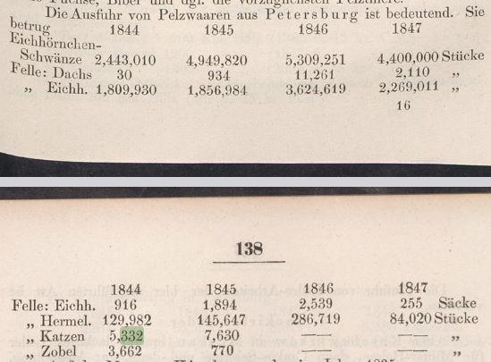
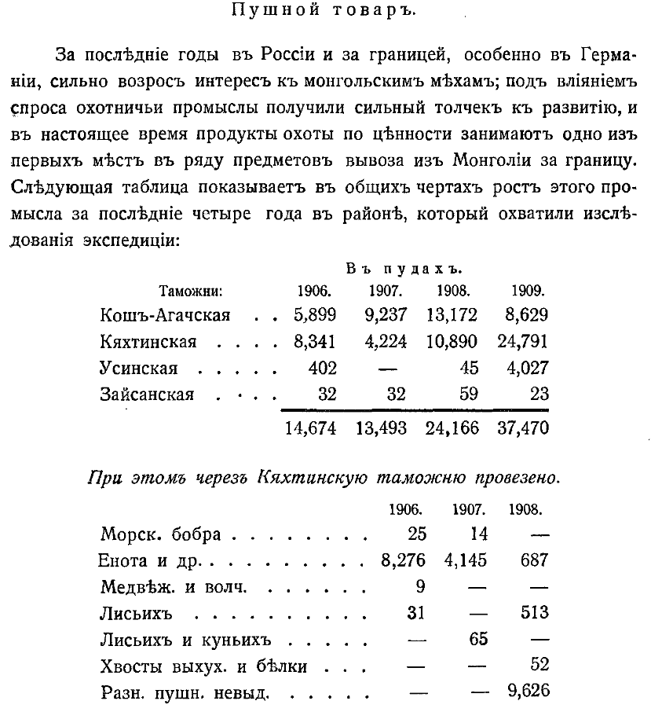
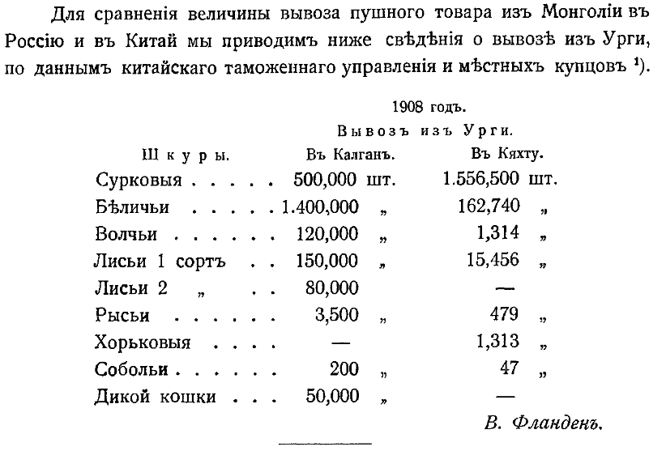

## Введение

В своей книге 1919 года Пастбища монголов в Халхе (Weideplätze der Mongolen im Reiche der Chalcha) ([книга на немецком](/notes/consten-wdm/)), Герман Костен приводит статистику экспорт шкур диких животных из Монголии через Кяхту в Российскую Империю. В ней присутствует загадочный Gynott.

Что же это такое? Каких шкур так много экспортировалось через Кяхту? Енот? Енотовидная собака? Манул?

> Consten, Hermann. Weideplätze der Mongolen im Reiche der Chalcha. Bd. 1. Berlin: Dietrich Reimer (Ernst Vohsen), 1919.

## Исходная формулировка

Außerdem gingen über Kiachta:

|                                      | 1906  | 1907  | 1908  |
|--------------------------------------|-------|-------|-------|
|                                      | Stück | Stück | Stück |
| Seebiber                             | 25    | 14    | ---   |
| Gynott                               | 8.276 | 4.145 | 687   |
| Bär und Wolf                         | 9     | ---   | ---   |
| Fuchs                                | 31    | ---   | 513   |
| Luchs und Marder                     | ---   | 65    | ---   |
| Schwänze von Jacks und Eichhörnchen  | ---   |       | 52    |
| Verschiedene Sorten                  | ---   | ---   | 9.626 |

Перевод:

Кроме того, через Кяхту вывозилось:

|                                      | 1906  | 1907  | 1908  |
|--------------------------------------|------:|------:|------:|
|                                      | штук  | штук  | штук  |
| Морской бобр (калан)                 |    25 |    14 |   --- |
| Генотт (кошачьи шкуры)               | 8 276 | 4 145 |   687 |
| Медведь и волк                       |     9 |   --- |   --- |
| Лисица                               |    31 |   --- |   513 |
| Рысь и куница                        |   --- |    65 |   --- |
| Хвосты яков и белок                  |   --- |       |    52 |
| Разные сорта                         |   --- |   --- | 9 626 |

## Gynott

Gynott не является обычным немецким названием животного. В таблице рядом стоят Seebiber, Bär und Wolf, Fuchs, Luchs und Marder, то есть речь идет о категориях пушнины.

Прямого перевода с немецкого слово не имеет и по всей видимости является искаженным словом на русском.

## Енот?

Исходно енот (*Procyon lotor*) из Северной и Центральной Америки интродуцирован в ряде стран Европы и Азии: в России, Азербайджане, Грузии, Узбекистане и Японии, — но в Монголии его нет. См. подтрвеждение в [Mammal Diversity Database](https://www.mammaldiversity.org/taxon/1005892/).

## Геннета?

Близким по форме словом является Genotte или Genette - [Генеты](https://ru.wikipedia.org/wiki/%D0%93%D0%B5%D0%BD%D0%B5%D1%82%D1%8B). Генеты обитают в тропических лесах Африки.

## Сибирская кошка?

[Merck’s Warenlexikon](https://www.retrobibliothek.de/retrobib/seite.html?id=45509&utm_source=chatgpt.com) XIX века упоминает, что Genetten в меховой торговле применялись не только к шкурам генетт, но и к чёрным сибирским кошачьим шкурам (schwarze sibirische Katzenfelle).

> Genettenfelle. Die Genette (Viverra genetta), eine Art Zibethtier, lebt in Südfrankreich, Spanien und in Afrika von der Berberei bis zum Kap. Die Farbe der Behaarung ist grau und safrangelb, mit braunen oder schwarzen Flecken getigert und einer dunklen Längslinie über den Rücken; Backen weiß gefleckt, Schwanz weiß mit 8-12 schwarzen Ringen. Die wegen ihrer Zeichnung sehr beliebten, sanften und glänzenden Felle ändern sowohl in Größe als Anordnung der Zeichnungen sehr ab, und es geht dies so weit, daß man noch gar nicht weiß, ob die Felle von, einer oder mehreren Tierarten kommen, denn die Länge derselben erstreckt sich von 15 Zoll bis fast 2 Fuß, Schwanz 10-18 Zoll. - Sonst wird der Name Genetten oder Genotten im Handel auch unrichtig gebraucht in Anwendung auf **schwarze sibirische Katzenfelle**. - Zollfrei.

Перевод:

> Шкурки генетт. Генетта (Viverra genetta) — разновидность циветтовых животных, обитающая на юге Франции, в Испании и в Африке, от Берберии до мыса Доброй Надежды. Окраска меха серая и шафранно-жёлтая, с коричневыми или чёрными пятнами, образующими тигровый рисунок, и тёмной продольной полосой вдоль спины. На щеках белые пятна, хвост белый, с 8–12 чёрными кольцами. Эти мягкие и блестящие шкурки, пользующиеся большой популярностью благодаря своему рисунку, весьма разнообразны как по размеру, так и по расположению пятен. Различия настолько велики, что до сих пор неизвестно, принадлежат ли шкурки одному или нескольким видам животных, поскольку их длина колеблется от 15 дюймов до почти 2 футов, а длина хвоста — от 10 до 18 дюймов. Кроме того, в торговле название «генетты» или «генотты» (Genetten или Genotten) ошибочно употребляется также для обозначения шкурок **чёрных сибирских кошек**. Беспошлинно.

Можно предположить, что сибирская кошка = манул.

## Экспорт кошек из России

Загадочные кошки в середине 19 века активно обменивались в Кяхте на чай.

Согласно отчёту о промышленной выставке Российской империи в Санкт-Петербурге в 1849 году, представленном Венской торговой палате её делегатами Людвигом Дамбёком и Якобом Маннером в 1844 из Санкт-Петербурга было вывезено 5332 шт., а в 1845 - 7630 шкур "кошек" (katzen). Стр. 137-138. [PDF отчёта на e-rara](https://www.e-rara.ch/download/pdf/22436884.pdf).

> Damböck L., Manner J., 1849. Bericht über die Gewerbe-Ausstellung des Russischen Reichs zu St. Petersburg im Jahre 1849. Wien: Druck von Carl Gerold & Sohn, 224 S., LXXII S. Anhang.

> Die Ausfuhr von Pelzwaaren aus Petersburg ist bedeutend. Sie betrug
>
> Вывоз пушных товаров из Санкт-Петербурга весьма значителен. Он составил…

На страницах VI-IX:

> Der Handel zwischen Russland und China.
>
> ...
>
> Der Handel zwischen Russland und China geschieht in Kiachta, Gränzstadt von Russland.
>
> ...
>
> Russische Producte und Fabrikate, gegen welche Thee getauscht wird...
>
> ...
>
> Katzenfelle: von diesen werden einige hundert Tausend Stücke abgesetzt. Die beliebtesten sind die schwarzen Felle; von grauer, weisser und gelber Sorte dürfen nur wenige Stücke sein ; der Preis ist 90 bis 170 Kop . pr . Stück . — Es sind in Eusslaud zu diesem Behufe Menagerien von Katzen errichtet.

Перевод:

> Торговля между Россией и Китаем.
>
> ...
>
> Торговля между Россией и Китаем происходит в Кяхте, пограничном городе России.
>
> ...
>
> Русские продукты и фабричные изделия, на которые обменивается чай.
>
> ...
>
> Кошачьи шкурки. Их сбывается по нескольку сотен тысяч штук. Наибольшим спросом пользуются чёрные шкурки; серые, белые и жёлтые встречаются в продаже лишь в небольшом количестве. Цена составляет от 90 до 170 копеек за штуку. Для этой цели в России даже устроены специальные питомники для разведения кошек.

Однако это направление обратно тому, о котором писал Констен. Из России в Монголию и Китай, а не наоборот.

## Экспорт из Монголии

Свою таблицу Констен полностью скопировал у В. Ц. Фландена, «Вывоз сырья из Монголии», в сборнике Московская торговая экспедиция в Монголию (М., 1912), страница 325. [PDF источника](https://legendtour.ru/mongolia/history/m_t_e_1912_14_flanden.pdf?utm_source=chatgpt.com).

> Фланден, В. Ц. Вывоз сырья из Монголии // Московская торговая экспедиция в Монголию. — М.: Типография П. П. Рябушинского, 1912. — С. 314–327.

Полное издание:

> Московская торговая экспедиция в Монголию. — Москва: Типография П. П. Рябушинского, 1912. — [4], 353 с., 36 л. ил., карт.

Что касается экспорта именно манула, то Фланден также приводит цифры экспорта в Китай, но не в Россию:

1) "В. Ф., П. и Торговли", №26, стр. 580. 1909 г. (Вестник финансов, промышленности и торговли)

## Енотовидная собака

Исходя из аргументов выше остается сделать вывод, что Gynott это Енотовидная собака (*Nyctereutes procyonoides*). [Mammal Diversity Database](https://www.mammaldiversity.org/taxon/1005961/?utm_source=chatgpt.com) прямо включает Монголию в её распространение.

Однако, обзор млекопитающих Монголии сообщает, что Банников в 1954 году ещё не отмечал енотовидную собаку в Монголии, а первые достоверные находки в МНР относятся к 1960-м годам. Источник: [Mallon, 2008. The mammals of the Mongolian People's Republic](https://www.researchgate.net/publication/230043258_The_mammals_of_the_Mongolian_People's_Republic).

> This species was not recorded by Bannikov (1954); according to Tsevegmid & Dashdorj (1974), it was first noted in the MPR during the 1960s at Buir Nuur on the eastern border. It has expanded its range since then, and it is now known from several places in the east (Hingan mountains, Halhyn Gol, Uldz and Onon valleys) (map, Fig. 61). Stubbe & Chotolchu (1968) listed N. p. ussuriensis Matschie 1907, included in the nominate form by Corbet (1978).

Возможно добывались шкуры не на территории Монголии, а в Манчжурии и Китае, откуда уже вывозили далее.  

## Итого

1/. Констен скопировал статистику у В. Ц. Фландена.
2/. Основная версия: Gynott -> Енот -> Енотовидная собака. Причем категория у Фландена называется "Енот и др.", т.е. кроме ЕС могла включать и что-то еще.
3/. Манула в Россию согласно официальной статистике - не вывозили, зато в огромных количествах (50000 шкур) вывозили в Китай.
4/. Кошачьи шкуры наоборот, вывозили из России в направлении Китая и меняли их на чай в Кяхте.

## Вопросы?

Возникли вопросы, комментарии или есть полезная информация по теме заметки?

[Пишите в комментарии](https://t.me/answer42geo/134) или [лично](https://m-d.me/about/).
