## Введение

30 (31) Day Challenge это тип акции когда целый месяц каждый день есть новая тема и надо что-нибудь сделать. Участвовал в подобной акции 30DayMapChallenge, когда каждый день делают карты. Но выдержал только пару дней, поскольку творить каждый день оказалось для меня очень сложным.

Оказалось, что в OpenStreetMap тоже проходит такая акция и она зашла неожиданно хорошо. В OSM я участвую с 2008 года и основные вещи знаю, поэтому в этот раз оказалось проще и интереснее. Изучил много новых для себя инструментов и сервисов, узнал всякие полезные мелочи и нанес пользы на всех континентах.

Основная ссылка: <https://wiki.openstreetmap.org/wiki/31_Day_OSM_Challenge>

Мероприятие проходило с 2026-10-01 по 2026-10-31.

В этой заметке собраны микрорепорты, на память. Ссылки на правки не все, только основные.

## Day 1 Tree or woods

> Add or improve a natural=tree, natural=tree_row, natural=wood, or landuse=forest feature

> Добавьте или улучшите объект с тегом natural=tree, natural=tree_row, natural=wood или landuse=forest.

Этот день я пропустил, просто не знал о мероприятии. Хорошее начало! :)

## Day 2 Africa

> Add or improve any object in Africa. For example, map a missing road, stream, or building in Cameroon, Cape Verde, or the Comoros

> Добавьте или улучшите любой объект в Африке.

Никогда в таком сильно не участвовал, желаю попробовать в рамках саморазвития.

[Правки](https://www.openstreetmap.org/changeset/189870002#map=18/6.941876/19.253325)

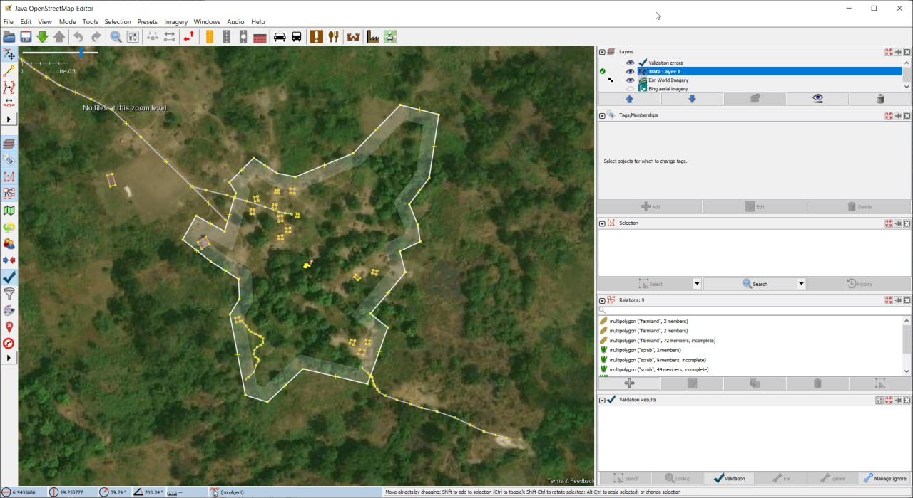

## Day 3 Fix a fixme

> Find any object with a fixme=* tag and fix it!

> Найти любой объект с `fixme=*` и соответственно пофиксить.

Fixme находятся через [оверпас-турбо](https://maps.mail.ru/osm/tools/overpass/?Q=%5Bout%3Ajson%5D%5Btimeout%3A25%5D%3B%0A(%20%20%0A%20%20nwr%5B%22fixme%22%5D(%7B%7Bbbox%7D%7D)%3B%0A)%3B%0Aout%20body%3B%0A%3E%3B%0Aout%20skel%20qt%3B), мэйловский сервак сильно лагает и надо раз пять запрос повторить, тогда запрос пройдет. Исправляется в JOSM.

Починил кофейню в саду Баумана.

[Правки](https://www.openstreetmap.org/changeset/190054089#map=19/55.769385/37.658977&layers=N)

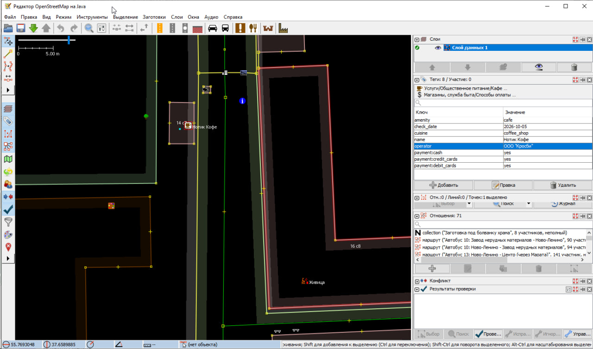

## Day 4 Opening hours

> Look for a POI with either a missing or outdated opening_hours=* tag and add or update it

> Найдите объект инфраструктуры (POI), у которого отсутствует или устарел тег opening_hours=*, и добавьте или обновите его.

Так как я лентяй и проспал несколько дней, то я использовал ту же точку второй раз.

EveryDoor - переключалка карта/снимок как-то неоднозначно работает, когда надо точку абы где найти и отредактировать.

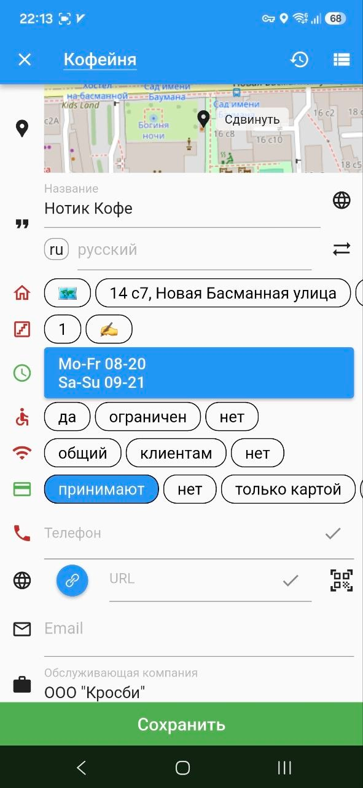

[Правки](https://www.openstreetmap.org/changeset/190054777)

## Day 5 MapRoulette

> Finish a task (or two!) on MapRoulette

> Выполните одно (или даже два!) задание на MapRoulette.

Это прикольная штука и заданий много. Я выбрал проставить паре музеев сайт и телефон. Заодно узнал что рядом с офисом есть музей фонда Николая II и виртуальная штука типа Tokyo Planets и Borderless на Арме, но по фото стремноватые, не пойду.

Рулетка прилегла и скриншот не сделать, может быть потом.

[Правки](https://www.openstreetmap.org/changeset/190036318#map=19/55.765556/37.670717&layers=N)

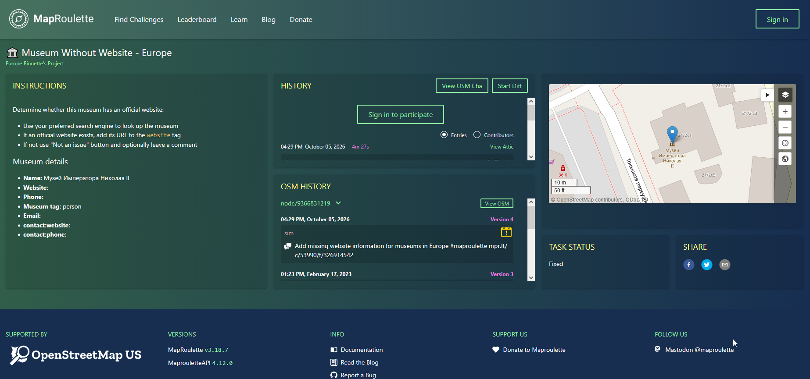

## Day 6 Points of interest

> Add a missing restaurant, café, bank, shop, office, or another POI

> Добавьте отсутствующий ресторан, кафе, банк, магазин, офис или другой объект (POI).

Добавить отсутствующий ресторан, кафе, банк, магазин, офис или другую POI.

EveryDoor - все-таки подглюкивает спутниковая подложка и как двигать местоположение POI сходу непонятно что-то.

[Правки](https://www.openstreetmap.org/changeset/190110456)

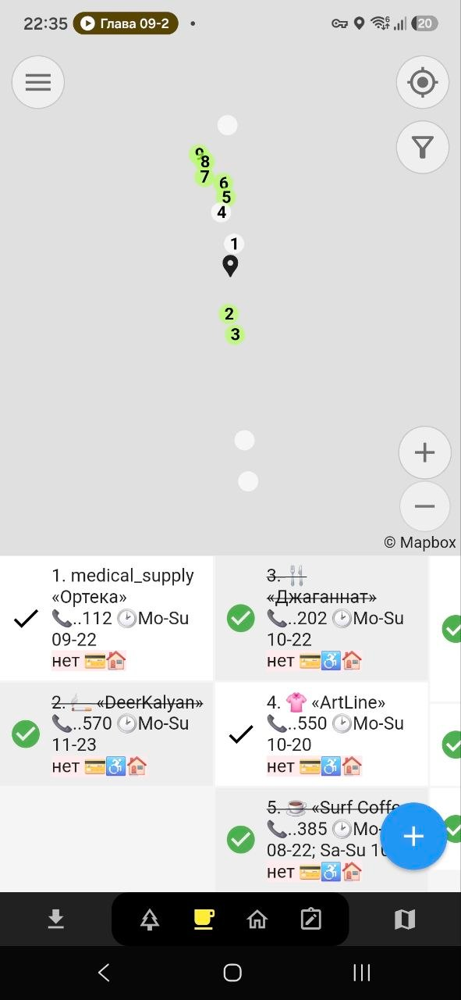

## Day 7 The Blue Marble

> The Earth’s surface is about 71% water. Map something related to bodies of water, such as rivers, beaches, or bays.

> Около 71% поверхности Земли покрыто водой. Нанесите на карту что-нибудь, связанное с водными объектами, например реки, пляжи или заливы.

Поредактировал ошибки типа Loop в WaterwayMap (<https://waterwaymap.org>), чаще всего это кусок реки который вдруг начинает течь обратно. Легко поправить через R в JOSM.

[Правки](https://www.openstreetmap.org/changeset/190187345)

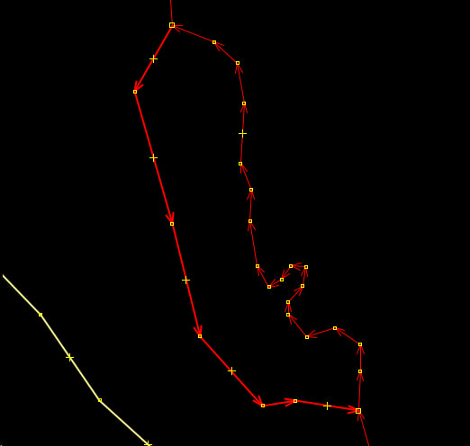

## Day 8 Wikimedia

> Add a missing wikipedia=*, wikidata=*, or wikimedia_commons=* tag

> Добавьте отсутствующий тег wikipedia=*, wikidata=* или wikimedia_commons=*.

Не так просто что-то отсутствующее найти, но нашел и добавил [Курменты](https://ru.wikipedia.org/wiki/%D0%9A%D1%8E%D1%80%D0%BC%D0%B5%D0%BD%D1%82%D1%8E) на берегу Иссык-куля. Это интересный поселок, чуть дальше на сервер в горы говорят есть клад времен ВОВ, все его ищут.

[Правки](https://www.openstreetmap.org/changeset/190214123)

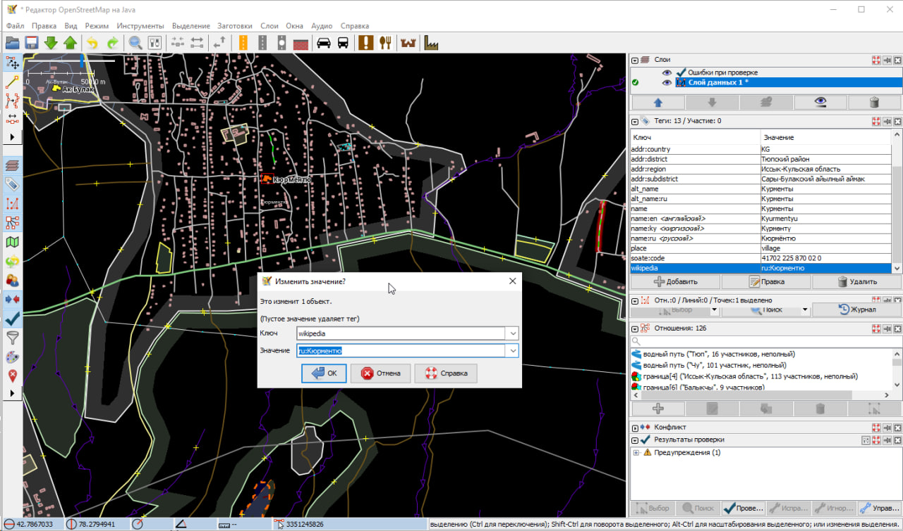

## Day 9 Europe

> Add or improve any object in Europe. For example, improve an existing building or add a missing landuse in Sweden, Slovenia, or Switzerland.

> Добавьте или улучшите любой объект в Европе. Например, уточните существующее здание или добавьте отсутствующий участок землепользования (landuse) в Швеции, Словении или Швейцарии.

Просто домики в Европах. Ткнул наугад куда-то сначала в Андорре, там сложно найти незакартированное, в Португалии оказалось попроще.

[Правки](https://www.openstreetmap.org/changeset/190268910)

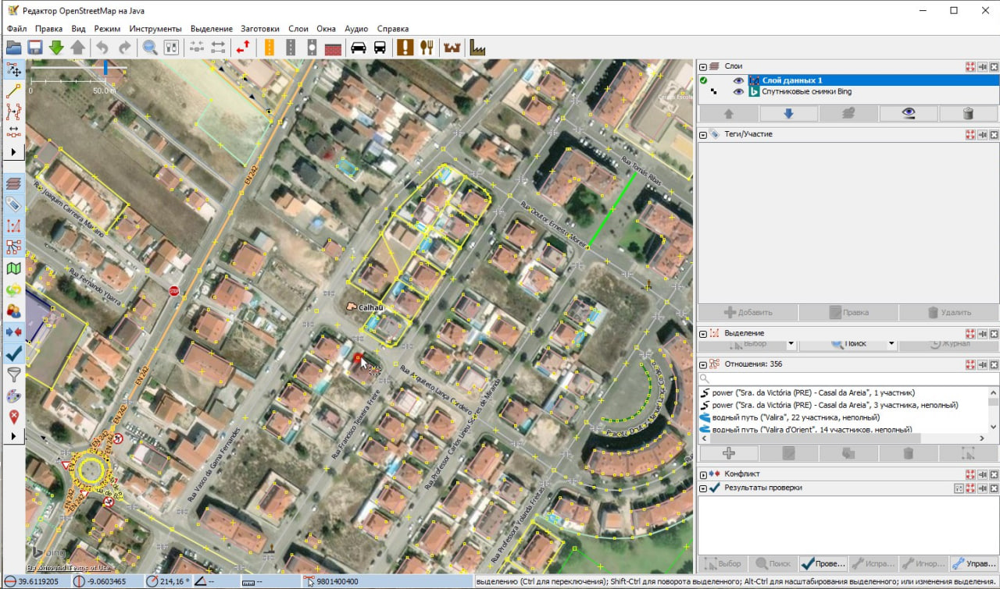

## Day 10 The island life

> Map something on an island!

> Нанесите на карту что-нибудь на острове!

Поулучшал береговую линию островного государства [Ниуэ](https://ru.wikipedia.org/wiki/%D0%9D%D0%B8%D1%83%D1%8D).
На неделю отстал, теперь нужно нагонять.

[Правки](https://www.openstreetmap.org/changeset/190621525)

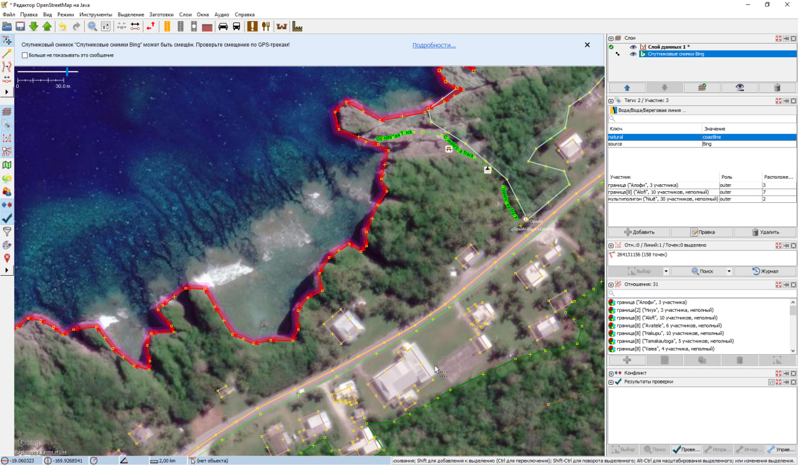

## Day 11 Street-level photos

> Update OSM using information you can see in Panoramax, Mapillary, KartaView, or another suitable Street-level imagery service

> Обновите OSM, используя информацию с уличных панорам Panoramax, Mapillary, KartaView или другого подходящего сервиса уличных снимков.

Панорамы. Глянул чего нового в панорамах, потыкался в новый для меня Panoramax [где-то в пгт Знаменка](https://explore.panoramax.fr/en/index?focus=pic&map=17/52.89327/35.974215&pic=fe144bce-2621-4339-80b8-dc44f643362c&seq=bc5acceb-bdae-4a81-821e-52449583b154&speed=250&theme=default&users=default&xyz=210.80/7.52/71) под Орлом.
Замапил ПВЗ, фикспрайс и ларек с шаурмой) Кривовато, но работает.

[Правки](https://www.openstreetmap.org/changeset/190622161)

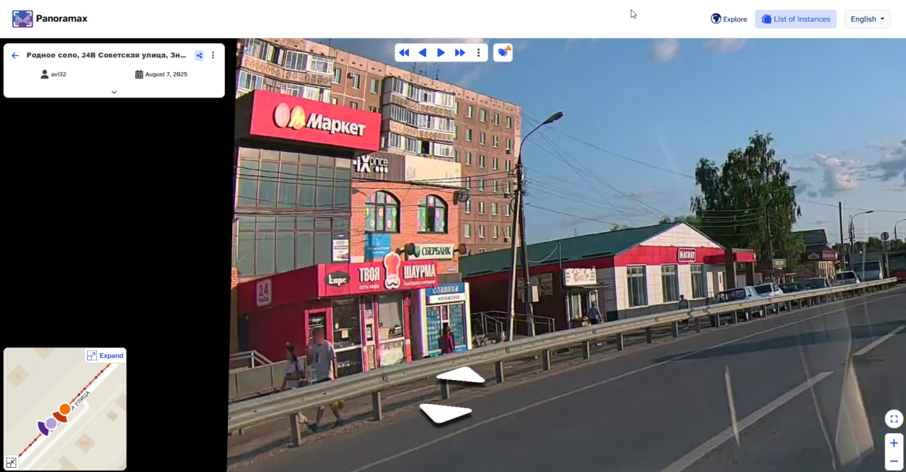

## Day 12 Railfans unite!

> Map some railway infrastructure! You can update a restaurant in a train station or improve details of a railway=* object

> Нанесите на карту железнодорожную инфраструктуру! Например, обновите информацию о ресторане на вокзале или уточните характеристики объекта с тегом railway=*.

Очень сложно, но нарисовал навес в Раздорах по панорамам вездесущего Артема. Панорамы аж от 2016 г., но вряд ли там что-то поменялось.

[Правки](https://www.openstreetmap.org/changeset/190638758)

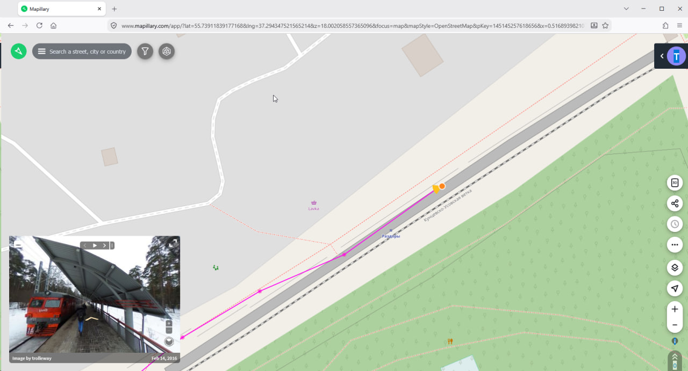

## Day 13 Public art

> Improve or add a piece of public art, whether it be a mural or sculpture

> Добавьте или улучшите объект уличного искусства, например мурал или скульптуру.

Я думал сложно будет, но оказалось просто и злободневно.

Помните историю с [закрашенным муралом Земфиры](https://meduza.io/news/2026/10/04/v-ufe-posle-zhaloby-provlastnyh-aktivistov-zakrasili-mural-s-zemfiroy-na-fasade-doma-gde-ona-zhila-v-detstve), оказалось его нет в OSM. Теперь вот есть.

[Правки](https://www.openstreetmap.org/changeset/190646080)

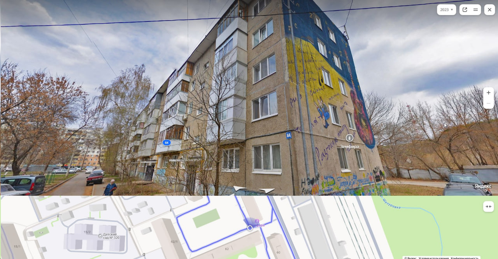

## Day 14 On the ground rules!

> Map something you have seen with your own eyes or heard with your own ears!

> Нанесите на карту что-нибудь, что вы видели своими глазами или слышали своими ушами!

Погулял с собакой, тропинки, скамейки, мусорки. Собственными глазами.

[Правки](https://www.openstreetmap.org/changeset/190684538)

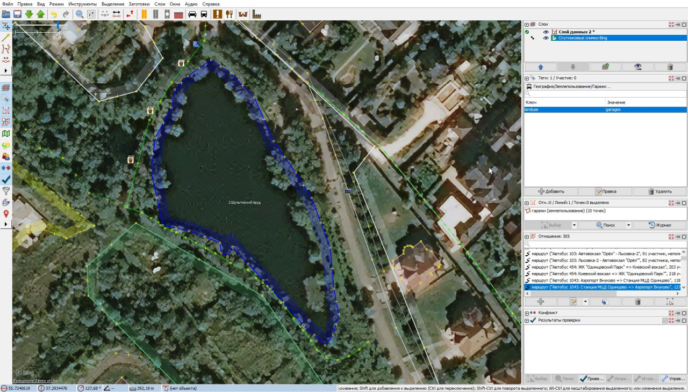

## Day 15 Go touch grass

> Map something related to grasslands like landuse=grass, landuse=meadow, natural=grassland, or natural=scrub

> Нанесите на карту что-нибудь, связанное с травянистой растительностью, например объекты с тегами landuse=grass, landuse=meadow, natural=grassland или natural=scrub.

Просто лужайки.

[Правки](https://www.openstreetmap.org/changeset/190685172)

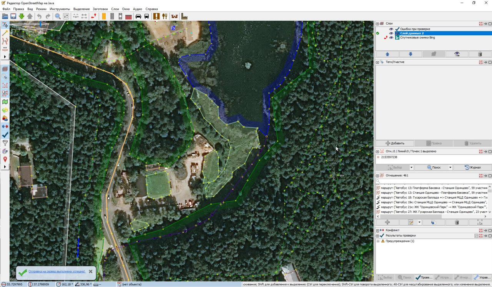

## Day 16 Americas

> Add or improve any object in the Americas. For example, map a missing sports pitch with leisure=pitch and sport=* in Cuba, Costa Rica, or Canada

> Добавьте или улучшите любой объект в Северной или Южной Америке. Например, нанесите отсутствующую спортивную площадку с тегами leisure=pitch и sport=* на Кубе, в Коста-Рике или Канаде.

Домики и дорожки в селении El Paradero на Кубе (или в Кубе? 🤔)

[Правки](https://www.openstreetmap.org/changeset/190756174)

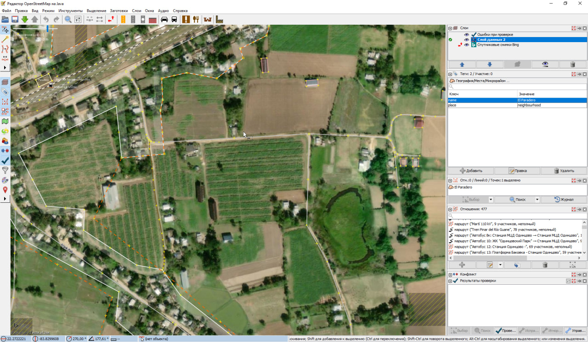

## Day 17 Universal healthcare

> Map something related to healthcare such as hospitals, pharmacies, dentists, or clinics

> Нанесите на карту что-нибудь, связанное со здравоохранением, например больницы, аптеки, стоматологические кабинеты или клиники.

Ничего особенного, поликлиника, обновил немножко. Пост для отчетности)

Правки

## Day 18 Resolve a note

> Look for an open note on the map and resolve it

> Найдите открытое замечание (note) на карте и устраните указанную в нём проблему.

Ох, вот тут я словил ностальгию. Искал-смотрел эти [Notes](https://www.openstreetmap.org/search?query=%D0%A3%D0%BB%D0%B0%D0%BD-%D0%AD%D1%80%D0%B3%D0%B5&zoom=12&minlon=45.157928466796875&minlat=46.018422915761974&maxlon=45.79273223876954&maxlat=46.23542774852908#map=9/46.102/45.773&layers=N), не так их и много, поискал в местах где знаю, потом двинулся в Астрахань, потом подумал дай загляну в Калмыкию, где провел в 2007-2009 немало полевых дней. Случайно наткнулся на [странную заметку](https://www.openstreetmap.org/note/4213476#map=12/46.1270/45.4753&layers=N). Центр диких животных Республики Калмыкия кто-то поставил прямо в пос. Яшкуль. Но я то знаю что он находится совершенно не там, поскольку сам там был несколько раз.

Юрий Нимеевич Арылов то сам, то с попутками, то еще как-то довозил меня до питомника, там мы тестировали Аргосовские передатчики и даже выпускали несколько раз сайгаков из питомника на волю в районе заповедника Черные земли.

Но судя по тому что пишут в интернетах судьба питомника незавидна, [геокэшеры пишут](https://geocaching.su/cache/10755/) что загоны пустые и никого нет:

> Заехали по дороге в Элисту 19.08.16г. Перед поездкой не читала комментарии. А питомника уже давно нет((( Остались одни лишь пустые загоны( Жаль, очень жаль!!!

Фото хороших дней можно посмотреть [тут](https://bronetractor.livejournal.com/10334.html).

Заметку я закрыл и задание выполнил, но грустно.

Центр диких животных Республики Калмыкия
<https://www.openstreetmap.org/node/1943719641>

Правки!

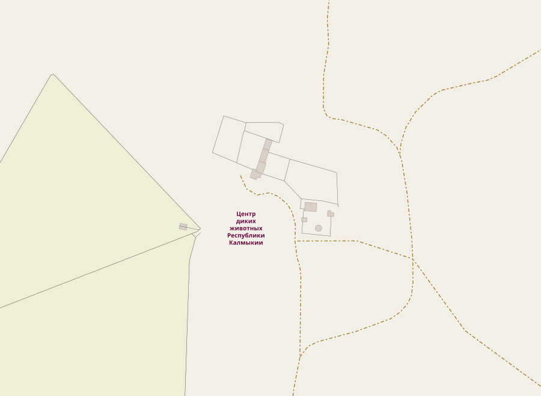

## Day 19 HOT Tasking Manager

> Contribute to humanitarian mapping by finishing a task in the HOT Tasking Manager

> Внесите вклад в гуманитарное картографирование, выполнив задание в HOT Tasking Manager.

Тут оказалось сложновато. Humanitarian OSM Team (HOT) помогает разным организациям решать гуманитарные проблемы, делит все на кусочки и раздает чтобы их картировали. Я взял кусок в Демократической Республике Конго посвященный недавней вспышке Эболы. Нужно было закартировать группы строений - заселенные территории для того чтобы дальше помогать логистике. Да, в Африке вообще нет никаких карт.

Но сам процесс сложный, задание схватить просто, а дальше надо очень внимательно все читать и не все понятно. Опять же, для этого конкретного надо было уметь редактировать мультиполигоны, хорошо что я когда-то это умел.

Короче, надеюсь, что ничего не напутал и выполнил задание правильно.

[Правки](https://www.openstreetmap.org/changeset/190802657)

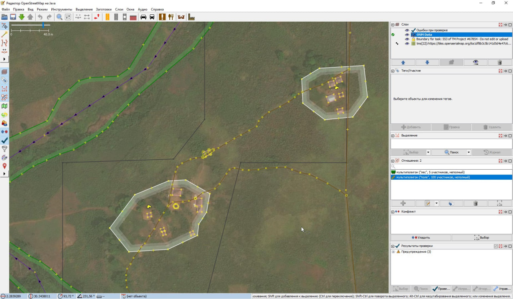

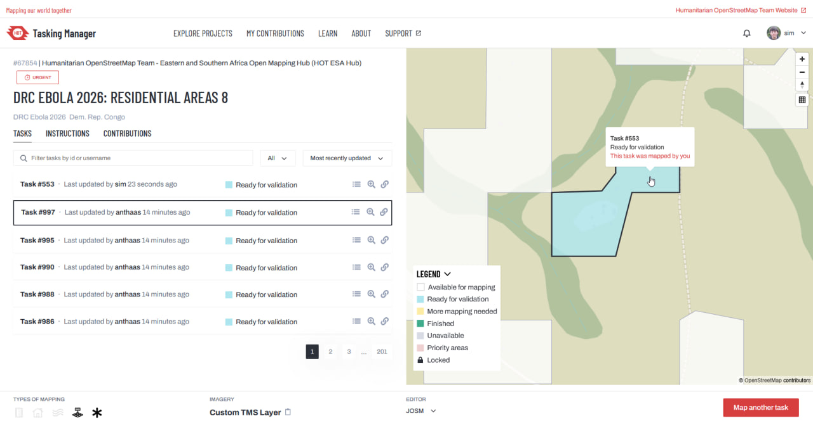

## Day 20 Benches

> Add or improve an amenity=bench. Bonus points if you can link it to OpenBenches with the openbenches:id=* tag

> Добавьте или улучшите скамейку с тегом amenity=bench. Дополнительные очки, если сможете связать её с OpenBenches с помощью тега openbenches:id=*.

Скамейки в Бауманском парке по Mappilary и "съемке от ESRI".

Оказывается есть целый проект про мемориальные скамейки - [OpenBenches](https://openbenches.org/), кажется приятное дело, но у нас не развито.

[Правки](https://www.openstreetmap.org/changeset/190803683)

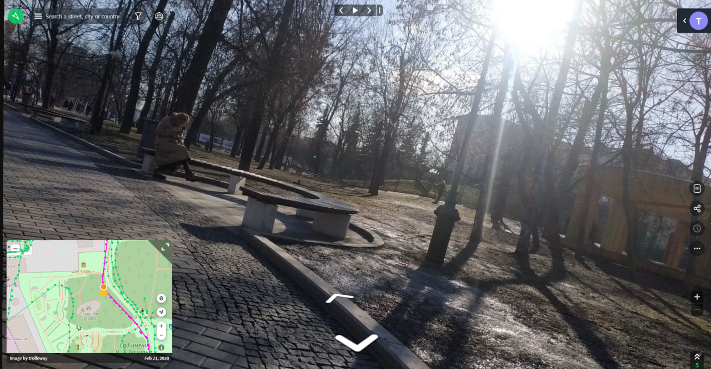

## Day 21 Velophiles unite!

> Improve something related to cycling infrastructure such as adding a missing highway=cycleway, tagging bicycle=* access tags, or improve an amenity=bicycle_parking feature

> Улучшите что-нибудь, связанное с велосипедной инфраструктурой: добавьте отсутствующую велодорожку с тегом highway=cycleway, укажите правила доступа с помощью bicycle=* или уточните объект велопарковки с тегом amenity=bicycle_parking.

Микроулучшение велопарковки, которую осмеры предложили пометить как "плохая". Может на велике съездить покататься пока не заморозило 🤔

[Правки](https://www.openstreetmap.org/changeset/190825822)

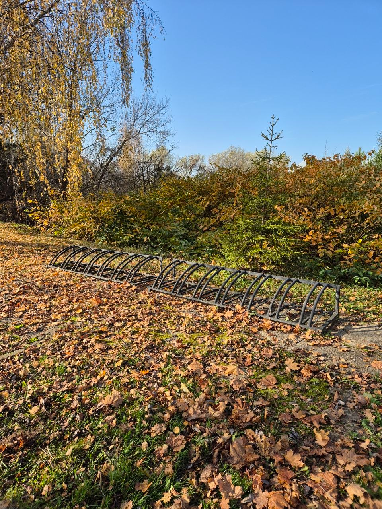

## Day 22 Going round in circles

> Map or improve something circular, such as roundabouts or a man_made=storage_tank

> Нанесите на карту или улучшите что-нибудь круглое, например перекрёсток с круговым движением или резервуар с тегом man_made=storage_tank.

Сказано-сделано --- станция аэрации. В JOSM для рисования кругов - рисуем линию и потом Shift+O.

[Правки](https://www.openstreetmap.org/changeset/190900027)

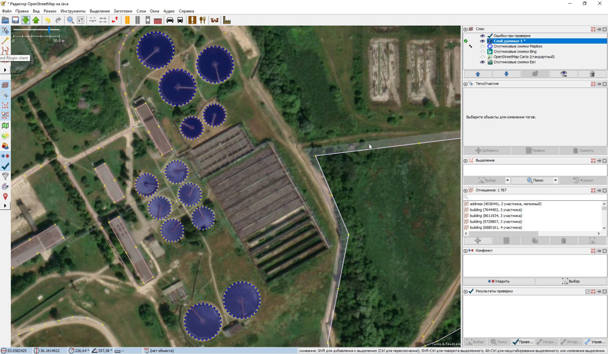

## Day 23 Oceania

> Add or improve any object in Oceania. For example, add a missing beach or road in Fiji, Guam, or Kiribati

> Добавьте или улучшите любой объект в Океании. Например, нанесите отсутствующий пляж или дорогу на Фиджи, Гуаме или Кирибати.

Поулучшал домики и дорожки на Кирибати, одной из немногих стран пересекающих 180 меридиан.

[Правки](https://www.openstreetmap.org/changeset/190940902)

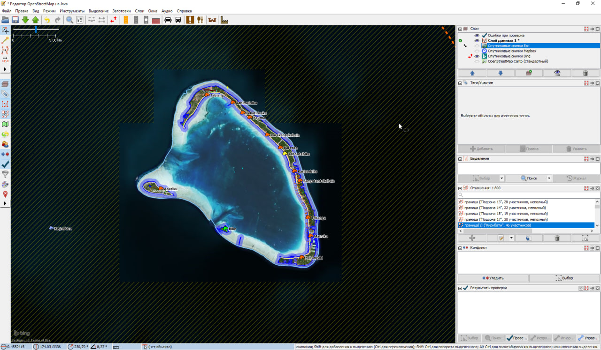

## Day 24 Go mobile!

> Use a mobile app such as Vespucci, StreetComplete, Go Map!!, or Every Door to improve OSM

> Используйте мобильное приложение, например Vespucci, StreetComplete, Go Map!! или Every Door, чтобы улучшить OSM.

После перерыва лет в 10 попробовал Vespucci. Давным давно он конечно шокировал, сейчас стало сильно лучше. Вполне интуитивно можно добавлять объекты и подсказки по проблемам - хорошая штука. Но функций в нем такое количество, что конечно много к чему все еще можно придраться.

[Правки](https://www.openstreetmap.org/changeset/190956584)

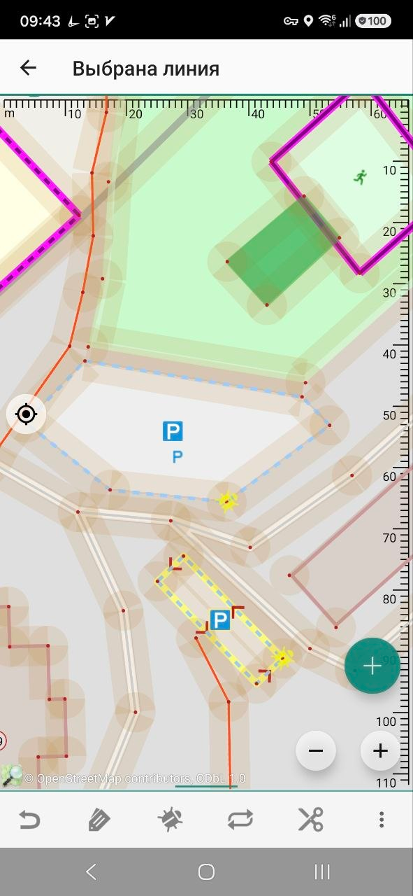

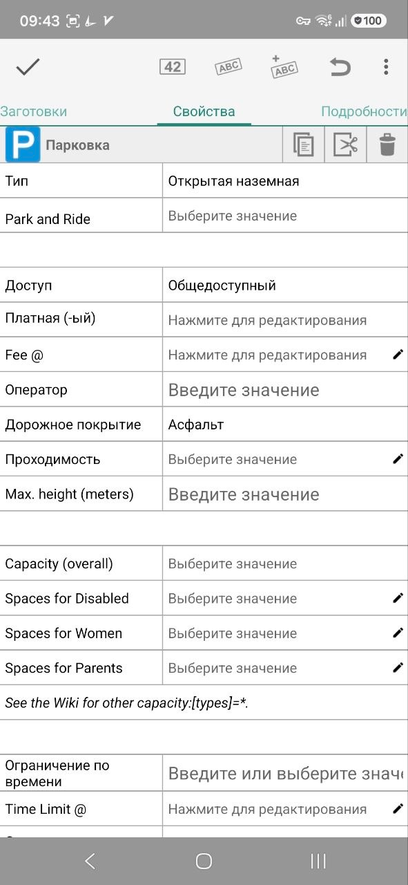

## Day 25 Osmose

> Browse for errors in Osmose and fix one

> Найдите ошибки с помощью Osmose и исправьте хотя бы одну из них.

Люблю валидаторы и осмеры их очень любят. Если скучно придумывать, сидишь и исправляешь ошибки по списку.

[Правки](https://www.openstreetmap.org/changeset/191005687)

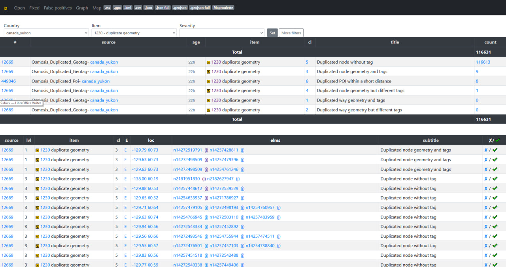

## Day 26 Be a good neighbour

> Improve a location in a neighbouring country

> Улучшите картографические данные в соседней стране.

Взял один из погранпереходов (<https://m-d.me/notes/mn-cn-border/>) между Монголией и Китаем (Хавирга-Ар хашаат 阿日哈沙特) и порисовал там разного. В OSM населенный пункт на стороне Китая почему-то называется Эжихашатэ, откуда появилась такая транскрипция - непонятно, ничего не гуглится такого, кроме рандомных сайтов про погоду.

PS: заменил Эжихашатэ на Архашаат в итоге.

[Правки](https://www.openstreetmap.org/changeset/191069408)

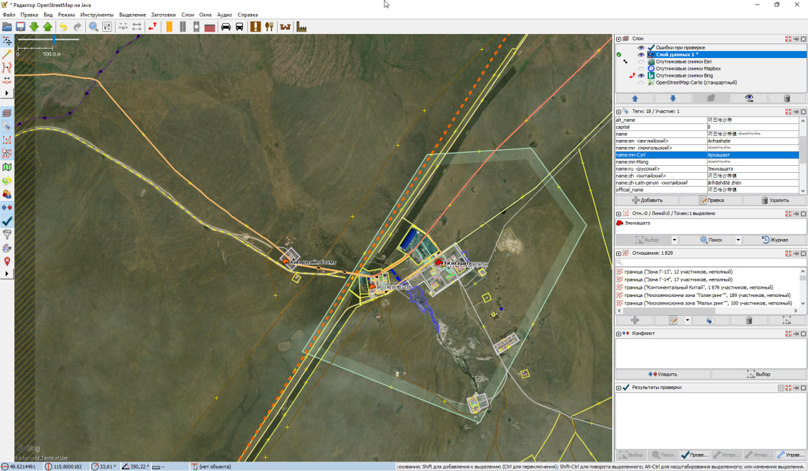

## Day 27 Avgeeks unite!

> Map in an airport! You can update a restaurant, add a missing aeroway=gate, or improve contact details for airline offices

> Займитесь картографированием аэропорта! Например, обновите информацию о ресторане, добавьте отсутствующий выход на посадку с тегом aeroway=gate или уточните контактные данные офисов авиакомпаний.

Улучшил закругления лужаек в странном аэропорту Chicago Midway в котором раз приземлился и не понял куда попал. Аэропорт находится чуть ли не в центре города, а надо мне было не в Чикаго. А еще он почти ровненький такой квадрат.

[Правки](https://www.openstreetmap.org/changeset/191112671)

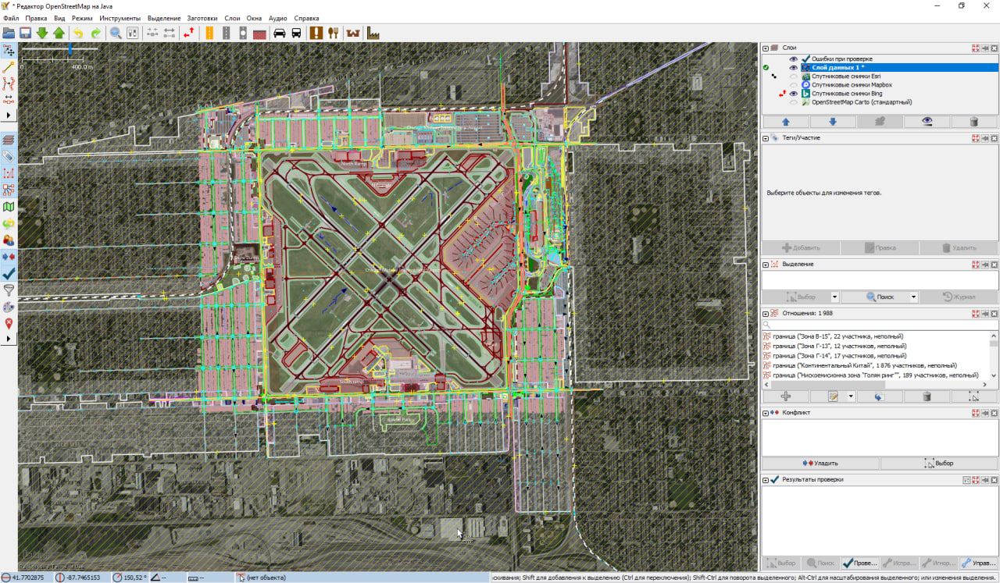

## Day 28 Barriers

> Map walls, fences, gates, or another type of barrier=*

> Нанесите на карту стены, заборы, ворота или другие виды препятствий с тегом barrier=*.

Что сказать - 😡😡😡

[Правки](https://www.openstreetmap.org/changeset/191159439)

## Day 29 Asia

> Add or improve any object in Asia. For example, add a missing landuse, footway, or POI in Mongolia, the Maldives, or Malaysia

> Добавьте или улучшите любой объект в Азии. Например, нанесите отсутствующий участок землепользования (landuse), пешеходную дорожку или объект инфраструктуры (POI) в Монголии, на Мальдивах или в Малайзии.

Порисовал окрестности Эрдэни-цзу, почему-то пришел в голову.

В Эрдэни-цзу хан Абатай притащил половину Будды, вторую от отрубил на перевале Бурхан-будай. Вот такая [история](https://m-d.me/notes/erdeni-tsu/).

[Правки](https://www.openstreetmap.org/changeset/191183983)

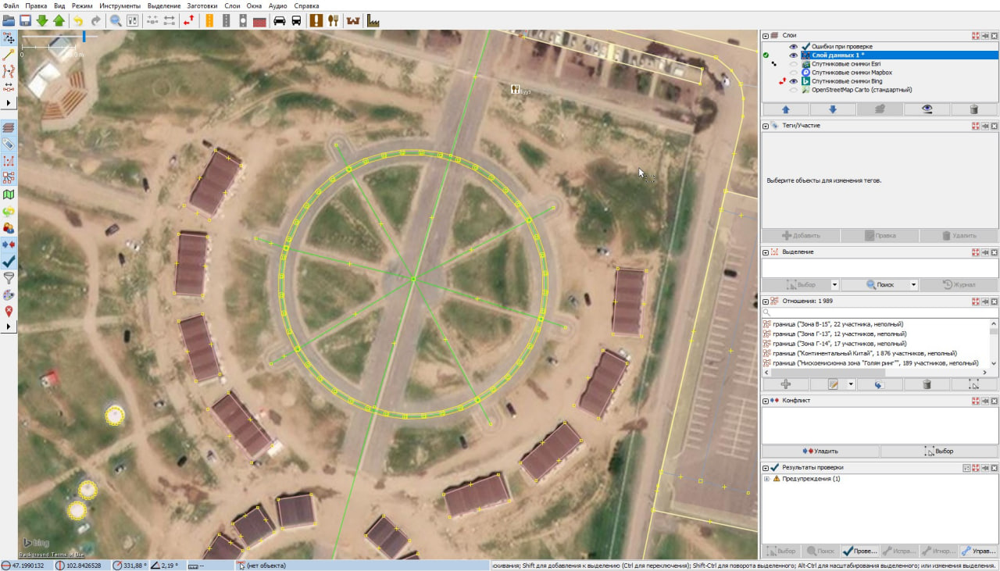

## Day 30 Bridges and tunnels

> Map something related to bridges or tunnels

> Нанесите на карту что-нибудь, связанное с мостами или тоннелями.

Куньлуньский тоннель - один из тоннелей на Цинхай-Тибетской железной дороге, Расположен на [историческом маршруте](https://m-d.me/notes/tsinhai-railroad-tunnels/) Цыбикова из Урги в Лхасу. Порисовал окрестности тоннеля и добавил его кириллическое название.

Завтра последний денек этого мероприятия и вернемся к другим аспектам востоковедения)

<https://m-d.me/notes/tsinhai-railroad-tunnels/>

[Правки](https://www.openstreetmap.org/changeset/191266717)

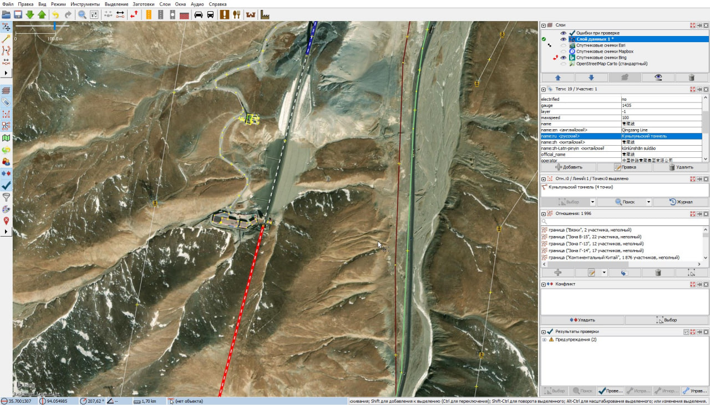

## Day 31 My precious!

> Map anything you like!

> Нанесите на карту всё, что вам нравится!

Блуждания в последний день мероприятия привели в Лавран. Самый большой монастырь оказался совершенно незакартирован. Нарисовал там один "квартал". Пришлось вспомнить как делать мультиполигоны.

На этом этот спринт закончен. ура, я справился)

[Правки](https://www.openstreetmap.org/changeset/191266717)

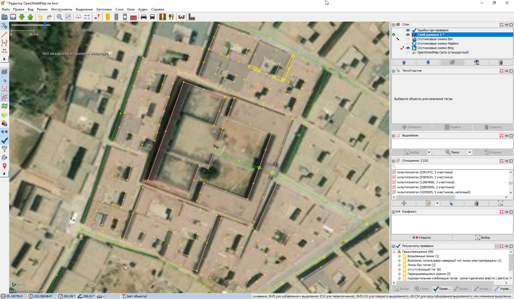

## Вопросы?

Возникли вопросы, комментарии или есть полезная информация по теме заметки?

[Пишите в комментарии](https://t.me/answer42geo/294) или [лично](https://m-d.me/about/).
